# ML & Deep Learning Foundations - Perguntas de Entrevista

> 🇧🇷 Tradução em português do Brasil. Versão original em inglês: [questions.md](questions.md).

55 perguntas: 15 básicas, 23 intermediárias, 17 avançadas.

> **Sobre os diagramas: desenhar é opcional.** Algumas respostas incluem um pequeno esboço que você
> poderia reproduzir em um quadro branco ou em um documento compartilhado. Você nunca precisa desenhar nada para ir bem,
> e uma resposta falada clara se sustenta sozinha. Mas em perguntas de arquitetura, pipeline e system design,
> esboçar enquanto fala mantém o entrevistador acompanhando você e mostra que você sabe estruturar
> um problema. Considere-os um bônus, não lição de casa.

## Básico

### 1. Explique o tradeoff bias-variance. Como você sabe qual dos dois está prejudicando seu modelo?

<details><summary><b>Resposta</b></summary>

O erro esperado de teste se decompõe em três partes: **bias²** (erro de um modelo simples demais para representar a função verdadeira), **variance** (erro de sensibilidade à amostra de treino específica - ajustar ruído) e ruído irredutível. Um modelo linear em um problema não linear tem bias alto; uma deep net treinada com 500 exemplos tem variance alta.

Você diagnostica pelo **gap train/val**, não pela teoria:

- Erro de treino alto ≈ erro de val alto → bias alto (underfitting). Correções: modelo maior/mais rico, mais features, treinar por mais tempo, reduzir a regularização.
- Erro de treino baixo, erro de val muito maior → variance alta (overfitting). Correções: mais dados, regularização (weight decay, dropout, early stopping), augmentation, modelo menor como último recurso.

Learning curves afinam o diagnóstico: se o erro de val ainda está caindo conforme você adiciona dados, mais dados ajudam (problema de variance); se as curvas de train e val estabilizaram juntas em um nível ruim, mais dados não ajudarão (problema de bias).

Um bom candidato acrescenta a ressalva moderna: a clássica curva em U "mais capacidade → mais overfitting" se desfaz para redes fortemente superparametrizadas. **Double descent** (Belkin et al.; Nakkiran et al.) mostra que o erro de teste pode *voltar a diminuir* além do limiar de interpolação - o que é consistente com a realidade empírica de que escalar transformers melhora a generalização. Portanto "seu modelo é grande demais" raramente é a primeira hipótese certa em deep learning; qualidade dos dados, leakage e a receita de treinamento geralmente importam mais.

**Vale desenhar.** Ele transforma o tradeoff em um procedimento de diagnóstico, que é o que o entrevistador realmente está pedindo.

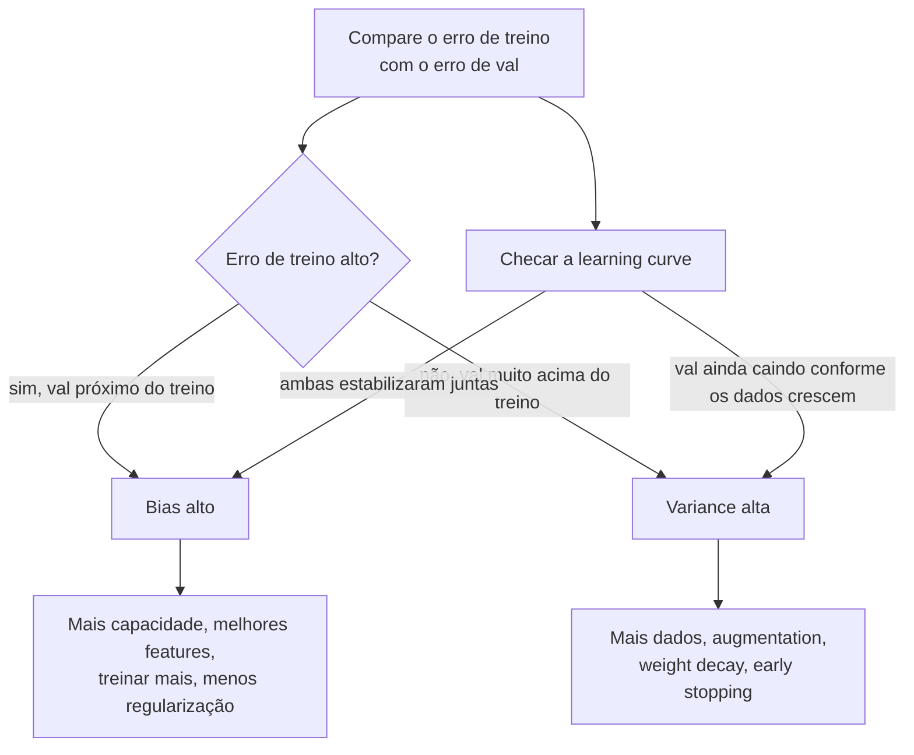

**Follow-ups:** Sua val loss é muito menor que a train loss - o que pode causar isso? (Dropout ativo apenas em tempo de treino, augmentation só no treino, distribuição de val mais fácil.) Como a regularização move você ao longo do tradeoff? Onde o double descent deixa o quadro clássico?

</details>

### 2. Como você detecta overfitting e underfitting na prática, e o que faz em cada caso?

<details><summary><b>Resposta</b></summary>

Observe a loss de treino e de validação ao longo do treinamento. **Underfitting**: ambas as losses estão altas e próximas, ou a train loss ainda está caindo de forma constante quando você para - o modelo não extraiu o sinal disponível. **Overfitting**: a train loss continua caindo enquanto a val loss estabiliza e depois sobe - o modelo está memorizando.

Para underfitting: aumente a capacidade (width/depth/params), melhore as features ou a representação do input, treine por mais tempo, aumente o learning rate se a otimização estiver estagnada, reduza a força da regularização.

Para overfitting, em ordem aproximada de preferência:
1. **Mais dados ou dados melhores** - quase sempre a correção de maior alavancagem.
2. **Data augmentation** - diversidade sintética barata.
3. **Regularização** - weight decay, dropout, label smoothing.
4. **Early stopping** - faça checkpoint pela val loss, mantenha o melhor.
5. Reduzir o tamanho do modelo - geralmente o último recurso em deep learning.

A receita de treinamento de Karpathy é o enquadramento prático que os entrevistadores gostam: primeiro *faça overfitting deliberado* de um batch pequeno até loss quase zero para provar que o modelo e o pipeline conseguem aprender, e depois regularize de volta em direção à generalização. Se você não consegue fazer overfitting em 100 exemplos, você tem um bug, não um problema de regularização.

Duas armadilhas que vale citar: (1) uma val loss suspeitamente *melhor* que o esperado frequentemente significa leakage, não brilhantismo; (2) em fine-tuning de LLMs, "overfitting" frequentemente aparece como regressões comportamentais (a loss no conjunto de SFT cai enquanto a capacidade geral se degrada - catastrophic forgetting), então você monitora evals de capacidade held-out, não apenas a loss de fine-tuning.

**Vale desenhar.** Desenhar o portão antes do ramo de regularização mostra que você separa bugs de problemas de generalização.


**Follow-ups:** Por que começar fazendo overfitting de um único batch? Sua SFT loss está diminuindo bem, mas os usuários dizem que o modelo piorou - o que aconteceu? Quando você aceitaria algum overfitting deliberadamente?

</details>

### 3. Compare a regularização L1 e L2. Por que L1 produz pesos esparsos?

<details><summary><b>Resposta</b></summary>

Ambas adicionam à loss uma penalidade sobre a magnitude dos pesos. **L2** adiciona λ‖w‖², encolhendo todos os pesos proporcionalmente em direção a zero, mas raramente *até* zero. **L1** adiciona λ‖w‖₁ e leva muitos pesos exatamente a zero, realizando feature selection implícita.

Por que a sparsity: o gradiente da penalidade L1 é um ±λ constante, independentemente do tamanho do peso, então ela continua empurrando pesos pequenos até zero, onde o subgradiente permite que eles fiquem; a força do L2 é proporcional a w, então enfraquece conforme os pesos encolhem e nunca termina o trabalho. Geometricamente, a bola L1 tem cantos sobre os eixos, e o contorno da loss tipicamente toca a região de restrição primeiro em um canto - onde algumas coordenadas são exatamente zero.

A visão Bayesiana é um bom diferenciador: L2 = estimação MAP com um **prior Gaussiano** nos pesos; L1 = MAP com um **prior de Laplace** (pico mais agudo em zero, caudas mais pesadas).

Na prática: L1 importa para modelos lineares e feature selection (lasso); deep learning usa quase exclusivamente **weight decay** no estilo L2. Uma sutileza que prepara uma pergunta posterior: com otimizadores adaptativos como o Adam, adicionar L2 à loss *não* é equivalente a weight decay - a penalidade é reescalada pelo termo adaptativo por parâmetro. Esse é exatamente o bug que o AdamW corrige ao desacoplar o decay da atualização do gradiente. Note também a prática comum: sem weight decay em biases ou ganhos de LayerNorm, já que são de baixa dimensionalidade e aplicar decay neles apenas distorce as ativações.

**Follow-ups:** O que é elastic net e quando você a usaria? Por que L2 na loss é diferente de weight decay sob o Adam? Por que excluir parâmetros de LayerNorm do weight decay?

</details>

### 4. Como o dropout funciona - e o que muda entre treinamento e inferência?

<details><summary><b>Resposta</b></summary>

Durante o treinamento, o dropout zera independentemente cada ativação com probabilidade p (comumente 0,1-0,5), forçando a rede a não depender de nenhuma unidade isolada e quebrando a co-adaptação. É frequentemente descrito como treinar um ensemble implícito de um número exponencial de subredes reduzidas que compartilham pesos.

A assimetria entre treino e inferência é a parte que os entrevistadores realmente sondam. Com **inverted dropout** (o que todo framework moderno implementa), as ativações que sobrevivem são escaladas por 1/(1−p) *em tempo de treino*, de modo que a magnitude esperada da ativação coincide entre treino e inferência - na inferência, o dropout é simplesmente desabilitado e nenhum reescalonamento é necessário. O bug clássico: esquecer o `model.eval()` no PyTorch, de modo que o dropout permanece ativo em produção e as predições ficam ruidosas e degradadas. (A mesma chamada também troca o BatchNorm para estatísticas running - dois bugs pelo preço de um.)

```python
mask = (torch.rand_like(x) > p).float()
x = x * mask / (1 - p)   # inverted dropout: reescala em tempo de treino
```

Onde é usado hoje: o Transformer original aplicava dropout à saída de cada sub-layer antes da soma residual e às somas de embeddings (p=0,1); implementações padrão também aplicam dropout aos attention weights. Mas o *pretraining* de LLMs em larga escala tipicamente usa dropout 0 - com um fluxo de dados massivo de uma única época há pouca pressão de memorização, e o dropout apenas desperdiça capacidade. Ele reaparece no fine-tuning, onde os datasets são pequenos: setups de LoRA comumente aplicam dropout ~0,05-0,1 aos inputs do adapter.

Variantes que vale citar se perguntarem: DropPath/stochastic depth (descartar ramos residuais inteiros, comum em vision transformers) e Monte Carlo dropout (manter o dropout ligado na inferência e amostrar repetidamente para uma estimativa grosseira de incerteza).

**Follow-ups:** Por que grandes runs de pretraining definem dropout como 0? O que o `model.eval()` muda além do dropout? Como você usaria MC dropout para obter estimativas de incerteza?

</details>

### 5. Explique os splits train/validation/test. Quando você usa cross-validation, e quando ela é uma má ideia?

<details><summary><b>Resposta</b></summary>

Três conjuntos, três funções: **train** ajusta parâmetros, **validation** orienta todas as escolhas que você faz entre runs (hiperparâmetros, arquitetura, seleção de checkpoint, early stopping) e **test** estima a generalização *uma única vez*, no final. Toda decisão que você toma olhando para um conjunto "gasta" esse conjunto - ajuste contra o test set vezes suficientes e ele silenciosamente vira um segundo validation set, e o número que você reporta é otimista.

**k-fold cross-validation** (tipicamente k=5 ou 10) rotaciona o fold de validação e tira a média, dando uma estimativa de menor variance quando os dados são escassos - padrão em ML clássico com milhares de linhas. Use k-fold **estratificado** para classes desbalanceadas, de modo que cada fold preserve a prevalência.

Quando a CV é errada ou impraticável:
- **Deep learning em escala** - treinar 5× é proibitivamente caro; um único conjunto held-out é o padrão, e com milhões de exemplos sua variance é aceitável.
- **Séries temporais** - folds aleatórios vazam o futuro para o treino. Use temporal splits: treine no passado, valide no futuro (walk-forward validation).
- **Dados agrupados** - se o mesmo usuário/paciente/documento aparece em várias linhas, divida por ID de grupo, ou o modelo reconhece entidades em vez de generalizar.

Para trabalho com LLMs a mesma disciplina aparece como: suítes de eval held-out nas quais você não treina, decontaminação dos dados de pretraining contra benchmarks e manter um eval novo, nunca otimizado contra, para decisões finais de go/no-go - porque fazer prompt tuning contra um eval faz overfitting nele exatamente como o ajuste de hiperparâmetros faz overfitting em um val set.

**Vale desenhar.** O loop à esquerda e a única seta para o test é todo o ponto: um conjunto é gasto repetidamente, o outro exatamente uma vez.

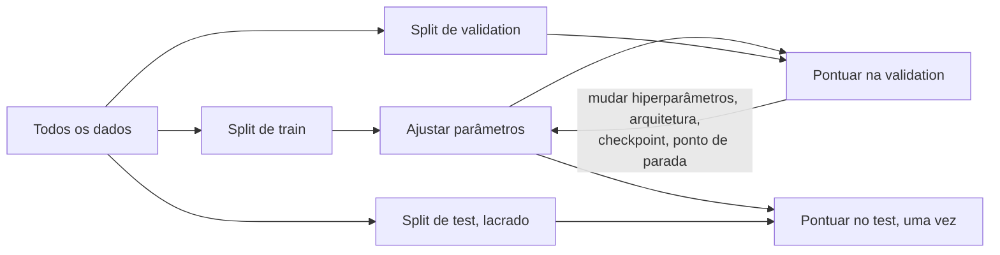

**Follow-ups:** Como a falha de ter o mesmo usuário nos dois splits realmente aparece nas métricas? Para que serve a nested cross-validation? Como você decontaminaria um eval set de LLM?

</details>

### 6. Explique precision, recall e F1. Dê um caso concreto em que 99% de accuracy significa que o modelo é inútil.

<details><summary><b>Resposta</b></summary>

A partir da matriz de confusão: **precision** = TP/(TP+FP) - de tudo que foi sinalizado como positivo, que fração estava certa; **recall** = TP/(TP+FN) - de todos os verdadeiros positivos, que fração foi encontrada; **F1** = 2PR/(P+R), a média harmônica, que pune o desequilíbrio entre os dois (harmônica, então um modelo com P=1,0, R=0,01 obtém F1≈0,02, não 0,5).

Accuracy mente sempre que as classes são desbalanceadas. Fraude com 1% de prevalência: o classificador constante "não é fraude" marca 99% de accuracy e captura zero fraude - recall 0. Qualquer accuracy de manchete deve ser comparada com o baseline da classe majoritária.

Qual métrica otimizar é uma questão de *custo*, não de matemática:
- Falsos positivos caros (filtro de spam comendo e-mail legítimo, alertas policiais) → priorize precision.
- Falsos negativos caros (triagem de câncer, fraude, filtros de segurança) → priorize recall.
- Use **F-beta** para codificar a razão explicitamente: F2 dá mais peso ao recall, F0.5 dá mais peso à precision.

Saiba também que precision/recall/F1 são **dependentes de threshold** - descrevem um único ponto de operação na distribuição de scores do classificador. Reportar "F1 = 0,83" sem dizer como o threshold foi escolhido (e em qual split) é um red flag; varra o threshold nos dados de validação e escolha o ponto de operação que corresponde à estrutura de custos do produto.

Esse vocabulário se transfere diretamente para evals de LLM: detecção de hallucination, filtragem de toxicidade e retrieval de RAG são todos problemas de precision/recall (o recall@k do retrieval é literalmente recall), e os entrevistadores esperam que você transite com fluência entre os enquadramentos clássico e de LLM.

**Vale desenhar.** Desenhar quais células alimentam qual métrica evita que você erre os denominadores sob pressão.

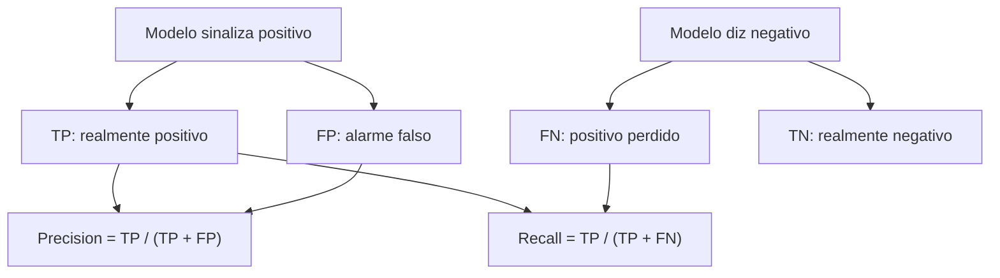

**Follow-ups:** Por que a média harmônica e não a aritmética? A precision é 0,95 mas o time de produto está insatisfeito - o que você checaria? Como o F1 micro e macro diferem em multiclasse desbalanceada?

</details>

### 7. Qual é a diferença entre parâmetros e hiperparâmetros? Como você ajusta hiperparâmetros de forma eficiente?

<details><summary><b>Resposta</b></summary>

**Parâmetros** são aprendidos dos dados pelo otimizador - pesos, biases, tabelas de embedding. Um LLM de 7B parâmetros tem 7 bilhões deles. **Hiperparâmetros** são definidos *antes* do treinamento e controlam o processo de aprendizado: learning rate, batch size, weight decay, taxa de dropout, escolhas de arquitetura (depth, width, número de heads), passos de warmup, rank do LoRA. Uma checagem de sanidade que os entrevistadores gostam: uma camada `Linear(in=4096, out=11008)` tem 4096×11008 pesos + 11008 biases ≈ 45M parâmetros.

Abordagens de tuning, em ordem de sofisticação:
- **Grid search** - exaustivo sobre uma grade discreta; desperdiçador em altas dimensões.
- **Random search** - Bergstra & Bengio mostraram que supera o grid search porque tipicamente apenas poucos hiperparâmetros importam, e a amostragem aleatória explora a marginal de cada dimensão muito melhor pelo mesmo orçamento.
- **Bayesian optimization / successive halving** (Optuna, ASHA/Hyperband) - modelam a superfície de resposta ou eliminam agressivamente trials ruins cedo; o padrão prático para runs de treinamento caros.

Orientação prática que um candidato sênior dá: o learning rate quase sempre é o hiperparâmetro de maior impacto - busque-o em **escala logarítmica** (por exemplo, 1e-5 a 1e-3). Ajuste em um proxy menor (subconjunto dos dados, run mais curto, modelo menor) e transfira; essa é a ideia que o μP (μTransfer) torna fundamentada para escalar a width do modelo. Não ajuste tudo de uma vez - fixe uma receita sensata (AdamW, cosine schedule, decay 0,1) e varra os 2-3 botões que importam. E toda decisão de tuning deve ser tomada em dados de validação, nunca em test.

**Follow-ups:** Por que amostrar o learning rate de forma log-uniforme? Se você pode pagar 20 runs, como as aloca? O número de épocas de treinamento é parâmetro ou hiperparâmetro - e uma temperature aprendida como a do CLIP?

</details>

### 8. Qual é a diferença entre batch, mini-batch e stochastic gradient descent? O que o batch size realmente muda?

<details><summary><b>Resposta</b></summary>

**Batch GD** calcula o gradiente exato sobre o dataset inteiro por passo - preciso, mas um passo lento por época e inviável em escala. **SGD** (estritamente, de um único exemplo) atualiza com uma amostra - muito ruidoso, má utilização de hardware. **Mini-batch GD** - o que todo mundo realmente roda - faz a média do gradiente sobre um batch (dezenas a milhões de tokens), equilibrando qualidade do gradiente e throughput. Confusamente, os praticantes também chamam o treinamento com mini-batch de "SGD".

O que o batch size muda:

- **Ruído do gradiente**: a variance da estimativa do gradiente escala ~1/batch size. Algum ruído é útil - age como regularização implícita e ajuda a escapar de mínimos agudos; batches muito grandes podem generalizar um pouco pior sem ajustes na receita.
- **Acoplamento com o LR**: batches maiores suportam (e precisam de) learning rates maiores. A **linear scaling rule** (multiplique o LR por k ao multiplicar o batch por k, mais warmup) vem do trabalho "ImageNet in 1 hour" de Goyal et al. Além de um **critical batch size** dependente do problema (McCandlish et al., análise da gradient-noise-scale), paralelismo extra de batch deixa de comprar convergência mais rápida - você está apenas fazendo a média de gradientes já limpos.
- **Hardware**: batches maiores melhoram a utilização do acelerador; o pretraining de LLMs usa global batches enormes (ordem de milhões de tokens) via data parallelism, e a **gradient accumulation** simula batches grandes quando a memória está apertada.

A armadilha da entrevista: "batch maior é sempre melhor." Não é - o custo por passo cresce, o progresso por passo satura além do critical batch size e a memória é finita. Batch size é um tradeoff de sistemas e otimização, não um botão gratuito.

**Follow-ups:** Você dobra o batch size - o que faz com o learning rate e por quê? A que a gradient accumulation é realmente equivalente, e onde a equivalência se quebra (dica: BatchNorm)? Por que um batch enorme pode prejudicar a generalização?

</details>

### 9. O que são embeddings? Compare cosine similarity, dot product e distância Euclidiana - quando a escolha importa?

<details><summary><b>Resposta</b></summary>

Um embedding é um vetor denso aprendido (tipicamente 256-4096 dims) em que a geometria codifica semântica: itens similares são mapeados para pontos próximos. Eles são produzidos por um encoder treinado para que uma função de similaridade escolhida pontue alto pares relacionados - palavras, sentenças, imagens, usuários, código.

As três medidas de similaridade:
- **Dot product** a·b - recompensa tanto o alinhamento *quanto* a magnitude. Um vetor longo pode dominar os rankings independentemente da direção.
- **Cosine** = a·b / (‖a‖‖b‖) - apenas direção; equivalente ao dot product em vetores normalizados para norma unitária.
- **Euclidean** ‖a−b‖ - para vetores unitários, ‖a−b‖² = 2 − 2·cos(a,b), então é monotonicamente equivalente ao cosine e produz rankings idênticos.

Portanto, em vetores normalizados as três concordam no ranking; a escolha só importa quando as magnitudes carregam informação. A resposta de engenheiro sênior: **use a similaridade com a qual o modelo foi treinado**. A maioria dos text embedders modernos (OpenAI text-embedding-3, Cohere, modelos abertos estilo E5/GTE/BGE) é treinada com objetivos contrastivos baseados em cosine e frequentemente entrega vetores já normalizados. Alguns modelos de retrieval usam deliberadamente dot product bruto para que a magnitude possa codificar confiança ou importância.

Operacionalmente, a métrica do seu índice vetorial deve corresponder: índices FAISS/pgvector/HNSW são construídos para inner product, L2 ou cosine, e uma incompatibilidade degrada silenciosamente a qualidade do retrieval. Dois pontos mais avançados que vale oferecer: os hidden states brutos de LLMs são **anisotrópicos** (comprimidos em um cone estreito), e é por isso que se usa um embedder treinado de forma contrastiva em vez de fazer pooling das ativações de um modelo base; e **embeddings Matryoshka (MRL)** são treinados de modo que truncar para as primeiras k dims ainda funciona, permitindo trocar recall por memória/latency.

**Vale desenhar.** A última caixa é a parte que as pessoas esquecem, e desenhá-la mostra que você realmente entregou um índice vetorial.

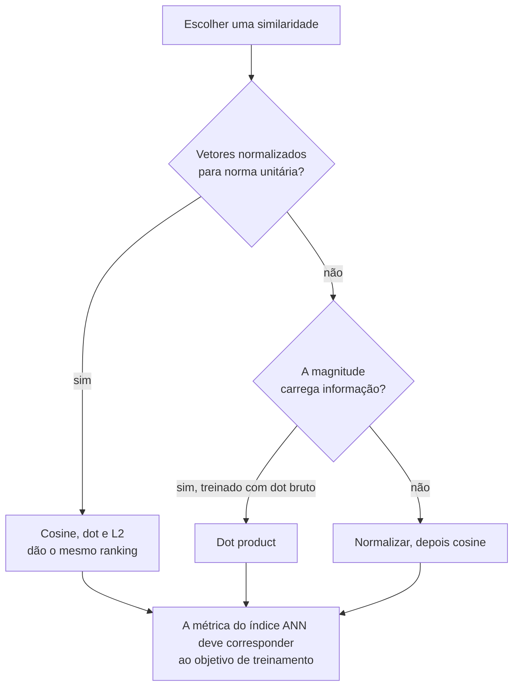

**Follow-ups:** Por que normalizar torna Euclidean e cosine equivalentes - demonstre. Quando o dot product venceria o cosine em um recommender? O que quebra se você indexar embeddings treinados com cosine usando uma métrica L2 sem normalizar?

</details>

### 10. Defina aprendizado supervised, unsupervised e self-supervised. Onde cada etapa do treinamento moderno de LLMs se encaixa?

<details><summary><b>Resposta</b></summary>

**Supervised**: aprender de pares (input, label) em que os labels vêm de fora dos dados - anotação humana, resultados registrados em log. **Unsupervised**: encontrar estrutura sem nenhum label - clustering, estimação de densidade, redução de dimensionalidade. **Self-supervised**: fabricar os labels *a partir dos próprios dados* por meio de uma pretext task e então aprender com a maquinaria supervised padrão - sem custo de anotação, dados efetivamente ilimitados.

Mapear o pipeline moderno de LLMs é o verdadeiro ponto da pergunta:

- **Pretraining** - self-supervised. A predição de next-token transforma texto bruto em trilhões de pares (contexto, próximo token); o "label" é apenas o token seguinte. Masked-language modeling (BERT) é a mesma ideia com outra pretext task.
- **SFT / instruction tuning** - aprendizado supervised simples: pares (prompt, resposta) curados, cross-entropy sobre os tokens da resposta.
- **Pós-treinamento com RL (RLHF em preferências, ou RL estilo GRPO em recompensas verificáveis)** - reinforcement learning: o sinal é uma recompensa escalar (de um reward model aprendido, preferências humanas ou verificadores para matemática/código), não labels por token. O DPO é o caso limítrofe interessante: otimiza diretamente um objetivo de preferência como uma loss de estilo supervised em pares de preferência, pulando o loop de RL explícito.
- **Modelos de embedding / CLIP** - aprendizado contrastivo self-supervised: os positivos são pares que co-ocorrem (texto/imagem, query/passagem), os negativos vêm de graça do batch.
- Passos genuinamente **unsupervised** ainda existem nas bordas: agrupar queries de usuários em clusters para descobrir intents, deduplicar corpora de pretraining via detecção de near-duplicates.

A frase de efeito que cai bem: a self-supervision resolveu o gargalo de rotulagem - o motivo pelo qual os LLMs funcionam é que a predição de next-token converte a internet inteira em dados de treinamento supervised gratuitos.

**Vale desenhar.** Rotular as setas em vez das caixas é o que faz a taxonomia fixar: o paradigma está em como a supervisão foi obtida.

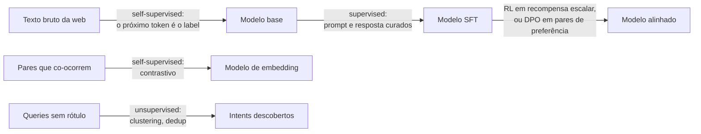

**Follow-ups:** Um reward model é treinado de forma supervised ou por RL? Por que a predição de next-token é uma pretext task tão poderosa em comparação com, digamos, autoencoding? Onde o feedback estilo RLAIF/constitucional se encaixa nessa taxonomia?

</details>

### 11. Random forest vs gradient boosting: como cada um funciona, e por que os tree ensembles ainda vencem redes neurais em dados tabulares?

<details><summary><b>Resposta</b></summary>

Eles ficam em lados opostos da alavanca bias-variance. **Random forest** é bagging: treine muitas árvores profundas em paralelo, cada uma em uma bootstrap sample e com cada split considerando um subconjunto aleatório de features, e então faça a média. Árvores profundas têm bias baixo e variance alta; a média de árvores decorrelacionadas elimina a variance. Adicionar árvores nunca prejudica, então é difícil fazer overfitting ao ajustar.

**Gradient boosting** é sequencial: cada árvore rasa ajusta o gradiente negativo da loss em relação às predições do ensemble atual (para squared error, literalmente os resíduos), então cada rodada reduz o bias. Normalmente vence em accuracy, mas fará overfitting se você continuar adicionando rodadas, então learning rate, depth, subsample e early stopping realmente importam. Na prática isso significa LightGBM, XGBoost ou CatBoost com um conjunto de validação ligado ao early stopping.

Por que árvores vencem MLPs em tabular:

- **Invariância a transformações monotônicas.** Os splits são thresholds, então sem scaling, sem transformações log, sem cirurgia de outliers. Redes neurais precisam de tudo isso.
- **Features heterogêneas e não suaves.** MLPs têm viés para funções suaves; alvos tabulares frequentemente são funções degrau irregulares de poucas features. Esse viés é um descasamento.
- **Robustez a colunas não informativas.** Árvores simplesmente nunca fazem split nelas; um MLP precisa aprender a ignorá-las, o que custa dados.
- **Tipos mistos e valores faltantes** tratados nativamente, mais tratamento de categóricas no CatBoost/LightGBM.
- **Dados pequenos.** A maioria dos datasets tabulares tem de milhares a milhões de linhas, onde o inductive bias importa mais que a capacidade.

Redes neurais vencem quando há estrutura a explorar: entidades de alta cardinalidade para as quais você quer embeddings compartilhados, input multimodal (texto livre ou imagens ao lado da tabela) ou transfer de um modelo pré-treinado. O padrão honesto em 2026 ainda é: baseline com LightGBM primeiro, e faça qualquer coisa mais sofisticada vencê-lo. A única rachadura real são dados pequenos: foundation models tabulares como o TabPFN v2 fazem predição in-context em tabelas de até cerca de dez mil linhas e são competitivos com GBDTs ajustados ali, então pertencem ao conjunto de baselines para problemas pequenos. Em escala, árvores com boosting ainda dominam.

Equívoco comum a evitar: dizer que random forest faz "boosting", ou citar `n_estimators=1000` para GBDT sem early stopping.

**Vale desenhar.** Setas paralelas contra um loop de feedback tornam a distinção variance-versus-bias visual em vez de decorada.

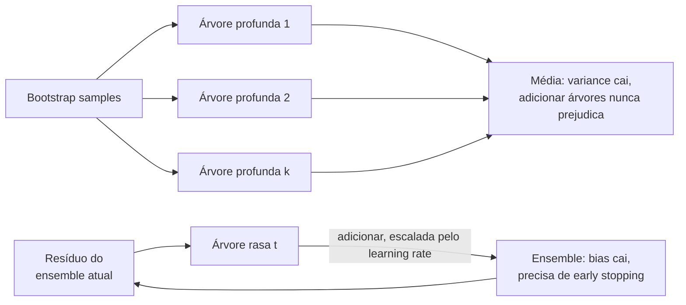

**Follow-ups:** Por que o ordered target encoding do CatBoost existe, e que leakage ele previne? Como você obteria probabilidades calibradas de uma árvore com boosting?

</details>

### 12. O que é feature scaling? Compare normalization e standardization e diga quais modelos realmente precisam dele.

<details><summary><b>Resposta</b></summary>

Standardization subtrai a média e divide pelo desvio padrão, dando aproximadamente média zero e variância unitária com intervalo ilimitado. A normalization min-max reescala linearmente para um intervalo fixo, geralmente [0, 1]. Standardization é o padrão; min-max é para quando algo adiante precisa de um intervalo limitado, e é muito mais sensível a outliers porque um valor extremo achata todo o resto.

Quem precisa:

- **Métodos baseados em distância** (kNN, k-means, SVM com kernel RBF): uma feature medida em dólares dominará uma medida em frações puramente por causa das unidades.
- **Modelos lineares regularizados**: uma penalidade L1/L2 depende da escala, então uma feature sem escala recebe uma quantidade arbitrária de shrinkage.
- **PCA**: maximiza a variância, e a variância depende da unidade, então sem standardizar você obtém os componentes de qualquer coluna que tenha os maiores números.
- **Gradient descent em modelos lineares e redes neurais**: escalas de features muito diferentes deixam a superfície da loss mal condicionada, e a otimização faz zig-zag.

Quem não precisa: árvores de decisão e tree ensembles. Os splits são thresholds, então qualquer transformação monotônica de uma feature deixa o modelo inalterado.

Duas coisas que eliminam candidatos aqui. Primeiro, **ajuste o scaler apenas no train**, depois aplique em validation e test. Ajustar no dataset inteiro antes de dividir é leakage de livro-texto e é o mais comum que as pessoas cometem. Segundo, as estatísticas ajustadas são **parte do artefato do modelo**. Recalcular a média e o desvio padrão a partir de um batch de serving, ou usar zero como padrão onde o treino imputou uma mediana, é training-serving skew, e falha silenciosamente.

Para quantidades positivas assimétricas (renda, contagens, latency) eu aplicaria log-transform primeiro e depois standardize. Para caudas pesadas, robust scaling com mediana e IQR. Em deep nets, o scaling do input importa menos internamente porque camadas de normalização cuidam das ativações, mas os próprios inputs ainda precisam dele.

**Follow-ups:** Por que uma feature sem escala arruína a regularização L2 mas não a propriedade de sparsity do L1 da mesma forma? Onde, em um caminho de serving em PyTorch, você colocaria o scaler para que ele não possa divergir do treino?

</details>

### 13. Leve-me de RNNs a LSTMs a transformers. Por que a attention venceu?

<details><summary><b>Resposta</b></summary>

Uma RNN carrega um hidden state adiante: `h_t = f(h_{t-1}, x_t)`. O treinamento faz backpropagation through time, o que multiplica o mesmo Jacobiano uma vez por passo, então os gradientes vanish ou explode em longas distâncias e a memória prática é curta.

A **LSTM** corrige o caminho do gradiente, não o paralelismo. Ela adiciona um cell state atualizado *aditivamente*, controlado por gates de forget/input/output. O caminho aditivo é o mesmo truque de uma conexão residual: o gradiente flui por ele sem multiplicação repetida, então uma LSTM mantém contexto por centenas de passos em vez de dezenas. A GRU é uma variante mais barata de dois gates com comportamento similar.

Dois problemas sobreviveram. Primeiro, tudo sobre o passado precisa ser espremido em um hidden state de tamanho fixo, que é exatamente o gargalo que a attention foi originalmente inventada para aliviar, como um complemento a RNNs seq2seq. Segundo, e decisivamente, **a recorrência é sequencial no tempo**, então você não consegue paralelizar o treinamento entre posições.

Transformers abandonam a recorrência por completo. Cada posição atende a todas as outras, então o caminho entre quaisquer dois tokens é O(1) em vez de O(n), e o treinamento vira grandes matmuls que saturam GPUs. Os custos: a attention é O(n²) em compute e memória versus O(n) para uma RNN, e é permutation-equivariant, então a ordem precisa ser injetada via positional encodings (RoPE é o padrão atual).

Então a resposta honesta para "por que a attention venceu" é utilização de hardware mais comprimento do caminho do gradiente, não alguma superioridade abstrata. Com os mesmos FLOPs você consegue treinar com muito mais dados.

Vale notar que a roda está girando de volta: modelos state-space e de linear attention (estilo Mamba) recuperam uma formulação recorrente O(n) que ainda paraleliza no treino via scan, e stacks híbridas de attention/SSM são entregues em modelos de produção para long context. E um transformer autoregressivo na inferência com KV cache *é* uma recorrência, só que com um estado que cresce com a sequência.

**Follow-ups:** Se o KV cache torna o decoding recorrente de qualquer forma, onde a vantagem do transformer realmente aparece? Por que o cell state aditivo da LSTM ajuda os gradientes quando os próprios gates são multiplicativos?

</details>

### 14. Qual é a diferença entre feature engineering e representation learning? Onde a engenharia manual ainda se justifica em 2026?

<details><summary><b>Resposta</b></summary>

Feature engineering é você escrevendo a função dos dados brutos para o input do modelo. Representation learning é um modelo aprendendo essa função a partir dos dados. Deep learning venceu em visão, fala e texto porque esses inputs têm alta dimensionalidade com forte estrutura local e existem corpora enormes, então features aprendidas superaram as feitas à mão (SIFT, MFCCs, n-grams perderam todos).

Tabular é o regime oposto. As features já são semânticas, os datasets são pequenos e o conhecimento de domínio codifica restrições que os dados não conseguem descobrir sozinhos. Então a engenharia manual ainda se justifica em alguns lugares concretos:

- **Stacks tabulares / GBDT.** Agregações, razões, contagens e features de janela de tempo ("transações nas últimas 24h", "dias desde o último login") são onde moram os ganhos reais. Nenhuma quantidade de capacidade do modelo as inventa.
- **Features que exigem dados que o modelo não consegue ver.** Joins com histórico de CRM, sinais externos, janelas calculadas.
- **Recsys**, onde features de histórico de usuário/item e cross features carregam boa parte da carga.
- **Sistemas com LLM.** O que você recupera, como faz o chunking e quais metadados anexa a um chunk é feature engineering com outro chapéu.

O meio-termo moderno é um híbrido: passe colunas não estruturadas (uma descrição de produto, o corpo de um ticket de suporte) por um encoder pré-treinado para obter embeddings e então alimente-os junto com features tabulares engenheiradas em um GBDT ou em um MLP pequeno. Representation learning onde ajuda, engenharia onde ajuda.

O equívoco a eliminar é "deep learning significa sem feature engineering." O trabalho se mudou, não desapareceu. Em escala de fronteira ele foi para curadoria de dados, pesos de mistura, dedup e tokenização, que são todas decisões de engenharia sobre representação com impacto enorme.

O que os entrevistadores realmente testam é o julgamento sobre em que regime você está. Gastar três semanas criando features para um problema que tem um bilhão de tokens e um backbone pré-treinado é tão errado quanto jogar um MLP em 8.000 linhas de dados tabulares.

**Follow-ups:** Dê-me uma feature que você engenheirou que um modelo jamais poderia ter aprendido, e diga por quê. Como você decide entre alimentar um embedding em um GBDT versus fazer fine-tuning do encoder de ponta a ponta?

</details>

### 15. Por que uma rede neural precisa de funções de ativação não lineares, e como o campo passou de sigmoid para ReLU para ativações estilo GELU?

<details><summary><b>Resposta</b></summary>

Sem uma não linearidade, empilhar camadas não compra nada: W₂(W₁x + b₁) + b₂ ainda é um único mapa afim, então uma rede de 100 camadas tem o poder expressivo de uma única camada linear. A ativação é o que permite que a profundidade componha features simples em funções que não são lineares no input, e é nela que os resultados de universal approximation se apoiam.

A história desde então é uma história sobre gradientes:

- **Sigmoid e tanh** foram os padrões durante os anos 2000. Ambas saturam: para |z| grande a derivada vai a zero, e a derivada máxima da sigmoid é apenas 0,25, então os gradientes encolhem a cada camada. A sigmoid também não é centrada em zero, o que faz as atualizações fazerem zig-zag. Ambas sobrevivem hoje como gates (LSTM, variantes de GLU) e como camadas de saída, onde comprimir em um intervalo é o objetivo.
- **ReLU**, max(0, z), tornou prático o treinamento supervised profundo na era da AlexNet. Sua derivada é exatamente 1 no lado ativo, é barata e dá ativações esparsas. Seu modo de falha são as **dead units**: um neurônio cuja pré-ativação é negativa para todo input recebe gradiente zero para sempre, frequentemente depois que um learning rate alto demais empurra seu bias para negativo. Leaky ReLU e PReLU mantêm uma pequena inclinação negativa para evitar isso.
- **GELU** (z·Φ(z)) e **SiLU/Swish** (z·σ(z)) são curvas suaves parecidas com a ReLU, com uma pequena depressão negativa. A suavidade tende a otimizar melhor em escala, e é por isso que BERT e GPT-2 usaram GELU.
- **Variantes com gate** (SwiGLU, GeGLU) multiplicam duas projeções lineares, uma passada pela ativação, e são a escolha padrão nos blocos feed-forward atuais de LLMs.

O que o entrevistador espera ouvir: o argumento do colapso linear enunciado com clareza, a saturação ligada ao vanishing gradient e a ligação com a inicialização (a He init assume que a ReLU zera metade de seus inputs). Para um novo MLP em inputs tabulares ou de embeddings, ReLU ou GELU está bom. A escolha raramente importa tanto quanto normalização, init e learning rate.

**Follow-ups:** Como você detectaria ReLUs mortas em uma rede treinada? Por que o SwiGLU geralmente usa um hidden size de cerca de 8/3 × d em vez de 4 × d? Por que a sigmoid ainda é a saída certa para um classificador multi-label?

</details>

## Intermediário

### 16. O que é data leakage? Dê três exemplos sutis que você viu ou poderia imaginar, e como os detectaria.

<details><summary><b>Resposta</b></summary>

Leakage é qualquer caminho pelo qual informação indisponível no momento da predição contamina o treinamento ou a avaliação, inflando métricas offline que desabam em produção. O caso gritante - treinar em linhas de test - é raro; os sutis são o que mata sistemas reais:

1. **Pré-processamento ajustado no dataset inteiro**: ajustar um scaler, PCA, target encoder ou tokenizer/vocabulário em train+test antes de dividir. As estatísticas do test set vazam para a transformação. Correção: ajuste as transformações apenas dentro do fold de treino (o `Pipeline` do sklearn dentro da CV existe precisamente para isso).
2. **Group leakage**: o mesmo paciente, usuário ou documento contribui com linhas tanto para train quanto para test. O modelo aprende a reconhecer a entidade, não o padrão. Detecte com splits cientes de grupo; o sintoma é uma grande queda de métrica quando você troca para `GroupKFold`.
3. **Temporal leakage**: splits aleatórios em dados dependentes do tempo deixam o modelo treinar no futuro. Uma feature de churn como "dias desde o último login" calculada sobre uma janela que se estende além da data do label é um clássico - a feature codifica silenciosamente o resultado.
4. **Target leakage em features**: uma coluna causalmente posterior ao label - por exemplo, "account_frozen" como feature de fraude, quando o congelamento acontece *porque* a fraude foi detectada.
5. **Era dos LLMs: benchmark contamination** - perguntas de eval presentes no corpus de pretraining. Detecção: varreduras de overlap de n-grams/substrings, canary strings, comparação de desempenho em versões renomeadas/perturbadas do benchmark.

Heurísticas de detecção: resultados bons demais para ser verdade (AUC quase perfeita em um problema difícil); uma feature com importância absurda; **adversarial validation** - treine um classificador para distinguir linhas de train de linhas de test, e se ele tiver sucesso, seus splits diferem sistematicamente; e grandes gaps de métrica offline→online.

**Vale desenhar.** Quatro portões em um único caminho é uma resposta muito melhor que uma lista, porque mostra que leakage é uma propriedade da ordem do pipeline, não do modelo.

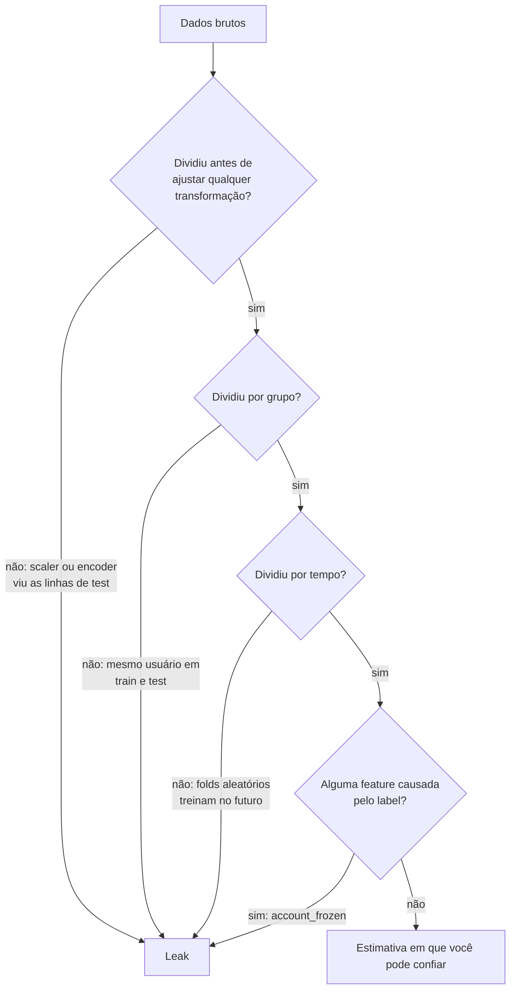

**Follow-ups:** Seu modelo obtém 0,99 de AUC em um problema de fraude - conduza-me pela sua auditoria. Como a k-fold CV piora o leakage de pré-processamento se feita ingenuamente? Como você verificaria se um LLM memorizou o seu eval set?

</details>

### 17. ROC-AUC vs PR-AUC - o que cada uma mede, e por que a ROC-AUC parece enganosamente boa em dados desbalanceados?

<details><summary><b>Resposta</b></summary>

**ROC-AUC** plota a taxa de verdadeiros positivos (recall) contra a taxa de falsos positivos em todos os thresholds; sua área é igual à probabilidade de que um positivo escolhido aleatoriamente receba score acima de um negativo escolhido aleatoriamente - uma métrica puramente de *ranking*. O baseline é 0,5 independentemente do balanceamento de classes. **PR-AUC** plota precision contra recall; seu baseline é a prevalência de positivos.

O engano: FPR = FP/(FP+TN) é normalizada pela contagem de *negativos*. Com 1M de negativos e 1k de positivos, um modelo que produz 10.000 falsos positivos tem FPR = 1% - a curva ROC parece ótima - mas em um threshold que recupera a maioria dos positivos, a precision pode ser ~9% (1k verdadeiros contra 10k alarmes falsos). A ROC-AUC pode marcar 0,98 enquanto a precision que o operador experimenta é de um dígito. A PR-AUC expõe isso porque a precision tem FP diretamente no denominador, sem ser diluída pela massa de negativos fáceis.

Regras práticas:
- Classes balanceadas, ou você realmente se importa com quão bem ranqueia os negativos também → ROC-AUC está bem e tem propriedades estatísticas mais agradáveis (invariante à prevalência, portanto comparável entre datasets).
- Classe positiva rara em que a experiência do produto é "quantos alertas são reais" → PR-AUC ou, melhor, **precision@k** / recall em uma FPR fixa alinhada ao orçamento de revisão do time de operações.

Duas ressalvas que sinalizam profundidade: a PR-AUC depende da prevalência, então não dá para compará-la entre datasets com taxas base diferentes; e a average precision (o estimador padrão de PR-AUC) é preferida à interpolação trapezoidal, que é enviesada de forma otimista para curvas PR. Nenhuma das métricas diz algo sobre **calibration** - ambas são invariantes a qualquer reescalonamento monotônico dos scores.

**Follow-ups:** Por que a interpolação linear entre pontos PR é inválida? Sua ROC-AUC melhorou mas a PR-AUC caiu - o que aconteceu? Como você escolhe o threshold operacional final para produção?

</details>

### 18. O que significa um classificador ser calibrado? Como você mede e corrige a miscalibration?

<details><summary><b>Resposta</b></summary>

Calibrado significa que as probabilidades previstas correspondem às frequências empíricas: entre todos os casos em que o modelo diz 0,8, ~80% devem realmente ser positivos. Discriminação (ranking, AUC) e calibration são ortogonais - você pode ranquear perfeitamente enquanto produz probabilidades todas erradas por uma compressão, e qualquer reescalonamento monotônico muda a calibration sem tocar na AUC.

**Medição**: reliability diagrams (agrupe predições por confiança em bins, plote a frequência observada por bin contra a diagonal); **ECE** (expected calibration error) resume o gap como uma média ponderada entre bins - cuidado com sua sensibilidade às escolhas de binning; **Brier score** e NLL são proper scoring rules que combinam calibration e discriminação.

**Correções** (ajuste em dados de validação, nunca de treino):
- **Temperature scaling** (Guo et al. 2017): divida os logits por um único T > 0 aprendido antes do softmax. Redes modernas são tipicamente *superconfiantes* (T ≈ 1,5-3 corrige muitos modelos de visão). Um parâmetro, preserva o ranking exatamente, difícil de sofrer overfitting - a escolha padrão.
- **Platt scaling** (ajuste logístico sobre os scores) e **isotonic regression** (não paramétrica, monotônica; precisa de mais dados, pode fazer overfitting em val sets pequenos).

Por que importa: qualquer sistema que aplica threshold sobre custo esperado - filas de revisão de fraude, triagem médica, decidir quando um classificador baseado em LLM deve se abster ou escalar para um humano - precisa de probabilidades que signifiquem algo, não apenas rankings corretos.

Ângulo de LLM que vale oferecer: modelos base são surpreendentemente bem calibrados em tarefas de múltipla escolha (probabilidade de token vs accuracy), e o RLHF tende a *piorar* essa calibration - o relatório técnico do GPT-4 mostrou que a curva de calibration do modelo pós-RLHF se degradou visivelmente em relação ao modelo pré-treinado. A confiança verbalizada ("tenho 90% de certeza") é um canal separado, geralmente pior calibrado que os logprobs dos tokens.

**Vale desenhar.** O loop de volta ao reliability diagram mostra que calibration é medida, corrigida e então remedida, e nunca ajustada no train.

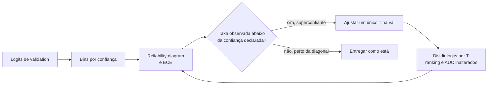

**Follow-ups:** Por que o temperature scaling deixa accuracy e AUC inalteradas? Como o desbalanceamento de classes interage com a calibration sob resampling? Como você calibraria um LLM judge que produz uma nota de 1 a 10?

</details>

### 19. Seu dataset de fraude tem 0,5% de positivos. Conduza-me pela sua estratégia para lidar com o desbalanceamento.

<details><summary><b>Resposta</b></summary>

Primeiro, corrija a *medição*, depois o *treinamento*, e mantenha as duas preocupações separadas.

**Medição**: accuracy e ROC-AUC vão ambas te lisonjear (veja o problema da diluição da FPR). Use PR-AUC, precision@k dimensionada para a capacidade do time de revisão ou recall em uma FPR fixa. Estabeleça a matriz de custos - uma fraude perdida pode custar 100× um alarme falso - porque ela determina o threshold operacional depois.

**Opções do lado do treinamento**:
- **Class weights / weighted loss** - dê mais peso aos positivos na cross-entropy. Simples, sem distorção de dados, o primeiro movimento usual.
- **Resampling** - undersample dos negativos (barato, funciona quando os negativos são redundantes; pode descartar sinal) ou oversample dos positivos. **SMOTE** interpola positivos sintéticos no espaço de features - sensato para dados tabulares de baixa dimensionalidade, majoritariamente inútil ou prejudicial para representações aprendidas de alta dimensionalidade, e nunca aplique antes de dividir ou você vaza cópias sintéticas para a validação.
- **Focal loss** (do RetinaNet) - reduz o peso de exemplos fáceis por (1−p)^γ para que o treinamento foque nos difíceis; projetada para desbalanceamento extremo em detecção.
- **Threshold moving** - frequentemente a ferramenta mais subestimada: treine normalmente, obtenha probabilidades calibradas e então escolha o threshold que otimiza o custo esperado. O desbalanceamento não impede o aprendizado de um bom *ranker*; ele quebra o threshold padrão de 0,5.
- **Reenquadramento** - em raridade extrema ou com padrões de ataque inéditos, formulações de anomaly detection ou one-class podem vencer a classificação.

Sutilezas críticas: avalie na distribuição *natural*, nunca em uma rebalanceada; se você faz resampling ou reweighting, suas probabilidades de saída ficam enviesadas e devem ser **recalibradas** antes do threshold; e valide temporalmente, porque os padrões de fraude sofrem drift e os adversários se adaptam.

**Vale desenhar.** Duas faixas separadas convergindo no threshold são a estrutura da resposta: corrigir a medição, corrigir o treinamento e depois recalibrar antes de escolher um ponto de operação.

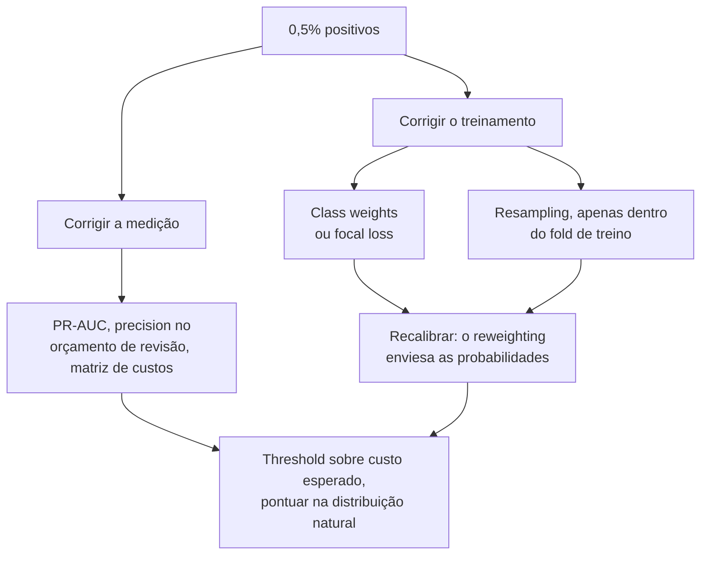

**Follow-ups:** Você fez oversampling e agora as probabilidades previstas estão infladas - por quê, e como corrigi-las? Quando o undersampling é de fato preferível? Como labels de fraude atrasados (chargebacks chegando 60 dias depois) mudam sua avaliação?

</details>

### 20. Explique momentum e Adam. Que problema cada um resolve em relação ao SGD puro?

<details><summary><b>Resposta</b></summary>

**Momentum** mantém uma média móvel exponencial dos gradientes e dá passos ao longo dessa média: `v ← βv + g; w ← w − lr·v` (β tipicamente 0,9). Em paisagens de loss em forma de ravina - íngremes em algumas direções, rasas em outras - o SGD puro oscila através das paredes íngremes enquanto se arrasta pelo fundo do vale. O momentum cancela os componentes oscilantes (eles alternam de sinal e se anulam na média) e acumula os consistentes, dando uma amplificação efetiva de até 1/(1−β) ao longo de direções estáveis. Ele também suaviza o ruído do mini-batch.

**Adam** acrescenta uma segunda ideia: **tamanhos de passo adaptativos por parâmetro**. Ele rastreia tanto o primeiro momento m (como o momentum, β₁=0,9) quanto o segundo momento v - uma EMA dos gradientes ao quadrado (β₂=0,999 classicamente, ~0,95 na prática de LLMs) - e atualiza com `w ← w − lr · m̂ / (√v̂ + ε)`. Dividir por √v̂ normaliza o passo de cada parâmetro pela sua magnitude típica de gradiente: parâmetros com gradientes raros/pequenos (linhas de embedding de tokens raros) recebem passos relativamente maiores; parâmetros com gradientes grandes e ruidosos são amortecidos. Os chapéus são a **bias correction** - ambas as EMAs são inicializadas em zero e subestimam severamente seus alvos no início do treinamento; sem a correção, os primeiros passos seriam muito mal escalados.

Por que isso importa para transformers: a escala do gradiente varia enormemente ao longo de um transformer profundo (embeddings vs ganhos de LayerNorm vs projeções de attention), e um único LR global não consegue atender a todos - o SGD é notoriamente difícil de fazer funcionar em transformers, enquanto otimizadores da família Adam são robustos. O outro lado: o Adam mantém dois estados fp32 extras por parâmetro (~8 bytes/param), um custo de memória importante que motiva otimizadores de 8 bits e sharding estilo ZeRO.

**Vale desenhar.** Desenhar as duas EMAs como ramos separados deixa óbvio o que a bias correction está corrigindo e por que ela só importa no início.

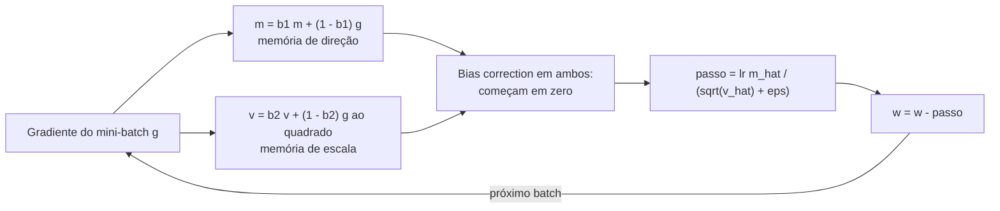

**Follow-ups:** Por que o Adam precisa de bias correction - o que acontece sem ela? Por que o SGD+momentum ainda frequentemente vence o Adam em convnets? Qual é a pegada de memória do Adam para um modelo de 7B e como reduzi-la?

</details>

### 21. Adam vs AdamW - o que exatamente é "decoupled weight decay", e por que o AdamW se tornou o padrão para transformers?

<details><summary><b>Resposta</b></summary>

A diferença é *onde* o termo de weight decay entra na atualização. No "Adam + L2", você adiciona λw ao gradiente, de modo que a penalidade flui pela maquinaria do Adam - incluindo a divisão por √v̂. No **AdamW** (Loshchilov & Hutter, "Decoupled Weight Decay Regularization"), o decay é aplicado diretamente aos pesos, fora da atualização adaptativa:

```python
# Adam + L2: a penalidade é reescalada pelo termo adaptativo
g = grad + lam * w
w -= lr * m_hat / (v_hat.sqrt() + eps)   # decay diluído onde v_hat é grande

# AdamW: decay desacoplado da adaptação do gradiente
w -= lr * m_hat / (v_hat.sqrt() + eps)
w -= lr * lam * w                         # encolhimento multiplicativo uniforme
```

Por que a versão acoplada é falha: parâmetros com grande histórico de gradiente (v̂ grande) têm o termo L2 dividido para baixo - precisamente os pesos que mais se movem recebem *a menor* regularização, e a força efetiva do decay se torna uma função descontrolada das estatísticas do gradiente. Ela também emaranha λ com o schedule de learning rate de maneiras bagunçadas, tornando os hiperparâmetros não transferíveis entre runs. Com SGD puro, L2 e weight decay coincidem - a distinção só existe para otimizadores adaptativos, que é exatamente a armadilha que a pergunta testa.

O AdamW restaura uma interpretação limpa - todo peso encolhe pela mesma fração lr·λ por passo -, desacopla as dimensões de busca λ/lr e empiricamente generaliza melhor. Tornou-se o padrão em essencialmente toda receita de transformer (série GPT, Llama etc.), com configurações típicas λ ≈ 0,1, β₂ ≈ 0,95 e decay desabilitado para biases, parâmetros de LayerNorm/RMSNorm e frequentemente embeddings. Em 2026 ainda é o padrão seguro, mas não é mais a única opção séria: otimizadores da família Muon, que ortogonalizam a atualização de momentum para matrizes de pesos 2D, foram usados para fazer o pretraining do Kimi K2 e do GLM-4.5, com o AdamW mantido para embeddings, o output head e os ganhos de norm. O decoupled weight decay se transporta para eles sem mudanças.

**Vale desenhar.** Dois caminhos a partir do mesmo gradiente, diferindo apenas em qual lado da divisão o decay fica, é a correção inteira em uma figura.

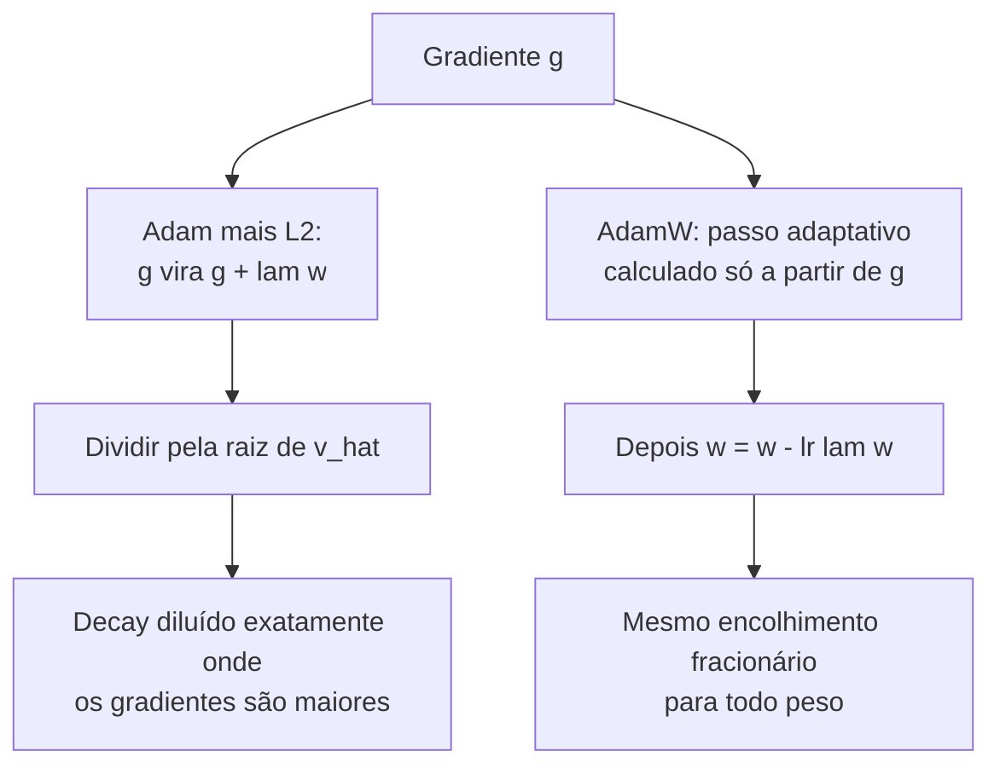

**Follow-ups:** Por que weight decay ≡ L2 sob SGD mas não sob Adam? Por que excluir parâmetros de norm do decay? O que acontece com o weight decay efetivo quando o LR sofre cosine annealing até perto de zero?

</details>

### 22. Por que as receitas de treinamento de transformers usam learning-rate warmup, e como é o resto do schedule?

<details><summary><b>Resposta</b></summary>

O **warmup** faz o LR subir linearmente de ~0 até o pico ao longo das primeiras centenas a poucos milhares de passos. Três razões que se reforçam e fazem os transformers precisarem dele:

1. **A estimativa de segundo momento do Adam é pouco confiável no início.** v̂ é uma EMA sobre um punhado de gradientes ruidosos, então o passo adaptativo m̂/√v̂ pode ser muito mal escalado; um LR de tamanho total por cima disso causa atualizações iniciais destrutivas. (O RAdam formalizou esse problema de variance; o warmup é a correção prática.)
2. **O início do treinamento de transformers é frágil.** Na init, as distribuições de attention e a paisagem da loss são mal condicionadas; passos grandes podem empurrar o modelo para um estado com normas de gradiente explosivas ou uma divergência de loss da qual ele nunca se recupera. Os transformers post-LN originais eram *inutilizáveis* sem warmup; o pre-LN reduziu a necessidade, mas não a eliminou.
3. **Batches grandes.** O regime de linear scaling (batch grande → LR grande) torna os primeiros passos ainda mais perigosos; Goyal et al. introduziram o warmup exatamente para isso no trabalho ImageNet-in-1-hour.

Depois do warmup, o padrão é o **cosine decay** do LR de pico até ~10% do pico ao longo de todo o orçamento de tokens (a receita estilo Chinchilla/Llama). O decay importa: LR alto no fim do treinamento mantém o modelo quicando em torno do mínimo; o annealing permite que ele se assente, e a fase final de LR baixo melhora desproporcionalmente o modelo.

Uma alternativa moderna que vale citar: **WSD (warmup - stable - decay)** - mantenha o LR constante depois do warmup e então faça o decay acentuado apenas nos últimos ~10-20% do treinamento. O benefício é operacional: você pode ramificar um checkpoint "finalizado" com decay a partir de um run ainda em andamento na fase estável a qualquer momento, o que serve a continued pretraining e experimentos de mistura de dados (popularizado pelo MiniCPM, e próximo em espírito dos schedules multi-step e constant-then-decay nos relatórios da DeepSeek).

**Vale desenhar.** Desenhar o WSD como uma ramificação a partir da fase estável explica todo o seu argumento de venda: você pode cortar um checkpoint finalizado quando quiser.

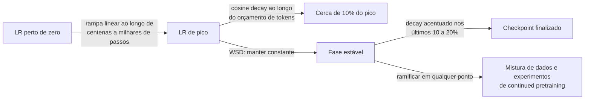

**Follow-ups:** O que realmente dá errado se você pula o warmup - descreva a assinatura da falha nas curvas de loss/grad-norm. Por que o cosine-to-zero interage mal com querer retomar o treinamento? Como você definiria o LR de pico para um modelo 10× maior?

</details>

### 23. Explique backpropagation para mim como se eu fosse um engenheiro de software forte que nunca fez ML. Por que ela é eficiente?

<details><summary><b>Resposta</b></summary>

Uma rede neural é uma função composta: `loss = f_L(...f_2(f_1(x, w_1), w_2)..., w_L)`. O treinamento precisa de ∂loss/∂w para cada peso. Backprop é apenas a **regra da cadeia organizada como programação dinâmica**: calcule a loss para a frente enquanto faz cache das ativações de cada camada, depois varra para trás, multiplicando por um Jacobiano local de cada vez e reutilizando o produto acumulado - o "sinal de gradiente" - em cada camada.

O argumento de eficiência é o coração de uma boa resposta. Ingenuamente, você poderia calcular o gradiente de cada peso de forma independente (diferenças finitas: perturbe um peso, rode a rede de novo) - isso são O(#params) forward passes, inviável para bilhões de parâmetros. O backprop calcula *todos* os gradientes em uma única varredura para trás custando aproximadamente **2× o forward pass**, porque o backward pass reutiliza resultados intermediários compartilhados exatamente como a memoização colapsa uma recursão exponencial. Detalhe-chave de implementação: você nunca materializa matrizes Jacobianas completas - o autodiff em modo reverso propaga **produtos vetor-Jacobiano**, que para uma camada de matmul são apenas dois matmuls a mais (gradientes em relação ao input e em relação aos pesos).

O modo reverso é a direção certa porque a loss é escalar: uma saída, muitas entradas → uma varredura para trás obtém todas as derivadas. (O modo forward é eficiente no regime oposto, poucas entradas/muitas saídas.)

Consequências de engenharia que vale declarar: o compute total de treinamento é ~3× o forward (daí a regra prática de ≈6·N·D FLOPs para transformers com N params e D tokens); as ativações em cache dominam a memória de treinamento, e é por isso que o **activation checkpointing** troca recompute por memória; e os frameworks implementam isso como autograd sobre um grafo de computação registrado - cada operação registra seu VJP.

**Vale desenhar.** As ativações em cache nas setas do forward são o que torna o backward pass barato e a memória de treinamento cara, e o esboço coloca os dois fatos em um só lugar.

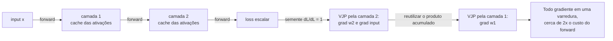

**Follow-ups:** Por que a memória de treinamento é tão maior que a memória de inferência? O que é activation checkpointing e qual é seu overhead de compute? De onde vem a estimativa 6ND?

</details>

### 24. O que são vanishing e exploding gradients? O que os causa, e o que o design moderno de arquitetura faz a respeito?

<details><summary><b>Resposta</b></summary>

O backprop multiplica uma cadeia de Jacobianos de camadas. Se esses fatores são tipicamente <1 em magnitude, o produto encolhe geometricamente com a profundidade - as camadas iniciais recebem gradiente essencialmente zero e param de aprender (**vanishing**). Se os fatores são >1, o produto explode - spikes de loss, NaNs (**exploding**). Mesmo mecanismo, sinal oposto do log da magnitude.

Causas clássicas: ativações saturantes (a derivada máxima da sigmoid é 0,25; a tanh satura nos extremos), inicialização mal escalada e profundidade ou recorrência (RNNs multiplicam pelo mesmo Jacobiano recorrente a cada timestep, tornando-as o caso patológico - historicamente corrigido pelo gating de LSTM/GRU).

Correções modernas, cada uma atacando um elo diferente da cadeia:
- **Conexões residuais**: `y = x + f(x)` dá o Jacobiano `I + ∂f/∂x` - o termo identidade fornece uma rodovia de gradiente que nunca desaparece, permitindo treinar redes com mais de 100 camadas. Este é o truque mais importante, e transformers são redes residuais de ponta a ponta.
- **Normalização** (LayerNorm/RMSNorm): mantém as escalas de ativação controladas para que os Jacobianos permaneçam bem condicionados; o posicionamento **pre-norm** (norm antes de cada sublayer) mantém o caminho residual limpo e é o motivo pelo qual modelos de GPT-2 em diante treinam de forma estável em profundidade.
- Ativações **ReLU/GELU**: derivada ~1 na região ativa, sem saturação nos dois lados.
- **Init que preserva a variância** (Xavier/He): começar com fatores do Jacobiano perto da escala unitária.
- **Gradient clipping** (norma global, tipicamente 1,0): uma rede de segurança contra explosão - ele reescala atualizações patológicas em vez de prevenir a causa.

Diagnóstico na prática: registre em log as normas de gradiente por camada. Um decaimento geométrico ao longo da profundidade = vanishing; spikes súbitos de grad-norm precedendo spikes de loss = exploding, comum no pretraining de LLMs e tratado com clipping, redução de LR ou pulando o batch problemático.

**Follow-ups:** Por que exatamente `I + ∂f/∂x` conserta o fluxo do gradiente? Por que transformers pre-norm toleram menos warmup que post-norm? Seu run de pretraining de 30B mostra spikes de loss recorrentes - qual é o seu playbook?

</details>

### 25. Por que você não pode inicializar todos os pesos com zero? O que as inicializações Xavier e He realmente fazem?

<details><summary><b>Resposta</b></summary>

Init com zero (ou qualquer constante) falha por **simetria**: todo neurônio de uma camada calcula a função idêntica, recebe o gradiente idêntico e faz a atualização idêntica - eles nunca se diferenciam, então sua camada larga é efetivamente um único neurônio. A aleatoriedade quebra a simetria. (Os biases *podem* começar em zero; a aleatoriedade dos pesos quebra a simetria por eles.)

Mas aleatório não basta - a **escala** precisa estar certa, ou ativações e gradientes encolhem/explodem geometricamente com a profundidade (o problema de vanishing/exploding, embutido já no passo 0). O objetivo fundamentado: preservar a variância de camada para camada.

- **Init Xavier/Glorot**: variância 2/(fan_in + fan_out) - derivada para ativações simétricas como tanh, equilibrando a variância da ativação no forward e a variância do gradiente no backward.
- **Init He/Kaiming**: variância 2/fan_in - leva em conta a ReLU zerando metade de seus inputs (reduzindo a variância pela metade), então dobra a escala. Padrão para redes da família ReLU.

A prática de transformers vai além: receitas estilo GPT-2 usam init normal pequeno (std ≈ 0,02) e adicionalmente **reduzem as projeções de saída dos ramos residuais por 1/√(2·n_layers)** - porque N ramos residuais somam sua variância ao stream, e sem isso a magnitude do residual stream cresce com a profundidade. Embeddings são frequentemente amarrados (tied) ao output head, o que também restringe sua escala. A extensão com sabor de pesquisa é o **μP (μTransfer)**: parametrize a init e os LRs por camada para que os hiperparâmetros ótimos se transfiram de modelos pequenos para grandes - ajuste em um modelo de 40M, treine o de 10B com as mesmas configurações.

Bons candidatos conectam init a todo o resto: init, normalização, residuais e warmup são quatro soluções coordenadas para o mesmo problema - manter a propagação de sinal bem condicionada em redes profundas.

**Follow-ups:** Derive por que fan_in aparece na fórmula da variância para uma camada linear. Por que redes residuais precisam do escalonamento extra 1/√N? O que quebra se você inicializar um transformer com std 0,2 em vez de 0,02?

</details>

### 26. Batch norm vs layer norm: como cada uma funciona, e por que transformers usam layer norm?

<details><summary><b>Resposta</b></summary>

Ambas normalizam ativações para média zero e variância unitária e depois aplicam uma escala γ e um deslocamento β aprendidos. A diferença é o eixo. **BatchNorm** normaliza cada feature/canal *ao longo do batch* - as estatísticas são calculadas sobre os N exemplos do mini-batch. **LayerNorm** normaliza *ao longo da dimensão de features dentro de um único exemplo* (por token, em um transformer) - sem nenhuma dependência de outros exemplos.

Por que BN é errada para transformers/LLMs:
- **Sequências de comprimento variável e padding** tornam as estatísticas de batch por posição mal definidas e ruidosas.
- **Dependência do batch**: a qualidade da BN se degrada com batch sizes pequenos, e em treinamento distribuído o batch por dispositivo pode ser minúsculo (existe a SyncBatchNorm, mas ela adiciona comunicação).
- **Descasamento entre treino e inferência**: a BN precisa de estatísticas running para inferência - uma fonte persistente de bugs de train/eval - e é desajeitada para decodificação autoregressiva, em que você gera um token por vez com batch size efetivo de 1 por posição.
- A LayerNorm não tem nenhum desses problemas: cada token se normaliza sozinho, matemática idêntica em treino e inferência, qualquer batch size.

Refinamentos modernos que vale conhecer: **RMSNorm** (Llama, Mistral, a maioria dos LLMs atuais) abandona a centralização pela média e apenas divide pela raiz da média quadrática, com um ganho aprendido - mais barata, empiricamente tão boa quanto. **O posicionamento importa mais que o sabor**: o transformer original usava **post-norm** (normalizar depois da soma residual), que é instável em profundidade e exige warmup cuidadoso; **pre-norm** (normalizar dentro do ramo, antes de attention/MLP) mantém um caminho de identidade desimpedido pelo residual stream e treina de forma estável - o padrão dominante desde o GPT-2. Modelos recentes adicionam normas extras por cima: QK-norm sobre queries/keys de attention para evitar explosões dos logits de attention em escala, e uma segunda norm na saída de cada sublayer antes da soma residual (a norm "sanduíche" do Gemma, a norm reordenada do OLMo 2) para manter limitada a magnitude do residual stream.

**Vale desenhar.** Nomear o eixo sobre o qual cada uma reduz é a resposta; todo o resto do diagrama decorre dessa única escolha.

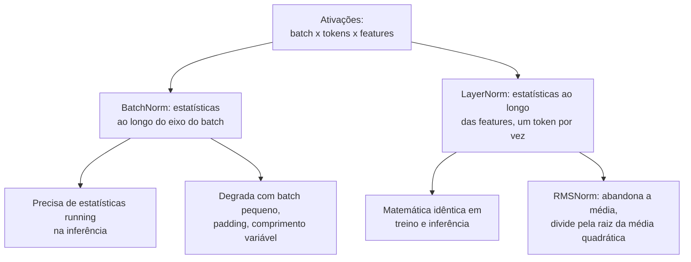

**Follow-ups:** Por que a BN geralmente tem desempenho inferior mesmo em transformers encoder-only, onde o decoding não é um problema? O que a RMSNorm remove e por que isso é aceitável? Explique mecanicamente por que post-norm em profundidade é instável.

</details>

### 27. Derive a cross-entropy loss a partir dos primeiros princípios. Por que ela é a loss "certa" para classificação e language modeling?

<details><summary><b>Resposta</b></summary>

Comece pela **maximum likelihood**. Um classificador (ou LM) define uma distribuição condicional p_θ(y|x). Dados i.i.d., o MLE maximiza Π p_θ(yᵢ|xᵢ); tomar logs (monotônico, transforma produtos em somas, numericamente necessário) e negar dá o objetivo de treinamento: minimizar a **negative log-likelihood** = −Σ log p_θ(yᵢ|xᵢ). Para uma saída categórica com targets one-hot, isso é exatamente a cross-entropy: H(y, p) = −Σ_c y_c log p_c = −log p(classe correta). Language modeling é isso aplicado por token: a cross-entropy de next-token é o MLE da distribuição do texto, e **perplexity = exp(CE média)** - "entre quantos tokens igualmente prováveis o modelo está escolhendo."

A visão da teoria da informação: minimizar a CE contra a distribuição empírica dos dados é equivalente a minimizar **KL(data ‖ model)** - você está casando a distribuição do modelo com a distribuição dos dados, e o gap acima da própria entropia dos dados é exatamente o termo KL.

Por que ela é *certa* mecanicamente, não apenas filosoficamente:

1. **Qualidade do gradiente.** Com saídas softmax, ∂CE/∂logits = **p − y**. Confiantemente errado (p≈0 na classe verdadeira) → gradiente próximo do máximo; correto e confiante → gradiente próximo de zero. Sem saturação em erros.
2. **Proper scoring rule**: a CE esperada é minimizada apenas ao prever as probabilidades condicionais verdadeiras, então incentiva incerteza honesta - a base da calibration de LMs.
3. Pune erros confiantes sem limite (−log p → ∞ quando p→0), que é o que você quer quando decisões posteriores consomem as probabilidades.

O enquadramento que cai bem em entrevistas: cross-entropy não é uma loss entre muitas - é no que "fazer MLE em uma distribuição categórica" *compila*. MSE é a mesma afirmação para ruído Gaussiano; toda loss padrão é uma likelihood disfarçada.

**Follow-ups:** Mostre que softmax+CE dá o gradiente p − y. O que o label smoothing muda nesse quadro? Por que perplexity é exp da CE, e o que perplexity 8 significa concretamente?

</details>

### 28. Explique softmax e o parâmetro temperature. Como calcular o softmax de forma estável, e onde a temperature aparece em ML?

<details><summary><b>Resposta</b></summary>

Softmax mapeia logits para uma distribuição de probabilidade: `p_i = exp(z_i/T) / Σ_j exp(z_j/T)`. Com temperature T=1 é a forma padrão. Quando **T→0** ela se aproxima do argmax (toda a massa no logit mais alto); quando **T→∞** achata em direção ao uniforme. Dividir por T reescala as *diferenças* entre logits, que é o que controla a nitidez. O softmax é invariante à adição de uma constante a todos os logits - só as diferenças importam - o que permite o truque de estabilidade.

**Estabilidade numérica**: exp estoura rápido (exp(89) dá overflow em fp32). Subtraia primeiro o logit máximo - matematicamente um no-op, numericamente essencial:

```python
def softmax(z, T=1.0):
    z = z / T
    z = z - z.max(axis=-1, keepdims=True)   # truque log-sum-exp
    e = np.exp(z)
    return e / e.sum(axis=-1, keepdims=True)
```

Na prática você calcula o `log_softmax` diretamente e o usa com NLL para uma cross-entropy fundida e estável - nunca `log(softmax(z))` em dois passos (catastrófico quando uma probabilidade sofre underflow para 0).

A temperature aparece por toda a stack, e conectar os pontos é o que torna esta resposta sênior:
- **Sampling de LLMs**: T escala os logits de next-token antes do sampling. T baixa → determinístico, repetitivo; T alta → diverso, propenso a erros. T=0 convencionalmente significa greedy decoding. Funciona junto com o truncamento top-p/top-k.
- **Knowledge distillation** (Hinton et al.): suavize a distribuição do teacher com T>1 para que o "dark knowledge" nas classes não-argmax carregue sinal de gradiente para o student.
- **Losses contrastivas** (InfoNCE/CLIP/SimCLR): scores de similaridade divididos por τ (~0,05-0,1) antes do softmax; τ controla quão intensamente a loss foca nos negativos mais confundíveis. O CLIP, como se sabe, *aprende* sua temperature.
- **Calibration**: o temperature scaling ajusta um único T nos logits de validação para corrigir superconfiança - mesmo botão, objetivo diferente.
- **Attention**: o fator 1/√d_k na scaled dot-product attention é exatamente uma temperature fixa que mantém a variância dos logits ~1 para que o softmax não sature na init.

**Follow-ups:** Por que a attention divide por √d_k - o que acontece sem isso? Por que temperature baixa *não* é o mesmo que truncamento top-k? O que quebra numericamente se você calcular log(softmax(z)) ingenuamente?

</details>

### 29. Compare PCA, t-SNE e UMAP. Quando você usaria cada um, e como as pessoas interpretam mal esses gráficos?

<details><summary><b>Resposta</b></summary>

PCA é linear e pertence a um pipeline. t-SNE e UMAP são não lineares e pertencem a uma tela, para olhar os dados, não para alimentar um modelo posterior.

**PCA** encontra direções ortogonais de variância máxima (autovetores da matriz de covariância, na prática a SVD dos dados centralizados). É determinístico, barato, invertível (você pode projetar de volta e medir o erro de reconstrução) e preserva a estrutura global. Isso o torna aquele que você pode entregar: reduzir embeddings de 1536-d para 256 para cortar o tamanho do índice e a latency, decorrelacionar features, remover ruído. Padronize primeiro se as features têm unidades diferentes. O modo de falha: variância não é informação. Uma direção de baixa variância pode ser a discriminativa, e o PCA a descartará.

**t-SNE e UMAP** otimizam um objetivo de preservação de vizinhança. São estocásticos, não preservam distâncias e enganam de maneiras específicas e documentadas:

- **Tamanhos de clusters não significam nada.** O t-SNE expande regiões esparsas e comprime as densas.
- **Distâncias entre clusters são em grande parte sem significado**, especialmente no t-SNE.
- **O gráfico muda com perplexity / n_neighbors e com a random seed.** Você consegue produzir clusters convincentes a partir de puro ruído Gaussiano escolhendo uma perplexity baixa o bastante.

O UMAP preserva mais estrutura global, é mais rápido e consegue transformar novos pontos (o t-SNE não consegue, sem gambiarras), mas as mesmas ressalvas valem.

Minhas regras: PCA até ~50 dims primeiro como passo de denoise e velocidade, depois t-SNE/UMAP. Varra perplexity/n_neighbors e várias seeds, e só acredite em estrutura que persista em todas. Nunca cite como achado uma contagem de clusters lida de um gráfico UMAP; confirme fazendo clustering no espaço original e checando contra os labels.

Para trabalho com embeddings especificamente, trate-os como auxiliares de debugging. Minhas paráfrases caem perto umas das outras? Meus embeddings de chunks colapsaram em uma única mancha? Boas perguntas. "Quantos intents meus usuários têm" não é respondível a partir da imagem.

**Follow-ups:** Você precisa cortar pela metade um índice de embeddings de 3072-d sem prejudicar o recall. Conduza-me pelas suas opções e como validaria a escolha. Por que o UMAP consegue transformar novos pontos e o t-SNE não?

</details>

### 30. Seu novo modelo marca 87,2% no test set, o atual marca 86,5%. Colocar em produção?

<details><summary><b>Resposta</b></summary>

Não com essa evidência. Uma estimativa pontual sem intervalo não é um resultado, e 0,7 ponto muito provavelmente é ruído.

Primeiro, quantifique a incerteza. Faça bootstrap do test set: reamostre com reposição ~1.000 a 10.000 vezes, recalcule a métrica a cada vez, tome os percentis 2,5 e 97,5. Melhor ainda, faça bootstrap da **diferença pareada**, pontuando ambos os modelos nos mesmos índices reamostrados, o que cancela a variância da dificuldade do test set e dá um intervalo muito mais estreito do que comparar dois ICs independentes. Note que ICs sobrepostos *não* implicam ausência de diferença significativa, então teste a diferença diretamente em vez de olhar duas barras de erro no olho.

Intuição aproximada da escala. Com n = 1.000 e accuracy perto de 0,87, o erro padrão é cerca de `sqrt(0.87*0.13/1000)` ≈ 1,1%. Um gap de 0,7 ponto cabe confortavelmente dentro do ruído. Resolvê-lo de forma confiável exigiria da ordem de dezenas de milhares de exemplos. O teste pareado ajuda porque apenas as discordâncias carregam informação, que é exatamente o que o teste de McNemar formaliza.

```python
import numpy as np
def paired_bootstrap(correct_a, correct_b, n=10_000, seed=0):
    rng, N = np.random.default_rng(seed), len(correct_a)
    d = np.array([ (correct_a[i]-correct_b[i]).mean()
                   for i in (rng.integers(0, N, N) for _ in range(n)) ])
    return np.percentile(d, [2.5, 97.5])
```

Três fontes de variância que a comparação ingênua esconde:

- **Variância de seed.** Retreine com várias seeds. Para fine-tunes, a dispersão entre seeds frequentemente engole o gap que você está perseguindo.
- **Ruído de seleção.** Se você tentou 40 configurações e reportou a melhor, o vencedor é em parte sorte. Isso exige um holdout novo.
- **Dados não iid.** Linhas agrupadas (várias por usuário ou por documento) quebram a premissa do bootstrap. Reamostre no nível do grupo.

A versão da era dos LLMs morde mais forte: eval sets frequentemente têm de 200 a 1.000 itens, então a maioria das afirmações "o modelo A bate o modelo B por um ponto" é irresolúvel. Se o gap está dentro do ruído, escolho por custo, latency ou simplicidade e digo isso claramente.

**Follow-ups:** Como você configuraria o eval para que uma diferença de 0,7 ponto *seja* detectável, e isso é um bom uso do orçamento? Seu test set tem 5 exemplos por usuário em 200 usuários. O que quebra em um bootstrap ingênuo?

</details>

### 31. O que é training-serving skew? Como você o detecta e como o elimina por design?

<details><summary><b>Resposta</b></summary>

Training-serving skew é quando as features que um modelo vê na inferência diferem das com que foi treinado, de modo que ele está pontuando uma distribuição que nunca ajustou. As métricas offline parecem boas, a produção silenciosamente rende menos e nada lança exceção. Esse silêncio é o que o torna a classe mais cara de bug de ML.

Causas, aproximadamente em ordem de quantas vezes as vi de fato:

1. **Duas implementações.** As features de treino vêm de um job batch em Spark ou SQL; as features de serving vêm de código no request path em outra linguagem. Elas divergem no momento em que qualquer um dos lados muda.
2. **Viagem no tempo.** Uma linha de treino para um evento no tempo `t` é unida a um snapshot de features que já contém dados posteriores a `t`. O treino viu um valor que o serving jamais pode ter.
3. **Tratamento diferente de nulos.** O treino imputa a mediana do conjunto de treino; o serving envia 0.
4. **Freshness skew.** O treino usou uma feature agregada sobre um dia completo; o serving lê uma parcialmente materializada.
5. **Drift de versão do pré-processamento.** Estatísticas do scaler, vocabulário ou tokenizer fora de sincronia com o checkpoint.

Eliminando por design:

- **Uma definição por feature**, consumida pelos dois caminhos. Esta é a verdadeira razão de existirem feature stores (Feast, Tecton); o armazenamento é incidental.
- **Joins point-in-time corretos** ao montar conjuntos de treino, para que uma linha só veja o que era conhecível naquele momento.
- **Embarque o pré-processamento dentro do artefato** (um Pipeline do sklearn, um módulo torch, o grafo de serving) para que ninguém possa reimplementá-lo.
- **Registre em log o vetor exato de features servido** e reutilize esses logs como dados de treino da próxima rodada. Para features registradas em log, o skew se torna estruturalmente impossível.

Detecção, porque a prevenção nunca é completa: compare as distribuições dos vetores servidos com as do conjunto de treino por feature (PSI ou KL contra uma janela de referência) e alerte. Melhor ainda, rode um shadow job que reproduz as requisições registradas através do pipeline de treino e compara os valores das features. Qualquer taxa de diferença diferente de zero é um bug. Eu preferiria muito mais ler "5% das linhas discordam na feature X" do que gastar uma semana caçando uma queda misteriosa de AUC.

**Vale desenhar.** Duas caixas calculando a mesma feature é o bug; a seta de replay embaixo é a única coisa que prova que você não o tem.

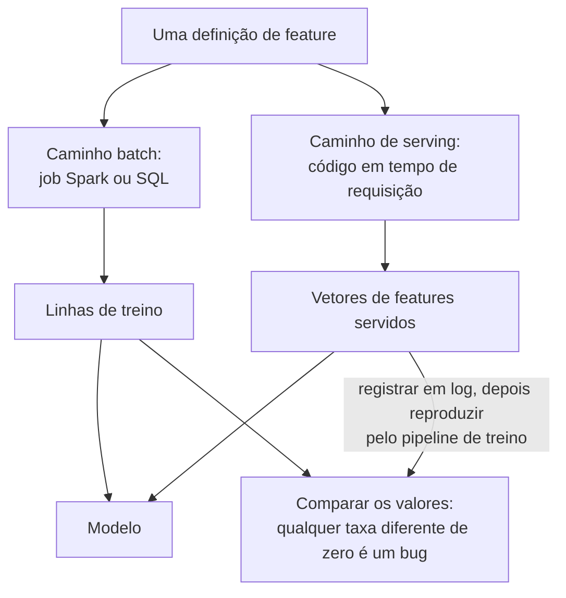

**Follow-ups:** Dê-me um join point-in-time concreto e mostre onde a versão ingênua vaza. Seu alerta de PSI dispara em uma feature. Como você distingue uma mudança real upstream de um pipeline quebrado?

</details>

### 32. Você está rodando um A/B test em um novo modelo. Conduza-me pelo design e diga o que você se recusaria a fazer depois que ele estivesse no ar.

<details><summary><b>Resposta</b></summary>

Fixe a métrica, o efeito mínimo detectável e o tamanho da amostra *antes* do lançamento, e então não espie sem corrigir para isso.

**Dimensionamento.** O tamanho da amostra por braço escala aproximadamente como `n ∝ σ²/Δ²`, então reduzir à metade o efeito que você quer detectar quadruplica o tráfego. Isso significa que a primeira pergunta não é "por quanto tempo rodamos", mas "qual lift vale a pena entregar". Padrões de α = 0,05 e 80% de poder significam uma chance em cinco de perder um efeito real, o que é aceitável para uma mudança barata e negligente para uma aposta grande.

**Peeking.** Testes de horizonte fixo assumem uma única olhada em um n predeterminado. Checar diariamente e parar no momento em que p < 0,05 infla a taxa de falsos positivos muito acima do α nominal. Correções aceitáveis: um horizonte fixo pré-registrado, fronteiras sequenciais em grupo (estilo O'Brien-Fleming) ou p-values sequenciais always-valid se o time insistir em um dashboard ao vivo. O que eu me recuso a fazer é parar cedo em um teste sem correção, que é como nascem a maioria dos "ganhos" que não se replicam.

**Redução de variância.** O CUPED remove por regressão uma covariável pré-experimento, tipicamente a métrica do mesmo usuário no período anterior. Quando a métrica é autocorrelacionada, ele reduz a variância substancialmente e encurta o teste. Mais barato que comprar tráfego.

Armadilhas que eu levantaria sem ser perguntado:

- **Sample ratio mismatch.** A primeira coisa que checo. Se a divisão não é a que você configurou, a atribuição está quebrada e todo número posterior é suspeito.
- **Unidade de randomização vs unidade de análise.** Randomize por usuário, analise por sessão, e a premissa iid quebra; seus p-values ficam pequenos demais. Use o delta method ou um cluster bootstrap para métricas de razão.
- **Interferência.** Em marketplaces ou grafos sociais o controle é contaminado pelo tratamento. Switchback ou randomização por cluster.
- **Novidade e primacy.** A primeira semana não é o estado estacionário.

Para uma feature de LLM especificamente, o custo por requisição é uma métrica co-primária, não uma nota de rodapé. Um ganho de 1% em qualidade que dobra o gasto de tokens não é um ganho, e o eval offline é apenas um proxy para a métrica online de qualquer forma.

**Vale desenhar.** Colocar a decisão sobre peeking no diagrama força a conversa de que você realmente precisa com o time antes do lançamento, não depois.

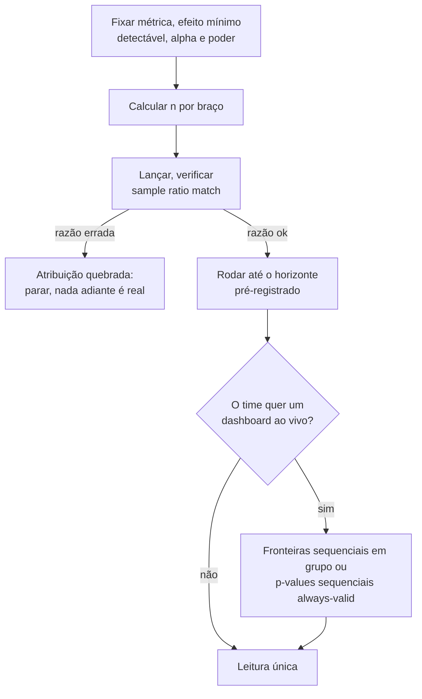

**Follow-ups:** Sua métrica é receita por usuário, que tem cauda pesada e é majoritariamente zero. O que isso faz com seu tamanho de amostra e o que você faria a respeito? Como você detectaria um efeito de novidade em vez de assumi-lo?

</details>

### 33. Cerca de 10% dos seus labels de treino estão errados. O que acontece, e o que você faz a respeito?

<details><summary><b>Resposta</b></summary>

Ruído de labels limita a accuracy alcançável, enviesa a seleção de modelo e, o mais danoso, corrompe o seu eval. Então eu corrijo o eval primeiro. Se 10% dos labels de *test* estão errados, um modelo perfeito marca ~90%, e pior, o ranking entre dois bons modelos passa a ser decidido por qual deles prevê melhor o ruído. Toda decisão posterior herda isso.

O treinamento é mais tolerante do que as pessoas esperam. Modelos são razoavelmente robustos a ruído *simétrico aleatório* com dados suficientes, porque ele se anula na média e a cross-entropy ainda consegue recuperar o posterior correto. Duas ressalvas importam mais que a robustez:

- **O ruído real é sistemático, não aleatório.** Os anotadores rotulam errado uma classe específica de forma consistente, ou as diretrizes são ambíguas em uma região específica. Ruído sistemático é aprendido como sinal, e nenhuma quantidade de dados o cura.
- **Modelos grandes memorizam labels ruidosos tarde no treinamento.** Aparece como um gap train/val que se alarga depois de um ajuste inicialmente limpo, o que torna o early stopping uma defesa genuína aqui.

Meu playbook:

1. **Meça.** Reanote uma amostra aleatória de ~200 a 500 itens com seus melhores anotadores ou um painel com adjudicação. Você quer a taxa de ruído e, mais útil ainda, o padrão de confusão.
2. **Leia a discordância como um bug de especificação.** Alta discordância entre anotadores geralmente significa que a rubrica é ambígua, não que os anotadores são descuidados. Corrija as diretrizes antes de comprar mais labels.
3. **Divida seus dados por propósito.** Construa um gold set pequeno, caro e com vários anotadores para eval; trate a pilha ruidosa apenas como dados de treino. Reporte a concordância entre anotadores (kappa de Cohen ou de Fleiss) como o teto contra o qual qualquer modelo pode ser medido.
4. **Limpe pela loss.** Treine com cross-validation, inspecione exemplos confiantemente errados e de loss alta. A maioria é de rotulagem errada, alguns são genuinamente difíceis e uns poucos revelam que a definição da sua tarefa está quebrada. Ferramentas de confident learning (estilo cleanlab) formalizam isso.
5. **Mitigue na loss.** Label smoothing, losses robustas/simétricas, reponderação de amostras.

O atalho de 2026: peça a um modelo forte para pré-rotular e trazer à tona as discordâncias para humanos. Só nunca deixe a mesma família de modelos julgar suas próprias saídas no seu gold set.

**Follow-ups:** O kappa é 0,55 na sua tarefa. O que isso lhe diz, e o que você faz a seguir? Como você distinguiria um exemplo genuinamente difícil de um rotulado errado no seu bucket de loss alta?

</details>

### 34. Você está adaptando um modelo pré-treinado a uma nova tarefa. O que você congela, o que treina, e como decide?

<details><summary><b>Resposta</b></summary>

Quanto você descongela deve escalar com a quantidade de dados da tarefa que você tem e com a distância do seu domínio em relação à distribuição de pretraining. Essa é a decisão inteira.

A escada:

1. **Backbone congelado mais um linear probe.** Centenas de exemplos, domínio próximo do pretraining. É também a medição honesta de quão boa a representação já é, e eu o rodo primeiro de qualquer forma, como baseline.
2. **Descongelar os últimos N blocos.** Milhares de exemplos.
3. **Fine-tune completo.** Dezenas de milhares ou mais, ou um domínio genuinamente distante (imagem médica, texto jurídico, uma língua incomum).
4. **PEFT / LoRA.** O padrão para LLMs agora. Você treina cerca de 1% dos parâmetros, mantém um modelo base residente e troca adapters por tarefa, e em boa parte escapa do catastrophic forgetting de capacidade geral que o fine-tune completo convida.

Por que as camadas iniciais congelam bem: elas aprendem estrutura genérica (bordas e texturas em CNNs, sintaxe e regularidades superficiais nas camadas iniciais de transformers), enquanto as camadas finais são específicas da tarefa e dos labels. Mesma razão pela qual você sempre substitui o head.

Regras práticas que separam quem já fez:

- **LR muito menor que o do pretraining**, tipicamente ~10 a 100x menor. Você está empurrando, não sobrescrevendo.
- **Aqueça o novo head com o backbone congelado** por uma época antes de descongelar. Um head inicializado aleatoriamente emite gradientes grandes que destruirão os pesos pré-treinados nos primeiros passos.
- **LRs discriminativos**, menores para camadas anteriores, se você descongela parcialmente.
- **Mantenha a BatchNorm em modo eval** quando os batches de fine-tuning são pequenos. Atualizar estatísticas running a partir de um batch de 8 é uma regressão silenciosa clássica.

Quando não fazer transfer: quando o orçamento de deployment não comporta o modelo pré-treinado (então faça distillation), ou quando o input é verdadeiramente alienígena para ele.

Para aplicações de LLM especificamente, a ordem importa: tente prompting, few-shot e retrieval primeiro. Faça fine-tuning para conformidade de formato e comportamento, ou para mover uma tarefa para um modelo menor e mais barato. Fazer fine-tuning para injetar fatos geralmente é a ferramenta errada; para isso existe o retrieval.

**Follow-ups:** Você fez fine-tuning e o modelo ficou melhor na sua tarefa, mas pior em todo o resto. Diagnostique e corrija. Por que o LoRA resiste mais ao catastrophic forgetting do que o fine-tune completo com o mesmo learning rate efetivo?

</details>

### 35. O que dá errado quando você valida um modelo em dados ordenados no tempo, e como fazer isso corretamente?

<details><summary><b>Resposta</b></summary>

K-fold aleatório em dados ordenados no tempo é leakage, ponto final. Treina no futuro para prever o passado, marca lindamente e morre em produção.

Use **walk-forward (rolling-origin) validation**: treine em `[0, t)`, valide em `[t, t+h)`, avance, repita. Múltiplos folds, para que você veja a variância entre regimes em vez de uma única janela de sorte. Janela expansível se regimes antigos ainda se aplicam; janela deslizante se não.

Os vazamentos mais sutis são onde as entrevistas são realmente vencidas:

- **Agregações não causais.** Calcular médias móveis, target encodings ou estatísticas de scaler sobre a série inteira antes de dividir. Toda agregação deve usar apenas dados até `t`.
- **Janela do label sobrepondo a janela de features.** Prever "churn nos próximos 30 dias" com features que incluem atividade do dia `t+5`.
- **Dados que existem no seu warehouse mas não existiam naquele momento.** Registros que chegam tarde, correções com backfill, números reapresentados. Seu snapshot de treino é retrospectivo; o serving não é. Este é o assassino, e joins point-in-time corretos são a correção.
- **Sem embargo.** Deixe um intervalo entre treino e validação igual ao horizonte do label. Sem ele, a autocorrelação torna as linhas de cada lado da fronteira quase duplicatas.

Duas coisas que eu insistiria em reportar:

**Baselines.** Sempre compare contra a persistência ingênua (`y_hat_t = y_{t-1}`) e o seasonal naive. Uma grande fração de modelos de forecasting de aparência impressionante não os supera, e qualquer entrevistador que já entregou forecasting sabe disso.

**Métricas por horizonte, não médias.** Um modelo pode ser excelente em h=1 e inútil em h=30, e a média esconde exatamente o que o negócio importa.

Por fim, trate o distribution shift como padrão em vez de patologia. A cadência de retreino é um parâmetro de design, não uma reflexão tardia. Um modelo validado em dados de 2024 enfrentando uma mudança de regime em 2026 não está fazendo overfitting, é um problema diferente, e confundir os dois leva você a otimizar a regularização quando deveria estar reconstruindo o pipeline.

**Vale desenhar.** O intervalo de embargo e a restrição "somente até t" são as duas coisas que os candidatos omitem, e um desenho torna sua ausência óbvia.

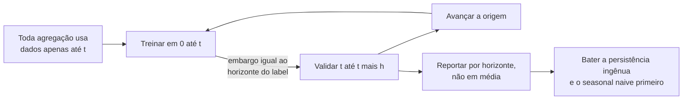

**Follow-ups:** Seus folds walk-forward mostram scores muito diferentes. O que isso diz e o que você reporta aos stakeholders? Como você constrói um conjunto de treino quando os valores de uma feature-chave são reapresentados 3 dias depois do fato?

</details>

### 36. Como você escolhe k em clustering, e como avalia um clustering quando não tem labels?

<details><summary><b>Resposta</b></summary>

Eu me esforço para não escolher k no vácuo, porque o k certo quase sempre é definido para que os clusters *servem*. Se a saída são 8 macros de suporte, então k é perto de 8 e a questão é se os dados sustentam isso.

Mecânica para k-means: o elbow na inertia é fraco (a inertia diminui monotonicamente e o elbow frequentemente é invisível). A silhouette é melhor porque penaliza sobreposição. Se eu mudo para uma Gaussian mixture, obtenho o BIC, que é um critério fundamentado de seleção de modelo, mais atribuições soft.

Minha verificação honesta favorita é a **estabilidade**: faça bootstrap de resamples do cluster e meça a consistência das atribuições entre runs com o adjusted Rand index. Clusters que não são estáveis entre resamples não são reais, e isso pega a falha de ruído-virando-cluster que a silhouette deixará passar alegremente.

O que as pessoas esquecem sobre o k-means: ele assume clusters aproximadamente esféricos, de tamanhos e densidades similares, e usa distância Euclidiana, então as features precisam estar em escala. Ele alegremente cortará um cluster alongado em três. Quando essas premissas quebram, use DBSCAN/HDBSCAN, que inferem o número de clusters, lidam com formas arbitrárias e rotulam outliers como ruído em vez de forçar cada ponto a algum lugar. O preço é ajustar `min_samples`/`eps` e ter dificuldade com densidade variável, que o HDBSCAN trata melhor. O agglomerative dá um dendrograma e permite adiar a decisão de k.

Em embeddings, que é o caso comum agora (agrupar queries de usuários para descobrir intents): normalize em L2 e use cosine, ou spherical k-means. Distâncias Euclidianas em alta dimensão se concentram e deixam de ser informativas. Reduza com PCA para velocidade, mas valide no espaço original em vez de na imagem do UMAP.

**O extrínseco vence o intrínseco sempre.** Rotule à mão uma amostra de clusters e cheque se são acionáveis, ou meça se o clustering melhora aquilo que ele alimenta. E o truque prático de 2026: depois de agrupar as queries, peça a um LLM que dê nome a cada cluster a partir dos seus membros. Se ele não consegue produzir um label coerente, aquilo não é um cluster.

**Follow-ups:** A silhouette diz k=2, o time de produto precisa de ~10 segmentos acionáveis. O que você faz? Por que as distâncias Euclidianas em alta dimensão se concentram, e o que isso faz com o k-means especificamente?

</details>

### 37. O que é conformal prediction, e como você a usaria para colocar uma garantia estatística nas saídas de um classificador ou de um pipeline de LLM?

<details><summary><b>Resposta</b></summary>

Conformal prediction envolve qualquer modelo treinado e transforma seus scores em **prediction sets** com uma taxa de cobertura garantida: para um nível de erro α escolhido, o conjunto contém o label verdadeiro pelo menos 1 − α das vezes, em média sobre novos exemplos. Ela não assume nada sobre o modelo estar correto ou calibrado, apenas que os dados de calibração e de teste são **intercambiáveis** (exchangeable; grosso modo, tirados da mesma distribuição).

Split conformal, a versão que você realmente entrega:

1. Reserve um conjunto de calibração em que o modelo nunca treinou, de algumas centenas a alguns milhares de exemplos.
2. Defina um nonconformity score, por exemplo 1 − p(classe verdadeira) para um classificador, ou |y − ŷ| para regressão.
3. Pontue cada exemplo de calibração e tome o quantil empírico ⌈(n+1)(1−α)⌉/n, q̂.
4. Na inferência, mantenha todo label cujo score é no máximo q̂. Para regressão isso dá o intervalo ŷ ± q̂.

O tamanho do conjunto é o sinal útil. Um input fácil recebe um singleton, um ambíguo recebe vários labels, um fora de escopo recebe um conjunto grande. Isso se mapeia diretamente em decisões de produto: aja automaticamente em singletons, encaminhe conjuntos grandes a um humano ou a um modelo mais forte. A mesma maquinaria se aplica a pipelines de LLM, por exemplo escolhendo um threshold em um score de verifier ou judge de modo que as respostas aceitas sem revisão atinjam uma taxa de erro-alvo. Conformal risk control generaliza a garantia de miscoverage para outras losses limitadas.

O que os candidatos erram: a garantia é **marginal**, média sobre inputs, não por input. Um modelo pode cobrir demais os casos fáceis e cobrir de menos um subgrupo difícil. Conformal condicional à classe ou ao grupo corrige isso ao custo de mais dados de calibração por grupo. E a intercambiabilidade quebra sob distribution shift, então atualize o conjunto de calibração com tráfego recente e monitore a cobertura realizada em produção como qualquer outra métrica.

**Vale desenhar.** A etapa do quantil é o método inteiro, e colocá-la entre o modelo congelado e a decisão de roteamento mostra que é um wrapper fino e agnóstico ao modelo.

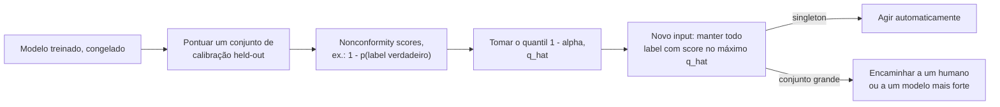

**Follow-ups:** Por que a correção (n+1) no quantil? Como você obteria uma cobertura que vale por classe e não na média? O tráfego muda após um lançamento de produto: o que acontece com a cobertura, e como você detectaria isso?

</details>

### 38. Um stakeholder pergunta quais features conduzem seu modelo de gradient boosting. Compare a importância embutida, a permutation importance e o SHAP, e diga onde cada uma engana.

<details><summary><b>Resposta</b></summary>

As três respondem "em que o modelo se apoia". Nenhuma responde "o que causa o resultado", e elas discordam de maneiras previsíveis. Diga isso primeiro, porque o stakeholder geralmente quer a resposta causal.

- **Importância embutida (contagem de splits ou gain)** é gratuita e a menos confiável. A contagem de splits favorece features contínuas e de alta cardinalidade que oferecem muitos pontos de split, e o gain é medido nos dados de treino, então recompensa features que as árvores usaram para ajustar ruído. Serve para uma olhada rápida, não para um slide.
- **Permutation importance** embaralha uma coluna em um conjunto held-out e mede a queda da métrica. É agnóstica ao modelo e ligada ao valor preditivo real. Dois modos de falha: features correlacionadas (embaralhe uma de um par e o modelo se apoia no gêmeo, então ambas parecem sem importância, e o embaralhamento também cria linhas irrealistas que o modelo nunca viu), e custo, já que precisa de uma passada de scoring por feature por repetição.
- **SHAP** decompõe cada predição individual em contribuições aditivas por feature baseadas em valores de Shapley, dando explicações locais e, ao fazer a média dos valores absolutos, um ranking global. O TreeSHAP as calcula de forma exata e rápida para tree ensembles. Ressalvas: os resultados dependem dos dados de background e de como as features "ausentes" são simuladas (intervencional versus condicional), features correlacionadas dividem o crédito de maneiras que parecem arbitrárias, e um valor SHAP grande significa "moveu esta predição", não "mudaria o resultado se você interviesse".

O que eu realmente faria: permutation importance em dados held-out para a história global, embaralhando clusters correlacionados juntos para que os gêmeos não possam se esconder um ao outro. SHAP para decisões individuais, como códigos de motivo em uma decisão de crédito. Partial dependence ou gráficos ICE quando alguém perguntar sobre direção e forma. E se uma feature ranqueia alto e ninguém consegue explicar por quê, trate-a como suspeita de leakage antes de tratá-la como um insight.

Quando a pergunta real é "o que acontece se mudarmos X", a resposta é um experimento ou um modelo causal, não um método de atribuição.

**Follow-ups:** Duas features têm correlação 0,95 e ambas mostram permutation importance próxima de zero. O que está acontecendo e como você reporta isso? Por que duas ferramentas de SHAP podem dar valores diferentes para o mesmo modelo?

</details>

## Avançado

### 39. Por que a MSE é uma loss ruim para classificação, mesmo que "funcione"? Conecte isso à visão probabilística das loss functions.

<details><summary><b>Resposta</b></summary>

Dois argumentos independentes - mecânico e probabilístico - e uma resposta forte dá ambos.

**Mecânico: gradient starvation em erros confiantes.** Para uma saída sigmoid p = σ(z) com loss MSE (p − y)², o gradiente em relação ao logit é `2(p − y)·σ'(z)`, e σ'(z) = p(1−p) → 0 sempre que a saída satura. Então um exemplo que o modelo erra *com confiança* (p≈0, y=1) produz quase **nenhum gradiente** - precisamente os exemplos que mais precisam de correção aprendem mais devagar. O gradiente sigmoid/softmax da cross-entropy é `p − y` sem fator σ': a derivada do log cancela exatamente a saturação da sigmoid, então erros confiantes recebem as maiores atualizações. Isso também torna a MSE-sobre-sigmoid não convexa em z por exemplo, com platôs ruins, enquanto a CE é convexa nos logits.

**Probabilístico: modelo de ruído errado.** Toda loss é uma negative log-likelihood sob alguma premissa de ruído. MSE ⇔ ruído Gaussiano com variância fixa - um modelo para alvos contínuos que podem ser "errados por 0,3." Labels de classe são eventos categóricos; a likelihood correta é Bernoulli/categórica, cuja NLL *é* a cross-entropy. Usar MSE afirma que prever 0,7 para um label verdadeiro 1 incorre no mesmo tipo de penalidade que um erro de regressão, e limita a penalidade máxima por confiança total na classe errada a 1,0, enquanto a CE atribui penalidade ilimitada (−log p → ∞). A CE é a negative log-likelihood do modelo categórico, então treinar com ela *é* MLE - e é por isso que probabilidades treinadas sob CE são as que têm uma interpretação probabilística limpa.

Nuance a oferecer: o Brier score (MSE sobre probabilidades) *é* uma proper scoring rule e é usado para avaliar calibration - a objeção é sobre a dinâmica de otimização e a correção da likelihood para treinamento, não que MSE sobre probabilidades seja sem sentido. E a regressão inverte tudo: a CE não se aplica diretamente, a MSE é exatamente certa sob premissas Gaussianas, L1/Huber quando você quer robustez a outliers.

**Follow-ups:** Derive o gradiente p − y e mostre onde acontece o cancelamento. Quando você usaria o Brier score deliberadamente? Que loss corresponde a ruído de Laplace, e quando você a preferiria?

</details>

### 40. Explique contrastive learning e a loss InfoNCE. Como os modelos de embedding modernos (CLIP, text retrievers) são realmente treinados?

<details><summary><b>Resposta</b></summary>

Contrastive learning treina um encoder para que pares "correspondentes" pontuem alta similaridade e pares não correspondentes pontuem baixa - sem labels por exemplo. A **InfoNCE** operacionaliza isso como cross-entropy sobre similaridades: para uma query q com positivo k⁺ entre um conjunto de negativos {kᵢ},

L = −log [ exp(sim(q,k⁺)/τ) / Σᵢ exp(sim(q,kᵢ)/τ) ]

ou seja, uma classificação de N vias em que a "classe correta" é o parceiro verdadeiro. sim geralmente é cosine; **τ** (~0,05-0,1 tipicamente; o CLIP o aprende, inicializado em 0,07) afia o softmax para que a loss se concentre nos negativos mais difíceis e mais confundíveis. Teoricamente é um limite inferior da informação mútua entre as visões pareadas (do paper Contrastive Predictive Coding), embora na prática as pessoas a tratem como uma "softmax retrieval loss."

De onde vêm positivos/negativos é o jogo inteiro:
- **CLIP**: os positivos são pares (imagem, legenda) de dados da web; os negativos são todos os outros pares do batch (**in-batch negatives**) - uma matriz de similaridade N×N com uma loss simétrica nas duas direções. O batch size é crítico porque define o número/dificuldade dos negativos; o CLIP usou ~32k.
- **Modelos de text embedding/retrieval** (estilo E5/GTE/BGE, linhagem DPR): os positivos são (query, passagem relevante); os in-batch negatives são aumentados com **hard negatives** minerados por BM25 ou por um modelo anterior - passagens tematicamente próximas mas erradas, que ensinam discriminação fina. Receita comum: pretraining contrastivo fracamente supervisionado em larga escala sobre pares minerados, depois fine-tuning em dados curados com hard negatives, às vezes fazendo distillation de um cross-encoder reranker.
- **Visão self-supervised estilo SimCLR**: os positivos são duas augmentations da mesma imagem.

Modos de falha que vale citar: **falsos negativos** (in-batch "negativos" que na verdade são relevantes) limitam a qualidade alcançável em dados ruidosos; batches pequenos → negativos fáceis → embeddings moles (memory banks/filas estilo MoCo foram construídos para simular pools de negativos maiores); e se você treina com cosine+τ, deve servir com cosine (normalize antes de indexar).

**Vale desenhar.** Uma vez que a matriz de similaridade está no quadro, batch size e hard negatives deixam de ser tópicos separados: ambos são apenas colunas naquele softmax.


**Follow-ups:** Por que batches maiores ajudam o treinamento contrastivo mas importam menos para o treinamento supervised padrão? Como os hard negatives mudam o que o espaço de embeddings aprende? Como você construiria o conjunto de treino para um embedder de busca de código?

</details>

### 41. Além de L1/L2: explique early stopping, data augmentation e label smoothing como regularizadores. O que é regularização, realmente?

<details><summary><b>Resposta</b></summary>

A definição unificadora: regularização é qualquer técnica que reduz o erro de generalização sem (primariamente) reduzir o erro de treino - equivalentemente, qualquer coisa que injeta um **prior** ou restringe a capacidade efetiva para que o modelo prefira soluções com probabilidade de generalizar.

**Early stopping** interrompe o treinamento quando a val loss deixa de melhorar (com uma janela de patience) e restaura o melhor checkpoint. Ele restringe o quanto os pesos viajam a partir da inicialização - para losses quadráticas é formalmente equivalente à regularização L2 com força inversamente relacionada ao tempo de treino. É gratuito (você monitora a val loss de qualquer forma) e é o padrão de fato em fine-tuning. Ressalva: ele gasta o conjunto de validação; o checkpoint que você escolhe é ajustado a ele. Nota da era dos LLMs: o pretraining de uma única época raramente faz overfitting no sentido clássico, mas SFT em 10k exemplos absolutamente faz - 1-3 épocas com seleção de checkpoint em evals held-out é a norma.

**Data augmentation** codifica invariâncias como dados sintéticos: crops/flips/color jitter em visão (o label não deve mudar sob eles), paráfrase/back-translation em NLP clássico, SpecAugment em fala. É um prior expresso por meio dos dados em vez de por meio da loss - frequentemente o regularizador mais forte disponível porque ataca diretamente a variance com amostras (pseudo)novas. O análogo em LLMs é menos "augmentation" e mais geração de dados sintéticos e diversificação de formatos de prompt durante o SFT, protegendo contra overfitting de formato.

**Label smoothing** substitui o alvo one-hot por (1−ε) na classe verdadeira e ε/(K−1) nas demais (ε≈0,1). Impede o modelo de perseguir gaps de logit infinitos, melhora a calibration em classificação supervised e foi padrão em visão da era Inception e em machine translation. Ressalvas: distorce ligeiramente a semântica das probabilidades e é conhecido por prejudicar a distillation (a informação das classes não-alvo do teacher é achatada). Geralmente *não* é usado no pretraining de LLMs, onde casar com a distribuição dos dados - incluindo sua incerteza genuína - é o objetivo.

Também na família: dropout, weight decay, ruído de gradiente de batch pequeno e - o mais subestimado - **mais dados**, e é por isso que "coletar/limpar dados" vence regularizadores engenhosos na maioria dos contextos de produção.

**Follow-ups:** Por que early stopping ≈ L2 para losses quadráticas - dê a intuição. Quando a augmentation *prejudica*? Por que o label smoothing conflita com knowledge distillation?

</details>

### 42. Que tipos de distribution shift existem, e como você monitoraria um modelo em produção - clássico ou baseado em LLM - quanto a eles?

<details><summary><b>Resposta</b></summary>

Três tipos canônicos, distinguidos por *o que* muda entre treino e serving:

- **Covariate shift**: P(x) muda, P(y|x) estável - novos dados demográficos de usuários, novos tipos de dispositivo, mudanças na mistura de tráfego. O modelo vê inputs diferentes dos de seus dados de treino.
- **Label/prior shift**: P(y) muda - a taxa de fraude dobra em feriados; as frequências das classes se movem enquanto o comportamento condicional à classe se mantém.
- **Concept drift**: o próprio P(y|x) muda - o mesmo input agora significa outra coisa. Domínios adversariais (fraude, spam, abuso) sofrem drift *porque* seu modelo existe; os atacantes se adaptam a ele.

Stack de monitoramento, ordenada por latência do sinal:
1. **Input drift** (imediato): compare as distribuições de features ao vivo com uma janela de treino/referência - PSI, divergência KL, testes de Kolmogorov-Smirnov por feature; para inputs não estruturados, monitore o drift no **espaço de embeddings** (distância entre as distribuições de embeddings ao vivo e de referência).
2. **Prediction drift** (imediato): mudanças na distribuição de scores de saída ou na mistura de classes previstas frequentemente sinalizam problema antes de os labels chegarem.
3. **Métricas proxy/comportamentais** (rápidas): CTR, correções de usuários, taxas de thumbs-down, taxas de escalonamento para humano, taxas de retry.
4. **Métricas de ground-truth** (atrasadas): accuracy/PR verdadeiras quando os labels chegam - chargebacks em 60 dias, churn em 90. O atraso é o motivo de as camadas 1-3 existirem.
5. **Golden/canary sets**: suítes de eval fixas reproduzidas em um agendamento - detecção de regressão independente do tráfego.

Para sistemas de LLM especificamente: a distribuição de *queries* sofre drift (novos tópicos, novos padrões de jailbreak) e - de forma única - o **próprio modelo muda debaixo de você** quando um provedor atualiza um modelo hospedado ou você muda um prompt. Trate prompts+versões de modelo como código: fixe versões, rode suítes de eval (LLM-judge com auditoria humana periódica) a cada mudança, registre amostras em log para re-scoring offline e monitore propriedades de saída (comprimento, taxa de recusa, taxa de tool-call, scores do judge) como sinais de prediction-drift.

Respostas: retreinar/fazer fine-tuning com dados recentes, recalibrar thresholds (barato, frequentemente suficiente para prior shift) ou consertar pipelines de dados upstream - uma fração surpreendente dos alertas de "drift" são pipelines de features quebrados, não o mundo mudando.

**Follow-ups:** Como você distingue concept drift de um bug de pipeline de dados? Apenas prior shift - dá para corrigir sem retreinar? Projete o monitoramento de drift para um bot de suporte baseado em RAG.

</details>

### 43. Quando a cosine similarity engana você? Discuta patologias do espaço de embeddings relevantes para sistemas de retrieval.

<details><summary><b>Resposta</b></summary>

A cosine similarity só é tão significativa quanto a geometria do espaço em que é calculada, e várias patologias corrompem essa geometria:

**Anisotropia.** Hidden states brutos de modelos de linguagem ocupam um cone estreito em vez de se espalhar pela hiperesfera - o cosine médio entre pares de sentenças *aleatórias* pode ser muito alto (é por isso que os primeiros "embeddings BERT via mean pooling" tiveram desempenho inferior a vetores GloVe médios simples em tarefas de similaridade, como o paper Sentence-BERT mostrou). Consequência: valores absolutos de cosine são ininterpretáveis; um 0,8 pode ser o piso de ruído. O fine-tuning contrastivo (a linhagem SimCSE, e todos os embedders modernos) espalha explicitamente o espaço - a loss InfoNCE tem um termo de **uniformity** que afasta os pontos e um termo de **alignment** que aproxima os positivos. Regra prática: nunca entregue busca por vizinho mais próximo sobre ativações de LLM base; use um embedder treinado de forma contrastiva.

**Hubness.** Em altas dimensões, alguns pontos viram "hubs" que aparecem nas listas de k-NN de uma parcela desproporcional de queries - um artefato da concentração de distâncias. Sintoma: o mesmo punhado de chunks recuperado para tudo. Mitigações: melhores embedders, normalização de score por candidato, reranking com um cross-encoder.

**Descasamento de métrica entre treino e serving.** Um modelo treinado com cosine (normalizado) mas indexado com inner product bruto deixa as *normas* dos vetores - que o objetivo de treinamento nunca disciplinou - dominarem os rankings. Normalize na hora de indexar e na hora da query, e configure a métrica do índice ANN (IP vs L2 vs cosine) para corresponder.

**Direções isotrópicas mas sem significado.** O cosine pesa todas as dimensões igualmente; se algumas dimensões carregam informação de ruído de alta variância (comprimento, idioma, formatação), a similaridade reflete isso. Transformações de whitening e fine-tuning do embedder específico para a tarefa tratam isso parcialmente.

**Descasamento de tarefa** - o mais sutil para RAG: "similar" é relativo à tarefa. A relevância pergunta-para-resposta é assimétrica; uma pergunta frequentemente é mais similar por cosine a *outras perguntas*, não às passagens que a respondem. Daí os embedders assimétricos com prefixo de instrução (prompts separados de query/passagem, estilo E5/BGE) e os cross-encoder rerankers sobre o top-k.

**Follow-ups:** Como você detectaria hubness em um sistema RAG de produção? Por que um cross-encoder vence o cosine de um bi-encoder, e por que não usá-lo para o retrieval de primeiro estágio? O que alignment e uniformity significam no enquadramento de Wang & Isola do contrastive learning?

</details>

### 44. O que é maximum likelihood estimation? Mostre como ela gera as loss functions padrão e onde a visão Bayesiana (MAP) se conecta à regularização.

<details><summary><b>Resposta</b></summary>

O MLE escolhe os parâmetros que tornam os dados observados mais prováveis sob o modelo: θ* = argmax_θ Π p_θ(dadosᵢ). Na prática você maximiza a **log**-likelihood - monotônica (mesmo argmax), transforma o produto em soma (dados i.i.d. → losses por exemplo que se agrupam bem em mini-batches) e evita o underflow de ponto flutuante ao multiplicar milhares de probabilidades. Uma likelihood *não* é uma distribuição de probabilidade sobre θ - é a probabilidade dos dados vista como função dos parâmetros; não precisa integrar a 1 sobre θ.

O movimento generativo que os entrevistadores querem: **escolha um modelo de ruído, ganhe uma loss de graça.**
- Likelihood categórica sobre classes/tokens → NLL = **cross-entropy**. O pretraining de LLMs é MLE da distribuição do texto, token por token.
- Likelihood Gaussiana com variância fixa em torno de uma média prevista → NLL = **MSE** (a menos de constantes).
- Ruído de Laplace → **L1/MAE** (daí sua robustez a outliers - caudas pesadas esperam erros grandes ocasionais).
- Bernoulli → binary cross-entropy; Poisson → loss de regressão de Poisson.

Então "qual loss?" é na verdade "qual distribuição condicional eu acredito que gerou os alvos?"

**MAP** (maximum a posteriori) adiciona um prior: maximize log p(dados|θ) + log p(θ). Um prior Gaussiano de média zero nos pesos adiciona −λ‖θ‖², ou seja, **L2/weight decay**; um prior de Laplace adiciona −λ‖θ‖₁, ou seja, **L1**. Regularização é literalmente uma crença prévia de que os pesos devem ser pequenos - as visões Bayesiana e de otimização penalizada são a mesma matemática.

Propriedades que vale citar: o MLE é consistente e assintoticamente eficiente sob condições de regularidade, mas com dados finitos faz overfitting - atribui alegremente probabilidade 1 a eventos vistos uma vez (o problema de smoothing em LMs clássicos de n-grams). Priors/regularização são a correção para dados finitos. Uma ruga moderna: objetivos estilo RLHF saem do arcabouço do MLE - eles otimizam a recompensa esperada com uma coleira KL de volta ao modelo de referência treinado por MLE, e é por isso que o termo KL está ali: ele ancora a policy na distribuição que o MLE aprendeu.

**Follow-ups:** Derive a MSE a partir da likelihood Gaussiana explicitamente. Por que o MLE + uma observação de um evento raro dá probabilidades patológicas, e qual é a correção? Que papel a penalidade KL desempenha no RLHF sob esse ponto de vista?

</details>

### 45. O que é double descent, e como ele muda a história clássica sobre tamanho de modelo e overfitting?

<details><summary><b>Resposta</b></summary>

O aprendizado estatístico clássico prevê uma curva de erro de teste em forma de U na capacidade do modelo: underfit → ponto ideal → overfit, com o pior comportamento quando o modelo consegue memorizar exatamente os dados. O **double descent** (Belkin et al. 2019; ampliado empiricamente em Nakkiran et al., "Deep Double Descent") mostra o que realmente acontece com redes modernas: o erro de teste sobe conforme você se aproxima do **limiar de interpolação** (capacidade ≈ apenas suficiente para ajustar o conjunto de treino, incluindo seu ruído), *atinge o pico ali* e depois **cai de novo** conforme você continua crescendo o modelo muito além dele. O U clássico é a metade esquerda de uma curva maior.

Intuição para a segunda descida: no limiar de interpolação há essencialmente uma única maneira de ajustar os dados, e ela é contorcida - forçada a passar por labels ruidosos com uma função tensionada. Com superparametrização massiva, existem *muitas* soluções interpoladoras, e o viés implícito do otimizador (métodos da família SGD preferindo soluções de baixa norma/"suaves") seleciona as que generalizam bem desse conjunto. Memorizar o ruído deixa de forçar estranheza global.

Nakkiran et al. mostraram o fenômeno ao longo de três eixos: **model-wise** (redes maiores), **epoch-wise** (treinar por mais tempo através de uma protuberância do erro de teste no meio do treino) e **data-wise** - o genuinamente contraintuitivo, em que *mais dados podem prejudicar transitoriamente* um modelo de tamanho fixo ao mover o limiar de interpolação para cima dele. O ruído de labels amplifica o pico; regularização e early stopping podem suavizá-lo, e é por isso que os praticantes raramente veem uma curva limpa de double descent no mundo real.

Por que importa na era dos LLMs: dissolve o instinto de "seu modelo é grande demais, vai fazer overfitting" e é consistente com a prática de scaling - transformers maiores generalizam melhor, e a capacidade é orçada contra compute e dados (scaling laws estilo Chinchilla), não contra temores clássicos de overfitting. Ressalva que um candidato forte acrescenta: o pretraining de uma época em trilhões de tokens fica longe do regime de interpolação de qualquer forma - as preocupações com memorização ali são sobre privacidade/contaminação, não sobre test loss.

**Follow-ups:** Onde entra o viés implícito do SGD nessa história? Como adicionar dados de treino pode prejudicar - percorra o mecanismo. O double descent contradiz a decomposição bias-variance ou apenas a narrativa clássica de capacidade?

</details>

### 46. Sua loss de pretraining de LLM acabou de dar spike. Conduza-me pela estabilidade de treinamento: gradient clipping, mixed precision e seu playbook de debugging.

<details><summary><b>Resposta</b></summary>

Loss spikes são endêmicos no treinamento de transformers em larga escala - batches ruins ocasionais, explosões de logits de attention ou estado do otimizador mal escalado produzem um gradiente enorme, uma atualização destrutiva e uma loss que salta e ou se recupera lentamente, ou estabiliza mais alto, ou diverge.

**Defesas permanentes** em toda receita séria:
- **Gradient clipping por norma global** (tipicamente 1,0): calcule a norma sobre todos os parâmetros; se exceder o threshold, reescale o vetor de gradiente inteiro. Preserva a direção, limita a magnitude. A *frequência* de clipping é em si uma métrica de saúde - clipar a cada passo significa que o seu LR está alto demais.
- **Mixed precision bem feita.** O fp16 tem um dynamic range minúsculo (máx. ~65k, e o underflow é o maior assassino) e exige **loss scaling** - multiplique a loss por um fator para que gradientes pequenos sobrevivam em fp16, desfaça a escala antes do passo do otimizador e pule passos cujos gradientes contenham inf/NaN (o dynamic loss scaling automatiza isso). O **bf16** mantém os 8 bits de expoente do fp32 com menor precisão de mantissa, eliminando o loss scaling - o formato de mixed precision padrão nas GPUs e TPUs atuais. Runs grandes levam cada vez mais os matmuls adiante, para **FP8** com escalonamento fino (por bloco), como o DeepSeek-V3 reportou, mantendo operações sensíveis em maior precisão. De qualquer forma, mantenha **master weights e optimizer states em fp32**; acumule grandes reduções em fp32.
- **Estabilizadores de arquitetura/objetivo**: posicionamento pre-norm, QK-norm para impedir o crescimento dos logits de attention e uma **z-loss** auxiliar (usada no PaLM, ~1e-4 · log²Z) que impede o normalizador do softmax de derivar.
- Warmup + peak LR sensato, β₂ ≈ 0,95 (uma memória de segundo momento mais curta reage mais rápido a mudanças na escala do gradiente do que 0,999).

**O playbook quando um spike acontece**: verifique os logs de grad-norm e de normas por camada - um spike de grad-norm *precedendo* o spike de loss implica otimização; nenhum spike de gradiente sugere dados. Inspecione o batch problemático (documentos corrompidos, repetição patológica - problemas de dados são o culpado mais comum). Remediações padrão, em escalada: confiar no clipping e deixar recuperar; **voltar ao último bom checkpoint e pular os batches de dados problemáticos** (o paper do PaLM descreve exatamente isso, e o logbook público do OPT documenta rollbacks repetidos); reduzir o peak LR; adicionar estabilizadores (QK-norm, z-loss). Descarte também a infraestrutura: uma GPU instável produzindo NaNs silenciosos parece exatamente um problema de otimização - o log de gradient-norm por rank o localiza.

**Vale desenhar.** O primeiro ramo é o playbook inteiro: se a grad-norm se moveu antes da loss lhe diz se isto é otimização, dados ou hardware.

```mermaid
flowchart TD
    A["Spike de loss"] --> B{"Spike de grad-norm<br/>antes do spike de loss?"}
    B -->|"sim"| C["Otimização: reduzir o peak LR,<br/>checar com que frequência o clipping dispara"]
    B -->|"não"| D["Dados: inspecionar o batch por<br/>docs corrompidos ou repetição patológica"]
    B -->|"apenas um rank"| E["Infraestrutura: dispositivo instável<br/>emitindo NaNs silenciosos"]
    D --> F["Voltar ao último bom<br/>checkpoint, pular aquele shard"]
    C --> G["Adicionar estabilizadores: QK-norm,<br/>z-loss, beta2 em 0,95"]
    F --> G
```

**Follow-ups:** Por que o bf16 remove a necessidade de loss scaling - qual é a diferença real em nível de bits? Por que β₂ menor para LLMs? O clipping dispara em 40% dos passos - o que você muda?

</details>

### 47. Projete a avaliação de ponta a ponta para um modelo de fraude com 0,1% de prevalência: métricas, thresholding, protocolo de validação e monitoramento.

<details><summary><b>Resposta</b></summary>

Esta é uma pergunta de síntese - o entrevistador quer os fios de desbalanceamento, calibration, leakage e drift tecidos em um design coerente.

**Métricas.** Descarte a accuracy (baseline de 99,9%) e desconfie da ROC-AUC (FPR diluída por negativos de ~999:1). Métricas offline primárias: **PR-AUC** para comparação de modelos, mais métricas de ponto de operação ligadas à capacidade - se o time de fraud-ops revisa 500 alertas/dia, reporte **precision@500/dia** e o recall alcançado ali; alternativamente, recall em uma FPR fixa. Expresse o objetivo final em dinheiro: custo esperado = contagem_FN·(perda média de fraude) + contagem_FP·(custo de revisão + custo de fricção com o cliente).

**Thresholding.** Treine um scorer e então **calibre** em dados held-out (isotonic ou temperature/Platt - e recalibre *depois* de qualquer reweighting de classes ou resampling, que enviesa as probabilidades). Escolha o threshold que minimiza o custo esperado na validação; considere dois thresholds (auto-block acima do alto, revisão humana na faixa intermediária).

**Protocolo de validação.** **Splits temporais** estritos - treine nos meses 1-9, valide no 10, teste nos 11-12 - porque a fraude sofre drift e os adversários se adaptam; splits aleatórios inflam os resultados. **Agrupamento em nível de entidade** para que nenhum cartão/conta/dispositivo atravesse os splits (group leakage, senão, deixa o modelo reconhecer entidades). Trate a **latência de labels**: chargebacks levam 30-90 dias para chegar, então dados recentes têm labels censurados - avalie em uma janela madura o bastante para os labels se assentarem, e seja explícito sobre isso. Audite as features quanto a target leakage (qualquer coisa posterior a uma decisão de fraude, como "account_frozen"). Rode **adversarial validation** para confirmar que train/test não são trivialmente distinguíveis por razões espúrias.

**Monitoramento.** Imediato: drift de features de input (PSI/KS vs referência), drift da distribuição de scores, volume de alertas. Proxies rápidos: precision da fila de revisão (analistas humanos rotulam alertas diariamente - uma estimativa de precision ao vivo). Atrasado: recall contra labels de chargeback maduros, reportado com o lag embutido. Armadilha do feedback loop: você só obtém labels do que *investiga*, então transações bloqueadas/ignoradas ficam sem rótulo - mitigue com um pequeno orçamento de exploração (deixe uma amostra aleatória de ~0,1% passar sem ação, ou use deep-dives de analistas) para estimar o recall não censurado. Cadência de retreino disparada por alarmes de drift, não apenas pelo calendário.

**Vale desenhar.** A seta de exploração contornando a fila de revisão é o detalhe que separa um design real de um de livro-texto: sem ela você nunca vê o recall não censurado.

```mermaid
flowchart LR
    A["Split temporal:<br/>meses 1-9, 10, 11-12"] --> B["Agrupar por cartão,<br/>conta e dispositivo"]
    B --> C["Treinar o scorer"]
    C --> D["Calibrar em dados held-out,<br/>após qualquer reweighting"]
    D --> E["Threshold sobre custo esperado:<br/>bloquear, revisar ou permitir"]
    E --> F["Fila de revisão,<br/>500 alertas por dia"]
    F --> G["Labels dos analistas dão<br/>a precision diária"]
    G --> H["Chargebacks em 30-90 dias<br/>dão o recall, com o lag"]
    E -->|"amostra de exploração de 0,1%<br/>passa sem ação"| H
```

**Follow-ups:** Como exatamente o problema de selective labels enviesa o retreino ingênuo? A capacidade do time de ops cai pela metade - o que muda na sua métrica e no seu threshold? Como você faz A/B test de um novo modelo de fraude quando a própria intervenção muda os labels que você observa?

</details>

### 48. Seu modelo atinge 0,87 de AUC offline, você o lança, e a métrica de negócio não se move. Faça o debug.

<details><summary><b>Resposta</b></summary>

Eu divido isso em sete hipóteses e ataco em ordem de custo, porque a maioria delas é mais barata de checar do que "retreinar o modelo."

1. **O experimento está quebrado.** Cheque primeiro sample ratio mismatch e o logging de exposição. Se a divisão está errada ou você está registrando exposições apenas para o tratamento, todo número é ficção.
2. **Training-serving skew.** Compare a distribuição de predições online contra a offline. O skew aparece instantaneamente como um histograma deslocado. Depois reproduza vetores de features registrados em log pelo pipeline de treino e compare. Taxa de diferença diferente de zero é igual a bug.
3. **A métrica offline é a métrica errada.** A AUC mede o ranking sobre a população inteira, mas você só age sobre o 1% do topo. Ela não diz nada sobre calibration, nem sobre o threshold que você de fato implantou. A precision no ponto de operação pode ser terrível enquanto a AUC parece ótima.
4. **A camada de decisão engole o modelo.** Restrições de capacidade, uma regra de negócio sobrescrevendo as predições, um threshold que ninguém reajustou. O modelo pode estar certo e nunca chegar a agir.
5. **O label não é o objetivo.** Você previu "vai sofrer churn" e o negócio quer "será retido pela nossa intervenção." Ranquear por P(evento) mira em pessoas que fariam isso de qualquer forma. Esse é um problema causal, e nenhuma quantidade de AUC o resolve. A resposta é um holdout randomizado e uplift modelling, não um classificador melhor.
6. **A ação é fraca.** Predição excelente, mas a intervenção que ela dispara não muda o comportamento.
7. **Poder.** O teste pode simplesmente ser pequeno demais para ver o efeito verdadeiro, que pode ser real porém modesto.

Sequenciamento: saúde do experimento, depois skew, depois camada de decisão, depois a questão causal, depois poder. Concretamente, se a AUC online em labels atrasados *também* é 0,87 e a métrica continua plana, o modelo está bem e o problema é causalidade ou a ação. Esse é o ramo que a maioria dos candidatos nunca alcança.

O sinal sênior aqui é estar disposto a chegar a "ML não é a alavanca para este problema" e dizê-lo em voz alta, com evidência, em vez de entregar a v2 de um modelo que nunca foi o gargalo.

**Vale desenhar.** Ordenar os ramos por custo é o sinal aqui: você descarta o encanamento antes de tocar no modelo, e a última caixa é onde a maioria dos candidatos nunca chega.

```mermaid
flowchart TD
    A["0,87 offline,<br/>métrica de negócio plana"] --> B{"Sample ratio e logging<br/>de exposição limpos?"}
    B -->|"não"| C["O experimento está quebrado,<br/>todo número é ficção"]
    B -->|"sim"| D{"A distribuição de scores online<br/>bate com a offline?"}
    D -->|"não"| E["Training-serving skew:<br/>reproduzir vetores registrados e comparar"]
    D -->|"sim"| F{"A camada de decisão<br/>age sobre o score?"}
    F -->|"não"| G["Threshold desatualizado, limite de capacidade<br/>ou uma regra de negócio sobrescrevendo"]
    F -->|"sim"| H["Causal: você ranqueou risco,<br/>o negócio precisa de persuadibilidade"]
```

**Follow-ups:** Você descobre que a AUC online bate com a offline e a intervenção é randomizada. O que resta, e como você quantifica? Como você teria pego o erro de "prever churn em vez de persuadibilidade" antes do lançamento?

</details>

### 49. Attention vs convolution: compare-as como inductive biases e diga o que isso implica para a escolha de arquitetura.

<details><summary><b>Resposta</b></summary>

A convolução embute localidade e equivariância a translação com weight sharing. A attention embute quase nada e, em vez disso, *aprende* quais posições interagem, com pesos de mistura calculados a partir do próprio conteúdo.

Mecanicamente: uma camada conv aplica um kernel fixo, independente do conteúdo do input, sobre uma janela local fixa. O receptive field cresce linearmente com a profundidade (exponencialmente com dilation), e a contagem de parâmetros é O(k·C_in·C_out) independentemente do tamanho do input. A self-attention calcula uma matriz de mistura de todos os pares dependente do input: pesos dinâmicos, receptive field global em uma única camada, permutation-equivariant, então a posição precisa ser injetada explicitamente. A conta é O(n²·d) versus O(n·k·d).

O princípio governante é o **tradeoff viés/dados**. Um prior forte vale muito quando os dados são escassos e custa caro quando são abundantes. Vision transformers têm desempenho inferior ao de CNNs quando treinados do zero em dados da escala do ImageNet e as superam quando pré-treinados em corpora substancialmente maiores (o DeiT depois fechou boa parte do gap em dados pequenos com augmentation pesada e distillation, que é apenas outra forma de fornecer o prior), porque o prior que uma CNN te entrega de graça é algo que a attention consegue aprender se você mostrar exemplos suficientes. Essa é a lição da última década comprimida em uma comparação: arquiteturas gerais mais escala vencem priors feitos à mão acima de um limiar de dados, e abaixo desse limiar o prior vence.

A attention consegue expressar convolução (aprender uma máscara local, apenas de posição), mas paga custo quadrático pelo privilégio. É por isso que na prática tudo convergiu para híbridos: conv stems e camadas de patchify em vision transformers, convoluções depthwise intercaladas com attention em modelos de fala, sliding-window e local attention em LLMs de long-context. Este último é literalmente reintroduzir o prior de localidade porque o custo quadrático virou a restrição ativa. A linha de state-space e linear-attention faz o mesmo com um prior recorrente para recuperar O(n).

O que isso muda nas minhas decisões: com milhares de exemplos e um sinal fortemente local, use uma conv ou um backbone conv pré-treinado. Com um transformer pré-treinado disponível e interações de longo alcance ou dependentes do conteúdo, use attention. Volume de dados e orçamento de compute decidem, não qual arquitetura está na moda no momento.

**Follow-ups:** A sliding-window attention reintroduz localidade. Isso a torna estritamente pior que a full attention em qualidade, e como você mediria? Por que a permutation equivariance é um problema para a attention mas não para a convolução?

</details>

### 50. Seu modelo de churn tem 0,9 de AUC. O produto quer enviar descontos de retenção para os 5% do topo. Por que isso pode ser um mau plano?

<details><summary><b>Resposta</b></summary>

Porque um modelo de churn prevê quem vai sair, não quem pode ser *salvo*, e essas são pessoas diferentes. Os 5% do topo por P(churn) estão cheios de clientes que já foram embora (desconto desperdiçado) e perdem completamente o meio persuadível. O que você precisa é de um efeito de tratamento: `P(stay | discount) - P(stay | no discount)` por usuário. Isso é uplift, ou CATE, e não é o que o seu modelo estima.

Pior, o modelo foi treinado em dados observacionais em que os descontos já haviam sido atribuídos de forma não aleatória. Se os atendentes davam descontos a clientes que reclamavam, então "recebeu desconto" se correlaciona com sofrer churn, e o modelo pode alegremente aprender que descontos causam churn. Isso é confounding, e uma AUC melhor o torna mais confiantemente errado, não menos.

O que eu faria: criar dados sem confounding **retendo aleatoriamente** o desconto de uma fatia e então ajustar um uplift model nela. Opções: T-learner (ajustar modelos de resultado por braço e subtrair; simples, alta variance), S-learner (tratamento como feature; pode ignorá-lo por completo quando o efeito é pequeno), X-learner (melhor com braços desbalanceados) ou causal forests e learners doubly-robust que miram o efeito diretamente. Avalie com Qini ou curvas de uplift em um test set randomizado. Não com AUC.

O enquadramento de quatro grupos vale ser nomeado: persuadables, sure things, lost causes e sleeping dogs. **Sleeping dogs são o perigo real** - clientes cuja retenção você prejudica ativamente ao lembrá-los de que você existe. Um ranking por P(churn) não consegue distingui-los dos persuadables; um uplift model atribui a eles lift negativo.

Quando a randomização é impossível: propensity weighting ou matching, difference-in-differences com uma checagem explícita de parallel-trends, variáveis instrumentais, regression discontinuity. Todos se apoiam em premissas não testáveis, principalmente ausência de confounders não medidos, então eu declaro a premissa em vez de fingir que a estimativa é limpa. E desenhe o DAG antes de escolher controles, porque condicionar em um mediador ou em um collider fabrica viés onde nenhum existia.

O enquadramento para deixar com eles: incrementalidade é a métrica. Campanhas que "miram nos high-converters" rotineiramente têm lift incremental próximo de zero, e um holdout é a única forma de saber.

**Vale desenhar.** Abrir os 5% do topo em quatro grupos mostra por que um modelo de churn melhor não pode consertar isso: o ranking não consegue separar os ramos de forma alguma.

```mermaid
flowchart TD
    A["Ranquear por P(churn)"] --> B["Os 5% do topo são uma mistura"]
    B --> C["Lost causes:<br/>saem de qualquer forma"]
    B --> D["Sure things:<br/>ficam de qualquer forma"]
    B --> E["Sleeping dogs:<br/>o desconto piora a situação"]
    B --> F["Persuadables:<br/>os únicos que valem o pagamento"]
    G["Reter aleatoriamente o<br/>desconto de uma fatia"] --> H["Ajustar o uplift nesses dados,<br/>pontuar com Qini e não AUC"]
    H --> F
```

**Follow-ups:** Você não tem orçamento para um holdout randomizado. Qual é sua próxima melhor opção e que premissa você está comprando? Por que um S-learner tende a subestimar efeitos de tratamento?

</details>

### 51. Seu modelo atinge a qualidade mas roda em 4s no p95 e você precisa de 400ms com 10x o throughput. Projete o plano de compressão.

<details><summary><b>Resposta</b></summary>

Meça primeiro e estabeleça se você é compute-bound ou memory-bandwidth-bound, porque a resposta escolhe a técnica. O decode autoregressivo em batch pequeno é bandwidth-bound (cada token lê todos os pesos), então a quantização apenas de pesos compra um speedup próximo do linear. Conforme você aumenta o batch size para atingir a meta de throughput, o decode deriva para compute-bound e o KV cache se torna a memória que você de fato está lendo. O prefill é compute-bound, então quer *matemática* de menor precisão, não apenas pesos menores. Errar isso ao contrário é como as pessoas quantizam agressivamente e não veem ganho de latency.

Ordem das operações, da mais barata:

1. **Ganhos em nível de serving que custam zero de qualidade.** Continuous batching, paged KV cache, prefix caching para system prompts compartilhados e speculative decoding com um pequeno modelo draft. O speculative decoding é lossless: a regra de aceitar/rejeitar preserva exatamente a distribuição de saída do modelo alvo. Faça tudo isso antes de tocar nos pesos.
2. **Post-training quantization.** Pesos apenas em 8 bits normalmente é um erro de arredondamento em qualidade. 4 bits com escalas por grupo (estilo GPTQ/AWQ) custa mais e precisa de um eval de verdade. FP8 em GPUs classe Hopper e mais novas dá speedup de compute além da redução de tamanho, e hardware classe Blackwell adiciona formatos de 4 bits com escala por bloco (NVFP4, MXFP4) para times dispostos a rodar o eval. Quantizar o KV cache importa especificamente para long context, onde ele pode dominar a memória.
3. **Distillation para um modelo menor.** Maior ganho, maior projeto. Treine o student nas saídas do teacher, idealmente soft logits ou sequências on-policy sobre a *sua* distribuição de tarefa. A distillation específica de tarefa vai muito mais longe que a distillation geral; um student pequeno em uma tarefa estreita pode igualar um generalista muito maior.
4. **Pruning estruturado ou remoção de camadas mais um fine-tune de recuperação.** Sparsity não estruturada raramente compensa sem suporte de hardware.

PTQ versus QAT: PTQ leva horas com um conjunto de calibração. QAT custa um run de treinamento mas recupera qualidade em larguras de bit agressivas. Comece com PTQ, escale apenas quando o eval disser que você precisa.

O que eu exijo: um eval por técnica no meu golden set *mais* uma checagem de regressão na cauda. A compressão danifica primeiro as capacidades raras e o comportamento em long-context, e as médias agregadas de benchmark escondem exatamente isso. E meça o p95 sob concorrência realista, não a latency de uma única requisição.

Frequentemente o melhor movimento não é compressão alguma: é **rotear**. Um modelo pequeno trata a maioria fácil do tráfego, escale para o grande com base em um sinal de incerteza. Isso geralmente supera degradar tudo uniformemente.

**Vale desenhar.** Abrir com o ramo do gargalo mostra ao entrevistador que você sabe para onde o tempo realmente vai, em vez de recorrer à quantização por reflexo.

```mermaid
flowchart TD
    A["Medir o p95 sob<br/>concorrência realista"] --> B{"Limitado por decode<br/>ou por prefill?"}
    B -->|"decode: memory bandwidth"| C["Quantização de pesos<br/>e do KV cache"]
    B -->|"prefill: compute"| D["FP8 ou matemática<br/>de menor precisão"]
    A --> E["De graça primeiro: continuous batching,<br/>paged KV, prefix cache,<br/>speculative decoding"]
    C --> F{"Ainda acima de 400ms?"}
    D --> F
    E --> F
    F -->|"sim"| G["Fazer distillation de um student na sua tarefa,<br/>ou rotear o tráfego fácil para um modelo pequeno"]
    F -->|"não"| H["Parar. Rodar o eval de<br/>regressão na cauda"]
```

**Follow-ups:** Seu modelo de 4 bits empata nos benchmarks agregados mas os usuários reclamam. Como você descobre o que quebrou? Por que o speculative decoding é lossless, e o que determina se ele realmente acelera?

</details>

### 52. Você tem 10M de exemplos sem rótulo e orçamento para 20k labels. Como você gasta?

<details><summary><b>Resposta</b></summary>

Os primeiros ~2k vão para uma **amostra aleatória**, não para algo engenhoso. Preciso de um eval set não enviesado e de um baseline antes de qualquer estratégia de aquisição fazer sentido. Pule isso e você não tem como saber se o active learning ajudou.

Depois itere contra esse baseline. Opções de aquisição:

- **Uncertainty sampling** (margin, entropy, least-confidence). Barato e eficaz, mas coleta near-duplicates redundantes e super-amostra outliers e rotulagens erradas.
- **Diversidade / cobertura** (core-set, cluster-then-sample no espaço de embeddings). Complementa a incerteza em vez de competir com ela.
- **Seleção híbrida em modo batch**, maximizando a incerteza sujeita à diversidade. É o que realmente funciona, porque você rotula em batches de milhares, não um por vez, e incerteza pura te dá mil cópias do mesmo caso confuso.
- **Discordância de ensemble** como sinal de incerteza quando a confiança bruta não é calibrada, o que geralmente é o caso.

Armadilhas que separam quem já executou isso de quem apenas leu a respeito:

1. **O conjunto rotulado deixa de ser iid.** Você não pode usá-lo como test set e não pode estimar prevalência a partir dele. O eval set aleatório permanece sagrado e separado.
2. **Cold start.** Uncertainty sampling guiado por um modelo inicial lixo é pior que aleatório.
3. **Classes raras o quebram.** Com 0,5% de positivos, o uncertainty sampling queima orçamento na fronteira e nunca encontra novos positivos. Para descoberta de eventos raros, use busca direcionada: kNN em embeddings a partir de positivos conhecidos, regras fracas de alto recall, amostragem estratificada.
4. **Acoplamento ao modelo.** Labels adquiridos via uma família de modelos são enviesados para os pontos cegos dessa família e podem não se transferir para a sua próxima arquitetura.

O reenquadramento de 2026 importa mais que qualquer um dos acima. Use um LLM forte para pré-rotular todos os 10M de forma barata e então gaste o orçamento humano em três coisas: um eval set gold rigorosamente adjudicado, os itens em que a auto-consistência ou a discordância de ensemble do modelo é alta e uma amostra de auditoria para estimar a taxa de erro dos pré-labels com um intervalo de confiança. Isso converte 20k labels humanos em 10M de labels de qualidade medida. O esforço humano vai exatamente para onde os labels do modelo são menos confiáveis, que é todo o ponto do active learning de qualquer forma, só que com um base learner muito melhor.

**Vale desenhar.** Dividir o orçamento em três buckets nomeados no quadro torna o argumento concreto: os humanos vão onde os labels do modelo são menos confiáveis.

```mermaid
flowchart TD
    A["10M sem rótulo,<br/>orçamento de 20k labels"] --> B["2k aleatórios: o eval set,<br/>mantido iid e sagrado"]
    A --> C["Modelo forte pré-rotula<br/>todos os 10M de forma barata"]
    C --> D["Amostra de auditoria: taxa de erro<br/>com intervalo de confiança"]
    C --> E["Alta discordância de ensemble<br/>ou baixa auto-consistência"]
    E --> F["Gastar o restante do orçamento<br/>humano aqui"]
    B --> G["A aquisição realmente<br/>superou o aleatório?"]
    F --> G
    D --> G
```

**Follow-ups:** Como você estima a taxa de erro verdadeira de 10M de labels gerados por modelo a partir de uma amostra de auditoria, e quão grande a amostra precisa ser? Seu uncertainty sampling continua trazendo o mesmo caso ambíguo. O que isso diz sobre a tarefa, não sobre o modelo?

</details>

### 53. Por que ensembles funcionam, quando valem o custo e onde aparecem em sistemas com LLM?

<details><summary><b>Resposta</b></summary>

Ensembles funcionam fazendo a média de erros não correlacionados, e o ganho é dirigido por quão *decorrelacionados* os membros são, não por quantos são. Se você faz a média de M modelos com variância de erro individual σ² e correlação média par a par ρ, a variância do ensemble é aproximadamente `ρσ² + (1-ρ)σ²/M`. Aumente M e o segundo termo desaparece, mas o piso `ρσ²` permanece. Essa única expressão explica tudo: dez seeds da mesma arquitetura nos mesmos dados têm ρ alto e dão um ganho modesto; classes de modelos genuinamente diferentes dão mais.

A taxonomia decorre disso. **Bagging** treina learners de alta variance em paralelo em bootstrap samples e faz a média, reduzindo a variance. O random forest adiciona subconjuntos aleatórios de features especificamente para reduzir ρ, que é o truque inteiro. **Boosting** treina weak learners de alto bias sequencialmente nos resíduos, reduzindo o bias, mas os membros são correlacionados por construção e ele fará overfitting em ruído de labels. **Stacking** ajusta um meta-learner nas predições out-of-fold de modelos base diversos, e precisa ser out-of-fold ou você vaza. A média simples de probabilidades é um baseline forte, geralmente por um fio do stacking e sem nenhum risco de leakage.

Variantes baratas: snapshot ensembles sobre um schedule de LR cíclico e MC dropout. Menor custo, diversidade correspondentemente menor. A média de pesos (SWA, model soups) é um bicho completamente diferente - um único modelo na inferência, portanto nenhum custo de serving.

Quando não vale a pena: 10x de custo de inferência por ~1 ponto é uma troca ruim em produção. Ensembles também são mais difíceis de monitorar, depurar e calibrar; fazer a média de modelos bem calibrados produz um resultado subconfiante. O movimento certo usual é fazer ensemble offline para encontrar o teto alcançável e então fazer distillation do ensemble em um único modelo.

O ensembling da era dos LLMs está vivo e rebatizado. **Self-consistency** (amostrar k cadeias, votação majoritária) é bagging sobre decodificações estocásticas. **Best-of-n com um verifier ou reward model** é um ensemble de seleção. **Júris multi-modelo** para evals reduzem a idiossincrasia de um único modelo. Tudo isso é test-time compute, e a curva custo/qualidade é o tradeoff clássico de ensembling com tokens como moeda.

**Follow-ups:** Self-consistency com 8 amostras ajuda em matemática e mal move a geração aberta. Por quê? Você tem um ensemble de 5 modelos que bate seu modelo único por 2 pontos. Conduza-me pela distillation dele e pelo que você espera perder.

</details>

### 54. O que é o otimizador Muon, como ele difere do AdamW, e por que alguns runs de pretraining de fronteira o adotaram?

<details><summary><b>Resposta</b></summary>

O Muon trata cada matriz de pesos oculta como uma matriz, em vez de um saco de escalares independentes. Ele mantém um buffer de momentum como o SGD e então substitui essa matriz de momentum pela matriz **semi-ortogonal** mais próxima (valores singulares levados a aproximadamente 1) antes de aplicá-la. O AdamW, em vez disso, reescala cada elemento independentemente pela sua própria variância de gradiente corrente.

Por que ortogonalizar: as atualizações para matrizes de pesos de transformers tendem a ser próximas de low-rank, dominadas por poucas direções singulares. Aplicadas diretamente, elas movem os pesos principalmente ao longo dessas poucas direções. Igualar os valores singulares dá às direções raras mas úteis um passo comparável. Uma leitura é steepest descent sob uma restrição de norma espectral, o que combina com matrizes que atuam como mapas lineares.

Mecânica que vale conhecer:

- Uma SVD exata a cada passo é cara demais, então o Muon roda cerca de cinco **iterações de Newton-Schulz**, um polinômio apenas de matmuls que ortogonaliza aproximadamente e roda bem em bf16.
- Aplica-se apenas a matrizes 2D ocultas. Embeddings, o output head, biases e ganhos de norm ficam no AdamW, então um run real usa dois otimizadores.
- Mantém um buffer de estado em vez dos dois do Adam, reduzindo aproximadamente à metade a memória do otimizador para esses parâmetros.
- Escalá-lo exigiu trabalho extra: decoupled weight decay e escalonamento da atualização por matriz para que o tamanho da atualização coincida com o do AdamW e os schedules de LR existentes se transfiram. O MuonClip da Moonshot adiciona o QK-clip, reescalando os pesos de query e key quando os logits de attention crescem demais, o que eles creditam por um pretraining do Kimi K2 sem spikes.

Evidência: o Muon bateu recordes em benchmarks estilo speedrun do NanoGPT ao atingir a loss-alvo em menos passos, e Moonshot e Zhipu relatam tê-lo usado para fazer o pretraining do Kimi K2 e do GLM-4.5. Custos: o Newton-Schulz adiciona compute por passo, e cada ortogonalização precisa da matriz completa, o que complica o treinamento com sharding.

O AdamW continua sendo o padrão seguro e o baseline para fine-tuning. O que os entrevistadores sondam é o raciocínio: geometria de matriz em vez de escalonamento elemento a elemento.

**Vale desenhar.** Dividir os parâmetros em dois caminhos de otimizador é o detalhe prático que as pessoas esquecem, e mostra exatamente onde a ortogonalização acontece.

```mermaid
flowchart TD
    A["Gradiente de cada parâmetro"] --> B{"Matriz de pesos<br/>2D oculta?"}
    B -->|"sim"| C["Buffer de momentum"]
    C --> D["Cerca de 5 passos de Newton-Schulz:<br/>valores singulares levados a 1"]
    D --> E["Reescalar para tamanho de atualização<br/>tipo AdamW, aplicar decay"]
    B -->|"não: embeddings, head,<br/>norms, biases"| F["Atualização AdamW"]
    E --> G["Pesos atualizados"]
    F --> G
```

**Follow-ups:** Por que trocar para o Muon para fazer fine-tuning de um modelo pré-treinado com AdamW pode dar errado? Como o QK-clip difere do QK-norm? O que a necessidade da matriz completa do Muon faz ao sharding de ZeRO ou FSDP?

</details>

### 55. O que é superposition em redes neurais, e como os sparse autoencoders tentam recuperar features interpretáveis dela? Onde ficaram aquém?

<details><summary><b>Resposta</b></summary>

Superposition é a hipótese de que uma rede representa mais features do que tem neurônios ao armazená-las como direções quase ortogonais no espaço de ativações, em vez de uma feature por neurônio. Espaços de alta dimensão comportam muito mais que d direções quase ortogonais, e se as features são esparsas (raramente ativas juntas) a interferência entre elas é tolerável. O sintoma visível são os **neurônios polissemânticos**: uma unidade dispara para conceitos não relacionados, então a interpretação neurônio a neurônio falha.

Um **sparse autoencoder (SAE)** é dictionary learning voltado a desfazer isso. Colete ativações de uma camada, frequentemente o residual stream, e treine um encoder-decoder muitas vezes mais largo que a camada para reconstruí-las por meio de uma camada oculta forçada a ser esparsa, com uma penalidade L1 ou uma restrição rígida TopK. Cada unidade oculta é uma feature candidata com sua própria direção de decoder. Anthropic, OpenAI e Google DeepMind escalaram isso para modelos grandes (Claude 3 Sonnet, GPT-4, a família Gemma 2) e encontraram muitas features que se leem como monossemânticas e que podem ser aumentadas ou reduzidas (clamped) para direcionar o comportamento.

Onde fica aquém, o que uma resposta forte diz com clareza:

- **A reconstrução tem perdas.** Reinserir as saídas do SAE no modelo eleva a loss dele de forma perceptível, então o dicionário perde parte do que o modelo computa.
- **As features dependem de escolhas.** Tamanho do dicionário, força da sparsity e camada mudam quais features aparecem, e dicionários grandes dividem um conceito em muitos quase-duplicatas.
- **Os rótulos são interpretações.** Os nomes das features vêm de humanos ou de outro modelo lendo as principais ativações, e podem estar confiantemente errados.
- **A utilidade posterior é mista.** A equipe de interpretabilidade do Google DeepMind relatou em 2025 que probes baseados em SAE tiveram desempenho inferior a linear probes simples na detecção de intenção prejudicial fora da distribuição, e despriorizou o trabalho fundamental com SAEs como resultado.

O quadro funcional: SAEs e seus sucessores (transcoders, circuit tracing com attribution graphs) são boas ferramentas exploratórias para gerar hipóteses sobre mecanismos. Quando você tem labels para o conceito que lhe interessa, um linear probe é o baseline barato e forte a ser batido.

**Follow-ups:** Por que a sparsity das features torna a superposition barata? Uma feature de SAE dispara em texto relacionado a decepção (deception): o que você precisaria antes de chamá-la de detector de decepção? Quando você escolheria um linear probe em vez de um SAE?

</details>
