# ML & Deep Learning Foundations — Perguntas de Entrevista

> 🇧🇷 Tradução em português do Brasil. Versão original em inglês: [questions.md](questions.md).

55 perguntas: 15 básicas, 23 intermediárias, 17 avançadas.

> **Sobre os diagramas: desenhar é opcional.** Algumas respostas trazem um esboço simples que você
> pode reproduzir num quadro branco ou num documento compartilhado. Você nunca precisa desenhar nada para ir bem,
> e uma resposta falada com clareza se sustenta sozinha. Mas, em perguntas de arquitetura, pipeline e system design,
> esboçar enquanto fala mantém o entrevistador acompanhando o seu raciocínio e mostra que você sabe estruturar
> um problema. Pense nos diagramas como um bônus, não como lição de casa.

## Básico

### 1. Explique o tradeoff bias-variance. Como você descobre qual dos dois está prejudicando seu modelo?

<details><summary><b>Resposta</b></summary>

O erro esperado no teste se decompõe em três partes: **bias²** (erro de um modelo simples demais para representar a função verdadeira), **variance** (erro causado pela sensibilidade à amostra de treino específica, ou seja, o modelo se ajusta ao ruído) e o ruído irredutível. Um modelo linear num problema não linear tem bias alto; uma deep net treinada com 500 exemplos tem variance alta.

O diagnóstico vem do **gap train/val**, não da teoria:

- Erro de treino alto ≈ erro de val alto → bias alto (underfitting). Correções: modelo maior ou mais rico, mais features, treinar por mais tempo, reduzir a regularização.
- Erro de treino baixo e erro de val bem maior → variance alta (overfitting). Correções: mais dados, regularização (weight decay, dropout, early stopping), augmentation e, como último recurso, um modelo menor.

As learning curves refinam o diagnóstico. Se o erro de val ainda cai à medida que você adiciona dados, mais dados ajudam (problema de variance). Se as curvas de train e val estabilizaram juntas num nível ruim, mais dados não vão ajudar (problema de bias).

Um bom candidato acrescenta a ressalva moderna: a clássica curva em U ("mais capacidade → mais overfitting") não vale para redes fortemente superparametrizadas. O **double descent** (Belkin et al.; Nakkiran et al.) mostra que o erro de teste pode *voltar a cair* depois do limiar de interpolação, o que combina com a realidade empírica de que escalar transformers melhora a generalização. Por isso, "seu modelo é grande demais" raramente é a primeira hipótese certa em deep learning: qualidade dos dados, leakage e a receita de treinamento costumam pesar mais.

**Vale desenhar.** O desenho transforma o tradeoff num procedimento de diagnóstico, que é o que o entrevistador realmente quer ver.


**Follow-ups:** Sua val loss está bem abaixo da train loss: o que pode causar isso? (Dropout ativo só no treino, augmentation só no treino, distribuição de val mais fácil.) Como a regularização move você ao longo do tradeoff? Onde o double descent deixa o quadro clássico?

</details>

### 2. Como você detecta overfitting e underfitting na prática, e o que faz em cada caso?

<details><summary><b>Resposta</b></summary>

Acompanhe a loss de treino e a de validação ao longo do treinamento. **Underfitting**: as duas losses estão altas e próximas, ou a train loss ainda cai de forma constante quando você para. O modelo não extraiu o sinal disponível. **Overfitting**: a train loss continua caindo enquanto a val loss estabiliza e depois sobe. O modelo está memorizando.

Para underfitting: aumente a capacidade (width, depth, params), melhore as features ou a representação do input, treine por mais tempo, aumente o learning rate se a otimização estiver estagnada e reduza a força da regularização.

Para overfitting, em ordem aproximada de preferência:
1. **Mais dados, ou dados melhores**: quase sempre a correção de maior alavancagem.
2. **Data augmentation**: diversidade sintética a baixo custo.
3. **Regularização**: weight decay, dropout, label smoothing.
4. **Early stopping**: salve checkpoints pela val loss e fique com o melhor.
5. Reduzir o tamanho do modelo: em deep learning, costuma ser o último recurso.

A receita de treinamento de Karpathy é o enquadramento prático que os entrevistadores gostam. Primeiro, faça *overfitting de propósito* num batch pequeno, até a loss ficar perto de zero, para provar que o modelo e o pipeline conseguem aprender. Depois, regularize para voltar em direção à generalização. Se você não consegue fazer overfitting em 100 exemplos, o que existe é um bug, não um problema de regularização.

Duas armadilhas que vale citar. (1) Uma val loss suspeitamente *melhor* que o esperado quase sempre indica leakage, não brilhantismo. (2) No fine-tuning de LLMs, o "overfitting" costuma aparecer como regressão de comportamento: a loss no conjunto de SFT cai, mas a capacidade geral se degrada (catastrophic forgetting). Por isso, monitore evals de capacidade held-out, e não só a loss do fine-tuning.

**Vale desenhar.** Desenhar o portão antes do ramo de regularização mostra que você separa bugs de problemas de generalização.

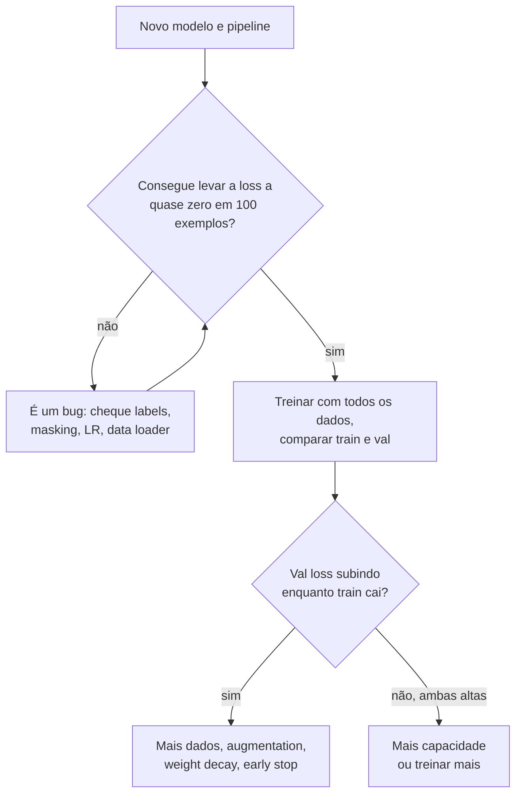

**Follow-ups:** Por que começar fazendo overfitting de um único batch? Sua SFT loss está caindo bem, mas os usuários dizem que o modelo piorou: o que aconteceu? Quando você aceitaria algum overfitting de propósito?

</details>

### 3. Compare a regularização L1 e L2. Por que a L1 produz pesos esparsos?

<details><summary><b>Resposta</b></summary>

As duas somam à loss uma penalidade sobre a magnitude dos pesos. A **L2** soma λ‖w‖² e encolhe todos os pesos de forma proporcional em direção a zero, mas raramente chega *a* zero. A **L1** soma λ‖w‖₁ e leva muitos pesos exatamente a zero, o que equivale a uma feature selection implícita.

Por que a sparsity acontece: o gradiente da penalidade L1 é um ±λ constante, qualquer que seja o tamanho do peso. Por isso ela continua empurrando os pesos pequenos até zero, e lá o subgradiente deixa que eles fiquem. Já a força da L2 é proporcional a w: ela enfraquece conforme os pesos encolhem e nunca termina o serviço. Geometricamente, a bola L1 tem cantos sobre os eixos, e o contorno da loss costuma tocar a região de restrição primeiro num canto, onde algumas coordenadas são exatamente zero.

A visão Bayesiana é um bom diferencial: L2 = estimação MAP com um **prior Gaussiano** nos pesos; L1 = MAP com um **prior de Laplace** (pico mais agudo em zero e caudas mais pesadas).

Na prática, a L1 é importante em modelos lineares e em feature selection (lasso), enquanto deep learning usa quase só **weight decay** no estilo L2. Há uma sutileza que prepara uma pergunta mais adiante: com otimizadores adaptativos como o Adam, somar a L2 à loss *não* equivale a weight decay, porque a penalidade é reescalada pelo termo adaptativo de cada parâmetro. Esse é exatamente o bug que o AdamW corrige ao desacoplar o decay da atualização do gradiente. Vale citar também a prática comum de não aplicar weight decay em biases nem nos ganhos de LayerNorm: eles têm poucas dimensões, e aplicar decay neles só distorce as ativações.

**Follow-ups:** O que é elastic net e quando você a usaria? Por que L2 na loss é diferente de weight decay no Adam? Por que excluir os parâmetros de LayerNorm do weight decay?

</details>

### 4. Como o dropout funciona, e o que muda entre treinamento e inferência?

<details><summary><b>Resposta</b></summary>

No treinamento, o dropout zera cada ativação de forma independente, com probabilidade p (em geral de 0,1 a 0,5). Isso obriga a rede a não depender de nenhuma unidade isolada e quebra a co-adaptação. É comum descrevê-lo como o treino de um ensemble implícito, formado por um número exponencial de subredes reduzidas que compartilham pesos.

A assimetria entre treino e inferência é o que os entrevistadores realmente sondam. No **inverted dropout** (o que todo framework moderno implementa), as ativações que sobrevivem são multiplicadas por 1/(1−p) *durante o treino*. Assim, a magnitude esperada da ativação é a mesma no treino e na inferência: na inferência, o dropout simplesmente é desligado e não precisa de reescala. O bug clássico é esquecer o `model.eval()` no PyTorch: o dropout continua ativo em produção, e as predições ficam ruidosas e piores. (A mesma chamada também faz o BatchNorm usar as estatísticas acumuladas, ou seja, dois bugs pelo preço de um.)

```python
mask = (torch.rand_like(x) > p).float()
x = x * mask / (1 - p)   # inverted dropout: reescala em tempo de treino
```

Onde ele é usado hoje: o Transformer original aplicava dropout à saída de cada sub-layer, antes da soma residual, e às somas de embeddings (p=0,1). As implementações padrão também aplicam dropout aos attention weights. Já o *pretraining* de LLMs em larga escala costuma usar dropout 0: com um fluxo enorme de dados, de uma única época, quase não há pressão de memorização, e o dropout só desperdiça capacidade. Ele volta no fine-tuning, onde os datasets são pequenos: setups de LoRA costumam aplicar dropout de ~0,05 a 0,1 nos inputs do adapter.

Variantes que valem ser citadas, se perguntarem: DropPath/stochastic depth (descartar ramos residuais inteiros, comum em vision transformers) e Monte Carlo dropout (manter o dropout ligado na inferência e amostrar várias vezes, para ter uma estimativa grosseira de incerteza).

**Follow-ups:** Por que os runs grandes de pretraining usam dropout 0? O que o `model.eval()` muda além do dropout? Como você usaria MC dropout para obter estimativas de incerteza?

</details>

### 5. Explique os splits train/validation/test. Quando usar cross-validation, e quando ela é uma má ideia?

<details><summary><b>Resposta</b></summary>

São três conjuntos, com três funções. O **train** ajusta os parâmetros. O **validation** orienta todas as escolhas que você faz entre os runs (hiperparâmetros, arquitetura, seleção de checkpoint, early stopping). O **test** estima a generalização *uma única vez*, no final. Cada decisão tomada olhando para um conjunto "gasta" esse conjunto: se você ajustar o modelo contra o test set muitas vezes, ele vira, sem ninguém notar, um segundo validation set, e o número reportado fica otimista.

A **k-fold cross-validation** (em geral com k=5 ou 10) rotaciona o fold de validação e tira a média. Isso dá uma estimativa com menos variance quando os dados são escassos, e é o padrão em ML clássico com alguns milhares de linhas. Para classes desbalanceadas, use k-fold **estratificado**, de modo que cada fold preserve a prevalência.

Quando a CV é inadequada ou inviável:
- **Deep learning em escala**: treinar 5× custa caro demais. O padrão é um único conjunto held-out, e com milhões de exemplos a variance dele é aceitável.
- **Séries temporais**: folds aleatórios vazam o futuro para o treino. Use temporal splits: treine no passado e valide no futuro (walk-forward validation).
- **Dados agrupados**: se o mesmo usuário, paciente ou documento aparece em várias linhas, divida por ID de grupo. Senão, o modelo reconhece entidades em vez de generalizar.

No trabalho com LLMs, a mesma disciplina aparece assim: suítes de eval held-out nas quais você não treina, decontaminação dos dados de pretraining em relação aos benchmarks e um eval novo, contra o qual você nunca otimizou, reservado para as decisões finais de go/no-go. Isso porque fazer prompt tuning contra um eval gera overfitting nele, do mesmo jeito que o ajuste de hiperparâmetros gera overfitting num val set.

**Vale desenhar.** O ponto central está no loop à esquerda e na seta única para o test: um conjunto é gasto repetidamente, o outro exatamente uma vez.

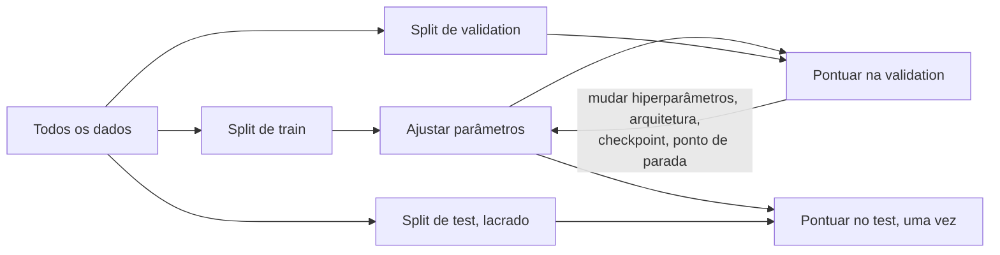

**Follow-ups:** Como a falha de ter o mesmo usuário nos dois splits aparece de fato nas métricas? Para que serve a nested cross-validation? Como você decontaminaria um eval set de LLM?

</details>

### 6. Explique precision, recall e F1. Dê um caso concreto em que 99% de accuracy significa que o modelo é inútil.

<details><summary><b>Resposta</b></summary>

Pela matriz de confusão: **precision** = TP/(TP+FP), ou seja, de tudo que foi marcado como positivo, a fração que estava certa. **Recall** = TP/(TP+FN), a fração dos verdadeiros positivos que foi encontrada. **F1** = 2PR/(P+R), a média harmônica, que pune o desequilíbrio entre os dois (por ser harmônica, um modelo com P=1,0 e R=0,01 tem F1≈0,02, e não 0,5).

A accuracy engana sempre que as classes são desbalanceadas. Fraude com 1% de prevalência: o classificador constante "não é fraude" marca 99% de accuracy e não pega nenhuma fraude (recall 0). Toda accuracy de destaque precisa ser comparada com o baseline da classe majoritária.

Qual métrica otimizar é uma questão de *custo*, não de matemática:
- Falsos positivos caros (filtro de spam engolindo e-mail legítimo, alertas policiais) → priorize precision.
- Falsos negativos caros (triagem de câncer, fraude, filtros de segurança) → priorize recall.
- Use **F-beta** para expressar essa proporção de forma explícita: o F2 dá mais peso ao recall, o F0.5 dá mais peso à precision.

Saiba também que precision, recall e F1 **dependem do threshold**: cada um descreve um único ponto de operação na distribuição de scores do classificador. Reportar "F1 = 0,83" sem dizer como o threshold foi escolhido (e em qual split) é um red flag. Varra o threshold nos dados de validação e escolha o ponto de operação que combina com a estrutura de custos do produto.

Esse vocabulário passa direto para os evals de LLM: detecção de hallucination, filtragem de toxicidade e retrieval em RAG são todos problemas de precision/recall (o recall@k do retrieval é, literalmente, recall). Os entrevistadores esperam que você transite com fluidez entre o enquadramento clássico e o de LLMs.

**Vale desenhar.** Desenhar quais células alimentam cada métrica evita que você troque os denominadores sob pressão.

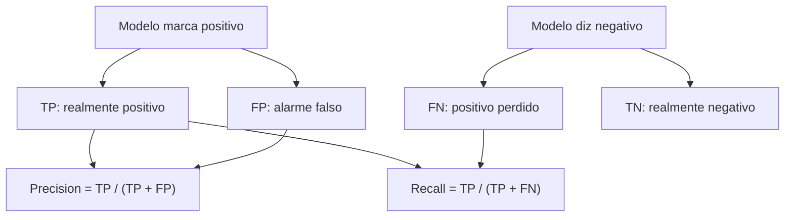

**Follow-ups:** Por que a média harmônica e não a aritmética? A precision é 0,95, mas o time de produto está insatisfeito: o que você checaria? Como o F1 micro e o macro diferem num problema multiclasse desbalanceado?

</details>

### 7. Qual é a diferença entre parâmetros e hiperparâmetros? Como ajustar hiperparâmetros de forma eficiente?

<details><summary><b>Resposta</b></summary>

**Parâmetros** são aprendidos dos dados pelo otimizador: pesos, biases, tabelas de embedding. Um LLM de 7B parâmetros tem 7 bilhões deles. **Hiperparâmetros** são definidos *antes* do treinamento e controlam o processo de aprendizado: learning rate, batch size, weight decay, taxa de dropout, escolhas de arquitetura (depth, width, número de heads), passos de warmup, rank do LoRA. Uma checagem de sanidade que os entrevistadores gostam: uma camada `Linear(in=4096, out=11008)` tem 4096×11008 pesos + 11008 biases ≈ 45M parâmetros.

As abordagens de tuning, em ordem de sofisticação:
- **Grid search**: busca exaustiva numa grade discreta; desperdiça muito em dimensões altas.
- **Random search**: Bergstra & Bengio mostraram que ela supera o grid search, porque em geral só poucos hiperparâmetros importam e a amostragem aleatória explora a marginal de cada dimensão bem melhor, com o mesmo orçamento.
- **Bayesian optimization / successive halving** (Optuna, ASHA/Hyperband): modelam a superfície de resposta, ou eliminam cedo e sem dó os trials ruins. É o padrão prático para runs de treinamento caros.

A orientação prática que um candidato sênior dá: o learning rate quase sempre é o hiperparâmetro de maior impacto, e a busca deve ser em **escala logarítmica** (por exemplo, de 1e-5 a 1e-3). Ajuste num proxy menor (subconjunto dos dados, run mais curto, modelo menor) e transfira o resultado. É a ideia que o μP (μTransfer) torna rigorosa para escalar a width do modelo. Não ajuste tudo de uma vez: fixe uma receita sensata (AdamW, cosine schedule, decay 0,1) e varra os 2 ou 3 botões que importam. E toda decisão de tuning deve ser tomada em dados de validação, nunca no test.

**Follow-ups:** Por que amostrar o learning rate de forma log-uniforme? Se você tem orçamento para 20 runs, como os distribui? O número de épocas de treinamento é parâmetro ou hiperparâmetro? E uma temperature aprendida, como a do CLIP?

</details>

### 8. Qual é a diferença entre batch, mini-batch e stochastic gradient descent? O que o batch size realmente muda?

<details><summary><b>Resposta</b></summary>

O **Batch GD** calcula o gradiente exato sobre o dataset inteiro a cada passo. É preciso, mas dá um passo lento por época e é inviável em escala. O **SGD** (estritamente, com um único exemplo) atualiza a cada amostra: é muito ruidoso e aproveita mal o hardware. O **Mini-batch GD**, que é o que todo mundo roda de fato, tira a média do gradiente sobre um batch (de dezenas de exemplos a milhões de tokens) e equilibra qualidade do gradiente e throughput. Para confundir, na prática o treino com mini-batch também é chamado de "SGD".

O que o batch size muda:

- **Ruído do gradiente**: a variance da estimativa do gradiente escala com ~1/batch size. Algum ruído é útil: ele funciona como regularização implícita e ajuda a escapar de mínimos agudos. Batches muito grandes podem generalizar um pouco pior, a menos que a receita seja ajustada.
- **Acoplamento com o LR**: batches maiores aceitam (e exigem) learning rates maiores. A **linear scaling rule** (multiplique o LR por k ao multiplicar o batch por k, com warmup) vem do trabalho "ImageNet in 1 hour", de Goyal et al. Passado um **critical batch size** que depende do problema (McCandlish et al., análise da gradient-noise-scale), mais paralelismo de batch não traz convergência mais rápida: você só está fazendo a média de gradientes que já eram limpos.
- **Hardware**: batches maiores aproveitam melhor o acelerador. O pretraining de LLMs usa global batches enormes (da ordem de milhões de tokens) via data parallelism, e a **gradient accumulation** simula batches grandes quando a memória está apertada.

A armadilha da entrevista é "batch maior é sempre melhor". Não é: o custo por passo cresce, o progresso por passo satura depois do critical batch size e a memória é finita. O batch size é um tradeoff entre sistemas e otimização, não um botão de graça.

**Follow-ups:** Você dobra o batch size: o que faz com o learning rate, e por quê? A que a gradient accumulation é realmente equivalente, e onde essa equivalência se quebra (dica: BatchNorm)? Por que um batch enorme pode prejudicar a generalização?

</details>

### 9. O que são embeddings? Compare cosine similarity, dot product e distância Euclidiana: quando a escolha importa?

<details><summary><b>Resposta</b></summary>

Um embedding é um vetor denso aprendido (em geral com 256 a 4096 dims) em que a geometria codifica semântica: itens parecidos são mapeados para pontos próximos. Ele sai de um encoder treinado para que uma função de similaridade escolhida dê scores altos a pares relacionados, sejam palavras, sentenças, imagens, usuários ou código.

As três medidas de similaridade:
- **Dot product** a·b: recompensa o alinhamento *e* a magnitude. Um vetor longo pode dominar os rankings, qualquer que seja a direção.
- **Cosine** = a·b / (‖a‖‖b‖): considera só a direção; equivale ao dot product em vetores normalizados para norma unitária.
- **Euclidean** ‖a−b‖: para vetores unitários, ‖a−b‖² = 2 − 2·cos(a,b). Logo, é monotonicamente equivalente ao cosine e produz rankings idênticos.

Portanto, em vetores normalizados as três concordam no ranking, e a escolha só importa quando a magnitude carrega informação. A resposta de engenheiro sênior é: **use a similaridade com a qual o modelo foi treinado**. A maioria dos text embedders modernos (OpenAI text-embedding-3, Cohere, modelos abertos no estilo E5/GTE/BGE) é treinada com objetivos contrastivos baseados em cosine e muitas vezes já entrega os vetores normalizados. Alguns modelos de retrieval usam dot product bruto de propósito, para que a magnitude codifique confiança ou importância.

Do lado operacional, a métrica do índice vetorial precisa ser a mesma: os índices FAISS/pgvector/HNSW são construídos para inner product, L2 ou cosine, e uma incompatibilidade degrada a qualidade do retrieval sem dar nenhum aviso. Há dois pontos mais avançados que vale oferecer por conta própria. Primeiro, os hidden states brutos de LLMs são **anisotrópicos** (ficam espremidos num cone estreito), e é por isso que se usa um embedder treinado de forma contrastiva em vez de fazer pooling das ativações de um modelo base. Segundo, os **embeddings Matryoshka (MRL)** são treinados de modo que truncar nas primeiras k dims continue funcionando, o que permite trocar recall por memória/latency.

**Vale desenhar.** A última caixa é a que as pessoas esquecem, e desenhá-la mostra que você já colocou um índice vetorial em produção.


**Follow-ups:** Por que normalizar torna Euclidean e cosine equivalentes? Demonstre. Quando o dot product venceria o cosine num recommender? O que quebra se você indexar embeddings treinados com cosine usando uma métrica L2 sem normalizar?

</details>

### 10. Defina aprendizado supervised, unsupervised e self-supervised. Onde cada etapa do treinamento moderno de LLMs se encaixa?

<details><summary><b>Resposta</b></summary>

**Supervised**: aprende com pares (input, label) em que os labels vêm de fora dos dados, como anotação humana ou resultados registrados em log. **Unsupervised**: encontra estrutura sem nenhum label, como em clustering, estimação de densidade e redução de dimensionalidade. **Self-supervised**: fabrica os labels *a partir dos próprios dados*, por meio de uma pretext task, e depois aprende com a maquinaria supervised de sempre. Não há custo de anotação, e a quantidade de dados é, na prática, ilimitada.

O ponto central da pergunta é mapear o pipeline moderno de LLMs:

- **Pretraining**: self-supervised. A previsão do próximo token transforma texto bruto em trilhões de pares (contexto, próximo token), e o "label" é só o token seguinte. O masked-language modeling (BERT) usa a mesma ideia, com outra pretext task.
- **SFT / instruction tuning**: aprendizado supervised puro, com pares (prompt, resposta) curados e cross-entropy sobre os tokens da resposta.
- **RL post-training (RLHF com preferências, ou RL no estilo GRPO com recompensas verificáveis)**: reinforcement learning. O sinal é uma recompensa escalar (de um reward model aprendido, de preferências humanas ou de verificadores automáticos para matemática e código), e não labels por token. O DPO é o caso limítrofe interessante: ele otimiza um objetivo de preferência diretamente, como uma loss de estilo supervised sobre pares de preferência, e dispensa o loop de RL explícito.
- **Modelos de embedding / CLIP**: aprendizado contrastivo self-supervised. Os positivos são pares que ocorrem juntos (texto/imagem, query/passagem), e os negativos vêm de graça do próprio batch.
- Ainda existem etapas **unsupervised** de verdade nas bordas do processo: agrupar queries de usuários para descobrir intents, ou deduplicar corpora de pretraining por detecção de near-duplicates.

Uma frase de efeito que funciona bem: a self-supervision resolveu o gargalo da rotulagem. Os LLMs funcionam porque a previsão do próximo token converte a internet inteira em dados de treino supervised de graça.

**Vale desenhar.** O que fixa a taxonomia é rotular as setas, e não as caixas: o paradigma está na forma como a supervisão foi obtida.

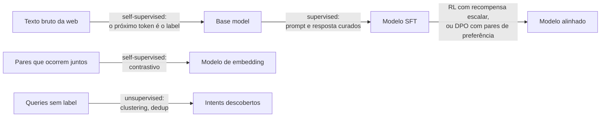

**Follow-ups:** Um reward model é treinado de forma supervised ou por RL? Por que a previsão do próximo token é uma pretext task tão poderosa em comparação com, por exemplo, autoencoding? Onde o feedback no estilo RLAIF/constitutional se encaixa nessa taxonomia?

</details>

### 11. Random forest vs gradient boosting: como cada um funciona, e por que os tree ensembles ainda vencem as redes neurais em dados tabulares?

<details><summary><b>Resposta</b></summary>

Os dois ficam em lados opostos da alavanca bias-variance. A **random forest** é bagging: treina em paralelo muitas árvores profundas, cada uma numa amostra bootstrap e com cada split considerando um subconjunto aleatório de features, e depois tira a média. Árvores profundas têm bias baixo e variance alta, e a média de árvores descorrelacionadas elimina a variance. Adicionar árvores nunca prejudica, então é difícil causar overfitting ao ajustar a random forest.

O **gradient boosting** é sequencial: cada árvore rasa se ajusta ao gradiente negativo da loss em relação às predições do ensemble atual (no squared error, literalmente os resíduos), de modo que cada rodada reduz o bias. Ele costuma vencer em accuracy, mas sofre overfitting se você continuar adicionando rodadas, então learning rate, depth, subsample e early stopping fazem diferença de verdade. Na prática, isso significa usar LightGBM, XGBoost ou CatBoost com um conjunto de validação ligado ao early stopping.

Por que as árvores vencem os MLPs em dados tabulares:

- **Invariância a transformações monótonas.** Os splits são thresholds, então não há scaling, nem transformação logarítmica, nem cirurgia em outliers. As redes neurais precisam de tudo isso.
- **Features heterogêneas e não suaves.** Os MLPs têm viés para funções suaves, mas os alvos tabulares costumam ser funções degrau irregulares de poucas features. Esse viés não combina com o problema.
- **Robustez a colunas sem informação.** As árvores simplesmente nunca fazem split nelas; o MLP precisa aprender a ignorá-las, e isso custa dados.
- **Tipos mistos e valores faltantes** tratados de forma nativa, além do tratamento de categóricas no CatBoost/LightGBM.
- **Poucos dados.** A maioria dos datasets tabulares tem de milhares a milhões de linhas, faixa em que o inductive bias pesa mais que a capacidade.

As redes neurais ganham quando há estrutura a explorar: entidades de alta cardinalidade para as quais você quer embeddings compartilhados, input multimodal (texto livre ou imagens ao lado da tabela) ou transferência de um modelo pré-treinado. O padrão honesto em 2026 continua sendo começar com um baseline em LightGBM e exigir que qualquer coisa mais sofisticada o supere. A única rachadura real está nos dados pequenos: os foundation models tabulares, como o TabPFN v2, fazem predição in-context em tabelas de até cerca de dez mil linhas e são competitivos com GBDTs bem ajustados nessa faixa, então entram no conjunto de baselines de problemas pequenos. Em escala, as árvores com boosting ainda dominam.

Um equívoco comum a evitar: dizer que a random forest "faz boosting", ou citar `n_estimators=1000` num GBDT sem early stopping.

**Vale desenhar.** Setas paralelas contra um loop de feedback tornam visual, em vez de decorada, a diferença entre variance e bias.


**Follow-ups:** Por que o ordered target encoding do CatBoost existe, e que leakage ele evita? Como você obteria probabilidades calibradas de uma árvore com boosting?

</details>

### 12. O que é feature scaling? Compare normalização e standardization, e diga quais modelos realmente precisam dele.

<details><summary><b>Resposta</b></summary>

A standardization subtrai a média e divide pelo desvio padrão, o que deixa a feature com média perto de zero e variance unitária, num intervalo sem limite. A normalização min-max reescala linearmente para um intervalo fixo, normalmente [0, 1]. A standardization é o padrão. O min-max serve quando algo mais adiante exige um intervalo limitado, e é bem mais sensível a outliers, porque um único valor extremo espreme todo o resto.

Quem precisa:

- **Métodos baseados em distância** (kNN, k-means, SVM com kernel RBF): uma feature medida em dólares domina outra medida em frações só por causa das unidades.
- **Modelos lineares regularizados**: a penalidade L1/L2 depende da escala, então uma feature sem scaling recebe uma quantidade arbitrária de shrinkage.
- **PCA**: ele maximiza a variance, e a variance depende da unidade. Sem standardization, você obtém os componentes da coluna que tem os maiores números.
- **Gradient descent em modelos lineares e redes neurais**: escalas de features muito diferentes deixam a superfície da loss mal condicionada, e a otimização anda em zigue-zague.

Quem não precisa: árvores de decisão e tree ensembles. Os splits são thresholds, então qualquer transformação monótona de uma feature deixa o modelo igual.

Dois deslizes que eliminam candidatos aqui. Primeiro, **ajuste o scaler só no train** e depois aplique em validation e test. Ajustar no dataset inteiro antes de dividir é leakage de manual, e é o mais comum de todos. Segundo, as estatísticas ajustadas são **parte do artefato do modelo**. Recalcular média e desvio padrão a partir de um batch de serving, ou usar zero como padrão onde o treino imputou a mediana, gera training-serving skew, e a falha é silenciosa.

Para quantidades positivas assimétricas (renda, contagens, latency), eu aplicaria log primeiro e depois a standardization. Para caudas pesadas, um robust scaling com mediana e IQR. Em deep nets, o scaling dos inputs importa menos nas camadas internas, porque as camadas de normalização cuidam das ativações, mas os inputs em si ainda precisam dele.

**Follow-ups:** Por que uma feature sem scaling estraga a regularização L2, mas não a propriedade de sparsity da L1 do mesmo jeito? Em que ponto de um caminho de serving em PyTorch você colocaria o scaler para que ele não se distancie do treino?

</details>

### 13. Me leve de RNNs a LSTMs e a transformers. Por que a attention venceu?

<details><summary><b>Resposta</b></summary>

Uma RNN carrega um hidden state adiante: `h_t = f(h_{t-1}, x_t)`. O treinamento faz backpropagation through time, que multiplica o mesmo Jacobiano uma vez por passo. Por isso os gradientes somem ou explodem em longas distâncias, e a memória prática é curta.

A **LSTM** corrige o caminho do gradiente, não o paralelismo. Ela adiciona um cell state atualizado de forma *aditiva*, controlado pelos gates de forget, input e output. O caminho aditivo é o mesmo truque da conexão residual: o gradiente passa por ele sem multiplicações repetidas, e assim a LSTM guarda contexto por centenas de passos, e não por dezenas. A GRU é uma variante mais barata, com dois gates e comportamento parecido.

Dois problemas sobreviveram. O primeiro: tudo sobre o passado precisa ser espremido num hidden state de tamanho fixo, que é justamente o gargalo que a attention foi inventada para aliviar, como um complemento das RNNs seq2seq. O segundo, e decisivo: **a recorrência é sequencial no tempo**, então não dá para paralelizar o treino entre as posições.

Os transformers abandonam a recorrência por completo. Cada posição atende a todas as outras, de modo que o caminho entre dois tokens quaisquer é O(1), e não O(n), e o treino vira grandes matmuls que saturam as GPUs. O custo: a attention é O(n²) em compute e memória, contra O(n) da RNN, e é permutation-equivariant, então a ordem precisa ser injetada por positional encodings (o RoPE é o padrão atual).

Portanto, a resposta honesta para "por que a attention venceu" é aproveitamento de hardware mais comprimento do caminho do gradiente, e não alguma superioridade abstrata. Com os mesmos FLOPs, dá para treinar com muito mais dados.

Vale notar que a roda está girando de volta: os modelos state-space e de linear attention (estilo Mamba) recuperam uma formulação recorrente O(n) que ainda paraleliza no treino por meio de um scan, e pilhas híbridas de attention/SSM já rodam em modelos de produção para contexto longo. Além disso, um transformer autorregressivo na inferência, com KV cache, *é* uma recorrência, só que com um estado que cresce junto com a sequência.

**Follow-ups:** Se o KV cache torna o decoding recorrente de qualquer jeito, onde a vantagem do transformer realmente aparece? Por que o cell state aditivo da LSTM ajuda os gradientes, se os próprios gates são multiplicativos?

</details>

### 14. Qual é a diferença entre feature engineering e representation learning? Onde o trabalho manual ainda compensa em 2026?

<details><summary><b>Resposta</b></summary>

No feature engineering, é você quem escreve a função que leva os dados brutos ao input do modelo. No representation learning, é o modelo que aprende essa função a partir dos dados. O deep learning venceu em visão, fala e texto porque esses inputs têm dimensionalidade alta e forte estrutura local, e existem corpora enormes. Assim, as features aprendidas superaram as feitas à mão (SIFT, MFCCs e n-grams perderam).

Os dados tabulares são o regime oposto. As features já são semânticas, os datasets são pequenos e o conhecimento de domínio codifica restrições que os dados não conseguem descobrir sozinhos. Por isso o trabalho manual ainda compensa em alguns lugares concretos:

- **Stacks tabulares / GBDT.** Agregações, razões, contagens e features de janela de tempo ("transações nas últimas 24h", "dias desde o último login") são onde moram os ganhos reais. Nenhuma capacidade de modelo as inventa.
- **Features que exigem dados que o modelo não enxerga.** Joins com o histórico do CRM, sinais externos, janelas calculadas.
- **Recsys**, em que as features de histórico de usuário/item e as cross features carregam boa parte do peso.
- **Sistemas com LLMs.** O que você recupera, como faz o chunking e que metadados anexa a cada chunk é feature engineering com outro chapéu.

O meio-termo moderno é um híbrido: passar as colunas não estruturadas (a descrição de um produto, o corpo de um ticket de suporte) por um encoder pré-treinado para obter embeddings, e alimentar um GBDT ou um MLP pequeno com esses embeddings junto das features tabulares trabalhadas à mão. Representation learning onde ajuda, engenharia onde ajuda.

O equívoco a combater é "deep learning significa não ter feature engineering". O trabalho mudou de lugar, não desapareceu. Na escala de fronteira, ele foi para curadoria de dados, pesos de mixture, dedup e tokenização, todas decisões de engenharia sobre a representação, com enorme impacto.

O que os entrevistadores realmente testam é o seu julgamento sobre em qual regime você está. Gastar três semanas elaborando features para um problema que tem um bilhão de tokens e um backbone pré-treinado é tão errado quanto jogar um MLP em 8.000 linhas de dados tabulares.

**Follow-ups:** Dê um exemplo de feature que você criou e que um modelo nunca poderia ter aprendido, e explique por quê. Como você decide entre alimentar um GBDT com um embedding e fazer fine-tuning do encoder de ponta a ponta?

</details>

### 15. Por que uma rede neural precisa de funções de ativação não lineares, e como o campo passou de sigmoid para ReLU e depois para ativações do tipo GELU?

<details><summary><b>Resposta</b></summary>

Sem uma não linearidade, empilhar camadas não rende nada: W₂(W₁x + b₁) + b₂ continua sendo um único mapa afim, então uma rede de 100 camadas tem o poder expressivo de uma única camada linear. A ativação é o que permite à profundidade compor features simples em funções que não são lineares no input, e é nela que se apoiam os resultados de universal approximation.

A história desde então é, no fundo, uma história sobre gradientes:

- **Sigmoid e tanh** foram o padrão nos anos 2000. Ambas saturam: para |z| grande, a derivada vai a zero, e a derivada máxima da sigmoid é só 0,25, então os gradientes encolhem a cada camada. A sigmoid também não é centrada em zero, o que faz as atualizações andarem em zigue-zague. As duas sobrevivem hoje como gates (LSTM, variantes de GLU) e em camadas de saída, onde comprimir os valores num intervalo é justamente o objetivo.
- A **ReLU**, max(0, z), tornou prático o treino supervised profundo na era da AlexNet. Sua derivada é exatamente 1 no lado ativo, ela é barata e gera ativações esparsas. Seu modo de falha são as **dead units**: um neurônio cuja pré-ativação é negativa para todos os inputs fica com gradiente zero para sempre, muitas vezes porque um learning rate alto demais empurrou seu bias para o negativo. A Leaky ReLU e a PReLU mantêm uma pequena inclinação negativa para evitar isso.
- **GELU** (z·Φ(z)) e **SiLU/Swish** (z·σ(z)) são curvas suaves parecidas com a ReLU, com uma pequena queda na região negativa. A suavidade tende a otimizar melhor em escala, e por isso o BERT e o GPT-2 usaram GELU.
- As **variantes com gate** (SwiGLU, GeGLU) multiplicam duas projeções lineares, uma delas passando pela ativação, e são a escolha padrão nos blocos feed-forward dos LLMs atuais.

O que o entrevistador quer ouvir: o argumento do colapso linear dito com clareza, a saturação ligada ao vanishing gradient e a conexão com a inicialização (a He init assume que a ReLU zera metade dos inputs). Num MLP novo, com inputs tabulares ou de embedding, ReLU ou GELU resolvem. A escolha raramente importa tanto quanto normalização, init e learning rate.

**Follow-ups:** Como você detectaria dead ReLUs numa rede treinada? Por que a SwiGLU costuma usar um hidden size de cerca de 8/3 × d em vez de 4 × d? Por que a sigmoid ainda é a saída certa para um classificador multi-label?

</details>

## Intermediário

### 16. O que é data leakage? Dê três exemplos sutis que você já viu ou poderia imaginar, e diga como os detectaria.

<details><summary><b>Resposta</b></summary>

Leakage é qualquer caminho pelo qual informação indisponível no momento da predição contamina o treino ou a avaliação, inflando métricas offline que desabam em produção. O caso gritante, treinar com as linhas de teste, é raro. O que derruba sistemas reais são os casos sutis:

1. **Preprocessing ajustado no dataset inteiro**: ajustar scaler, PCA, target encoder ou tokenizer/vocabulário em train+test antes de dividir. As estatísticas do test set vazam para a transformação. Correção: ajuste as transformações só dentro do fold de treino (o `Pipeline` do sklearn dentro da CV existe justamente para isso).
2. **Group leakage**: o mesmo paciente, usuário ou documento contribui com linhas tanto para o train quanto para o test. O modelo aprende a reconhecer a entidade, não o padrão. Detecte com splits que respeitam grupos; o sintoma é uma queda grande na métrica quando você passa para `GroupKFold`.
3. **Temporal leakage**: splits aleatórios em dados que dependem do tempo deixam o modelo treinar com o futuro. Uma feature de churn como "dias desde o último login", calculada numa janela que passa da data do label, é um clássico: a feature codifica o resultado em silêncio.
4. **Target leakage nas features**: uma coluna causalmente posterior ao label, por exemplo "account_frozen" como feature de fraude, quando o bloqueio acontece *porque* a fraude foi detectada.
5. **Na era dos LLMs, benchmark contamination**: perguntas do eval presentes no corpus de pretraining. Detecção: varreduras de sobreposição de n-grams/substrings, canary strings e comparação do desempenho em versões renomeadas ou perturbadas do benchmark.

Heurísticas de detecção: resultados bons demais para ser verdade (AUC quase perfeito num problema difícil); uma feature com importância absurda; **adversarial validation**, em que você treina um classificador para distinguir as linhas de train das de test (se ele conseguir, os splits diferem de forma sistemática); e grandes diferenças entre as métricas offline e online.

**Vale desenhar.** Quatro portões num único caminho é uma resposta bem melhor que uma lista, porque mostra que o leakage é uma propriedade da ordem do pipeline, e não do modelo.

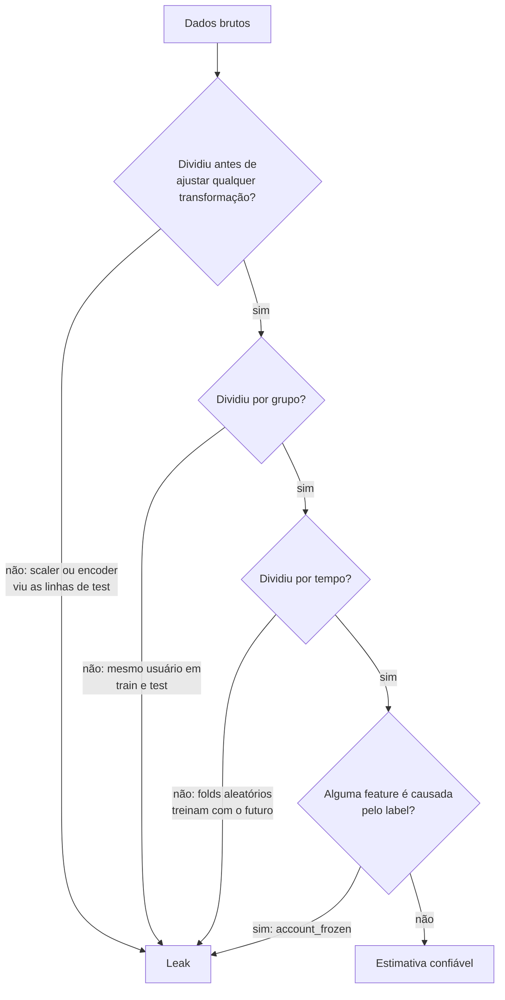

**Follow-ups:** Seu modelo atinge 0,99 de AUC num problema de fraude: me conduza pela sua auditoria. Como a k-fold CV agrava o leakage de preprocessing quando feita de forma ingênua? Como você verificaria se um LLM memorizou o seu eval set?

</details>

### 17. ROC-AUC vs PR-AUC: o que cada uma mede, e por que a ROC-AUC parece enganosamente boa em dados desbalanceados?

<details><summary><b>Resposta</b></summary>

A **ROC-AUC** traça a true-positive rate (recall) contra a false-positive rate ao longo de todos os thresholds. A área equivale à probabilidade de um positivo escolhido ao acaso receber score maior que um negativo escolhido ao acaso, ou seja, é uma métrica puramente de *ranking*. O baseline é 0,5, qualquer que seja o balanceamento das classes. A **PR-AUC** traça a precision contra o recall, e seu baseline é a prevalência dos positivos.

O engano: a FPR = FP/(FP+TN) é normalizada pela quantidade de *negativos*. Com 1M de negativos e 1k de positivos, um modelo que produz 10.000 falsos positivos tem FPR = 1%, e a curva ROC parece ótima. Mas, num threshold que recupera a maior parte dos positivos, a precision pode ficar em ~9% (1k verdadeiros contra 10k alarmes falsos). A ROC-AUC pode marcar 0,98 enquanto a precision que o operador sente está na casa de um dígito. A PR-AUC expõe isso porque a precision tem FP diretamente no denominador, sem ser diluída pela massa de negativos fáceis.

Regras práticas:
- Classes balanceadas, ou você se importa de verdade com o ranking dos negativos também → a ROC-AUC serve e tem propriedades estatísticas melhores (é invariante à prevalência, então é comparável entre datasets).
- Classe positiva rara, em que a experiência do produto é "quantos alertas são reais" → PR-AUC ou, melhor ainda, **precision@k** / recall com FPR fixa, calibrada pela capacidade de revisão do time de operações.

Duas ressalvas que mostram profundidade. A PR-AUC depende da prevalência, então não se pode compará-la entre datasets com base rates diferentes. E o average precision (o estimador padrão de PR-AUC) é preferível à interpolação trapezoidal, que é otimista e enviesada para curvas PR. Nenhuma das duas métricas diz nada sobre **calibration**: ambas são invariantes a qualquer reescala monotônica dos scores.

**Follow-ups:** Por que a interpolação linear entre pontos PR é inválida? Sua ROC-AUC melhorou, mas a PR-AUC caiu: o que aconteceu? Como você escolhe o threshold operacional final para produção?

</details>

### 18. O que significa um classificador ser calibrado? Como medir e corrigir a miscalibration?

<details><summary><b>Resposta</b></summary>

Calibrado significa que as probabilidades previstas batem com as frequências empíricas: entre todos os casos em que o modelo diz 0,8, cerca de 80% devem ser de fato positivos. Discriminação (ranking, AUC) e calibration são ortogonais. Dá para ranquear perfeitamente e, ao mesmo tempo, produzir probabilidades todas erradas por uma compressão, e qualquer reescala monotônica muda a calibration sem tocar na AUC.

**Medição**: reliability diagrams (agrupe as predições em bins por confiança e plote a frequência observada de cada bin contra a diagonal). O **ECE** (expected calibration error) resume o gap como uma média ponderada entre os bins; cuidado com a sensibilidade dele à escolha dos bins. O **Brier score** e o NLL são proper scoring rules que misturam calibration e discriminação.

**Correções** (ajustadas em dados de validação, nunca de train):
- **Temperature scaling** (Guo et al. 2017): divide os logits por um único T > 0 aprendido, antes do softmax. As redes modernas costumam ser *superconfiantes* (T ≈ 1,5 a 3 corrige muitos modelos de visão). Tem um só parâmetro, preserva o ranking exatamente e é difícil de sofrer overfitting, por isso é a escolha padrão.
- **Platt scaling** (ajuste logístico sobre os scores) e **isotonic regression** (não paramétrica e monotônica; precisa de mais dados e pode sofrer overfitting em val sets pequenos).

Por que isso importa: qualquer sistema que decide por limiar de custo esperado, como filas de revisão de fraude, triagem médica ou a decisão de quando um classificador baseado em LLM deve se abster ou escalar para um humano, precisa de probabilidades que signifiquem algo, e não apenas de rankings corretos.

Um ângulo de LLMs que vale oferecer: os base models são surpreendentemente bem calibrados em tarefas de múltipla escolha (probabilidade do token vs accuracy), e o RLHF tende a *piorar* essa calibration. O relatório técnico do GPT-4 mostrou que a curva de calibration do modelo pós-RLHF fica visivelmente pior que a do modelo pré-treinado. A confiança verbalizada ("tenho 90% de certeza") é um canal à parte, em geral pior calibrado que os logprobs dos tokens.

**Vale desenhar.** A volta para o reliability diagram mostra que a calibration é medida, corrigida e medida de novo, e nunca ajustada no train.

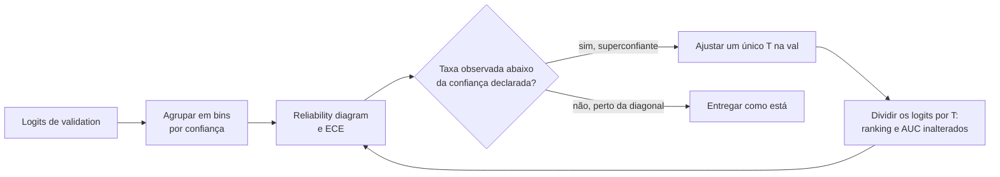

**Follow-ups:** Por que o temperature scaling deixa accuracy e AUC inalteradas? Como o desbalanceamento de classes interage com a calibration quando há resampling? Como você calibraria um LLM judge que devolve uma nota de 1 a 10?

</details>

### 19. Seu dataset de fraude tem 0,5% de positivos. Me explique sua estratégia para lidar com o desbalanceamento.

<details><summary><b>Resposta</b></summary>

Primeiro, resolva a *medição*; depois, o *treinamento*. E mantenha os dois assuntos separados.

**Medição**: a accuracy e a ROC-AUC vão te iludir (veja o problema da diluição da FPR). Use PR-AUC, precision@k dimensionada pela capacidade do time de revisão, ou recall com FPR fixa. Defina a matriz de custos: uma fraude perdida pode custar 100× um alarme falso, e isso determina o threshold operacional mais adiante.

**Opções do lado do treinamento**:
- **Class weights / loss ponderada**: dê mais peso aos positivos na cross-entropy. É simples, não distorce os dados e costuma ser o primeiro movimento.
- **Resampling**: faça undersampling dos negativos (barato, funciona quando os negativos são redundantes, mas pode descartar sinal) ou oversampling dos positivos. O **SMOTE** interpola positivos sintéticos no espaço de features. Faz sentido para dados tabulares de baixa dimensionalidade, mas é quase inútil ou até prejudicial para representações aprendidas de alta dimensão. E nunca o aplique antes de dividir os dados, senão cópias sintéticas vazam para a validation.
- **Focal loss** (da RetinaNet): reduz o peso dos exemplos fáceis por (1−p)^γ, de modo que o treino se concentre nos difíceis. Foi projetada para desbalanceamento extremo em detecção.
- **Threshold moving**: muitas vezes a ferramenta mais subestimada. Treine normalmente, obtenha probabilidades calibradas e escolha o threshold que otimiza o custo esperado. O desbalanceamento não impede de aprender um bom *ranker*; o que ele quebra é o threshold padrão de 0,5.
- **Reformulação**: na raridade extrema, ou com padrões de ataque novos, formulações de anomaly detection ou one-class podem superar a classificação.

Sutilezas críticas: avalie sempre na distribuição *natural*, nunca numa rebalanceada. Se você fizer resampling ou reweighting, as probabilidades de saída ficam enviesadas e precisam ser **recalibradas** antes de aplicar o threshold. E valide no tempo, porque os padrões de fraude mudam e os adversários se adaptam.

**Vale desenhar.** Duas frentes separadas que convergem no threshold são a estrutura da resposta: corrigir a medição, corrigir o treino e, antes de escolher o ponto de operação, recalibrar.

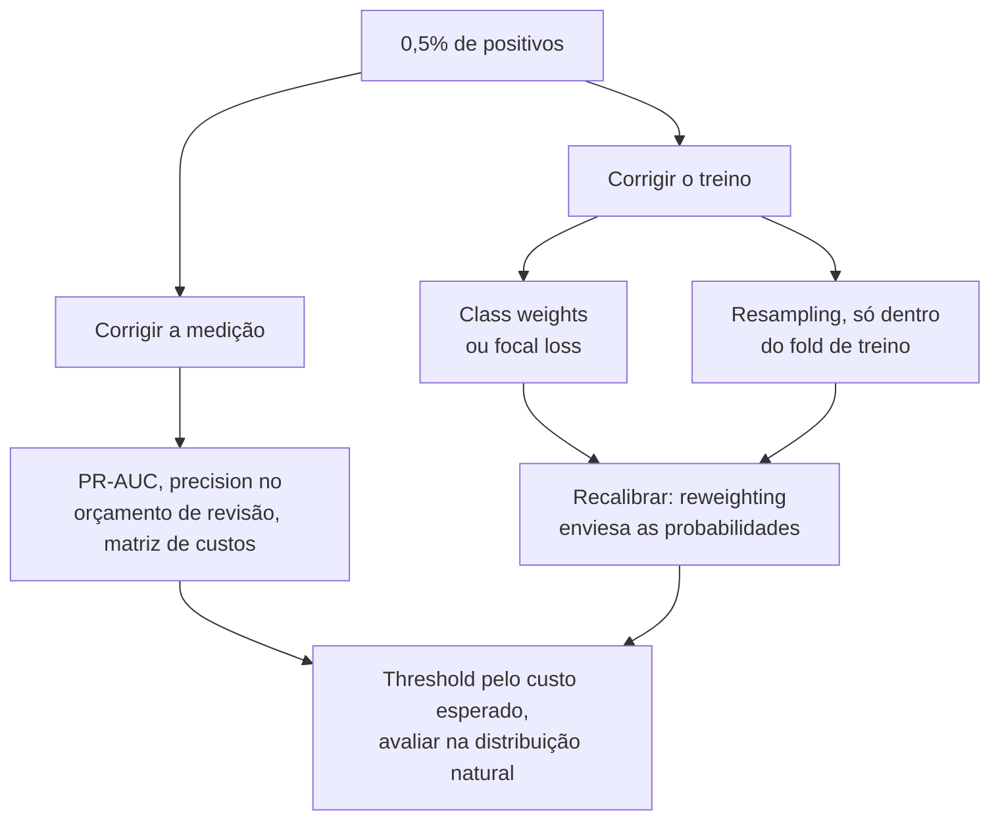

**Follow-ups:** Você fez oversampling e agora as probabilidades previstas estão infladas: por quê, e como corrigi-las? Quando o undersampling é de fato preferível? Como os labels de fraude atrasados (chargebacks que chegam 60 dias depois) mudam a sua avaliação?

</details>

### 20. Explique momentum e Adam. Que problema cada um resolve em relação ao SGD puro?

<details><summary><b>Resposta</b></summary>

O **momentum** mantém uma média móvel exponencial dos gradientes e dá os passos ao longo dessa média: `v ← βv + g; w ← w − lr·v` (β em geral 0,9). Em paisagens de loss em forma de ravina, íngremes em algumas direções e rasas em outras, o SGD puro oscila entre as paredes íngremes e se arrasta pelo fundo do vale. O momentum cancela as componentes oscilantes (elas alternam de sinal e se anulam na média) e acumula as consistentes, com uma amplificação efetiva de até 1/(1−β) nas direções estáveis. Ele também suaviza o ruído do mini-batch.

O **Adam** acrescenta uma segunda ideia: **tamanhos de passo adaptativos por parâmetro**. Ele acompanha o primeiro momento m (como o momentum, com β₁=0,9) e o segundo momento v, uma EMA dos gradientes ao quadrado (β₂=0,999 no clássico, ~0,95 na prática com LLMs), e atualiza com `w ← w − lr · m̂ / (√v̂ + ε)`. Dividir por √v̂ normaliza o passo de cada parâmetro pela magnitude típica do seu gradiente: parâmetros com gradientes raros ou pequenos (linhas de embedding de tokens raros) recebem passos relativamente maiores, e parâmetros com gradientes grandes e ruidosos são amortecidos. Os chapéus indicam a **bias correction**: as duas EMAs começam em zero e subestimam muito seus alvos no início do treino. Sem a correção, os primeiros passos teriam a escala muito errada.

Por que isso importa para transformers: a escala do gradiente varia enormemente ao longo de um transformer profundo (embeddings vs ganhos de LayerNorm vs projeções de attention), e um único LR global não serve para todos. O SGD é famoso por ser difícil de fazer funcionar em transformers, enquanto a família Adam é robusta. O outro lado da moeda: o Adam guarda dois estados fp32 extras por parâmetro (~8 bytes/param), um custo de memória relevante que motiva otimizadores de 8 bits e o sharding no estilo ZeRO.

**Vale desenhar.** Desenhar as duas EMAs como ramos separados deixa óbvio o que a bias correction corrige e por que ela só importa no começo.

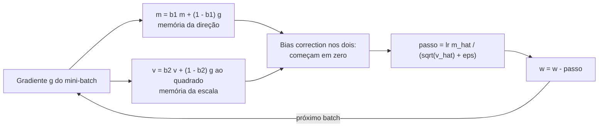

**Follow-ups:** Por que o Adam precisa de bias correction? O que acontece sem ela? Por que o SGD com momentum ainda costuma vencer o Adam em convnets? Qual é a pegada de memória do Adam para um modelo de 7B, e como reduzi-la?

</details>

### 21. Adam vs AdamW: o que exatamente é "decoupled weight decay", e por que o AdamW virou o padrão dos transformers?

<details><summary><b>Resposta</b></summary>

A diferença está em *onde* o termo de weight decay entra na atualização. No "Adam + L2", você soma λw ao gradiente, e a penalidade passa por toda a maquinaria do Adam, inclusive pela divisão por √v̂. No **AdamW** (Loshchilov & Hutter, "Decoupled Weight Decay Regularization"), o decay é aplicado diretamente nos pesos, fora da atualização adaptativa:

```python
# Adam + L2: a penalidade é reescalada pelo termo adaptativo
g = grad + lam * w
w -= lr * m_hat / (v_hat.sqrt() + eps)   # decay diluído onde v_hat é grande

# AdamW: decay desacoplado da adaptação do gradiente
w -= lr * m_hat / (v_hat.sqrt() + eps)
w -= lr * lam * w                         # encolhimento multiplicativo uniforme
```

Por que a versão acoplada é falha: parâmetros com histórico de gradiente grande (v̂ grande) têm o termo L2 dividido para baixo. Ou seja, justamente os pesos que mais se movem recebem *a menor* regularização, e a força efetiva do decay vira uma função descontrolada das estatísticas do gradiente. Além disso, o λ se embaralha com o schedule de learning rate de maneiras bagunçadas, e os hiperparâmetros deixam de ser transferíveis entre runs. Com o SGD puro, L2 e weight decay coincidem, e a distinção só existe nos otimizadores adaptativos, que é exatamente a armadilha que a pergunta testa.

O AdamW devolve uma interpretação limpa (todo peso encolhe pela mesma fração lr·λ a cada passo), desacopla as dimensões de busca de λ e lr e, empiricamente, generaliza melhor. Ele virou o padrão em praticamente toda receita de transformer (série GPT, Llama etc.), com ajustes típicos de λ ≈ 0,1 e β₂ ≈ 0,95, e com o decay desligado para biases, parâmetros de LayerNorm/RMSNorm e, muitas vezes, embeddings. Em 2026 ele ainda é o padrão seguro, mas já não é a única opção séria: otimizadores da família Muon, que ortogonalizam a atualização de momentum das matrizes de pesos 2D, foram usados no pretraining do Kimi K2 e do GLM-4.5, mantendo o AdamW para embeddings, output head e ganhos de norm. O decoupled weight decay vale para eles sem mudanças.

**Vale desenhar.** Dois caminhos a partir do mesmo gradiente, que diferem só no lado da divisão em que o decay fica, mostram a correção inteira numa figura.

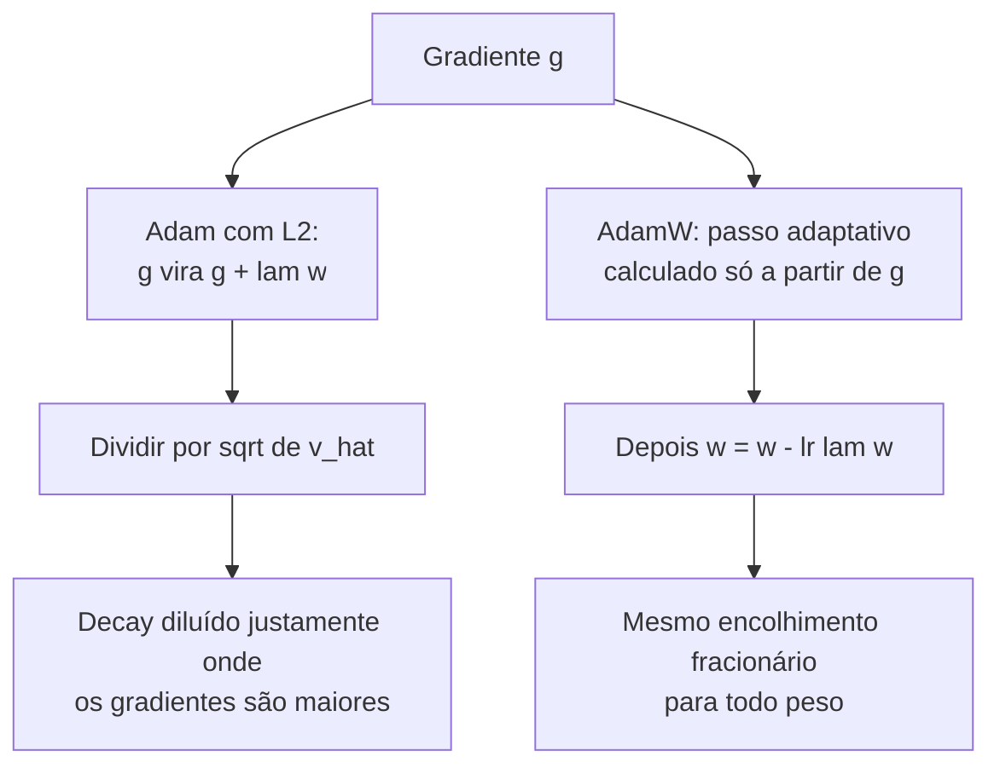

**Follow-ups:** Por que weight decay ≡ L2 no SGD, mas não no Adam? Por que excluir os parâmetros de norm do decay? O que acontece com o weight decay efetivo quando o LR sofre cosine annealing até perto de zero?

</details>

### 22. Por que as receitas de treinamento de transformers usam warmup do learning rate, e como é o resto do schedule?

<details><summary><b>Resposta</b></summary>

O **warmup** aumenta o LR linearmente, de ~0 até o pico, ao longo das primeiras centenas a poucos milhares de passos. Há três razões que se reforçam e fazem os transformers precisarem dele:

1. **A estimativa do segundo momento do Adam não é confiável no começo.** O v̂ é uma EMA de um punhado de gradientes ruidosos, então o passo adaptativo m̂/√v̂ pode ter a escala muito errada. Um LR cheio por cima disso causa atualizações destrutivas logo no início. (O RAdam formalizou esse problema de variance; o warmup é a correção prática.)
2. **O começo do treino de um transformer é frágil.** Na inicialização, as distribuições de attention e a paisagem da loss são mal condicionadas, e passos grandes podem levar o modelo a um estado com normas de gradiente explodindo ou a uma divergência da loss da qual ele nunca se recupera. Os transformers originais post-LN eram *inutilizáveis* sem warmup; o pre-LN reduziu essa necessidade, mas não a eliminou.
3. **Batches grandes.** O regime de linear scaling (batch grande → LR grande) deixa os primeiros passos ainda mais perigosos. Goyal et al. introduziram o warmup exatamente para isso, no trabalho ImageNet-in-1-hour.

Depois do warmup, o padrão é o **cosine decay**, do LR de pico até ~10% do pico ao longo de todo o orçamento de tokens (a receita no estilo Chinchilla/Llama). O decay importa: um LR alto no fim do treino faz o modelo continuar quicando em volta do mínimo, e o annealing o deixa assentar. A fase final, de LR baixo, melhora o modelo de forma desproporcional.

Uma alternativa moderna que vale citar é o **WSD (warmup, stable, decay)**: mantém o LR constante depois do warmup e só faz um decay brusco nos últimos ~10 a 20% do treino. O benefício é operacional: dá para derivar um checkpoint "finalizado", já com o decay aplicado, a partir de um run que ainda está na fase stable, a qualquer momento. Isso combina bem com continued pretraining e experimentos de mixture de dados (popularizado pelo MiniCPM e próximo, no espírito, dos schedules multi-step e constant-then-decay dos relatórios da DeepSeek).

**Vale desenhar.** Desenhar o WSD como um ramo que sai da fase stable explica todo o seu argumento de venda: você pode tirar um checkpoint finalizado quando quiser.

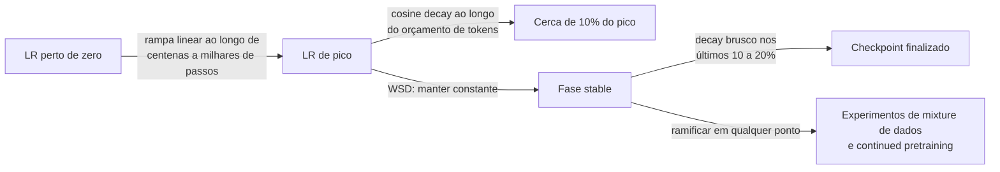

**Follow-ups:** O que realmente dá errado se você pular o warmup? Descreva a assinatura da falha nas curvas de loss e grad-norm. Por que o cosine-to-zero interage mal com a vontade de retomar o treino? Como você definiria o LR de pico para um modelo 10× maior?

</details>

### 23. Explique o backpropagation como se eu fosse um engenheiro de software experiente que nunca fez ML. Por que ele é eficiente?

<details><summary><b>Resposta</b></summary>

Uma rede neural é uma função composta: `loss = f_L(...f_2(f_1(x, w_1), w_2)..., w_L)`. O treino precisa de ∂loss/∂w para cada peso. O backprop é só a **regra da cadeia organizada como programação dinâmica**: você calcula a loss no forward, guardando em cache as ativações de cada camada, e depois faz uma varredura para trás, multiplicando por um Jacobiano local de cada vez e reaproveitando em cada camada o produto acumulado, o "sinal de gradiente".

O argumento da eficiência é o coração de uma boa resposta. Ingenuamente, você poderia calcular o gradiente de cada peso de forma independente (diferenças finitas: perturbe um peso e rode a rede de novo). Isso custa O(#params) forward passes, o que é inviável para bilhões de parâmetros. O backprop calcula *todos* os gradientes numa única varredura para trás, que custa cerca de **2× o forward pass**, porque o backward reaproveita resultados intermediários compartilhados, exatamente como a memoização colapsa uma recursão exponencial. Um detalhe de implementação importante: você nunca materializa as matrizes Jacobianas completas. O autodiff em modo reverso propaga **produtos vetor-Jacobiano**, que, numa camada de matmul, são só mais dois matmuls (gradientes em relação ao input e em relação aos pesos).

O modo reverso é a direção certa porque a loss é escalar: uma saída e muitas entradas → uma varredura para trás entrega todas as derivadas. (O modo forward é eficiente no regime oposto, com poucas entradas e muitas saídas.)

Consequências de engenharia que vale dizer: o compute total de treino é ~3× o forward (daí a regra prática de ≈6·N·D FLOPs para transformers com N parâmetros e D tokens). As ativações em cache dominam a memória de treino, e é por isso que o **activation checkpointing** troca recompute por memória. E os frameworks implementam tudo isso como autograd sobre um grafo de computação gravado, em que cada op registra seu VJP.

**Vale desenhar.** As ativações em cache nas setas do forward são o que torna o backward barato e a memória de treino cara, e o desenho coloca os dois fatos no mesmo lugar.

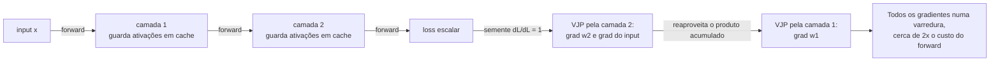

**Follow-ups:** Por que a memória de treino é tão maior que a de inferência? O que é activation checkpointing e qual o overhead de compute dele? De onde vem a estimativa de 6ND?

</details>

### 24. O que são vanishing e exploding gradients? O que os causa, e o que o design moderno de arquiteturas faz a respeito?

<details><summary><b>Resposta</b></summary>

O backprop multiplica uma cadeia de Jacobianos de camadas. Se esses fatores costumam ter magnitude <1, o produto encolhe geometricamente com a profundidade: as primeiras camadas recebem gradiente praticamente nulo e param de aprender (**vanishing**). Se os fatores são >1, o produto explode: a loss dá spikes e aparecem NaNs (**exploding**). É o mesmo mecanismo, com o sinal oposto do log da magnitude.

Causas clássicas: ativações que saturam (a derivada máxima da sigmoid é 0,25; a tanh satura nos extremos), inicialização mal escalada e profundidade ou recorrência (as RNNs multiplicam pelo mesmo Jacobiano recorrente a cada timestep, o que as torna o caso patológico, historicamente resolvido pelo gating da LSTM/GRU).

Correções modernas, cada uma atacando um elo diferente da cadeia:
- **Conexões residuais**: `y = x + f(x)` dá o Jacobiano `I + ∂f/∂x`, e o termo identidade fornece uma rodovia de gradiente que nunca some, o que permite treinar redes com mais de 100 camadas. É o truque mais importante de todos, e os transformers são redes residuais da cabeça aos pés.
- **Normalização** (LayerNorm/RMSNorm): mantém as escalas das ativações sob controle, para que os Jacobianos continuem bem condicionados. A posição **pre-norm** (norm antes de cada sublayer) mantém o caminho residual limpo e é o motivo de os modelos a partir do GPT-2 treinarem de forma estável em profundidade.
- Ativações **ReLU/GELU**: derivada ~1 na região ativa, sem saturação dos dois lados.
- **Init que preserva a variance** (Xavier/He): começa com fatores de Jacobiano perto da escala unitária.
- **Gradient clipping** (norma global, tipicamente 1,0): uma rede de segurança contra a explosão. Ele reescala atualizações patológicas em vez de prevenir a causa.

Diagnóstico na prática: registre as normas de gradiente por camada. Um decaimento geométrico ao longo da profundidade indica vanishing. Spikes súbitos de grad-norm antes dos spikes de loss indicam exploding, comum no pretraining de LLMs e tratado com clipping, redução do LR ou descartando o batch problemático.

**Follow-ups:** Por que exatamente `I + ∂f/∂x` conserta o fluxo de gradiente? Por que os transformers pre-norm toleram menos warmup que os post-norm? Seu run de pretraining de 30B mostra loss spikes recorrentes: qual é o seu playbook?

</details>

### 25. Por que não dá para inicializar todos os pesos com zero? O que as inicializações Xavier e He realmente fazem?

<details><summary><b>Resposta</b></summary>

A inicialização com zero (ou com qualquer constante) falha por **simetria**: todo neurônio de uma camada calcula a mesma função, recebe o mesmo gradiente e faz a mesma atualização. Eles nunca se diferenciam, e a camada larga acaba equivalendo a um único neurônio. A aleatoriedade quebra a simetria. (Os biases *podem* começar em zero; a aleatoriedade dos pesos já quebra a simetria para eles.)

Mas aleatório não basta: a **escala** precisa estar certa. Senão, ativações e gradientes encolhem ou explodem geometricamente com a profundidade (o problema de vanishing/exploding, embutido já no passo 0). O objetivo fundamentado é preservar a variance de uma camada para a outra.

- **Init Xavier/Glorot**: variance 2/(fan_in + fan_out). Derivada para ativações simétricas como a tanh, equilibra a variance da ativação no forward e a do gradiente no backward.
- **Init He/Kaiming**: variance 2/fan_in. Leva em conta que a ReLU zera metade dos inputs (reduzindo a variance à metade), então dobra a escala. É o padrão para redes da família ReLU.

A prática com transformers vai além: as receitas no estilo GPT-2 usam init normal pequena (std ≈ 0,02) e ainda **reduzem as projeções de saída dos ramos residuais por 1/√(2·n_layers)**, porque N ramos residuais somam sua variance ao stream e, sem isso, a magnitude do residual stream cresce com a profundidade. Os embeddings costumam ser compartilhados com o output head, o que também restringe sua escala. A extensão com sabor de pesquisa é o **μP (μTransfer)**: parametrizar a init e os LRs por camada para que os hiperparâmetros ótimos se transfiram de modelos pequenos para grandes. Você ajusta num modelo de 40M e treina o de 10B com as mesmas configurações.

Bons candidatos conectam a init a todo o resto: init, normalização, residuais e warmup são quatro soluções coordenadas para o mesmo problema, que é manter a propagação do sinal bem condicionada em redes profundas.

**Follow-ups:** Derive por que o fan_in aparece na fórmula da variance de uma camada linear. Por que as redes residuais precisam do escalonamento extra de 1/√N? O que quebra se você inicializar um transformer com std 0,2 em vez de 0,02?

</details>

### 26. Batch norm vs layer norm: como cada uma funciona, e por que os transformers usam layer norm?

<details><summary><b>Resposta</b></summary>

As duas normalizam as ativações para média zero e variance unitária e depois aplicam uma escala γ e um deslocamento β aprendidos. A diferença está no eixo. A **BatchNorm** normaliza cada feature/canal *ao longo do batch*: as estatísticas são calculadas sobre os N exemplos do mini-batch. A **LayerNorm** normaliza *ao longo da dimensão de features dentro de um único exemplo* (por token, num transformer), sem nenhuma dependência de outros exemplos.

Por que a BN é inadequada para transformers e LLMs:
- **Sequências de tamanho variável e padding** tornam as estatísticas de batch por posição mal definidas e ruidosas.
- **Dependência do batch**: a qualidade da BN se degrada com batch sizes pequenos, e no treino distribuído o batch por dispositivo pode ser minúsculo (existe a SyncBatchNorm, mas ela acrescenta comunicação).
- **Descompasso entre treino e inferência**: a BN precisa de estatísticas running na inferência, uma fonte constante de bugs treino/eval, e é incômoda no decoding autorregressivo, em que você gera um token por vez, com batch size efetivo 1 por posição.
- A LayerNorm não tem nenhum desses problemas: cada token se normaliza sozinho, a conta é idêntica no treino e na inferência, e vale para qualquer batch size.

Refinamentos modernos que vale conhecer: a **RMSNorm** (Llama, Mistral, a maioria dos LLMs atuais) abandona a centralização pela média e apenas divide pela raiz da média dos quadrados, com um ganho aprendido. É mais barata e, empiricamente, tão boa quanto. **A posição importa mais que o tipo**: o transformer original usava **post-norm** (normaliza depois da soma residual), que é instável em profundidade e exige um warmup cuidadoso. O **pre-norm** (normaliza dentro do ramo, antes de attention/MLP) mantém um caminho de identidade desimpedido pelo residual stream e treina de forma estável, sendo o padrão dominante desde o GPT-2. Modelos recentes acrescentam normas extras por cima: a QK-norm nas queries/keys da attention, para evitar explosões de attention logits em escala, e uma segunda norm na saída de cada sublayer antes da soma residual (a norm "sanduíche" do Gemma, a norm reordenada do OLMo 2), para manter limitada a magnitude do residual stream.

**Vale desenhar.** A resposta é nomear o eixo sobre o qual cada uma reduz; todo o resto do diagrama decorre dessa única escolha.

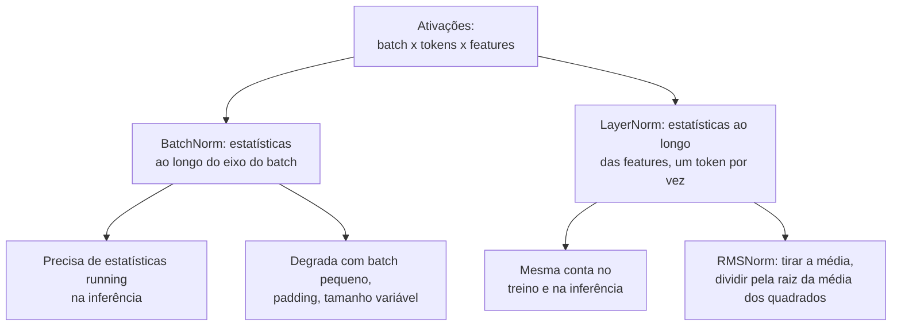

**Follow-ups:** Por que a BN geralmente tem desempenho inferior mesmo em transformers só com encoder, onde o decoding não é problema? O que a RMSNorm remove, e por que isso não atrapalha? Explique mecanicamente por que o post-norm é instável em profundidade.

</details>

### 27. Derive a cross-entropy loss a partir dos princípios básicos. Por que ela é a loss "certa" para classificação e language modeling?

<details><summary><b>Resposta</b></summary>

Comece pela **máxima verossimilhança**. Um classificador (ou LM) define uma distribuição condicional p_θ(y|x). Dados i.i.d., o MLE maximiza Π p_θ(yᵢ|xᵢ). Tomando logs (monotônico, transforma produtos em somas e é numericamente necessário) e invertendo o sinal, chega-se ao objetivo de treino: minimizar a **negative log-likelihood** = −Σ log p_θ(yᵢ|xᵢ). Para uma saída categórica com alvos one-hot, isso é exatamente a cross-entropy: H(y, p) = −Σ_c y_c log p_c = −log p(classe correta). O language modeling é isso aplicado por token: a cross-entropy do próximo token é o MLE da distribuição do texto, e **perplexity = exp(CE média)**, ou seja, "entre quantos tokens igualmente prováveis o modelo está escolhendo".

A visão da teoria da informação: minimizar a CE contra a distribuição empírica dos dados equivale a minimizar a **KL(data ‖ model)**. Você está igualando a distribuição do modelo à dos dados, e o gap acima da entropia dos próprios dados é exatamente o termo de KL.

Por que ela é a *certa* de forma mecânica, e não só filosófica:

1. **Qualidade do gradiente.** Com saídas softmax, ∂CE/∂logits = **p − y**. Errado com confiança (p≈0 na classe verdadeira) → gradiente próximo do máximo; certo e confiante → gradiente próximo de zero. Não há saturação nos erros.
2. **Proper scoring rule**: a CE esperada só é minimizada ao prever as verdadeiras probabilidades condicionais, então ela incentiva incerteza honesta, base da calibration dos LMs.
3. Ela pune erros confiantes sem limite (−log p → ∞ quando p→0), que é o que você quer quando decisões posteriores consomem as probabilidades.

O enquadramento que funciona em entrevistas: a cross-entropy não é uma loss entre muitas; é aquilo em que "fazer MLE numa distribuição categórica" *se compila*. O MSE é a mesma afirmação para ruído Gaussiano; toda loss padrão é uma verossimilhança disfarçada.

**Follow-ups:** Mostre que softmax+CE dá o gradiente p − y. O que o label smoothing muda nesse quadro? Por que a perplexity é o exp da CE, e o que significa, concretamente, uma perplexity de 8?

</details>

### 28. Explique softmax e o parâmetro de temperature. Como calcular o softmax de forma estável, e onde a temperature aparece em ML?

<details><summary><b>Resposta</b></summary>

O softmax mapeia logits para uma distribuição de probabilidade: `p_i = exp(z_i/T) / Σ_j exp(z_j/T)`. Com temperature T=1, é a forma padrão. Quando **T→0**, ele se aproxima do argmax (toda a massa no maior logit); quando **T→∞**, ele se achata em direção ao uniforme. Dividir por T reescala as *diferenças* entre logits, e é isso que controla a nitidez. O softmax é invariante à soma de uma constante em todos os logits (só as diferenças importam), o que permite o truque de estabilidade.

**Estabilidade numérica**: o exp estoura rápido (exp(89) dá overflow em fp32). Subtraia primeiro o maior logit. Matematicamente é uma operação nula, mas numericamente é essencial:

```python
def softmax(z, T=1.0):
    z = z / T
    z = z - z.max(axis=-1, keepdims=True)   # truque do log-sum-exp
    e = np.exp(z)
    return e / e.sum(axis=-1, keepdims=True)
```

Na prática, você calcula o `log_softmax` diretamente e o usa com a NLL para obter uma cross-entropy fundida e estável. Nunca faça `log(softmax(z))` em dois passos (catastrófico quando uma probabilidade sofre underflow para 0).

A temperature aparece em toda a stack, e ligar esses pontos é o que torna a resposta de nível sênior:
- **Sampling em LLMs**: T escala os logits do próximo token antes da amostragem. T baixa → determinístico e repetitivo; T alta → diverso e sujeito a erros. T=0 significa, por convenção, greedy decoding. Funciona junto com o truncamento top-p/top-k.
- **Knowledge distillation** (Hinton et al.): suaviza a distribuição do teacher com T>1, para que o "dark knowledge" das classes que não são o argmax leve sinal de gradiente ao student.
- **Losses contrastivas** (InfoNCE/CLIP/SimCLR): os scores de similaridade são divididos por τ (~0,05 a 0,1) antes do softmax; o τ controla o quanto a loss se concentra nos negativos mais confundíveis. O CLIP, aliás, *aprende* a sua temperature.
- **Calibration**: o temperature scaling ajusta um único T nos logits de validação para corrigir a superconfiança. É o mesmo botão, com outro objetivo.
- **Attention**: o fator 1/√d_k na scaled dot-product attention é exatamente uma temperature fixa, que mantém a variance dos logits ~1 para o softmax não saturar na init.

**Follow-ups:** Por que a attention divide por √d_k? O que acontece sem isso? Por que uma temperature baixa *não* é o mesmo que o truncamento top-k? O que quebra numericamente se você calcular log(softmax(z)) de forma ingênua?

</details>

### 29. Compare PCA, t-SNE e UMAP. Quando usar cada um, e como as pessoas interpretam mal esses gráficos?

<details><summary><b>Resposta</b></summary>

O PCA é linear e tem lugar dentro de um pipeline. O t-SNE e o UMAP são não lineares e pertencem à tela, para olhar os dados, e não para alimentar um modelo adiante.

O **PCA** encontra as direções ortogonais de máxima variance (autovetores da matriz de covariância; na prática, a SVD dos dados centralizados). É determinístico, barato, invertível (dá para projetar de volta e medir o erro de reconstrução) e preserva a estrutura global. Por isso é o que você pode colocar em produção: reduzir embeddings de 1536-d para 256 para diminuir o tamanho do índice e a latency, descorrelacionar features, remover ruído. Faça standardization antes se as features têm unidades diferentes. O modo de falha: variance não é informação. Uma direção de baixa variance pode ser a discriminativa, e o PCA vai descartá-la.

O **t-SNE e o UMAP** otimizam um objetivo de preservação de vizinhança. São estocásticos, não preservam distâncias e enganam de formas específicas e documentadas:

- **O tamanho dos clusters não significa nada.** O t-SNE expande regiões esparsas e comprime as densas.
- **As distâncias entre clusters também não significam quase nada**, principalmente no t-SNE.
- **O gráfico muda com perplexity / n_neighbors e com a random seed.** Dá para produzir clusters convincentes a partir de puro ruído Gaussiano, escolhendo uma perplexity baixa o bastante.

O UMAP preserva mais da estrutura global, é mais rápido e consegue transformar pontos novos (o t-SNE não consegue, sem gambiarras), mas as mesmas ressalvas valem.

Minhas regras: primeiro o PCA até ~50 dims, como etapa de denoise e de ganho de velocidade, e só depois o t-SNE/UMAP. Varra perplexity/n_neighbors e várias seeds, e só acredite na estrutura que persiste em todas elas. Nunca cite como achado uma contagem de clusters lida num gráfico de UMAP; confirme agrupando no espaço original e conferindo com os labels.

Em trabalho com embeddings especificamente, trate esses gráficos como auxílio de debugging. Minhas paráfrases caem perto umas das outras? Os embeddings dos meus chunks colapsaram numa massa só? Boas perguntas. Já "quantos intents os meus usuários têm" não se responde olhando o gráfico.

**Follow-ups:** Você precisa reduzir pela metade um índice de embeddings de 3072-d sem prejudicar o recall. Me conduza pelas suas opções e por como validaria a escolha. Por que o UMAP consegue transformar pontos novos e o t-SNE não?

</details>

### 30. Seu modelo novo marca 87,2% no test set e o atual marca 86,5%. Vai para produção?

<details><summary><b>Resposta</b></summary>

Com essa evidência, não. Uma estimativa pontual sem intervalo não é um resultado, e 0,7 ponto muito provavelmente é ruído.

Primeiro, quantifique a incerteza. Faça bootstrap do test set: reamostre com reposição ~1.000 a 10.000 vezes, recalcule a métrica a cada vez e pegue os percentis 2,5 e 97,5. Melhor ainda, faça o bootstrap da **diferença pareada**, avaliando os dois modelos nos mesmos índices reamostrados. Isso cancela a variance de dificuldade do test set e dá um intervalo muito mais estreito do que comparar dois ICs independentes. Note que ICs sobrepostos *não* implicam ausência de diferença significativa, então teste a diferença diretamente em vez de comparar duas barras de erro a olho.

Uma intuição aproximada da escala. Com n = 1.000 e accuracy perto de 0,87, o erro padrão é de cerca de `sqrt(0.87*0.13/1000)` ≈ 1,1%. Uma diferença de 0,7 ponto cabe com folga dentro do ruído. Para resolvê-la com segurança seriam necessários exemplos na ordem de dezenas de milhares. O teste pareado ajuda porque só as discordâncias carregam informação, que é exatamente o que o teste de McNemar formaliza.

```python
import numpy as np
def paired_bootstrap(correct_a, correct_b, n=10_000, seed=0):
    rng, N = np.random.default_rng(seed), len(correct_a)
    d = np.array([ (correct_a[i]-correct_b[i]).mean()
                   for i in (rng.integers(0, N, N) for _ in range(n)) ])
    return np.percentile(d, [2.5, 97.5])
```

Três fontes de variance que a comparação ingênua esconde:

- **Variance de seed.** Retreine com várias seeds. Em fine-tunes, a dispersão entre seeds muitas vezes engole a diferença que você está perseguindo.
- **Ruído de seleção.** Se você tentou 40 configurações e reportou a melhor, a vencedora é em parte sorte. Isso exige um novo holdout.
- **Dados não i.i.d.** Linhas agrupadas (várias por usuário ou por documento) quebram a premissa do bootstrap. Reamostre no nível do grupo.

A versão da era dos LLMs pesa ainda mais: os eval sets costumam ter de 200 a 1.000 itens, então a maioria das afirmações do tipo "o modelo A supera o B por um ponto" não pode ser resolvida. Se a diferença está dentro do ruído, eu decido por custo, latency ou simplicidade, e digo isso com clareza.

**Follow-ups:** Como você montaria o eval para que uma diferença de 0,7 ponto *seja* detectável, e isso é um bom uso do orçamento? Seu test set tem 5 exemplos por usuário em 200 usuários. O que quebra num bootstrap ingênuo?

</details>

### 31. O que é training-serving skew? Como detectá-lo e como eliminá-lo já no design?

<details><summary><b>Resposta</b></summary>

O training-serving skew acontece quando as features que o modelo vê na inferência diferem das que ele viu no treino, e ele passa a pontuar uma distribuição que nunca ajustou. As métricas offline parecem boas, a produção rende menos sem alarde e nenhuma exceção é lançada. Esse silêncio é o que faz dele a classe mais cara de bug de ML.

As causas, mais ou menos na ordem de frequência com que eu as vi de fato:

1. **Duas implementações.** As features de treino vêm de um job batch em Spark ou SQL, e as de serving vêm de código no caminho da requisição, em outra linguagem. Elas divergem assim que qualquer um dos lados muda.
2. **Viagem no tempo.** Uma linha de treino para um evento no tempo `t` é juntada com um snapshot de features que já contém dados posteriores a `t`. O treino viu um valor que o serving nunca poderá ter.
3. **Tratamento diferente de nulos.** O treino imputa a mediana do conjunto de treino; o serving manda 0.
4. **Skew de freshness.** O treino usou uma feature agregada sobre um dia completo; o serving lê uma materializada só em parte.
5. **Deriva de versão do preprocessing.** Estatísticas do scaler, vocabulário ou tokenizer fora de sincronia com o checkpoint.

Como eliminá-lo no design:

- **Uma única definição por feature**, consumida pelos dois caminhos. Essa é a verdadeira razão de existirem as feature stores (Feast, Tecton); o armazenamento é secundário.
- **Joins point-in-time corretos** ao montar os conjuntos de treino, de modo que uma linha só enxergue o que era conhecível naquele momento.
- **Embutir o preprocessing no artefato** (um Pipeline do sklearn, um módulo torch, o grafo de serving), para que ninguém possa reimplementá-lo.
- **Registrar em log o vetor de features exato que foi servido** e reaproveitar esses logs como dados de treino da rodada seguinte. Para features registradas em log, o skew se torna estruturalmente impossível.

Detecção, porque a prevenção nunca é completa: compare por feature as distribuições dos vetores servidos com as do conjunto de treino (PSI ou KL contra uma janela de referência) e dispare alertas. Melhor ainda, rode um job shadow que reproduz as requisições registradas pelo pipeline de treino e compara os valores das features. Qualquer taxa de diferença diferente de zero é um bug. Prefiro muito mais ler "5% das linhas divergem na feature X" a passar uma semana caçando uma queda misteriosa de AUC.

**Vale desenhar.** Duas caixas calculando a mesma feature são o bug; a seta de replay embaixo é a única coisa que prova que você não o tem.


**Follow-ups:** Dê um exemplo concreto de join point-in-time e mostre onde a versão ingênua vaza. Seu alerta de PSI dispara numa feature. Como você distingue uma mudança real no upstream de um pipeline quebrado?

</details>

### 32. Você vai rodar um A/B test num modelo novo. Me explique como o desenharia e o que se recusaria a fazer depois que ele estivesse no ar.

<details><summary><b>Resposta</b></summary>

Defina a métrica, o minimum detectable effect e o tamanho da amostra *antes* do lançamento, e depois não espie os resultados sem aplicar correção.

**Dimensionamento.** O tamanho da amostra por braço escala aproximadamente como `n ∝ σ²/Δ²`, então reduzir à metade o efeito que você quer detectar quadruplica o tráfego. Isso significa que a primeira pergunta não é "quanto tempo vamos rodar", e sim "que lift vale a pena colocar em produção". Os padrões de α = 0,05 e 80% de power implicam uma chance em cinco de perder um efeito real, o que é aceitável para uma mudança barata e negligente para uma aposta grande.

**Peeking.** Os testes de horizonte fixo assumem uma única olhada num n predeterminado. Checar todo dia e parar assim que p < 0,05 infla a taxa de falsos positivos muito acima do α nominal. Correções aceitáveis: um horizonte fixo pré-registrado, fronteiras sequenciais em grupo (estilo O'Brien-Fleming) ou p-values sequenciais always-valid, se o time insistir num dashboard ao vivo. O que eu me recuso a fazer é parar cedo num teste sem correção, que é como nascem a maioria das "vitórias" que não se replicam.

**Redução de variance.** O CUPED remove por regressão uma covariável pré-experimento, tipicamente a métrica do mesmo usuário no período anterior. Quando a métrica é autocorrelacionada, isso reduz bastante a variance e encurta o teste. É mais barato que comprar tráfego.

Armadilhas que eu levantaria por conta própria:

- **Sample ratio mismatch.** É a primeira coisa que eu checo. Se o split não é o que você configurou, a atribuição está quebrada e todos os números adiante são suspeitos.
- **Unidade de randomização vs unidade de análise.** Se você randomiza por usuário e analisa por sessão, a premissa i.i.d. quebra e seus p-values ficam pequenos demais. Use o delta method ou um cluster bootstrap para métricas de razão.
- **Interferência.** Em marketplaces ou grafos sociais, o controle é contaminado pelo tratamento. Use switchback ou randomização por cluster.
- **Novelty e primacy.** A primeira semana não é o estado estacionário.

Para uma feature com LLM em particular, o custo por requisição é uma métrica co-primária, e não uma nota de rodapé. Um ganho de 1% em qualidade que dobra o gasto com tokens não é um ganho, e o eval offline é de qualquer forma só uma proxy da métrica online.

**Vale desenhar.** Colocar a decisão sobre o peeking no diagrama força a conversa que você realmente precisa ter com o time antes do lançamento, e não depois.

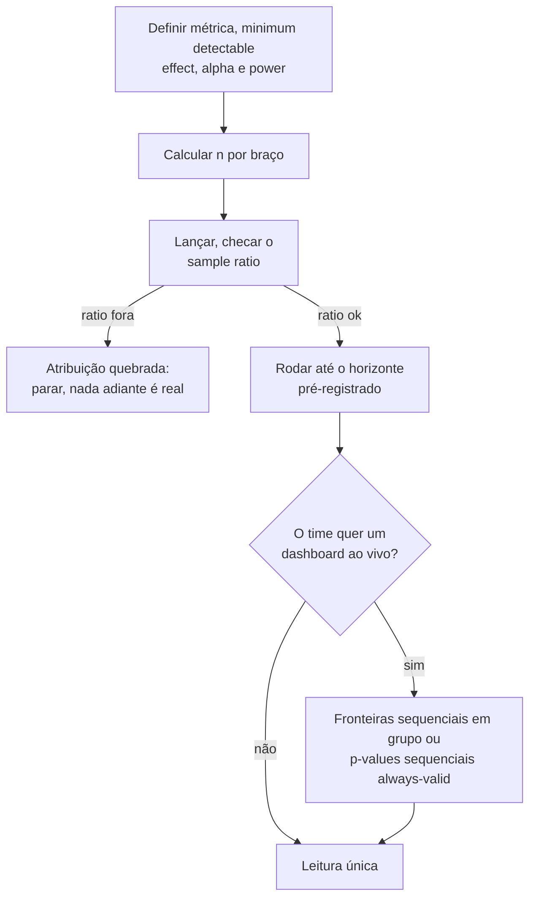

**Follow-ups:** Sua métrica é receita por usuário, que tem cauda pesada e é quase sempre zero. O que isso faz com o tamanho da amostra, e o que você faria a respeito? Como você detectaria um efeito de novelty em vez de apenas presumi-lo?

</details>

### 33. Cerca de 10% dos labels do seu treino estão errados. O que acontece, e o que você faz?

<details><summary><b>Resposta</b></summary>

O ruído de labels limita a accuracy alcançável, enviesa a seleção de modelos e, o mais danoso, corrompe o seu eval. Por isso eu conserto o eval primeiro. Se 10% dos labels de *teste* estão errados, um modelo perfeito marca ~90%. Pior: o ranking entre dois bons modelos passa a ser decidido por qual deles prevê melhor o ruído. Toda decisão adiante herda isso.

O treino é mais tolerante do que as pessoas esperam. Os modelos são razoavelmente robustos a ruído *aleatório simétrico*, desde que haja dados suficientes, porque ele se anula na média e a cross-entropy ainda consegue recuperar a posterior correta. Duas ressalvas pesam mais do que essa robustez:

- **O ruído real é sistemático, não aleatório.** Os anotadores erram o label de uma classe específica de forma consistente, ou as diretrizes são ambíguas numa região específica. O ruído sistemático é aprendido como sinal, e nenhuma quantidade de dados o cura.
- **Modelos grandes memorizam labels ruidosos no fim do treino.** Isso aparece como um gap train/val que aumenta depois de um ajuste inicialmente limpo, o que faz do early stopping uma defesa real aqui.

Meu playbook:

1. **Meça.** Reanote uma amostra aleatória de ~200 a 500 itens com seus melhores anotadores ou com um painel de adjudicação. O que você quer é a taxa de ruído e, mais útil ainda, o padrão de confusão.
2. **Leia a discordância como um bug de especificação.** Uma alta discordância entre anotadores geralmente indica que o rubric é ambíguo, e não que os anotadores são descuidados. Corrija as diretrizes antes de comprar mais labels.
3. **Separe os dados por finalidade.** Monte um gold set pequeno, caro e com vários anotadores para o eval, e trate a pilha ruidosa apenas como dados de treino. Reporte a concordância entre anotadores (kappa de Cohen ou de Fleiss) como o teto contra o qual qualquer modelo pode ser medido.
4. **Limpe pela loss.** Treine com cross-validation e inspecione os exemplos errados com confiança e os de loss alta. A maioria é label errado, alguns são difíceis de verdade e uns poucos revelam que a definição da tarefa está quebrada. As ferramentas de confident learning (estilo cleanlab) formalizam isso.
5. **Mitigue na loss.** Label smoothing, losses robustas/simétricas, reponderação de amostras.

O atalho de 2026: peça a um modelo forte que pré-rotule e destaque as discordâncias para os humanos. Só nunca deixe a mesma família de modelos julgar as próprias saídas no seu gold set.

**Follow-ups:** O kappa é 0,55 na sua tarefa. O que isso diz, e qual é o próximo passo? Como você distinguiria um exemplo realmente difícil de um com label errado no seu bucket de loss alta?

</details>

### 34. Você vai adaptar um modelo pré-treinado a uma tarefa nova. O que congela, o que treina, e como decide?

<details><summary><b>Resposta</b></summary>

O quanto você descongela deve crescer com a quantidade de dados da tarefa e com a distância entre o seu domínio e a distribuição de pretraining. A decisão toda é essa.

A escada:

1. **Backbone congelado mais um linear probe.** Centenas de exemplos, domínio próximo do pretraining. É também a medida honesta do quão boa a representação já é, e eu rodo isso primeiro de qualquer jeito, como baseline.
2. **Descongelar os últimos N blocos.** Milhares de exemplos.
3. **Full fine-tune.** Dezenas de milhares ou mais, ou um domínio realmente distante (imagem médica, texto jurídico, um idioma incomum).
4. **PEFT / LoRA.** Hoje é o padrão para LLMs. Você treina cerca de 1% dos parâmetros, mantém um único modelo base residente, troca os adapters por tarefa e evita em boa parte o catastrophic forgetting da capacidade geral que o full fine-tuning convida.

Por que as camadas iniciais se congelam bem: elas aprendem estrutura genérica (bordas e texturas em CNNs, sintaxe e regularidades de superfície nas camadas iniciais dos transformers), enquanto as camadas finais são específicas da tarefa e dos labels. É o mesmo motivo pelo qual você sempre troca a head.

Regras práticas que separam quem já fez de quem só leu:

- **LR bem menor que o do pretraining**, tipicamente ~10 a 100x menor. Você está dando um empurrão, não sobrescrevendo.
- **Aqueça a head nova com o backbone congelado** por uma época antes de descongelar. Uma head inicializada aleatoriamente emite gradientes grandes que vão destruir os pesos pré-treinados nos primeiros passos.
- **LRs discriminativos**, menores para as camadas iniciais, se você descongelar parcialmente.
- **Mantenha a BatchNorm em modo eval** quando os batches do fine-tuning são pequenos. Atualizar as estatísticas running com um batch de 8 é uma regressão silenciosa clássica.

Quando não fazer transfer: quando o orçamento de deployment não comporta o modelo pré-treinado (aí é caso de distillation), ou quando o input é realmente alienígena para ele.

Em aplicações com LLMs, a ordem importa: tente primeiro prompting, few-shot e retrieval. Faça fine-tuning para aderência a formato e comportamento, ou para levar uma tarefa para um modelo menor e mais barato. Fazer fine-tuning para injetar fatos costuma ser a ferramenta errada; para isso existe o retrieval.

**Follow-ups:** Você fez o fine-tuning e o modelo ficou melhor na sua tarefa, mas pior em todo o resto. Diagnostique e corrija. Por que o LoRA resiste mais ao catastrophic forgetting do que o full fine-tuning com o mesmo learning rate efetivo?

</details>

### 35. O que dá errado ao validar um modelo em dados ordenados no tempo, e como fazer isso direito?

<details><summary><b>Resposta</b></summary>

A k-fold aleatória em dados ordenados no tempo é leakage, ponto final. Ela treina com o futuro para prever o passado, tem um score lindo e morre em produção.

Use a **walk-forward validation (rolling-origin)**: treine em `[0, t)`, valide em `[t, t+h)`, avance e repita. São vários folds, para que você veja a variance entre regimes em vez de uma janela de sorte. Use janela expansiva se os regimes antigos ainda valem, e janela deslizante se não valem.

Os leaks mais sutis são onde as entrevistas realmente se ganham:

- **Agregações não causais.** Calcular médias móveis, target encodings ou estatísticas de scaler sobre a série inteira antes de dividir. Toda agregação deve usar apenas dados até `t`.
- **Janela do label sobreposta à janela das features.** Prever "churn nos próximos 30 dias" com features que incluem a atividade do dia `t+5`.
- **Dados que existem no seu warehouse mas não existiam naquele momento.** Registros que chegam atrasados, correções com backfill, números reapresentados. O snapshot de treino é retrospectivo; o serving não. Esse é o que mata, e os joins point-in-time corretos são a solução.
- **Falta de embargo.** Deixe entre o treino e a validação um intervalo igual ao horizonte do label. Sem ele, a autocorrelação faz das linhas dos dois lados da fronteira quase duplicatas.

Duas coisas que eu insistiria em reportar:

**Baselines.** Compare sempre com a persistência ingênua (`y_hat_t = y_{t-1}`) e com a seasonal naive. Uma boa parte dos modelos de previsão com aparência impressionante não os supera, e qualquer entrevistador que já colocou previsão em produção sabe disso.

**Métricas por horizonte, não na média.** Um modelo pode ser excelente em h=1 e inútil em h=30, e a média esconde justamente o que o negócio quer saber.

Por fim, trate o distribution shift como o padrão, e não como uma patologia. A cadência de retreino é um parâmetro de design, não um pensamento tardio. Um modelo validado em dados de 2024 diante de uma mudança de regime em 2026 não está sofrendo overfitting: é outro problema, e confundir os dois leva você a otimizar a regularização quando deveria reconstruir o pipeline.

**Vale desenhar.** O intervalo de embargo e a restrição de "só até t" são as duas coisas que os candidatos esquecem, e o desenho deixa a ausência delas óbvia.


**Follow-ups:** Seus folds de walk-forward mostram scores muito diferentes. O que isso diz, e o que você reporta aos stakeholders? Como você monta um conjunto de treino quando os valores de uma feature importante são reapresentados 3 dias depois do fato?

</details>

### 36. Como escolher o k em clustering, e como avaliar um clustering quando não há labels?

<details><summary><b>Resposta</b></summary>

Eu evito escolher o k no vácuo, porque o k certo quase sempre é definido pela *finalidade* dos clusters. Se o resultado são 8 macros de suporte, o k fica perto de 8, e a pergunta passa a ser se os dados sustentam isso.

A mecânica para o k-means: o elbow na inertia é fraco (a inertia diminui de forma monotônica e o cotovelo muitas vezes é invisível). A silhouette é melhor porque penaliza a sobreposição. Se eu migro para um Gaussian mixture, ganho o BIC, que é um critério de seleção de modelo bem fundamentado, além de atribuições suaves.

Minha checagem honesta preferida é a **estabilidade**: faça bootstrap, reagrupe e meça a consistência das atribuições entre os runs com o adjusted Rand index. Clusters que não são estáveis entre reamostragens não são reais, e isso pega a falha de "ruído virando cluster" que a silhouette deixa passar numa boa.

O que as pessoas esquecem sobre o k-means: ele assume clusters mais ou menos esféricos, de tamanho e densidade parecidos, e usa distância Euclidiana, então as features precisam estar em escala comparável. Ele corta alegremente um cluster alongado em três. Quando essas premissas não valem, use DBSCAN/HDBSCAN, que inferem o número de clusters, lidam com formas arbitrárias e marcam outliers como ruído, em vez de forçar cada ponto a ir para algum lugar. O preço é ajustar `min_samples`/`eps` e sofrer com densidades variáveis, que o HDBSCAN trata melhor. O agglomerative entrega um dendrograma e deixa a decisão do k para depois.

Com embeddings, que hoje é o caso comum (agrupar queries de usuários para descobrir intents): normalize em L2 e use cosine, ou o spherical k-means. As distâncias Euclidianas em alta dimensão se concentram e deixam de ser informativas. Reduza com PCA por velocidade, mas valide no espaço original, e não no desenho do UMAP.

**O critério extrínseco sempre vence o intrínseco.** Rotule à mão uma amostra de clusters e verifique se eles são acionáveis, ou meça se o clustering melhora aquilo que ele alimenta. E o truque prático de 2026: depois de agrupar as queries, peça a um LLM que dê um nome a cada cluster a partir dos seus membros. Se ele não consegue produzir um rótulo coerente, aquilo não é um cluster.

**Follow-ups:** A silhouette indica k=2, mas o time de produto precisa de ~10 segmentos acionáveis. O que você faz? Por que as distâncias Euclidianas em alta dimensão se concentram, e o que isso faz com o k-means em particular?

</details>

### 37. O que é conformal prediction, e como usá-la para dar uma garantia estatística às saídas de um classificador ou de um pipeline com LLM?

<details><summary><b>Resposta</b></summary>

A conformal prediction envolve qualquer modelo treinado e transforma seus scores em **prediction sets** com uma taxa de coverage garantida: para um nível de erro α escolhido, o conjunto contém o label verdadeiro pelo menos 1 − α das vezes, na média sobre exemplos novos. Ela não assume nada sobre o modelo estar correto ou calibrado, apenas que os dados de calibração e de teste são **permutáveis** (exchangeable; grosso modo, vêm da mesma distribuição).

A split conformal, a versão que você de fato coloca em produção:

1. Reserve um conjunto de calibração em que o modelo nunca treinou, de algumas centenas a alguns milhares de exemplos.
2. Defina um nonconformity score, por exemplo 1 − p(classe verdadeira) para um classificador, ou |y − ŷ| para regressão.
3. Calcule o score de cada exemplo de calibração e pegue o quantil empírico ⌈(n+1)(1−α)⌉/n, q̂.
4. Na inferência, mantenha todo label cujo score seja no máximo q̂. Em regressão, isso dá o intervalo ŷ ± q̂.

O tamanho do conjunto é o sinal útil. Um input fácil recebe um conjunto unitário, um ambíguo recebe vários labels e um fora do escopo recebe um conjunto grande. Isso se traduz direto em decisões de produto: aja automaticamente nos conjuntos unitários e encaminhe os grandes a um humano ou a um modelo mais forte. A mesma maquinaria vale para pipelines com LLM, por exemplo ao escolher um threshold no score de um verifier ou judge, para que as respostas aceitas sem revisão atinjam uma taxa de erro-alvo. A conformal risk control generaliza a garantia, da miscoverage para outras losses limitadas.

O que os candidatos erram: a garantia é **marginal**, uma média sobre os inputs, e não vale por input. Um modelo pode ter coverage excessiva nos casos fáceis e insuficiente num subgrupo difícil. A conformal condicional por classe ou por grupo corrige isso, ao custo de mais dados de calibração por grupo. E a permutabilidade quebra sob distribution shift, então renove o conjunto de calibração com tráfego recente e monitore a coverage realizada em produção, como qualquer outra métrica.

**Vale desenhar.** A etapa do quantil é o método inteiro, e colocá-la entre o modelo congelado e a decisão de roteamento mostra que se trata de um wrapper fino, que independe do modelo.

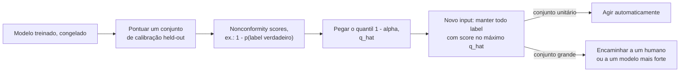

**Follow-ups:** Por que a correção (n+1) no quantil? Como você obteria uma coverage que valha por classe, e não na média? O tráfego muda depois de um lançamento de produto: o que acontece com a coverage, e como você detectaria isso?

</details>

### 38. Um stakeholder pergunta quais features dirigem o seu modelo de gradient boosting. Compare a importância nativa, a permutation importance e o SHAP, e diga onde cada uma engana.

<details><summary><b>Resposta</b></summary>

As três respondem a "no que o modelo se apoia". Nenhuma responde a "o que causa o resultado", e elas discordam entre si de maneiras previsíveis. Diga isso primeiro, porque o stakeholder costuma querer a resposta causal.

- A **importância nativa (por contagem de splits ou por gain)** sai de graça e é a menos confiável. A contagem de splits favorece features contínuas e de alta cardinalidade, que oferecem muitos pontos de corte, e o gain é medido nos dados de treino, então premia as features que as árvores usaram para ajustar ruído. Serve para uma olhada rápida, não para um slide.
- A **permutation importance** embaralha uma coluna num conjunto held-out e mede a queda da métrica. É independente do modelo e está ligada ao valor preditivo real. Tem dois modos de falha: features correlacionadas (embaralhe uma de um par e o modelo se apoia na gêmea, de modo que as duas parecem sem importância, e o embaralhamento ainda cria linhas irreais que o modelo nunca viu) e custo, já que exige uma passada de scoring por feature por repetição.
- O **SHAP** decompõe cada predição individual em contribuições aditivas por feature, com base nos valores de Shapley, o que dá explicações locais e, tirando a média dos valores absolutos, um ranking global. O TreeSHAP os calcula de forma exata e rápida para tree ensembles. Ressalvas: os resultados dependem dos dados de background e de como as features "ausentes" são simuladas (interventional vs conditional), as features correlacionadas dividem o crédito de maneiras que parecem arbitrárias, e um valor SHAP grande significa "moveu esta predição", e não "mudaria o resultado se você interviesse".

O que eu faria de fato: permutation importance em dados held-out para a visão global, embaralhando juntos os clusters de features correlacionadas, para que as gêmeas não se escondam uma atrás da outra. SHAP para decisões individuais, como os reason codes de uma decisão de crédito. Partial dependence ou gráficos ICE quando alguém perguntar sobre direção e forma. E se uma feature aparece no topo e ninguém sabe explicar por quê, trate-a como suspeita de leakage antes de tratá-la como um insight.

Quando a pergunta real é "o que acontece se mudarmos X", a resposta é um experimento ou um modelo causal, não um método de atribuição.

**Follow-ups:** Duas features têm 0,95 de correlação e ambas mostram permutation importance quase nula. O que está acontecendo, e como você reporta isso? Por que duas ferramentas de SHAP podem dar valores diferentes para o mesmo modelo?

</details>

## Avançado

### 39. Por que o MSE é uma loss ruim para classificação, mesmo "funcionando"? Conecte isso à visão probabilística das funções de loss.

<details><summary><b>Resposta</b></summary>

São dois argumentos independentes, um mecânico e um probabilístico, e uma boa resposta traz os dois.

**Mecânico: gradient starvation nos erros confiantes.** Para uma saída sigmoid p = σ(z) com loss MSE (p − y)², o gradiente em relação ao logit é `2(p − y)·σ'(z)`, e σ'(z) = p(1−p) → 0 sempre que a saída satura. Assim, um exemplo que o modelo erra *com confiança* (p≈0, y=1) produz quase **nenhum gradiente**: justamente os exemplos que mais precisam de correção são os que aprendem mais devagar. O gradiente da cross-entropy com sigmoid/softmax é `p − y`, sem o fator σ': a derivada do log cancela exatamente a saturação da sigmoid, e por isso os erros confiantes recebem as maiores atualizações. Isso também torna o MSE sobre sigmoid não convexo em z para cada exemplo, com platôs ruins, enquanto a CE é convexa nos logits.

**Probabilístico: modelo de ruído errado.** Toda loss é uma negative log-likelihood sob alguma premissa de ruído. MSE ⇔ ruído Gaussiano com variance fixa, um modelo para alvos contínuos que podem "errar por 0,3". Os labels de classe são eventos categóricos, e a verossimilhança correta é a Bernoulli/categórica, cuja NLL *é* a cross-entropy. Usar o MSE afirma que prever 0,7 para um label verdadeiro 1 gera o mesmo tipo de penalidade de um erro de regressão, e limita em 1,0 a penalidade máxima por total confiança na classe errada, enquanto a CE atribui uma penalidade ilimitada (−log p → ∞). A CE é a negative log-likelihood do modelo categórico, então treinar com ela *é* MLE, e por isso as probabilidades treinadas com CE são as que têm uma interpretação probabilística limpa.

Uma nuance para oferecer: o Brier score (MSE sobre probabilidades) *é* uma proper scoring rule e é usado para avaliar calibration. A objeção diz respeito à dinâmica de otimização e à correção da verossimilhança no treino, e não ao MSE sobre probabilidades ser sem sentido. E a regressão inverte tudo: a CE não se aplica diretamente, o MSE é exatamente o certo sob premissas Gaussianas, e L1/Huber servem quando você quer robustez a outliers.

**Follow-ups:** Derive o gradiente p − y e mostre onde o cancelamento acontece. Quando você usaria o Brier score de propósito? Qual loss corresponde ao ruído de Laplace, e quando você a preferiria?

</details>

### 40. Explique o contrastive learning e a loss InfoNCE. Como os modelos de embedding modernos (CLIP, retrievers de texto) são realmente treinados?

<details><summary><b>Resposta</b></summary>

O contrastive learning treina um encoder para que pares que "combinam" tenham similaridade alta e os que não combinam tenham similaridade baixa, sem labels por exemplo. A **InfoNCE** operacionaliza isso como uma cross-entropy sobre as similaridades: para uma query q com positivo k⁺ entre um conjunto de negativos {kᵢ},

L = −log [ exp(sim(q,k⁺)/τ) / Σᵢ exp(sim(q,kᵢ)/τ) ]

ou seja, uma classificação em N classes em que a "classe correta" é o parceiro verdadeiro. A sim costuma ser o cosine; o **τ** (tipicamente ~0,05 a 0,1; o CLIP o aprende, com valor inicial 0,07) afia o softmax para que a loss se concentre nos negativos mais difíceis e mais confundíveis. Em teoria, ela é um limite inferior da informação mútua entre as visões pareadas (do paper Contrastive Predictive Coding), embora na prática as pessoas a tratem como uma "loss de retrieval com softmax".

De onde vêm os positivos e os negativos é o jogo inteiro:
- **CLIP**: os positivos são pares (imagem, legenda) da web; os negativos são todos os outros pares do batch (**in-batch negatives**), numa matriz de similaridade N×N com uma loss simétrica nas duas direções. O batch size é crítico porque define o número e a dificuldade dos negativos; o CLIP usou ~32k.
- **Modelos de text embedding/retrieval** (estilo E5/GTE/BGE, linhagem DPR): os positivos são (query, passagem relevante); os in-batch negatives são complementados com **hard negatives** minerados por BM25 ou por um modelo anterior, isto é, passagens próximas no tema, mas erradas, que ensinam discriminação fina. Receita comum: pretraining contrastivo fracamente supervisionado em larga escala, com pares minerados, e depois fine-tuning em dados curados com hard negatives, às vezes com distillation de um reranker cross-encoder.
- **Visão self-supervised no estilo SimCLR**: os positivos são duas augmentations da mesma imagem.

Modos de falha que valem ser citados: **falsos negativos** (os "negativos" in-batch que na verdade são relevantes) limitam a qualidade alcançável em dados ruidosos; batches pequenos → negativos fáceis → embeddings mal definidos (os memory banks e as filas no estilo MoCo foram criados para simular pools maiores de negativos); e se você treina com cosine+τ, deve servir com cosine (normalize antes de indexar).

**Vale desenhar.** Com a matriz de similaridade no quadro, batch size e hard negatives deixam de ser assuntos separados: ambos são apenas colunas nesse softmax.

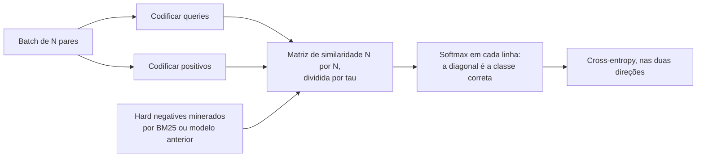

**Follow-ups:** Por que batches maiores ajudam o treino contrastivo, mas importam menos no treino supervised padrão? Como os hard negatives mudam o que o espaço de embedding aprende? Como você montaria o conjunto de treino para um embedder de busca em código?

</details>

### 41. Além de L1/L2: explique early stopping, data augmentation e label smoothing como regularizadores. O que é, afinal, regularização?

<details><summary><b>Resposta</b></summary>

A definição unificadora: regularização é qualquer técnica que reduz o erro de generalização sem reduzir (principalmente) o erro de treino. De forma equivalente, é qualquer coisa que injeta um **prior** ou restringe a capacidade efetiva, para que o modelo prefira soluções com maior chance de generalizar.

O **early stopping** interrompe o treino quando a val loss deixa de melhorar (com uma janela de patience) e restaura o melhor checkpoint. Ele restringe o quanto os pesos se afastam da inicialização: para losses quadráticas, é formalmente equivalente à regularização L2, com uma força inversamente relacionada ao tempo de treino. Sai de graça (você já monitora a val loss) e é o padrão de fato em fine-tuning. Ressalva: ele gasta o validation set, e o checkpoint escolhido fica ajustado a ele. Nota da era dos LLMs: o pretraining de uma única época raramente sofre overfitting no sentido clássico, mas o SFT em 10k exemplos com certeza sofre. O normal é treinar de 1 a 3 épocas, com seleção de checkpoint em evals held-out.

A **data augmentation** codifica invariâncias como dados sintéticos: crops, flips e color jitter em visão (o label não deve mudar com eles), paráfrase e back-translation em NLP clássico, SpecAugment em fala. É um prior expresso por meio dos dados, e não da loss, e muitas vezes é o regularizador mais forte disponível, porque ataca a variance diretamente com amostras (pseudo)novas. O análogo em LLMs é menos "augmentation" e mais geração de dados sintéticos e diversificação do formato de prompt durante o SFT, como proteção contra overfitting de formato.

O **label smoothing** troca o alvo one-hot por (1−ε) na classe verdadeira e ε/(K−1) nas demais (ε≈0,1). Ele impede o modelo de perseguir gaps infinitos entre logits, melhora a calibration na classificação supervised e foi padrão na visão da era Inception e em tradução automática. Ressalvas: distorce um pouco a semântica das probabilidades e é conhecido por prejudicar a distillation (a informação das classes não alvo do teacher é achatada). Em geral *não* se usa em pretraining de LLMs, onde o objetivo é reproduzir a distribuição dos dados, inclusive a incerteza genuína dela.

Na mesma família: dropout, weight decay, o ruído de gradiente de batches pequenos e, o mais subestimado de todos, **mais dados**, razão pela qual "coletar/limpar dados" vence regularizadores engenhosos na maioria dos cenários de produção.

**Follow-ups:** Por que early stopping ≈ L2 em losses quadráticas? Dê a intuição. Quando a augmentation *prejudica*? Por que o label smoothing entra em conflito com a knowledge distillation?

</details>

### 42. Que tipos de distribution shift existem, e como você monitoraria um modelo em produção, clássico ou baseado em LLM, para detectá-los?

<details><summary><b>Resposta</b></summary>

São três tipos canônicos, que se distinguem por *o que* muda entre o treino e o serving:

- **Covariate shift**: P(x) muda e P(y|x) permanece estável. Exemplos: novos perfis demográficos de usuários, novos tipos de dispositivo, mudanças na composição do tráfego. O modelo vê inputs diferentes dos do treino.
- **Label/prior shift**: P(y) muda. A taxa de fraude dobra nas festas de fim de ano; as frequências das classes se movem enquanto o comportamento condicional à classe se mantém.
- **Concept drift**: o próprio P(y|x) muda, e o mesmo input passa a significar outra coisa. Domínios adversariais (fraude, spam, abuso) sofrem drift *porque* o seu modelo existe: os atacantes se adaptam a ele.

A stack de monitoramento, ordenada pela latency do sinal:
1. **Input drift** (imediato): compare as distribuições de features ao vivo com uma janela de treino/referência, com PSI, KL divergence e testes de Kolmogorov-Smirnov por feature. Para inputs não estruturados, monitore o drift no **espaço de embedding** (distância entre as distribuições de embeddings ao vivo e de referência).
2. **Prediction drift** (imediato): mudanças na distribuição dos scores de saída ou na mistura de classes previstas muitas vezes sinalizam problemas antes de os labels chegarem.
3. **Métricas proxy/comportamentais** (rápidas): CTR, correções dos usuários, taxa de thumbs-down, taxa de escalonamento para humanos, taxa de retries.
4. **Métricas de ground truth** (atrasadas): accuracy/PR reais quando os labels chegam, como chargebacks aos 60 dias e churn aos 90. O atraso é o motivo de as camadas 1 a 3 existirem.
5. **Golden/canary sets**: suítes de eval fixas reexecutadas periodicamente, para detectar regressões independentemente do tráfego.

Em sistemas com LLM em particular: a distribuição de *queries* sofre drift (novos tópicos, novos padrões de jailbreak) e, de forma única, **o próprio modelo muda debaixo dos seus pés** quando um provedor atualiza um modelo hospedado ou quando você altera um prompt. Trate as versões de prompt e modelo como código: fixe as versões, rode suítes de eval (LLM-judge com auditoria humana periódica) a cada mudança, registre amostras em log para reavaliação offline e monitore propriedades da saída (tamanho, taxa de recusa, taxa de tool calls, scores do judge) como sinais de prediction drift.

Respostas possíveis: retreinar ou fazer fine-tuning com dados recentes, recalibrar thresholds (barato e, para prior shift, muitas vezes suficiente) ou corrigir os pipelines de dados upstream. Uma fração surpreendente dos alertas de "drift" são pipelines de features quebrados, e não o mundo mudando.

**Follow-ups:** Como você distingue concept drift de um bug no pipeline de dados? Se for só prior shift, dá para corrigir sem retreinar? Desenhe o monitoramento de drift de um bot de suporte baseado em RAG.

</details>

### 43. Quando a cosine similarity engana? Discuta as patologias do espaço de embedding relevantes para sistemas de retrieval.

<details><summary><b>Resposta</b></summary>

A cosine similarity só é tão significativa quanto a geometria do espaço em que é calculada, e várias patologias corrompem essa geometria:

**Anisotropia.** Os hidden states brutos de modelos de linguagem ocupam um cone estreito, em vez de se espalharem pela hiperesfera: o cosine médio entre pares de sentenças *aleatórias* pode ser muito alto (é por isso que os primeiros "embeddings de BERT via mean pooling" tiveram desempenho inferior ao de simples vetores GloVe médios em tarefas de similaridade, como mostrou o paper do Sentence-BERT). Consequência: os valores absolutos de cosine não são interpretáveis, e um 0,8 pode ser só o piso de ruído. O fine-tuning contrastivo (a linhagem do SimCSE e todos os embedders modernos) espalha explicitamente o espaço: a loss InfoNCE tem um termo de **uniformity**, que afasta os pontos, e um de **alignment**, que aproxima os positivos. Regra prática: nunca coloque em produção uma busca por vizinhos mais próximos sobre ativações de um LLM base; use um embedder treinado de forma contrastiva.

**Hubness.** Em alta dimensão, alguns pontos viram "hubs", que aparecem nas listas de k-NN de uma parcela desproporcional das queries, um artefato da concentração das distâncias. Sintoma: os mesmos poucos chunks são recuperados para tudo. Mitigações: embedders melhores, normalização dos scores por candidato, reranking com um cross-encoder.

**Descompasso de métrica entre treino e serving.** Um modelo treinado com cosine (normalizado), mas indexado com inner product bruto, deixa as *normas* dos vetores, que o objetivo de treino nunca disciplinou, dominarem os rankings. Normalize na indexação e na query, e configure a métrica do índice ANN (IP vs L2 vs cosine) para corresponder.

**Direções isotrópicas, mas sem significado.** O cosine pesa todas as dimensões igualmente; se algumas dimensões carregam informação de ruído de alta variance (tamanho, idioma, formatação), a similaridade reflete isso. Transformações de whitening e o fine-tuning do embedder para a tarefa resolvem em parte.

**Descompasso de tarefa**, o mais sutil para RAG: "similar" é relativo à tarefa. A relevância pergunta-resposta é assimétrica; uma pergunta costuma ter mais cosine com *outras perguntas* do que com as passagens que a respondem. Daí os embedders assimétricos com prefixo de instrução (prompts separados para query e passagem, no estilo E5/BGE) e os rerankers cross-encoder sobre o top-k.

**Follow-ups:** Como você detectaria hubness num sistema RAG em produção? Por que um cross-encoder supera o cosine de um bi-encoder, e por que não usá-lo no retrieval de primeira etapa? O que significam alignment e uniformity no enquadramento de Wang & Isola para o contrastive learning?

</details>

### 44. O que é a maximum likelihood estimation? Mostre como ela gera as funções de loss padrão e onde a visão Bayesiana (MAP) se conecta com a regularização.

<details><summary><b>Resposta</b></summary>

O MLE escolhe os parâmetros que tornam os dados observados mais prováveis sob o modelo: θ* = argmax_θ Π p_θ(dadosᵢ). Na prática, maximiza-se a **log**-verossimilhança: ela é monotônica (mesmo argmax), transforma o produto em soma (dados i.i.d. → losses por exemplo, que se dividem bem em mini-batches) e evita o underflow de ponto flutuante de multiplicar milhares de probabilidades. A verossimilhança *não* é uma distribuição de probabilidade sobre θ: é a probabilidade dos dados vista como função dos parâmetros, e não precisa integrar 1 sobre θ.

O movimento generativo que os entrevistadores querem ver: **escolha um modelo de ruído e ganhe uma loss de graça.**
- Verossimilhança categórica sobre classes/tokens → NLL = **cross-entropy**. O pretraining de LLMs é o MLE da distribuição do texto, token a token.
- Verossimilhança Gaussiana com variance fixa em torno de uma média prevista → NLL = **MSE** (a menos de constantes).
- Ruído de Laplace → **L1/MAE** (daí a robustez a outliers: caudas pesadas esperam erros grandes ocasionais).
- Bernoulli → binary cross-entropy; Poisson → loss de regressão de Poisson.

Então "qual loss?" é, na verdade, "qual distribuição condicional eu acredito que gerou os alvos?"

O **MAP** (maximum a posteriori) acrescenta um prior: maximiza log p(dados|θ) + log p(θ). Um prior Gaussiano de média zero nos pesos adiciona −λ‖θ‖², ou seja, **L2/weight decay**; um prior de Laplace adiciona −λ‖θ‖₁, ou seja, **L1**. A regularização é, literalmente, a crença a priori de que os pesos devem ser pequenos: as visões Bayesiana e de otimização penalizada são a mesma matemática.

Propriedades que vale citar: o MLE é consistente e assintoticamente eficiente sob condições de regularidade, mas, com dados finitos, sofre overfitting: ele atribui com prazer probabilidade 1 a eventos vistos uma única vez (o problema de smoothing dos LMs clássicos de n-grams). Priors e regularização são a correção para dados finitos. Uma ruga moderna: os objetivos no estilo RLHF saem do arcabouço do MLE. Eles otimizam a recompensa esperada com uma coleira de KL presa ao modelo de referência treinado por MLE, e é por isso que o termo de KL existe: ele ancora a policy na distribuição que o MLE aprendeu.

**Follow-ups:** Derive o MSE a partir da verossimilhança Gaussiana, passo a passo. Por que o MLE com uma única observação de um evento raro dá probabilidades patológicas, e qual é a correção? Que papel a penalidade de KL cumpre no RLHF, sob esse ponto de vista?

</details>

### 45. O que é double descent, e como ele muda a história clássica sobre tamanho de modelo e overfitting?

<details><summary><b>Resposta</b></summary>

O aprendizado estatístico clássico prevê uma curva de erro de teste em forma de U em função da capacidade: underfit → ponto ideal → overfit, com o pior comportamento quando o modelo consegue memorizar exatamente os dados. O **double descent** (Belkin et al. 2019; ampliado empiricamente por Nakkiran et al., "Deep Double Descent") mostra o que realmente acontece com as redes modernas: o erro de teste sobe à medida que você se aproxima do **limiar de interpolação** (capacidade ≈ suficiente para ajustar o conjunto de treino, ruído incluído), *atinge o pico ali* e depois **cai de novo** conforme você continua aumentando o modelo muito além dele. O U clássico é a metade esquerda de uma curva maior.

A intuição para a segunda descida: no limiar de interpolação existe essencialmente uma única forma de ajustar os dados, e ela é contorcida: a função, forçada a passar por labels ruidosos, fica esticada ao limite. Com superparametrização massiva, existem *muitas* soluções que interpolam, e o viés implícito do otimizador (os métodos da família SGD preferem soluções de baixa norma, ou "suaves") escolhe, nesse conjunto, as que generalizam bem. Memorizar o ruído deixa de impor uma esquisitice global.

Nakkiran et al. mostraram o fenômeno em três eixos: **model-wise** (redes maiores), **epoch-wise** (treinar por mais tempo, passando por um pico do erro de teste no meio do treino) e **data-wise**, o genuinamente contraintuitivo, em que *mais dados podem prejudicar temporariamente* um modelo de tamanho fixo, ao deslocar o limiar de interpolação para cima dele. O ruído nos labels amplifica o pico; a regularização e o early stopping podem suavizá-lo até sumir, e por isso os praticantes raramente veem uma curva limpa de double descent na prática.

Por que isso importa na era dos LLMs: ele dissolve o instinto de "seu modelo é grande demais, vai sofrer overfitting" e é consistente com a prática de scaling. Transformers maiores generalizam melhor, e a capacidade é orçada contra compute e dados (scaling laws no estilo Chinchilla), e não contra os medos clássicos de overfitting. Uma ressalva que um bom candidato acrescenta: o pretraining de uma única época em trilhões de tokens está longe do regime de interpolação de qualquer maneira, e as preocupações com memorização ali são de privacidade e contaminação, não de test loss.

**Follow-ups:** Onde o viés implícito do SGD entra nessa história? Como adicionar dados de treino pode prejudicar? Explique o mecanismo. O double descent contradiz a decomposição bias-variance, ou apenas a narrativa clássica sobre capacidade?

</details>

### 46. A loss do seu pretraining de LLM acabou de dar um spike. Me conduza pela estabilidade de treinamento: gradient clipping, mixed precision e o seu playbook de debugging.

<details><summary><b>Resposta</b></summary>

Os loss spikes são endêmicos no treinamento de transformers em larga escala: batches ruins ocasionais, explosões de attention logits ou estados do otimizador mal escalados produzem um gradiente enorme, uma atualização destrutiva e uma loss que pula e, ou se recupera devagar, ou estaciona num patamar mais alto, ou diverge.

**Defesas permanentes** em toda receita séria:
- **Gradient clipping por norma global** (tipicamente 1,0): calcule a norma sobre todos os parâmetros e, se ela passar do threshold, reescale o vetor de gradiente inteiro. Isso preserva a direção e limita a magnitude. A *frequência* do clipping é, em si, uma métrica de saúde: clipar a cada passo significa que o LR está alto demais.
- **Mixed precision bem-feita.** O fp16 tem um dynamic range minúsculo (máximo ~65k, e o underflow é o maior assassino) e exige **loss scaling**: multiplique a loss por um fator para que os gradientes pequenos sobrevivam em fp16, desfaça a escala antes do passo do otimizador e pule os passos cujos gradientes contêm inf/NaN (o dynamic loss scaling automatiza isso). O **bf16** mantém os 8 bits de expoente do fp32, com menos precisão de mantissa, e elimina o loss scaling: é o formato de mixed precision padrão nas GPUs e TPUs atuais. Runs grandes levam cada vez mais os matmuls para **FP8**, com escalonamento fino (por bloco), como o DeepSeek-V3 reportou, mantendo as operações sensíveis em precisão maior. Seja como for, mantenha **master weights e estados do otimizador em fp32** e acumule em fp32 as reduções grandes.
- **Estabilizadores de arquitetura e objetivo**: posição pre-norm, QK-norm para impedir o crescimento dos attention logits e uma **z-loss** auxiliar (usada no PaLM, ~1e-4 · log²Z) que evita que o normalizador do softmax derive.
- Warmup e um LR de pico sensato, β₂ ≈ 0,95 (uma memória mais curta do segundo momento reage mais rápido a mudanças na escala do gradiente do que 0,999).

**O playbook quando um spike aparece**: olhe os logs de grad-norm e de norma por camada. Um spike de grad-norm *anterior* ao spike de loss aponta para a otimização; a ausência de spike de gradiente sugere os dados. Inspecione o batch responsável (documentos corrompidos, repetição patológica; problemas de dados são o culpado mais comum). Remédios padrão, em ordem crescente: confiar no clipping e deixar a loss se recuperar; **voltar ao último bom checkpoint e pular os batches de dados problemáticos** (o paper do PaLM descreve exatamente isso, e o logbook público do OPT documenta rollbacks repetidos); reduzir o LR de pico; adicionar estabilizadores (QK-norm, z-loss). Descarte também a infraestrutura: uma GPU instável gerando NaNs silenciosos parece exatamente um problema de otimização, e o log de grad-norm por rank ajuda a localizá-la.

**Vale desenhar.** O primeiro ramo é o playbook inteiro: saber se o grad-norm se mexeu antes da loss diz se o problema é de otimização, de dados ou de hardware.

```mermaid
flowchart TD
    A["Loss spike"] --> B{"Spike de grad-norm<br/>antes do spike de loss?"}
    B -->|"sim"| C["Otimização: reduzir o LR de pico,<br/>ver com que frequência o clipping dispara"]
    B -->|"não"| D["Dados: inspecionar o batch atrás de<br/>docs corrompidos ou repetição patológica"]
    B -->|"só em um rank"| E["Infraestrutura: dispositivo instável<br/>gerando NaNs silenciosos"]
    D --> F["Voltar ao último bom<br/>checkpoint, pular aquele shard"]
    C --> G["Adicionar estabilizadores: QK-norm,<br/>z-loss, beta2 em 0,95"]
    F --> G
```

**Follow-ups:** Por que o bf16 elimina a necessidade de loss scaling? Qual é a diferença real, no nível dos bits? Por que usar um β₂ menor em LLMs? O clipping dispara em 40% dos passos: o que você muda?

</details>

### 47. Desenhe a avaliação de um modelo de fraude com 0,1% de prevalência, de ponta a ponta: métricas, thresholding, protocolo de validação e monitoramento.

<details><summary><b>Resposta</b></summary>

É uma pergunta de síntese: o entrevistador quer ver os fios de desbalanceamento, calibration, leakage e drift tecidos num único design coerente.

**Métricas.** Descarte a accuracy (baseline de 99,9%) e desconfie da ROC-AUC (a FPR é diluída por negativos na proporção de ~999:1). Métricas offline primárias: **PR-AUC** para comparar modelos, mais métricas de ponto de operação ligadas à capacidade. Se o time de fraud-ops revisa 500 alertas/dia, reporte a **precision@500/dia** e o recall atingido ali; como alternativa, o recall com FPR fixa. Expresse o objetivo final em dinheiro: custo esperado = FN_count·(perda média por fraude) + FP_count·(custo de revisão + custo de atrito com o cliente).

**Thresholding.** Treine um scorer e depois **calibre** em dados held-out (isotonic ou temperature/Platt, e recalibre *depois* de qualquer reweighting ou resampling de classes, que enviesa as probabilidades). Escolha o threshold que minimiza o custo esperado na validation; considere dois thresholds (bloqueio automático acima do mais alto, revisão humana na faixa intermediária).

**Protocolo de validação.** **Splits temporais**, estritamente: treine nos meses 1 a 9, valide no 10 e teste nos 11 e 12, porque a fraude muda e os adversários se adaptam; splits aleatórios inflam os resultados. **Agrupamento no nível da entidade**, para que nenhum cartão/conta/dispositivo atravesse os splits (senão o group leakage deixa o modelo reconhecer entidades). Lide com a **latência de labels**: os chargebacks levam de 30 a 90 dias para chegar, então os dados recentes têm labels censurados. Avalie numa janela madura o bastante para os labels se assentarem, e seja explícito sobre isso. Audite as features atrás de target leakage (qualquer coisa posterior a uma decisão de fraude, como "account_frozen"). Rode **adversarial validation** para confirmar que train e test não são trivialmente distinguíveis por razões espúrias.

**Monitoramento.** Imediato: drift das features de input (PSI/KS contra a referência), drift da distribuição de scores, volume de alertas. Proxies rápidos: a precision da fila de revisão (os analistas humanos rotulam os alertas diariamente, o que dá uma estimativa de precision ao vivo). Atrasado: o recall contra labels de chargeback já maduros, reportado com o lag embutido. Armadilha do loop de feedback: você só recebe labels do que *investiga*, então as transações bloqueadas ou ignoradas ficam sem label. Mitigue com um pequeno orçamento de exploração (deixe passar sem ação uma amostra aleatória de ~0,1%, ou use mergulhos profundos dos analistas) para estimar o recall não censurado. O ciclo de retreino deve ser disparado por alarmes de drift, e não só pelo calendário.

**Vale desenhar.** A seta de exploração que contorna a fila de revisão é o detalhe que separa um design real de um de livro-texto: sem ela, você nunca enxerga o recall não censurado.

```mermaid
flowchart LR
    A["Split temporal:<br/>meses 1-9, 10, 11-12"] --> B["Agrupar por cartão,<br/>conta e dispositivo"]
    B --> C["Treinar o scorer"]
    C --> D["Calibrar em dados held-out,<br/>depois de qualquer reweighting"]
    D --> E["Threshold pelo custo esperado:<br/>bloquear, revisar ou permitir"]
    E --> F["Fila de revisão,<br/>500 alertas por dia"]
    F --> G["Labels dos analistas dão<br/>a precision diária"]
    G --> H["Chargebacks em 30-90 dias<br/>dão o recall, com o lag"]
    E -->|"amostra de exploração de 0,1%<br/>passa sem ação"| H
```

**Follow-ups:** Exatamente como o problema de selective labels enviesa um retreino ingênuo? A capacidade do time de operações cai pela metade: o que muda na sua métrica e no seu threshold? Como você faz um A/B test de um novo modelo de fraude quando a própria intervenção muda os labels que você observa?

</details>

### 48. Seu modelo atinge 0,87 de AUC offline, você o lança e a métrica de negócio não se mexe. Faça o debug.

<details><summary><b>Resposta</b></summary>

Eu divido o problema em sete hipóteses e ataco cada uma por ordem de custo, porque a maioria é mais barata de checar do que "retreinar o modelo".

1. **O experimento está quebrado.** Cheque primeiro o sample ratio mismatch e o logging de exposição. Se o split está errado, ou se você registra exposições só do tratamento, todo número é ficção.
2. **Training-serving skew.** Compare a distribuição das predições online com a offline. O skew aparece de imediato como um histograma deslocado. Depois, reproduza os vetores de features registrados em log pelo pipeline de treino e compare. Taxa de diferença diferente de zero significa bug.
3. **A métrica offline é a métrica errada.** A AUC mede o ranking da população inteira, mas você só age sobre o 1% do topo. Ela não diz nada sobre calibration, nem sobre o threshold que você de fato colocou no ar. A precision no ponto de operação pode ser péssima enquanto a AUC parece ótima.
4. **A camada de decisão engole o modelo.** Restrições de capacidade, uma regra de negócio que sobrepõe as predições, um threshold que ninguém reajustou. O modelo pode estar certo e nunca chegar a agir.
5. **O label não é o objetivo.** Você previu "vai dar churn" e o negócio quer "vai ser retido pela nossa intervenção". Ranquear por P(evento) mira em pessoas que fariam aquilo de qualquer jeito. É um problema causal, e nenhuma quantidade de AUC o resolve. A resposta é um holdout randomizado e uplift modelling, não um classificador melhor.
6. **A ação é fraca.** A predição é excelente, mas a intervenção que ela dispara não muda o comportamento.
7. **Power.** O teste pode simplesmente ser pequeno demais para enxergar o efeito verdadeiro, que pode ser real, porém modesto.

Sequência: saúde do experimento, depois skew, depois a camada de decisão, depois a questão causal, depois o power. Concretamente, se a AUC online sobre labels atrasados *também* for 0,87 e a métrica continuar parada, o modelo está bem e o problema é a causalidade ou a ação. É o ramo a que a maioria dos candidatos nunca chega.

O sinal de senioridade aqui é estar disposto a chegar a "ML não é a alavanca para este problema" e dizer isso em voz alta, com evidências, em vez de entregar a v2 de um modelo que nunca foi o gargalo.

**Vale desenhar.** Ordenar os ramos por custo é o sinal aqui: você descarta o encanamento antes de mexer no modelo, e a última caixa é a que a maioria dos candidatos nunca alcança.

```mermaid
flowchart TD
    A["0,87 offline,<br/>métrica de negócio parada"] --> B{"Sample ratio e logging<br/>de exposição limpos?"}
    B -->|"não"| C["O experimento está quebrado,<br/>todo número é ficção"]
    B -->|"sim"| D{"A distribuição de scores online<br/>bate com a offline?"}
    D -->|"não"| E["Training-serving skew:<br/>reproduzir vetores registrados e comparar"]
    D -->|"sim"| F{"A camada de decisão<br/>age sobre o score?"}
    F -->|"não"| G["Threshold desatualizado, teto de capacidade<br/>ou regra de negócio que sobrepõe"]
    F -->|"sim"| H["Causal: você ranqueou risco,<br/>o negócio precisa de persuadibilidade"]
```

**Follow-ups:** Você descobre que a AUC online bate com a offline e que a intervenção é randomizada. O que sobra, e como você quantifica? Como você teria pego, antes do lançamento, o erro de "prever churn em vez de persuadibilidade"?

</details>

### 49. Attention vs convolution: compare-as como inductive biases e diga o que isso implica na escolha de arquitetura.

<details><summary><b>Resposta</b></summary>

A convolução fixa no código a localidade e a translation equivariance, com compartilhamento de pesos. A attention fixa quase nada e, em vez disso, *aprende* quais posições interagem, com pesos de mistura calculados a partir do próprio conteúdo.

Mecanicamente: uma camada conv aplica um kernel fixo, independente do conteúdo do input, sobre uma janela local fixa. O campo receptivo cresce linearmente com a profundidade (exponencialmente com dilation), e o número de parâmetros é O(k·C_in·C_out), qualquer que seja o tamanho do input. A self-attention calcula uma matriz de mistura de todos contra todos que depende do input: pesos dinâmicos, campo receptivo global numa única camada e permutation equivariance, então a posição precisa ser injetada de forma explícita. A conta vem em O(n²·d), contra O(n·k·d).

O princípio que governa é o **tradeoff entre viés e dados**. Um prior forte vale muito quando os dados são escassos e custa caro quando são abundantes. Os vision transformers têm desempenho inferior ao das CNNs quando treinados do zero em dados da escala do ImageNet e as ultrapassam depois de pré-treinados em corpora substancialmente maiores (o DeiT depois fechou boa parte da lacuna em poucos dados com augmentation pesada e distillation, o que é só outro jeito de fornecer o prior), porque o prior que a CNN entrega de graça é algo que a attention consegue aprender se você mostrar exemplos suficientes. É a lição da última década comprimida numa comparação: arquiteturas gerais mais escala vencem priors feitos à mão acima de um limiar de dados, e abaixo desse limiar o prior vence.

A attention consegue expressar a convolução (aprendendo uma máscara local, só de posição), mas paga um custo quadrático pelo privilégio. Por isso, na prática, tudo convergiu para híbridos: conv stems e camadas de patchify nos vision transformers, convoluções depthwise intercaladas com attention em modelos de fala, sliding-window e local attention em LLMs de contexto longo. Este último é, literalmente, reintroduzir o prior de localidade porque o custo quadrático virou a restrição que importa. A linha dos state-space e linear-attention faz o mesmo com um prior recorrente, para recuperar O(n).

O que isso muda nas minhas decisões: com milhares de exemplos e um sinal fortemente local, use uma conv ou um backbone conv pré-treinado. Com um transformer pré-treinado disponível e interações de longo alcance ou dependentes do conteúdo, use attention. Quem decide são o volume de dados e o orçamento de compute, e não a arquitetura que está na moda.

**Follow-ups:** A sliding-window attention reintroduz a localidade. Isso a torna estritamente pior que a attention completa em qualidade, e como você mediria? Por que a permutation equivariance é um problema para a attention, mas não para a convolução?

</details>

### 50. Seu modelo de churn tem 0,9 de AUC. O produto quer enviar descontos de retenção para os 5% do topo. Por que isso pode ser um mau plano?

<details><summary><b>Resposta</b></summary>

Porque um modelo de churn prevê quem vai sair, e não quem pode ser *salvo*, e são pessoas diferentes. Os 5% do topo por P(churn) estão cheios de clientes que já foram embora (desconto desperdiçado) e deixam de fora por completo o meio persuadível. O que você precisa é de um efeito de tratamento: `P(stay | discount) - P(stay | no discount)` por usuário. Isso é uplift, ou CATE, e não é o que o seu modelo estima.

Pior: o modelo foi treinado com dados observacionais em que os descontos já tinham sido atribuídos de forma não aleatória. Se os atendentes davam descontos a clientes que reclamavam, então "recebeu desconto" se correlaciona com dar churn, e o modelo pode aprender, tranquilamente, que descontos causam churn. Isso é confounding, e uma AUC melhor o deixa mais confiantemente errado, não menos.

O que eu faria: criar dados sem confounding **retendo o desconto de forma aleatória** de uma fatia, e então ajustar um modelo de uplift nela. Opções: T-learner (ajusta modelos de resultado por braço e subtrai; simples, alta variance), S-learner (o tratamento como feature; pode ignorá-lo por completo quando o efeito é pequeno), X-learner (melhor com braços desbalanceados) ou causal forests e learners doubly-robust, que miram o efeito diretamente. Avalie com curvas Qini ou de uplift num test set randomizado. Não com AUC.

O enquadramento dos quatro grupos vale ser citado: persuadables, sure things, lost causes e sleeping dogs. **Os sleeping dogs são o verdadeiro perigo**: clientes cuja retenção você prejudica ativamente ao lembrá-los de que você existe. Um ranking por P(churn) não consegue distingui-los dos persuadables, e um modelo de uplift atribui a eles lift negativo.

Quando a randomização é impossível: propensity weighting ou matching, difference-in-differences com uma checagem explícita de parallel trends, variáveis instrumentais, regression discontinuity. Todos se apoiam em premissas não testáveis, principalmente a de ausência de confounders não medidos, então eu declaro a premissa em vez de fingir que a estimativa é limpa. E desenhe o DAG antes de escolher os controles, porque condicionar num mediador ou num collider fabrica viés onde não havia nenhum.

O enquadramento para deixar com eles: incrementalidade é a métrica. Campanhas que "miram nos high-converters" costumam ter lift incremental próximo de zero, e um holdout é a única forma de saber.

**Vale desenhar.** Abrir o top 5% em quatro grupos mostra por que um modelo de churn melhor não resolve isso: o ranking simplesmente não separa os ramos.

```mermaid
flowchart TD
    A["Ranquear por P(churn)"] --> B["O top 5% é uma mistura"]
    B --> C["Lost causes:<br/>saem de qualquer jeito"]
    B --> D["Sure things:<br/>ficam de qualquer jeito"]
    B --> E["Sleeping dogs:<br/>o desconto piora"]
    B --> F["Persuadables:<br/>os únicos que valem o gasto"]
    G["Reter o desconto de forma<br/>aleatória em uma fatia"] --> H["Ajustar uplift nesses dados,<br/>avaliar com Qini, não AUC"]
    H --> F
```

**Follow-ups:** Você não tem orçamento para um holdout randomizado. Qual é a sua segunda melhor opção, e que premissa você está comprando? Por que um S-learner tende a subestimar os efeitos de tratamento?

</details>

### 51. Seu modelo atinge a qualidade, mas roda com p95 de 4s e você precisa de 400ms com 10x o throughput. Desenhe o plano de compressão.

<details><summary><b>Resposta</b></summary>

Meça primeiro e estabeleça se você está limitado por compute ou por memory bandwidth, porque a resposta escolhe a técnica. O decode autorregressivo com batch pequeno é limitado por bandwidth (cada token lê todos os pesos), então a quantização só dos pesos rende um speedup quase linear. Conforme você aumenta o batch size para bater a meta de throughput, o decode vai se aproximando do limite de compute, e o KV cache passa a ser a memória que você de fato está lendo. O prefill é limitado por compute, então ele pede *matemática* de menor precisão, e não apenas pesos menores. Inverter isso é como as pessoas quantizam agressivamente e não veem ganho de latency.

Ordem das operações, da mais barata para a mais cara:

1. **Ganhos de serving que não custam nada em qualidade.** Continuous batching, paged KV cache, prefix caching para system prompts compartilhados e speculative decoding com um pequeno draft model. O speculative decoding é lossless: a regra de aceitar/rejeitar preserva exatamente a distribuição de saída do modelo-alvo. Faça tudo isso antes de tocar nos pesos.
2. **Post-training quantization.** Os pesos em 8 bits (weight-only) costumam custar na qualidade um erro de arredondamento. 4 bits com escalas por grupo (estilo GPTQ/AWQ) custa mais e exige um eval de verdade. O FP8 em GPUs da classe Hopper e mais novas dá speedup de compute além da redução de tamanho, e o hardware da classe Blackwell acrescenta formatos de 4 bits com escala por bloco (NVFP4, MXFP4) para times dispostos a rodar o eval. Quantizar o KV cache importa especificamente em contexto longo, onde ele pode dominar a memória.
3. **Distillation para um modelo menor.** É o maior ganho e o maior projeto. Treine o student com as saídas do teacher, idealmente logits suaves ou sequências on-policy, sobre a *sua* distribuição de tarefa. A distillation específica da tarefa vai muito mais longe que a geral: um student pequeno numa tarefa estreita pode igualar um generalista muito maior.
4. **Structured pruning ou layer dropping mais um fine-tune de recuperação.** A sparsity não estruturada raramente compensa sem suporte de hardware.

PTQ vs QAT: o PTQ leva horas, com um conjunto de calibração. O QAT custa um run de treinamento, mas recupera qualidade em bit widths agressivos. Comece com PTQ e só escale quando o eval disser que é preciso.

O que eu exijo: um eval por técnica no meu golden set *mais* uma checagem de regressão na cauda. A compressão danifica primeiro as capacidades raras e o comportamento em contexto longo, e as médias agregadas de benchmark escondem exatamente isso. E meça o p95 sob concorrência realista, não a latency de uma requisição isolada.

Muitas vezes a melhor jogada nem é comprimir: **roteie**. Um modelo pequeno atende a maioria fácil do tráfego, e o grande entra quando há sinal de incerteza. Isso costuma superar a degradação uniforme de tudo.

**Vale desenhar.** Abrir pelo ramo do gargalo mostra ao entrevistador que você sabe onde o tempo realmente vai, em vez de recorrer à quantização por reflexo.

```mermaid
flowchart TD
    A["Medir o p95 sob<br/>concorrência realista"] --> B{"Limitado pelo decode<br/>ou pelo prefill?"}
    B -->|"decode: memory bandwidth"| C["Quantização dos pesos<br/>e do KV cache"]
    B -->|"prefill: compute"| D["FP8 ou matemática<br/>de menor precisão"]
    A --> E["O que é de graça primeiro: continuous batching,<br/>paged KV, prefix cache,<br/>speculative decoding"]
    C --> F{"Ainda acima de 400ms?"}
    D --> F
    E --> F
    F -->|"sim"| G["Fazer distillation de um student na sua tarefa,<br/>ou rotear o tráfego fácil para um modelo pequeno"]
    F -->|"não"| H["Parar. Rodar o eval de<br/>regressão na cauda"]
```

**Follow-ups:** Seu modelo de 4 bits empata nos benchmarks agregados, mas os usuários reclamam. Como você descobre o que quebrou? Por que o speculative decoding é lossless, e o que determina se ele de fato acelera?

</details>

### 52. Você tem 10M de exemplos sem label e orçamento para 20k labels. Como gasta?

<details><summary><b>Resposta</b></summary>

Os primeiros ~2k vão para uma **amostra aleatória**, e não para algo engenhoso. Preciso de um eval set sem viés e de um baseline antes que qualquer estratégia de aquisição faça sentido. Se você pular isso, não tem como saber se o active learning ajudou.

Depois, itere contra esse baseline. Opções de aquisição:

- **Uncertainty sampling** (margin, entropy, least-confidence). Barato e eficaz, mas coleta quase-duplicatas redundantes e coleta demais outliers e exemplos com label errado.
- **Diversidade / coverage** (core-set, cluster-then-sample no espaço de embedding). Complementa a incerteza em vez de competir com ela.
- **Seleção híbrida em modo batch**, maximizando a incerteza sujeita à diversidade. É o que realmente funciona, porque você rotula em batches de milhares, e não um por vez, e a incerteza pura te entrega mil cópias do mesmo caso confuso.
- **Discordância de ensemble** como sinal de incerteza quando a confiança bruta não está calibrada, o que costuma ser o caso.

Armadilhas que separam quem já rodou isso de quem só leu a respeito:

1. **O conjunto rotulado deixa de ser i.i.d.** Você não pode usá-lo como test set nem estimar prevalência com ele. O eval set aleatório continua sagrado e separado.
2. **Cold start.** O uncertainty sampling guiado por um modelo inicial ruim é pior que o aleatório.
3. **Classes raras quebram a estratégia.** Com 0,5% de positivos, o uncertainty sampling queima o orçamento na fronteira e nunca encontra positivos novos. Para descobrir eventos raros, use busca direcionada: kNN em embeddings a partir de positivos conhecidos, regras fracas de alto recall, amostragem estratificada.
4. **Acoplamento ao modelo.** Labels adquiridos por meio de uma família de modelos ficam enviesados para os pontos cegos dessa família e podem não se transferir para a sua próxima arquitetura.

A reformulação de 2026 importa mais que qualquer um dos pontos acima. Use um LLM forte para pré-rotular os 10M a baixo custo e gaste o orçamento humano em três coisas: um gold eval set rigorosamente adjudicado, os itens em que a autoconsistência do modelo ou a discordância do ensemble é alta e uma amostra de auditoria para estimar a taxa de erro do pré-label com um intervalo de confiança. Isso converte 20k labels humanos em 10M de labels com qualidade medida. O esforço humano vai exatamente onde os labels do modelo são menos confiáveis, que é o ponto central do active learning de qualquer forma, só que com um base learner muito melhor.

**Vale desenhar.** Dividir o orçamento em três baldes nomeados no quadro torna o argumento concreto: os humanos vão onde os labels do modelo são menos confiáveis.

```mermaid
flowchart TD
    A["10M sem label,<br/>orçamento de 20k labels"] --> B["2k aleatórios: o eval set,<br/>mantido i.i.d. e sagrado"]
    A --> C["Modelo forte pré-rotula<br/>os 10M a baixo custo"]
    C --> D["Amostra de auditoria: taxa de erro<br/>com intervalo de confiança"]
    C --> E["Alta discordância de ensemble<br/>ou baixa autoconsistência"]
    E --> F["Gastar o orçamento humano<br/>restante aqui"]
    B --> G["A aquisição realmente<br/>superou o aleatório?"]
    F --> G
    D --> G
```

**Follow-ups:** Como você estima a taxa de erro verdadeira de 10M de labels gerados por modelo a partir de uma amostra de auditoria, e qual o tamanho necessário da amostra? Seu uncertainty sampling fica trazendo o mesmo caso ambíguo. O que isso diz sobre a tarefa, e não sobre o modelo?

</details>

### 53. Por que ensembles funcionam, quando valem o custo e onde aparecem em sistemas com LLM?

<details><summary><b>Resposta</b></summary>

Os ensembles funcionam ao anular por média erros não correlacionados, e o ganho depende do quão *descorrelacionados* os membros são, não de quantos eles são. Se você faz a média de M modelos com variance de erro individual σ² e correlação média entre pares ρ, a variance do ensemble é aproximadamente `ρσ² + (1-ρ)σ²/M`. Aumente o M e o segundo termo some, mas o piso `ρσ²` permanece. Essa única expressão explica tudo: dez seeds da mesma arquitetura nos mesmos dados têm ρ alto e dão um ganho modesto; classes de modelo realmente diferentes dão mais.

A taxonomia decorre disso. O **bagging** treina learners de alta variance em paralelo, em amostras bootstrap, e tira a média, reduzindo a variance. A random forest adiciona subconjuntos aleatórios de features justamente para baixar o ρ, e esse é todo o truque. O **boosting** treina learners fracos de alto bias em sequência, sobre os resíduos, reduzindo o bias, mas os membros são correlacionados por construção, e ele sofre overfitting em ruído de labels. O **stacking** ajusta um meta-learner sobre predições out-of-fold de base models diversos, e precisa ser out-of-fold, senão vaza. A média simples de probabilidades é um baseline forte, quase sempre a um triz do stacking, sem nenhum risco de leakage.

Variantes baratas: snapshot ensembles sobre um schedule de LR cíclico e MC dropout. Menor custo, diversidade proporcionalmente menor. A média de pesos (SWA, model soups) é um bicho totalmente diferente: é um único modelo na inferência, então não tem custo de serving.

Quando não vale a pena: 10x de custo de inferência por ~1 ponto é um mau negócio em produção. Os ensembles também são mais difíceis de monitorar, depurar e calibrar; a média de modelos bem calibrados produz um resultado subconfiante. O movimento certo, em geral, é fazer o ensemble offline para descobrir o teto alcançável e depois fazer distillation do ensemble num único modelo.

O ensembling da era dos LLMs está vivo e com outro nome. A **self-consistency** (amostrar k chains, votação por maioria) é bagging sobre decodificações estocásticas. O **best-of-n com um verifier ou reward model** é um ensemble de seleção. Os **júris de vários modelos** em evals reduzem a idiossincrasia de um único modelo. Tudo isso é test-time compute, e a curva de custo/qualidade é o tradeoff clássico do ensembling, com tokens como moeda.

**Follow-ups:** A self-consistency com 8 amostras ajuda em matemática e mal mexe na geração aberta. Por quê? Você tem um ensemble de 5 modelos que supera o seu modelo único por 2 pontos. Me conduza pela distillation dele e pelo que você espera perder.

</details>

### 54. O que é o otimizador Muon, como ele difere do AdamW e por que alguns runs de pretraining de fronteira o adotaram?

<details><summary><b>Resposta</b></summary>

O Muon trata cada matriz de pesos oculta como uma matriz, e não como um saco de escalares independentes. Ele mantém um buffer de momentum como o SGD e então substitui essa matriz de momentum pela **matriz semi-ortogonal** mais próxima (valores singulares levados a aproximadamente 1) antes de aplicá-la. O AdamW, em vez disso, reescala cada elemento de forma independente pela sua própria variance de gradiente acumulada.

Por que ortogonalizar: as atualizações das matrizes de pesos de um transformer tendem a ser quase de baixo rank, dominadas por poucas direções singulares. Aplicadas diretamente, elas movem os pesos principalmente ao longo dessas poucas direções. Igualar os valores singulares dá às direções raras, mas úteis, um passo comparável. Uma leitura é a de steepest descent sob uma restrição de norma espectral, o que combina com matrizes que atuam como mapas lineares.

Mecânica que vale conhecer:

- Uma SVD exata a cada passo é cara demais, então o Muon roda cerca de cinco **iterações de Newton-Schulz**, um polinômio só de matmuls que ortogonaliza de forma aproximada e roda bem em bf16.
- Ele se aplica apenas às matrizes 2D ocultas. Embeddings, output head, biases e ganhos de norm continuam no AdamW, então um run real usa dois otimizadores.
- Ele guarda um buffer de estado em vez dos dois do Adam, reduzindo à metade, aproximadamente, a memória do otimizador para esses parâmetros.
- Escalá-lo exigiu trabalho extra: decoupled weight decay e escalonamento da atualização por matriz, para que o tamanho da atualização coincida com o do AdamW e os schedules de LR existentes se transfiram. O MuonClip da Moonshot acrescenta o QK-clip, que reescala os pesos de query e key quando os attention logits crescem demais, e que eles creditam por um pretraining do Kimi K2 sem spikes.

Evidências: o Muon bateu recordes em benchmarks no estilo NanoGPT speedrun, ao atingir a loss-alvo em menos passos, e a Moonshot e a Zhipu relatam tê-lo usado para fazer o pretraining do Kimi K2 e do GLM-4.5. Custos: o Newton-Schulz soma compute por passo, e cada ortogonalização precisa da matriz inteira, o que complica o treino com sharding.

O AdamW continua sendo o padrão seguro e o baseline para fine-tuning. O que os entrevistadores sondam é o raciocínio: geometria de matrizes em vez de escalonamento elemento a elemento.

**Vale desenhar.** Dividir os parâmetros em dois caminhos de otimizador é o detalhe prático que as pessoas esquecem, e mostra exatamente onde a ortogonalização acontece.

```mermaid
flowchart TD
    A["Gradiente de cada parâmetro"] --> B{"Matriz de pesos<br/>2D oculta?"}
    B -->|"sim"| C["Buffer de momentum"]
    C --> D["Cerca de 5 passos de Newton-Schulz:<br/>valores singulares levados a 1"]
    D --> E["Reescalar para um tamanho de<br/>atualização parecido com o do AdamW, aplicar decay"]
    B -->|"não: embeddings, head,<br/>norms, biases"| F["Atualização do AdamW"]
    E --> G["Pesos atualizados"]
    F --> G
```

**Follow-ups:** Por que migrar para o Muon no fine-tuning de um modelo pré-treinado com AdamW pode dar errado? Como o QK-clip difere da QK-norm? O que a necessidade da matriz inteira, no Muon, faz com o sharding do ZeRO ou do FSDP?

</details>

### 55. O que é superposition em redes neurais, e como os sparse autoencoders tentam recuperar features interpretáveis a partir dela? Onde ficaram aquém?

<details><summary><b>Resposta</b></summary>

Superposition é a hipótese de que uma rede representa mais features do que tem neurônios, armazenando-as como direções quase ortogonais no espaço de ativações, em vez de uma feature por neurônio. Espaços de alta dimensão comportam muito mais do que d direções quase ortogonais e, se as features são esparsas (raramente ativas juntas), a interferência entre elas é tolerável. O sintoma visível são os **neurônios polissemânticos**: uma unidade dispara para conceitos não relacionados, e por isso a interpretação neurônio a neurônio fracassa.

Um **sparse autoencoder (SAE)** é um dictionary learning voltado a desfazer isso. Coletam-se ativações de uma camada, muitas vezes do residual stream, e treina-se um encoder-decoder muito mais largo que a camada para reconstruí-las por meio de uma camada oculta forçada a ser esparsa, com uma penalidade L1 ou uma restrição TopK rígida. Cada unidade oculta é uma feature candidata, com sua própria direção no decoder. Anthropic, OpenAI e Google DeepMind escalaram isso para modelos grandes (Claude 3 Sonnet, GPT-4, a família Gemma 2) e encontraram muitas features com cara de monossemânticas, que podem ser aumentadas ou reduzidas (clamped) para direcionar o comportamento.

Onde ele fica aquém, o que uma boa resposta diz com franqueza:

- **A reconstrução tem perdas.** Encaixar as saídas do SAE de volta no modelo eleva a loss dele de forma perceptível, então o dicionário perde parte do que o modelo calcula.
- **As features dependem de escolhas.** Tamanho do dicionário, força da sparsity e camada mudam quais features aparecem, e dicionários grandes dividem um conceito em muitos quase-duplicados.
- **Os rótulos são interpretações.** Os nomes das features vêm de humanos ou de outro modelo lendo as ativações mais altas, e podem estar errados com muita confiança.
- **A utilidade posterior é irregular.** O time de interpretability do Google DeepMind reportou em 2025 que probes baseados em SAE tiveram desempenho inferior ao de simples linear probes na detecção de intenção danosa fora da distribuição, e por isso despriorizou o trabalho fundamental em SAEs.

O quadro prático: os SAEs e seus sucessores (transcoders, circuit tracing com attribution graphs) são boas ferramentas exploratórias para gerar hipóteses sobre mecanismos. Quando você tem labels do conceito que importa, um linear probe é o baseline barato e forte a ser superado.

**Follow-ups:** Por que a sparsity das features torna a superposition barata? Uma feature de SAE dispara em texto relacionado a engano (deception): o que você precisaria ter antes de chamá-la de detector de engano? Quando você escolheria um linear probe em vez de um SAE?

</details>
