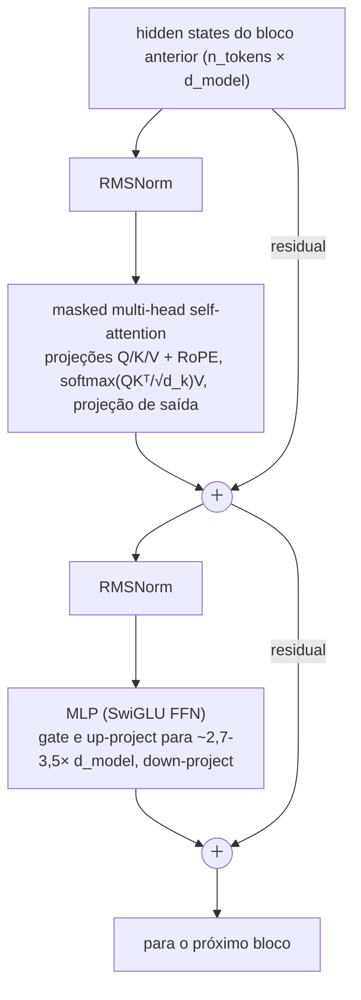

# 🧠 LLM & Transformer Fundamentals

> 🇧🇷 Tradução em português do Brasil. Versão original em inglês: [README.md](README.md).

Este é o tópico mais testado em entrevistas de AI Engineer: todo frontier lab, time de IA de big tech e startup séria vai sondar se você realmente entende o que acontece dentro do modelo sobre o qual está construindo, ou se está apenas chamando uma API. Espere estas perguntas em todos os níveis - screens as usam para filtrar, onsites as usam para calibrar profundidade, e rodadas de system design assumem este material como vocabulário. Se você só tiver tempo para dominar uma seção deste repositório, que seja esta.

## Crash course

### O transformer decoder-only, de cima a baixo

Os LLMs modernos (GPT, Claude, Llama, Gemini, DeepSeek, Qwen) são **transformers decoder-only**: uma camada de token embedding, uma pilha de N **decoder blocks**, uma norm final e um **LM head** (projeção linear para os logits do vocabulário, com weight-tying à matriz de embedding em muitos modelos pequenos e sem tying na maioria dos grandes). Cada bloco faz duas coisas - mistura informação *entre posições* (attention) e transforma informação *em cada posição* (MLP) - com conexões residuais em torno de ambas:



Pontos de design que os entrevistadores sondam:

- **Pre-norm vs post-norm.** O original de 2017 aplicava LayerNorm *depois* da soma residual (post-norm); ele treina mal em profundidade sem um warmup cuidadoso, porque os gradientes precisam passar por cada norm. Os LLMs modernos usam **pre-norm** (norm dentro do ramo residual, antes da subcamada): o residual stream é um caminho de identidade limpo, os gradientes fluem sem obstáculos e o treinamento é estável com 100+ camadas.
- **RMSNorm** (usada na família Llama e na maioria dos modelos modernos) elimina o mean-centring e o bias da LayerNorm - apenas reescala pela raiz do valor quadrático médio (root-mean-square). Mais barata, igualmente eficaz.
- **O residual stream é o espaço de trabalho do modelo**: attention e MLPs leem dele e escrevem atualizações nele. Esse enquadramento (vindo de trabalhos de interpretability) torna muitas perguntas de arquitetura fáceis de raciocinar.

### Self-attention em uma tela

Cada token emite uma **query** ("o que estou procurando?"), uma **key** ("o que eu contenho?") e um **value** ("com o que eu contribuo?"). Os attention scores são produtos escalares escalados de queries com keys; um softmax por linha os transforma em pesos sobre os values.

```python
import numpy as np

def causal_self_attention(X, Wq, Wk, Wv):
    Q, K, V = X @ Wq, X @ Wk, X @ Wv          # cada um (n, d_k)
    scores = Q @ K.T / np.sqrt(K.shape[-1])    # (n, n); a escala mantém o softmax não saturado
    mask = np.triu(np.ones_like(scores, dtype=bool), k=1)
    scores[mask] = -np.inf                     # causal: a posição i não enxerga j > i
    w = np.exp(scores - scores.max(-1, keepdims=True))
    w /= w.sum(-1, keepdims=True)              # softmax por linha
    return w @ V                               # (n, d_k) mistura ponderada dos values
```

- **Por que √d_k?** Produtos escalares de vetores aleatórios de d_k dimensões têm variância ~d_k. Sem escala, logits grandes saturam o softmax em algo próximo de um one-hot, os gradientes desaparecem e o treinamento se desestabiliza. Dividir por √d_k mantém a variância dos logits ~1.
- **Causal mask** = −∞ triangular superior antes do softmax. É o que permite que uma única forward pass sobre uma sequência de treinamento produza uma loss de next-token prediction em *cada* posição.

### Heads: MHA → MQA → GQA

**Multi-head attention** divide d_model em h heads (por exemplo, 32 heads × 128 dims), cada uma com suas próprias projeções Q/K/V, executadas em paralelo e concatenadas. Múltiplas heads permitem que o modelo atenda a diferentes relações simultaneamente (sintaxe aqui, correferência ali) - uma única head grande faria a média delas em uma papa. Mesmo total de FLOPs que uma única head de largura total.

A pressão que remodelou a attention é o **KV cache** (abaixo): seu tamanho escala com o número de KV heads.

- **MQA (multi-query)**: todas as query heads compartilham *uma* K/V head → o cache encolhe ~h×, com alguma perda de qualidade.
- **GQA (grouped-query)**: grupos de query heads compartilham uma KV head (por exemplo, 64 query heads, 8 KV heads) → redução de cache de ~8× com qualidade próxima à de MHA. O padrão moderno (Llama 2/3 70B, Mistral, a maioria dos modelos de 2024+).
- **MLA (multi-head latent attention, DeepSeek-V2/V3, também usada pelo Kimi K2)**: faz cache de um vetor latente de baixo rank por token por camada e o up-projeta para K/V por head no momento da attention, reduzindo o cache abaixo dos níveis de GQA e mantendo keys e values distintos por head.

### KV cache

Durante a geração autorregressiva, os vetores K e V de cada token passado, por camada, são reutilizados a cada passo. Fazer cache deles transforma o custo por token de recomputação O(n²) em lookups O(n) - é por isso que a geração é viável. O que você paga é memória:

```
KV bytes por token = 2 (K e V) × n_layers × n_kv_heads × head_dim × bytes_per_elem
```

Exemplo, um modelo no formato do Llama-3-70B (80 camadas, 8 KV heads via GQA, head_dim 128, fp16): 2 × 80 × 8 × 128 × 2 ≈ **320 KB/token** → ~40 GB para uma única sequência de 128k tokens. Com MHA completa (64 KV heads) seria 8× isso. É por isso que existem GQA, MLA, quantização de cache e alocação paginada (o PagedAttention do vLLM), e por isso o serving de long context é um problema de memória, não de FLOPs.

### Custo da attention e FlashAttention

A attention calcula uma matriz de scores n×n: **O(n²) de tempo e (ingenuamente) de memória** no comprimento da sequência. Consequências: o custo de prefill cresce quadraticamente com o comprimento do prompt; o serving de long context é dominado pela largura de banda de memória do KV cache no momento do decode.

A **FlashAttention** não aproxima nada - é uma implementação **exata e IO-aware**. Insight: em uma GPU, a attention é limitada por leituras/escritas na HBM, não por FLOPs. Então: faça **tiling** de Q/K/V em blocos que cabem na SRAM on-chip, calcule a attention bloco a bloco com um **softmax online (streaming)** que mantém o máximo e o normalizador correntes, e **nunca materialize a matriz n×n** (recompute-a na backward pass). Resultado: attention exata com memória O(n) e grandes ganhos de tempo de relógio. É padrão em todo stack de serving.

### Além da full attention

Full attention em toda camada deixou de ser uma certeza. Quatro variações aparecem em entrevistas:

- **Sliding-window (local) attention**: cada token enxerga apenas os últimos w tokens, de modo que o KV cache dessa camada é limitado a w. Stacks híbridos local/global intercalam muitas camadas locais com poucas de full attention (Gemma 3: cinco camadas locais de 1024 tokens para cada camada global; o gpt-oss alterna camadas de banded-window e densas).
- **Attention sinks**: o softmax precisa colocar sua massa de probabilidade em algum lugar, então os modelos aprendem a despejar attention nos primeiros tokens. Se você removê-los de um cache rolante, a qualidade colapsa, e é por isso que caches de streaming os mantêm fixados (e por que alguns modelos, incluindo o gpt-oss, adicionam um sink explícito aprendido).
- **Learned sparse attention**: um indexer barato pontua as posições passadas e cada query atende apenas às melhores (DeepSeek Sparse Attention, do DeepSeek-V3.2).
- **Stacks híbridos linear/SSM**: a maioria das camadas carrega um estado recorrente de tamanho fixo (estilo Mamba ou linear attention) e aproximadamente uma camada a cada 4 a 10 mantém full attention para recall exato (Jamba, Nemotron-H, Qwen3-Next, Kimi Linear).

O fio condutor: poucas camadas exatas fazem o retrieval de longo alcance, muitas camadas baratas fazem a maior parte do trabalho, e apenas uma fração do stack tem um cache que cresce com o contexto.

### Informação posicional

A attention é invariante a permutação - a posição precisa ser injetada.

- **Sinusoidal** (transformer original): sin/cos fixos de frequências espaçadas geometricamente, somados aos embeddings. Sem parâmetros aprendidos.
- **Learned absolute** (GPT-2, BERT): um embedding por índice de posição. Simples, mas limitada rigidamente ao comprimento treinado.
- **RoPE** (rotary, o padrão moderno - Llama, Qwen, a maioria dos modelos abertos): em vez de somar vetores de posição, *rotaciona* cada par 2D de dimensões de Q/K por um ângulo proporcional à posição, com frequências por par. O produto escalar entre uma query na posição m e uma key na posição n passa então a depender apenas de **m − n**: posição relativa, codificada multiplicativamente, sem parâmetros extras. Alguns modelos recentes intercalam camadas RoPE com camadas **NoPE** que não usam nenhuma codificação posicional (o iRoPE do Llama 4) para ajudar na generalização de comprimento.
- **ALiBi**: sem nenhum position embedding; soma uma penalidade linear −slope·|i−j| aos attention scores (slopes por head). Enviesa para recência e extrapola para sequências mais longas do que as treinadas.
- **Extensão de contexto**: executar RoPE ingenuamente além do comprimento treinado falha (ângulos de rotação nunca vistos). A **position interpolation** reescala as posições para caberem dentro da faixa treinada, mais um fine-tune curto; o **YaRN** interpola as bandas de frequência de forma desigual (preserva a resolução de alta frequência/local, interpola a de baixa frequência) com um ajuste de attention-temperature - exige muito menos fine-tuning. A outra alavanca padrão é aumentar a frequência base θ do RoPE durante o continued pretraining de long-context (o Llama 3 usa 500.000, contra os 10.000 originais). É assim que modelos treinados em 8k viraram modelos de 128k+.

### Tokenization

Os modelos veem **token IDs**, não caracteres. Subwords são o compromisso entre nível de palavra (vocabulário enorme, problema de OOV) e nível de caractere (sequências longas demais, e a attention O(n²) torna isso caro).

- **BPE**: parte de bytes/caracteres, mesclando repetidamente o par adjacente mais frequente em um novo token até atingir o tamanho do vocabulário. As merges são aprendidas uma vez; na inferência são aplicadas de forma determinística.
- **Byte-level BPE** (GPT-2 em diante): o alfabeto base são 256 bytes → *nenhuma* string fora do vocabulário, nunca.
- **WordPiece** (BERT): como o BPE, mas mescla o par que maximiza a likelihood dos dados de treinamento, não a frequência bruta.
- **SentencePiece**: uma biblioteca (que implementa BPE ou unigram-LM) que trata o texto bruto como um stream - espaços viram um meta-símbolo (▁) - então é agnóstica a idioma e dispensa pre-tokenization; muito usada em modelos multilíngues e abertos (T5, Llama 2, Gemma), embora o Llama 3 tenha migrado para um BPE byte-level no estilo tiktoken.

**Por que as falhas clássicas são falhas do tokenizer:** "strawberry" são dois ou três tokens (por exemplo, "str" + "aw" + "berry") - o modelo nunca vê as letras, então contar os r's exige conhecimento de ortografia memorizado, não percepção. A aritmética sofre quando os números são divididos de forma inconsistente ("1234" vs "12"+"34"), e é por isso que muitos tokenizers agora separam dígitos individualmente ou em grupos fixos de três. Idiomas de escrita não latina se fragmentam em muito mais tokens por frase → custo maior, contexto efetivo menor, qualidade pior. Modelos de código dependem de tokens de sequências de whitespace para indentação. **Tradeoff do tamanho do vocabulário**: vocabulário maior (de 32k do Llama 2 para 128k do Llama 3, ~200k no tokenizer o200k da OpenAI e ~262k no Gemma 3) = menos tokens por texto (mais barato, contexto efetivo maior), mas uma matriz de embedding maior e tokens de cauda mais raros e sub-treinados (modos de falha de glitch tokens).

### Arquiteturas e objetivos

- **Encoder-only** (BERT): attention bidirecional, objetivo **masked-LM**. Ótimo em compreensão/embedding/classificação; não gera. Sobrevive em modelos de embedding e reranker.
- **Decoder-only** (GPT/Llama/Claude): attention causal, **next-token prediction**. Cada posição gera um sinal de treinamento, a geração é nativa e uma única arquitetura escala para tudo - é por isso que ela venceu.
- **Encoder-decoder** (T5, e modelos de fala/tradução como o Whisper): o encoder lê a entrada de forma bidirecional, o decoder gera com cross-attention. Ainda forte para transformações input→output fixas.

### O pipeline de treinamento

1. **Pretraining**: next-token prediction em trilhões de tokens de dados de web/código/livros. Produz um modelo de completion bruto - capaz, mas não steerable.
2. **Mid-training / continued pretraining**: dados curados de alta qualidade, injeção de domínio (código, matemática), extensão do comprimento de contexto, annealing da data mix em direção a formatos semelhantes a instruções.
3. **SFT**: supervised fine-tuning em demonstrações (prompt, resposta) → segue instruções, adota o formato de chat.
4. **Preference optimisation e RL**: RLHF com um reward model aprendido (PPO), métodos diretos offline (**DPO**, que dispensa reward model e rollouts) e RL com recompensas *verificáveis* (**RLVR**, tipicamente com algoritmos da família GRPO - respostas de matemática, testes que passam), que é o que treina os reasoning models. Alinha o comportamento com preferências e afia capacidades que o SFT não alcança.

### Scaling laws

**Kaplan et al. (2020)**: a loss cai como uma power law no compute; implicava que se deveria crescer os *parâmetros* muito mais rápido que os dados. **Chinchilla (Hoffmann et al., 2022)** corrigiu isso: o treinamento compute-optimal escala parâmetros e tokens aproximadamente na mesma proporção, ~**20 tokens por parâmetro** (o Chinchilla-70B em 1,4T de tokens superou o Gopher-280B em 300B). Mas compute-optimal ≠ deployment-optimal: **o custo de treinamento é pago uma vez, a inferência para sempre**, então os modelos modernos treinam muito além do Chinchilla (o Llama 3 8B viu ~15T tokens ≈ ~1.900 tokens/param) para comprar um modelo menor e mais barato de servir com a mesma qualidade. **Emergent abilities** (saltos bruscos de capacidade com a escala) são em parte um artefato de medição - a crítica do "mirage" mostra melhora suave sob métricas contínuas - mas a experiência prática de thresholds continua real para tarefas descontínuas.

### Mixture-of-Experts (MoE)

Substitua cada MLP por E MLPs experts mais um **router** aprendido que envia cada token para os top-k experts (por exemplo, Mixtral: 8 experts, top-2, ~47B de parâmetros totais / ~13B ativos; DeepSeek-V3: 671B totais / ~37B ativos). Você compra **mais capacidade por FLOP**: a qualidade de um modelo denso muito maior com uma fração do compute por token, e é por isso que MoE é hoje a norma para modelos open-weight de escala frontier (DeepSeek-V3, Qwen3-235B-A22B, Kimi K2 com ~1T totais / 32B ativos, gpt-oss). A receita atual são experts **fine-grained** mais um **shared expert** sempre ativo (DeepSeek-V3: 256 routed experts, top-8, mais um shared). Custos: o roteamento precisa ser **load-balanced** (losses auxiliares, router z-loss ou o bias por expert sem loss auxiliar do DeepSeek-V3) ou os experts colapsam; o treinamento é menos estável; e na inferência **todos os experts precisam estar na memória** - você paga memória pelos parâmetros totais e FLOPs pelos parâmetros ativos, então MoE favorece serving grande, em batch e rico em memória em vez de deployment em uma única GPU.

### Decoding & sampling

O modelo gera logits z; o sampling os molda. A **Temperature** reescala antes do softmax: p_i = exp(z_i/T) / Σ_j exp(z_j/T). T→0 é greedy (argmax); T>1 achata. **Top-k** mantém os k tokens mais altos; **top-p (nucleus)** mantém o menor conjunto com probabilidade acumulada ≥ p (adapta-se à confiança); **min-p** mantém tokens com p ≥ min_p × p_max (adapta-se ainda melhor em temperature alta). **Penalidades de repetition/frequency/presence** amortecem loops. **Beam search** maximiza a likelihood da sequência - bom para tradução/ASR, degenerado (repetitivo, insosso) para geração aberta. **Logprobs** são sua ferramenta para confidence scoring, classificação, evals de perplexity e heurísticas de hallucination - mas verifique o endpoint: muitos reasoning models hospedados fixam temperature e top-p e não retornam logprobs, e alguns provedores não expõem logprobs em nenhum modelo. Confirme o suporte antes de projetar em torno deles, ou faça self-host quando precisar deles.

A **Speculative decoding** acelera a geração sem alterar a distribuição de saída: um draft barato (um modelo pequeno, heads de predição extras ou o próprio multi-token-prediction head do modelo) propõe vários tokens, o target model os verifica em uma única forward pass, e uma regra de rejection-sampling aceita um prefixo de modo que a distribuição final seja exatamente a do target model. Compensa porque o decode é limitado pela largura de banda de memória, então verificar k tokens custa aproximadamente o mesmo que gerar um.

### Long context, hallucination, reasoning models

- **Long context ≠ retrieval.** "Lost in the middle": a acurácia em fatos posicionados no meio do contexto é sistematicamente pior do que no início/fim. Uma janela de 1M de tokens não é um banco de dados; RAG e curadoria de contexto continuam importando.
- **Hallucination** é estrutural: o objetivo recompensa próximos tokens plausíveis, não a verdade, e o treinamento/evals padrão recompensam chutar em vez de abstenção calibrada. Mitigações: grounding (RAG + citations), tool use, abstention training, sinais de confiança por logprob/self-consistency, camadas de verificação - redução, não eliminação.
- **Reasoning models** (a linhagem que começou com o o1 da OpenAI e o DeepSeek-R1) são treinados com RL em recompensas verificáveis para emitir longas chains of thought, convertendo **test-time compute** em acurácia em matemática/código/planejamento. A maioria dos modelos frontier hoje entrega reasoning como um modo do mesmo modelo, controlado por um thinking budget ou uma configuração de reasoning-effort, em vez de um modelo separado. Tradeoff: frequentemente de várias a dezenas de vezes mais tokens de saída, maior latency e custo. Gaste reasoning em problemas difíceis de múltiplas etapas; reduza ou desligue para extração, classificação e caminhos sensíveis a latency. A **Distillation** (treinar um modelo pequeno nas saídas ou logits de um modelo grande) é como o comportamento de reasoning é comprimido em modelos baratos.

## Perguntas de entrevista

**[questions.pt-BR.md](questions.pt-BR.md)** - 65 perguntas com respostas: 13 básicas, 16 intermediárias, 12 avançadas.

## Red flags que os entrevistadores observam

- Não consegue escrever nem esboçar scaled dot-product attention, ou trata Q/K/V como "vetores mágicos" sem uma história funcional do que cada um faz.
- Diz que a divisão por √d_k é "para normalização" sem conectá-la à saturação do softmax e ao fluxo de gradientes.
- Acredita que a FlashAttention é uma aproximação ou "sparse attention" - ela é exata; o ganho está no IO, não em menos FLOPs.
- Explica o KV cache mas não consegue estimar seu tamanho, ou não sabe por que GQA/MQA existem - sinal de nunca ter pensado em serving.
- Atribui falhas do tipo "strawberry" à burrice do modelo em vez de à tokenization; mais amplamente, nunca olhou como o texto realmente é tokenizado.
- Cita "Chinchilla-optimal = 20 tokens/param" como uma lei do que fazer, ignorando que a economia da inferência empurra o treinamento muito além disso.
- Acha que uma context window maior elimina a necessidade de retrieval, ou que o comprimento de contexto anunciado equivale ao recall utilizável.
- Recorre a um reasoning model (ou a temperature alta, ou a beam search) por reflexo, sem articular o tradeoff de custo/latency/qualidade.

## Leituras complementares

- [Attention Is All You Need (Vaswani et al., 2017)](https://arxiv.org/abs/1706.03762) - o paper original do transformer.
- [The Illustrated Transformer (Jay Alammar)](https://jalammar.github.io/illustrated-transformer/) - o passo a passo visual clássico.
- [Let's build GPT: from scratch, in code (Andrej Karpathy)](https://www.youtube.com/watch?v=kCc8FmEb1nY) - construa um transformer decoder-only de ponta a ponta.
- [FlashAttention: Fast and Memory-Efficient Exact Attention with IO-Awareness (Dao et al., 2022)](https://arxiv.org/abs/2205.14135)
- [RoFormer: Enhanced Transformer with Rotary Position Embedding (Su et al., 2021)](https://arxiv.org/abs/2104.09864) - RoPE.
- [Training Compute-Optimal Large Language Models (Hoffmann et al., 2022)](https://arxiv.org/abs/2203.15556) - Chinchilla.
- [DeepSeek-V3 Technical Report (DeepSeek-AI, 2024)](https://arxiv.org/abs/2412.19437) - MLA, MoE fine-grained com balanceamento sem loss auxiliar, multi-token prediction e treinamento em FP8 em um só lugar.
- [Lost in the Middle: How Language Models Use Long Contexts (Liu et al., 2023)](https://arxiv.org/abs/2307.03172)
- [Are Emergent Abilities of Large Language Models a Mirage? (Schaeffer et al., 2023)](https://arxiv.org/abs/2304.15004)
