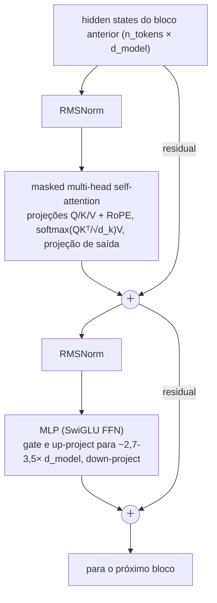

# 🧠 LLM & Transformer Fundamentals

> 🇧🇷 Tradução em português do Brasil. Versão original em inglês: [README.md](README.md).

Este é o tópico mais cobrado em entrevistas de AI Engineer. Todo frontier lab, time de IA de big tech e startup séria quer saber se você entende de verdade o que acontece dentro do modelo sobre o qual está construindo, ou se apenas chama uma API. Espere estas perguntas em qualquer nível: os screens as usam para filtrar, os onsites para calibrar profundidade, e as rodadas de system design tratam este conteúdo como vocabulário básico. Se você só tiver tempo de dominar uma seção deste repositório, que seja esta.

## Crash course

### O transformer decoder-only, de cima a baixo

Os LLMs modernos (GPT, Claude, Llama, Gemini, DeepSeek, Qwen) são **transformers decoder-only**: uma camada de token embedding, uma pilha de N **decoder blocks**, uma norm final e um **LM head** (projeção linear para os logits do vocabulário, com weight-tying à matriz de embedding em muitos modelos pequenos e sem tying na maioria dos grandes). Cada bloco faz duas coisas: mistura informação *entre posições* (attention) e transforma informação *em cada posição* (MLP), com conexões residuais em volta de ambas:



Pontos de design que os entrevistadores gostam de explorar:

- **Pre-norm vs post-norm.** O transformer original, de 2017, aplicava LayerNorm *depois* da soma residual (post-norm). Em redes profundas, isso treina mal sem um warmup cuidadoso, porque os gradientes precisam atravessar cada norm. Os LLMs modernos usam **pre-norm** (a norm fica dentro do ramo residual, antes da subcamada): o residual stream vira um caminho de identidade limpo, os gradientes fluem sem obstáculos e o treinamento se mantém estável com 100+ camadas.
- **RMSNorm** (usada na família Llama e na maioria dos modelos modernos) elimina o mean-centring e o bias da LayerNorm e apenas reescala pela raiz do valor quadrático médio (root-mean-square). É mais barata e igualmente eficaz.
- **O residual stream é o espaço de trabalho do modelo**: attention e MLPs leem dele e escrevem atualizações nele. Esse enquadramento, vindo dos trabalhos de interpretability, facilita o raciocínio sobre muitas perguntas de arquitetura.

### Self-attention em uma tela

Cada token emite uma **query** ("o que estou procurando?"), uma **key** ("o que eu contenho?") e um **value** ("com o que eu contribuo?"). Os attention scores são produtos escalares escalados entre queries e keys, e um softmax por linha os transforma em pesos sobre os values.

```python
import numpy as np

def causal_self_attention(X, Wq, Wk, Wv):
    Q, K, V = X @ Wq, X @ Wk, X @ Wv          # cada um (n, d_k)
    scores = Q @ K.T / np.sqrt(K.shape[-1])    # (n, n); a escala mantém o softmax não saturado
    mask = np.triu(np.ones_like(scores, dtype=bool), k=1)
    scores[mask] = -np.inf                     # causal: a posição i não enxerga j > i
    w = np.exp(scores - scores.max(-1, keepdims=True))
    w /= w.sum(-1, keepdims=True)              # softmax por linha
    return w @ V                               # (n, d_k) mistura ponderada dos values
```

- **Por que √d_k?** Produtos escalares de vetores aleatórios de d_k dimensões têm variância ~d_k. Sem a escala, logits grandes saturam o softmax até ele ficar quase um one-hot, os gradientes desaparecem e o treinamento se desestabiliza. Dividir por √d_k mantém a variância dos logits em ~1.
- **Causal mask** = −∞ na parte triangular superior, antes do softmax. É ela que permite que uma única forward pass sobre uma sequência de treino produza uma loss de next-token prediction em *cada* posição.

### Heads: MHA → MQA → GQA

A **multi-head attention** divide o d_model em h heads (por exemplo, 32 heads × 128 dims). Cada head tem suas próprias projeções Q/K/V, e todas rodam em paralelo e são concatenadas. Várias heads permitem que o modelo observe relações diferentes ao mesmo tempo (sintaxe numa, correferência em outra); uma única head grande tiraria a média de tudo e viraria uma papa. O total de FLOPs é o mesmo de uma única head de largura total.

A pressão que remodelou a attention foi o **KV cache** (veja abaixo): o tamanho dele escala com o número de KV heads.

- **MQA (multi-query)**: todas as query heads compartilham *uma* K/V head. O cache encolhe ~h×, com alguma perda de qualidade.
- **GQA (grouped-query)**: grupos de query heads compartilham uma KV head (por exemplo, 64 query heads e 8 KV heads). O cache fica ~8× menor, com qualidade próxima à da MHA. É o padrão atual (Llama 2/3 70B, Mistral, a maioria dos modelos de 2024 em diante).
- **MLA (multi-head latent attention, do DeepSeek-V2/V3, também usada pelo Kimi K2)**: guarda em cache um vetor latente de baixo rank por token por camada e o up-projeta para K/V de cada head só na hora da attention. Assim o cache fica menor que o do GQA, e as keys e values continuam distintos por head.

### KV cache

Na geração autorregressiva, os vetores K e V de cada token passado, em cada camada, são reutilizados a cada passo. Guardá-los em cache transforma o custo por token de uma recomputação O(n²) em lookups O(n), e é por isso que a geração é viável. O preço é memória:

```
KV bytes por token = 2 (K e V) × n_layers × n_kv_heads × head_dim × bytes_per_elem
```

Exemplo, com um modelo no formato do Llama-3-70B (80 camadas, 8 KV heads via GQA, head_dim 128, fp16): 2 × 80 × 8 × 128 × 2 ≈ **320 KB/token**, ou seja, ~40 GB para uma única sequência de 128k tokens. Com MHA completa (64 KV heads), seria 8× isso. Por esse motivo existem GQA, MLA, quantização de cache e alocação paginada (o PagedAttention do vLLM), e por isso o serving de long context é um problema de memória, não de FLOPs.

### Custo da attention e FlashAttention

A attention calcula uma matriz de scores n×n: **O(n²) de tempo e (na versão ingênua) de memória** em relação ao comprimento da sequência. Duas consequências: o custo do prefill cresce quadraticamente com o tamanho do prompt, e o serving de long context é dominado pela largura de banda de memória do KV cache na hora do decode.

A **FlashAttention** não aproxima nada: é uma implementação **exata e IO-aware**. A sacada é que, numa GPU, o gargalo da attention são as leituras e escritas na HBM, não os FLOPs. Então ela faz **tiling** de Q/K/V em blocos que cabem na SRAM on-chip e calcula a attention bloco a bloco, com um **softmax online (streaming)** que mantém o máximo e o normalizador correntes. Ela **nunca materializa a matriz n×n** (que é recomputada na backward pass). O resultado é attention exata com memória O(n) e grandes ganhos de tempo real. Está presente em todo stack de serving.

### Além da full attention

Full attention em toda camada deixou de ser regra. Quatro variações aparecem em entrevistas:

- **Sliding-window (local) attention**: cada token enxerga apenas os últimos w tokens, então o KV cache daquela camada fica limitado a w. Stacks híbridos local/global intercalam muitas camadas locais com poucas de full attention (Gemma 3: cinco camadas locais de 1024 tokens para cada camada global; o gpt-oss alterna camadas de banded-window e camadas densas).
- **Attention sinks**: o softmax precisa colocar sua massa de probabilidade em algum lugar, então os modelos aprendem a despejar attention nos primeiros tokens. Se você os remove de um cache rolante, a qualidade desaba. Por isso os caches de streaming os mantêm fixos (e por isso alguns modelos, o gpt-oss entre eles, adicionam um sink explícito e aprendido).
- **Learned sparse attention**: um indexer barato pontua as posições passadas, e cada query olha apenas para as melhores (DeepSeek Sparse Attention, do DeepSeek-V3.2).
- **Stacks híbridos linear/SSM**: a maioria das camadas carrega um estado recorrente de tamanho fixo (estilo Mamba ou linear attention), e cerca de uma camada a cada 4 a 10 mantém full attention para recall exato (Jamba, Nemotron-H, Qwen3-Next, Kimi Linear).

O fio condutor é o mesmo: poucas camadas exatas fazem o retrieval de longo alcance, muitas camadas baratas fazem a maior parte do trabalho, e só uma fração do stack tem um cache que cresce com o contexto.

### Informação posicional

A attention é invariante a permutação, então a posição precisa ser injetada.

- **Sinusoidal** (transformer original): sin/cos fixos, com frequências espaçadas geometricamente, somados aos embeddings. Não tem parâmetros aprendidos.
- **Learned absolute** (GPT-2, BERT): um embedding por índice de posição. É simples, mas fica rigidamente limitada ao comprimento de treino.
- **RoPE** (rotary, o padrão atual: Llama, Qwen, a maioria dos modelos abertos): em vez de somar vetores de posição, *rotaciona* cada par 2D de dimensões de Q/K por um ângulo proporcional à posição, com frequências diferentes por par. O produto escalar entre uma query na posição m e uma key na posição n passa a depender apenas de **m − n**: a posição relativa, codificada de forma multiplicativa e sem parâmetros extras. Alguns modelos recentes intercalam camadas RoPE com camadas **NoPE**, que não usam nenhuma codificação posicional (o iRoPE do Llama 4), para ajudar na generalização de comprimento.
- **ALiBi**: não usa position embedding nenhum. Soma uma penalidade linear −slope·|i−j| aos attention scores (com slopes diferentes por head). Isso cria um viés para tokens recentes e extrapola para sequências mais longas do que as vistas no treino.
- **Extensão de contexto**: rodar RoPE de forma ingênua além do comprimento de treino falha, porque os ângulos de rotação nunca foram vistos. A **position interpolation** reescala as posições para caberem na faixa treinada e acrescenta um fine-tune curto. O **YaRN** interpola as bandas de frequência de forma desigual (preserva a resolução de alta frequência/local e interpola a de baixa frequência) e ajusta a attention-temperature, o que exige muito menos fine-tuning. A outra alavanca padrão é aumentar a frequência base θ do RoPE durante o continued pretraining de long-context (o Llama 3 usa 500.000, contra os 10.000 originais). É assim que modelos treinados em 8k viraram modelos de 128k+.

### Tokenization

Os modelos enxergam **token IDs**, não caracteres. Subwords são o meio-termo entre o nível de palavra (vocabulário enorme, problema de OOV) e o nível de caractere (sequências longas demais, e a attention O(n²) torna isso caro).

- **BPE**: parte de bytes/caracteres e vai mesclando o par adjacente mais frequente em um novo token, até atingir o tamanho do vocabulário. As merges são aprendidas uma única vez; na inferência, são aplicadas de forma determinística.
- **Byte-level BPE** (do GPT-2 em diante): o alfabeto base são 256 bytes, então *nunca* existe string fora do vocabulário.
- **WordPiece** (BERT): parecido com o BPE, mas mescla o par que maximiza a likelihood dos dados de treino, e não a frequência bruta.
- **SentencePiece**: uma biblioteca (que implementa BPE ou unigram-LM) que trata o texto bruto como um stream. Os espaços viram um meta-símbolo (▁), o que a torna agnóstica a idioma e dispensa pre-tokenization. É muito usada em modelos multilíngues e abertos (T5, Llama 2, Gemma), embora o Llama 3 tenha migrado para um BPE byte-level no estilo tiktoken.

**Por que as falhas clássicas são falhas do tokenizer:** "strawberry" vira dois ou três tokens (por exemplo, "str" + "aw" + "berry"). O modelo nunca vê as letras, então contar os r's exige conhecimento de ortografia memorizado, não percepção. A aritmética sofre quando os números são divididos de forma inconsistente ("1234" vs "12"+"34"), e é por isso que muitos tokenizers hoje separam os dígitos individualmente ou em grupos fixos de três. Idiomas de escrita não latina se fragmentam em muito mais tokens por frase, o que significa custo maior, contexto efetivo menor e qualidade pior. Modelos de código dependem de tokens de sequências de whitespace para a indentação. **Tradeoff do tamanho do vocabulário**: um vocabulário maior (de 32k no Llama 2 para 128k no Llama 3, ~200k no tokenizer o200k da OpenAI e ~262k no Gemma 3) gera menos tokens por texto (mais barato, contexto efetivo maior), mas exige uma matriz de embedding maior e deixa tokens de cauda mais raros e sub-treinados (daí os modos de falha de glitch tokens).

### Arquiteturas e objetivos

- **Encoder-only** (BERT): attention bidirecional, objetivo **masked-LM**. Ótimo em compreensão, embedding e classificação, mas não gera texto. Sobrevive nos modelos de embedding e de reranker.
- **Decoder-only** (GPT/Llama/Claude): attention causal, **next-token prediction**. Cada posição gera um sinal de treino, a geração é nativa e uma única arquitetura escala para tudo. Foi por isso que ela venceu.
- **Encoder-decoder** (T5, e modelos de fala/tradução como o Whisper): o encoder lê a entrada de forma bidirecional e o decoder gera com cross-attention. Continua forte para transformações input→output fixas.

### O pipeline de treinamento

1. **Pretraining**: next-token prediction em trilhões de tokens de dados de web, código e livros. Produz um modelo de completion bruto: capaz, mas difícil de direcionar.
2. **Mid-training / continued pretraining**: dados curados de alta qualidade, injeção de domínio (código, matemática), extensão do comprimento de contexto e annealing da data mix em direção a formatos parecidos com instruções.
3. **SFT**: supervised fine-tuning em demonstrações (prompt, resposta). O modelo passa a seguir instruções e adota o formato de chat.
4. **Preference optimisation e RL**: RLHF com um reward model aprendido (PPO), métodos diretos offline (**DPO**, que dispensa reward model e rollouts) e RL com recompensas *verificáveis* (**RLVR**, em geral com algoritmos da família GRPO; por exemplo, respostas de matemática ou testes que passam), que é o que treina os reasoning models. Essa etapa alinha o comportamento às preferências e afia capacidades que o SFT não alcança.

### Scaling laws

**Kaplan et al. (2020)**: a loss cai como uma power law do compute, o que levava a crescer os *parâmetros* muito mais rápido que os dados. **Chinchilla (Hoffmann et al., 2022)** corrigiu isso: o treinamento compute-optimal escala parâmetros e tokens aproximadamente na mesma proporção, com ~**20 tokens por parâmetro** (o Chinchilla-70B, com 1,4T de tokens, superou o Gopher-280B, com 300B). Mas compute-optimal ≠ deployment-optimal: **o custo de treino é pago uma vez, e o de inferência para sempre**. Por isso os modelos modernos treinam muito além do Chinchilla (o Llama 3 8B viu ~15T tokens ≈ ~1.900 tokens/param), para ter um modelo menor e mais barato de servir com a mesma qualidade. **Emergent abilities** (saltos bruscos de capacidade com a escala) são em parte um artefato de medição: a crítica do "mirage" mostra uma melhora suave quando as métricas são contínuas. Ainda assim, a experiência prática de thresholds continua real em tarefas descontínuas.

### Mixture-of-Experts (MoE)

Substitua cada MLP por E MLPs experts e um **router** aprendido, que envia cada token para os top-k experts (por exemplo, Mixtral: 8 experts, top-2, ~47B de parâmetros totais / ~13B ativos; DeepSeek-V3: 671B totais / ~37B ativos). Você ganha **mais capacidade por FLOP**: a qualidade de um modelo denso muito maior, com uma fração do compute por token. Por isso o MoE é hoje a norma nos modelos open-weight de escala frontier (DeepSeek-V3, Qwen3-235B-A22B, Kimi K2 com ~1T totais / 32B ativos, gpt-oss). A receita atual combina experts **fine-grained** com um **shared expert** sempre ativo (DeepSeek-V3: 256 routed experts, top-8, mais um shared). Os custos: o roteamento precisa ser **load-balanced** (losses auxiliares, router z-loss ou o bias por expert sem loss auxiliar do DeepSeek-V3), senão os experts colapsam; o treinamento é menos estável; e, na inferência, **todos os experts precisam estar na memória**. Você paga memória pelos parâmetros totais e FLOPs pelos parâmetros ativos, então o MoE favorece serving grande, em batch e com bastante memória, e não deployment em uma única GPU.

### Decoding & sampling

O modelo gera logits z, e o sampling os molda. A **Temperature** reescala antes do softmax: p_i = exp(z_i/T) / Σ_j exp(z_j/T). Com T→0, o resultado é greedy (argmax); com T>1, a distribuição achata. **Top-k** mantém os k tokens mais prováveis. **Top-p (nucleus)** mantém o menor conjunto com probabilidade acumulada ≥ p, e por isso se adapta à confiança do modelo. **Min-p** mantém os tokens com p ≥ min_p × p_max e se adapta ainda melhor com temperature alta. **Penalidades de repetition/frequency/presence** reduzem loops. **Beam search** maximiza a likelihood da sequência: é bom para tradução e ASR, mas degenera (fica repetitivo e insosso) em geração aberta. **Logprobs** são a sua ferramenta para confidence scoring, classificação, evals de perplexity e heurísticas de hallucination. Só verifique o endpoint antes: muitos reasoning models hospedados fixam temperature e top-p e não retornam logprobs, e alguns provedores não expõem logprobs em nenhum modelo. Confirme o suporte antes de projetar em cima deles, ou faça self-host quando precisar deles.

A **Speculative decoding** acelera a geração sem alterar a distribuição de saída. Um draft barato (um modelo pequeno, heads de predição extras ou o próprio multi-token-prediction head do modelo) propõe vários tokens, o target model os verifica em uma única forward pass, e uma regra de rejection-sampling aceita um prefixo, de modo que a distribuição final seja exatamente a do target model. Isso compensa porque o decode é limitado pela largura de banda de memória: verificar k tokens custa aproximadamente o mesmo que gerar um.

### Long context, hallucination, reasoning models

- **Long context ≠ retrieval.** "Lost in the middle": a accuracy em fatos posicionados no meio do contexto é sistematicamente pior do que no início ou no fim. Uma janela de 1M de tokens não é um banco de dados, e RAG e curadoria de contexto continuam importando.
- **Hallucination** é estrutural: o objetivo recompensa próximos tokens plausíveis, não a verdade, e o treinamento e os evals padrão premiam o chute em vez da abstenção calibrada. Mitigações: grounding (RAG + citations), tool use, abstention training, sinais de confiança por logprob/self-consistency e camadas de verificação. Isso reduz o problema, mas não o elimina.
- **Reasoning models** (a linhagem que começou com o o1 da OpenAI e o DeepSeek-R1) são treinados com RL em recompensas verificáveis para emitir chains of thought longas, convertendo **test-time compute** em accuracy em matemática, código e planejamento. Hoje, a maioria dos modelos frontier entrega o reasoning como um modo do mesmo modelo, controlado por um thinking budget ou por uma configuração de reasoning-effort, e não como um modelo separado. O tradeoff: em geral são de várias a dezenas de vezes mais tokens de saída, com maior latency e custo. Gaste reasoning em problemas difíceis, de múltiplas etapas; reduza ou desligue em extração, classificação e caminhos sensíveis a latency. A **Distillation** (treinar um modelo pequeno com as saídas ou os logits de um modelo grande) é como o comportamento de reasoning é comprimido em modelos baratos.

## Perguntas de entrevista

**[questions.pt-BR.md](questions.pt-BR.md)** - 65 perguntas com respostas: 13 básicas, 16 intermediárias, 12 avançadas.

## Red flags que os entrevistadores observam

- Não consegue escrever nem esboçar o scaled dot-product attention, ou trata Q/K/V como "vetores mágicos", sem uma explicação funcional do que cada um faz.
- Diz que a divisão por √d_k é "para normalização", sem ligá-la à saturação do softmax e ao fluxo de gradientes.
- Acredita que a FlashAttention é uma aproximação ou uma "sparse attention". Ela é exata: o ganho está no IO, não em menos FLOPs.
- Explica o KV cache, mas não sabe estimar o tamanho dele nem por que GQA/MQA existem. É sinal de que nunca pensou em serving.
- Atribui falhas do tipo "strawberry" à burrice do modelo, e não à tokenization. De modo geral, nunca olhou como o texto é de fato tokenizado.
- Cita "Chinchilla-optimal = 20 tokens/param" como uma lei do que fazer, sem perceber que a economia da inferência empurra o treinamento muito além disso.
- Acha que uma context window maior elimina a necessidade de retrieval, ou que o comprimento de contexto anunciado equivale ao recall utilizável.
- Parte para um reasoning model (ou para temperature alta, ou para beam search) por reflexo, sem conseguir explicar o tradeoff entre custo, latency e qualidade.

## Leituras complementares

- [Attention Is All You Need (Vaswani et al., 2017)](https://arxiv.org/abs/1706.03762) - o paper original do transformer.
- [The Illustrated Transformer (Jay Alammar)](https://jalammar.github.io/illustrated-transformer/) - o passo a passo visual clássico.
- [Let's build GPT: from scratch, in code (Andrej Karpathy)](https://www.youtube.com/watch?v=kCc8FmEb1nY) - construa um transformer decoder-only de ponta a ponta.
- [FlashAttention: Fast and Memory-Efficient Exact Attention with IO-Awareness (Dao et al., 2022)](https://arxiv.org/abs/2205.14135)
- [RoFormer: Enhanced Transformer with Rotary Position Embedding (Su et al., 2021)](https://arxiv.org/abs/2104.09864) - RoPE.
- [Training Compute-Optimal Large Language Models (Hoffmann et al., 2022)](https://arxiv.org/abs/2203.15556) - Chinchilla.
- [DeepSeek-V3 Technical Report (DeepSeek-AI, 2024)](https://arxiv.org/abs/2412.19437) - MLA, MoE fine-grained com balanceamento sem loss auxiliar, multi-token prediction e treinamento em FP8 em um só lugar.
- [Lost in the Middle: How Language Models Use Long Contexts (Liu et al., 2023)](https://arxiv.org/abs/2307.03172)
- [Are Emergent Abilities of Large Language Models a Mirage? (Schaeffer et al., 2023)](https://arxiv.org/abs/2304.15004)
