# LLM & Transformer Fundamentals - Perguntas de Entrevista

> 🇧🇷 Tradução em português do Brasil. Versão original em inglês: [questions.md](questions.md).

65 perguntas: 18 básicas, 25 intermediárias, 22 avançadas.

> **Sobre os diagramas: desenhar é opcional.** Algumas respostas incluem um pequeno esboço que você
> poderia reproduzir em um quadro branco ou em um documento compartilhado. Você nunca precisa desenhar nada para ir bem,
> e uma resposta falada clara se sustenta sozinha. Mas em perguntas de arquitetura, pipeline e system design,
> esboçar enquanto fala mantém o entrevistador acompanhando você e mostra que você sabe estruturar
> um problema. Considere-os um bônus, não lição de casa.

## Básico

### 1. Por que os transformers substituíram RNNs e LSTMs em language modeling?

<details><summary><b>Resposta</b></summary>

Duas razões: paralelismo e caminhos de gradiente. RNNs processam tokens sequencialmente - o hidden state t depende de t−1 - então o treinamento não consegue paralelizar ao longo da dimensão da sequência, e a informação dos primeiros tokens precisa sobreviver a centenas de passos recorrentes, onde se degrada mesmo com o gating das LSTMs. Transformers calculam attention sobre todas as posições simultaneamente: uma multiplicação de matrizes processa a sequência inteira, então o treinamento satura GPUs/TPUs, e qualquer token pode atender a qualquer outro através de um caminho de comprimento um, de modo que dependências de longo alcance não decaem através da recorrência.

O ponto do paralelismo é o economicamente decisivo. Next-token prediction com uma causal mask dá a você um sinal de treinamento em *cada* posição de uma sequência a partir de uma única forward pass - um documento de n tokens gera n termos de loss calculados em paralelo. Essa eficiência foi o que tornou viável treinar em trilhões de tokens, o que tornou as scaling laws descobríveis, o que produziu os LLMs modernos.

Vale mencionar os tradeoffs com honestidade: RNNs têm estado O(1) por passo na inferência, enquanto transformers pagam compute de attention O(n²) e um KV cache O(n) que cresce com o contexto. É por isso que há trabalho ativo em state-space models (arquiteturas estilo Mamba) e designs híbridos - eles revisitam a ideia recorrente com treinamento paralelizável. Mas em throughput de treinamento e qualidade em escala, a attention venceu, e tudo na fronteira hoje é baseado em transformer ou híbrido de transformer.

Uma boa resposta também menciona que a self-attention é invariante a permutação, então transformers precisam de informação posicional explícita (RoPE etc.) - a ordem sequencial que as RNNs obtinham de graça precisa ser injetada.

**Vale desenhar.** Duas linhas no quadro: isso torna visíveis ao mesmo tempo o comprimento do caminho de gradiente e o argumento do paralelismo.

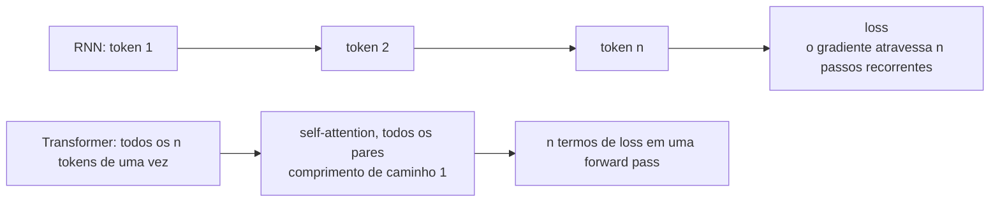

**Follow-ups:** Qual custo em inference time os transformers pagam e as RNNs não? Por que a causal masking torna o treinamento tão eficiente em amostras por forward pass? O que os state-space models estão tentando recuperar?

</details>

### 2. Explique o que acontece dentro de um único decoder block de um transformer.

<details><summary><b>Resposta</b></summary>

Um decoder block recebe hidden states de formato (n_tokens × d_model) e aplica duas subcamadas, cada uma envolvida em uma conexão residual com uma normalização:

1. **Norm → masked self-attention → add.** A entrada é normalizada (RMSNorm nos modelos modernos) e então projetada em queries, keys e values. A scaled dot-product attention com uma causal mask mistura informação *entre posições* - cada token reúne um resumo ponderado dos tokens anteriores. O resultado passa por uma projeção de saída e é *somado* à entrada original (residual).
2. **Norm → MLP → add.** O stream atualizado é normalizado novamente e passa por uma feed-forward network position-wise - tipicamente up-project para ~3-4× d_model, não linearidade (SwiGLU em modelos da família Llama), down-project - aplicada de forma idêntica e independente em cada posição. Somado de volta ao residual stream.

Então a divisão do trabalho é: **a attention move informação entre tokens; a MLP transforma a informação em cada token** (é onde vive a maior parte dos parâmetros e, plausivelmente, da maior parte do "conhecimento" armazenado). O residual stream atua como um espaço de trabalho compartilhado do qual cada subcamada lê e no qual escreve pequenas atualizações - um enquadramento que explica por que dá para empilhar 100+ blocos: o caminho de identidade significa que cada bloco só precisa fazer um refinamento incremental.

A posição da norm importa: os modelos modernos são **pre-norm** (norm dentro do ramo residual), o que mantém o caminho residual limpo e o treinamento estável em profundidade; o original de 2017 era post-norm. Em um modelo real, cada subcamada de attention também aplica RoPE a Q e K, e o bloco se repete N vezes (por exemplo, 32 blocos para um modelo de 7-8B, 80 para um de 70B), seguido de uma norm final e do LM head projetando para os logits do vocabulário.

**Vale desenhar.** Desenhe primeiro a linha residual direto de ponta a ponta, depois pendure as duas subcamadas nela: essa ordem é o ponto central do bloco.

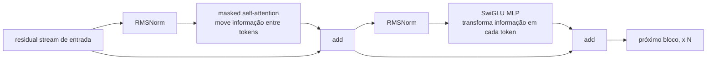

**Follow-ups:** Aproximadamente que fração dos parâmetros de um bloco está na MLP vs na attention? Por que as conexões residuais importam mais à medida que a profundidade cresce? O que muda nesse quadro para um modelo MoE?

</details>

### 3. Explique a self-attention passo a passo. O que exatamente são Q, K e V?

<details><summary><b>Resposta</b></summary>

O vetor de cada token é projetado linearmente de três formas: uma **query** ("o que estou procurando?"), uma **key** ("o que eu contenho, para os outros compararem?") e um **value** ("que conteúdo eu contribuo se for atendido?"). Attention é um lookup chave-valor suave e diferenciável: a query do token i é comparada com a key de cada token; os pesos resultantes misturam os values.

Passos, para X de formato (n, d_model):

1. Q = XW_q, K = XW_k, V = XW_v - três projeções aprendidas.
2. Scores = QKᵀ / √d_k - uma matriz (n, n); a entrada (i, j) é o quão relevante o token j é para o token i.
3. Aplique a causal mask: defina os scores onde j > i como −∞.
4. Softmax por linha → cada linha vira uma distribuição de probabilidade sobre as posições anteriores.
5. Output = weights · V - a saída de cada token é uma combinação convexa de vetores de value; em seguida, uma projeção de saída final W_o mapeia de volta para d_model.

```python
import numpy as np
def attention(Q, K, V, causal=True):
    s = Q @ K.T / np.sqrt(K.shape[-1])
    if causal:
        s[np.triu(np.ones_like(s, dtype=bool), k=1)] = -np.inf
    w = np.exp(s - s.max(-1, keepdims=True))
    w /= w.sum(-1, keepdims=True)
    return w @ V
```

O ponto conceitual crucial: os pesos são **calculados a partir dos dados em runtime**, não fixos como kernels de convolução. A mesma camada pode rotear "pronome → antecedente" em uma frase e "verbo → sujeito" em outra. Por que separar K e V? Porque o que torna um token *encontrável* (key) e o que ele deve *entregar* uma vez encontrado (value) são papéis diferentes - colapsá-los força um único vetor a servir a ambos, o que é mensuravelmente pior.

**Vale desenhar.** Isso mantém organizadas as três projeções e as duas matmuls, que é onde as pessoas tropeçam sob pressão.

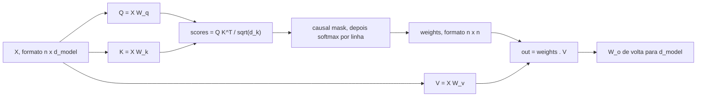

**Follow-ups:** Por que dividir por √d_k? Qual é a complexidade computacional do passo 2 e o que isso implica para contextos longos? Em um decoder gerando token a token, quais entre Q, K, V são mantidos em cache e por quê?

</details>

### 4. Por que a scaled dot-product attention divide por √d_k?

<details><summary><b>Resposta</b></summary>

Para evitar que o softmax sature. Se os componentes de q e k são aproximadamente independentes, com média zero e variância unitária, seu produto escalar q·k é uma soma de d_k termos e tem variância ≈ d_k - então o desvio padrão dos logits cresce como √d_k. Com d_k = 128, logits sem escala rotineiramente atingem magnitudes de ±20 ou mais.

O softmax de logits de grande magnitude colapsa para quase one-hot: um peso de attention ≈ 1, os demais ≈ 0. Nesse regime, o Jacobiano do softmax é quase zero (o gradiente do softmax envolve termos p·(1−p), que desaparecem quando p → 0 ou 1), então quase nenhum gradiente flui de volta pelos attention scores. No início do treinamento isso significa que as camadas de attention mal aprendem; também pode causar loss spikes e instabilidade. Dividir por √d_k renormaliza a variância dos logits de volta para ~1, independentemente da dimensão da head, mantendo o softmax em um regime com gradientes utilizáveis e distribuições de attention adequadamente suaves.

Dois pontos que distinguem uma resposta forte:

- É um **argumento de variância sobre a dinâmica de inicialização/treinamento**, não uma exigência matemática - o modelo poderia, em princípio, aprender projeções reduzidas, mas começar saturado torna a otimização muito mais difícil.
- A mesma ideia aparece em outros lugares: o **soft-capping** de logits em alguns modelos (limitar logits de attention ou finais com tanh) e o **QK-norm** (aplicar LayerNorm/RMSNorm a queries e keys antes do produto escalar, usado em várias arquiteturas modernas) atacam o mesmo modo de falha - logits de attention crescendo sem limite durante o treinamento - de forma mais agressiva do que a escala estática √d_k.

Uma forma concreta de formular a intuição: a escala √d_k torna a temperature do softmax da attention independente do tamanho da head, de modo que escolhas de arquitetura sobre head_dim não alteram silenciosamente o quão concentrada é a attention.

**Follow-ups:** O que é QK-norm e por que alguns modelos recentes o adotaram? O que acontece com os gradientes quando o softmax satura - me conduza pelo Jacobiano? Você esperaria que problemas de escala fossem piores com dimensões de head maiores ou menores?

</details>

### 5. O que é causal masking, por que ele é necessário e como é implementado?

<details><summary><b>Resposta</b></summary>

A causal masking impede que a posição i atenda a posições j > i, garantindo que as predições dependam apenas do passado. Ela é necessária por duas razões ligadas. Primeiro, em inference time os tokens futuros não existem - o modelo precisa gerar da esquerda para a direita, então o treinamento precisa corresponder a essa estrutura condicional. Segundo, e de forma mais sutil, é o que torna o treinamento de causal LM eficiente e não degenerado: com uma causal mask, uma única forward pass sobre uma sequência de n tokens produz n predições válidas de próximo token treinadas em paralelo. Sem a máscara, prever o token t+1 enquanto se atende ao token t+1 é cópia trivial - o modelo não aprenderia nada.

Implementação: antes do softmax, some uma matriz de máscara que é 0 na diagonal e abaixo dela e −∞ (na prática um número negativo grande como −1e9, ou o mínimo do dtype) estritamente acima dela. Depois do softmax, essas posições recebem peso exatamente zero, e a renormalização acontece automaticamente porque o softmax normaliza sobre as entradas finitas restantes.

```python
mask = np.triu(np.ones((n, n), dtype=bool), k=1)   # True acima da diagonal
scores = np.where(mask, -1e9, scores)               # antes do softmax
```

Em kernels de produção (FlashAttention), a máscara nunca é materializada como um tensor n×n - o kernel simplesmente pula o cálculo de blocos totalmente mascarados, o que também reduz o trabalho pela metade, já que aproximadamente metade da matriz de scores é mascarada.

Detalhes que valem ser mencionados espontaneamente: modelos encoder (BERT) omitem deliberadamente a máscara - trocam a capacidade de gerar por contexto bidirecional. Setups prefix-LM mascaram causalmente apenas a porção gerada, permitindo attention bidirecional sobre o prompt. E durante a inferência em batch você ainda precisa de máscaras de *padding* para que os tokens não atendam ao padding - uma máscara distinta que iniciantes frequentemente confundem com a causal.

**Vale desenhar.** Mostra que a máscara entra antes do softmax, então a renormalização é automática em vez de um segundo passo que você acrescenta.

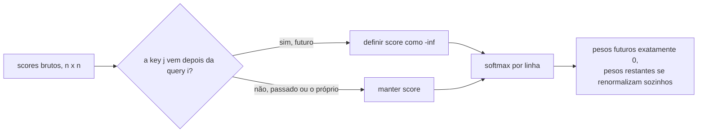

**Follow-ups:** Por que a máscara vai antes do softmax e não depois? O que é um prefix LM e quando a attention bidirecional sobre o prompt é útil? Como a FlashAttention explora a estrutura causal para ganhar velocidade?

</details>

### 6. Por que o transformer usa múltiplas attention heads em vez de uma grande?

<details><summary><b>Resposta</b></summary>

Porque um único softmax produz uma única ponderação sobre posições por token - uma "visão" do contexto. Um token frequentemente precisa que várias relações diferentes sejam resolvidas simultaneamente: a qual substantivo este pronome se refere, qual é o núcleo sintático desta frase, o que veio logo antes de mim, qual delimitador abriu este colchete. Fazer a média disso em uma única distribuição de attention destrói informação. A multi-head attention executa h operações de attention independentes em subespaços paralelos, de modo que cada uma pode se especializar.

Mecanicamente: em vez de uma attention sobre Q/K/V de d_model dimensões, divida em h heads de dimensão d_model/h (por exemplo, 4096 → 32 heads × 128). Cada head recebe suas próprias projeções Q/K/V aprendidas para seu subespaço, calcula a attention de forma independente, e as h saídas são concatenadas e misturadas pela projeção de saída W_o. A contagem total de parâmetros e de FLOPs é aproximadamente a mesma de uma única head de largura total - você está particionando a computação, não acrescentando a ela. O que você ganha são h softmaxes independentes; o que cada head perde é largura representacional (um produto escalar de 128 dimensões é uma medida de similaridade de rank mais baixo do que um de 4096).

Empiricamente, trabalhos de interpretability encontraram heads com papéis reconhecíveis - previous-token heads, positional heads e, famosamente, **induction heads** (pares de heads que implementam "encontre a ocorrência anterior deste token e copie o que veio depois dela"), que são centrais para in-context learning. Também é empiricamente verdade que muitas heads são redundantes após o treinamento - estudos de head-pruning mostraram que dá para remover uma fração substancial com perda modesta de qualidade - o que é parte da intuição de por que compartilhar K/V entre query heads (MQA/GQA) funciona.

O número de heads é um hiperparâmetro ajustado: poucas heads sofrem underfitting da diversidade de relações; muitas tornam o subespaço de cada head estreito demais. Um head_dim entre 64 e 128 tem sido um ponto ideal estável ao longo das gerações de modelos.

**Vale desenhar.** Deixa claro que você está particionando uma computação, não empilhando h cópias dela.

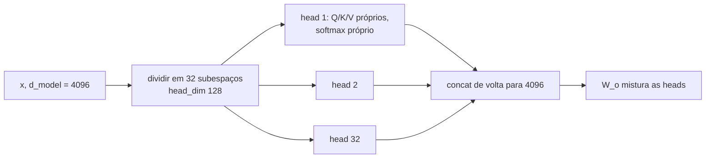

**Follow-ups:** O que é uma induction head e por que ela importa para in-context learning? Se muitas heads são redundantes, que otimizações arquiteturais isso motiva? A multi-head attention custa mais FLOPs que a single-head com o mesmo d_model?

</details>

### 7. Compare as arquiteturas encoder-only, decoder-only e encoder-decoder. Para que cada uma é usada?

<details><summary><b>Resposta</b></summary>

**Encoder-only** (linhagem BERT): self-attention bidirecional - cada token enxerga a sequência inteira - treinada com masked-LM. Produz representações contextuais ricas, mas não tem mecanismo natural de geração. Hoje sobrevive onde a qualidade de representação por FLOP importa: modelos de embedding para retrieval, rerankers, classificadores, filtros de PII/toxicidade. Pequenos, rápidos, baratos de servir.

**Decoder-only** (GPT, Llama, Claude, Gemini): self-attention causal, treinada com next-token prediction. É a arquitetura de essencialmente todo LLM de propósito geral moderno. Por que venceu: (1) a geração é nativa; (2) cada posição de token fornece sinal de treinamento em cada passada, então é eficiente em dados em escala; (3) uma arquitetura e um objetivo lidam com toda tarefa via prompting - sem heads específicas por tarefa; (4) escala de forma limpa, e todo o ecossistema de ferramentas (KV caching, stacks de serving, pipelines de RLHF) é construído em torno dela.

**Encoder-decoder** (transformer original, T5, Whisper, muitos modelos de tradução): o encoder lê a entrada com attention bidirecional; o decoder gera de forma autorregressiva enquanto faz cross-attention às saídas do encoder. O melhor encaixe quando há uma transformação input→output clara com entrada fixa: tradução, speech-to-text, sumarização estruturada. O encode bidirecional da fonte é uma vantagem genuína ali. Desvantagens para chat geral: a divisão input/output é desajeitada para conversa multi-turn, e você não consegue estender incrementalmente "a entrada" como um modelo decoder-only que simplesmente anexa ao contexto.

Uma nuance que vale acrescentar: modelos decoder-only podem emular o padrão encoder-decoder - o prompt faz o papel da entrada codificada - e variantes prefix-LM permitem attention bidirecional sobre o prompt enquanto geram causalmente. Na prática, a indústria se consolidou em decoder-only para cargas generativas e encoder-only para embeddings/reranking, com o encoder-decoder mantendo nichos como ASR (Whisper) e tradução.

**Vale desenhar.** Desenhe quem atende a quem, em vez de três caixas rotuladas: o padrão de attention é a diferença real.

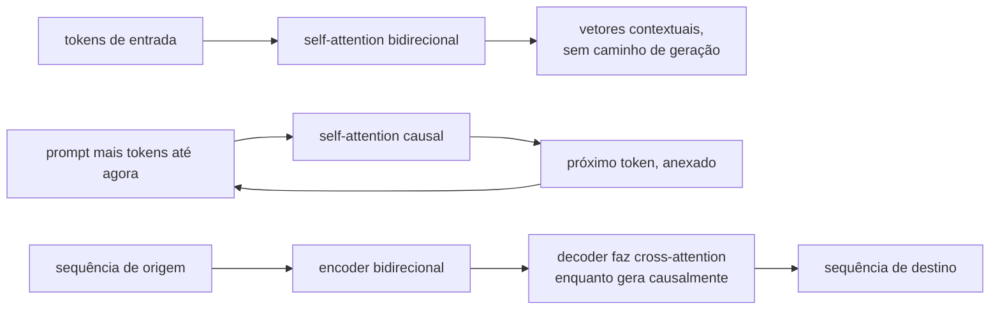

**Follow-ups:** Por que modelos de embedding ainda usam attention bidirecional? O que é um prefix LM? Se você estivesse construindo um sistema de tradução hoje, escolheria encoder-decoder ou um LLM decoder-only, e com quais critérios?

</details>

### 8. Qual é a diferença entre causal language modeling e masked language modeling como objetivos de pretraining?

<details><summary><b>Resposta</b></summary>

**Causal LM (CLM)**: prever o token t+1 dados os tokens 1..t, em cada posição, com a attention mascarada causalmente. A loss é a cross-entropy somada sobre todas as posições - uma sequência de n tokens gera n problemas de predição por forward pass, e 100% dos tokens contribuem com sinal.

**Masked LM (MLM)**: corromper a entrada mascarando um subconjunto de tokens (o BERT mascarava ~15%) e prever os originais usando contexto *bidirecional*. Apenas as posições mascaradas produzem loss, então por forward pass você obtém sinal de ~15% dos tokens.

Implicações:

- **Geração**: modelos CLM geram nativamente - fazer sampling do modelo *é* o modo de inferência do objetivo. Modelos MLM não conseguem gerar de forma coerente; não há fatoração left-to-right da distribuição conjunta.
- **Qualidade de representação**: o MLM enxerga os dois lados de cada posição, o que historicamente deu melhores representações por parâmetro para tarefas de compreensão - por isso o BERT dominou benchmarks de classificação em 2019-2020 e por isso modelos de embedding ainda preferem attention bidirecional.
- **Escala e universalidade**: o CLM acabou sendo o objetivo que escala para capacidade de propósito geral. Next-token prediction sobre dados diversos exige implicitamente sintaxe, conhecimento de mundo, raciocínio e estilo - e in-context learning decorre disso. A ineficiência de 15% de sinal do MLM, somada à ausência de um modo generativo, o tornou um beco sem saída para modelos gerais em escala frontier.
- **Descompasso treino/inferência**: o token [MASK] do MLM nunca aparece na inferência - um distribution shift que os papers da era BERT contornaram; o CLM não tem esse descompasso (embora tenha *exposure bias*: o treinamento sempre condiciona em prefixos de ground-truth, a inferência condiciona nas próprias saídas possivelmente errôneas do modelo).

Também vale saber: o **span corruption** estilo T5 é um meio-termo encoder-decoder (mascarar spans contíguos, gerá-los), e alguns modelos de texto estilo diffusion revisitam objetivos não autorregressivos, mas o CLM continua sendo a espinha dorsal de todo modelo frontier.

**Follow-ups:** O que é exposure bias e quanto ele importa na prática? Por que o in-context learning emerge da next-token prediction? Quando você ainda faria pretraining ou fine-tuning com MLM hoje?

</details>

### 9. Por que os LLMs usam tokenização por subwords em vez de palavras inteiras ou caracteres brutos?

<details><summary><b>Resposta</b></summary>

É um tradeoff de compressão/cobertura, e subwords são o ponto ideal entre dois extremos ruins.

O **nível de palavra** falha na cobertura: a linguagem natural tem um vocabulário ilimitado (nomes, erros de digitação, morfologia, identificadores de código, outros idiomas). Ou você carrega um vocabulário de milhões - uma matriz de embedding e um softmax enormes - ou mapeia tudo que não foi visto para um token `<UNK>` e perde informação. Idiomas morfologicamente ricos tornam isso catastrófico.

O **nível de caractere** (ou bytes brutos) tem cobertura perfeita, mas compressão terrível: as sequências ficam ~4-5× mais longas que com tokenização por subwords em inglês, e o custo da attention é quadrático no comprimento da sequência - então você paga um grande fator constante em compute e em contexto efetivo. Cada caractere também carrega quase nenhum significado sozinho, então o modelo gasta capacidade remontando palavras antes de poder fazer qualquer outra coisa.

A **tokenização por subwords** (BPE e parentes) aprende um vocabulário de pedaços frequentes: palavras comuns viram tokens únicos, palavras raras se decompõem em partes com significado ("tokenization" → "token" + "ization"), e com um alfabeto base byte-level *qualquer* string é representável - nunca há OOV. Você obtém sequências ~4× mais curtas que no nível de caractere com um vocabulário de tamanho gerenciável (aproximadamente 32k - 256k), e tokens frequentes recebem embeddings bem treinados.

A ressalva digna de entrevista: essa eficiência é comprada escondendo o nível de caractere do modelo - o que causa as falhas clássicas (contar letras, jogos de ortografia, alguma aritmética) - e a qualidade da compressão varia enormemente por idioma, então texto não inglês costuma ter 2-4× mais tokens para o mesmo conteúdo, o que significa custo maior e menos contexto utilizável. A tokenization é um dos poucos estágios do pipeline que continuam sendo projetados à mão e não aprendidos, e há pesquisa em andamento sobre modelos byte-level com patching aprendido (por exemplo, a linha Byte Latent Transformer) com o objetivo de eliminá-la.

**Follow-ups:** Como o byte-level BPE garante que não haja strings fora do vocabulário? Qual o efeito da escolha do tokenizer no preço e na qualidade multilíngues? Por que a modelagem em nível de caractere/byte ainda não substituiu o BPE?

</details>

### 10. Por que os LLMs famosamente contam errado o número de r's em "strawberry"?

<details><summary><b>Resposta</b></summary>

Porque o modelo nunca vê letras. O tokenizer mapeia "strawberry" para um ou dois token IDs (por exemplo, "str" + "awberry", ou um único token), e o modelo recebe apenas os vetores de embedding desses IDs. Não há visão em nível de caractere em lugar nenhum da forward pass - pedir que ele conte r's é como pedir a alguém que conte as letras de uma palavra que só ouviu falada. Para responder corretamente, o modelo precisa ter *memorizado* a ortografia daquele token específico a partir dos dados de treinamento (por exemplo, de listas de ortografia ou texto separado por caracteres) e então realizar a contagem - um processo de dois passos em que ambos os passos são pouco confiáveis.

A contagem em si é a segunda falha: transformers realizam um número fixo de camadas de computação paralela por token, e contar é uma operação inerentemente sequencial. Sem externalizar passos intermediários em tokens gerados (chain of thought como "s-t-r-a-w-b-e-r-r-y: r aparece nas posições 3, 8, 9 → 3"), o modelo tenta a contagem "de cabeça" de uma só vez, onde está chutando a partir de associações memorizadas. É por isso que o mesmo modelo que falha na pergunta direta geralmente acerta se você pede que ele soletre a palavra letra por letra primeiro - e por que os reasoning models, treinados para externalizar passos, em grande parte corrigiram essa classe de erro.

A lição geral que os entrevistadores querem: **isto é um artefato de tokenization, não evidência sobre inteligência**. A mesma causa raiz explica o desempenho ruim em rimas e jogos de palavras, inversão de strings, manipulação de caracteres estilo base64 e comportamentos de off-by-one em edição precisa de caracteres. Implicação prática para engenheiros: não construa operações de string em nível de caractere sobre a saída bruta de um LLM - faça-as em código, e use o LLM para as partes em que ele realmente é bom.

**Vale desenhar.** Aponta o dedo para o passo exato em que os caracteres deixam de existir, que é também o motivo pelo qual soletrar primeiro funciona.

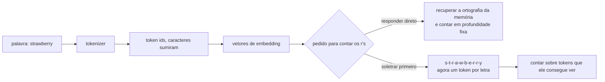

**Follow-ups:** Por que pedir ao modelo que soletre a palavra primeiro corrige a contagem? Que outras categorias de tarefa falham pela mesma causa raiz? Como um modelo byte-level se comportaria de forma diferente aqui?

</details>

### 11. O que o parâmetro temperature realmente faz? Dê a fórmula.

<details><summary><b>Resposta</b></summary>

A temperature reescala os logits antes do softmax que os converte em uma distribuição de probabilidade sobre o vocabulário:

p_i = exp(z_i / T) / Σ_j exp(z_j / T)

- **T = 1**: a distribuição bruta do modelo.
- **T → 0**: as diferenças entre logits são amplificadas; a distribuição colapsa em direção ao argmax - decoding determinístico, tipo greedy. (T = 0 em APIs é implementado como argmax; a divisão real por zero é indefinida.)
- **T > 1**: as diferenças são comprimidas; a distribuição se achata, tokens de baixa probabilidade ficam mais prováveis - saída mais diversa e mais propensa a erros.

Propriedades-chave que vale declarar: a temperature é uma transformação *monotônica* - nunca reordena os tokens, apenas afia ou achata a distribuição, então o greedy decoding não é afetado por ela. Ela opera a cada passo de geração sobre a distribuição condicional, e seus efeitos se acumulam ao longo de uma geração longa: pequenos aumentos na entropia por token produzem completions visivelmente mais divergentes.

Orientação prática que um candidato forte dá: use T = 0 (ou perto disso) para extração, classificação, structured output e código em que há uma resposta correta - você quer a moda. Use T ≈ 0,7-1,0 para escrita criativa e brainstorming, onde a diversidade é o ponto. Note que T = 0 não garante saídas idênticas bit a bit entre chamadas de API na prática (não determinismo de batching, não associatividade de ponto flutuante entre kernels, mudanças de infraestrutura), um equívoco comum que vale sinalizar. Note também que a temperature interage com os truncation samplers: ela é aplicada junto com top-p/top-k/min-p, e a ordem das operações (tipicamente temperature primeiro, depois truncamento, embora as implementações variem) muda o comportamento em T alto - o min-p em particular foi projetado para se manter robusto em T > 1.

Mais um enquadramento útil: a temperature troca a exploitation da confiança do modelo pela exploration de sua incerteza - o mesmo botão da exploração por softmax em RL.

**Follow-ups:** Por que T=0 ainda pode produzir saídas diferentes em chamadas de API idênticas? Se você aumenta a temperature, por que geralmente também quer min-p ou top-p? Que temperature você usaria para uma avaliação com LLM-as-judge e por quê?

</details>

### 12. Compare greedy decoding, top-k sampling e top-p (nucleus) sampling.

<details><summary><b>Resposta</b></summary>

O **Greedy** pega o token de argmax a cada passo. Determinístico e barato, bom para respostas factuais curtas e extração estruturada. Modo de falha: loops de repetição ("the the the", ou ciclos em nível de parágrafo) e insipidez - tokens localmente ótimos não se compõem em um bom texto global, e o modelo pode entrar em repetição auto-reforçada em que repetições anteriores tornam a próxima repetição *mais* provável.

O **Top-k** restringe o sampling aos k tokens de maior probabilidade (renormalizados), tipicamente k = 20-50. Problema: k é estático enquanto o formato da distribuição varia enormemente por passo. Quando o modelo está confiante (um token com 0,95), k = 40 admite 39 tokens lixo; quando está genuinamente incerto entre 200 continuações plausíveis (início de uma frase de história), k = 40 trunca diversidade válida.

O **Top-p / nucleus** (de Holtzman et al., "The Curious Case of Neural Text Degeneration") se adapta: mantém o menor conjunto de tokens cuja probabilidade acumulada ≥ p (por exemplo, 0,9), renormaliza e faz sampling. Passo confiante → o nucleus tem 1-2 tokens; passo incerto → o nucleus é grande. Essa adaptatividade é o motivo de o top-p ter se tornado o padrão. Sua fraqueza residual: em temperature alta, a distribuição achatada deixa o nucleus inchar e incluir tokens genuinamente ruins - que é o que o **min-p** (manter tokens com p ≥ min_p × p_max) resolve ancorando o corte na confiança do token de topo.

O insight-chave por trás de todo truncation sampling: a massa de probabilidade do modelo é bem calibrada na cabeça da distribuição e pouco confiável na cauda - uma geração longa eventualmente fará sampling de um token da cauda, e um token ruim pode descarrilar tudo depois dele (erros se acumulam de forma autorregressiva). O truncamento corta a cauda; a temperature molda o que resta. Na prática eles se compõem: temperature + top-p (+ opcionalmente top-k como teto rígido) é o stack padrão, com greedy/T≈0 para qualquer coisa que tenha uma resposta certa.

**Vale desenhar.** Fixa a ordem das operações, o que torna concreta a diferença entre top-p e min-p.

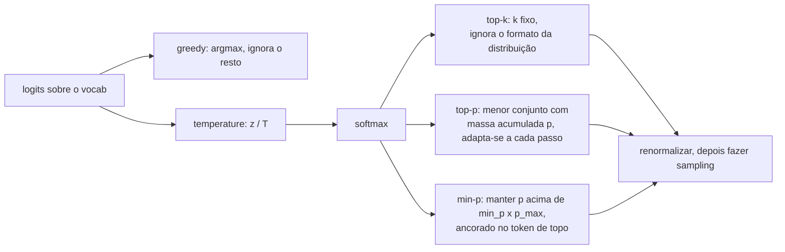

**Follow-ups:** Por que o greedy decoding entra em loop, mecanicamente? Quando o top-p falha e como o min-p o corrige? Por que o texto amostrado em T=1 é frequentemente *pior* do que a distribuição "verdadeira" do modelo sugeriria?

</details>

### 13. O que é o KV cache e por que ele torna a geração rápida?

<details><summary><b>Resposta</b></summary>

Durante a geração autorregressiva, a attention de cada novo token precisa das keys e values de *todos os tokens anteriores* em cada camada. Esses vetores K e V dependem apenas dos tokens que os produziram (e de suas posições) - não mudam conforme a geração avança. O KV cache os armazena para que cada passo calcule Q/K/V apenas para o único novo token, atenda aos K/V em cache e anexe seus próprios K/V ao cache.

Sem o cache você reexecutaria a forward pass completa sobre todo o prefixo para cada token gerado: gerar o token n custa O(n) de recomputação, então uma geração completa custa O(n²) de trabalho de forward pass (com a attention interna tornando-a efetivamente quase cúbica em FLOPs totais). Com o cache, cada passo faz as projeções de um token mais leituras de attention sobre n entradas em cache - a geração se torna linear nos tokens gerados, que é a diferença entre latency utilizável e inutilizável.

Isso cria a estrutura de duas fases em torno da qual todo stack de serving é construído: **prefill** (processar o prompt inteiro em paralelo - compute-bound, popula o cache) e **decode** (um token por vez - limitado pela largura de banda de memória, porque cada passo precisa ler o cache inteiro da memória da GPU enquanto faz relativamente poucos FLOPs). Time-to-first-token é o prefill; inter-token latency é o decode.

O custo é memória: por token você armazena 2 (K e V) × n_layers × n_kv_heads × head_dim elementos. Para um modelo da classe 70B com GQA (80 camadas, 8 KV heads, head_dim 128, fp16) são ~320 KB por token - ~40 GB para uma sequência de 128k tokens. Essa pressão de memória é o motivo de existirem GQA/MQA (menos KV heads), de o PagedAttention do vLLM gerenciar o cache em blocos não contíguos, de o prefix/prompt caching compartilhar cache entre requisições e de a quantização de cache (KV em fp8/int8) ser comum.

**Vale desenhar.** O laço de volta ao cache é o ponto: desenhe-o e o argumento linear versus quadrático se explica sozinho.

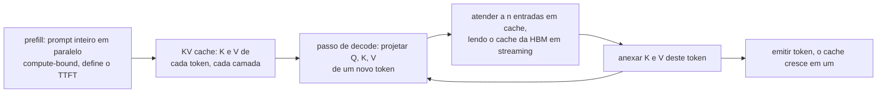

**Follow-ups:** Por que o decode é limitado pela largura de banda de memória e não por compute? O que é prefix caching e quando ele economiza dinheiro? Por que você não pode fazer cache das queries também?

</details>

### 14. O que a feed-forward network de um bloco transformer realmente faz, e por que o SwiGLU é o padrão agora?

<details><summary><b>Resposta</b></summary>

A attention move informação entre posições; a FFN transforma a informação em cada posição de forma independente. É também onde vive a maior parte dos parâmetros, cerca de dois terços dos pesos de um transformer denso.

A versão clássica são duas camadas lineares com uma não linearidade entre elas, expandindo para cerca de 4x d_model e projetando de volta:

```python
def ffn(x, W1, W2):
    return gelu(x @ W1) @ W2   # d_model -> 4*d_model -> d_model
```

O SwiGLU substitui a única up-projection por um par com gate:

```python
def swiglu_ffn(x, W_gate, W_up, W_down):
    return (silu(x @ W_gate) * (x @ W_up)) @ W_down
```

São três matrizes em vez de duas, então, para manter fixa a contagem de parâmetros, você reduz a dimensão oculta de ~4x d_model para ~8/3 x d_model. Os modelos da família Llama fazem exatamente isso, e é por isso que você vê tamanhos intermediários estranhos como 11008 em vez de um múltiplo de 4 redondo.

Por que venceu: dá consistentemente uma loss menor com parâmetros e FLOPs equivalentes. O gate torna a não linearidade dependente dos dados e multiplicativa, de modo que uma unidade pode ser desligada com base na entrada em vez de passar por uma curva pontual fixa. O trabalho sobre GLU-variants que o popularizou é refrescantemente honesto ao dizer que a justificativa é empírica, não teórica. O GeGLU (GELU em vez de SiLU como ativação do gate) tem desempenho praticamente igual; a escolha é em grande parte convenção.

Um modelo mental útil vindo de interpretability: trate as linhas de W_gate/W_up como detectores de padrões e as colunas de W_down como o conteúdo que esses padrões escrevem de volta no residual stream, de modo que a FFN se comporta como uma memória chave-valor.

O equívoco que vale matar é o de que a FFN é uma MLP sem graça pendurada na parte interessante. Ela guarda a maior parte dos parâmetros, domina os FLOPs em contextos curtos e moderados, e é exatamente o componente que o Mixture-of-Experts substitui, porque é ali que está a capacidade.

**Vale desenhar.** Três matrizes se encontrando em uma multiplicação: mostra imediatamente por que a dimensão oculta encolhe para manter fixa a contagem de parâmetros.

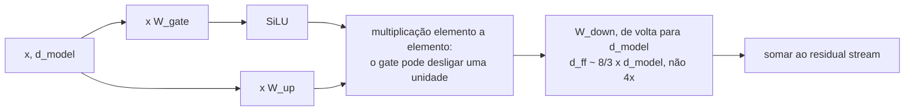

**Follow-ups:** Onde a FFN deixa de dominar os FLOPs e a attention assume? Por que o MoE troca a FFN e não a attention?

</details>

### 15. O que é weight tying, e por que alguns modelos fazem tying das matrizes de embedding e de saída enquanto outros não?

<details><summary><b>Resposta</b></summary>

Weight tying significa que a matriz de input embedding e o LM head de saída são a mesma matriz, usada transposta na saída. Ambas mapeiam entre a identidade do token e o espaço do residual stream, então o argumento é que uma única matriz deveria servir.

A economia é de vocab x d_model parâmetros. Com um vocabulário de 128k e d_model 4096, são ~524M parâmetros, uma fração séria de um modelo de 8B e um erro de arredondamento em um de 400B. Essa assimetria de tamanho basicamente explica a divisão na prática: modelos pequenos tendem a fazer tying (o Gemma faz, e com um vocabulário de ~256k a economia é enorme em relação ao corpo), enquanto modelos grandes cada vez mais desfazem o tying porque os parâmetros são baratos e desfazê-lo melhora mensuravelmente a loss.

Por que desfazer o tying ajuda é a parte interessante. As duas matrizes querem geometrias diferentes. O embedding quer que tokens que aparecem em contextos similares fiquem próximos. O unembedding quer que tokens intercambiáveis como predições fiquem próximos. Essas coisas são relacionadas mas não idênticas, e forçar uma única matriz a satisfazer ambas a restringe. Há também um argumento de rank: a matriz de logits é limitada por d_model, o softmax bottleneck, e o tying não ajuda aí.

Dois detalhes que vale conhecer. Primeiro, os gradientes se comportam de forma diferente: o lado do embedding recebe atualizações esparsas para os tokens realmente presentes no batch, enquanto o head recebe atualizações densas do softmax sobre o vocabulário inteiro, e com tying elas caem na mesma matriz, o que muda sua learning rate efetiva em relação ao resto do modelo. Segundo, o descompasso de escala é real, e é por isso que vários modelos com tying multiplicam as saídas do embedding por sqrt(d_model).

Os argumentos originais vieram de Press e Wolf e de Inan et al. por volta de 2016 e 2017, numa era de modelos pequenos em que a tabela de embedding era genuinamente a maior parte do modelo. O tradeoff mudou desde então, e esse é o ponto.

**Follow-ups:** Como a decisão do tamanho do vocabulário interage com a decisão de tying? O que acontece com um modelo com tying se você quiser estender o vocabulário a posteriori?

</details>

### 16. Explique a speculative decoding. Por que ela não altera a distribuição de saída do modelo?

<details><summary><b>Resposta</b></summary>

Um draft model pequeno propõe k tokens de forma autorregressiva. O target model grande então pontua todas as k+1 posições em uma única forward pass. Uma regra de aceitação percorre as propostas da esquerda para a direita, aceitando cada uma com probabilidade min(1, p_target(x)/p_draft(x)); na primeira rejeição você refaz o sampling daquele token a partir de uma distribuição residual corrigida e descarta o resto. É um esquema de rejection-sampling, e a prova é que as amostras resultantes são distribuídas exatamente como se você tivesse feito sampling diretamente do target model. Esse é o ponto crucial: é lossless, não uma aproximação. Se alguém diz que a speculative decoding troca qualidade por velocidade, está confundindo com um modelo menor.

Por que é mais rápida se resume a arithmetic intensity. O decode é limitado pela largura de banda de memória: para produzir um token você faz stream de cada peso da HBM e faz quase nenhuma aritmética com eles. Pontuar 5 posições custa quase o mesmo tempo de relógio que pontuar 1, porque o custo de carregar os pesos domina e é amortizado. Você está gastando FLOPs ociosos para comprar tempo de volta. Ganhos típicos são de ~1,5-3x, governados pela taxa de aceitação e pelo quão barato é o draft.

O que uma resposta forte acrescenta:

- Ela deixa de ajudar quando o batch é grande. Em batch alto você já está compute-bound e não há FLOPs sobrando para gastar, então o overhead especulativo pode piorar as coisas. É uma técnica de baixa latency e baixo batch.
- A taxa de aceitação é tudo, e depende da correspondência de distribuição, não da qualidade do draft em abstrato. Os melhores drafts são destilados do target model específico, de modo que o KL entre eles é pequeno. Um modelo de 1B genericamente bom fazendo draft para um 70B não relacionado pode ter aceitação ruim.
- Variantes evitam totalmente o segundo modelo: Medusa e EAGLE adicionam draft heads sobre o próprio trunk do target, o drafting por n-gram ou prompt-lookup funciona bem para trabalho pesado em cópia como RAG e edições de código, e o DeepSeek-V3 reutiliza seu módulo de multi-token-prediction como draft.

**Vale desenhar.** A bifurcação no teste de aceitação é o que prova que você entende que isto é rejection sampling, não uma aproximação.

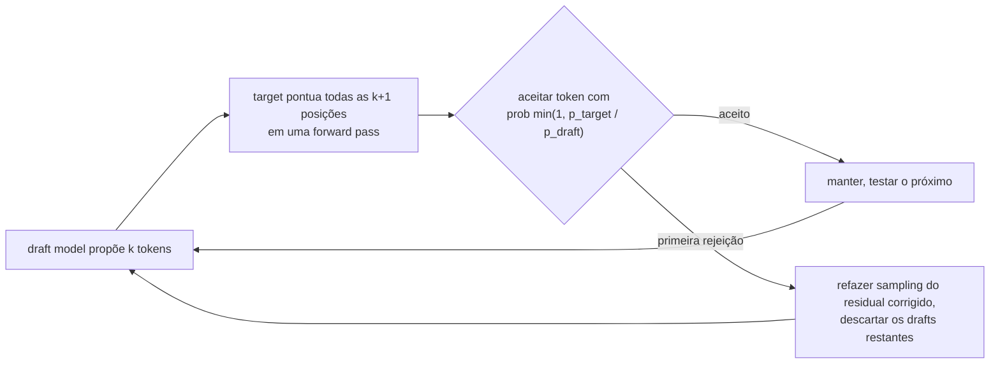

**Follow-ups:** Como você mediria se a speculative decoding está realmente ajudando em um deployment de serving ao vivo? Que taxa de aceitação você precisa para atingir o break-even?

</details>

### 17. O que é in-context learning, e como você decide entre ele e fine-tuning?

<details><summary><b>Resposta</b></summary>

In-context learning é um modelo executando uma tarefa especificada inteiramente no prompt, via instruções ou exemplos, sem atualização de pesos. Ele emergiu do pretraining em vez de ter sido projetado, e é a razão pela qual a era das chamadas de API existe.

Por que funciona: o pretraining em dados enormemente diversos faz de "inferir qual tarefa este prefixo implica e continuar de forma consistente" o comportamento que minimiza a loss, porque o corpus está cheio de demonstrações implícitas de tarefas. Mecanicamente, o ingrediente mais bem compreendido são as induction heads: um circuito de duas heads que encontra uma ocorrência anterior do token atual e copia o que veio depois dela. Sua formação coincide com um salto brusco na capacidade in-context durante o treinamento, que é uma das histórias mecanísticas mais limpas que temos.

O framework de decisão:

Use in-context learning quando a tarefa é descritível, muda com frequência, tem baixo volume ou você ainda está iterando. Não custa nada configurar e você pode alterá-lo em um editor de texto. O teto é seu orçamento de contexto e o custo em tokens por chamada.

Use fine-tuning quando a tarefa é estável e de alto volume, de modo que o custo amortizado em tokens domina, quando você precisa de menor latency ou de um modelo menor, quando você tem milhares de bons exemplos, ou quando o comportamento resiste a ser descrito em um prompt (tom, um estilo da casa, um formato de saída especializado).

Uma coisa que vale sinalizar porque entrevistadores gostam: para a maioria das tarefas reais, os exemplos em sua maioria não estão ensinando uma nova tarefa. Min et al. (2022) mostraram que, em classificação, substituir os rótulos das demonstrações por rótulos errados aleatórios mal prejudica. O que as demonstrações transmitem é o label space, a distribuição de entrada e o formato de saída, não o mapeamento. A nuance: trabalhos posteriores descobriram que os maiores modelos conseguem seguir rótulos consistentemente invertidos, então o mapeamento não é totalmente ignorado, mas a lição prática se mantém. Assim, a implicação prática é que a seleção e a diversidade dos exemplos importam muito mais que a quantidade de exemplos, e 30 exemplos quase idênticos são em grande parte contexto desperdiçado.

**Vale desenhar.** Uma árvore de decisão evita que isto vire uma lista genérica de prós e contras.

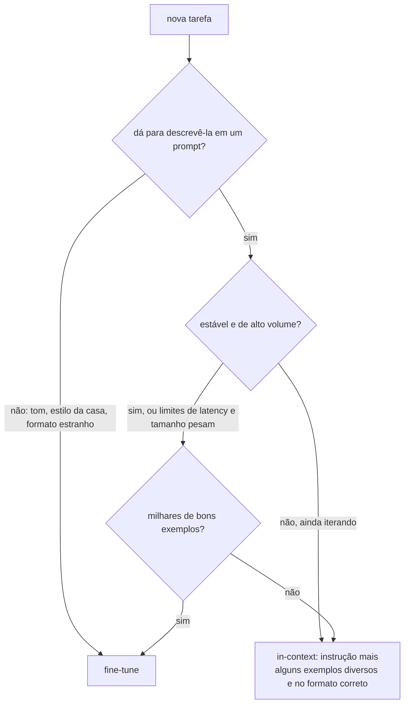

**Follow-ups:** Se rótulos errados mal prejudicam, o que isso implica sobre como você deveria escolher exemplos few-shot? Quando você viu o in-context learning falhar de verdade onde o fine-tuning teve sucesso?

</details>

### 18. O que a perplexity mede, e por que você não pode compará-la entre modelos com tokenizers diferentes?

<details><summary><b>Resposta</b></summary>

Perplexity é a média exponenciada da negative log-likelihood por token em texto held-out: PPL = exp(-(1/N) Σ log p(x_t | x_<t)). Intuitivamente, é o número efetivo de tokens entre os quais o modelo está escolhendo a cada passo: uma perplexity de 8 significa que o modelo está, em média, tão incerto quanto uma escolha uniforme entre 8 tokens. Menor é melhor, e é a training loss, apenas exponenciada.

A armadilha é o denominador. "Por token" depende do tokenizer. Um modelo com vocabulário de 200k divide o mesmo documento em menos tokens, maiores, do que um modelo com vocabulário de 32k, então cada predição carrega mais informação e a perplexity por token sobe mesmo que o modelo preveja melhor o texto. Comparar perplexity por token entre tokenizers é comparar números em unidades diferentes.

A correção é normalizar por algo independente do tokenizer. Bits per byte (BPB) divide a negative log-likelihood total do documento, em bits, pela sua contagem de bytes UTF-8: BPB = (loss em nats por token / ln 2) / (bytes por token). A log-likelihood total de um documento é comparável entre modelos; dividir por uma unidade específica do modelo é onde a coisa dá errado. Papers byte-level e tokenizer-free reportam BPB exatamente por esse motivo.

Outras formas pelas quais a perplexity engana:

- Modelos pós-treinados geralmente têm perplexity pior em texto da web do que seus modelos base, porque SFT e RL afiam a distribuição em direção a um estilo de chat. Isso não é uma regressão de capacidade.
- A média é dominada por tokens fáceis. Palavras funcionais e boilerplate são bem previstos por qualquer modelo; os tokens que carregam raciocínio são uma pequena fração da média.
- Contaminação: se o texto de eval estava no pretraining, a perplexity colapsa e não diz nada.
- Ela não diz nada sobre instruction following, factualidade ou uso de tools.

Onde ainda é a ferramenta certa: comparar checkpoints dentro de uma mesma execução, ablações de data mix e de tokenizer (em BPB), detectar domain shift e filtrar dados de pretraining pela perplexity de um modelo de referência.

**Follow-ups:** Converta uma loss de 2,0 nats por token em perplexity. O tokenizer A tem em média 3,5 bytes por token e o tokenizer B 4,5: como você compara suas losses? Por que um modelo melhor poderia mostrar perplexity mais alta no seu eval set?

</details>

## Intermediário

### 19. Pre-norm vs post-norm - qual é a diferença e por que todo mundo migrou para pre-norm? E por que RMSNorm?

<details><summary><b>Resposta</b></summary>

**Post-norm** (transformer original de 2017): `x = Norm(x + Sublayer(x))` - a normalização fica *sobre* o caminho residual, depois do add. **Pre-norm** (GPT-2 em diante, essencialmente todos os LLMs modernos): `x = x + Sublayer(Norm(x))` - a normalização fica dentro do ramo, e o caminho residual é uma identidade pura.

Por que importa: com post-norm, o gradiente da loss até as camadas iniciais precisa passar por todas as LayerNorms do trunk, e cada norm reescala os gradientes de formas que se acumulam com a profundidade - transformers post-norm profundos são notoriamente difíceis de treinar, exigindo um warmup cuidadoso de learning rate e ainda assim propensos a divergência. Com pre-norm, há um caminho de identidade desobstruído da loss até cada camada - os gradientes chegam às camadas iniciais sem atenuação, as exigências de warmup diminuem e o treinamento é estável com 80-100+ camadas. Como um treinamento frontier pode custar de dezenas a centenas de milhões de dólares, a estabilidade vence tudo: o pre-norm se tornou universal.

A nuance honesta: o post-norm, *quando você consegue treiná-lo*, às vezes alcança qualidade final ligeiramente melhor - o caminho de identidade do pre-norm significa que camadas posteriores podem se comportar mais como um ensemble de caminhos rasos, possivelmente desperdiçando alguma profundidade. Isso motivou híbridos (por exemplo, arranjos "peri-norm"/double-norm, ou o estilo Gemma de normalizar tanto a entrada quanto a saída do ramo), mas o pre-norm simples continua sendo o padrão.

**RMSNorm** vs LayerNorm: a LayerNorm subtrai a média, divide pelo desvio padrão e então aplica ganho e bias aprendidos. A RMSNorm elimina o mean-centring e o bias - apenas divide pelo root-mean-square do vetor e aplica um ganho aprendido: x / RMS(x) · g. Ablações (do paper da RMSNorm em diante, confirmadas em escala pelos modelos da família Llama) mostram que o mean-centring não é necessário; a RMSNorm é mais barata (menos reduções, menos parâmetros, uma operação memory-bound a menos) e igualmente estável. Com milhares de invocações de norm por forward pass, a economia é real.

**Vale desenhar.** Desenhe os dois caminhos residuais e a diferença é imediata: um deles tem uma norm sentada no trunk.

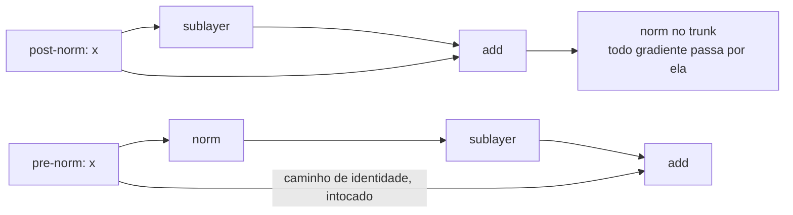

**Follow-ups:** Por que o warmup interage com o post-norm? O que a normalização faz com a geometria do loss landscape? Onde mais, em arquiteturas modernas, aparecem norms além das duas posições do bloco (QK-norm, norm final)?

</details>

### 20. Conduza-me pelo algoritmo de treinamento do BPE passo a passo.

<details><summary><b>Resposta</b></summary>

O Byte-Pair Encoding aprende um vocabulário de merges de subwords a partir de um corpus:

1. **Inicialize** o vocabulário com o alfabeto base - no byte-level BPE (GPT-2 em diante), todos os 256 valores de byte, o que garante que qualquer string seja representável. Represente o corpus como sequências desses símbolos base.
2. **Conte** todos os pares adjacentes de símbolos no corpus.
3. **Mescle** o par mais frequente em um novo símbolo único, adicione-o ao vocabulário e registre a regra de merge (por exemplo, `t` + `h` → `th`).
4. **Repita** os passos 2-3 até atingir o tamanho de vocabulário alvo (por exemplo, ~50k merges para o vocabulário de 50.257 do GPT-2; ~128k para o do Llama 3).

A saída é uma lista ordenada de regras de merge. O **encoding** em inference time as reproduz: divida o texto em símbolos base e depois aplique os merges na ordem em que foram aprendidos, onde quer que ocorram, de forma greedy, até que nenhum mais se aplique. O encoding é determinístico; a ordem de merges aprendida é o tokenizer.

```python
from collections import Counter
def bpe_step(corpus):                     # corpus: lista de (tupla_de_símbolos, freq)
    pairs = Counter()
    for word, freq in corpus:
        for a, b in zip(word, word[1:]):
            pairs[(a, b)] += freq
    return max(pairs, key=pairs.get)      # par a ser mesclado em seguida
```

Detalhes práticos que sinalizam entendimento real: tokenizers reais aplicam primeiro uma regex de **pre-tokenization** (dividindo em fronteiras de whitespace/categoria, para que os merges não cruzem fronteiras de palavras - a regex do GPT-2 trata notoriamente contrações como `'s` como casos especiais), e tratam espaços iniciais como parte dos tokens (`" the"` e `"the"` são tokens diferentes). O merge baseado em frequência faz o vocabulário espelhar a distribuição do corpus de treinamento - que é exatamente por que tokenizers treinados em dados com muito inglês fragmentam outros idiomas. Note também o contraste: o **WordPiece** escolhe o merge que maximiza a likelihood do corpus em vez da frequência bruta, e o **unigram-LM** (o outro algoritmo do SentencePiece) funciona top-down - começa com um vocabulário candidato grande e poda os tokens cuja remoção menos prejudica a likelihood.

**Vale desenhar.** O laço e sua condição de saída são o algoritmo; o resto é contabilidade.

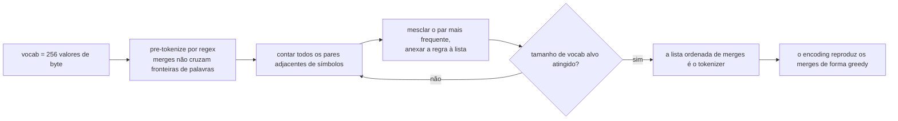

**Follow-ups:** Por que a pre-tokenization importa - o que daria errado sem restrições de fronteira de palavra? Por que `"the"` e `" the"` precisam ser tokens separados? Como a tokenização unigram-LM difere conceitualmente do BPE?

</details>

### 21. Compare BPE, WordPiece, SentencePiece e byte-level BPE.

<details><summary><b>Resposta</b></summary>

São dois algoritmos, uma biblioteca e uma escolha de alfabeto base - uma distinção que por si só pontua, porque as pessoas erradamente os tratam como quatro algoritmos paralelos.

**BPE** (algoritmo): bottom-up, greedy - mescla repetidamente o par adjacente mais *frequente*. Usado (em forma byte-level) pelos tokenizers da família GPT-2/3/4 (tiktoken) e pelo Llama 3.

**WordPiece** (algoritmo, BERT): mesmo esquema bottom-up, mas mescla o par que maximiza a *likelihood* do corpus de treinamento - score ≈ freq(ab) / (freq(a)·freq(b)) - favorecendo pares que co-ocorrem mais do que o acaso em vez de apenas com frequência. Reconhecível pela convenção de peças de continuação `##`. O encoding usa longest-match-first em vez de reprodução de merges.

**Unigram-LM** (algoritmo, frequentemente usado via SentencePiece): top-down - começa com um vocabulário candidato grande e poda iterativamente os tokens cuja remoção menos prejudica a likelihood do corpus sob um modelo unigram; o encoding escolhe a segmentação mais provável (Viterbi). Suporta fazer sampling de segmentações alternativas para regularização durante o treinamento.

**SentencePiece** (biblioteca, não um algoritmo): implementa tanto BPE quanto unigram-LM. Sua propriedade distintiva: opera sobre texto bruto como um stream de caracteres **sem pre-tokenization externa** - o whitespace é codificado como um meta-símbolo (▁, U+2581) - tornando-o agnóstico a idioma (funciona para chinês/japonês/tailandês, onde não há espaços) e exatamente reversível. Padrão em modelos multilíngues e em muitos modelos abertos (Llama 1/2, T5, Gemma).

**Byte-level BPE** (escolha de alfabeto base): executa BPE sobre os 256 valores de byte em vez de caracteres Unicode. Garantia: *nenhuma string jamais fica fora do vocabulário* - qualquer coisa, qualquer idioma, emoji, lixo quase binário, decompõe-se em bytes no pior caso. Custo: caracteres não latinos raros podem se fragmentar em múltiplos tokens de byte. O SentencePiece oferece uma válvula de escape equivalente chamada byte-fallback.

Relevância prática de engenharia: a escolha do tokenizer determina contagens de tokens (custo, latency, contexto efetivo) por idioma, e tokenizers incompatíveis são uma fonte clássica de bugs ao trocar de modelo - nunca assuma que contagens de tokens se transferem entre famílias de modelos.

**Follow-ups:** Por que o SentencePiece codifica o whitespace explicitamente - que propriedade isso traz? O que é byte-fallback? Dado o mesmo tamanho de vocab, por que o unigram-LM poderia produzir segmentações linguisticamente mais naturais que o BPE?

</details>

### 22. Quais são os tradeoffs na escolha do tamanho do vocabulário?

<details><summary><b>Resposta</b></summary>

O tamanho do vocab troca compressão do comprimento da sequência por custo de parâmetros e qualidade dos tokens de cauda. A tendência do setor conta a história: o GPT-2 usou 50.257; o Llama 2 usou 32k; o Llama 3 migrou para ~128k; o tokenizer do GPT-4o tem ~200k.

**Vocabulário maior - benefícios:**
- **Menos tokens por texto**: mais strings viram tokens únicos, então o mesmo documento custa menos tokens - diretamente inferência mais barata, menor latency e mais conteúdo cabendo na context window. Os ganhos são maiores para idiomas não ingleses e código, que vocabs pequenos centrados em inglês fragmentam muito. Este é um dos principais motivos pelos quais o Llama 3 quadruplicou o vocab do Llama 2.
- Menos passos autorregressivos para a mesma saída → geração mais rápida.

**Vocabulário maior - custos:**
- Os **parâmetros de embedding + LM-head** escalam como 2 × vocab × d_model (a menos que haja weight-tying). Com d_model = 4096, um vocab de 128k significa ~525M parâmetros de embedding e o mesmo de novo para o output head - para modelos pequenos isso é uma fração enorme do orçamento (um modelo de 1B pode gastar >30% dos parâmetros em vocab), enquanto para um modelo de 70B é ruído. É por isso que modelos pequenos quase sempre fazem tying do embedding e do LM head e são muito mais sensíveis ao tamanho do vocab, enquanto modelos grandes podem bancar vocabulários enormes.
- **Compute do softmax** sobre o vocab em cada posição (importa principalmente para modelos pequenos e para o throughput de treinamento).
- **Tokens de cauda sub-treinados**: com mais tokens, cada token raro tem menos ocorrências de treinamento. Caso patológico: "glitch tokens" (a história do SolidGoldMagikarp - tokens presentes no vocab mas quase ausentes dos dados de treinamento, cujos embeddings são essencialmente não inicializados, produzindo comportamento bizarro quando acionados).
- Vocabs multilíngues maiores fazem cada token cobrir *mais* texto, o que reduz levemente a granularidade por token que o modelo pode explorar.

Regra prática: o tamanho do vocab deve escalar com o tamanho do modelo e com a amplitude de idiomas/domínios atendidos. Há trabalho publicado sobre scaling compute-optimal de vocab mostrando que modelos frontier vinham subdimensionando seus vocabulários.

**Follow-ups:** O que são glitch tokens e o que os causa? Por que o weight-tying do embedding e do LM head importa mais para modelos pequenos? Como você avaliaria se um tokenizer atende bem seus idiomas-alvo?

</details>

### 23. Além de contar letras, que modos de falha a tokenization causa? Pense em aritmética, texto multilíngue e código.

<details><summary><b>Resposta</b></summary>

**Aritmética.** Números são tokenizados de forma inconsistente: "1234" pode ser um token enquanto "1235" se divide como "12"+"35", e a mesma quantidade é fragmentada diferente dependendo do texto ao redor. O alinhamento de valor posicional - o núcleo dos algoritmos dígito a dígito - é destruído quando os operandos têm fronteiras inconsistentes. É por isso que várias famílias de modelos forçam tokenização de dígito único para números (cada dígito é seu próprio token), o que melhora mensuravelmente a aritmética: estrutura consistente permite que o modelo aprenda algoritmos posicionais. A formatação com vírgulas ("1,234,567") acrescenta outra camada de caos de fragmentação.

**Ineficiência multilíngue.** Tokenizers são treinados em um corpus; os merges refletem sua mistura de idiomas. Vocabs com muito inglês fragmentam outros scripts - hindi, tailandês, khmer e outros podem custar 2-5× mais tokens que o inglês para conteúdo equivalente (o byte-level fallback pode reduzir caracteres raros de um script a múltiplos tokens de byte cada). As consequências são concretas: usuários desses idiomas pagam mais por requisição, esgotam as context windows mais cedo, atingem limites de tokens de saída antes e obtêm qualidade pior porque o modelo raciocina sobre unidades fragmentadas. É uma questão de equidade embutida antes de qualquer aprendizado acontecer - e um motivo pelo qual o Llama 3 e tokenizers mais novos expandiram o vocab com dados explicitamente multilíngues.

**Código.** O whitespace é sintaxe em Python, e tokenizers tratam a indentação via tokens de sequências de whitespace (por exemplo, um token para 4 espaços, 8 espaços...). Modelos podem confundir níveis de indentação - um bug de off-by-one-level é uma falha adjacente à tokenization. Tabs vs espaços são tokenizados de forma totalmente diferente. A divisão de identificadores (`getUserById` → `get`+`User`+`By`+`Id`) costuma ser semanticamente razoável, mas identificadores raros se fragmentam de forma imprevisível. Tokenizers modernos cientes de código adicionaram tratamento dedicado de whitespace e indentação, o que foi um contribuinte real para os ganhos de qualidade em geração de código.

**Hábito geral de diagnóstico** que os entrevistadores querem: quando um LLM falha em algo preciso em nível de caractere ou formato - ortografia, manipulação de strings, offsets de caracteres em saída estruturada, edições off-by-one - verifique a tokenization primeiro. Colar a entrada que falha em um visualizador de tokenizer resolve uma fração surpreendente dos relatos de bug do tipo "o modelo é burro".

**Follow-ups:** Por que a tokenização de números em dígito único melhora a aritmética? Se seu produto tem como alvo idiomas do Sudeste Asiático, o que você verificaria antes de escolher um modelo? Como a tokenization afetaria uma feature de geração de code-diff?

</details>

### 24. A attention é O(n²) no comprimento da sequência. Onde isso realmente pesa na prática - prefill vs decode?

<details><summary><b>Resposta</b></summary>

A matriz de scores n×n significa que os FLOPs da attention escalam quadraticamente com o comprimento da sequência, mas *onde* isso dói difere por fase, e candidatos fortes as separam.

**Prefill** (processar o prompt): compute genuinamente quadrático. Todos os n tokens atendem a todos os tokens anteriores em paralelo - FLOPs totais de attention ~O(n²·d) por camada. Dobrar o comprimento do prompt aproximadamente quadruplica o trabalho de attention no prefill (a parte da MLP escala linearmente, então o expoente combinado depende do comprimento - em contextos curtos as MLPs dominam; em 100k+ a attention domina). É por isso que o time-to-first-token cresce de forma superlinear para prompts longos, e por que stacks de serving usam chunked prefill para evitar travar o tráfego de decode atrás de um prompt de 100k tokens.

**Decode** (gerar token a token, com KV cache): cada passo é O(n·d) - o novo token atende a n entradas em cache. Quadrático no total ao longo de uma geração completa, mas o custo por passo é linear no contexto. A restrição real aqui não são FLOPs de modo algum - é **largura de banda e capacidade de memória**: cada passo precisa ler o KV cache inteiro da HBM em stream, e o próprio cache cresce linearmente com n (aqueles ~320 KB/token para um modelo GQA da classe 70B → ~40 GB em 128k). Long context em decode time é um problema de memória.

Consequências que decorrem disso: (1) preço de long-context - alguns provedores cobram mais por requisições de long-context porque o compute de prefill e a memória de cache inflam; (2) respostas arquiteturais - GQA/MQA/MLA encolhem o cache, a sliding-window attention (estilo Mistral) o limita, modelos híbridos SSM-attention atacam ambos; (3) a FlashAttention corrige o *footprint de memória* da attention (sem matriz n² materializada) e o IO, mas não a contagem de FLOPs - o prefill continua quadrático; (4) implicações de produto - "é só enfiar tudo no contexto" tem um piso de custo quadrático real, o que mantém RAG e curadoria de contexto economicamente relevantes mesmo conforme as janelas crescem.

**Vale desenhar.** Separar as duas fases antes de falar mostra ao entrevistador que você sabe onde o gargalo realmente está.

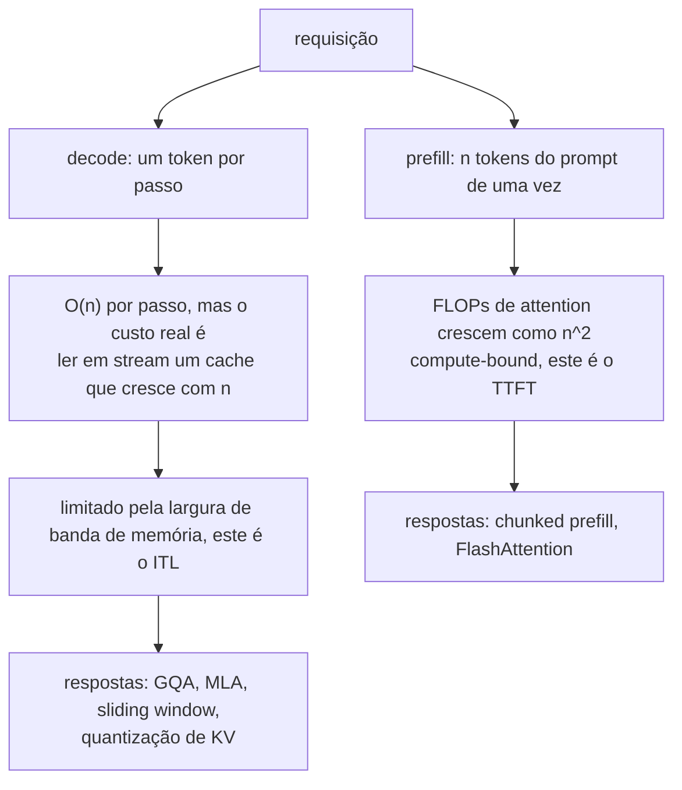

**Follow-ups:** Por que o decode é limitado pela largura de banda de memória - me conduza pela arithmetic intensity? O que a sliding-window attention sacrifica? Por que a FlashAttention não muda a complexidade assintótica de FLOPs?

</details>

### 25. Explique a ideia central da FlashAttention. O que ela otimiza e o que ela não muda?

<details><summary><b>Resposta</b></summary>

O insight da FlashAttention é que a attention padrão é limitada não por FLOPs, mas por **tráfego de memória**: a implementação ingênua materializa a matriz de scores n×n na HBM da GPU, escreve-a, lê-a de volta para o softmax, escreve as probabilidades, lê-as de novo para multiplicar por V. O compute da GPU supera de longe a largura de banda da HBM, então o kernel passa seu tempo esperando a memória. A FlashAttention é uma reimplementação **IO-aware e exata** - mesma matemática, movimentação de memória radicalmente menor.

Três mecanismos:

1. **Tiling**: dividir Q, K, V em blocos dimensionados para caber na SRAM on-chip (ordens de magnitude mais rápida que a HBM). Calcular a attention bloco a bloco, mantendo produtos intermediários on-chip, fundindo o cálculo de scores, o softmax e a multiplicação por V em um único kernel.
2. **Online softmax**: o softmax normalmente precisa da linha inteira (para o máximo e o normalizador) antes de qualquer saída. O truque de streaming mantém um máximo corrente e uma soma corrente conforme os blocos chegam, reescalando resultados parciais anteriores quando o máximo é atualizado - matematicamente exato, sem nunca precisar da linha inteira. Esta é a peça que torna o tiling possível.
3. **Recomputação no backward**: em vez de armazenar a matriz de probabilidades n×n para a backward pass, armazene apenas as estatísticas por linha (máximo, normalizador) e recompute blocos de attention na hora. FLOPs extras, muito menos IO - um trade favorável em hardware moderno.

Resultados: o footprint de memória da attention cai de O(n²) para O(n), speedups de tempo de relógio de ~2-4× em formatos típicos, e treinamento/inferência de long-context se torna prático. FlashAttention-2/3 refinam a paralelização e exploram hardware mais novo (execução assíncrona do Hopper, fp8), e a FlashAttention-4 (2026) redesenha o kernel para Blackwell, onde o throughput dos tensor cores superou as unidades de softmax e de memória ao redor.

O que ela **não** muda: a contagem de FLOPs continua O(n²) - o prefill continua quadrático em compute; não é attention esparsa, linear ou aproximada. E ela não encolhe o KV cache - esses são problemas ortogonais resolvidos por GQA/MLA/quantização. Armadilha comum de entrevista: chamar a FlashAttention de aproximação. Ela é, bit a bit, a mesma attention (a menos de reordenação de ponto flutuante), que é exatamente por que a adoção foi universal - não havia tradeoff de qualidade para litigar.

**Vale desenhar.** Contrastar o tráfego de memória nas duas versões deixa óbvio que a matemática nunca mudou.

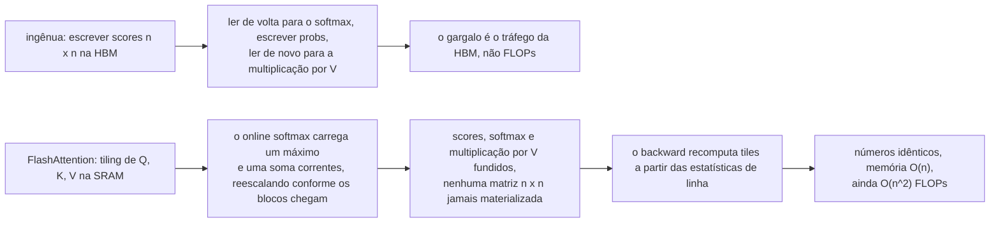

**Follow-ups:** Conduza-me pelo reescalonamento do online softmax. Por que recomputar é mais rápido que armazenar a matriz? Como a FlashAttention interage com a causal masking?

</details>

### 26. Como funcionam os positional encodings sinusoidais, e como se comparam aos positional embeddings aprendidos?

<details><summary><b>Resposta</b></summary>

A self-attention é invariante a permutação, então a posição precisa ser injetada explicitamente. O transformer original somou **encodings sinusoidais** aos token embeddings: para a posição pos e o par de dimensões i, PE(pos, 2i) = sin(pos / 10000^(2i/d)) e PE(pos, 2i+1) = cos(pos / 10000^(2i/d)). Cada par de dimensões oscila em uma frequência diferente, espaçadas geometricamente do comprimento de onda 2π até ~10000·2π - como um contador binário em forma contínua, ou ponteiros de relógio girando em velocidades diferentes. Dimensões de baixa frequência distinguem a posição grosseira; dimensões de alta frequência distinguem tokens adjacentes.

Duas propriedades elegantes: nenhum parâmetro aprendido (funciona para qualquer posição, inclusive as nunca vistas no treinamento - em teoria), e para qualquer offset fixo k, PE(pos+k) é uma *função linear* de PE(pos) - uma rotação em cada par de frequência - de modo que offsets relativos são, em princípio, fáceis para a attention calcular. Na prática, a extrapolação além dos comprimentos treinados ainda se degrada, porque o modelo nunca aprendeu a *usar* as combinações não vistas.

Os **embeddings absolutos aprendidos** (GPT-2, BERT): apenas uma tabela de embedding indexada pela posição, somada aos token embeddings. Mais simples, deixa o modelo aprender qualquer estrutura posicional que ajude, e empiricamente igualou o sinusoidal nos comprimentos treinados. Limitações rígidas: a tabela tem tamanho fixo - a posição 1025 simplesmente não tem embedding em um modelo treinado com 1024 - e cada índice de posição é treinado apenas tantas vezes quanto aparece, então posições tardias são sub-treinadas.

Ambos compartilham uma fraqueza mais profunda: codificam posição **absoluta**, enquanto a linguagem se importa principalmente com posição **relativa** ("o adjetivo antes deste substantivo"), e somar posição ao *embedding* emaranha conteúdo com posição por todo o residual stream. Isso motivou a geração moderna de métodos que injetam posição *relativa* diretamente no cálculo da attention - RoPE (rotacionar Q/K por posição, de modo que os scores dependam do offset) e ALiBi (bias de penalidade por distância nos scores) - que é o que os modelos atuais realmente usam. Os embeddings absolutos sinusoidais/aprendidos são hoje principalmente de importância histórica e conceitual.

**Follow-ups:** Por que a posição relativa é mais útil que a absoluta para linguagem? Mostre por que um offset fixo é uma transformação linear de um encoding sinusoidal. Por que somar posição aos embeddings emaranha conteúdo e posição, e por que isso importa?

</details>

### 27. Explique o RoPE. Qual a intuição da rotação e por que ele se tornou o padrão?

<details><summary><b>Resposta</b></summary>

O Rotary Position Embedding injeta posição **rotacionando** os vetores de query e key em vez de somar algo aos embeddings. Emparelhe as dimensões de cada head (dim 0-1, 2-3, ...) e trate cada par como um vetor 2D; para um token na posição m, rotacione o par i pelo ângulo m·θ_i, onde θ_i = 10000^(−2i/d) dá frequências espaçadas geometricamente - pares que giram rápido codificam posição fina/local, pares que giram devagar codificam posição grosseira/de longo alcance.

O ganho está no que acontece no produto escalar. Rotações preservam normas, e o ângulo entre uma query rotacionada por m·θ e uma key rotacionada por n·θ muda exatamente por (m−n)·θ. Então o attention score entre as posições m e n depende apenas do seu **offset relativo m − n** (e dos vetores de conteúdo) - codificação de posição relativa, obtida multiplicativamente, com zero parâmetros aprendidos, aplicada apenas a Q e K (V é deixado em paz; a saída não carrega contaminação posicional). A intuição dos ponteiros de relógio: cada par de dimensões é um ponteiro girando em sua própria taxa conforme a posição avança; a attention compara a *diferença* nas leituras do relógio entre dois tokens.

Por que venceu (Llama, Qwen, Mistral, a maioria dos modelos abertos modernos - e é a suposição por trás da maior parte das ferramentas de long-context):

- A posição relativa corresponde ao que a linguagem precisa, sem os termos extras de attention que esquemas de posição relativa mais antigos (T5 bias, Shaw et al.) exigiam.
- Sem parâmetros, sem teto de comprimento de tabela de posições; compatível com KV caching (o K de cada token é rotacionado uma vez por sua posição absoluta e depois armazenado em cache - o comportamento relativo emerge no produto escalar).
- A dependência decrescente entre tokens com a distância surge naturalmente nas configurações de frequência padrão.
- Crucialmente, revelou-se **extensível**: como a posição vive em ângulos de rotação, a extensão de contexto vira cirurgia de frequência - position interpolation, NTK-aware scaling e YaRN funcionam reescalando θ ou as posições, o que é muito mais limpo do que retrofitar uma tabela de embedding.

Limitação: o RoPE vanilla ainda se degrada bruscamente além do comprimento treinado - faixas de ângulo não vistas estão fora da distribuição - que é exatamente o que os métodos de extensão endereçam.

**Vale desenhar.** As duas rotações se encontrando em um produto escalar são o esboço de prova inteiro em uma imagem.

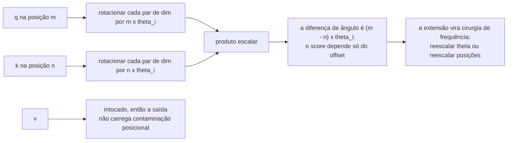

**Follow-ups:** Prove que o score depende apenas de m−n para um único par 2D. Por que o RoPE é aplicado a Q e K mas não a V? Como a position interpolation e o YaRN manipulam as frequências do RoPE?

</details>

### 28. Como o ALiBi codifica posição, e qual é a sua fama?

<details><summary><b>Resposta</b></summary>

O ALiBi (Attention with Linear Biases) usa **nenhum positional embedding**. Em vez disso, soma uma penalidade estática diretamente aos attention scores, proporcional à distância entre query e key: score(i, j) += −slope · (i − j) para j ≤ i. Cada head recebe um slope diferente, fixo (não aprendido), tirado de uma sequência geométrica (por exemplo, 1/2, 1/4, ..., 1/2⁸ para 8 heads) - então algumas heads têm forte viés de recência, efetivamente locais, enquanto heads de slope raso ainda podem atender muito atrás. A posição é expressa puramente como "mais longe = suavemente com menos peso", e o modelo aprende todo o resto a partir do conteúdo.

Sua fama é a **extrapolação de comprimento**: treinar com contexto de 1k - 2k e rodar a inferência em comprimentos muito maiores com muito menos degradação do que modelos sinusoidais, aprendidos ou RoPE vanilla, cujo comportamento colapsa em valores de posição fora da distribuição. O ALiBi não tem posições fora da distribuição - a fórmula do bias é a mesma função linear em qualquer distância - então nada quebra estruturalmente em comprimentos não vistos. É também simples (algumas linhas no kernel de attention), sem parâmetros, e adiciona compute desprezível. MPT e BLOOM foram lançados com ele.

Limitações honestas, que explicam por que o RoPE ainda domina: o viés de recência embutido é um forte prior indutivo - útil para perplexity, mas significa que o retrieval genuinamente de longo alcance precisa lutar contra a penalidade, e empiricamente modelos ALiBi são mais fracos em tarefas de recall de longo alcance do que modelos com RoPE estendido; "não explode no comprimento" não é o mesmo que "usa bem o comprimento". Também é desajeitado combiná-lo com algumas otimizações de attention, e o ferramental do ecossistema se consolidou em torno do RoPE - uma vez que position interpolation e YaRN tornaram o RoPE extensível a baixo custo, a vantagem de destaque do ALiBi importou menos.

Conceitualmente continua sendo um dado importante: a posição relativa pode ser expressa como um *bias no espaço de scores* em vez de conteúdo no espaço de embedding, e o comportamento tipo sliding-window de heads com slope íngreme prefigurou designs explícitos de local attention.

**Follow-ups:** Por que o ALiBi extrapola onde o RoPE não? Qual o custo de um prior de recência para tarefas pesadas em retrieval? Compare o bias do ALiBi com os buckets aprendidos de posição relativa do T5.

</details>

### 29. Um modelo foi pré-treinado com contexto de 8k. Você precisa de 128k. Quais são suas opções? Explique position interpolation e YaRN.

<details><summary><b>Resposta</b></summary>

A falha que você está corrigindo: o RoPE codifica posição como ângulos de rotação, e posições além de 8k produzem combinações de ângulo que o modelo nunca viu - o comportamento da attention se degrada catastroficamente fora da distribuição. Fazer fine-tuning ingênuo em 128k a partir de posições do zero é caro e lento para convergir, então os métodos práticos reescalam o RoPE para que contextos longos caiam dentro (ou perto) da distribuição que o modelo já entende.

**Position interpolation (PI)**: comprimir posições linearmente - para rodar em 32k um modelo treinado com 8k, multiplique cada posição por 1/4 (equivalentemente, reduza as frequências do RoPE) para que toda a faixa seja mapeada em [0, 8k]. Todos os ângulos agora estão na distribuição; o custo é resolução - tokens adjacentes ficam a apenas um quarto de "unidade de posição" de distância, borrando as distinções locais finas que as dimensões de alta frequência forneciam. Um fine-tune curto (ordem de ~1B tokens) recupera a maior parte da qualidade. Simples e eficaz; a precisão local sofre mais com fatores de escala grandes.

**NTK-aware scaling** (a ideia intermediária): em vez de comprimir todas as frequências igualmente, reescale a base do RoPE para que **as dimensões de baixa frequência (comprimento de onda longo) sejam muito interpoladas** enquanto **as de alta frequência ficam quase intactas** - preservando a resolução local enquanto estica a cobertura de longo alcance. Popular porque funciona surpreendentemente bem mesmo *sem* fine-tuning.

O **YaRN** combina e refina isso: divide as dimensões do RoPE em bandas por quantos comprimentos de onda completos cabem no contexto treinado - bandas de alta frequência ficam intocadas (já viram todas as fases; codificam estrutura local), bandas de baixa frequência são totalmente interpoladas (seus ângulos absolutos importam) e uma banda intermediária é suavemente rampada entre as duas - mais um pequeno ajuste de attention-temperature (escalar os logits de attention) que compensa o deslocamento de entropia que contextos mais longos induzem. O YaRN alcança forte qualidade em long-context com aproximadamente uma ordem de magnitude menos dados de fine-tuning que a PI simples, e é a base de muitas variantes long-context de modelos abertos.

Mencione também: modelos long-context de produção tipicamente combinam esse tipo de scaling com **mid-training de long-context** dedicado (continued pretraining em documentos genuinamente longos) - a cirurgia de frequência torna posições longas representáveis; treinar em dependências de longo alcance as torna *utilizáveis*. E verifique com evals de retrieval (needle-in-a-haystack e, melhor, benchmarks de raciocínio multi-fato como suítes estilo RULER) - comprimento anunciado ≠ comprimento utilizável.

**Vale desenhar.** Dividir as frequências em bandas é o que separa uma resposta de YaRN de uma resposta de position interpolation simples.

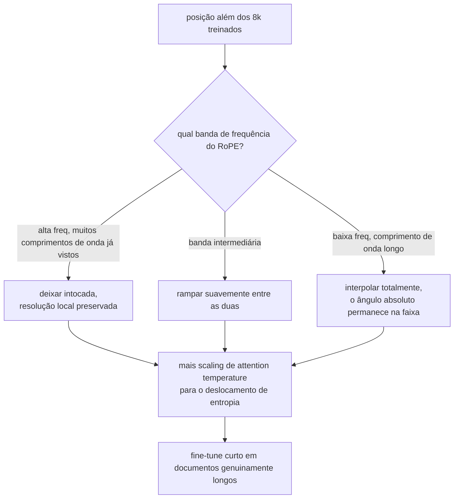

**Follow-ups:** Por que as dimensões de alta frequência do RoPE não precisam de interpolação? Por que a extensão de long-context geralmente ainda exige algum fine-tuning em documentos longos? Como você verificaria o comprimento de contexto utilizável antes de fazer o ship?

</details>

### 30. O que são MQA e GQA, e por que existem?

<details><summary><b>Resposta</b></summary>

Eles existem por causa da memória do KV cache. Na multi-head attention (MHA) padrão, cada uma das h heads tem suas próprias projeções K e V, então o cache armazena h keys e h values por token por camada. O tamanho do cache - não os FLOPs - é a restrição limitante no throughput de serving: ele determina quantas sequências concorrentes cabem em uma GPU (batch size), e a velocidade de decode é limitada por ler o cache da HBM em stream a cada passo. Cortar KV heads ataca ambos.

**MQA (multi-query attention)**, de "Fast Transformer Decoding: One Write-Head is All You Need" de Shazeer: mantém h query heads mas compartilha uma **única** K/V head entre todas elas. O cache encolhe h× (por exemplo, 32×), a largura de banda de decode cai proporcionalmente. Custo: regressão de qualidade mensurável em algumas tarefas, e o treinamento pode ser menos estável - uma única representação K/V precisa atender às necessidades de toda query head.

**GQA (grouped-query attention)**, Ainslie et al.: a interpolação. Particiona as h query heads em g grupos, cada grupo compartilhando uma K/V head - por exemplo, modelos de 70B estilo Llama usam 64 query heads com 8 KV heads (grupos de 8). O cache encolhe 8×, e a qualidade é empiricamente quase indistinguível da MHA. O paper da GQA também mostrou que dá para fazer **uptrain** de um checkpoint MHA existente para GQA fazendo mean-pooling de suas K/V heads e continuando o treinamento brevemente - não é preciso fazer pretraining do zero. A GQA tem sido o padrão na maioria dos modelos abertos desde 2023 (variantes grandes do Llama 2/3, Mistral, Qwen...), com a MLA como principal alternativa nas linhagens DeepSeek e Kimi.

Impacto concreto: um modelo da classe 70B em fp16 com 80 camadas e head_dim 128 armazena ~2,6 MB/token com 64 KV heads versus ~320 KB/token com 8 - a diferença entre caber ~4 e ~30+ sequências longas na mesma memória.

O desdobramento natural é a **MLA** (multi-head latent attention, DeepSeek): comprimir K/V em um vetor latente de baixo rank compartilhado por token e reconstruir K/V por head a partir dele - cortando o cache ainda mais enquanto *aumenta* a diversidade efetiva de heads em relação à GQA. Vale mencionar para mostrar que você sabe aonde essa linha de design foi.

**Vale desenhar.** Query heads de um lado, KV heads do outro: a razão de compartilhamento é o espaço de design inteiro.

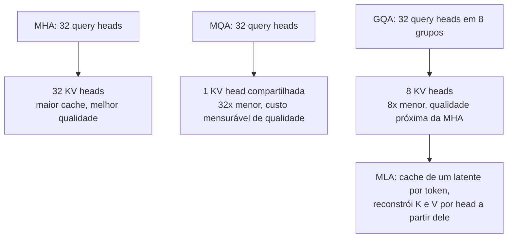

**Follow-ups:** Por que o throughput de decode é limitado pela largura de banda de memória, e como a GQA muda a aritmética? Como funciona a receita de uptraining da GQA? O que a MLA faz de diferente?

</details>

### 31. Derive a fórmula de memória do KV cache e calcule-a para um modelo concreto.

<details><summary><b>Resposta</b></summary>

Derivação a partir do que é armazenado: para cada token, em cada camada, o cache guarda os vetores de key e value daquele token para cada KV head. Um vetor de key (ou value) por head tem head_dim elementos. Então:

**bytes por token = 2 × n_layers × n_kv_heads × head_dim × bytes_per_element**

(2 para K e V; multiplique por seq_len para uma sequência e pelo batch size para um nó de serving.) Note que são **kv** heads - com GQA a contagem de query heads é irrelevante para o cache.

Concreto: um modelo no formato do Llama-3-70B - 80 camadas, 8 KV heads (GQA), head_dim 128, fp16 (2 bytes):

```python
bytes_per_token = 2 * 80 * 8 * 128 * 2      # = 327,680 ≈ 320 KB/token
seq_128k = bytes_per_token * 131_072        # ≈ 42 GB para uma sequência
seq_8k   = bytes_per_token * 8_192          # ≈ 2.7 GB
```

Então uma única conversa de contexto de 128k consome ~40+ GB de memória de GPU *além* dos ~140 GB de pesos em fp16. Com MHA completa (64 KV heads) seria 8× pior: ~2,6 MB/token, ~340 GB em 128k - completamente inservível. Essa única comparação é a justificativa inteira da GQA.

Consequências de engenharia a destacar: (1) capacidade de batch - a memória de cache, não os pesos, limita os usuários concorrentes, então o tamanho do cache define diretamente o custo por requisição; (2) o **PagedAttention** (vLLM) existe porque pré-alocar ingenuamente cache contíguo de comprimento máximo desperdiça a maior parte dele - paginar aloca sob demanda em blocos, como memória virtual; (3) a **quantização de KV** para fp8/int8 reduz isso à metade ou a um quarto com custo modesto de qualidade; (4) o **prefix caching** compartilha o cache de prefixos de prompt comuns (system prompts, exemplos few-shot) entre requisições - economia enorme para cargas agentic que reenviam repetidamente conversas crescentes; (5) speculative decoding, beam search e sampling paralelo multiplicam a pressão de cache.

Hábito de sanity-check: memorize a fórmula, não os números de modelos - entrevistadores variam a arquitetura e querem ver você calcular.

**Vale desenhar.** Escrever a cadeia de multiplicações permite recalcular ao vivo quando o entrevistador muda a arquitetura na sua frente.

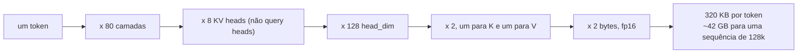

**Follow-ups:** Como o PagedAttention reduz o desperdício, e que problema a fragmentação causa? Em um nó 8×80 GB servindo este modelo, quantas sequências concorrentes de 32k tokens cabem depois dos pesos? Como a sliding-window attention muda a fórmula?

</details>

### 32. Explique o min-p sampling e as penalidades de repetition/frequency. Quando as configurações padrão de sampling falham?

<details><summary><b>Resposta</b></summary>

O **Min-p** mantém apenas os tokens cuja probabilidade é pelo menos min_p × p_max (a probabilidade do token de topo), depois renormaliza e faz sampling. O limiar *escala com a confiança do modelo*: se o token de topo tem p = 0,9, min_p = 0,1 mantém apenas tokens acima de 0,09 - essencialmente só a cabeça; se o token de topo tem p = 0,1 (incerteza genuína), tokens acima de 0,01 sobrevivem - diversidade ampla e apropriada. Contraste com o top-p, cujo critério de massa acumulada se degrada em temperature alta: distribuições achatadas empurram o nucleus fundo na cauda de lixo. O min-p permanece ancorado no melhor token, e é por isso que permite sampling estável em temperaturas como 1,5-3 onde a saída do top-p desmorona - popular em comunidades de escrita criativa e de modelos abertos, com suporte em vLLM e llama.cpp.

As **penalidades da família repetition** existem porque modelos autorregressivos têm um loop auto-reforçado: texto repetido aumenta a probabilidade de repetir ainda mais, e o decoding greedy/de baixa temperature pode travar em ciclos. Três variantes padrão: **repetition penalty** (dividir/multiplicar os logits de tokens já vistos por um fator como 1,1-1,3), **frequency penalty** (subtrair uma quantidade proporcional à contagem do token até agora - pune progressivamente o reuso pesado) e **presence penalty** (subtração fixa para qualquer token que já tenha aparecido - empurra novidade de tópico). APIs estilo OpenAI expõem as duas últimas.

**Quando as configurações padrão falham** - a parte que mostra experiência em produção:

- **Saída estruturada/código com penalidades ligadas**: o JSON precisa repetir `"`, `{`, `,`, nomes de campos; o código precisa de identificadores e tokens de indentação repetidos. Penalidades de repetição corrompem exatamente esses - uma causa clássica de JSON malformado. Desligue-as (ou quase) para geração estruturada; use constrained decoding.
- **Temperature alta + top-p**: incoerência por sampling da cauda - mude para min-p ou reduza T.
- **T = 0 para geração longa de texto livre**: loops de repetição - a coisa para a qual as penalidades foram inventadas.
- **Presence penalty agressiva em conversas longas**: o modelo começa a evitar termos de domínio necessários que já usou.
- Além disso: as penalidades se aplicam a *token IDs*, não a palavras - elas não enxergam que "dog" e " dog" são a mesma palavra, outro vazamento de tokenization.

**Follow-ups:** Por que o top-p especificamente se desfaz em temperature alta? Como você geraria JSON garantidamente válido - configurações de sampling ou constrained decoding? Por que as penalidades de repetição operam sobre tokens e não sobre palavras, e que artefatos isso causa?

</details>

### 33. O que são logprobs, e para que servem em sistemas de produção?

<details><summary><b>Resposta</b></summary>

Um logprob é o log da probabilidade que o modelo atribuiu a um token - log softmax(z) - em um dado passo. APIs (por exemplo, `logprobs`/`top_logprobs` da OpenAI) podem retornar, por token de saída, seu logprob mais os top-k tokens alternativos e os deles. São o mais próximo que você obtém da confiança interna do modelo, e são de graça - sem forward pass extra.

Usos em produção:

- **Classificação com confiança.** Formule a tarefa de modo que a resposta seja um único token ("yes"/"no", "A" - "D"); o logprob é um confidence score. Roteie casos de baixa confiança para um modelo maior, um humano ou um caminho de abstenção. Esta é a forma mais limpa de obter scores quase calibrados de um classificador LLM e de definir limiares de precision/recall como em um sistema de ML normal.
- **Heurísticas de hallucination/incerteza.** Logprobs baixos ou com entropia espalhada em spans portadores de conteúdo (nomes, números, datas) sinalizam prováveis fabricações. Não é garantia - modelos podem estar confiantemente errados - mas é um sinal utilizável para disparar verificação ou checagem de citations.
- **Reranking e scoring.** Pontue completions candidatas, passagens de retrieval ou opções de múltipla escolha pelo logprob total/médio; a perplexity de um documento sob o modelo é um sinal de fluência/anomalia (também muito usado em filtragem de dados de pretraining).
- **Evals.** Avaliação baseada em perplexity; benchmarks de múltipla escolha (pontuar cada opção, escolher o máximo - o truque padrão por trás de muitos harnesses de benchmark) - mais barato e de menor variância do que parsear respostas geradas.
- **Debugging.** Quando a saída fica estranha em um ponto específico, logprobs por token mostram exatamente onde o modelo ficou incerto, e as alternativas top-k mostram o que ele quase fez - inestimável para debugging de prompts e para identificar artefatos de tokenizer.
- **Distillation/trabalho com dados.** Soft targets para treinar modelos menores; filtragem de dados sintéticos baseada em confiança.

Ressalvas que um candidato forte levanta: modelos ajustados com RLHF são notoriamente **mal calibrados** em relação a modelos base (o alinhamento afia distribuições), então trate logprobs como sinais relativos e ajuste limiares nos seus próprios dados; probabilidade em nível de sequência ≠ correção da resposta (muitas formulações compartilham a mesma resposta - sua probabilidade verdadeira está espalhada entre paráfrases); e APIs fechadas podem não expor logprobs em todos os endpoints/modelos, às vezes por razões de prevenção de distillation.

**Follow-ups:** Por que o RLHF prejudica a calibração? Projete um router com limiar de confiança usando logprobs - o que você validaria? Por que a probabilidade de uma *resposta* não é a mesma coisa que a probabilidade de uma *sequência*?

</details>

### 34. Descreva o pipeline moderno de treinamento de LLMs: pretraining → mid-training → SFT → RL.

<details><summary><b>Resposta</b></summary>

**Pretraining** - next-token prediction sobre trilhões de tokens (web crawl, código, livros, papers; fortemente filtrados, deduplicados e ponderados por mistura). É onde a maior parte do compute tradicionalmente foi (meses em milhares de aceleradores) e de onde as capacidades - linguagem, conhecimento, código, raciocínio latente - realmente vêm. Saída: um *base model* que completa texto mas não segue instruções nem conversa; ele pode responder sua pergunta ou continuá-la com mais três perguntas.

**Mid-training** (continued pretraining) - o estágio intermediário bagunçado mas crucial que os labs agora nomeiam explicitamente: ainda é next-token prediction, mas sobre dados deliberadamente curados para objetivos específicos: injetar dados de domínio de alta qualidade (matemática, código, livros-texto sintéticos), **extensão do comprimento de contexto** (documentos longos + reescalonamento do RoPE - long context é uma entrega de mid-training, não um padrão do pretraining) e **annealing** - decair a learning rate sobre os dados de mais alta qualidade, dando mais peso a material em formato de instrução e estilo de prova para que o base model aterrisse mais perto de seu destino pós-treinado.

**SFT (supervised fine-tuning)** - cross-entropy em pares (prompt, resposta) curados, com a loss geralmente mascarada para os tokens de resposta. Ensina formato e comportamento: estrutura de chat, instruction following, sintaxe de tool-call, estilo de recusa, persona. Relativamente minúsculo (ordem de 10⁴ - 10⁶ exemplos) e barato em comparação ao pretraining. Modelo mental-chave: o SFT *elicita e molda* o que o pretraining construiu; adiciona comportamento, não (muito) conhecimento - empurrar fatos novos via SFT tende à memorização e pode até encorajar comportamento com formato de hallucination.

**RL / preference optimisation** - alinhar as saídas com preferências humanas ou verificáveis além do que demonstrações capturam. O **RLHF** clássico: treinar um reward model em pares de preferência humana, otimizar a policy com PPO sob uma coleira de KL para o modelo SFT. **DPO** e sucessores dispensam o reward model explícito, otimizando preferências diretamente - mais simples, mais barato, amplamente usado. **RLVR** (RL from verifiable rewards, por exemplo **GRPO**): a recompensa vem de resultados verificáveis (testes unitários passam, resposta de matemática confere) - é o que treina reasoning models estilo o1/R1 e representa a fronteira atual, porque pode *estender* capacidades em vez de apenas direcionar o estilo.

Enquadramento que funciona bem: pretraining ≈ construir o motor; mid-training ≈ melhorar componentes; SFT ≈ ensiná-lo a dirigir em estradas; RL ≈ treiná-lo contra resultados. Historicamente cada estágio era ordens de magnitude mais barato que o anterior; o RL focado em reasoning estreitou muito essa diferença desde 2025, com orçamentos de RL em alguns labs agora sendo uma fração substancial do pretraining. De qualquer forma, os estágios posteriores determinam desproporcionalmente a qualidade percebida.

**Vale desenhar.** Rotular as arestas com o que cada estágio adiciona evita que os quatro estágios soem como o mesmo estágio.

```mermaid
flowchart LR
    PT["pretraining: trilhões de tokens,<br/>next-token prediction"] -->|"a maior parte do compute"| BM["base model: completa texto,<br/>não conversa"]
    BM -->|"dados curados, documentos longos"| MT["mid-training: mix de domínio,<br/>extensão de contexto, annealing"]
    MT -->|"10^4 a 10^6 pares"| SFT["SFT: formato de chat, instruction following,<br/>sintaxe de tools, estilo de recusa"]
    SFT -->|"preferências ou verificadores"| RL["RL: RLHF e DPO para estilo,<br/>RLVR e GRPO para resultados verificáveis"]
    RL --> SHIP["modelo entregue"]
```

**Follow-ups:** Por que o SFT em fatos novos encoraja hallucination? O que a restrição de KL no RLHF previne? Por que recompensas verificáveis destravaram ganhos de reasoning que o RLHF baseado em preferências não destravou?

</details>

### 35. O que é um attention sink, por que ele existe e o que quebra se você o remover do KV cache?

<details><summary><b>Resposta</b></summary>

Um attention sink é uma posição, quase sempre o primeiríssimo token, que absorve uma grande parcela da massa de attention na maioria das heads e camadas, independentemente de seu conteúdo. Não é um bug e não tem a ver com o token ser importante.

Ele existe porque o softmax precisa somar 1. Uma head que não tem nada relevante a buscar nesta posição ainda precisa colocar todo o seu peso em algum lugar. Ela aprende a despejá-lo em um token que toda posição consegue ver (a posição 0, sob causal masking) e cujo value vector contribui com quase nada. Então o sink é como um modelo expressa "não atender a nada" dentro de um mecanismo sem opção nula.

A consequência prática é a descoberta do StreamingLLM. Se você executa uma evicção ingênua de KV por sliding-window e a janela rola além do token 0, a perplexity não se degrada graciosamente, ela explode. A massa que estava inofensivamente estacionada no sink é redistribuída sobre tokens reais, distorcendo toda distribuição de attention do modelo. A correção é quase constrangedoramente barata: fixar permanentemente o KV dos primeiros ~4 tokens junto com a janela rolante, e a estabilidade é restaurada até milhões de tokens em streaming.

Seja preciso sobre o que isso não faz. Não estende o contexto efetivo. Tokens removidos do meio se foram. Serve para streaming sem fim, uma sessão de chat que nunca termina, não para recall de long-context.

Respostas arquiteturais: treinar com um sink token aprendível dedicado para que o comportamento seja explícito em vez de emergente; ou dar ao softmax uma válvula de escape, seja uma formulação off-by-one com um logit zero extra no denominador, seja um bias aprendido por head, para que as heads não precisem sequestrar um token real para fazer no-op.

A conexão que entrevistadores adoram: as posições de sink carregam enormes outliers de ativação, já que o modelo empurra valores gigantes por dimensões residuais específicas para vencer essa competição. Isso é grande parte do motivo pelo qual a quantização ingênua de ativações fracassa, e liga isso diretamente ao serving.

**Vale desenhar.** A bifurcação na evicção é a parte memorável: um token sai e toda distribuição de attention se desloca.

```mermaid
flowchart TD
    S["o softmax precisa somar 1"] --> NN["uma head sem nada a buscar<br/>ainda precisa colocar sua massa em algum lugar"]
    NN --> T0["token 0: visível a toda posição,<br/>value vector contribui ~ nada"]
    T0 --> EV{"a sliding window rola além do token 0?"}
    EV -->|"removido"| BOOM["a massa cai em tokens reais,<br/>a perplexity explode"]
    EV -->|"primeiros ~4 tokens fixados"| OK["estável ao longo de milhões de tokens em streaming"]
    OK --> NOTE["mas sem recall extra:<br/>os tokens do meio removidos continuam perdidos"]
```

**Follow-ups:** Como um bias de softmax aprendido muda a história da quantização? Você esperaria attention sinks em um modelo encoder-only?

</details>

### 36. Explique a sliding-window attention e os stacks híbridos local/global. O que você ganha e o que você sacrifica?

<details><summary><b>Resposta</b></summary>

A sliding-window attention restringe cada token aos últimos w tokens em vez do prefixo inteiro. O tempo vai de O(n^2) para O(n*w) e, mais importante, o KV cache dessas camadas é limitado a w entradas em vez de crescer com n. O Mistral 7B a popularizou com uma janela de 4096; Gemma 2 e 3 a intercalam com camadas de full attention.

O ponto que candidatos costumam perder: uma pilha de camadas com janela não é tão míope quanto parece, porque o receptive field se compõe com a profundidade exatamente como em uma CNN. Com janela w e L camadas, a informação pode, em princípio, viajar ~L*w posições. Mas a propagação por muitos hops é com perdas e difusa, e qualquer retrieval exato de um único hop, citar uma string situada mais longe que w, simplesmente não pode acontecer em uma camada local.

Daí o padrão moderno: stacks híbridos. Intercalar majoritariamente camadas locais com camadas ocasionais de full attention, por exemplo a razão local-para-global de 5:1 do Gemma 3 com janelas de 1024 tokens. As camadas globais fazem retrieval exato de longo alcance; as camadas locais fazem a maior parte barata do trabalho. Ablações publicadas mostram custo mínimo de perplexity, e a economia de KV em 128k é grande porque apenas 1 camada em 6 tem um cache que escala com n.

O que você sacrifica e o que observar:

- O contexto efetivo de retrieval é governado pelas camadas globais, não pela janela anunciada. A razão é um botão real de qualidade, não é de graça.
- As camadas de full attention restantes se tornam o gargalo de memória, e é por isso que times empilham mais truques exatamente nessas camadas: compartilhamento de KV entre camadas, MLA, quantização de cache.
- Prefix caching e reuso de cache ficam mais complicados quando as camadas têm semânticas de cache heterogêneas.
- Bugs de máscara em camadas locais são silenciosos em contexto curto e só aparecem em contexto longo, então sua suíte de testes precisa de casos longos ou você vai fazer ship disso.

Comparadas a um padrão esparso aprendido, as sliding windows codificam rigidamente a suposição de que a relevância é local. É um bom prior para prosa e um ruim para código com definições distantes, o que é parte do motivo de a esparsidade aprendida ter saído da pesquisa para modelos entregues: a sparse attention do DeepSeek-V3.2 usa um indexer leve para pontuar posições anteriores e deixa cada query atender apenas às de maior score.

**Vale desenhar.** Desenhar o bloco 5:1 mostra exatamente quais camadas ainda carregam um cache que cresce com o contexto.

```mermaid
flowchart LR
    IN["tokens"] --> L1["camada local, janela 1024<br/>cache limitado a w"]
    L1 --> L2["cinco camadas locais seguidas"]
    L2 --> G["uma camada de full attention<br/>cache cresce com n"]
    G --> OUT["repetir o bloco"]
    L2 --> RF["o receptive field se compõe até ~ L x w,<br/>mas a propagação multi-hop tem perdas"]
    G --> EX["retrieval exato de longo alcance<br/>só pode acontecer aqui"]
```

**Follow-ups:** Como você escolheria a razão local-para-global para um modelo de código versus um modelo de chat? O que a sliding-window attention faz com o prefix caching em um agent multi-turn?

</details>

### 37. O que é Multi-head Latent Attention, e como ela realmente difere da GQA?

<details><summary><b>Resposta</b></summary>

A GQA encolhe o KV cache estruturalmente: menos KV heads, compartilhadas entre grupos de query heads. Você está jogando fora diversidade de heads em K e V e torcendo para que não importe muito.

A MLA faz um corte diferente. Projeta o hidden state para baixo em um pequeno vetor latente, faz cache apenas desse latente e reconstrói K e V por head com up-projections aprendidas no momento da attention. Conceitualmente cada head mantém seu próprio K e V; você apenas armazena uma representação comprimida. Veio do DeepSeek-V2 e seguiu para o V3.

Por que não é apenas "GQA com passos extras": as matrizes de up-projection são estáticas, então podem ser algebricamente absorvidas nas projeções de query e de saída. Na inferência você nunca materializa o K completo por head, calcula os scores contra o latente diretamente. Isso faz dela uma vitória genuína de memória, em vez de trocar memória por recomputação. A DeepSeek reportou uma redução de aproximadamente 93% do KV cache em relação ao seu modelo MHA no V2, com qualidade igualando ou superando a GQA em suas ablações, que é a parte incomum: normalmente a compressão de cache te custa algo.

A complicação é o RoPE, e este é o detalhe que separa quem leu o paper de quem leu um resumo. O RoPE aplica uma rotação dependente da posição, e você não consegue absorver uma rotação dependente da posição em uma up-projection estática, então o truque da absorção quebra. A resposta da DeepSeek é o decoupled RoPE: dividir a dimensão da head em uma parte comprimida sem RoPE e uma pequena parte separada que carrega o RoPE, armazenada sem compressão em cache e compartilhada entre heads.

Quando eu a escolheria? Só quando a memória de KV em long context for genuinamente minha restrição limitante e eu controlar o stack de serving. A MLA é materialmente mais difícil de implementar e de fazer sharding sob tensor parallelism, o suporte de kernels (melhorou desde que kernels dedicados de MLA e engines de serving mainstream a adicionaram) ainda é mais estreito que para a GQA, e a vantagem de qualidade reportada aparece principalmente em grande escala. Abaixo de aproximadamente 100B a maioria dos times ainda escolhe GQA, e essa é uma decisão de engenharia defensável: a GQA é simples, suportada em todo lugar e boa o bastante. Complexidade que você não consegue servir tem valor negativo.

**Vale desenhar.** O caminho separado que carrega o RoPE é o detalhe que mostra que você leu o paper e não um resumo dele.

```mermaid
flowchart LR
    H["hidden state"] --> C["down-project para um pequeno latente"]
    C --> CACHE["fazer cache só do latente"]
    CACHE --> UP["as up-projections reconstroem K e V por head"]
    UP --> ABS["estáticas, então absorvê-las em W_q e W_o:<br/>pontuar contra o latente diretamente"]
    H --> RP["pequena fatia que carrega o RoPE, em cache<br/>sem compressão e compartilhada entre heads"]
    ABS --> SC["attention scores"]
    RP --> SC
```

**Follow-ups:** Como a MLA interage com tensor parallelism em comparação com a GQA? Você esperaria que a MLA ou a quantização de KV cache fosse o melhor primeiro movimento em um modelo GQA existente?

</details>

### 38. Por que quantizar ativações é mais difícil que quantizar pesos, e como isso molda escolhas de arquitetura?

<details><summary><b>Resposta</b></summary>

Pesos são estáticos, aproximadamente gaussianos por canal e bem comportados. Você calcula as escalas offline, por canal, uma vez, e segue em frente. Ativações são dinâmicas e dominadas por outliers: um pequeno número de dimensões de feature carrega valores ordens de magnitude maiores que todo o resto, consistentemente nos mesmos canais, e o problema piora com a escala do modelo. Como a escala de quantização é definida pelo máximo, um outlier esmaga todos os outros valores daquele tensor em direção a zero.

De onde vêm os outliers está ligado à arquitetura, e essa é a conexão que vale fazer: attention sinks. Heads que querem fazer no-op empurram valores extremos por dimensões residuais específicas, e os ganhos das norms amplificam canais particulares. O problema da quantização e o problema de o softmax não ter opção nula são o mesmo problema.

Respostas, aproximadamente em ordem de sofisticação:

- Isolá-los. O LLM.int8() mantém as dimensões outlier em fp16 e quantiza o resto. Correto, mas quebra o fast path, então você frequentemente perde a velocidade pela qual veio.
- Mover a dificuldade. O SmoothQuant migra escala das ativações para os pesos com uma equalização por canal, porque os pesos toleram isso. O AWQ usa estatísticas de ativação para identificar canais de pesos salientes e os protege.
- Mudar o formato. O FP8 (E4M3) tem faixa dinâmica muito maior que o INT8 com a mesma largura de bits, que é exatamente o que outliers precisam, e aceleradores modernos têm FP8 nativo. É por isso que os stacks de serving em grande parte foram para FP8 em vez de lutar com INT8, e hardware classe Blackwell leva a mesma lógica a formatos de ponto flutuante de 4 bits (MXFP4, NVFP4) que combinam elementos minúsculos com escalas de bloco de granularidade fina.
- Projetar para isso. QK-norm, um bias de softmax aprendido para que as heads tenham uma opção real de no-op, e treinar nativamente em baixa precisão (o DeepSeek-V3 reportou pretraining em FP8) atacam a causa em vez do sintoma.

A quantização de KV cache é um eixo separado e geralmente a vitória mais barata em long-context, já que em 128k o cache supera os pesos. Assimetria que vale conhecer: o K tem outliers persistentes por canal que o V não tem, e o RoPE complica ainda mais o K ao misturar pares de canais (alguns métodos quantizam as keys antes de o RoPE ser aplicado por esse motivo), então os stacks comumente quantizam V mais agressivamente que K, ou usam escalas por canal para K e por token para V.

**Follow-ups:** Você quantiza pesos para 4 bits e não vê queda em benchmark. O que te faria desconfiar desse resultado? Por que a quantização prejudica mais gerações longas do que curtas?

</details>

### 39. Um vendor anuncia 1M de contexto com 100% em needle-in-a-haystack. O que isso de fato provou, e como você avaliaria long context corretamente?

<details><summary><b>Resposta</b></summary>

Prova que o modelo consegue recuperar um span lexicalmente distintivo de um haystack de resto não relacionado. Isso é quase a tarefa de long-context mais fácil que existe. A agulha está fora da distribuição em relação ao enchimento, então a attention a encontra por contraste, não por compreensão. Saturar o NIAH é evidência necessária, mas muito fraca. É um smoke test, e tratá-lo como uma afirmação de capacidade é o erro.

O que ele não testa:

- Múltiplas agulhas, e agulhas que precisam ser combinadas entre posições separadas (multi-hop).
- Agregação sobre o contexto inteiro: contar, ordenar ou resumir toda menção. A retrieval attention não consegue atalhar isso, e a acurácia despenca muito mais cedo aqui do que no NIAH.
- Distratores. Corpora reais estão cheios de passagens quase duplicadas e contraditórias. Uma única agulha única em enchimento não relacionado não se parece em nada com seus documentos reais.
- Negativos. O modelo consegue dizer que o fato não está presente? Um modelo treinado para sempre encontrar algo inventará uma agulha, e o NIAH nunca mede isso.
- Raciocínio sobre o conteúdo recuperado em vez de citá-lo.

O que eu realmente construiria: um eval em nossos próprios documentos nos nossos comprimentos reais, com queries multi-fato e multi-hop, distratores difíceis minerados do corpus, uma parcela significativa de perguntas sem resposta para obter uma taxa de falsos positivos, pelo menos uma tarefa de agregação de contexto completo, e uma varredura por profundidade e comprimento para obter uma curva de degradação em vez de um único número. A saída que quero é o contexto efetivo: o comprimento em que a acurácia cruza nossa barra. Suítes públicas das quais vale tomar a estrutura emprestada são o RULER, que gera tarefas sintéticas de dificuldade variável e consistentemente coloca o contexto efetivo bem abaixo do contexto anunciado, suítes de tarefas realistas da família LongBench e o BABILong para multi-hop.

Depois a economia. O prefill é quadrático e a memória de KV é linear no comprimento. Se o contexto efetivo é 32k, pagar para enfiar 1M de tokens é comprar latency e custo para obter uma resposta pior do que um bom retrieval daria. Long context não aposenta o RAG; muda o tamanho do chunk.

**Follow-ups:** Como você construiria distratores difíceis automaticamente a partir do corpus de um cliente? O que uma taxa de falsos positivos em perguntas sem resposta te diz que a acurácia não diz?

</details>

### 40. O que é multi-token prediction como objetivo de treinamento, e o que ele te dá?

<details><summary><b>Resposta</b></summary>

Em vez de uma única head prevendo o token t+1, a multi-token prediction adiciona heads ou módulos que também preveem t+2, t+3 e assim por diante a partir do mesmo trunk, treinados com losses auxiliares. Há dois ganhos e eles são bem diferentes em caráter.

Primeiro, melhores representações. Forçar o hidden state na posição t a codificar informação sobre vários tokens futuros empurra o modelo a planejar um pouco à frente em vez de otimizar um sinal greedy puramente local. Gloeckle et al. (2024) descobriram que os ganhos crescem com a escala do modelo e são maiores em código e benchmarks generativos, e, notavelmente, que pode prejudicar modelos pequenos. Essa dependência de escala é o motivo de não ser universal.

Segundo, e mais concretamente valioso, um draft model de graça. As heads extras são um draft de speculative-decoding que compartilha o trunk, custa quase nada e é, por construção, casado em distribuição com o target, que é a coisa que normalmente limita a taxa de aceitação. O DeepSeek-V3 treina um módulo MTP e o reutiliza na inferência exatamente assim, reportando uma alta taxa de aceitação para o próximo token previsto. Esta é a ideia do Medusa e do EAGLE incorporada ao pretraining em vez de acoplada depois.

Detalhes de design que importam: a versão da DeepSeek é sequencial, cada módulo condicionando na predição do módulo anterior, em vez das heads paralelas independentes da formulação original. Isso mantém a cadeia causal intacta e melhora a aceitação, ao custo de algum paralelismo. As heads também podem simplesmente ser descartadas na inferência, então, se você só quer o benefício de representação, o custo é apenas em training time.

Tradeoffs: parâmetros e memória extras durante o treinamento, mais um hiperparâmetro de ponderação de loss para ajustar, e um benefício que depende tanto da escala que você precisa da sua própria ablação em vez de uma citação. E eu seria honesto que a história do "ele aprende a planejar" é contestada; parte da melhora pode ser apenas um sinal de treinamento mais denso agindo como regularização. O ganho de speculative-decoding, ao contrário da alegação de planejamento, é inequívoco e fácil de medir.

**Vale desenhar.** Um trunk alimentando várias heads torna a afirmação do draft model grátis autoevidente.

```mermaid
flowchart LR
    TR["trunk compartilhado, posição t"] --> H1["head: prever t+1"]
    TR --> H2["módulo: prever t+2,<br/>condicionado em t+1"]
    H2 --> H3["módulo: prever t+3"]
    H1 --> LOSS["losses auxiliares, só no treinamento"]
    H2 --> LOSS
    H3 --> LOSS
    H2 --> SD["na inferência: um draft que compartilha o trunk<br/>e é casado em distribuição por construção"]
```

**Follow-ups:** Por que uma draft head de MTP alcança aceitação maior que um draft model de 1B treinado separadamente? Como você ponderaria as losses auxiliares entre as heads t+2, t+3?

</details>

### 41. Mamba e state-space models deveriam substituir os transformers. O que realmente aconteceu, e por quê?

<details><summary><b>Resposta</b></summary>

Eles não substituíram os transformers, foram absorvidos em híbridos. A razão é a ilustração mais limpa do tradeoff central em modelagem de sequências, e é por isso que a pergunta é feita.

Mecanismo: uma camada SSM ou de linear attention carrega um estado recorrente de tamanho fixo. A inferência por token é O(1) em tempo e memória independentemente da posição, sem KV cache crescendo com n. A contribuição específica do Mamba (S6) foi tornar a transição de estado dependente da entrada, algo que os SSMs anteriores não tinham, mantendo um parallel scan para que o treinamento ainda paralelize ao longo da sequência.

O problema é teórico-informacional e nenhuma quantidade de engenharia o conserta. Um estado de tamanho fixo não consegue reter sem perdas um prefixo arbitrariamente longo. O KV cache de um transformer é um registro crescente e sem perdas, que é precisamente por que ele consegue citar uma string exata de 100k tokens atrás. Um SSM precisa decidir no momento da escrita o que manter, antes de saber o que será perguntado. Então SSMs são competitivos em perplexity de language modelling e em agregação, e mensuravelmente mais fracos em recall exato, cópia e retrieval in-context. Sondas de multi-query associative recall mostraram isso cedo e claramente. Essa fraqueza é fatal para a coisa para a qual as pessoas mais querem long context.

Daí os híbridos, onde o campo de fato aterrissou: manter uma pequena fração de camadas de full attention, de aproximadamente 1 em 4 até cerca de 1 em 10 ou menos em modelos entregues como Jamba, Zamba, Nemotron-H, Qwen3-Next e Kimi Linear, para retrieval exato, e fazer todo o resto linear ou SSM. Você obtém crescimento de memória quase plano no comprimento de contexto e throughput de long-context muito melhor com qualidade próxima à de um transformer. A estrutura espelha a attention híbrida local/global, e pelo mesmo motivo: poucas camadas exatas mais muitas baratas.

Ressalvas práticas em 2026: o suporte de kernels e de serving é mais escasso que para attention; a semântica de prefix caching difere, porque você está fazendo cache de um estado recorrente que não é fatiável nem reutilizável como um KV cache, o que importa muito para cargas de agents; e a comparação pública mais bem controlada (o estudo de 2024 da NVIDIA treinando transformer, Mamba-2 e modelos híbridos em 8B com dados idênticos) favoreceu o híbrido, mas nada equivalente existe em escala frontier, então a escolha de arquitetura continua sendo em parte convicção mais suas próprias ablações.

**Vale desenhar.** Ponha o estado fixo e o cache crescente lado a lado e o híbrido se desenha sozinho como a consequência óbvia.

```mermaid
flowchart LR
    A["camada SSM: estado recorrente de tamanho fixo"] --> B["O(1) por token, nada cresce com n"]
    A --> C["precisa decidir o que manter no momento da escrita,<br/>antes de saber a pergunta"]
    D["camada de attention: KV cache"] --> E["registro crescente sem perdas,<br/>consegue citar uma string de 100k atrás"]
    D --> F["a memória cresce linearmente com n"]
    C --> HY["híbrido: 1 camada de attention<br/>a cada 4 a 10 mais ou menos"]
    E --> HY
    HY --> R["crescimento de memória quase plano,<br/>retrieval exato preservado"]
```

**Follow-ups:** Por que o prefix caching fica mais difícil com um estado recorrente do que com um KV cache? Para um agent fazendo longas trajetórias de tool-use, você escolheria um híbrido ou um transformer puro?

</details>

### 42. Reasoning models expõem uma configuração de thinking budget ou reasoning effort. Como você a ajusta, e o que dá errado?

<details><summary><b>Resposta</b></summary>

Trate-a como um botão explícito de acurácia versus custo e latency, e calibre-o por tarefa com um eval em vez de por intuição. O formato é uma curva saturante: a acurácia sobe abruptamente nos primeiros tokens de thinking, achata e, em tarefas fáceis, pode até declinar.

Primeiro, saiba qual controle você tem, porque eles se comportam de forma diferente:

- Um teto rígido de tokens imposto no decode. O modelo é cortado e forçado a responder, o que pode truncar no meio de uma derivação e produzir algo pior do que nenhum thinking.
- Um control token treinado ou nível de effort que o modelo foi treinado com RL para respeitar, que é um budget suave em torno do qual ele planeja e se degrada graciosamente.
- Uma dica no prompt como "think briefly", que os modelos seguem de forma pouco confiável.

O que eu faço:

- Construo um eval em nível de tarefa, varro o budget, plotar accuracy e p95 latency juntos e escolho o joelho. Tarefas diferentes têm joelhos extremamente diferentes. Extração e classificação geralmente querem zero.
- Faço routing em vez de escolher uma única configuração. Um classificador barato envia a fatia difícil para effort alto e todo o resto para baixo ou desligado. A maior parte do tráfego de produção não precisa de thinking, e pagar por isso uniformemente é a maneira mais comum de os times gastarem demais aqui.
- Observo o overthinking, que é uma falha real e mensurável: em problemas fáceis, cadeias longas convencem o modelo a abandonar uma resposta inicial correta. Observo também o modelo queimando todo o seu budget em um problema mal especificado em vez de fazer uma pergunta.
- Respeito o modelo de custo. Tokens de thinking são cobrados como tokens de saída, tokens de saída são os caros, e são gerados em série, então o budget se mapeia quase linearmente em latency. Um budget 10x é aproximadamente um impacto de 10x de latency naquela chamada.
- Não planejo em torno de lê-los. Provedores comumente resumem, criptografam ou removem os traces, e se o reasoning anterior é carregado para turnos posteriores (tipicamente devolvido como itens de reasoning opacos ou criptografados durante tool use) é específico do provedor e muda entre versões de API, então construir lógica que inspeciona o conteúdo de reasoning é construir sobre areia.

A resposta que reprova nesta pergunta é "configure alto para qualidade". Isso não é um tradeoff, é uma conta.

**Vale desenhar.** Reformula a resposta como routing e calibração em vez de escolher um número e defendê-lo.

```mermaid
flowchart TD
    R["requisição recebida"] --> CL{"classificador barato: isto merece thinking?"}
    CL -->|"não: extração, classificação, formatação"| OFF["thinking desligado, fast path"]
    CL -->|"sim: multi-etapa, verificável"| HI["budget de effort alto"]
    HI --> EV["varrer o budget em um eval da tarefa,<br/>plotar acurácia contra p95 latency"]
    EV --> KNEE["entregar o joelho, não o máximo"]
    KNEE --> W["observar overthinking, e tetos rígidos<br/>truncando no meio da derivação"]
```

**Follow-ups:** Como você construiria o router que decide quais requisições recebem effort alto? O que você monitoraria em produção para detectar que o budget escolhido saiu de calibração?

</details>

### 43. O que é a reversal curse, e o que ela revela sobre como os LLMs armazenam conhecimento?

<details><summary><b>Resposta</b></summary>

A reversal curse (Berglund et al., 2023) é a descoberta de que um modelo treinado em "A is B" não aprende automaticamente "B is A". Faça fine-tuning de um modelo em afirmações como "Daphne Barrington is the director of 'A Journey Through Time'" e ele responde "Who is Daphne Barrington?" mas não se sai melhor que o acaso em "Who directed 'A Journey Through Time'?". A mesma assimetria aparece em fatos reais: modelos nomeiam o pai ou a mãe de uma celebridade de forma muito mais confiável do que nomeiam o filho famoso desse pai ou mãe.

Por quê: a next-token prediction só treina a direção em que o texto foi escrito. O gradiente de "A is B" fortalece o caminho da representação de A para os tokens de B, e nada nessa atualização ensina o modelo a recuperar A dado B. Isso se encaixa na imagem das camadas FFN como memórias chave-valor: o fato é armazenado sob uma chave construída a partir do sujeito, e um lookup indexado pelo objeto não encontra nada. O conhecimento paramétrico é um conjunto de associações direcionadas, não um banco de dados simétrico.

A distinção que importa: in context, os modelos revertem sem problemas. Ponha "A is B" no prompt e pergunte quem é B, e o modelo responde, porque a attention consegue ler o contexto em qualquer ordem. A maldição diz respeito ao conhecimento armazenado nos pesos, que é a mesma divisão que você vê entre knowledge editing e retrieval.

Consequências práticas:

- Não assuma que fazer fine-tuning de um fato ensina seu inverso ou suas consequências. É a mesma falha dos ripple effects em knowledge editing.
- Se você injeta conhecimento por fine-tuning, declare cada fato nas duas direções e em várias formulações. Apenas parafrasear não resolveu nos experimentos originais; incluir explicitamente a direção reversa, ou treinar em texto invertido, ajuda.
- Fatos famosos frequentemente sobrevivem nas duas direções apenas porque o pretraining os viu escritos de ambas as formas.
- É mais um argumento a favor de retrieval quando os fatos precisam ser consultáveis de ângulos arbitrários.

É também um antídoto útil contra o antropomorfismo. Uma pessoa que aprende "A is B" obtém "B is A" de graça. Um modelo precisa tê-lo visto.

**Follow-ups:** Por que a reversão funciona in context quando falha nos pesos? Como você estruturaria dados de fine-tuning para que um conjunto de fatos de produto seja recuperável a partir de qualquer direção? Você esperaria que um encoder bidirecional mostrasse a mesma assimetria?

</details>

## Avançado

### 44. O que é "lost in the middle", e por que uma context window longa não equivale a retrieval confiável?

<details><summary><b>Resposta</b></summary>

"Lost in the middle" (Liu et al., 2023) é a descoberta empírica de que os modelos recuperam e usam melhor a informação quando ela está no **início ou no fim** do contexto, com uma queda pronunciada de acurácia para conteúdo no meio - uma curva em formato de U, demonstrada em tarefas de QA multi-documento e de retrieval chave-valor. Surpreendentemente, isso valeu até para modelos explicitamente construídos para contextos longos - variantes de contexto estendido não foram melhores em usar informação do meio do contexto do que suas irmãs de contexto curto nas mesmas posições.

Por que acontece (mecanismos plausíveis, vale apresentá-los como tal): os dados de treinamento têm estrutura posicional - conteúdo importante se agrupa no início dos documentos (manchetes, abstracts) e a recência importa para a next-token prediction, então a attention aprende priors de primazia e recência; a massa de attention também se concentra nos primeiros tokens ("attention sinks") e nos tokens recentes por construção. Some a assimetria da causal masking e não há pressão durante o pretraining para ponderar uniformemente o meio de uma janela de 100k tokens.

Por que long context ≠ retrieval - as conclusões de engenharia:

- **Anunciado ≠ utilizável.** Um modelo que aceita 1M de tokens não é uma promessa de recall uniforme sobre 1M de tokens. Testes de needle-in-a-haystack são o caso *fácil* (retrieval literal de uma string distintiva); tarefas realistas - agregar vários fatos do meio do contexto, raciocinar entre eles, resistir a distratores - se degradam muito mais cedo, que é o que suítes mais difíceis (estilo RULER, multi-needle, benchmarks de raciocínio long-form) mostram.
- **O RAG sobrevive ao long context.** Retrieval + curadoria colocam os 2k tokens relevantes onde o modelo tem melhor desempenho, por uma fração do custo de prefill e da latency de enfiar 500k tokens por query - prefill quadrático e preço por token tornam o contexto de força bruta economicamente dominado mesmo quando a qualidade se mantém.
- **Prompting ciente de posição importa**: coloque instruções e o material mais crítico no início e no fim; reafirme restrições-chave perto do fim em transcrições agentic longas; resuma/compacte históricos longos em vez de deixá-los crescer.

Nuance para 2026: modelos frontier melhoraram substancialmente o recall do meio do contexto - o efeito encolheu, não desapareceu - e continua pior em tarefas do tipo agregação. Verifique contra a sua própria carga de trabalho; não assuma nem a patologia de 2023 nem as alegações dos vendors.

**Follow-ups:** Como você projetaria um eval para o comprimento de contexto *utilizável* na sua carga de trabalho? Por que os resultados de needle-in-a-haystack superestimam a capacidade de long-context? O que são attention sinks e como se conectam?

</details>

### 45. Compare as scaling laws de Kaplan e de Chinchilla. O que o Chinchilla mudou?

<details><summary><b>Resposta</b></summary>

Ambas ajustam power laws relacionando loss a tamanho do modelo (N), dados (D) e compute (C ≈ 6ND para treinamento) - a conclusão compartilhada e estrutural sendo que a loss melhora de forma previsível e suave como uma power law ao longo de muitas ordens de magnitude, o que torna racional apostar centenas de milhões em um treinamento.

**Kaplan et al. (2020, "Scaling Laws for Neural Language Models")** concluíram que, para um orçamento de compute fixo, você deveria escalar **parâmetros muito mais rápido que dados** - a maior parte do compute incremental vai para um modelo maior. O campo seguiu: GPT-3 (175B em ~300B tokens) e Gopher (280B em 300B tokens) têm o formato Kaplan - modelos enormes, comparativamente poucos dados.

O **Chinchilla (Hoffmann et al., 2022)** refez a análise com uma correção crucial: os experimentos de Kaplan tinham usado um cronograma de learning rate aproximadamente fixo (e curto demais, não otimizado) entre as execuções, subtreinando os modelos menores e enviesando o ajuste para "parâmetros importam mais". Com cronogramas ajustados por orçamento de compute (mais análises IsoFLOP e um ajuste paramétrico de loss), a resposta corrigida: **escalar N e D aproximadamente igualmente** - o compute-optimal é aproximadamente **~20 tokens por parâmetro**. A demonstração: o Chinchilla, 70B de parâmetros em 1,4T tokens, mesmo compute do Gopher (280B/300B), superou-o em todos os aspectos. Os modelos flagship do campo eram 3-4× superdimensionados e correspondentemente famintos de dados.

Consequências: uma virada imediata da indústria rumo a treinamento com N menor/D maior; coleta, limpeza e deduplicação de dados se tornaram preocupações de engenharia de primeira classe (e "estamos ficando sem tokens de alta qualidade?" virou uma pergunta séria, impulsionando dados sintéticos); e os custos de inferência caíram, já que modelos de igual qualidade ficaram menores.

Ressalvas agudas que distinguem uma resposta forte: o Chinchilla-optimal minimiza a loss *apenas para um orçamento de treinamento fixo* - ignora completamente a inferência, que é por que ninguém mais o segue (veja a pergunta sobre overtraining); as leis preveem a *loss de pretraining*, não capacidades downstream, e o mapeamento loss→capacidade pode ser não linear; e as constantes ajustadas dependem de dados e arquitetura - 20 tokens/param é uma regra prática de um setup, não uma constante física.

**Follow-ups:** Por que a escolha de cronograma de learning rate de Kaplan enviesou a conclusão? O que C ≈ 6ND assume? Se dados de alta qualidade se tornarem a restrição limitante, como a alocação ótima se desloca?

</details>

### 46. Por que os modelos modernos treinam muito além do Chinchilla-optimal?

<details><summary><b>Resposta</b></summary>

Porque o Chinchilla responde à pergunta errada para uma empresa de produto. Ele minimiza a loss sujeita a um orçamento fixo de compute de **treinamento** - tratando o treinamento como o único custo. Mas o treinamento é pago **uma vez**, enquanto a inferência é paga a **cada** requisição durante toda a vida em produção do modelo. Para qualquer modelo com tráfego real, o compute de inferência ao longo da vida supera o compute de treinamento, e o custo de inferência escala com a contagem de parâmetros. Então a otimização economicamente relevante é: minimizar o custo *treinamento + inferência ao longo da vida* sujeito a uma meta de qualidade - e sua solução é um **modelo menor treinado com muito mais dados** do que o Chinchilla prescreve.

Mecânica: além do ponto de ~20 tokens/param, dados adicionais ainda melhoram um modelo de tamanho fixo - com retornos suavemente decrescentes, mas sem parede. Você gasta FLOPs de treinamento extras "ineficientes" para empurrar um modelo pequeno a um nível de qualidade que o Chinchilla alcançaria com um modelo maior - e então colhe a economia em cada chamada de inferência, para sempre. A taxa de câmbio é favorável sempre que o volume de serving esperado é alto.

Evidência concreta da mudança de regime: o Chinchilla-optimal para um modelo de 8B é ~160B tokens; o Llama 3 8B treinou em ~15T tokens - aproximadamente **~1.900 tokens por parâmetro**, cerca de 100× além do "ótimo" - precisamente porque a Meta otimizou para deployment (incluindo viabilidade em edge/on-device), não loss-de-treinamento-por-FLOP. Essencialmente todo lançamento open-weights sério desde então (Llama, Qwen, Gemma, modelos pequenos da Mistral) é fortemente overtrained nesse sentido, e a mesma lógica rege os tiers pequenos/rápidos dos modelos fechados (a classe -mini/-flash/-haiku), tipicamente combinada com distillation de modelos internos maiores.

Forças adicionais empurrando na mesma direção: modelos pequenos destravam produtos sensíveis a latency e on-device independentemente da contabilidade de FLOPs; o footprint de memória (pesos + KV cache) restringe a concorrência de serving, favorecendo menos parâmetros; a distillation torna o overtraining ainda mais eficaz ao melhorar o sinal de treinamento por token; e o MoE complica ainda mais a aritmética ao desacoplar parcialmente a capacidade (parâmetros totais) do custo de inferência (parâmetros ativos).

Frase-resumo nítida: o Chinchilla te diz a forma mais barata de *alcançar* uma loss; a economia da inferência te diz o modelo mais barato de *servir* com essa loss. Os labs modernos otimizam a segunda.

**Follow-ups:** Esboce a otimização de custo total de propriedade que substitui a do Chinchilla. Como a distillation muda o cálculo do overtraining? Por que o MoE é outra resposta à mesma pressão econômica?

</details>

### 47. O que são "emergent abilities", e o que é a crítica do mirage? Onde esse debate aterrissa na prática?

<details><summary><b>Resposta</b></summary>

**A alegação** (Wei et al., 2022, "Emergent Abilities of Large Language Models"): algumas capacidades - aritmética multi-etapa, certas tarefas do BIG-Bench, instruction following - mostram desempenho próximo ao aleatório em escalas pequenas e então saltam bruscamente acima de algum tamanho de modelo. "Emergente" = não previsível por extrapolação a partir de modelos menores. Isso importou em dobro: cientificamente (as capacidades não são suaves na escala, embora a loss seja) e para planejamento de segurança (se as habilidades aparecem de forma imprevisível, você não consegue prever o que o próximo modelo 10× fará).

**A crítica do mirage** (Schaeffer et al., 2023, "Are Emergent Abilities of Large Language Models a Mirage?"): a abruptidão é em grande parte um artefato de **métricas descontínuas**, não de melhora descontínua do modelo. Exact-match em um problema de aritmética de 5 dígitos pontua 0 a menos que *todo* token esteja certo; um modelo pode estar melhorando de forma constante em acurácia por dígito enquanto o exact-match fica em zero - até que a qualidade por token cruze o limiar em que respostas inteiras começam a acertar, e a métrica salta. Substitua exact match por medidas contínuas (likelihood por token, edit distance) e as curvas ficam suaves; inversamente, você pode fabricar "emergência" em sistemas comuns escolhendo uma métrica dura o bastante. A melhora subjacente do modelo é uma power law suave o tempo todo.

**Onde aterrissa** - a posição com nuance que os entrevistadores querem:

- A crítica do mirage está substancialmente certa sobre a *medição*: boa parte da emergência reportada se dissolve sob métricas contínuas, e o progresso interno suave frequentemente precede a capacidade visível. As curvas de loss são genuinamente suaves.
- Mas isso não torna os limiares irrelevantes: **a métrica descontínua costuma ser o requisito do mundo real**. O código passa nos testes ou não; um agent completa uma tarefa ou não; aritmética só é útil exatamente certa. Se a utilidade em deployment é uma função degrau de uma habilidade subjacente suave, então a emergência *em nível de produto* é real mesmo quando a emergência *em nível de modelo* é um mirage - você ainda vivencia o "de repente funciona" entre gerações de modelos.
- Síntese prática: acompanhe indicadores antecedentes suaves (métricas por token, pass@k com k alto, log-likelihood nas tarefas-alvo) para *prever* quando as métricas de limiar vão virar; não conclua "o modelo não consegue fazer X" a partir de uma métrica dura em uma escala; e, para previsão de capacidade/segurança, assuma crescimento suave de competência com visibilidade dependente da métrica.

**Follow-ups:** Dê uma tarefa concreta em que a métrica de deployment é inerentemente descontínua - que proxy suave você monitoraria? Como esse debate afeta previsões de capacidade baseadas em scaling laws? O chain-of-thought muda o que parece emergente?

</details>

### 48. Explique o Mixture-of-Experts: o router, top-k experts, parâmetros totais vs ativos. Por que ele vence?

<details><summary><b>Resposta</b></summary>

O MoE substitui a MLP densa de cada bloco transformer por **E MLPs experts paralelos** mais um **router** aprendido e leve (tipicamente uma única camada linear produzindo scores sobre os experts, por token, por camada). Para cada token, o router seleciona os **top-k** experts (k = 1 ou 2 classicamente; designs estilo DeepSeek usam experts mais fine-grained com k maior, frequentemente mais um shared expert sempre ativo); o token é processado apenas por esses experts, e suas saídas são combinadas ponderadas pelos valores de gate (com softmax) do router. As camadas de attention geralmente permanecem densas; as decisões de roteamento são tomadas independentemente por token e por camada.

Isso desacopla duas coisas que modelos densos misturam: **capacidade** (parâmetros totais - todos os experts) e **compute por token** (parâmetros ativos - apenas o equivalente a k experts). Mixtral 8x7B: 8 experts, top-2, ~47B totais mas ~13B ativos por token. DeepSeek-V3: ~671B totais, ~37B ativos. Em um modelo denso esses números são iguais por definição.

Por que vence: as scaling laws recompensam parâmetros, mas o crescimento denso de parâmetros eleva os FLOPs por token proporcionalmente. O MoE compra contagem de parâmetros - mais conhecimento armazenado, computação mais especializada - por uma fração do custo em FLOPs. Empiricamente, um MoE alcança uma dada loss com substancialmente menos compute de treinamento que um modelo denso de qualidade igual, e serve com o perfil de latency de seu tamanho *ativo*. A aposta implícita, que se sustenta na prática, é que nem todo token precisa de todo parâmetro: os experts se especializam (a especialização observada costuma ser sintática/em nível de token - código, pontuação, números - em vez da história arrumada do "expert de matemática" por tópico), e a computação condicional explora isso. É a mesma lógica econômica do overtraining: otimizar qualidade por FLOP de *inferência*, não por parâmetro.

Os custos (antecipando a pergunta seguinte): o roteamento é uma operação discreta, sensível ao balanceamento de carga, que complica o treinamento; e na inferência **todos os experts precisam estar residentes na memória** - você paga memória pelos parâmetros totais enquanto só calcula com os ativos, o que molda onde o MoE faz sentido em deployment (serving grande em batch, clusters com expert-parallelism) e onde não faz (uma única GPU de consumidor).

**Vale desenhar.** Desenhe também os experts ociosos: é aí que vive a distinção entre memória e FLOPs.

```mermaid
flowchart LR
    T["um token, uma camada"] --> R["router: camada linear pontua E experts"]
    R --> TK["pegar top-k, softmax dos gates"]
    TK --> E1["MLP do expert 3"]
    TK --> E2["MLP do expert 7"]
    E1 --> S["somar, ponderado pelo valor do gate"]
    E2 --> S
    S --> RES["de volta ao residual stream"]
    R -.-> IDLE["outros experts pulados neste token<br/>mas ainda residentes na memória"]
```

**Follow-ups:** Por que rotear por token e não por sequência? Em que os experts realmente se especializam, empiricamente? Um MoE de 47B totais/13B ativos é comparável a um denso de 13B ou a um denso de 47B - em qual eixo?

</details>

### 49. O que dá errado ao treinar modelos MoE, e qual é a ressalva de memória na inferência?

<details><summary><b>Resposta</b></summary>

**Instabilidades de treinamento - em sua maioria decorrentes de um único problema: o roteamento é uma decisão discreta treinada com gradient descent.**

- **Router collapse / desbalanceamento de carga**: o loop do rico fica mais rico. Experts favorecidos cedo recebem mais tokens, treinam mais rápido, ficam melhores, atraem mais tráfego - até que poucos experts absorvem tudo e o resto vira peso morto. Correção padrão: uma **loss auxiliar de load-balancing** penalizando o desvio da utilização uniforme dos experts por batch. Mas isso cria uma tensão - a loss de balanceamento luta ativamente contra as preferências do router guiadas por qualidade, e dar peso demais a ela prejudica o modelo. (O DeepSeek-V3 notavelmente avançou com um esquema de balanceamento sem loss auxiliar usando ajustes de bias aprendidos por expert, precisamente para escapar dessa tensão.)
- **Explosão de logits do router**: logits do router crescendo muito desestabilizam o treinamento (softmax saturado, gradientes enormes) - mitigado pela **router z-loss** (do ST-MoE, Zoph et al.), penalizando logsumexp grande dos logits do router. Execuções MoE são empiricamente mais propensas a spikes e divergência do que execuções densas, exigindo tratamento de precisão mais cuidadoso (routers frequentemente mantidos em fp32).
- **Top-k não diferenciável**: os gradientes fluem apenas pelos pesos de gate dos experts selecionados; o contrafactual "outro expert teria sido melhor?" não recebe sinal direto - o aprendizado do roteamento é ruidoso.
- **Acoplamento com sistemas**: os experts são distribuídos entre dispositivos (expert parallelism), então o roteamento de tokens vira comunicação de rede all-to-all; o desbalanceamento de carga agora também é um problema de stall de *hardware*. **Capacity factors** limitam tokens por expert; tokens em excesso são descartados (pulando silenciosamente a computação) - um botão de qualidade/throughput que modelos densos não têm. Fazer fine-tuning de MoEs também é mais delicado (routers podem se desestabilizar em distribuições estreitas).

**A ressalva de memória na inferência**: a esparsidade economiza FLOPs, não memória. Todo expert precisa estar carregado e residente, porque qualquer token pode rotear para qualquer lugar - um modelo de ~47B totais/13B ativos precisa de ~94 GB em fp16, a memória de um denso de 47B com a latency de ~13B. Consequências: o MoE serve para serving em batch de alto throughput em clusters ricos em memória e de interconexão rápida (onde batches grandes mantêm todos os experts ocupados e a largura de banda por token para os pesos é amortizada); é um mau encaixe para deployment em uma única GPU ou on-device, onde um modelo denso de *qualidade* igual frequentemente faz deploy melhor. Em batch sizes pequenos a vantagem estreita ainda mais - você lê em stream muitos pesos para poucos tokens.

**Vale desenhar.** Desenhar o loop de feedback faz a correção e o custo da correção aterrissarem juntos.

```mermaid
flowchart LR
    A["um expert é favorecido por acaso no início"] --> B["recebe mais tokens"]
    B --> C["treina mais rápido, fica melhor"]
    C --> A
    C --> D["os experts restantes passam fome,<br/>viram capacidade morta"]
    D --> F["correção: loss auxiliar de load-balancing,<br/>ou balanceamento por ajuste de bias"]
    F --> G["custo: o termo de balanceamento luta contra a<br/>preferência do router guiada por qualidade"]
```

**Follow-ups:** Por que a loss de load-balancing troca qualidade por estabilidade? O que o expert parallelism faz com as caudas de latency na inferência? Quando você recomendaria denso em vez de MoE apesar da vitória do MoE em compute de treinamento?

</details>

### 50. Quais são as causas raiz da hallucination, e o que realmente a mitiga?

<details><summary><b>Resposta</b></summary>

Causas raiz, do objetivo para fora:

1. **O objetivo de treinamento otimiza plausibilidade, não verdade.** A next-token prediction recompensa continuar o texto como o corpus faria - uma citação fluente, confiante e *errada* e uma correta podem ser quase indistinguíveis na loss. O modelo aprende a *forma* da afirmação factual, e a forma generaliza além dos fatos que a sustentam: peça um paper sobre o tópico X do autor Y e ele montará um título plausível porque é exatamente isso que seu objetivo o ensinou a fazer.
2. **Nenhum canal calibrado de abstenção.** O pretraining contém quase nenhum exemplo de "não sei" emitido *porque o escritor não tinha conhecimento* de uma forma correlacionada com as lacunas de conhecimento do próprio modelo. E a análise de incentivos (formalizada no trabalho da OpenAI de 2025 sobre por que modelos alucinam) é direta: sob treinamento e evals com avaliação binária, chutar tem valor esperado positivo e abster-se pontua zero - os modelos são sistematicamente treinados para serem candidatos confiantes em provas. O post-training pode piorar: avaliadores humanos historicamente preferiram respostas confiantes e de aparência completa.
3. **O conhecimento é paramétrico, com perdas e congelado** - estatísticas comprimidas sobre um corpus com data de corte, sem proveniência, sem lookup; a interpolação entre fragmentos memorizados produz compostos confabulados. O sampling adiciona erro estocástico, e a autorregressão o **compõe**: uma entidade fabricada cedo força o modelo a se manter consistente com a própria ficção.

Mitigações, aproximadamente em ordem de alavancagem prática:

- **Grounding (RAG + citation)**: recuperar texto-fonte para o contexto e exigir respostas citadas/com citação literal - converte recall em compreensão de leitura restrita, além de tornar a verificação possível. A maior alavanca isolada para tarefas de conhecimento.
- **Tool use**: calculadoras, execução de código, busca - tirar completamente dos pesos a operação propensa a falhas.
- **Post-training e evals cientes de abstenção**: treinar e avaliar com crédito para "não sei" calibrado e penalidades para erros confiantes, não apenas acurácia - atacando a causa #2 diretamente; labs frontier agora reportam métricas de hallucination/abstenção.
- **Camadas de verificação**: self-consistency (amostrar k, checar concordância), uma passada de checagem validando afirmações contra fontes, flags de logprob/entropia em entidades → escalar ou verificar.
- **Design de produto**: mostrar citations, expor incerteza, manter humanos no loop onde erros são custosos.

Enquadramento honesto: as mitigações reduzem a taxa e o raio de impacto; nada a elimina - uma alegação de sistema ("verificado contra fontes"), não uma alegação de modelo, é o que você realmente pode entregar.

**Follow-ups:** Por que o RLHF pode *aumentar* a hallucination confiante? Projete um eval de hallucination para um produto RAG - qual é a métrica? Quando uma resposta com formato de hallucination é realmente desejável (tarefas criativas) e como você alterna entre regimes?

</details>

### 51. O que são reasoning models, e como o test-time compute muda o quadro? Quando você usaria um versus um modelo padrão?

<details><summary><b>Resposta</b></summary>

Reasoning models (a linhagem o1 da OpenAI, o DeepSeek-R1 e os modos de extended thinking de modelos frontier) são LLMs pós-treinados com **RL contra recompensas verificáveis** para produzir longas chains of thought antes de responder. A receita que o R1 tornou pública: pegar um base model forte, rodar RL (GRPO - group-relative policy optimisation, comparando soluções amostradas dentro de um grupo para calcular advantages sem uma value network) em problemas com respostas verificáveis - matemática com soluções conhecidas, código com testes unitários. Recompensar a correção; o resultado emergente é que o modelo *aprende* a pensar por mais tempo - explorando, voltando atrás, autoverificando ("espera, deixa eu reconsiderar") - porque esses comportamentos ganham recompensa. O comprimento não é incentivado diretamente; ele emerge porque deliberar compensa.

A mudança conceitual é o **test-time compute como eixo de scaling**: a acurácia em problemas difíceis escala com os tokens gastos pensando, não apenas com parâmetros ou compute de treinamento. Em vez de comprar capacidade uma vez no training time, você a gasta por query, proporcionalmente à dificuldade - um botão (thinking budgets, configurações de effort) que não existia antes. Técnicas relacionadas - self-consistency (amostrar k, votação majoritária), best-of-n com verificadores - são a versão de amostragem paralela da mesma ideia.

**Quando usar reasoning models**: matemática multi-etapa e análise quantitativa; debugging difícil e código que não é boilerplate; planejamento em loops agentic; problemas com estrutura verificável em que estar certo importa mais que ser rápido. Os ganhos são grandes precisamente onde modelos padrão falham pulando passos.

**Quando não**: extração, classificação, sumarização, formatação rotineira - thinking adiciona custo e latency, não acurácia; UX sensível a latency (thinking pode adicionar de segundos a minutos antes do primeiro token de resposta visível); caminhos baratos de alto volume. O tradeoff é marcante: 10-100× mais tokens de saída, tokens de saída precificados acima dos de entrada, e você paga por tokens de thinking que talvez nunca exiba. Overthinking é um modo de falha real - perguntas simples respondidas lentamente, ocasionalmente *piores* por dúvida excessiva.

O padrão de produção de 2026 é routing e budgeting: modelos híbridos expõem o thinking como um dial (desligado / budget limitado / effort alto); sistemas roteiam tráfego fácil para fast paths e reservam deliberação para queries que a merecem. Trate o reasoning como um recurso a alocar, não como um modelo-padrão.

**Follow-ups:** Por que recompensas verificáveis importam tanto - o que dá errado ao treinar reasoning com RL contra uma recompensa de preferência aprendida? Como o GRPO difere do PPO? Como você decidiria um thinking budget por classe de requisição em produção?

</details>

### 52. O que é distillation, e como ela é usada no ecossistema de LLMs?

<details><summary><b>Resposta</b></summary>

Distillation treina um modelo **student** pequeno para imitar um **teacher** grande, transferindo capacidade para um footprint de deployment mais barato. A forma clássica (Hinton et al., 2015) casa com os **soft targets** do teacher: minimizar a divergência KL entre as distribuições de saída do student e do teacher, por token. A distribuição completa é muito mais rica que o rótulo one-hot - as probabilidades relativas do teacher sobre alternativas plausíveis ("dark knowledge") codificam estrutura de similaridade que um rótulo duro descarta - então o student aprende mais por exemplo do que apenas com o ground truth.

No mundo dos LLMs, dois regimes:

- **Distillation de logits/white-box**: exige os logits do teacher, então os pesos do teacher precisam estar acessíveis (seu próprio modelo, ou pesos abertos). KL em nível de token sobre vocabulário compartilhado; sinal mais rico, mais infraestrutura.
- **Distillation em nível de sequência / black-box**: gerar saídas do teacher e fazer SFT do student nelas - sem necessidade de logits, funciona através de uma fronteira em formato de API. Este é de longe o modo dominante hoje: labs frontier fazem distillation de seus modelos flagship internos para os tiers de serving -mini/-flash/-haiku, e o ecossistema aberto treina modelos pequenos com dados sintéticos de grandes. O lançamento do DeepSeek-R1 tornou o padrão vívido: traces de reasoning gerados pelo R1 usados em fine-tuning de modelos Qwen e Llama produziram modelos pequenos com forte reasoning - a **reasoning distillation** (o student imita a chain of thought do teacher, não apenas as respostas finais) mostrou transferir capacidade de forma notável, e muito mais barato do que rodar RL diretamente no modelo pequeno.

Por que supera treinar modelos pequenos do zero: o teacher atua como motor de dados e currículo - suas saídas são mais limpas, mais consistentes e melhor formatadas que texto bruto da web, então o student alcança qualidade por parâmetro que sua própria escala não conseguiria extrair de dados brutos. Combinada com overtraining (pergunta 44), é como os modelos pequenos modernos ficaram tão bons.

Limites e ressalvas: o student herda os erros, vieses e o teto de estilo do teacher - em geral não dá para fazer distillation *além* do teacher; lacunas de cobertura nos dados gerados viram pontos cegos do student; a filtragem de qualidade/diversidade das saídas do teacher é a maior parte da engenharia real; e a maioria dos termos de API comerciais proíbe usar suas saídas em distillation para modelos concorrentes - a dimensão legal/de ToS é uma consideração real, e um motivo pelo qual labs restringem a exposição de logprobs.

**Follow-ups:** Por que os soft targets carregam mais informação que os hard labels - você consegue formalizar? Quando a on-policy distillation (o student gera, o teacher corrige/pontua) supera a imitação simples das saídas do teacher? Como você construiria um pipeline de dados de distillation com filtragem de qualidade?

</details>

### 53. O beam search é padrão em machine translation. Por que raramente é usado em geração aberta de LLMs?

<details><summary><b>Resposta</b></summary>

O beam search mantém as B sequências parciais de maior score, expandindo cada uma com tokens candidatos seguintes e mantendo os B melhores globais por log-probabilidade acumulada - decoding aproximado de maximum-a-posteriori para a sequência completa, corrigindo a miopia do greedy (um token localmente subótimo pode vencer depois).

Funciona em tradução/ASR/sumarização restrita porque essas tarefas têm um **conjunto estreito de saídas aceitáveis, firmemente determinado pela entrada** - a sequência de maior likelihood é genuinamente provável de ser a melhor resposta, e beam sizes de 4-10 ajudam de forma confiável. A distribuição de saída é de baixa entropia por um bom motivo.

Para geração aberta falha por uma razão mais profunda que custo - **a moda da distribuição não é o que você quer**. Holtzman et al. ("The Curious Case of Neural Text Degeneration") mostraram que o texto de alta likelihood de LLMs é degenerado: repetitivo, genérico, autocíclico (a repetição se auto-reforça, então um beam repetitivo continua pontuando bem), enquanto o texto humano natural é consistentemente de probabilidade *menor* sob o modelo - humanos rotineiramente escolhem continuações "surpreendentes", e existem astronomicamente muitas boas continuações, cada uma individualmente improvável. Maximizar a likelihood da sequência persegue uma moda que corresponde a texto insosso e propenso a loops; fazer sampling da distribuição (truncada) casa com o perfil de entropia da linguagem natural. Resumindo: a qualidade em geração aberta ≈ uma *amostra* de uma distribuição bem moldada; a qualidade em tradução ≈ o *argmax* de uma distribuição concentrada.

Razões práticas secundárias, mas reais: o beam search multiplica a memória de KV cache e o compute por B - caro precisamente onde o KV cache já é a restrição limitante - e se serializa mal em stacks de serving em batch (vLLM e companhia o tratam como cidadão de segunda classe). O viés de comprimento (somas de log-prob favorecem sequências curtas, exigindo hacks de normalização de comprimento) acrescenta mais atrito.

Onde ideias em formato de beam persistem: constrained decoding (forçar saídas em uma gramática/JSON schema), alguns pipelines de saída estruturada e de fala e - reformulado - best-of-n sampling com um *verificador ou reward model* substituindo a likelihood como função de ranking, o que corrige exatamente a falha "likelihood ≠ qualidade" e é central para métodos de test-time-compute.

**Follow-ups:** Por que a likelihood diverge da qualidade especificamente em tarefas abertas - qual é o argumento de entropia? Por que o best-of-n com um reward model tem sucesso onde o beam search falha? O que é o viés de comprimento no beam search?

</details>

### 54. Onde os parâmetros e FLOPs realmente vivem em um transformer? Conduza-me pelo orçamento.

<details><summary><b>Resposta</b></summary>

Por decoder block, para um modelo no formato do Llama-2-7B (d_model = 4096, 32 heads, head_dim 128, SwiGLU d_ff = 11008, MHA completa):

- **Attention**: quatro projeções W_q, W_k, W_v, W_o, cada uma d×d → 4d² ≈ 67M parâmetros. Com GQA (por exemplo, 8 de 32 KV heads), K e V encolhem 4× → ~2,5d² ≈ 42M.
- **MLP (SwiGLU)**: três matrizes (gate, up, down), cada uma d × d_ff → 3 · 4096 · 11008 ≈ **135M parâmetros - aproximadamente 2/3 do bloco**. (O SwiGLU usa d_ff ≈ 2,7d com três matrizes em vez dos 4d clássicos com duas - aproximadamente neutro em parâmetros por design.)
- **Norms**: desprezíveis (~2d cada).

Vezes 32 blocos: ~6,5B. Mais **embeddings/LM head**: vocab × d = 32000 × 4096 ≈ 131M cada (262M sem tying). O insight de scaling: os parâmetros de embedding são *lineares* em d enquanto os parâmetros dos blocos são *quadráticos*, então o vocab importa enormemente para modelos pequenos (um modelo de 1B com vocab de 128k pode gastar >30% dos parâmetros em embeddings - por isso modelos pequenos fazem tying de pesos e historicamente mantiveram vocabs pequenos) e é ruído em 70B+.

**FLOPs**: treinamento ≈ 6·N·D (forward 2ND + backward 4ND); forward pass de inferência ≈ 2·N por token - os parâmetros de multiplicação de matrizes dominam. A ressalva crítica: **os FLOPs de QKᵀ e weights·V da attention escalam com o comprimento da sequência** (~custo por token ∝ n·d por camada) e *não estão em N*. Em contextos curtos (≤4k), as MLPs dominam o compute e 2N é preciso; em 100k+, o cálculo de attention scores ultrapassa os FLOPs dos parâmetros - o ponto de cruzamento é por que o prefill de long-context é caro e por que o trabalho de eficiência de attention importa mesmo que a attention guarde uma minoria dos parâmetros.

Por que esse orçamento importa na prática: (1) explica por que o **MoE mira a MLP** - é onde estão os parâmetros, então é onde o compute condicional compensa; (2) discussões sobre posicionamento de LoRA e análises de sensibilidade à quantização são na verdade conversas sobre este mapa; (3) a hipótese de trabalho de interpretability de que MLPs armazenam conhecimento enquanto a attention o roteia se alinha com onde a capacidade está; (4) no decode time, todo o orçamento vira um orçamento de *largura de banda* - todo parâmetro é lido por token, então parâmetros ≈ bytes movidos, e é por isso que a velocidade de decode com batch pequeno acompanha o tamanho do modelo em GB, não FLOPs.

**Vale desenhar.** Um orçamento desenhado como árvore é muito mais fácil de defender do que uma lista recitada de números.

```mermaid
flowchart TD
    B["um decoder block, d_model 4096"] --> AT["attention: 4 d^2 ~ 67M parâmetros<br/>(~2.5 d^2 com GQA)"]
    B --> MLP["SwiGLU MLP: 3 x d x d_ff ~ 135M<br/>aproximadamente dois terços do bloco"]
    B --> NM["norms: ~2d cada, desprezíveis"]
    AT --> X32["x 32 blocos = ~6.5B"]
    MLP --> X32
    X32 --> EMB["mais vocab x d para embedding e head:<br/>linear em d, então domina modelos pequenos"]
    EMB --> FL["FLOPs: 2N por token, até o termo n x d<br/>da attention ultrapassar em long context"]
```

**Follow-ups:** Derive a estimativa de 6ND FLOPs de treinamento. Em que comprimento de contexto o compute da attention ultrapassa o da MLP nesta arquitetura? Como a GQA muda os orçamentos de parâmetros e de largura de banda de forma diferente?

</details>

### 55. Modelos open-weights vs closed-weights: como você pensa o tradeoff como engenheiro em 2026?

<details><summary><b>Resposta</b></summary>

Enquadre como uma decisão de engenharia com vários eixos, não uma questão ideológica.

**Capacidade e velocidade.** Modelos closed frontier (servidos por API: OpenAI, Anthropic, Google) geralmente lideram nas tarefas mais difíceis - reasoning profundo, trabalho agentic de longo horizonte - com a distância para os melhores modelos open-weights (Qwen, DeepSeek, Kimi, GLM, gpt-oss, linhagens Llama e Mistral, entre outros) repetidamente comprimindo para meses em benchmarks mensuráveis, e depois reabrindo a cada lançamento de fronteira. Regra prática: se sua carga de trabalho precisa da fronteira, closed geralmente vence hoje; se um nível de capacidade de 6-12 meses atrás basta - a maioria das cargas de produção: extração, sumarização, classificação, respostas de RAG, codegen rotineiro - open weights costumam ser adequados e muito mais baratos por token quando self-hosted em escala.

**Controle e deployment.** Open weights dão a você: deployment on-prem/VPC para soberania de dados, privacidade e ambientes regulados; direitos plenos de fine-tuning/distillation/quantização (sujeitos à licença); versões fixadas para sempre - sem model drift silencioso sob seus evals, sem deprecação no cronograma de um vendor, sem rate limits; acesso a logits/internos (decoding customizado, interpretability, pesquisa). Closed dá: zero carga de infraestrutura, acesso imediato à capacidade de fronteira, escalabilidade elástica e ferramental de segurança/abuso do lado do vendor.

**Estrutura de custos.** Closed = opex, linear em tokens, custo fixo zero - vence em volume baixo/irregular e permite começar instantaneamente. Open self-hosted = capacidade de GPU + engenharia de serving (vLLM/SGLang/TensorRT-LLM, monitoramento, upgrades) - vence em alto volume sustentado, especialmente com um modelo pequeno destilado/fine-tuned para uma tarefa. O ponto de cruzamento é um cálculo real (a utilização importa mais que preços de tabela); muitos times erram nos dois sentidos.

**Eixos de risco.** Closed: vendor lock-in, deprecações de modelos quebrando comportamento ajustado por prompt, contratos de tratamento de dados, mudanças de preço. Open: os termos de licença não são uniformemente permissivos (leia-os - "open weights" ≠ open source; dados e código de treinamento geralmente continuam fechados nos dois casos), você é dono de safety/red-teaming e é dono dos incidentes.

**A arquitetura padrão de 2026** é um hibridismo pragmático: API closed frontier para os caminhos mais difíceis, modelos baratos (frequentemente open, frequentemente destilados) para caminhos de alto volume, uma abstração de router/gateway para que os modelos sejam intercambiáveis e seus próprios evals como árbitro - porque a resposta honesta para "qual é melhor" é "contra a sua carga de trabalho, medido, neste trimestre".

**Follow-ups:** Esboce a matemática de break-even para self-hosting de um modelo da classe 70B versus preço de API. Que questões contratuais/de governança de dados importam ao enviar dados regulados para uma API closed? Como você projeta um sistema para que a camada de modelo continue intercambiável?

</details>

### 56. Conduza-me pelo treinamento de um reasoning model com RLVR. Por que GRPO em vez de PPO, e o que quebra na prática?

<details><summary><b>Resposta</b></summary>

RLVR é RL em que a recompensa vem de um verificador programático em vez de um reward model aprendido: a resposta confere, os testes passam, a prova é validada. Isso remove a fraqueza central do RLHF, um reward model aprendido ser uma aproximação que a policy pode explorar (hack), e dá um sinal barato, abundante e muito mais difícil de hackear, embora não impossível, como a lista de falhas abaixo mostra.

O loop: amostrar G completions por prompt da policy atual, verificar cada uma, calcular advantages, dar um passo de policy-gradient com uma penalidade de KL em direção a um modelo de referência.

GRPO em vez de PPO: o PPO precisa de um critic para estimar advantages, que é uma segunda rede de tamanho comparável, treinada em conjunto, e é notoriamente difícil de ajustar sob recompensa esparsa de longo horizonte, onde um único escalar chega depois de milhares de tokens. O GRPO elimina o critic e usa o grupo como seu próprio baseline: advantage = (r_i - mean(r_group)) / std(r_group). É um truque de redução de variância, não um novo objetivo. Você remove um modelo inteiro da memória e o componente mais frágil do pipeline, e paga por isso com G rollouts por prompt. A DeepSeek o usou no R1 e ele se tornou o padrão.

O que realmente quebra:

- Length hacking. Cadeias mais longas correlacionam com recompensa, então a policy infla o comprimento sem ganho de acurácia. O Dr. GRPO identificou termos de viés no objetivo original que empurram isso: a normalização de comprimento por resposta penaliza respostas erradas longas menos que as curtas, e dividir pelo std do grupo adiciona um viés separado de dificuldade da questão.
- Entropy collapse. A policy se afia, a diversidade de sampling morre, todos os G rollouts ficam idênticos, os advantages vão a zero, o aprendizado trava. Combatido com termos de entropia e KL, clipping assimétrico, temperature.
- Grupos degenerados. Grupos todos corretos ou todos errados dão advantage zero e queimam compute à toa. Você precisa de currículo e filtragem para manter os prompts perto da fronteira de capacidade, e essa engenharia de dados é a maior parte do trabalho real.
- Gaming do verificador: passar nos testes sem resolver o problema, explorar o checker, encontrar vazamento de resposta.
- A questão da elicitação. Análises de Pass@k sugerem que o RLVR afia o que o base model já consegue fazer às vezes mais do que adiciona capacidade nova. Na prática: a qualidade do base é o teto, e nenhum orçamento de RL resgata um base fraco.
- A transferência além de domínios verificáveis é a questão aberta em curso.

**Vale desenhar.** O loop mais o ramo de grupo degenerado mostra onde o compute realmente vaza.

```mermaid
flowchart LR
    P["prompt"] --> G["amostrar G completions da policy"]
    G --> V["verificador: testes passam, resposta confere, prova valida"]
    V --> A["advantage = r menos a média do grupo,<br/>dividido pelo std do grupo, sem rede critic"]
    A --> U["passo de policy-gradient, coleira de KL<br/>para o modelo de referência"]
    U --> P
    V --> DEG{"todas corretas ou todas erradas?"}
    DEG -->|"sim"| ZERO["advantage é zero, rollouts desperdiçados:<br/>corrigir com currículo e filtragem"]
```

**Follow-ups:** Como você construiria o currículo de prompts para evitar grupos degenerados? Se o RLVR principalmente elicita, o que isso implica sobre onde gastar o próximo dólar?

</details>

### 57. Há uma linha de trabalho alegando que in-context learning é gradient descent implícito. Qual é a alegação, qual é a evidência, e isso muda o que você faz?

<details><summary><b>Resposta</b></summary>

A alegação: uma forward pass sobre demonstrações pode implementar um algoritmo de otimização sobre um modelo interno implícito, de modo que "aprender" a partir de exemplos é aprendizado literal, apenas dentro das ativações em vez dos pesos.

A evidência é genuinamente forte, mas estreita. É construtiva: von Oswald et al. e Akyurek et al. construíram à mão pesos de transformer cujas camadas de attention implementam um passo de gradient descent por camada para regressão linear, e depois mostraram que transformers treinados do zero nessas tarefas convergem para soluções que casam com preditores de GD ou de ridge-regression camada a camada. Dai et al. traçaram uma correspondência de forma dual entre attention e atualizações de gradient descent. Em classes de funções pequenas, sintéticas e bem especificadas, transformers treinados demonstravelmente se comportam como algoritmos de aprendizado conhecidos.

O que ela não sustenta é a extrapolação que as pessoas fazem a partir disso: que um LLM frontier fazendo classificação few-shot está rodando gradient descent internamente. A evidência mecanística em LLMs reais aponta para outro lugar. Induction heads (prefix-match e depois cópia) explicam muito do comportamento de cópia. Task vectors explicam mais do resto: trabalhos de Hendel et al. e Todd et al. mostram que as demonstrações são comprimidas em uma única direção de ativação que nomeia uma tarefa que o modelo já conhece, e você pode extrair esse vetor e injetá-lo sem nenhuma demonstração presente e recuperar boa parte do desempenho. A descoberta dos rótulos errados de Min et al. é muito difícil de reconciliar com um ajuste genuíno de um mapeamento in-context, e fácil de reconciliar com seleção de tarefa.

Então minha leitura honesta: dois fenômenos diferentes compartilham um nome. Modelos pequenos em regressão sintética realmente aprendem in context. Modelos grandes em tarefas naturais principalmente recuperam e especificam uma capacidade que já têm.

Por que importa na prática, que é a parte que os entrevistadores estão pescando. Se as demonstrações selecionam em vez de ensinar, então a contagem de exemplos tem retornos rapidamente decrescentes e a diversidade e a representatividade dos exemplos dominam. Gaste contexto em uma instrução precisa mais alguns exemplos bem escolhidos, no formato correto e cobrindo edge cases, não cinquenta quase duplicatas. E se o mapeamento é genuinamente novo, ausente de qualquer lugar no pretraining, espere que o ICL seja fraco e recorra ao fine-tuning cedo em vez de escalar a prompt engineering.

**Follow-ups:** Como você testaria se uma tarefa específica está sendo selecionada versus genuinamente aprendida in context? A visão de task vectors sugere algo sobre como comprimir system prompts longos?

</details>

### 58. O que é grokking, e ele tem alguma relação com como você realmente treina modelos?

<details><summary><b>Resposta</b></summary>

Grokking (Power et al., 2022) é generalização atrasada. Em pequenas tarefas algorítmicas como aritmética modular, uma rede ajusta o conjunto de treinamento perfeitamente cedo, fica em acurácia de teste no nível do acaso por ordens de magnitude a mais de passos e então generaliza abruptamente. É impressionante porque viola a intuição de que as curvas de treino e teste se movem juntas e de que overfitting prolongado é terminal.

O mecanismo agora é razoavelmente bem compreendido. Duas soluções competem: uma memorizadora, rápida de alcançar e sem estrutura, e uma generalizadora, um circuito tipo Fourier para adição modular, mais lenta para se formar mas muito mais eficiente em pesos. O weight decay penaliza a solução memorizadora com mais força, então, dados passos suficientes, a regularização leva a rede da memorização ao circuito. O trabalho de progress-measures de Nanda et al. é a parte importante: eles rastrearam o circuito se formando continuamente durante o platô. Nada repentino aconteceu dentro do modelo. A descontinuidade estava na métrica. O grokking em grande parte desaparece sem weight decay, ou com dados suficientes.

Relação com o treinamento real: majoritariamente negativa, e dizer isso claramente é o ponto. Você não observará grokking ao fazer pretraining de um LLM. Ele exige uma tarefa minúscula e totalmente especificada e superparametrização pesada em relação aos dados, o exato oposto do regime de trilhões de tokens, onde você faz aproximadamente uma passada e nunca memoriza o conjunto de treinamento para começar.

Onde ele informa a prática:

- Uma métrica plana pode esconder progresso interno real. Não mate um fine-tune ou uma ablação por causa de um platô de acurácia; olhe a loss ou um proxy contínuo.
- É a mesma lição do argumento do mirage das emergent abilities, alcançada por outra direção: métricas discretas fabricam descontinuidades que não estão no modelo.
- É evidência de que o weight decay faz algo estrutural, selecionando entre soluções, não meramente amortecimento numérico.
- A tensão memorizar-versus-generalizar é real no regime que você de fato atinge: fine-tunes pequenos em alguns milhares de exemplos, onde regularização e early stopping genuinamente decidem em qual solução você aterrissa.

Se alguém lhe diz que está esperando seu 70B dar grok, leu mal o cenário.

**Follow-ups:** Que métrica proxy contínua você observaria durante um fine-tune que parece em platô? Como a crítica do mirage às emergent abilities se conecta a isto?

</details>

### 59. Quando o model merging funciona, e o que realmente acontece por baixo?

<details><summary><b>Resposta</b></summary>

Merging combina vários fine-tunes do mesmo base model em um único conjunto de pesos sem treinamento. A ideia organizadora são os task vectors (Ilharco et al.): tau = theta_finetuned - theta_base é uma direção no espaço de pesos que codifica uma capacidade. Some-os para comportamento multitarefa, escale-os para ajustar a intensidade, negue um para fazer unlearning. Os métodos vão da média simples (model soups, para checkpoints de uma mesma execução), passando por TIES (resolver conflitos de sinal e podar deltas pequenos antes de calcular a média), DARE (descartar aleatoriamente e reescalar deltas, explorando o quão redundantes eles são), até SLERP para dois modelos.

Por que funciona: o fine-tuning a partir de uma inicialização pré-treinada compartilhada permanece dentro de uma única bacia de loss, então os fine-tunes são linearmente mode-connected e o caminho reto entre eles não cruza loss alta. Essa pré-condição é tudo, e é também exatamente a condição de falha.

Quando falha:

- Base models diferentes ou execuções de pretraining diferentes. Não é a mesma bacia, e a simetria de permutação significa que o neurônio i em A não tem relação com o neurônio i em B, então a média produz ruído. O Git Re-Basin tenta alinhamento por permutação; não é prática de produção.
- Fine-tunes que derivaram longe: continued pretraining longo, grandes execuções de RL.
- Interferência. Dois task vectors tocando os mesmos parâmetros com sinais opostos se cancelam. É isso que TIES e DARE endereçam, e é por isso que mesclar três modelos frequentemente funciona e mesclar dez frequentemente não.

Onde é genuinamente usado: média de checkpoints dentro de uma execução para um ganho de qualidade quase gratuito, consolidar vários especialistas de SFT em um modelo deployável e intensamente na comunidade open-weights, onde visivelmente molda leaderboards.

Meu enquadramento honesto: merging é uma busca empírica, não uma técnica. Você mescla, avalia, ajusta coeficientes, frequentemente descarta. Não é um substituto para um mix de SFT multitarefa apropriado quando você tem os dados e o compute, porque isso dá um modelo melhor e mais previsível. Mas custa GPU-minutos em vez de uma execução de treinamento, o que o torna uma excelente coisa para tentar primeiro e uma péssima coisa para depender. Vale dizer também: se seu eval é um leaderboard, o merging é muito bom em burlar leaderboards especificamente.

**Follow-ups:** Por que o merging infla scores de leaderboard mais do que a capacidade real? Como você decidiria os coeficientes de merge sem um grande orçamento de eval?

</details>

### 60. Um stakeholder quer "simplesmente editar o fato nos pesos do modelo" em vez de manter um pipeline de RAG. Converse comigo sobre isso.

<details><summary><b>Resposta</b></summary>

Knowledge editing é pesquisa real e eu não construiria um produto em cima dele. Deixe-me explicar as duas metades, porque o motivo importa mais que o veredito.

Como funciona: a linha locate-then-edit (ROME, depois MEMIT) trata as FFNs de camadas intermediárias como uma memória chave-valor linear. O causal tracing localiza onde uma associação factual é recuperada, e então você resolve uma atualização de mínimos quadrados com restrições na down-projection da FFN para que a chave de "the Eiffel Tower is located in" mapeie para um novo valor, minimizando o drift em outras chaves. O MEMIT escala isso para milhares de edições distribuídas por camadas. É elegante e a evidência do causal tracing é real.

Por que não sobrevive à produção:

- Ripple effects. Você muda o fato literal, não suas consequências. Pergunte em que país fica a Torre Eiffel, ou que idioma se fala onde ela está, e a resposta antiga volta. RippleEdits e MQuAKE existem para medir exatamente isso, e os métodos de edição vão mal. O modelo agora tem crenças mutuamente inconsistentes, o que é pior que o erro original.
- A edição sequencial degrada o modelo. Acumule milhares e a capacidade geral se erode mensuravelmente, eventualmente de forma catastrófica.
- Falhas de localidade: fatos não relacionados se movem, e você descobre por um usuário.
- A avaliação é autoenganosa. Reporte a eficácia no prompt exato da edição e parece 100%. Parafraseie-o e desmorona. Qualquer um que lhe mostre uma demo está mostrando o prompt exato.
- Operacionalmente é insustentável: sem trilha de auditoria, sem rollback além de restaurar um checkpoint, re-edição necessária após qualquer fine-tune, sem como dizer a um usuário ou a um regulador por que o modelo disse algo.

O que eu faria no lugar, e como eu venderia: fatos que precisam de edição são fatos que mudam, e esse é o argumento inteiro a favor do retrieval. RAG ou tool calls dão proveniência, atualizações instantâneas sem tocar nos pesos, isolamento por tenant e uma história de exclusão que sobrevive a uma revisão de compliance. Se o que eles realmente querem é estilístico ou comportamental em vez de factual, isso é um fine-tune. A edição fica onde pertence: pesquisa, e usos offline restritos como apagar uma string memorizada.

O instinto do stakeholder não é bobo, porém. Vem de um modelo mental dos pesos como um banco de dados. Corrigir esse modelo é a maior parte da conversa.

**Follow-ups:** Onde você traçaria a linha em que o fine-tuning supera o retrieval para conteúdo factual? O que mudaria sua opinião sobre knowledge editing?

</details>

### 61. Qual é o argumento a favor de modelos tokenizer-free, e por que o tokenizer ainda não morreu?

<details><summary><b>Resposta</b></summary>

O argumento é que toda patologia de tokenizer remonta a uma única causa raiz: um vocabulário fixo, congelado e específico de um corpus, escolhido antes do treinamento e nunca revisitado. Cegueira em nível de caractere, aritmética que depende de como os dígitos por acaso são fragmentados, inflação de tokens de várias vezes para scripts de poucos recursos (um custo e imposto de qualidade reais pagos por usuários não anglófonos), glitch tokens de entradas de cauda sub-treinadas, fragilidade a erros de digitação e whitespace incomum, e o fato de que você não pode mudar o vocabulário após o pretraining sem reconstruir a matriz de embedding. É o último componente projetado à mão e não aprendido do stack, e a história diz que esses perdem.

O obstáculo é compute. Bytes dão aproximadamente 4x mais posições por documento do que tokens BPE. Com prefill quadrático e um custo fixo de FLOPs por posição, a modelagem ingênua de bytes é cerca de uma ordem de magnitude mais cara para o mesmo texto, e o modelo queima profundidade reaprendendo ortografia.

Os designs interessantes contornam isso com hierarquia em vez de força bruta:

- MegaByte: patches de tamanho fixo, um modelo global grande sobre patches mais um modelo local pequeno dentro deles.
- Downsampling aprendido estilo Charformer e CANINE.
- Byte Latent Transformer (Meta, 2024), onde a ideia-chave é o patching dinâmico baseado em entropia. Um pequeno modelo byte-level prevê a entropia do próximo byte e as fronteiras dos patches são colocadas onde a entropia dispara. Trechos previsíveis recebem patches longos e baratos; regiões surpreendentes recebem patches curtos e mais compute. A alocação de compute se torna adaptativa ao conteúdo, o que um vocabulário estático nunca pode ser. Reportam igualar o desempenho da classe Llama-3 sob comparação com FLOPs de treinamento controlados em escala, com melhor robustez em tarefas de nível de caractere e de entrada ruidosa.
- O H-Net avança rumo a chunking hierárquico aprendido de ponta a ponta, sem um modelo de entropia separado.

Por que o tokenizer ainda está aqui em 2026: nada ainda mostrou uma vitória decisiva em escala frontier, e o ônus da prova é uma execução em escala frontier, na qual ninguém aposta casualmente. Enquanto isso, todo o ecossistema assume tokens: kernels, prefix caching, evals, contabilidade de contexto e preços são todos denominados neles. O BPE é quase gratuito na inferência e suas falhas são irritantes em vez de fatais. O argumento do compute dinâmico é o mais forte, e é por isso que eu não apostaria contra isso mudar, só não neste ano.

**Follow-ups:** Como funcionariam preço e contabilidade de contexto para um modelo sem unidade de token fixa? O patching dinâmico interage bem ou mal com o prefix caching?

</details>

### 62. Seu time estendeu um modelo de 32k para 256k com YaRN mais um fine-tune curto. Os evals de long-context melhoraram, mas os usuários dizem que ele piorou em prompts curtos comuns e está visivelmente mais verboso. Faça o debug.

<details><summary><b>Resposta</b></summary>

Isso é esperado, não misterioso. A extensão de contexto não é de graça em comprimentos curtos, e esse padrão de sintomas geralmente tem duas causas independentes empilhadas. Eu as separaria antes de mudar qualquer coisa.

Isole primeiro. Rode a suíte original de evals de contexto curto contra três configurações: base model, modelo estendido e modelo estendido com o RoPE scaling desabilitado na inferência. Essa terceira é o diagnóstico que separa as duas hipóteses.

Causa 1, o próprio scaling. O RoPE scaling estático se aplica em todo comprimento, inclusive a um prompt de 200 tokens. Você comprimiu ângulos de rotação com os quais o modelo foi pré-treinado, então a resolução posicional de curto alcance se degrada mesmo quando nada de longo alcance está acontecendo. Correções: aplicar o scaling apenas acima do comprimento originalmente treinado, para o que o NTK-by-parts e a rampa do YaRN foram projetados, ou usar um fator de escala condicional ao comprimento se seu stack suportar. Verifique também se o termo de attention-temperature está configurado como o método prescreve em vez de deixado no padrão, porque ele é comumente omitido em reimplementações. E confira se rope_theta e o fator de scaling coincidem exatamente entre treinamento e serving. Um descompasso silencioso aí é um dos bugs mais comuns em toda essa área e se parece exatamente com isto.

Causa 2, e minha favorita a priori, os dados de fine-tuning. Corpora de SFT de long-context são esmagadoramente documentos longos com respostas longas. Se você fez fine-tuning apenas neles, ensinou ao modelo que as respostas são longas e esqueceu catastroficamente o instruction following de formato curto. A reclamação de verbosidade é o indício, já que o RoPE scaling não tem razão para tornar as saídas mais longas. Correção: replay. Misture uma parcela substancial da distribuição original de SFT de contexto curto no fine-tune de extensão. Sua ausência é a causa mais provável aqui.

Depois as checagens chatas que envergonham as pessoas: o chat template ou o tokenizer mudou, o eval está usando uma configuração de sampling diferente, o novo caminho de serving está quantizando o KV cache quando o antigo não estava.

E eu reabriria o requisito. Se evals estilo RULER colocam o contexto efetivo em 64k, pagamos um imposto de qualidade em prompts curtos por um número num slide. Eu gostaria da medição de contexto efetivo antes de defender 256k.

**Vale desenhar.** O passo de isolamento em três configurações é a resposta; todo o resto decorre de qual ramo você pegar.

```mermaid
flowchart TD
    S["prompts curtos piores, saída verbosa"] --> ISO["rodar a antiga suíte de contexto curto em três configs:<br/>base, estendido, estendido com scaling desabilitado"]
    ISO --> D{"desabilitar o RoPE scaling restaura a qualidade?"}
    D -->|"sim"| SC["o scaling está sendo aplicado em todo comprimento:<br/>usar a rampa do YaRN acima do comprimento treinado,<br/>checar attention temperature e rope_theta"]
    D -->|"não"| DATA["os dados de fine-tune eram todos documentos longos<br/>com respostas longas, daí a verbosidade"]
    DATA --> RP["misturar SFT de contexto curto de volta como replay"]
    SC --> CHK["depois as checagens chatas: chat template,<br/>config de sampling, quantização do KV cache"]
    RP --> CHK
```

**Follow-ups:** Quanto de dados de replay de contexto curto você misturaria, e como escolheria essa proporção? Se desabilitar o RoPE scaling restaura a qualidade em prompts curtos, qual é seu próximo passo?

</details>

### 63. O que é superposition, e o que os sparse autoencoders realmente mostraram sobre o que um modelo representa?

<details><summary><b>Resposta</b></summary>

Superposition é a hipótese, com forte suporte em modelos de brinquedo e empírico, de que uma rede representa muito mais features do que tem dimensões, armazenando-as como direções quase ortogonais no espaço de ativação. Em d dimensões apenas d direções podem ser exatamente ortogonais, mas muitíssimas mais podem ser quase ortogonais. Se as features são esparsas, de modo que qualquer entrada ativa apenas algumas, a interferência da sobreposição é pequena e a rede a aceita em troca de capacidade. O sintoma visível são neurônios polissemânticos: um neurônio dispara em conceitos não relacionados porque as features não se alinham com a base de neurônios. É por isso que a interpretability neurônio a neurônio majoritariamente falhou.

Sparse autoencoders (SAEs) são a ferramenta construída para isso. Treina-se um autoencoder nas ativações de uma camada, geralmente o residual stream, com uma camada oculta muito mais larga que a dimensão do modelo e uma restrição de esparsidade, de modo que cada ativação seja reconstruída a partir de um punhado de direções do dicionário. As direções aprendidas costumam ser muito mais interpretáveis que neurônios: uma feature para exceções de Python, uma cidade específica, código com uma falha de segurança. Anthropic, OpenAI e Google DeepMind escalaram isso para modelos de tamanho de produção em 2024, com dicionários chegando a milhões de features.

O que mostrou, e o que não mostrou:

- Features são causais. Fixar uma para cima ou para baixo direciona o comportamento, mais famosamente um modelo fixado na Golden Gate Bridge.
- Muitas features são abstratas e multilíngues, disparando para um conceito em vários idiomas.
- A reconstrução tem perdas. Reinserir reconstruções de SAE no modelo eleva mensuravelmente a loss, então o termo de erro guarda computação real que você não está vendo.
- As features se dividem conforme o dicionário se alarga, então o conjunto de features é em parte um artefato do método.
- Em tarefas downstream como detectar intenção nociva, as features de SAE frequentemente falharam em superar probes lineares simples, e pelo menos um grande lab despriorizou publicamente a pesquisa em SAE por esse motivo.

Leitura prática: útil para auditoria, não uma garantia de segurança nem um substituto para evals. Transcoders e attribution graphs estendem a ideia de features para circuitos.

**Vale desenhar.** Mostra onde vive a parte interpretável e onde se esconde a parte inexplicada.

```mermaid
flowchart LR
    A["ativação residual, d dims"] --> E["encoder do SAE"]
    E --> Z["código esparso: muitos latentes,<br/>um punhado ativo"]
    Z --> D["decoder: soma de direções de features"]
    D --> R["reconstrução"]
    A --> ERR["termo de erro: computação<br/>que o SAE não explica"]
    Z --> ST["fixar uma feature para direcionar o comportamento"]
```

**Follow-ups:** Por que a esparsidade torna a superposition barata? Como você verificaria que uma feature de SAE é usada causalmente pelo modelo e não meramente correlacionada com uma propriedade da entrada? Quando você recorreria a um probe linear em vez de um SAE?

</details>

### 64. Como os diffusion language models geram texto, e por que não deslocaram os modelos autorregressivos?

<details><summary><b>Resposta</b></summary>

Um diffusion language model gera por denoising iterativo em vez de da esquerda para a direita. A variante de texto dominante é a masked diffusion: começar de uma sequência de mask tokens, fazer um transformer bidirecional prever todas as posições mascaradas de uma vez, confirmar (commit) as predições mais confiantes, deixar ou re-mascarar o resto e repetir por um número definido de passos. O treinamento generaliza o masked language modelling: amostrar uma razão de mascaramento entre 0 e 1, mascarar essa fração e treinar o modelo para recuperar os originais, o que dá um bound na likelihood. O LLaDA mostrou que isso escala para 8B e compete com modelos autorregressivos de tamanho similar, e o Mercury da Inception e o Gemini Diffusion do Google o apresentaram pela velocidade.

Por que pode ser rápido: cada passo atualiza muitos tokens em paralelo, então uma resposta de 500 tokens pode levar dezenas de passadas em vez de 500 decodes sequenciais. O decode autorregressivo é limitado pela largura de banda de memória; a diffusion o troca por menos passadas, mais pesadas em compute, o que combina com GPUs em batch baixo. O contexto bidirecional durante a geração também torna natural o infilling e a edição.

Por que não assumiu o controle:

- Qualidade por passo. Tokens confirmados no mesmo passo são previstos independentemente e podem se contradizer, então cortar passos degrada a coerência. Os botões de velocidade e qualidade são o mesmo botão.
- Caching. A attention bidirecional significa que cada passo recomputa sobre a sequência inteira. Esquemas por blocos recuperam o caching fazendo denoising de um bloco por vez, da esquerda para a direita, o que devolve parte da estrutura autorregressiva.
- O comprimento da saída é desajeitado: você o escolhe de antemão ou acopla mecanismos para estendê-lo.
- Receitas de post-training, RL para reasoning e stacks de serving são todos construídos em torno da autorregressão, e portá-los é trabalho em aberto.
- Em batch alto, o serving autorregressivo já é eficiente em compute, o que apaga grande parte da vantagem de velocidade.

Leitura prática: uma opção crível para geração de curta a média extensão e crítica em latency, como code completion e edições, e um espaço de design que vale acompanhar. Não é o padrão para reasoning frontier.

**Vale desenhar.** O loop é a ideia inteira, e o passo de commit é de onde vêm tanto o ganho de velocidade quanto o risco de coerência.

```mermaid
flowchart LR
    S["L mask tokens"] --> P["modelo bidirecional prevê<br/>toda posição mascarada"]
    P --> C{"confiante o bastante?"}
    C -->|"sim"| K["confirmar esses tokens"]
    C -->|"não"| M["manter mascarado"]
    K --> N{"restam passos?"}
    M --> N
    N -->|"sim"| P
    N -->|"não"| O["sequência final"]
```

**Follow-ups:** Por que tokens confirmados no mesmo passo de denoising correm o risco de serem mutuamente inconsistentes? Como a diffusion por blocos recupera o KV caching, e o que ela sacrifica? Em qual produto você faria o piloto de um diffusion LM primeiro, e o que mediria?

</details>

### 65. A linear attention foi descartada por anos. O que camadas gated delta-rule como a Gated DeltaNet mudam, e por que estão aparecendo em modelos híbridos?

<details><summary><b>Resposta</b></summary>

Camadas gated delta-rule corrigem a razão pela qual a linear attention perdeu: sua memória só podia acumular, nunca sobrescrever ou esquecer.

A linear attention elimina o softmax, de modo que a attention vira um estado corrente: o_t = S_t q_t, com S_t = S_{t-1} + v_t k_t^T, uma matriz acumulando produtos externos chave-valor. A memória por token é constante, não há KV cache crescente, e o treinamento ainda paraleliza. Mas a atualização só adiciona. Cada novo par é escrito por cima de todos os anteriores, então o estado de tamanho fixo se enche de interferência e o recall se degrada conforme o contexto cresce.

Duas correções, agora combinadas:

- Gating. Multiplicar o estado por um decaimento alpha_t dependente dos dados, entre 0 e 1, a cada passo: S_t = alpha_t S_{t-1} + v_t k_t^T. Esta é a ideia do Mamba-2 e do GLA. O modelo pode limpar a memória, mas apenas apagando tudo gradualmente, não mirando uma entrada.
- A delta rule. Antes de escrever, ler o que o estado atualmente retorna para esta key, v_old = S_{t-1} k_t, e escrever apenas a correção: S_t = S_{t-1} + beta_t (v_t - v_old) k_t^T. Isso é um passo de gradient descent online na loss ||S k_t - v_t||^2, então a camada substitui o value associado a uma key em vez de empilhar um segundo por cima. Mira diretamente a fraqueza de associative-recall dos modelos lineares anteriores.

A Gated DeltaNet usa ambos: alpha_t para esquecimento rápido em bloco, beta_t para edições precisas. O que a tornou prática foi um algoritmo paralelo chunkwise, usando uma fatoração estilo WY das atualizações de rank um encadeadas, de modo que o treinamento roda como multiplicações de matrizes nos tensor cores em vez de um scan sequencial lento.

Onde foi entregue: o Qwen3-Next intercala Gated DeltaNet com full attention em cerca de 3:1, e a KDA do Kimi Linear a refina com gating mais fino, por canal. As camadas de full attention permanecem porque um estado de tamanho fixo continua com perdas por mais esperta que seja a atualização; o híbrido obtém retrieval exato de poucas camadas e memória quase constante do resto.

O enquadramento que os entrevistadores gostam: a delta rule transforma uma camada recorrente em um aprendiz em test-time, uma memória de fast-weights treinada online durante a forward pass. Isso a liga ao trabalho de test-time training e explica por que a regra de atualização, e não o tamanho do estado, se tornou a fronteira de design.

**Follow-ups:** Mostre que a atualização da delta rule é um passo de gradiente em ||S k - v||^2. Por que o gating sozinho não conserta o associative recall? O que um estado recorrente, em vez de um KV cache, faz com o prefix caching em uma carga de trabalho de agent?

</details>
