# LLM & Transformer Fundamentals - Perguntas de Entrevista

> 🇧🇷 Tradução em português do Brasil. Versão original em inglês: [questions.md](questions.md).

65 perguntas: 18 básicas, 25 intermediárias, 22 avançadas.

> **Sobre os diagramas: desenhar é opcional.** Algumas respostas trazem um pequeno esboço que você
> poderia reproduzir em um quadro branco ou em um documento compartilhado. Você nunca precisa desenhar nada para ir bem,
> e uma resposta falada com clareza se sustenta sozinha. Mas, em perguntas de arquitetura, pipeline e system design,
> esboçar enquanto fala mantém o entrevistador acompanhando seu raciocínio e mostra que você sabe estruturar
> um problema. Veja os diagramas como um bônus, não como lição de casa.

## Básico

### 1. Por que os transformers substituíram RNNs e LSTMs em language modeling?

<details><summary><b>Resposta</b></summary>

Por duas razões: paralelismo e caminhos de gradiente. As RNNs processam os tokens em sequência: o hidden state t depende do t−1. Por isso o treinamento não consegue paralelizar ao longo da dimensão da sequência, e a informação dos primeiros tokens precisa sobreviver a centenas de passos recorrentes, onde se degrada mesmo com o gating das LSTMs. Os transformers calculam a attention sobre todas as posições ao mesmo tempo. Uma única multiplicação de matrizes processa a sequência inteira, então o treinamento satura GPUs/TPUs. Além disso, qualquer token pode atender a qualquer outro por um caminho de comprimento um, e as dependências de longo alcance não decaem pela recorrência.

O paralelismo é o ponto decisivo do ponto de vista econômico. Next-token prediction com causal mask dá um sinal de treinamento em *cada* posição da sequência, a partir de uma única forward pass: um documento de n tokens gera n termos de loss calculados em paralelo. Essa eficiência tornou viável treinar com trilhões de tokens, o que permitiu descobrir as scaling laws, o que por sua vez deu origem aos LLMs modernos.

Vale reconhecer os tradeoffs com honestidade. As RNNs têm estado O(1) por passo na inferência, enquanto os transformers pagam compute de attention O(n²) e um KV cache O(n) que cresce com o contexto. Por isso há muita pesquisa em state-space models (arquiteturas estilo Mamba) e em designs híbridos, que retomam a ideia recorrente com treinamento paralelizável. Mesmo assim, em throughput de treinamento e qualidade em escala, a attention venceu, e tudo o que está na fronteira hoje é baseado em transformer ou é um híbrido de transformer.

Uma boa resposta também menciona que a self-attention é invariante a permutação. Por isso os transformers precisam de informação posicional explícita (RoPE etc.): a ordem sequencial que as RNNs tinham de graça precisa ser injetada.

**Vale desenhar.** Duas linhas no quadro: elas deixam visíveis, ao mesmo tempo, o comprimento do caminho de gradiente e o argumento do paralelismo.

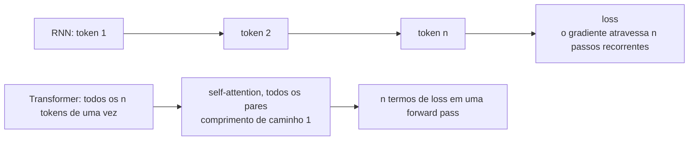

**Follow-ups:** Que custo em inference time os transformers pagam e as RNNs não? Por que a causal masking deixa o treinamento tão eficiente em amostras por forward pass? O que os state-space models tentam recuperar?

</details>

### 2. Explique o que acontece dentro de um único decoder block de um transformer.

<details><summary><b>Resposta</b></summary>

Um decoder block recebe hidden states no formato (n_tokens × d_model) e aplica duas subcamadas, cada uma envolvida por uma conexão residual e uma normalização:

1. **Norm → masked self-attention → add.** A entrada é normalizada (RMSNorm nos modelos modernos) e projetada em queries, keys e values. A scaled dot-product attention com causal mask mistura informação *entre posições*: cada token reúne um resumo ponderado dos tokens anteriores. O resultado passa por uma projeção de saída e é *somado* à entrada original (residual).
2. **Norm → MLP → add.** O stream atualizado é normalizado de novo e passa por uma feed-forward network position-wise: em geral, up-project para ~3-4× d_model, uma não linearidade (SwiGLU nos modelos da família Llama) e down-project. Ela é aplicada de forma idêntica e independente em cada posição, e o resultado é somado de volta ao residual stream.

A divisão de trabalho, então, é a seguinte: **a attention move informação entre tokens, e a MLP transforma a informação em cada token** (é nela que ficam a maior parte dos parâmetros e, muito provavelmente, a maior parte do "conhecimento" armazenado). O residual stream funciona como um espaço de trabalho compartilhado, do qual cada subcamada lê e no qual escreve pequenas atualizações. Esse enquadramento explica por que dá para empilhar 100+ blocos: com o caminho de identidade, cada bloco só precisa fazer um refinamento incremental.

A posição da norm importa. Os modelos modernos são **pre-norm** (a norm fica dentro do ramo residual), o que mantém o caminho residual limpo e o treinamento estável em profundidade; o original de 2017 era post-norm. Num modelo real, cada subcamada de attention também aplica RoPE a Q e K, e o bloco se repete N vezes (por exemplo, 32 blocos num modelo de 7-8B e 80 num de 70B), seguido de uma norm final e do LM head, que projeta para os logits do vocabulário.

**Vale desenhar.** Comece desenhando a linha residual reta, de ponta a ponta, e depois pendure as duas subcamadas nela: essa ordem é o ponto central do bloco.

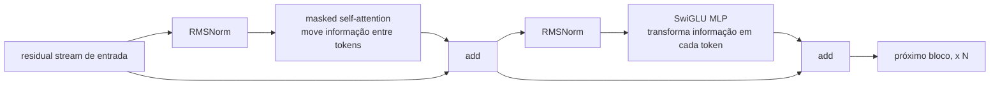

**Follow-ups:** Que fração dos parâmetros de um bloco fica na MLP, e que fração fica na attention? Por que as conexões residuais ganham importância à medida que a profundidade cresce? O que muda nesse quadro para um modelo MoE?

</details>

### 3. Explique a self-attention passo a passo. O que exatamente são Q, K e V?

<details><summary><b>Resposta</b></summary>

O vetor de cada token passa por três projeções lineares: uma **query** ("o que estou procurando?"), uma **key** ("o que eu contenho, para os outros compararem?") e um **value** ("que conteúdo eu entrego se alguém prestar attention em mim?"). A attention é um lookup chave-valor suave e diferenciável: a query do token i é comparada com a key de cada token, e os pesos resultantes misturam os values.

Os passos, para um X de formato (n, d_model):

1. Q = XW_q, K = XW_k, V = XW_v: três projeções aprendidas.
2. Scores = QKᵀ / √d_k: uma matriz (n, n) em que a entrada (i, j) indica o quanto o token j é relevante para o token i.
3. Aplique a causal mask: defina como −∞ os scores onde j > i.
4. Softmax por linha: cada linha vira uma distribuição de probabilidade sobre as posições anteriores.
5. Output = weights · V: a saída de cada token é uma combinação convexa dos vetores de value. Em seguida, uma projeção de saída final W_o leva o resultado de volta para d_model.

```python
import numpy as np
def attention(Q, K, V, causal=True):
    s = Q @ K.T / np.sqrt(K.shape[-1])
    if causal:
        s[np.triu(np.ones_like(s, dtype=bool), k=1)] = -np.inf
    w = np.exp(s - s.max(-1, keepdims=True))
    w /= w.sum(-1, keepdims=True)
    return w @ V
```

O ponto conceitual central: os pesos são **calculados a partir dos dados em runtime**, e não fixos como os kernels de uma convolução. A mesma camada pode rotear "pronome → antecedente" numa frase e "verbo → sujeito" em outra. Por que separar K e V? Porque o que torna um token *encontrável* (key) e o que ele deve *entregar* depois de encontrado (value) são papéis diferentes. Juntá-los obriga um único vetor a cumprir os dois, e isso é mensuravelmente pior.

**Vale desenhar.** Isso mantém organizadas as três projeções e as duas matmuls, que é onde as pessoas tropeçam sob pressão.

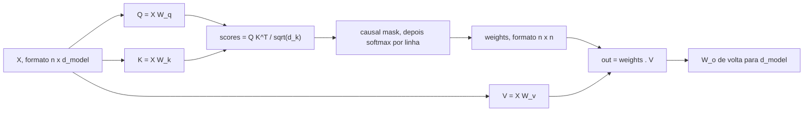

**Follow-ups:** Por que dividir por √d_k? Qual é a complexidade computacional do passo 2 e o que isso implica para contextos longos? Num decoder que gera token a token, quais entre Q, K e V ficam em cache, e por quê?

</details>

### 4. Por que a scaled dot-product attention divide por √d_k?

<details><summary><b>Resposta</b></summary>

Para o softmax não saturar. Se os componentes de q e k são aproximadamente independentes, com média zero e variância unitária, o produto escalar q·k é uma soma de d_k termos e tem variância ≈ d_k. Logo, o desvio padrão dos logits cresce como √d_k. Com d_k = 128, logits sem escala chegam com frequência a magnitudes de ±20 ou mais.

O softmax de logits com magnitude grande colapsa para algo quase one-hot: um peso de attention ≈ 1 e os demais ≈ 0. Nesse regime, o Jacobiano do softmax é quase zero (o gradiente do softmax envolve termos p·(1−p), que desaparecem quando p → 0 ou p → 1), e quase nenhum gradiente flui de volta pelos attention scores. No começo do treinamento, isso significa que as camadas de attention mal aprendem; também pode causar loss spikes e instabilidade. Dividir por √d_k traz a variância dos logits de volta para ~1, qualquer que seja a dimensão da head. Assim, o softmax fica num regime com gradientes úteis e com distribuições de attention suficientemente suaves.

Dois pontos que distinguem uma resposta forte:

- É um **argumento de variância sobre a dinâmica de inicialização e treinamento**, não uma exigência matemática. Em princípio, o modelo poderia aprender projeções reduzidas, mas começar saturado torna a otimização muito mais difícil.
- A mesma ideia aparece em outros lugares. O **soft-capping** de logits em alguns modelos (limitar com tanh os logits de attention ou os finais) e o **QK-norm** (aplicar LayerNorm/RMSNorm a queries e keys antes do produto escalar, usado em várias arquiteturas modernas) atacam o mesmo modo de falha, que é o crescimento descontrolado dos logits de attention durante o treinamento, de forma mais agressiva do que a escala estática √d_k.

Uma forma concreta de expressar a intuição: a escala √d_k deixa a temperature do softmax da attention independente do tamanho da head, então as escolhas de arquitetura sobre o head_dim não mudam em silêncio o quão concentrada é a attention.

**Follow-ups:** O que é QK-norm e por que alguns modelos recentes o adotaram? O que acontece com os gradientes quando o softmax satura? Me conduza pelo Jacobiano. Você esperaria que os problemas de escala fossem piores com dimensões de head maiores ou menores?

</details>

### 5. O que é causal masking, por que ela é necessária e como é implementada?

<details><summary><b>Resposta</b></summary>

A causal masking impede que a posição i atenda a posições j > i, garantindo que as predições dependam apenas do passado. Ela é necessária por duas razões ligadas entre si. Primeiro, em inference time os tokens futuros não existem: o modelo precisa gerar da esquerda para a direita, então o treinamento tem de seguir essa mesma estrutura condicional. Segundo, e de forma mais sutil, é ela que torna o treinamento de causal LM eficiente e não degenerado. Com a causal mask, uma única forward pass sobre uma sequência de n tokens produz n predições válidas de próximo token, treinadas em paralelo. Sem a máscara, prever o token t+1 enquanto se atende ao próprio token t+1 vira cópia trivial, e o modelo não aprenderia nada.

Na implementação, antes do softmax você soma uma matriz de máscara que vale 0 na diagonal e abaixo dela e −∞ estritamente acima (na prática, um número negativo grande como −1e9, ou o valor mínimo do dtype). Depois do softmax, essas posições recebem peso exatamente zero, e a renormalização acontece sozinha, porque o softmax normaliza sobre as entradas finitas que sobraram.

```python
mask = np.triu(np.ones((n, n), dtype=bool), k=1)   # True acima da diagonal
scores = np.where(mask, -1e9, scores)               # antes do softmax
```

Em kernels de produção (FlashAttention), a máscara nunca é materializada como um tensor n×n. O kernel simplesmente pula o cálculo dos blocos totalmente mascarados, o que também corta o trabalho pela metade, já que mais ou menos metade da matriz de scores é mascarada.

Alguns detalhes que vale citar por conta própria: os modelos encoder (BERT) omitem a máscara de propósito, trocando a capacidade de gerar por contexto bidirecional. Os setups prefix-LM aplicam a máscara causal apenas à parte gerada e permitem attention bidirecional sobre o prompt. E, na inferência em batch, você ainda precisa de máscaras de *padding* para que os tokens não atendam ao padding. É uma máscara diferente, que iniciantes costumam confundir com a causal.

**Vale desenhar.** Mostra que a máscara entra antes do softmax, então a renormalização é automática, e não um segundo passo que você acrescenta depois.

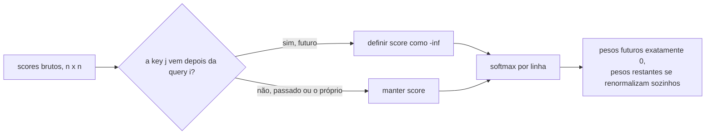

**Follow-ups:** Por que a máscara vai antes do softmax e não depois? O que é um prefix LM e quando a attention bidirecional sobre o prompt é útil? Como a FlashAttention explora a estrutura causal para ganhar velocidade?

</details>

### 6. Por que o transformer usa várias attention heads em vez de uma só, grande?

<details><summary><b>Resposta</b></summary>

Porque um único softmax produz uma única ponderação sobre as posições para cada token, ou seja, uma só "visão" do contexto. Um token muitas vezes precisa resolver várias relações diferentes ao mesmo tempo: a qual substantivo esse pronome se refere, qual é o núcleo sintático dessa frase, o que veio logo antes de mim, qual delimitador abriu esse colchete. Tirar a média de tudo isso numa só distribuição de attention destrói informação. A multi-head attention executa h operações de attention independentes, em subespaços paralelos, para que cada uma possa se especializar.

Mecanicamente, em vez de uma attention sobre Q/K/V com d_model dimensões, você divide em h heads de dimensão d_model/h (por exemplo, 4096 → 32 heads × 128). Cada head recebe suas próprias projeções Q/K/V aprendidas para o seu subespaço, calcula a attention de forma independente, e as h saídas são concatenadas e misturadas pela projeção de saída W_o. O total de parâmetros e de FLOPs é aproximadamente o mesmo de uma única head de largura total: você está particionando a computação, não acrescentando nada a ela. O que você ganha são h softmaxes independentes; o que cada head perde é largura representacional (um produto escalar de 128 dimensões é uma medida de similaridade de rank mais baixo que um de 4096).

Na prática, os trabalhos de interpretability encontraram heads com papéis reconhecíveis: previous-token heads, positional heads e, as mais famosas, as **induction heads** (pares de heads que implementam "ache a ocorrência anterior deste token e copie o que veio depois dela"), centrais para in-context learning. Também se observa que muitas heads são redundantes depois do treinamento: estudos de head-pruning mostraram que dá para remover uma fração substancial com perda modesta de qualidade. Isso ajuda a entender por que compartilhar K/V entre query heads (MQA/GQA) funciona.

O número de heads é um hiperparâmetro a ser ajustado. Poucas heads sofrem underfitting em relação à diversidade de relações; muitas deixam o subespaço de cada head estreito demais. Um head_dim entre 64 e 128 tem se mantido como ponto ideal ao longo das gerações de modelos.

**Vale desenhar.** Deixa claro que você está particionando uma única computação, não empilhando h cópias dela.

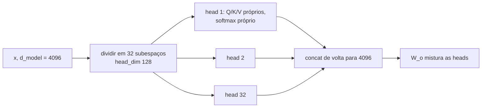

**Follow-ups:** O que é uma induction head e por que ela importa para in-context learning? Se muitas heads são redundantes, que otimizações de arquitetura isso motiva? A multi-head attention custa mais FLOPs que a single-head com o mesmo d_model?

</details>

### 7. Compare as arquiteturas encoder-only, decoder-only e encoder-decoder. Para que serve cada uma?

<details><summary><b>Resposta</b></summary>

**Encoder-only** (linhagem BERT): self-attention bidirecional, em que cada token enxerga a sequência inteira, treinada com masked-LM. Produz representações contextuais ricas, mas não tem um mecanismo natural de geração. Hoje sobrevive onde a qualidade de representação por FLOP importa: modelos de embedding para retrieval, rerankers, classificadores, filtros de PII/toxicidade. São pequenos, rápidos e baratos de servir.

**Decoder-only** (GPT, Llama, Claude, Gemini): self-attention causal, treinada com next-token prediction. É a arquitetura de praticamente todo LLM moderno de propósito geral. Por que venceu: (1) a geração é nativa; (2) cada posição de token fornece sinal de treinamento a cada passada, o que dá eficiência de dados em escala; (3) uma arquitetura e um objetivo cobrem qualquer tarefa via prompting, sem heads específicas por tarefa; (4) ela escala bem, e todo o ecossistema de ferramentas (KV caching, stacks de serving, pipelines de RLHF) foi construído em torno dela.

**Encoder-decoder** (transformer original, T5, Whisper, muitos modelos de tradução): o encoder lê a entrada com attention bidirecional, e o decoder gera de forma autorregressiva enquanto faz cross-attention às saídas do encoder. É o melhor encaixe quando há uma transformação input→output clara e com entrada fixa: tradução, speech-to-text, sumarização estruturada. Nesses casos, o encode bidirecional da fonte é uma vantagem real. Para chat geral, as desvantagens são que a divisão input/output fica desajeitada em conversas multi-turn e que você não consegue estender "a entrada" de forma incremental, como um modelo decoder-only, que simplesmente anexa ao contexto.

Uma nuance que vale acrescentar: os modelos decoder-only conseguem emular o padrão encoder-decoder (o prompt faz o papel da entrada codificada), e as variantes prefix-LM permitem attention bidirecional sobre o prompt enquanto geram de forma causal. Na prática, a indústria se consolidou em decoder-only para cargas generativas e em encoder-only para embeddings e reranking, e o encoder-decoder ficou com nichos como ASR (Whisper) e tradução.

**Vale desenhar.** Desenhe quem atende a quem, em vez de três caixas rotuladas: o padrão de attention é a diferença de verdade.

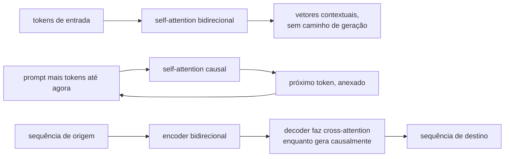

**Follow-ups:** Por que os modelos de embedding ainda usam attention bidirecional? O que é um prefix LM? Se você fosse construir hoje um sistema de tradução, escolheria encoder-decoder ou um LLM decoder-only, e com quais critérios?

</details>

### 8. Qual é a diferença entre causal language modeling e masked language modeling como objetivos de pretraining?

<details><summary><b>Resposta</b></summary>

**Causal LM (CLM)**: prever o token t+1 dados os tokens 1..t, em cada posição, com a attention mascarada de forma causal. A loss é a cross-entropy somada sobre todas as posições: uma sequência de n tokens gera n problemas de predição por forward pass, e 100% dos tokens contribuem com sinal.

**Masked LM (MLM)**: corromper a entrada mascarando um subconjunto de tokens (o BERT mascarava ~15%) e prever os originais com contexto *bidirecional*. Só as posições mascaradas geram loss, então, por forward pass, você obtém sinal de ~15% dos tokens.

Implicações:

- **Geração**: os modelos CLM geram de forma nativa, porque fazer sampling do modelo *é* o modo de inferência do objetivo. Os modelos MLM não geram de forma coerente: não existe uma fatoração left-to-right da distribuição conjunta.
- **Qualidade de representação**: o MLM enxerga os dois lados de cada posição, o que historicamente rendeu representações melhores por parâmetro em tarefas de compreensão. Foi por isso que o BERT dominou os benchmarks de classificação em 2019-2020 e é por isso que os modelos de embedding ainda preferem attention bidirecional.
- **Escala e universalidade**: o CLM acabou sendo o objetivo que escala até virar capacidade de propósito geral. Fazer next-token prediction sobre dados diversos exige, implicitamente, sintaxe, conhecimento de mundo, raciocínio e estilo, e o in-context learning surge como consequência. A ineficiência do MLM (só ~15% de sinal), somada à falta de um modo generativo, fez dele um beco sem saída para modelos gerais em escala frontier.
- **Descompasso entre treino e inferência**: o token [MASK] do MLM nunca aparece na inferência, um distribution shift que os papers da era BERT precisaram contornar. O CLM não tem esse descompasso, embora tenha *exposure bias*: o treinamento sempre condiciona em prefixos de ground-truth, e a inferência condiciona nas próprias saídas do modelo, que podem estar erradas.

Também vale saber que o **span corruption** do T5 é um meio-termo encoder-decoder (mascarar spans contíguos e gerá-los) e que alguns modelos de texto estilo diffusion revisitam objetivos não autorregressivos. Ainda assim, o CLM continua sendo a espinha dorsal de todo modelo frontier.

**Follow-ups:** O que é exposure bias e o quanto ele pesa na prática? Por que o in-context learning emerge da next-token prediction? Quando você ainda faria pretraining ou fine-tuning com MLM hoje?

</details>

### 9. Por que os LLMs usam tokenização por subwords, em vez de palavras inteiras ou caracteres brutos?

<details><summary><b>Resposta</b></summary>

É um tradeoff entre compressão e cobertura, e as subwords são o ponto ideal entre dois extremos ruins.

O **nível de palavra** falha na cobertura: a linguagem natural tem um vocabulário ilimitado (nomes, erros de digitação, morfologia, identificadores de código, outros idiomas). Ou você carrega um vocabulário de milhões, com uma matriz de embedding e um softmax enormes, ou mapeia tudo que não foi visto para um token `<UNK>` e perde informação. Em idiomas morfologicamente ricos, isso é catastrófico.

O **nível de caractere** (ou de bytes brutos) tem cobertura perfeita, mas compressão péssima. As sequências ficam ~4-5× mais longas do que com subwords em inglês, e o custo da attention é quadrático no comprimento da sequência, então você paga um fator constante alto em compute e em contexto efetivo. Além disso, cada caractere carrega quase nenhum significado sozinho, e o modelo gasta capacidade remontando palavras antes de poder fazer qualquer outra coisa.

A **tokenização por subwords** (BPE e parentes) aprende um vocabulário de pedaços frequentes: palavras comuns viram tokens únicos, palavras raras se decompõem em partes com significado ("tokenization" → "token" + "ization"), e com um alfabeto base byte-level *qualquer* string é representável, ou seja, nunca há OOV. Você obtém sequências ~4× mais curtas do que no nível de caractere, com um vocabulário de tamanho administrável (algo entre 32k e 256k), e os tokens frequentes recebem embeddings bem treinados.

A ressalva que vale levar para a entrevista: essa eficiência é comprada escondendo o nível de caractere do modelo, o que causa as falhas clássicas (contar letras, jogos de ortografia, parte da aritmética). Além disso, a qualidade da compressão varia muito de idioma para idioma, e o texto fora do inglês costuma ter 2-4× mais tokens para o mesmo conteúdo, o que significa custo maior e menos contexto utilizável. A tokenization é um dos poucos estágios do pipeline que continuam sendo projetados à mão, e não aprendidos. Há pesquisa em andamento sobre modelos byte-level com patching aprendido (por exemplo, a linha Byte Latent Transformer) com o objetivo de eliminá-la.

**Follow-ups:** Como o byte-level BPE garante que não existam strings fora do vocabulário? Qual é o efeito da escolha do tokenizer no preço e na qualidade em cenários multilíngues? Por que a modelagem em nível de caractere ou byte ainda não substituiu o BPE?

</details>

### 10. Por que os LLMs são famosos por errar a contagem de r's em "strawberry"?

<details><summary><b>Resposta</b></summary>

Porque o modelo nunca vê letras. O tokenizer mapeia "strawberry" para um ou dois token IDs (por exemplo, "str" + "awberry", ou um único token), e o modelo recebe apenas os vetores de embedding desses IDs. Não existe visão em nível de caractere em nenhum ponto da forward pass. Pedir que ele conte r's é como pedir a alguém que conte as letras de uma palavra que só ouviu falada. Para responder certo, o modelo precisa ter *memorizado*, a partir dos dados de treinamento (por exemplo, de listas de ortografia ou de texto separado por caracteres), a grafia daquele token específico, e só então fazer a contagem. São dois passos, e nenhum dos dois é confiável.

A contagem em si é a segunda falha. Os transformers executam um número fixo de camadas de computação paralela por token, e contar é uma operação inerentemente sequencial. Sem externalizar os passos intermediários em tokens gerados (uma chain of thought como "s-t-r-a-w-b-e-r-r-y: r aparece nas posições 3, 8, 9 → 3"), o modelo tenta contar "de cabeça", de uma só vez, e acaba chutando a partir de associações memorizadas. É por isso que o mesmo modelo que erra a pergunta direta costuma acertar quando você pede que ele soletre a palavra letra por letra antes. E é também por isso que os reasoning models, treinados para externalizar os passos, corrigiram em grande parte essa classe de erro.

A lição geral que os entrevistadores querem ouvir: **isso é um artefato de tokenization, não evidência sobre inteligência**. A mesma causa raiz explica o desempenho ruim em rimas e jogos de palavras, em inversão de strings, em manipulação de caracteres estilo base64 e em erros de off-by-one na edição precisa de caracteres. A implicação prática para engenheiros: não construa operações de string em nível de caractere em cima da saída bruta de um LLM. Faça isso em código e use o LLM para as partes em que ele realmente é bom.

**Vale desenhar.** Aponta o passo exato em que os caracteres deixam de existir, que é também o motivo pelo qual soletrar primeiro funciona.

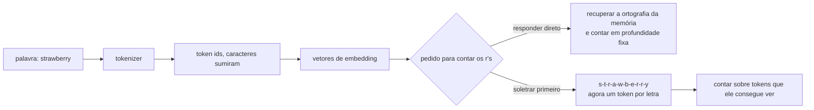

**Follow-ups:** Por que pedir ao modelo que soletre a palavra primeiro corrige a contagem? Que outras categorias de tarefa falham pela mesma causa raiz? Como um modelo byte-level se comportaria de forma diferente aqui?

</details>

### 11. O que o parâmetro temperature realmente faz? Dê a fórmula.

<details><summary><b>Resposta</b></summary>

A temperature reescala os logits antes do softmax que os converte em uma distribuição de probabilidade sobre o vocabulário:

p_i = exp(z_i / T) / Σ_j exp(z_j / T)

- **T = 1**: a distribuição bruta do modelo.
- **T → 0**: as diferenças entre logits são amplificadas, e a distribuição colapsa em direção ao argmax, num decoding determinístico, parecido com o greedy. (T = 0 nas APIs é implementado como argmax, já que a divisão por zero é indefinida.)
- **T > 1**: as diferenças são comprimidas e a distribuição se achata, de modo que tokens de baixa probabilidade ficam mais prováveis. A saída fica mais diversa e mais sujeita a erros.

Propriedades-chave que vale declarar: a temperature é uma transformação *monotônica*. Ela nunca reordena os tokens, só afia ou achata a distribuição, então o greedy decoding não é afetado por ela. Ela atua a cada passo de geração, sobre a distribuição condicional, e seus efeitos se acumulam ao longo de uma geração longa: pequenos aumentos na entropia por token produzem completions visivelmente mais divergentes.

A orientação prática que um candidato forte dá: use T = 0 (ou perto disso) em extração, classificação, structured output e código, onde existe uma resposta correta e o que você quer é a moda. Use T ≈ 0,7-1,0 em escrita criativa e brainstorming, onde a diversidade é justamente o objetivo. Note que, na prática, T = 0 não garante saídas idênticas bit a bit entre chamadas de API (não determinismo de batching, não associatividade do ponto flutuante entre kernels, mudanças de infraestrutura), um equívoco comum que vale apontar. Note também que a temperature interage com os truncation samplers: ela é aplicada junto com top-p/top-k/min-p, e a ordem das operações (em geral temperature primeiro e truncamento depois, embora as implementações variem) muda o comportamento em T alto. O min-p, em particular, foi projetado para se manter robusto em T > 1.

Mais um enquadramento útil: a temperature troca a exploitation da confiança do modelo pela exploration da incerteza dele. É o mesmo botão da exploração por softmax em RL.

**Follow-ups:** Por que T=0 ainda pode produzir saídas diferentes em chamadas de API idênticas? Se você aumenta a temperature, por que geralmente quer também min-p ou top-p? Que temperature você usaria numa avaliação com LLM-as-judge, e por quê?

</details>

### 12. Compare greedy decoding, top-k sampling e top-p (nucleus) sampling.

<details><summary><b>Resposta</b></summary>

O **Greedy** pega o token de argmax a cada passo. É determinístico e barato, e serve para respostas factuais curtas e extração estruturada. O modo de falha são os loops de repetição ("the the the", ou ciclos em nível de parágrafo) e o texto insosso: tokens localmente ótimos não se combinam num bom texto global, e o modelo pode entrar numa repetição que se autoalimenta, em que as repetições anteriores tornam a próxima repetição *mais* provável.

O **Top-k** restringe o sampling aos k tokens de maior probabilidade (renormalizados), em geral com k = 20-50. O problema é que k é estático, enquanto o formato da distribuição varia enormemente de passo a passo. Quando o modelo está confiante (um token com 0,95), k = 40 deixa entrar 39 tokens lixo. Quando ele está genuinamente em dúvida entre 200 continuações plausíveis (o começo de uma frase de história), k = 40 corta diversidade válida.

O **Top-p / nucleus** (de Holtzman et al., "The Curious Case of Neural Text Degeneration") se adapta: mantém o menor conjunto de tokens cuja probabilidade acumulada seja ≥ p (por exemplo, 0,9), renormaliza e faz o sampling. Num passo confiante, o nucleus tem 1-2 tokens; num passo incerto, ele é grande. Essa adaptatividade é o motivo de o top-p ter virado o padrão. Sua fraqueza residual: em temperature alta, a distribuição achatada deixa o nucleus inchar e incluir tokens realmente ruins. É isso que o **min-p** (manter tokens com p ≥ min_p × p_max) resolve, ancorando o corte na confiança do token de topo.

O insight por trás de todo truncation sampling: a massa de probabilidade do modelo é bem calibrada na cabeça da distribuição e pouco confiável na cauda. Uma geração longa vai acabar sorteando um token da cauda, e um único token ruim pode descarrilar tudo o que vem depois (os erros se acumulam de forma autorregressiva). O truncamento corta a cauda, e a temperature molda o que sobra. Na prática, eles se combinam: temperature + top-p (+ opcionalmente top-k como teto rígido) é o stack padrão, com greedy/T≈0 para qualquer coisa que tenha uma resposta certa.

**Vale desenhar.** Fixa a ordem das operações, o que deixa concreta a diferença entre top-p e min-p.

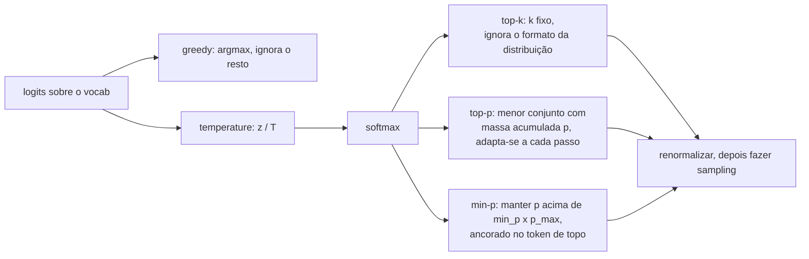

**Follow-ups:** Por que o greedy decoding entra em loop, mecanicamente? Quando o top-p falha e como o min-p corrige isso? Por que o texto amostrado em T=1 costuma ser *pior* do que a distribuição "verdadeira" do modelo sugeriria?

</details>

### 13. O que é o KV cache e por que ele deixa a geração rápida?

<details><summary><b>Resposta</b></summary>

Na geração autorregressiva, a attention de cada novo token precisa das keys e values de *todos os tokens anteriores*, em cada camada. Esses vetores K e V dependem apenas dos tokens que os produziram (e de suas posições), então não mudam conforme a geração avança. O KV cache os armazena, para que cada passo calcule Q/K/V apenas do único token novo, atenda aos K/V que já estão em cache e anexe os próprios K/V ao cache.

Sem o cache, você reexecutaria a forward pass completa sobre todo o prefixo a cada token gerado. Gerar o token n custa O(n) de recomputação, então uma geração completa custa O(n²) de trabalho de forward pass (e, com a attention por dentro, o total de FLOPs fica quase cúbico). Com o cache, cada passo faz as projeções de um único token mais leituras de attention sobre n entradas em cache, e a geração passa a ser linear no número de tokens gerados. Essa é a diferença entre uma latency utilizável e uma inutilizável.

Isso cria a estrutura de duas fases em torno da qual todo stack de serving é construído: o **prefill** (processar o prompt inteiro em paralelo, compute-bound, populando o cache) e o **decode** (um token por vez, limitado pela largura de banda de memória, porque cada passo precisa ler o cache inteiro da memória da GPU fazendo relativamente poucos FLOPs). O time-to-first-token é o prefill; a inter-token latency é o decode.

O custo é memória: por token, você armazena 2 (K e V) × n_layers × n_kv_heads × head_dim elementos. Num modelo da classe 70B com GQA (80 camadas, 8 KV heads, head_dim 128, fp16), isso dá ~320 KB por token, ou ~40 GB para uma sequência de 128k tokens. Essa pressão de memória explica por que existem GQA/MQA (menos KV heads), por que o PagedAttention do vLLM gerencia o cache em blocos não contíguos, por que o prefix/prompt caching compartilha cache entre requisições e por que a quantização de cache (KV em fp8/int8) é comum.

**Vale desenhar.** O laço de volta ao cache é o ponto central: desenhe-o e o argumento linear versus quadrático se explica sozinho.

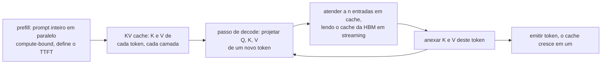

**Follow-ups:** Por que o decode é limitado pela largura de banda de memória e não por compute? O que é prefix caching e quando ele economiza dinheiro? Por que não dá para fazer cache das queries também?

</details>

### 14. O que a feed-forward network de um bloco transformer realmente faz, e por que o SwiGLU é o padrão hoje?

<details><summary><b>Resposta</b></summary>

A attention move informação entre posições; a FFN transforma a informação em cada posição, de forma independente. É também onde fica a maior parte dos parâmetros: cerca de dois terços dos pesos de um transformer denso.

A versão clássica são duas camadas lineares com uma não linearidade no meio, expandindo para cerca de 4x d_model e projetando de volta:

```python
def ffn(x, W1, W2):
    return gelu(x @ W1) @ W2   # d_model -> 4*d_model -> d_model
```

O SwiGLU troca a up-projection única por um par com gate:

```python
def swiglu_ffn(x, W_gate, W_up, W_down):
    return (silu(x @ W_gate) * (x @ W_up)) @ W_down
```

São três matrizes em vez de duas. Para manter fixa a contagem de parâmetros, você reduz a dimensão oculta de ~4x d_model para ~8/3 x d_model. Os modelos da família Llama fazem exatamente isso, e é por esse motivo que aparecem tamanhos intermediários estranhos, como 11008, em vez de um múltiplo redondo de 4.

Por que ele venceu: consistentemente, dá uma loss menor com o mesmo número de parâmetros e de FLOPs. O gate torna a não linearidade dependente dos dados e multiplicativa, de modo que uma unidade pode ser desligada conforme a entrada, em vez de passar por uma curva pontual fixa. O trabalho sobre GLU-variants que o popularizou é bem honesto ao admitir que a justificativa é empírica, não teórica. O GeGLU (GELU em vez de SiLU como ativação do gate) tem desempenho praticamente igual, e a escolha é em grande parte convenção.

Um modelo mental útil, vindo de interpretability: trate as linhas de W_gate/W_up como detectores de padrões e as colunas de W_down como o conteúdo que esses padrões escrevem de volta no residual stream. Assim, a FFN se comporta como uma memória chave-valor.

O equívoco que vale combater é achar que a FFN é uma MLP sem graça pendurada na parte interessante. Ela guarda a maior parte dos parâmetros, domina os FLOPs em contextos curtos e moderados, e é exatamente o componente que o Mixture-of-Experts substitui, porque é ali que está a capacidade.

**Vale desenhar.** Três matrizes se encontrando numa multiplicação: mostra de imediato por que a dimensão oculta encolhe para manter fixa a contagem de parâmetros.

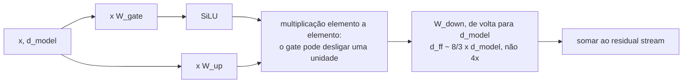

**Follow-ups:** A partir de que ponto a FFN deixa de dominar os FLOPs e a attention assume? Por que o MoE troca a FFN e não a attention?

</details>

### 15. O que é weight tying, e por que alguns modelos fazem tying das matrizes de embedding e de saída e outros não?

<details><summary><b>Resposta</b></summary>

Weight tying significa que a matriz de input embedding e o LM head de saída são a mesma matriz, usada transposta na saída. As duas mapeiam entre a identidade do token e o espaço do residual stream, então o argumento é que uma única matriz deveria servir.

A economia é de vocab x d_model parâmetros. Com um vocabulário de 128k e d_model 4096, são ~524M parâmetros: uma fração séria de um modelo de 8B e um erro de arredondamento num de 400B. Essa assimetria de tamanho basicamente explica a divisão na prática. Os modelos pequenos tendem a fazer tying (o Gemma faz, e com um vocabulário de ~256k a economia é enorme em relação ao corpo do modelo), enquanto os grandes cada vez mais desfazem o tying, porque os parâmetros são baratos e desfazê-lo melhora a loss de forma mensurável.

O interessante é por que desfazer o tying ajuda. As duas matrizes querem geometrias diferentes. O embedding quer que tokens que aparecem em contextos parecidos fiquem próximos. O unembedding quer que fiquem próximos os tokens que são intercambiáveis como predições. As duas coisas são relacionadas, mas não idênticas, e forçar uma única matriz a satisfazer ambas a restringe. Há também um argumento de rank: a matriz de logits é limitada por d_model (o softmax bottleneck), e o tying não ajuda nesse ponto.

Dois detalhes que vale conhecer. Primeiro, os gradientes se comportam de forma diferente: o lado do embedding recebe atualizações esparsas, só para os tokens que estão no batch, enquanto o head recebe atualizações densas do softmax sobre o vocabulário inteiro. Com tying, as duas caem na mesma matriz, e isso muda a learning rate efetiva dela em relação ao resto do modelo. Segundo, o descompasso de escala é real, e é por isso que vários modelos com tying multiplicam as saídas do embedding por sqrt(d_model).

Os argumentos originais vieram de Press e Wolf e de Inan et al., por volta de 2016 e 2017, numa época de modelos pequenos em que a tabela de embedding era de fato a maior parte do modelo. O tradeoff mudou desde então, e é esse o ponto.

**Follow-ups:** Como a decisão sobre o tamanho do vocabulário interage com a decisão de tying? O que acontece com um modelo com tying se você quiser estender o vocabulário depois?

</details>

### 16. Explique a speculative decoding. Por que ela não altera a distribuição de saída do modelo?

<details><summary><b>Resposta</b></summary>

Um draft model pequeno propõe k tokens de forma autorregressiva. O target model, grande, pontua então todas as k+1 posições numa única forward pass. Uma regra de aceitação percorre as propostas da esquerda para a direita, aceitando cada uma com probabilidade min(1, p_target(x)/p_draft(x)). Na primeira rejeição, você refaz o sampling daquele token a partir de uma distribuição residual corrigida e descarta o resto. É um esquema de rejection-sampling, e a prova é que as amostras resultantes se distribuem exatamente como se você tivesse feito o sampling direto do target model. Esse é o ponto crucial: o método é lossless, não uma aproximação. Se alguém diz que a speculative decoding troca qualidade por velocidade, está confundindo com usar um modelo menor.

Por que ela é mais rápida? Tudo se resume a arithmetic intensity. O decode é limitado pela largura de banda de memória: para produzir um token, você faz stream de cada peso da HBM e quase não faz aritmética com eles. Pontuar 5 posições custa quase o mesmo tempo real que pontuar 1, porque o custo de carregar os pesos domina e é amortizado. Você gasta FLOPs ociosos para recuperar tempo. Os ganhos típicos ficam em ~1,5-3x, e dependem da taxa de aceitação e de quão barato é o draft.

O que uma resposta forte acrescenta:

- Ela deixa de ajudar quando o batch é grande. Com batch alto você já está compute-bound e não sobram FLOPs para gastar, então o overhead especulativo pode até piorar as coisas. É uma técnica de baixa latency e baixo batch.
- A taxa de aceitação é tudo, e ela depende do quanto as distribuições se parecem, não da qualidade do draft em abstrato. Os melhores drafts são destilados do target model específico, de modo que o KL entre os dois é pequeno. Um modelo de 1B bom em termos gerais, fazendo draft para um 70B sem relação com ele, pode ter uma aceitação ruim.
- Há variantes que evitam o segundo modelo por completo: Medusa e EAGLE adicionam draft heads sobre o próprio trunk do target, o drafting por n-gram ou prompt-lookup funciona bem em trabalhos com muita cópia, como RAG e edição de código, e o DeepSeek-V3 reutiliza seu módulo de multi-token-prediction como draft.

**Vale desenhar.** A bifurcação no teste de aceitação é o que prova que você entende que isso é rejection sampling, e não uma aproximação.

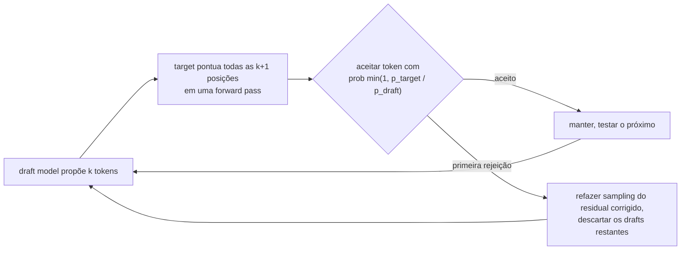

**Follow-ups:** Como você mediria se a speculative decoding está realmente ajudando num deployment de serving em produção? Que taxa de aceitação é necessária para atingir o break-even?

</details>

### 17. O que é in-context learning, e como você decide entre ele e fine-tuning?

<details><summary><b>Resposta</b></summary>

In-context learning é quando um modelo executa uma tarefa especificada inteiramente no prompt, por meio de instruções ou exemplos, sem nenhuma atualização de pesos. Ele surgiu do pretraining, não foi projetado de propósito, e é a razão pela qual a era das chamadas de API existe.

Por que funciona: o pretraining em dados enormemente diversos faz de "inferir qual tarefa este prefixo implica e continuar de forma consistente" o comportamento que minimiza a loss, porque o corpus está cheio de demonstrações implícitas de tarefas. Do ponto de vista mecanístico, o ingrediente mais bem compreendido são as induction heads: um circuito de duas heads que encontra uma ocorrência anterior do token atual e copia o que veio depois dela. A formação delas coincide com um salto brusco na capacidade in-context durante o treinamento, uma das histórias mecanísticas mais limpas que temos.

O framework de decisão:

Use in-context learning quando a tarefa for descritível, mudar com frequência, tiver baixo volume ou ainda estiver em fase de iteração. Não custa nada configurar, e você altera tudo num editor de texto. O teto é o seu orçamento de contexto e o custo em tokens por chamada.

Use fine-tuning quando a tarefa for estável e de alto volume, de modo que o custo amortizado em tokens domine; quando você precisar de menor latency ou de um modelo menor; quando tiver milhares de bons exemplos; ou quando o comportamento resistir a ser descrito num prompt (tom, um estilo da casa, um formato de saída especializado).

Um ponto que vale sinalizar, porque os entrevistadores gostam: na maioria das tarefas reais, os exemplos não estão ensinando uma tarefa nova. Min et al. (2022) mostraram que, em classificação, trocar os rótulos das demonstrações por rótulos errados aleatórios quase não prejudica. O que as demonstrações transmitem é o label space, a distribuição de entrada e o formato de saída, não o mapeamento. A nuance: trabalhos posteriores descobriram que os maiores modelos conseguem seguir rótulos invertidos de forma consistente, então o mapeamento não é totalmente ignorado, mas a lição prática continua valendo. A implicação prática é que a seleção e a diversidade dos exemplos importam muito mais que a quantidade, e 30 exemplos quase idênticos são, em grande parte, contexto desperdiçado.

**Vale desenhar.** Uma árvore de decisão evita que a resposta vire uma lista genérica de prós e contras.

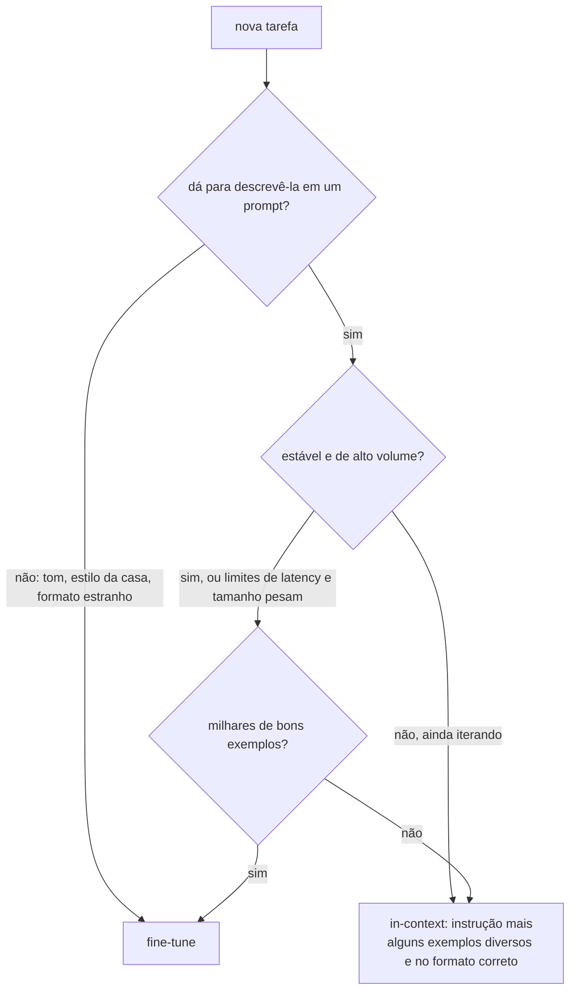

**Follow-ups:** Se rótulos errados quase não prejudicam, o que isso implica sobre como você deve escolher exemplos few-shot? Quando você viu o in-context learning falhar de verdade onde o fine-tuning funcionou?

</details>

### 18. O que a perplexity mede, e por que você não pode compará-la entre modelos com tokenizers diferentes?

<details><summary><b>Resposta</b></summary>

Perplexity é a exponencial da negative log-likelihood média por token, medida em texto held-out: PPL = exp(-(1/N) Σ log p(x_t | x_<t)). Intuitivamente, é o número efetivo de tokens entre os quais o modelo está escolhendo a cada passo: uma perplexity de 8 significa que o modelo está, em média, tão incerto quanto estaria numa escolha uniforme entre 8 tokens. Quanto menor, melhor. Ela é a training loss, só que exponenciada.

A armadilha está no denominador. "Por token" depende do tokenizer. Um modelo com vocabulário de 200k divide o mesmo documento em menos tokens, e maiores, do que um modelo com vocabulário de 32k. Assim, cada predição carrega mais informação, e a perplexity por token sobe mesmo que o modelo preveja melhor o texto. Comparar perplexity por token entre tokenizers é comparar números em unidades diferentes.

A correção é normalizar por algo independente do tokenizer. Bits per byte (BPB) divide a negative log-likelihood total do documento, em bits, pela contagem de bytes UTF-8 dele: BPB = (loss em nats por token / ln 2) / (bytes por token). A log-likelihood total de um documento é comparável entre modelos; o erro está em dividir por uma unidade específica de cada modelo. Os papers byte-level e tokenizer-free reportam BPB exatamente por esse motivo.

Outras formas pelas quais a perplexity engana:

- Os modelos pós-treinados costumam ter perplexity pior em texto da web do que os modelos base, porque SFT e RL afunilam a distribuição em direção a um estilo de chat. Isso não é regressão de capacidade.
- A média é dominada pelos tokens fáceis. Palavras funcionais e boilerplate são bem previstos por qualquer modelo, e os tokens que carregam raciocínio são uma fração pequena da média.
- Contaminação: se o texto de eval estava no pretraining, a perplexity colapsa e não diz nada.
- Ela não diz nada sobre instruction following, factualidade ou uso de tools.

Onde ela ainda é a ferramenta certa: comparar checkpoints dentro de um mesmo run, fazer ablações de data mix e de tokenizer (em BPB), detectar domain shift e filtrar dados de pretraining pela perplexity de um modelo de referência.

**Follow-ups:** Converta uma loss de 2,0 nats por token em perplexity. O tokenizer A tem em média 3,5 bytes por token e o tokenizer B, 4,5: como você compara as losses deles? Por que um modelo melhor poderia mostrar perplexity mais alta no seu eval set?

</details>

## Intermediário

### 19. Pre-norm vs post-norm: qual é a diferença e por que todo mundo migrou para pre-norm? E por que RMSNorm?

<details><summary><b>Resposta</b></summary>

**Post-norm** (transformer original, de 2017): `x = Norm(x + Sublayer(x))`. A normalização fica *em cima* do caminho residual, depois do add. **Pre-norm** (do GPT-2 em diante, essencialmente todos os LLMs modernos): `x = x + Sublayer(Norm(x))`. A normalização fica dentro do ramo, e o caminho residual é uma identidade pura.

Por que isso importa: no post-norm, o gradiente que vai da loss até as camadas iniciais precisa passar por todas as LayerNorms do trunk, e cada norm reescala os gradientes de um jeito que se acumula com a profundidade. Transformers post-norm profundos são notoriamente difíceis de treinar: exigem um warmup cuidadoso de learning rate e, mesmo assim, são propensos a divergir. No pre-norm, existe um caminho de identidade desobstruído da loss até cada camada. Os gradientes chegam às camadas iniciais sem atenuação, a necessidade de warmup diminui e o treinamento é estável com 80-100+ camadas. Como um treinamento frontier pode custar de dezenas a centenas de milhões de dólares, a estabilidade pesa mais que tudo, e o pre-norm se tornou universal.

A nuance honesta: o post-norm, *quando você consegue treiná-lo*, às vezes chega a uma qualidade final ligeiramente melhor. Com o caminho de identidade do pre-norm, as camadas posteriores podem se comportar mais como um ensemble de caminhos rasos, desperdiçando, possivelmente, parte da profundidade. Isso motivou híbridos (por exemplo, arranjos "peri-norm"/double-norm, ou o estilo do Gemma, que normaliza tanto a entrada quanto a saída do ramo), mas o pre-norm simples continua sendo o padrão.

**RMSNorm** vs LayerNorm: a LayerNorm subtrai a média, divide pelo desvio padrão e depois aplica um ganho e um bias aprendidos. A RMSNorm elimina o mean-centring e o bias: apenas divide pelo root-mean-square do vetor e aplica um ganho aprendido, x / RMS(x) · g. As ablações (do paper da RMSNorm em diante, confirmadas em escala pelos modelos da família Llama) mostram que o mean-centring não é necessário. A RMSNorm é mais barata (menos reduções, menos parâmetros, uma operação memory-bound a menos) e igualmente estável. Com milhares de chamadas de norm por forward pass, a economia é real.

**Vale desenhar.** Desenhe os dois caminhos residuais e a diferença aparece na hora: um deles tem uma norm plantada no trunk.

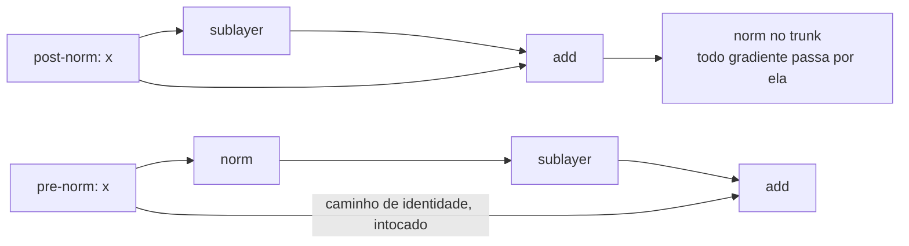

**Follow-ups:** Por que o warmup interage com o post-norm? O que a normalização faz com a geometria do loss landscape? Em que outros pontos das arquiteturas modernas aparecem norms, além das duas posições do bloco (QK-norm, norm final)?

</details>

### 20. Conduza-me pelo algoritmo de treinamento do BPE, passo a passo.

<details><summary><b>Resposta</b></summary>

O Byte-Pair Encoding aprende, a partir de um corpus, um vocabulário de merges de subwords:

1. **Inicialize** o vocabulário com o alfabeto base. No byte-level BPE (do GPT-2 em diante), são todos os 256 valores de byte, o que garante que qualquer string seja representável. Represente o corpus como sequências desses símbolos base.
2. **Conte** todos os pares adjacentes de símbolos no corpus.
3. **Mescle** o par mais frequente em um novo símbolo único, adicione-o ao vocabulário e registre a regra de merge (por exemplo, `t` + `h` → `th`).
4. **Repita** os passos 2-3 até atingir o tamanho de vocabulário desejado (por exemplo, ~50k merges para o vocabulário de 50.257 do GPT-2; ~128k para o do Llama 3).

A saída é uma lista ordenada de regras de merge. O **encoding** em inference time as reproduz: divida o texto em símbolos base e aplique os merges na ordem em que foram aprendidos, onde quer que ocorram, de forma greedy, até que nenhum outro se aplique. O encoding é determinístico, e a ordem de merges aprendida é o tokenizer.

```python
from collections import Counter
def bpe_step(corpus):                     # corpus: lista de (tupla_de_símbolos, freq)
    pairs = Counter()
    for word, freq in corpus:
        for a, b in zip(word, word[1:]):
            pairs[(a, b)] += freq
    return max(pairs, key=pairs.get)      # par a ser mesclado em seguida
```

Detalhes práticos que sinalizam entendimento de verdade: os tokenizers reais aplicam primeiro uma regex de **pre-tokenization** (dividindo em fronteiras de whitespace e de categoria, para que os merges não cruzem fronteiras de palavras; a regex do GPT-2 é famosa por tratar contrações como `'s` como casos especiais) e tratam os espaços iniciais como parte dos tokens (`" the"` e `"the"` são tokens diferentes). O merge baseado em frequência faz o vocabulário espelhar a distribuição do corpus de treinamento, e é exatamente por isso que tokenizers treinados com muito inglês fragmentam outros idiomas. Note também o contraste: o **WordPiece** escolhe o merge que maximiza a likelihood do corpus, e não a frequência bruta, e o **unigram-LM** (o outro algoritmo do SentencePiece) funciona top-down: começa com um vocabulário candidato grande e poda os tokens cuja remoção menos prejudica a likelihood.

**Vale desenhar.** O laço e a condição de saída são o algoritmo; o resto é contabilidade.

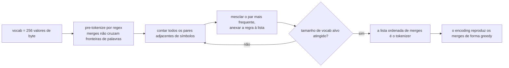

**Follow-ups:** Por que a pre-tokenization importa? O que daria errado sem restrições de fronteira de palavra? Por que `"the"` e `" the"` precisam ser tokens separados? Em que o unigram-LM difere do BPE, conceitualmente?

</details>

### 21. Compare BPE, WordPiece, SentencePiece e byte-level BPE.

<details><summary><b>Resposta</b></summary>

São dois algoritmos, uma biblioteca e uma escolha de alfabeto base. Essa distinção, por si só, já rende pontos, porque muita gente erra ao tratar os quatro como algoritmos paralelos.

**BPE** (algoritmo): bottom-up e greedy, mescla repetidamente o par adjacente mais *frequente*. É usado (na forma byte-level) pelos tokenizers da família GPT-2/3/4 (tiktoken) e pelo Llama 3.

**WordPiece** (algoritmo, BERT): o mesmo esquema bottom-up, mas mescla o par que maximiza a *likelihood* do corpus de treinamento, com score ≈ freq(ab) / (freq(a)·freq(b)). Isso favorece pares que co-ocorrem mais do que o acaso, e não apenas os que aparecem muito. Dá para reconhecê-lo pela convenção `##` para peças de continuação. O encoding usa longest-match-first, em vez de reproduzir os merges.

**Unigram-LM** (algoritmo, muitas vezes usado via SentencePiece): top-down. Começa com um vocabulário candidato grande e poda, de forma iterativa, os tokens cuja remoção menos prejudica a likelihood do corpus sob um modelo unigram; o encoding escolhe a segmentação mais provável (Viterbi). Permite fazer sampling de segmentações alternativas, como regularização durante o treinamento.

**SentencePiece** (biblioteca, não um algoritmo): implementa tanto BPE quanto unigram-LM. Sua propriedade marcante é operar sobre o texto bruto como um stream de caracteres, **sem pre-tokenization externa**. O whitespace é codificado como um meta-símbolo (▁, U+2581), o que o torna agnóstico a idioma (funciona para chinês, japonês e tailandês, onde não há espaços) e exatamente reversível. É o padrão em modelos multilíngues e em muitos modelos abertos (Llama 1/2, T5, Gemma).

**Byte-level BPE** (escolha de alfabeto base): executa o BPE sobre os 256 valores de byte, em vez de caracteres Unicode. A garantia: *nenhuma string jamais fica fora do vocabulário*. Qualquer coisa, em qualquer idioma, emoji, lixo quase binário, se decompõe em bytes no pior caso. O custo: caracteres não latinos raros podem se fragmentar em vários tokens de byte. O SentencePiece oferece uma válvula de escape equivalente, chamada byte-fallback.

Relevância prática para engenharia: a escolha do tokenizer determina as contagens de tokens (custo, latency, contexto efetivo) por idioma, e tokenizers incompatíveis são uma fonte clássica de bugs ao trocar de modelo. Nunca presuma que as contagens de tokens se transferem entre famílias de modelos.

**Follow-ups:** Por que o SentencePiece codifica o whitespace de forma explícita? Que propriedade isso traz? O que é byte-fallback? Com o mesmo tamanho de vocab, por que o unigram-LM poderia produzir segmentações linguisticamente mais naturais que o BPE?

</details>

### 22. Quais são os tradeoffs na escolha do tamanho do vocabulário?

<details><summary><b>Resposta</b></summary>

O tamanho do vocab troca compressão do comprimento da sequência por custo de parâmetros e qualidade dos tokens de cauda. A tendência do setor conta a história: o GPT-2 usou 50.257; o Llama 2 usou 32k; o Llama 3 migrou para ~128k; o tokenizer do GPT-4o tem ~200k.

**Vocabulário maior, benefícios:**
- **Menos tokens por texto**: mais strings viram tokens únicos, então o mesmo documento custa menos tokens. Isso significa inferência mais barata, menor latency e mais conteúdo cabendo na context window. Os ganhos são maiores em idiomas que não o inglês e em código, que vocabs pequenos, centrados no inglês, fragmentam muito. Esse é um dos principais motivos pelos quais o Llama 3 quadruplicou o vocab do Llama 2.
- Menos passos autorregressivos para a mesma saída → geração mais rápida.

**Vocabulário maior, custos:**
- Os **parâmetros de embedding + LM-head** escalam como 2 × vocab × d_model (a menos que haja weight-tying). Com d_model = 4096, um vocab de 128k significa ~525M parâmetros de embedding e outro tanto no output head. Para modelos pequenos, isso é uma fração enorme do orçamento (um modelo de 1B pode gastar >30% dos parâmetros em vocab), enquanto para um modelo de 70B é ruído. Por isso os modelos pequenos quase sempre fazem tying do embedding com o LM head e são muito mais sensíveis ao tamanho do vocab, enquanto os grandes podem bancar vocabulários enormes.
- **Compute do softmax** sobre o vocab em cada posição (importa sobretudo para modelos pequenos e para o throughput de treinamento).
- **Tokens de cauda sub-treinados**: com mais tokens, cada token raro tem menos ocorrências no treinamento. O caso patológico são os "glitch tokens" (a história do SolidGoldMagikarp): tokens que existem no vocab mas quase não aparecem nos dados de treinamento, com embeddings praticamente não inicializados, o que produz comportamento bizarro quando são acionados.
- Vocabs multilíngues maiores fazem cada token cobrir *mais* texto, o que reduz um pouco a granularidade por token que o modelo pode explorar.

Regra prática: o tamanho do vocab deve crescer com o tamanho do modelo e com a variedade de idiomas e domínios atendidos. Há trabalho publicado sobre scaling compute-optimal de vocab mostrando que os modelos frontier vinham subdimensionando seus vocabulários.

**Follow-ups:** O que são glitch tokens e o que os causa? Por que o weight-tying do embedding com o LM head importa mais em modelos pequenos? Como você avaliaria se um tokenizer atende bem aos seus idiomas-alvo?

</details>

### 23. Além de contar letras, que modos de falha a tokenization causa? Pense em aritmética, texto multilíngue e código.

<details><summary><b>Resposta</b></summary>

**Aritmética.** Os números são tokenizados de forma inconsistente: "1234" pode ser um único token, enquanto "1235" se divide em "12"+"35", e a mesma quantidade é fragmentada de forma diferente conforme o texto ao redor. O alinhamento de valor posicional, que é o núcleo dos algoritmos dígito a dígito, se perde quando os operandos têm fronteiras inconsistentes. Por isso várias famílias de modelos forçam a tokenização de um dígito por token nos números, o que melhora a aritmética de forma mensurável: uma estrutura consistente permite que o modelo aprenda algoritmos posicionais. A formatação com vírgulas ("1,234,567") acrescenta mais uma camada de caos na fragmentação.

**Ineficiência multilíngue.** Os tokenizers são treinados em um corpus, e os merges refletem a mistura de idiomas dele. Vocabs com muito inglês fragmentam outros scripts: hindi, tailandês, khmer e outros podem custar 2-5× mais tokens que o inglês para o mesmo conteúdo (o byte-level fallback pode reduzir caracteres raros de um script a vários tokens de byte cada um). As consequências são concretas: usuários desses idiomas pagam mais por requisição, esgotam as context windows mais cedo, atingem os limites de tokens de saída antes e recebem qualidade pior, porque o modelo raciocina sobre unidades fragmentadas. É uma questão de equidade embutida antes de qualquer aprendizado, e um dos motivos pelos quais o Llama 3 e os tokenizers mais novos expandiram o vocab com dados explicitamente multilíngues.

**Código.** O whitespace é sintaxe em Python, e os tokenizers tratam a indentação com tokens de sequências de whitespace (por exemplo, um token para 4 espaços, outro para 8...). Os modelos podem confundir níveis de indentação, e um bug de off-by-one-level é uma falha ligada à tokenization. Tabs e espaços são tokenizados de maneiras totalmente diferentes. A divisão de identificadores (`getUserById` → `get`+`User`+`By`+`Id`) costuma ser semanticamente razoável, mas identificadores raros se fragmentam de forma imprevisível. Os tokenizers modernos, que levam código em conta, ganharam um tratamento dedicado de whitespace e indentação, e isso contribuiu de verdade para os ganhos de qualidade na geração de código.

**O hábito geral de diagnóstico** que os entrevistadores querem ver: quando um LLM falha em algo que exige precisão de caractere ou de formato (ortografia, manipulação de strings, offsets de caracteres em saída estruturada, edições off-by-one), verifique a tokenization primeiro. Colar a entrada problemática num visualizador de tokenizer resolve uma fração surpreendente dos relatos de bug do tipo "o modelo é burro".

**Follow-ups:** Por que tokenizar números com um dígito por token melhora a aritmética? Se o seu produto tem como alvo idiomas do Sudeste Asiático, o que você verificaria antes de escolher um modelo? Como a tokenization afetaria uma feature de geração de code-diff?

</details>

### 24. A attention é O(n²) no comprimento da sequência. Onde isso realmente pesa na prática: no prefill ou no decode?

<details><summary><b>Resposta</b></summary>

A matriz de scores n×n faz os FLOPs da attention crescerem de forma quadrática com o comprimento da sequência, mas *onde* isso dói muda conforme a fase, e os candidatos fortes separam as duas.

**Prefill** (processar o prompt): compute genuinamente quadrático. Todos os n tokens atendem a todos os tokens anteriores em paralelo, e o total de FLOPs de attention fica em ~O(n²·d) por camada. Dobrar o comprimento do prompt quadruplica, aproximadamente, o trabalho de attention no prefill (a parte da MLP escala de forma linear, então o expoente combinado depende do comprimento: em contextos curtos as MLPs dominam, e a partir de 100k+ é a attention que domina). É por isso que o time-to-first-token cresce de forma superlinear em prompts longos, e é por isso que os stacks de serving usam chunked prefill, para o tráfego de decode não ficar travado atrás de um prompt de 100k tokens.

**Decode** (gerar token a token, com KV cache): cada passo é O(n·d), já que o novo token atende a n entradas em cache. O total ao longo de uma geração completa é quadrático, mas o custo por passo é linear no contexto. A restrição real aqui nem são os FLOPs: é a **largura de banda e a capacidade de memória**. Cada passo precisa ler o KV cache inteiro da HBM em stream, e o próprio cache cresce linearmente com n (aqueles ~320 KB/token de um modelo GQA da classe 70B → ~40 GB em 128k). Long context em decode time é um problema de memória.

Consequências que decorrem disso: (1) preço de long-context: alguns provedores cobram mais por requisições de long-context, porque o compute de prefill e a memória do cache inflam; (2) respostas de arquitetura: GQA/MQA/MLA encolhem o cache, a sliding-window attention (estilo Mistral) o limita, e os modelos híbridos SSM-attention atacam os dois problemas; (3) a FlashAttention resolve o *footprint de memória* da attention (sem matriz n² materializada) e o IO, mas não a contagem de FLOPs, então o prefill continua quadrático; (4) implicações de produto: "é só enfiar tudo no contexto" tem um piso de custo quadrático real, o que mantém RAG e curadoria de contexto economicamente relevantes mesmo com janelas cada vez maiores.

**Vale desenhar.** Separar as duas fases antes de falar mostra ao entrevistador que você sabe onde está o gargalo de verdade.

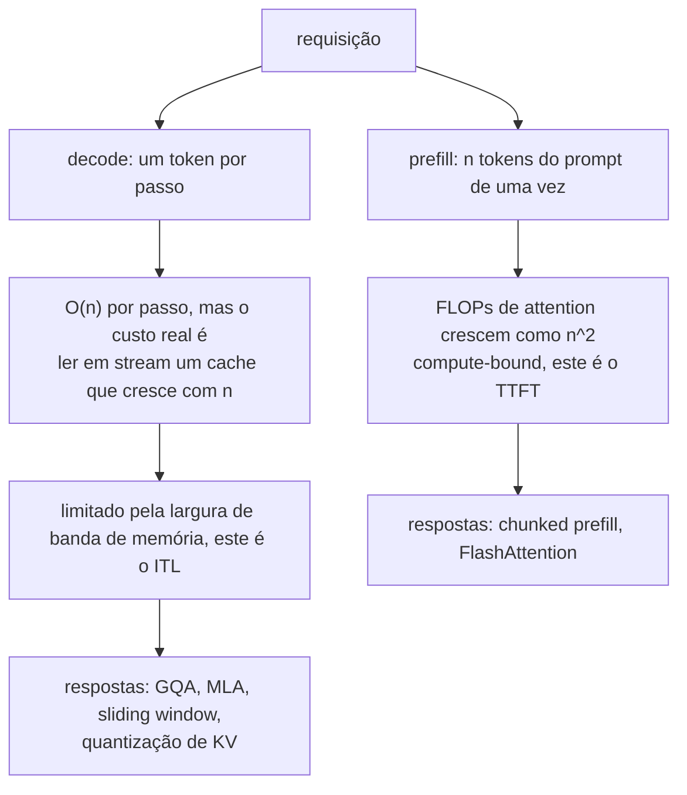

**Follow-ups:** Por que o decode é limitado pela largura de banda de memória? Me conduza pela arithmetic intensity. O que a sliding-window attention sacrifica? Por que a FlashAttention não muda a complexidade assintótica de FLOPs?

</details>

### 25. Explique a ideia central da FlashAttention. O que ela otimiza e o que ela não muda?

<details><summary><b>Resposta</b></summary>

O insight da FlashAttention é que a attention padrão é limitada não por FLOPs, mas por **tráfego de memória**. A implementação ingênua materializa a matriz de scores n×n na HBM da GPU, escreve nela, lê de volta para o softmax, escreve as probabilidades e lê tudo de novo para multiplicar por V. O compute da GPU supera de longe a largura de banda da HBM, então o kernel passa o tempo esperando a memória. A FlashAttention é uma reimplementação **IO-aware e exata**: a mesma matemática, com uma movimentação de memória radicalmente menor.

Três mecanismos:

1. **Tiling**: dividir Q, K, V em blocos dimensionados para caber na SRAM on-chip (ordens de magnitude mais rápida que a HBM). A attention é calculada bloco a bloco, com os produtos intermediários mantidos on-chip e o cálculo de scores, o softmax e a multiplicação por V fundidos em um único kernel.
2. **Online softmax**: o softmax normalmente precisa da linha inteira (para o máximo e o normalizador) antes de produzir qualquer saída. O truque de streaming mantém um máximo corrente e uma soma corrente à medida que os blocos chegam, reescalando os resultados parciais anteriores quando o máximo muda. É matematicamente exato e nunca precisa da linha inteira. Esta é a peça que viabiliza o tiling.
3. **Recomputação no backward**: em vez de armazenar a matriz de probabilidades n×n para a backward pass, guarda-se apenas as estatísticas por linha (máximo e normalizador) e os blocos de attention são recomputados na hora. São FLOPs extras, mas muito menos IO, uma troca favorável no hardware moderno.

Resultados: o footprint de memória da attention cai de O(n²) para O(n), os ganhos de tempo real ficam em ~2-4× nos formatos típicos, e o treinamento e a inferência com long-context se tornam práticos. A FlashAttention-2/3 refinam a paralelização e exploram hardware mais novo (execução assíncrona do Hopper, fp8), e a FlashAttention-4 (2026) redesenha o kernel para a Blackwell, onde o throughput dos tensor cores passou o das unidades de softmax e de memória ao redor.

O que ela **não** muda: a contagem de FLOPs continua O(n²), então o prefill continua quadrático em compute. Não é attention esparsa, linear ou aproximada. E ela não encolhe o KV cache: esse é um problema ortogonal, resolvido por GQA/MLA/quantização. Uma armadilha comum em entrevista é chamar a FlashAttention de aproximação. Ela é, bit a bit, a mesma attention (a menos de reordenação de ponto flutuante), e é exatamente por isso que a adoção foi universal: não havia tradeoff de qualidade a discutir.

**Vale desenhar.** Contrastar o tráfego de memória das duas versões deixa óbvio que a matemática nunca mudou.

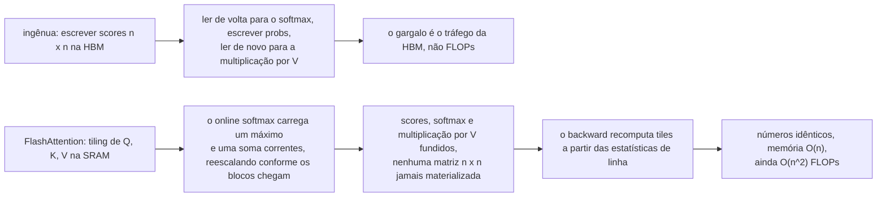

**Follow-ups:** Me conduza pelo reescalonamento do online softmax. Por que recomputar é mais rápido que armazenar a matriz? Como a FlashAttention interage com a causal masking?

</details>

### 26. Como funcionam os positional encodings sinusoidais, e como eles se comparam aos positional embeddings aprendidos?

<details><summary><b>Resposta</b></summary>

A self-attention é invariante a permutação, então a posição precisa ser injetada de forma explícita. O transformer original somou **encodings sinusoidais** aos token embeddings: para a posição pos e o par de dimensões i, PE(pos, 2i) = sin(pos / 10000^(2i/d)) e PE(pos, 2i+1) = cos(pos / 10000^(2i/d)). Cada par de dimensões oscila numa frequência diferente, espaçadas de forma geométrica, do comprimento de onda 2π até ~10000·2π. É como um contador binário em forma contínua, ou ponteiros de relógio girando em velocidades diferentes. As dimensões de baixa frequência distinguem a posição de forma grosseira, e as de alta frequência distinguem tokens adjacentes.

Duas propriedades elegantes. A primeira: não há parâmetros aprendidos, então, em teoria, funciona para qualquer posição, inclusive as que nunca apareceram no treinamento. A segunda: para qualquer offset fixo k, PE(pos+k) é uma *função linear* de PE(pos), uma rotação em cada par de frequência, de modo que os offsets relativos são, em princípio, fáceis para a attention calcular. Na prática, a extrapolação além dos comprimentos treinados ainda se degrada, porque o modelo nunca aprendeu a *usar* as combinações que não viu.

Os **embeddings absolutos aprendidos** (GPT-2, BERT) são apenas uma tabela de embedding indexada pela posição e somada aos token embeddings. São mais simples, deixam o modelo aprender qualquer estrutura posicional que ajude e, empiricamente, igualaram os sinusoidais nos comprimentos treinados. As limitações são rígidas: a tabela tem tamanho fixo (a posição 1025 simplesmente não tem embedding num modelo treinado com 1024), e cada índice de posição é treinado só tantas vezes quanto aparece, então as posições finais ficam sub-treinadas.

Os dois compartilham uma fraqueza mais profunda: codificam a posição **absoluta**, enquanto a linguagem se importa sobretudo com a posição **relativa** ("o adjetivo antes deste substantivo"). Além disso, somar a posição ao *embedding* mistura conteúdo e posição em todo o residual stream. Isso motivou a geração moderna de métodos que injetam a posição *relativa* direto no cálculo da attention: RoPE (rotacionar Q/K conforme a posição, de modo que os scores dependam do offset) e ALiBi (bias de penalidade por distância nos scores). É isso que os modelos atuais realmente usam. Os embeddings absolutos sinusoidais e aprendidos hoje têm importância sobretudo histórica e conceitual.

**Follow-ups:** Por que a posição relativa é mais útil que a absoluta para linguagem? Mostre por que um offset fixo é uma transformação linear de um encoding sinusoidal. Por que somar a posição aos embeddings mistura conteúdo e posição, e por que isso importa?

</details>

### 27. Explique o RoPE. Qual é a intuição da rotação e por que ele se tornou o padrão?

<details><summary><b>Resposta</b></summary>

O Rotary Position Embedding injeta a posição **rotacionando** os vetores de query e key, em vez de somar algo aos embeddings. Agrupe as dimensões de cada head em pares (dim 0-1, 2-3, ...) e trate cada par como um vetor 2D. Para um token na posição m, rotacione o par i pelo ângulo m·θ_i, onde θ_i = 10000^(−2i/d) dá frequências espaçadas de forma geométrica: pares que giram rápido codificam a posição fina/local, e pares que giram devagar codificam a posição grosseira/de longo alcance.

O ganho aparece no produto escalar. As rotações preservam normas, e o ângulo entre uma query rotacionada por m·θ e uma key rotacionada por n·θ muda exatamente em (m−n)·θ. Assim, o attention score entre as posições m e n depende apenas do **offset relativo m − n** (e dos vetores de conteúdo). É uma codificação de posição relativa, obtida de forma multiplicativa, com zero parâmetros aprendidos e aplicada só a Q e K (V fica como está, então a saída não carrega contaminação posicional). A intuição dos ponteiros de relógio: cada par de dimensões é um ponteiro que gira na sua própria velocidade conforme a posição avança, e a attention compara a *diferença* entre as leituras do relógio de dois tokens.

Por que ele venceu (Llama, Qwen, Mistral, a maioria dos modelos abertos modernos, e é a premissa por trás da maior parte das ferramentas de long-context):

- A posição relativa corresponde ao que a linguagem precisa, sem os termos extras de attention que os esquemas de posição relativa mais antigos (T5 bias, Shaw et al.) exigiam.
- Não tem parâmetros nem teto de comprimento imposto por uma tabela de posições, e é compatível com KV caching (a K de cada token é rotacionada uma vez, pela posição absoluta, e depois guardada em cache; o comportamento relativo emerge no produto escalar).
- A dependência entre tokens que decai com a distância surge naturalmente nas configurações de frequência padrão.
- E, o mais importante, ele se mostrou **extensível**: como a posição vive em ângulos de rotação, estender o contexto vira cirurgia de frequência. Position interpolation, NTK-aware scaling e YaRN funcionam reescalando θ ou as posições, o que é muito mais limpo do que adaptar uma tabela de embedding depois.

Limitação: o RoPE vanilla ainda se degrada bruscamente além do comprimento treinado, porque as faixas de ângulo que o modelo não viu estão fora da distribuição. É exatamente isso que os métodos de extensão resolvem.

**Vale desenhar.** As duas rotações se encontrando num produto escalar são o esboço da prova inteira numa imagem.

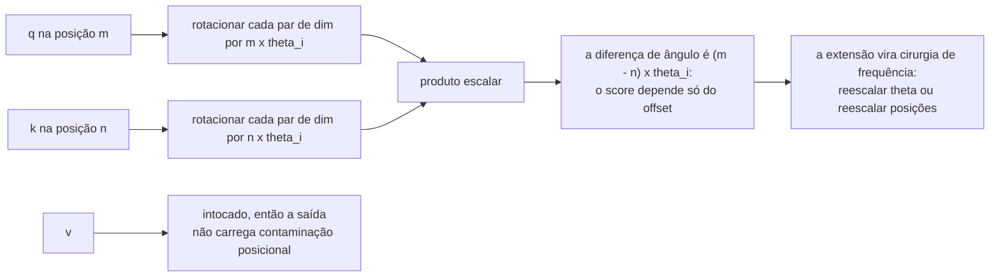

**Follow-ups:** Prove que o score depende apenas de m−n para um único par 2D. Por que o RoPE é aplicado a Q e K, mas não a V? Como a position interpolation e o YaRN manipulam as frequências do RoPE?

</details>

### 28. Como o ALiBi codifica a posição, e pelo que ele ficou famoso?

<details><summary><b>Resposta</b></summary>

O ALiBi (Attention with Linear Biases) **não usa nenhum positional embedding**. Em vez disso, soma uma penalidade estática direto aos attention scores, proporcional à distância entre query e key: score(i, j) += −slope · (i − j) para j ≤ i. Cada head recebe um slope diferente, fixo (não aprendido), tirado de uma sequência geométrica (por exemplo, 1/2, 1/4, ..., 1/2⁸ para 8 heads). Assim, algumas heads têm um forte viés de recência e acabam sendo locais, enquanto as heads de slope raso ainda conseguem olhar bem para trás. A posição é expressa puramente como "quanto mais longe, menos peso", e o modelo aprende todo o resto a partir do conteúdo.

O que o tornou famoso foi a **extrapolação de comprimento**: dá para treinar com contexto de 1k-2k e rodar a inferência em comprimentos muito maiores, com bem menos degradação do que nos modelos sinusoidais, aprendidos ou com RoPE vanilla, cujo comportamento colapsa em valores de posição fora da distribuição. O ALiBi não tem posições fora da distribuição: a fórmula do bias é a mesma função linear em qualquer distância, então nada quebra estruturalmente em comprimentos não vistos. Ele também é simples (algumas linhas no kernel de attention), não tem parâmetros e adiciona compute desprezível. MPT e BLOOM foram lançados com ele.

As limitações honestas explicam por que o RoPE ainda domina. O viés de recência embutido é um prior indutivo forte: ajuda na perplexity, mas faz o retrieval realmente de longo alcance lutar contra a penalidade, e na prática os modelos ALiBi são mais fracos em tarefas de recall de longo alcance do que os modelos com RoPE estendido. "Não explode no comprimento" não é o mesmo que "usa bem o comprimento". Ele também é desajeitado de combinar com algumas otimizações de attention, e o ferramental do ecossistema se consolidou em torno do RoPE. Depois que position interpolation e YaRN tornaram o RoPE extensível a baixo custo, a principal vantagem do ALiBi perdeu importância.

Conceitualmente, ele continua sendo uma referência importante: a posição relativa pode ser expressa como um *bias no espaço dos scores*, e não como conteúdo no espaço de embedding. Além disso, o comportamento tipo sliding-window das heads de slope íngreme antecipou os designs explícitos de local attention.

**Follow-ups:** Por que o ALiBi extrapola onde o RoPE não consegue? Qual é o custo de um prior de recência em tarefas pesadas em retrieval? Compare o bias do ALiBi com os buckets aprendidos de posição relativa do T5.

</details>

### 29. Um modelo foi pré-treinado com contexto de 8k. Você precisa de 128k. Quais são as opções? Explique position interpolation e YaRN.

<details><summary><b>Resposta</b></summary>

O problema que você está corrigindo: o RoPE codifica a posição como ângulos de rotação, e posições além de 8k produzem combinações de ângulos que o modelo nunca viu. Fora da distribuição, o comportamento da attention se degrada de forma catastrófica. Fazer fine-tuning ingênuo em 128k, com posições novas desde o início, é caro e converge devagar. Por isso os métodos práticos reescalam o RoPE, para que os contextos longos caiam dentro (ou perto) da distribuição que o modelo já entende.

**Position interpolation (PI)**: comprimir as posições de forma linear. Para rodar em 32k um modelo treinado com 8k, multiplique cada posição por 1/4 (ou, de forma equivalente, reduza as frequências do RoPE), para que toda a faixa seja mapeada em [0, 8k]. Todos os ângulos passam a estar na distribuição, e o custo é a resolução: tokens adjacentes ficam a apenas um quarto de "unidade de posição" de distância, o que borra as distinções locais finas que as dimensões de alta frequência forneciam. Um fine-tune curto (da ordem de ~1B tokens) recupera a maior parte da qualidade. É simples e eficaz, mas a precisão local sofre mais com fatores de escala grandes.

**NTK-aware scaling** (a ideia intermediária): em vez de comprimir todas as frequências por igual, reescale a base do RoPE para que **as dimensões de baixa frequência (comprimento de onda longo) sejam bastante interpoladas**, enquanto **as de alta frequência ficam quase intactas**. Isso preserva a resolução local e estica a cobertura de longo alcance. É popular porque funciona surpreendentemente bem mesmo *sem* fine-tuning.

O **YaRN** combina e refina essas ideias. Ele divide as dimensões do RoPE em bandas, conforme quantos comprimentos de onda completos cabem no contexto treinado: as bandas de alta frequência ficam intocadas (já viram todas as fases e codificam estrutura local), as de baixa frequência são totalmente interpoladas (os ângulos absolutos delas importam) e uma banda intermediária faz uma rampa suave entre as duas. Há ainda um pequeno ajuste de attention-temperature (escalar os logits de attention), que compensa o deslocamento de entropia que contextos mais longos induzem. O YaRN chega a uma boa qualidade em long-context com cerca de uma ordem de magnitude a menos de dados de fine-tuning que a PI simples, e é a base de muitas variantes long-context de modelos abertos.

Mencione também que os modelos long-context de produção costumam combinar esse tipo de scaling com um **mid-training de long-context** dedicado (continued pretraining em documentos realmente longos). A cirurgia de frequência torna as posições longas representáveis; treinar em dependências de longo alcance as torna *utilizáveis*. E valide com evals de retrieval (needle-in-a-haystack e, melhor ainda, benchmarks de raciocínio multi-fato, como as suítes estilo RULER): comprimento anunciado ≠ comprimento utilizável.

**Vale desenhar.** Dividir as frequências em bandas é o que separa uma resposta sobre YaRN de uma resposta sobre position interpolation simples.

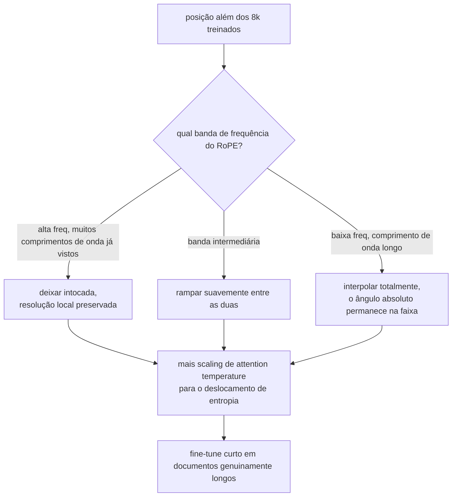

**Follow-ups:** Por que as dimensões de alta frequência do RoPE não precisam de interpolação? Por que a extensão de long-context geralmente ainda exige algum fine-tuning em documentos longos? Como você verificaria o comprimento de contexto utilizável antes do ship?

</details>

### 30. O que são MQA e GQA, e por que existem?

<details><summary><b>Resposta</b></summary>

Elas existem por causa da memória do KV cache. Na multi-head attention (MHA) padrão, cada uma das h heads tem as próprias projeções K e V, então o cache armazena h keys e h values por token, em cada camada. O tamanho do cache, e não os FLOPs, é a restrição que limita o throughput de serving: ele determina quantas sequências concorrentes cabem numa GPU (o batch size), e a velocidade de decode é limitada pela leitura do cache da HBM em stream a cada passo. Cortar KV heads ataca os dois problemas.

**MQA (multi-query attention)**, de "Fast Transformer Decoding: One Write-Head is All You Need", de Shazeer: mantém h query heads, mas compartilha uma **única** K/V head entre todas elas. O cache encolhe h× (por exemplo, 32×), e a largura de banda do decode cai na mesma proporção. O custo é uma regressão de qualidade mensurável em algumas tarefas, e o treinamento pode ser menos estável, já que uma única representação K/V precisa atender às necessidades de todas as query heads.

**GQA (grouped-query attention)**, de Ainslie et al.: a solução intermediária. Particiona as h query heads em g grupos, e cada grupo compartilha uma K/V head. Por exemplo, os modelos de 70B no estilo Llama usam 64 query heads com 8 KV heads (grupos de 8). O cache encolhe 8×, e a qualidade, na prática, é quase indistinguível da MHA. O paper da GQA também mostrou que dá para fazer **uptrain** de um checkpoint MHA existente para GQA, fazendo mean-pooling das K/V heads e continuando o treinamento por pouco tempo, sem precisar de um novo pretraining do zero. A GQA é o padrão na maioria dos modelos abertos desde 2023 (variantes grandes do Llama 2/3, Mistral, Qwen...), e a MLA é a principal alternativa nas linhagens DeepSeek e Kimi.

Impacto concreto: um modelo da classe 70B em fp16, com 80 camadas e head_dim 128, armazena ~2,6 MB/token com 64 KV heads, contra ~320 KB/token com 8. É a diferença entre caber ~4 e ~30+ sequências longas na mesma memória.

O desdobramento natural é a **MLA** (multi-head latent attention, DeepSeek): comprimir K/V num vetor latente de baixo rank compartilhado por token e reconstruir a K/V de cada head a partir dele. Isso reduz o cache ainda mais e *aumenta* a diversidade efetiva das heads em relação à GQA. Vale mencionar para mostrar que você sabe aonde essa linha de design chegou.

**Vale desenhar.** Query heads de um lado, KV heads do outro: a razão de compartilhamento é todo o espaço de design.

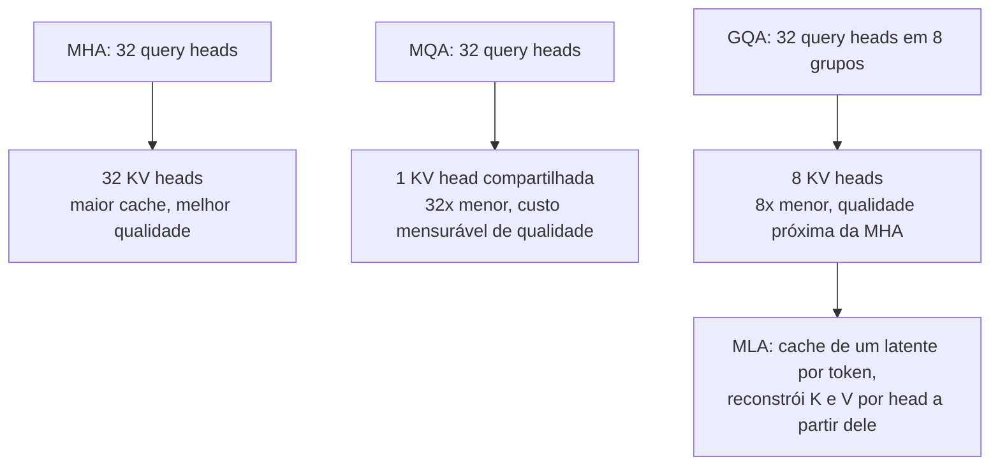

**Follow-ups:** Por que o throughput de decode é limitado pela largura de banda de memória, e como a GQA muda a aritmética? Como funciona a receita de uptraining da GQA? O que a MLA faz de diferente?

</details>

### 31. Derive a fórmula de memória do KV cache e calcule-a para um modelo concreto.

<details><summary><b>Resposta</b></summary>

A derivação parte do que é armazenado: para cada token, em cada camada, o cache guarda os vetores de key e value daquele token para cada KV head. Um vetor de key (ou value) por head tem head_dim elementos. Então:

**bytes por token = 2 × n_layers × n_kv_heads × head_dim × bytes_per_element**

(O 2 é de K e V; multiplique por seq_len para uma sequência e pelo batch size para um nó de serving.) Note que são **kv** heads: com GQA, a quantidade de query heads é irrelevante para o cache.

Um exemplo concreto: um modelo no formato do Llama-3-70B, com 80 camadas, 8 KV heads (GQA), head_dim 128 e fp16 (2 bytes):

```python
bytes_per_token = 2 * 80 * 8 * 128 * 2      # = 327,680 ≈ 320 KB/token
seq_128k = bytes_per_token * 131_072        # ≈ 42 GB para uma sequência
seq_8k   = bytes_per_token * 8_192          # ≈ 2.7 GB
```

Ou seja, uma única conversa com contexto de 128k consome ~40+ GB de memória de GPU *além* dos ~140 GB de pesos em fp16. Com MHA completa (64 KV heads), seria 8× pior: ~2,6 MB/token, ~340 GB em 128k, o que é impossível de servir. Só essa comparação já justifica a GQA.

Consequências de engenharia que vale destacar: (1) capacidade de batch: o que limita os usuários concorrentes é a memória do cache, não os pesos, então o tamanho do cache define diretamente o custo por requisição; (2) o **PagedAttention** (vLLM) existe porque pré-alocar de forma ingênua um cache contíguo de comprimento máximo desperdiça a maior parte dele, e a paginação aloca sob demanda, em blocos, como numa memória virtual; (3) a **quantização de KV** para fp8/int8 reduz isso à metade ou a um quarto, com custo modesto de qualidade; (4) o **prefix caching** compartilha entre requisições o cache de prefixos de prompt comuns (system prompts, exemplos few-shot), com economia enorme em cargas agentic que reenviam repetidamente conversas cada vez maiores; (5) speculative decoding, beam search e sampling paralelo multiplicam a pressão sobre o cache.

Um hábito de sanity-check: memorize a fórmula, não os números dos modelos. Os entrevistadores variam a arquitetura e querem ver você calcular.

**Vale desenhar.** Escrever a cadeia de multiplicações permite recalcular ao vivo quando o entrevistador muda a arquitetura na sua frente.

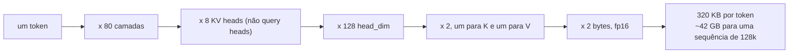

**Follow-ups:** Como o PagedAttention reduz o desperdício, e que problema a fragmentação causa? Num nó 8×80 GB servindo este modelo, quantas sequências concorrentes de 32k tokens cabem depois dos pesos? Como a sliding-window attention muda a fórmula?

</details>

### 32. Explique o min-p sampling e as penalidades de repetition/frequency. Quando as configurações padrão de sampling falham?

<details><summary><b>Resposta</b></summary>

O **Min-p** mantém apenas os tokens cuja probabilidade seja pelo menos min_p × p_max (a probabilidade do token de topo), depois renormaliza e faz o sampling. O limiar *escala com a confiança do modelo*. Se o token de topo tem p = 0,9, min_p = 0,1 mantém só os tokens acima de 0,09, essencialmente apenas a cabeça da distribuição. Se o token de topo tem p = 0,1 (incerteza genuína), sobrevivem os tokens acima de 0,01, uma diversidade ampla e adequada. Compare com o top-p, cujo critério de massa acumulada se degrada em temperature alta: as distribuições achatadas empurram o nucleus para dentro da cauda de lixo. O min-p fica ancorado no melhor token, e é por isso que permite sampling estável em temperaturas como 1,5-3, onde a saída do top-p desmorona. É popular em comunidades de escrita criativa e de modelos abertos, com suporte em vLLM e llama.cpp.

As **penalidades da família repetition** existem porque os modelos autorregressivos têm um loop que se autoalimenta: texto repetido aumenta a probabilidade de repetir ainda mais, e o decoding greedy ou de baixa temperature pode travar em ciclos. Há três variantes padrão: **repetition penalty** (dividir/multiplicar os logits dos tokens já vistos por um fator como 1,1-1,3), **frequency penalty** (subtrair um valor proporcional à contagem do token até o momento, punindo o reuso intenso de forma progressiva) e **presence penalty** (subtração fixa para qualquer token que já tenha aparecido, o que empurra por novidade de tópico). As APIs no estilo OpenAI expõem as duas últimas.

**Quando as configurações padrão falham**, a parte que mostra experiência em produção:

- **Saída estruturada/código com penalidades ligadas**: o JSON precisa repetir `"`, `{`, `,` e nomes de campos; o código precisa de identificadores e tokens de indentação repetidos. As penalidades de repetição corrompem exatamente esses tokens, uma causa clássica de JSON malformado. Desligue-as (ou quase) na geração estruturada e use constrained decoding.
- **Temperature alta + top-p**: incoerência por sampling da cauda. Mude para min-p ou reduza T.
- **T = 0 em geração longa de texto livre**: loops de repetição, exatamente o problema para o qual as penalidades foram inventadas.
- **Presence penalty agressiva em conversas longas**: o modelo passa a evitar termos de domínio necessários que ele já usou.
- Além disso: as penalidades se aplicam a *token IDs*, não a palavras. Elas não percebem que "dog" e " dog" são a mesma palavra, outro vazamento da tokenization.

**Follow-ups:** Por que o top-p, especificamente, se desfaz em temperature alta? Como você geraria JSON garantidamente válido: com configurações de sampling ou com constrained decoding? Por que as penalidades de repetição operam sobre tokens e não sobre palavras, e que artefatos isso causa?

</details>

### 33. O que são logprobs, e para que servem em sistemas de produção?

<details><summary><b>Resposta</b></summary>

Um logprob é o log da probabilidade que o modelo atribuiu a um token, ou seja, log softmax(z), em um dado passo. As APIs (por exemplo, o `logprobs`/`top_logprobs` da OpenAI) podem retornar, para cada token de saída, o logprob dele mais os top-k tokens alternativos e os respectivos logprobs. É o mais perto que você chega da confiança interna do modelo, e sai de graça: não exige forward pass extra.

Usos em produção:

- **Classificação com confiança.** Formule a tarefa de modo que a resposta seja um único token ("yes"/"no", "A" - "D"). O logprob vira um confidence score. Mande os casos de baixa confiança para um modelo maior, para um humano ou para um caminho de abstenção. É a forma mais limpa de tirar scores quase calibrados de um classificador baseado em LLM e de definir limiares de precision/recall como num sistema de ML comum.
- **Heurísticas de hallucination/incerteza.** Logprobs baixos, ou com entropia espalhada, em trechos que carregam conteúdo (nomes, números, datas) indicam prováveis fabricações. Não é garantia, porque o modelo pode estar confiantemente errado, mas é um sinal utilizável para disparar verificação ou checagem de citations.
- **Reranking e scoring.** Pontue completions candidatas, passagens de retrieval ou opções de múltipla escolha pelo logprob total ou médio. A perplexity de um documento sob o modelo é um sinal de fluência/anomalia (também muito usado na filtragem de dados de pretraining).
- **Evals.** Avaliação baseada em perplexity e benchmarks de múltipla escolha (pontuar cada opção e escolher a de maior score, o truque padrão por trás de muitos harnesses de benchmark). É mais barato e tem menos variância do que fazer parsing das respostas geradas.
- **Debugging.** Quando a saída fica estranha num ponto específico, os logprobs por token mostram exatamente onde o modelo ficou em dúvida, e as alternativas top-k mostram o que ele quase fez. Isso é valiosíssimo para debugar prompts e para identificar artefatos de tokenizer.
- **Distillation/trabalho com dados.** Soft targets para treinar modelos menores e filtragem de dados sintéticos baseada em confiança.

Ressalvas que um candidato forte levanta: os modelos ajustados com RLHF são notoriamente **mal calibrados** em comparação com os modelos base (o alinhamento afunila as distribuições), então trate os logprobs como sinais relativos e ajuste os limiares nos seus próprios dados. A probabilidade em nível de sequência não equivale à correção da resposta: muitas formulações compartilham a mesma resposta, e a probabilidade verdadeira dela fica espalhada entre as paráfrases. E as APIs fechadas podem não expor logprobs em todos os endpoints/modelos, às vezes para evitar distillation.

**Follow-ups:** Por que o RLHF prejudica a calibração? Projete um router com limiar de confiança usando logprobs: o que você validaria? Por que a probabilidade de uma *resposta* não é a mesma coisa que a probabilidade de uma *sequência*?

</details>

### 34. Descreva o pipeline moderno de treinamento de LLMs: pretraining → mid-training → SFT → RL.

<details><summary><b>Resposta</b></summary>

**Pretraining**: next-token prediction sobre trilhões de tokens (web crawl, código, livros, papers, tudo muito filtrado, deduplicado e ponderado por mistura). É onde, tradicionalmente, foi a maior parte do compute (meses em milhares de aceleradores) e de onde as capacidades realmente vêm: linguagem, conhecimento, código, raciocínio latente. A saída é um *base model*, que completa texto, mas não segue instruções nem conversa. Ele pode responder à sua pergunta ou continuá-la com mais três perguntas.

**Mid-training** (continued pretraining): o estágio intermediário, bagunçado mas crucial, que os labs agora nomeiam de forma explícita. Continua sendo next-token prediction, mas sobre dados curados de propósito para objetivos específicos: injetar dados de domínio de alta qualidade (matemática, código, livros-texto sintéticos), fazer a **extensão do comprimento de contexto** (documentos longos + reescalonamento do RoPE; long context é uma entrega do mid-training, não um padrão do pretraining) e o **annealing**, que é decair a learning rate sobre os dados de mais alta qualidade, dando mais peso a material em formato de instrução e em estilo de prova, para que o base model chegue mais perto do destino pós-treinado.

**SFT (supervised fine-tuning)**: cross-entropy sobre pares (prompt, resposta) curados, com a loss em geral mascarada para os tokens da resposta. Ensina formato e comportamento: estrutura de chat, instruction following, sintaxe de tool-call, estilo de recusa, persona. É relativamente minúsculo (da ordem de 10⁴ a 10⁶ exemplos) e barato perto do pretraining. O modelo mental-chave: o SFT *elicita e molda* o que o pretraining construiu. Ele adiciona comportamento, e não (muito) conhecimento: empurrar fatos novos via SFT tende a gerar memorização e pode até estimular um comportamento no formato de hallucination.

**RL / preference optimisation**: alinhar as saídas a preferências humanas ou verificáveis, além do que as demonstrações capturam. No **RLHF** clássico, treina-se um reward model em pares de preferência humana e otimiza-se a policy com PPO, sob uma coleira de KL para o modelo SFT. O **DPO** e seus sucessores dispensam o reward model explícito e otimizam as preferências diretamente: é mais simples, mais barato e muito usado. O **RLVR** (RL from verifiable rewards, por exemplo o **GRPO**) obtém a recompensa de resultados verificáveis (testes unitários passam, a resposta de matemática confere). É o que treina os reasoning models no estilo o1/R1 e representa a fronteira atual, porque pode *estender* capacidades, e não só direcionar o estilo.

Um enquadramento que funciona bem: pretraining ≈ construir o motor; mid-training ≈ melhorar componentes; SFT ≈ ensinar a dirigir em estrada; RL ≈ treinar contra resultados. Historicamente, cada estágio era ordens de magnitude mais barato que o anterior. O RL focado em reasoning estreitou muito essa diferença desde 2025, e os orçamentos de RL de alguns labs hoje são uma fração substancial do pretraining. De qualquer forma, os estágios finais determinam, de forma desproporcional, a qualidade percebida.

**Vale desenhar.** Rotular as arestas com o que cada estágio adiciona evita que os quatro estágios soem como se fossem o mesmo.

```mermaid
flowchart LR
    PT["pretraining: trilhões de tokens,<br/>next-token prediction"] -->|"a maior parte do compute"| BM["base model: completa texto,<br/>não conversa"]
    BM -->|"dados curados, documentos longos"| MT["mid-training: mix de domínio,<br/>extensão de contexto, annealing"]
    MT -->|"10^4 a 10^6 pares"| SFT["SFT: formato de chat, instruction following,<br/>sintaxe de tools, estilo de recusa"]
    SFT -->|"preferências ou verificadores"| RL["RL: RLHF e DPO para estilo,<br/>RLVR e GRPO para resultados verificáveis"]
    RL --> SHIP["modelo entregue"]
```

**Follow-ups:** Por que o SFT com fatos novos estimula hallucination? O que a restrição de KL no RLHF evita? Por que as recompensas verificáveis destravaram ganhos de reasoning que o RLHF baseado em preferências não destravou?

</details>

### 35. O que é um attention sink, por que ele existe e o que quebra se você o remover do KV cache?

<details><summary><b>Resposta</b></summary>

Um attention sink é uma posição, quase sempre o primeiríssimo token, que absorve uma grande parcela da massa de attention na maioria das heads e camadas, qualquer que seja o conteúdo dela. Não é um bug, e não tem a ver com o token ser importante.

Ele existe porque o softmax precisa somar 1. Uma head que não tem nada relevante a buscar naquela posição ainda precisa colocar todo o seu peso em algum lugar. Ela aprende a despejá-lo num token que toda posição enxerga (a posição 0, sob causal masking) e cujo value vector contribui com quase nada. Ou seja, o sink é a forma como o modelo expressa "não atender a nada" dentro de um mecanismo que não tem opção nula.

A consequência prática é a descoberta do StreamingLLM. Se você faz uma evicção ingênua de KV por sliding-window e a janela rola além do token 0, a perplexity não se degrada aos poucos: ela explode. A massa que estava estacionada sem fazer mal no sink é redistribuída sobre tokens reais, e isso distorce todas as distribuições de attention do modelo. A correção é quase constrangedoramente barata: fixar de forma permanente o KV dos primeiros ~4 tokens junto com a janela rolante, e a estabilidade volta, mesmo com milhões de tokens em streaming.

Seja preciso sobre o que isso não faz. Não estende o contexto efetivo: os tokens removidos do meio se foram. A técnica serve para streaming sem fim, como uma sessão de chat que nunca termina, e não para recall de long-context.

Respostas de arquitetura: treinar com um sink token aprendível e dedicado, para que o comportamento seja explícito em vez de emergente; ou dar ao softmax uma válvula de escape, seja com uma formulação off-by-one, com um logit zero extra no denominador, seja com um bias aprendido por head, para que as heads não precisem sequestrar um token real para fazer no-op.

A conexão que os entrevistadores adoram: as posições de sink carregam outliers de ativação enormes, porque o modelo empurra valores gigantes por dimensões residuais específicas para vencer essa disputa. Isso explica boa parte do motivo pelo qual a quantização ingênua de ativações fracassa, e liga o assunto diretamente a serving.

**Vale desenhar.** A bifurcação na evicção é a parte que fica na memória: um token sai e todas as distribuições de attention se deslocam.

```mermaid
flowchart TD
    S["o softmax precisa somar 1"] --> NN["uma head sem nada a buscar<br/>ainda precisa colocar sua massa em algum lugar"]
    NN --> T0["token 0: visível a toda posição,<br/>value vector contribui ~ nada"]
    T0 --> EV{"a sliding window rola além do token 0?"}
    EV -->|"removido"| BOOM["a massa cai em tokens reais,<br/>a perplexity explode"]
    EV -->|"primeiros ~4 tokens fixados"| OK["estável ao longo de milhões de tokens em streaming"]
    OK --> NOTE["mas sem recall extra:<br/>os tokens do meio removidos continuam perdidos"]
```

**Follow-ups:** Como um bias de softmax aprendido muda a história da quantização? Você esperaria encontrar attention sinks num modelo encoder-only?

</details>

### 36. Explique a sliding-window attention e os stacks híbridos local/global. O que você ganha e o que você sacrifica?

<details><summary><b>Resposta</b></summary>

A sliding-window attention restringe cada token aos últimos w tokens, em vez do prefixo inteiro. O tempo vai de O(n^2) para O(n*w) e, mais importante, o KV cache dessas camadas fica limitado a w entradas, em vez de crescer com n. O Mistral 7B a popularizou com uma janela de 4096, e o Gemma 2 e 3 a intercalam com camadas de full attention.

O ponto que os candidatos costumam perder: uma pilha de camadas com janela não é tão míope quanto parece, porque o receptive field se compõe com a profundidade, exatamente como numa CNN. Com janela w e L camadas, a informação pode, em princípio, viajar ~L*w posições. Só que a propagação por muitos hops perde informação e fica difusa, e qualquer retrieval exato de um único hop, como citar uma string que está a mais de w posições, simplesmente não acontece numa camada local.

Daí o padrão moderno: stacks híbridos. Intercalam-se majoritariamente camadas locais com uma camada de full attention de vez em quando, por exemplo a razão local-para-global de 5:1 do Gemma 3, com janelas de 1024 tokens. As camadas globais fazem o retrieval exato de longo alcance, e as camadas locais fazem a maior parte do trabalho, de forma barata. Ablações publicadas mostram custo mínimo de perplexity, e a economia de KV em 128k é grande, porque só 1 camada em 6 tem um cache que escala com n.

O que você sacrifica e o que observar:

- O contexto efetivo de retrieval é governado pelas camadas globais, não pela janela anunciada. A razão é um botão real de qualidade; não sai de graça.
- As camadas de full attention que sobram viram o gargalo de memória, e é por isso que os times empilham mais truques justamente nelas: compartilhamento de KV entre camadas, MLA, quantização de cache.
- Prefix caching e reuso de cache ficam mais complicados quando as camadas têm semânticas de cache heterogêneas.
- Bugs de máscara em camadas locais passam despercebidos em contexto curto e só aparecem em contexto longo. Sua suíte de testes precisa de casos longos, senão você vai fazer ship do bug.

Em comparação com um padrão esparso aprendido, as sliding windows embutem a suposição de que a relevância é local. É um bom prior para prosa e um prior ruim para código com definições distantes, e esse é parte do motivo pelo qual a esparsidade aprendida saiu da pesquisa e chegou a modelos em produção: a sparse attention do DeepSeek-V3.2 usa um indexer leve para pontuar as posições anteriores e deixa cada query atender apenas às de maior score.

**Vale desenhar.** Desenhar o bloco 5:1 mostra exatamente quais camadas ainda carregam um cache que cresce com o contexto.

```mermaid
flowchart LR
    IN["tokens"] --> L1["camada local, janela 1024<br/>cache limitado a w"]
    L1 --> L2["cinco camadas locais seguidas"]
    L2 --> G["uma camada de full attention<br/>cache cresce com n"]
    G --> OUT["repetir o bloco"]
    L2 --> RF["o receptive field se compõe até ~ L x w,<br/>mas a propagação multi-hop perde informação"]
    G --> EX["retrieval exato de longo alcance<br/>só pode acontecer aqui"]
```

**Follow-ups:** Como você escolheria a razão local-para-global para um modelo de código e para um modelo de chat? O que a sliding-window attention faz com o prefix caching num agent multi-turn?

</details>

### 37. O que é Multi-head Latent Attention, e em que ela realmente difere da GQA?

<details><summary><b>Resposta</b></summary>

A GQA encolhe o KV cache pela estrutura: menos KV heads, compartilhadas entre grupos de query heads. Você joga fora diversidade de heads em K e V e torce para que isso não pese muito.

A MLA faz um corte diferente. Projeta o hidden state para baixo, num pequeno vetor latente, guarda em cache apenas esse latente e reconstrói o K e o V de cada head com up-projections aprendidas, na hora da attention. Conceitualmente, cada head continua com o próprio K e V; você só armazena uma representação comprimida. Ela surgiu no DeepSeek-V2 e seguiu para o V3.

Por que ela não é só "GQA com passos extras": as matrizes de up-projection são estáticas, então podem ser absorvidas algebricamente nas projeções de query e de saída. Na inferência, você nunca materializa o K completo de cada head: calcula os scores direto contra o latente. Isso faz dela um ganho de memória genuíno, e não uma troca de memória por recomputação. A DeepSeek reportou uma redução de cerca de 93% no KV cache em relação ao próprio modelo MHA no V2, com qualidade igual ou melhor que a da GQA nas ablações deles, e essa é a parte incomum: normalmente, comprimir o cache custa alguma coisa.

A complicação é o RoPE, e este é o detalhe que separa quem leu o paper de quem leu um resumo. O RoPE aplica uma rotação que depende da posição, e não dá para absorver uma rotação dependente da posição numa up-projection estática, então o truque da absorção quebra. A resposta da DeepSeek é o decoupled RoPE: dividir a dimensão da head em uma parte comprimida, sem RoPE, e uma pequena parte separada que carrega o RoPE, guardada em cache sem compressão e compartilhada entre as heads.

Quando eu a escolheria? Só quando a memória de KV em long context for, de fato, a minha restrição limitante e eu controlar o stack de serving. A MLA é bem mais difícil de implementar e de fazer sharding sob tensor parallelism, e o suporte de kernels (que melhorou depois que kernels dedicados de MLA e engines de serving mainstream passaram a oferecê-la) ainda é mais restrito que o da GQA. Além disso, a vantagem de qualidade reportada aparece principalmente em grande escala. Abaixo de uns 100B, a maioria dos times ainda escolhe GQA, e é uma decisão de engenharia defensável: a GQA é simples, tem suporte em todo lugar e é boa o bastante. Complexidade que você não consegue servir tem valor negativo.

**Vale desenhar.** O caminho separado que carrega o RoPE é o detalhe que mostra que você leu o paper, e não um resumo dele.

```mermaid
flowchart LR
    H["hidden state"] --> C["down-project para um pequeno latente"]
    C --> CACHE["fazer cache só do latente"]
    CACHE --> UP["as up-projections reconstroem K e V por head"]
    UP --> ABS["estáticas, então absorvê-las em W_q e W_o:<br/>pontuar contra o latente diretamente"]
    H --> RP["pequena fatia que carrega o RoPE, em cache<br/>sem compressão e compartilhada entre heads"]
    ABS --> SC["attention scores"]
    RP --> SC
```

**Follow-ups:** Como a MLA interage com tensor parallelism, em comparação com a GQA? Num modelo GQA já existente, você esperaria que a MLA ou a quantização de KV cache fosse o melhor primeiro passo?

</details>

### 38. Por que quantizar ativações é mais difícil que quantizar pesos, e como isso molda as escolhas de arquitetura?

<details><summary><b>Resposta</b></summary>

Os pesos são estáticos, aproximadamente gaussianos por canal e bem comportados. Você calcula as escalas offline, por canal, uma única vez, e segue em frente. As ativações são dinâmicas e dominadas por outliers: um pequeno número de dimensões de feature carrega valores ordens de magnitude maiores que todo o resto, de forma consistente nos mesmos canais, e o problema piora com a escala do modelo. Como a escala de quantização é definida pelo máximo, um único outlier esmaga todos os outros valores daquele tensor em direção a zero.

A origem dos outliers está ligada à arquitetura, e essa é a conexão que vale fazer: attention sinks. As heads que querem fazer no-op empurram valores extremos por dimensões residuais específicas, e os ganhos das norms amplificam certos canais. O problema da quantização e o problema de o softmax não ter opção nula são o mesmo problema.

As respostas, mais ou menos em ordem de sofisticação:

- Isolá-los. O LLM.int8() mantém as dimensões outlier em fp16 e quantiza o resto. Está correto, mas quebra o fast path, e muitas vezes você perde a velocidade pela qual veio.
- Mover a dificuldade. O SmoothQuant migra escala das ativações para os pesos, com uma equalização por canal, porque os pesos toleram isso. O AWQ usa estatísticas de ativação para identificar os canais de pesos salientes e os protege.
- Mudar o formato. O FP8 (E4M3) tem uma faixa dinâmica muito maior que a do INT8 com a mesma largura de bits, que é exatamente o que os outliers pedem, e os aceleradores modernos têm FP8 nativo. É por isso que os stacks de serving foram, em sua maioria, para FP8 em vez de brigar com o INT8, e o hardware da classe Blackwell leva a mesma lógica a formatos de ponto flutuante de 4 bits (MXFP4, NVFP4), que combinam elementos minúsculos com escalas de bloco de granularidade fina.
- Projetar já pensando nisso. QK-norm, um bias de softmax aprendido para que as heads tenham uma opção real de no-op e treinamento nativo em baixa precisão (o DeepSeek-V3 reportou pretraining em FP8) atacam a causa, e não o sintoma.

A quantização do KV cache é um eixo separado e, em geral, o ganho mais barato em long-context, já que em 128k o cache supera os pesos. Uma assimetria que vale conhecer: o K tem outliers persistentes por canal que o V não tem, e o RoPE complica ainda mais o K ao misturar pares de canais (por isso alguns métodos quantizam as keys antes da aplicação do RoPE). Daí os stacks costumarem quantizar o V de forma mais agressiva que o K, ou usar escalas por canal para o K e por token para o V.

**Follow-ups:** Você quantiza os pesos para 4 bits e não vê queda em nenhum benchmark. O que faria você desconfiar desse resultado? Por que a quantização prejudica mais as gerações longas do que as curtas?

</details>

### 39. Um vendor anuncia 1M de contexto com 100% em needle-in-a-haystack. O que isso de fato provou, e como você avaliaria long context do jeito certo?

<details><summary><b>Resposta</b></summary>

Prova que o modelo consegue recuperar um trecho lexicalmente distintivo de um haystack, de resto sem relação com ele. Isso é praticamente a tarefa de long-context mais fácil que existe. A agulha está fora da distribuição em relação ao enchimento, então a attention a encontra por contraste, não por compreensão. Saturar o NIAH é evidência necessária, mas muito fraca. É um smoke test, e o erro é tratá-lo como afirmação de capacidade.

O que ele não testa:

- Várias agulhas, e agulhas que precisam ser combinadas entre posições separadas (multi-hop).
- Agregação sobre o contexto inteiro: contar, ordenar ou resumir toda menção. A retrieval attention não consegue pegar atalho aqui, e a accuracy despenca muito mais cedo do que no NIAH.
- Distratores. Corpora reais estão cheios de passagens quase duplicadas e contraditórias. Uma única agulha única, em meio a enchimento sem relação, não se parece em nada com os seus documentos reais.
- Negativos. O modelo consegue dizer que o fato não está presente? Um modelo treinado para sempre achar alguma coisa vai inventar uma agulha, e o NIAH nunca mede isso.
- Raciocínio sobre o conteúdo recuperado, em vez de apenas citá-lo.

O que eu de fato construiria: um eval nos nossos próprios documentos, nos nossos comprimentos reais, com queries multi-fato e multi-hop, distratores difíceis minerados do corpus, uma parcela significativa de perguntas sem resposta (para obter uma taxa de falsos positivos), pelo menos uma tarefa de agregação sobre o contexto completo e uma varredura por profundidade e comprimento, para ter uma curva de degradação em vez de um único número. A saída que eu quero é o contexto efetivo: o comprimento em que a accuracy cruza a nossa barra. Entre as suítes públicas das quais vale tomar a estrutura emprestada estão o RULER, que gera tarefas sintéticas de dificuldade variável e consistentemente coloca o contexto efetivo bem abaixo do anunciado, as suítes de tarefas realistas da família LongBench e o BABILong, para multi-hop.

Depois, a economia. O prefill é quadrático, e a memória de KV é linear no comprimento. Se o contexto efetivo é de 32k, pagar para enfiar 1M de tokens é comprar latency e custo para obter uma resposta pior do que um bom retrieval daria. Long context não aposenta o RAG; só muda o tamanho do chunk.

**Follow-ups:** Como você construiria distratores difíceis, de forma automática, a partir do corpus de um cliente? O que a taxa de falsos positivos em perguntas sem resposta diz que a accuracy não diz?

</details>

### 40. O que é multi-token prediction como objetivo de treinamento, e o que ela entrega?

<details><summary><b>Resposta</b></summary>

Em vez de uma única head prevendo o token t+1, a multi-token prediction adiciona heads ou módulos que também preveem t+2, t+3 e assim por diante, a partir do mesmo trunk, treinados com losses auxiliares. Há dois ganhos, e eles são bem diferentes entre si.

Primeiro, representações melhores. Forçar o hidden state na posição t a codificar informação sobre vários tokens futuros empurra o modelo a planejar um pouco à frente, em vez de otimizar um sinal greedy puramente local. Gloeckle et al. (2024) descobriram que os ganhos crescem com a escala do modelo e são maiores em código e em benchmarks generativos e, notavelmente, que a técnica pode prejudicar modelos pequenos. Essa dependência de escala é o motivo de ela não ser universal.

Segundo, e mais valioso na prática, um draft model de graça. As heads extras funcionam como um draft de speculative-decoding que compartilha o trunk, custa quase nada e, por construção, tem distribuição casada com a do target, justamente o que costuma limitar a taxa de aceitação. O DeepSeek-V3 treina um módulo MTP e o reutiliza na inferência exatamente assim, reportando uma alta taxa de aceitação para o próximo token previsto. É a ideia do Medusa e do EAGLE incorporada ao pretraining, em vez de acoplada depois.

Detalhes de design que importam: a versão da DeepSeek é sequencial, com cada módulo condicionado à predição do módulo anterior, em vez das heads paralelas independentes da formulação original. Isso mantém a cadeia causal intacta e melhora a aceitação, ao custo de algum paralelismo. As heads também podem simplesmente ser descartadas na inferência, então, se você só quer o benefício de representação, o custo é apenas em training time.

Tradeoffs: parâmetros e memória extras durante o treinamento, mais um hiperparâmetro de peso de loss para ajustar e um benefício tão dependente da escala que você precisa da sua própria ablação, e não de uma citação. Eu também seria honesto ao dizer que a história de que "ele aprende a planejar" é contestada: parte da melhora pode ser só um sinal de treinamento mais denso agindo como regularização. O ganho em speculative decoding, ao contrário da tese do planejamento, é inequívoco e fácil de medir.

**Vale desenhar.** Um trunk alimentando várias heads deixa autoevidente a afirmação de que o draft model sai de graça.

```mermaid
flowchart LR
    TR["trunk compartilhado, posição t"] --> H1["head: prever t+1"]
    TR --> H2["módulo: prever t+2,<br/>condicionado em t+1"]
    H2 --> H3["módulo: prever t+3"]
    H1 --> LOSS["losses auxiliares, só no treinamento"]
    H2 --> LOSS
    H3 --> LOSS
    H2 --> SD["na inferência: um draft que compartilha o trunk<br/>e tem distribuição casada por construção"]
```

**Follow-ups:** Por que uma draft head de MTP alcança aceitação maior que um draft model de 1B treinado separadamente? Como você ponderaria as losses auxiliares entre as heads t+2 e t+3?

</details>

### 41. Mamba e state-space models iam substituir os transformers. O que realmente aconteceu, e por quê?

<details><summary><b>Resposta</b></summary>

Eles não substituíram os transformers: foram absorvidos por híbridos. A razão é a ilustração mais limpa do tradeoff central em modelagem de sequências, e é por isso que a pergunta aparece.

O mecanismo: uma camada SSM ou de linear attention carrega um estado recorrente de tamanho fixo. A inferência por token é O(1) em tempo e memória, qualquer que seja a posição, sem um KV cache crescendo com n. A contribuição específica do Mamba (S6) foi tornar a transição de estado dependente da entrada, algo que os SSMs anteriores não tinham, mantendo um parallel scan para que o treinamento continue paralelizando ao longo da sequência.

O problema é de teoria da informação, e nenhuma engenharia o resolve. Um estado de tamanho fixo não consegue reter, sem perdas, um prefixo arbitrariamente longo. O KV cache de um transformer é um registro crescente e sem perdas, e é justamente por isso que ele consegue citar uma string exata de 100k tokens atrás. Um SSM precisa decidir, na hora de escrever, o que manter, antes de saber o que será perguntado. Por isso os SSMs são competitivos em perplexity de language modelling e em agregação, e mensuravelmente mais fracos em recall exato, cópia e retrieval in-context. As sondas de multi-query associative recall mostraram isso cedo e com clareza. Essa fraqueza é fatal para aquilo que as pessoas mais querem de um long context.

Daí os híbridos, onde o campo de fato chegou: manter uma pequena fração de camadas de full attention, de aproximadamente 1 em 4 até cerca de 1 em 10 (ou menos) em modelos como Jamba, Zamba, Nemotron-H, Qwen3-Next e Kimi Linear, para o retrieval exato, e deixar todo o resto como linear ou SSM. Você obtém um crescimento de memória quase plano com o comprimento de contexto e um throughput de long-context muito melhor, com qualidade próxima à de um transformer. A estrutura espelha a da attention híbrida local/global, pelo mesmo motivo: poucas camadas exatas mais muitas camadas baratas.

Ressalvas práticas em 2026: o suporte de kernels e de serving é mais escasso que o da attention. A semântica de prefix caching é diferente, porque você está guardando em cache um estado recorrente, que não pode ser fatiado nem reaproveitado como um KV cache, e isso pesa muito em cargas de agents. E a comparação pública mais bem controlada (o estudo de 2024 da NVIDIA, treinando transformer, Mamba-2 e modelos híbridos de 8B com dados idênticos) favoreceu o híbrido, mas não existe nada equivalente em escala frontier. Assim, a escolha de arquitetura continua sendo, em parte, convicção somada às suas próprias ablações.

**Vale desenhar.** Ponha o estado fixo e o cache crescente lado a lado, e o híbrido se desenha sozinho como a consequência óbvia.

```mermaid
flowchart LR
    A["camada SSM: estado recorrente de tamanho fixo"] --> B["O(1) por token, nada cresce com n"]
    A --> C["precisa decidir o que manter na hora de escrever,<br/>antes de saber a pergunta"]
    D["camada de attention: KV cache"] --> E["registro crescente sem perdas,<br/>consegue citar uma string de 100k atrás"]
    D --> F["a memória cresce linearmente com n"]
    C --> HY["híbrido: 1 camada de attention<br/>a cada 4 a 10 mais ou menos"]
    E --> HY
    HY --> R["crescimento de memória quase plano,<br/>retrieval exato preservado"]
```

**Follow-ups:** Por que o prefix caching fica mais difícil com um estado recorrente do que com um KV cache? Para um agent que faz trajetórias longas de tool-use, você escolheria um híbrido ou um transformer puro?

</details>

### 42. Os reasoning models expõem uma configuração de thinking budget ou de reasoning effort. Como você a ajusta, e o que pode dar errado?

<details><summary><b>Resposta</b></summary>

Trate-a como um botão explícito de accuracy versus custo e latency, e calibre-o por tarefa, com um eval e não por intuição. O formato é uma curva que satura: a accuracy sobe rápido nos primeiros tokens de thinking, achata e, em tarefas fáceis, pode até cair.

Primeiro, saiba qual controle você tem, porque eles se comportam de maneira diferente:

- Um teto rígido de tokens, imposto no decode. O modelo é cortado e forçado a responder, o que pode truncar no meio de uma derivação e produzir algo pior do que não ter pensado nada.
- Um control token treinado, ou um nível de effort que o modelo foi treinado com RL para respeitar. É um budget suave, em torno do qual ele planeja e se degrada de forma gradual.
- Uma dica no prompt, como "think briefly", que os modelos seguem de forma pouco confiável.

O que eu faço:

- Monto um eval em nível de tarefa, varro o budget, faço o plot de accuracy e p95 latency juntos e escolho o joelho da curva. Cada tarefa tem um joelho muito diferente. Extração e classificação geralmente querem zero.
- Faço routing, em vez de escolher uma única configuração. Um classificador barato manda a fatia difícil para effort alto e todo o resto para baixo ou desligado. A maior parte do tráfego de produção não precisa de thinking, e pagar por isso de modo uniforme é a forma mais comum de os times gastarem demais aqui.
- Fico de olho no overthinking, uma falha real e mensurável: em problemas fáceis, cadeias longas convencem o modelo a abandonar uma resposta inicial correta. Também observo se o modelo queima todo o budget num problema mal especificado, em vez de fazer uma pergunta.
- Respeito o modelo de custo. Os tokens de thinking são cobrados como tokens de saída, os tokens de saída são os caros, e eles são gerados em série, então o budget se traduz quase linearmente em latency. Um budget 10x é, aproximadamente, um impacto de 10x na latency daquela chamada.
- Não construo nada em cima de ler esses tokens. Os provedores costumam resumir, criptografar ou remover os traces, e se o reasoning anterior é levado para os turnos seguintes (em geral devolvido como itens de reasoning opacos ou criptografados durante o tool use) é algo específico de cada provedor e muda entre versões de API. Construir lógica que inspeciona o conteúdo de reasoning é construir sobre areia.

A resposta que reprova nesta pergunta é "configure alto para ter qualidade". Isso não é um tradeoff, é uma conta a pagar.

**Vale desenhar.** Reformula a resposta como routing e calibração, em vez de escolher um número e defendê-lo.

```mermaid
flowchart TD
    R["requisição recebida"] --> CL{"classificador barato: isto merece thinking?"}
    CL -->|"não: extração, classificação, formatação"| OFF["thinking desligado, fast path"]
    CL -->|"sim: multi-etapa, verificável"| HI["budget de effort alto"]
    HI --> EV["varrer o budget em um eval da tarefa,<br/>plotar accuracy contra p95 latency"]
    EV --> KNEE["entregar o joelho, não o máximo"]
    KNEE --> W["observar overthinking, e tetos rígidos<br/>truncando no meio da derivação"]
```

**Follow-ups:** Como você construiria o router que decide quais requisições recebem effort alto? O que você monitoraria em produção para detectar que o budget escolhido saiu de calibração?

</details>

### 43. O que é a reversal curse, e o que ela revela sobre como os LLMs armazenam conhecimento?

<details><summary><b>Resposta</b></summary>

A reversal curse (Berglund et al., 2023) é a descoberta de que um modelo treinado em "A is B" não aprende automaticamente "B is A". Se você faz fine-tuning de um modelo com afirmações como "Daphne Barrington is the director of 'A Journey Through Time'", ele responde "Who is Daphne Barrington?", mas não se sai melhor que o acaso em "Who directed 'A Journey Through Time'?". A mesma assimetria aparece com fatos reais: os modelos nomeiam o pai ou a mãe de uma celebridade com muito mais confiabilidade do que nomeiam o filho famoso desse pai ou mãe.

Por quê: a next-token prediction só treina a direção em que o texto foi escrito. O gradiente de "A is B" fortalece o caminho que vai da representação de A até os tokens de B, e nada nessa atualização ensina o modelo a recuperar A a partir de B. Isso combina com a imagem das camadas FFN como memórias chave-valor: o fato é armazenado sob uma chave construída a partir do sujeito, e um lookup indexado pelo objeto não encontra nada. O conhecimento paramétrico é um conjunto de associações direcionadas, não um banco de dados simétrico.

A distinção que importa: in context, os modelos revertem sem problema. Ponha "A is B" no prompt e pergunte quem é B, e o modelo responde, porque a attention consegue ler o contexto em qualquer ordem. A maldição diz respeito ao conhecimento armazenado nos pesos, que é a mesma divisão que se vê entre knowledge editing e retrieval.

Consequências práticas:

- Não presuma que fazer fine-tuning de um fato ensina o inverso dele ou as consequências dele. É a mesma falha dos ripple effects em knowledge editing.
- Se você injeta conhecimento por fine-tuning, escreva cada fato nas duas direções e em várias formulações. Só parafrasear não resolveu nos experimentos originais; incluir a direção reversa de forma explícita, ou treinar em texto invertido, ajuda.
- Fatos famosos costumam sobreviver nas duas direções só porque o pretraining os viu escritos das duas formas.
- É mais um argumento a favor de retrieval, quando os fatos precisam poder ser consultados de ângulos arbitrários.

É também um antídoto útil contra o antropomorfismo. Uma pessoa que aprende "A is B" ganha "B is A" de graça. O modelo precisa ter visto.

**Follow-ups:** Por que a reversão funciona in context, mas falha nos pesos? Como você estruturaria os dados de fine-tuning para que um conjunto de fatos de produto possa ser recuperado a partir de qualquer direção? Você esperaria que um encoder bidirecional mostrasse a mesma assimetria?

</details>

## Avançado

### 44. O que é "lost in the middle", e por que uma context window longa não equivale a retrieval confiável?

<details><summary><b>Resposta</b></summary>

"Lost in the middle" (Liu et al., 2023) é a descoberta empírica de que os modelos recuperam e usam melhor a informação quando ela está no **início ou no fim** do contexto, com uma queda pronunciada de accuracy para o conteúdo do meio. O resultado é uma curva em formato de U, demonstrada em tarefas de QA multi-documento e de retrieval chave-valor. Surpreendentemente, isso valeu até para modelos construídos de propósito para contextos longos: as variantes de contexto estendido não foram melhores em usar informação do meio do contexto do que as irmãs de contexto curto, nas mesmas posições.

Por que acontece (mecanismos plausíveis, que vale apresentar como tais): os dados de treinamento têm estrutura posicional, com o conteúdo importante concentrado no começo dos documentos (manchetes, abstracts), e a recência importa para a next-token prediction, então a attention aprende priors de primazia e de recência. A massa de attention também se concentra, por construção, nos primeiros tokens ("attention sinks") e nos tokens recentes. Somada a assimetria da causal masking, não existe pressão, durante o pretraining, para ponderar de forma uniforme o meio de uma janela de 100k tokens.

Por que long context ≠ retrieval, e as conclusões de engenharia:

- **Anunciado ≠ utilizável.** Um modelo que aceita 1M de tokens não promete recall uniforme sobre 1M de tokens. Os testes de needle-in-a-haystack são o caso *fácil* (retrieval literal de uma string distintiva). As tarefas realistas, como agregar vários fatos do meio do contexto, raciocinar entre eles e resistir a distratores, se degradam muito mais cedo, e é isso que as suítes mais difíceis (estilo RULER, multi-needle, benchmarks de raciocínio long-form) mostram.
- **O RAG sobrevive ao long context.** Retrieval + curadoria colocam os 2k tokens relevantes onde o modelo tem o melhor desempenho, por uma fração do custo de prefill e da latency de enfiar 500k tokens a cada query. O prefill quadrático e o preço por token fazem a força bruta no contexto sair perdendo, em termos econômicos, mesmo quando a qualidade se mantém.
- **Prompting que leva a posição em conta importa**: coloque as instruções e o material mais crítico no início e no fim; reafirme as restrições-chave perto do fim em transcrições agentic longas; resuma ou compacte históricos longos, em vez de deixá-los crescer.

Uma nuance para 2026: os modelos frontier melhoraram bastante o recall do meio do contexto (o efeito encolheu, mas não desapareceu), e ele continua pior em tarefas do tipo agregação. Verifique contra a sua própria carga de trabalho; não presuma nem a patologia de 2023 nem as promessas dos vendors.

**Follow-ups:** Como você projetaria um eval para o comprimento de contexto *utilizável* na sua carga de trabalho? Por que os resultados de needle-in-a-haystack superestimam a capacidade de long-context? O que são attention sinks e como eles se conectam a isso?

</details>

### 45. Compare as scaling laws de Kaplan e de Chinchilla. O que o Chinchilla mudou?

<details><summary><b>Resposta</b></summary>

As duas ajustam power laws que relacionam a loss ao tamanho do modelo (N), aos dados (D) e ao compute (C ≈ 6ND no treinamento). A conclusão em comum, e a que sustenta tudo, é que a loss melhora de forma previsível e suave, como uma power law, ao longo de muitas ordens de magnitude, o que torna racional apostar centenas de milhões num treinamento.

**Kaplan et al. (2020, "Scaling Laws for Neural Language Models")** concluíram que, com um orçamento de compute fixo, você deveria escalar os **parâmetros muito mais rápido que os dados**, com a maior parte do compute adicional indo para um modelo maior. O campo seguiu essa linha: GPT-3 (175B em ~300B tokens) e Gopher (280B em 300B tokens) têm o formato Kaplan, com modelos enormes e comparativamente poucos dados.

O **Chinchilla (Hoffmann et al., 2022)** refez a análise com uma correção crucial. Os experimentos de Kaplan tinham usado um cronograma de learning rate mais ou menos fixo (e curto demais, sem otimização) entre os runs, o que subtreinava os modelos menores e enviesava o ajuste para "parâmetros importam mais". Com cronogramas ajustados para cada orçamento de compute (mais análises IsoFLOP e um ajuste paramétrico da loss), a resposta corrigida foi: **escalar N e D aproximadamente na mesma proporção**, com o compute-optimal em torno de **~20 tokens por parâmetro**. A demonstração: o Chinchilla, com 70B de parâmetros e 1,4T de tokens, usando o mesmo compute do Gopher (280B/300B), superou-o em tudo. Os modelos flagship da época estavam 3-4× superdimensionados e, na mesma medida, famintos por dados.

Consequências: uma virada imediata da indústria rumo a treinos com N menor e D maior; coleta, limpeza e deduplicação de dados se tornaram preocupações de engenharia de primeira classe (e "estamos ficando sem tokens de alta qualidade?" virou uma pergunta séria, que impulsionou os dados sintéticos); e os custos de inferência caíram, já que modelos de mesma qualidade ficaram menores.

Ressalvas importantes, que distinguem uma resposta forte: o Chinchilla-optimal minimiza a loss *apenas para um orçamento de treinamento fixo*. Ele ignora a inferência por completo, e é por isso que ninguém mais o segue (veja a pergunta sobre overtraining). As leis preveem a *loss de pretraining*, não as capacidades downstream, e o mapeamento loss→capacidade pode ser não linear. E as constantes ajustadas dependem de dados e arquitetura: 20 tokens/param é uma regra prática de um setup, não uma constante física.

**Follow-ups:** Por que a escolha de cronograma de learning rate do Kaplan enviesou a conclusão? O que C ≈ 6ND assume? Se dados de alta qualidade virarem a restrição limitante, como a alocação ótima se desloca?

</details>

### 46. Por que os modelos modernos treinam muito além do Chinchilla-optimal?

<details><summary><b>Resposta</b></summary>

Porque o Chinchilla responde à pergunta errada para uma empresa de produto. Ele minimiza a loss sujeita a um orçamento fixo de compute de **treinamento**, tratando o treinamento como o único custo. Mas o treinamento é pago **uma vez**, enquanto a inferência é paga a **cada** requisição, durante toda a vida do modelo em produção. Em qualquer modelo com tráfego real, o compute de inferência ao longo da vida supera de longe o de treinamento, e o custo de inferência escala com a contagem de parâmetros. Então a otimização relevante, do ponto de vista econômico, é minimizar o custo de *treinamento + inferência ao longo da vida* sujeito a uma meta de qualidade, e a solução é um **modelo menor, treinado com muito mais dados** do que o Chinchilla prescreve.

A mecânica: depois do ponto de ~20 tokens/param, dados adicionais ainda melhoram um modelo de tamanho fixo, com retornos que diminuem suavemente, mas sem parede. Você gasta FLOPs extras de treinamento, "ineficientes", para levar um modelo pequeno a um nível de qualidade que o Chinchilla alcançaria com um modelo maior, e então colhe a economia em cada chamada de inferência, para sempre. A taxa de câmbio é favorável sempre que o volume esperado de serving é alto.

Evidência concreta da mudança de regime: o Chinchilla-optimal para um modelo de 8B é de ~160B tokens, e o Llama 3 8B foi treinado com ~15T tokens, algo como **~1.900 tokens por parâmetro**, cerca de 100× além do "ótimo". A Meta otimizou para deployment (inclusive a viabilidade em edge/on-device), e não para loss de treinamento por FLOP. Praticamente todo lançamento open-weights sério desde então (Llama, Qwen, Gemma, os modelos pequenos da Mistral) é fortemente overtrained nesse sentido, e a mesma lógica rege os tiers pequenos e rápidos dos modelos fechados (a classe -mini/-flash/-haiku), em geral combinada com distillation a partir de modelos internos maiores.

Outras forças empurram na mesma direção: modelos pequenos destravam produtos sensíveis a latency e on-device, independentemente da contabilidade de FLOPs; o footprint de memória (pesos + KV cache) restringe a concorrência de serving, o que favorece menos parâmetros; a distillation torna o overtraining ainda mais eficaz, ao melhorar o sinal de treinamento por token; e o MoE complica ainda mais a aritmética ao desacoplar parcialmente a capacidade (parâmetros totais) do custo de inferência (parâmetros ativos).

Uma frase-resumo nítida: o Chinchilla diz qual é a forma mais barata de *chegar* a uma loss; a economia da inferência diz qual é o modelo mais barato de *servir* com essa loss. Os labs modernos otimizam a segunda.

**Follow-ups:** Esboce a otimização de custo total de propriedade que substitui a do Chinchilla. Como a distillation muda o cálculo do overtraining? Por que o MoE é outra resposta à mesma pressão econômica?

</details>

### 47. O que são "emergent abilities", e o que é a crítica do mirage? Onde esse debate chega na prática?

<details><summary><b>Resposta</b></summary>

**A tese** (Wei et al., 2022, "Emergent Abilities of Large Language Models"): algumas capacidades, como aritmética em várias etapas, certas tarefas do BIG-Bench e instruction following, mostram desempenho próximo ao aleatório em escalas pequenas e então saltam de forma brusca acima de certo tamanho de modelo. "Emergente" significa que não dá para prever por extrapolação a partir de modelos menores. Isso importou por dois motivos: do ponto de vista científico (as capacidades não são suaves na escala, embora a loss seja) e para o planejamento de segurança (se as habilidades surgem de forma imprevisível, você não consegue antecipar o que o próximo modelo 10× maior fará).

**A crítica do mirage** (Schaeffer et al., 2023, "Are Emergent Abilities of Large Language Models a Mirage?"): a abruptidão é, em boa parte, um artefato de **métricas descontínuas**, e não de uma melhora descontínua do modelo. O exact-match num problema de aritmética de 5 dígitos pontua 0, a menos que *todos* os tokens estejam certos. O modelo pode estar melhorando de forma constante na accuracy por dígito enquanto o exact-match fica em zero, até que a qualidade por token cruze o limiar a partir do qual respostas inteiras começam a acertar, e a métrica dá um salto. Troque o exact match por medidas contínuas (likelihood por token, edit distance) e as curvas ficam suaves. Em sentido inverso, dá para fabricar "emergência" em sistemas comuns, bastando escolher uma métrica dura o suficiente. A melhora subjacente do modelo é uma power law suave o tempo todo.

**Onde o debate chega**, a posição com nuance que os entrevistadores querem:

- A crítica do mirage está substancialmente certa quanto à *medição*: boa parte da emergência reportada se dissolve sob métricas contínuas, e o progresso interno suave costuma anteceder a capacidade visível. As curvas de loss são, de fato, suaves.
- Mas isso não torna os limiares irrelevantes: **a métrica descontínua costuma ser o requisito do mundo real**. O código passa nos testes ou não passa; um agent completa a tarefa ou não completa; a aritmética só serve se estiver exatamente certa. Se a utilidade em deployment é uma função degrau de uma habilidade subjacente suave, então a emergência *em nível de produto* é real, mesmo quando a emergência *em nível de modelo* é um mirage. Você continua vivendo o "de repente funciona" entre gerações de modelos.
- Síntese prática: acompanhe indicadores antecedentes suaves (métricas por token, pass@k com k alto, log-likelihood nas tarefas-alvo) para *prever* quando as métricas de limiar vão virar; não conclua "o modelo não consegue fazer X" a partir de uma métrica dura numa só escala; e, para previsões de capacidade e de segurança, parta de um crescimento suave de competência, com visibilidade que depende da métrica.

**Follow-ups:** Dê uma tarefa concreta em que a métrica de deployment seja inerentemente descontínua: que proxy suave você monitoraria? Como esse debate afeta as previsões de capacidade baseadas em scaling laws? O chain-of-thought muda o que parece emergente?

</details>

### 48. Explique o Mixture-of-Experts: o router, os top-k experts, parâmetros totais vs ativos. Por que ele vence?

<details><summary><b>Resposta</b></summary>

O MoE substitui a MLP densa de cada bloco transformer por **E MLPs experts em paralelo** mais um **router** leve e aprendido (em geral, uma única camada linear que produz scores sobre os experts, por token e por camada). Para cada token, o router seleciona os **top-k** experts (k = 1 ou 2 nos designs clássicos; os designs no estilo DeepSeek usam experts mais fine-grained com k maior, muitas vezes mais um shared expert sempre ativo). O token é processado apenas por esses experts, e as saídas deles são combinadas, ponderadas pelos valores de gate (com softmax) do router. As camadas de attention geralmente continuam densas, e as decisões de roteamento são tomadas de forma independente, por token e por camada.

Isso desacopla duas coisas que os modelos densos misturam: a **capacidade** (parâmetros totais, de todos os experts) e o **compute por token** (parâmetros ativos, só o equivalente a k experts). Mixtral 8x7B: 8 experts, top-2, ~47B totais, mas ~13B ativos por token. DeepSeek-V3: ~671B totais, ~37B ativos. Num modelo denso, esses números são iguais por definição.

Por que vence: as scaling laws premiam parâmetros, mas o crescimento denso de parâmetros eleva os FLOPs por token na mesma proporção. O MoE compra contagem de parâmetros (mais conhecimento armazenado, computação mais especializada) por uma fração do custo em FLOPs. Na prática, um MoE alcança uma dada loss com bem menos compute de treinamento que um modelo denso de qualidade igual, e serve com o perfil de latency do tamanho *ativo*. A aposta implícita, que se sustenta na prática, é que nem todo token precisa de todos os parâmetros: os experts se especializam (a especialização observada costuma ser sintática ou em nível de token, como código, pontuação, números, e não a história arrumada do "expert de matemática" por tópico), e a computação condicional explora isso. É a mesma lógica econômica do overtraining: otimizar qualidade por FLOP de *inferência*, e não por parâmetro.

Os custos (que antecipam a pergunta seguinte): o roteamento é uma operação discreta, sensível ao balanceamento de carga, que complica o treinamento; e, na inferência, **todos os experts precisam estar residentes na memória**. Você paga memória pelos parâmetros totais enquanto só calcula com os ativos, o que define onde o MoE faz sentido em deployment (serving grande em batch, clusters com expert-parallelism) e onde não faz (uma única GPU de consumidor).

**Vale desenhar.** Desenhe também os experts ociosos: é ali que mora a distinção entre memória e FLOPs.

```mermaid
flowchart LR
    T["um token, uma camada"] --> R["router: camada linear pontua E experts"]
    R --> TK["pegar top-k, softmax dos gates"]
    TK --> E1["MLP do expert 3"]
    TK --> E2["MLP do expert 7"]
    E1 --> S["somar, ponderado pelo valor do gate"]
    E2 --> S
    S --> RES["de volta ao residual stream"]
    R -.-> IDLE["outros experts pulados neste token<br/>mas ainda residentes na memória"]
```

**Follow-ups:** Por que rotear por token e não por sequência? Em que os experts realmente se especializam, empiricamente? Um MoE de 47B totais/13B ativos é comparável a um modelo denso de 13B ou a um denso de 47B? Em qual eixo?

</details>

### 49. O que dá errado ao treinar modelos MoE, e qual é a ressalva de memória na inferência?

<details><summary><b>Resposta</b></summary>

**Instabilidades de treinamento, em sua maioria decorrentes de um único problema: o roteamento é uma decisão discreta treinada com gradient descent.**

- **Router collapse / desbalanceamento de carga**: o ciclo do rico que fica mais rico. Os experts favorecidos no começo recebem mais tokens, treinam mais rápido, ficam melhores e atraem mais tráfego, até que poucos experts absorvem tudo e o resto vira peso morto. A correção padrão é uma **loss auxiliar de load-balancing**, que penaliza o desvio em relação à utilização uniforme dos experts por batch. Mas isso cria uma tensão: a loss de balanceamento briga ativamente com as preferências do router guiadas por qualidade, e dar peso demais a ela prejudica o modelo. (O DeepSeek-V3 avançou, notavelmente, com um esquema de balanceamento sem loss auxiliar, que usa ajustes de bias aprendidos por expert, justamente para escapar dessa tensão.)
- **Explosão de logits do router**: logits do router que crescem demais desestabilizam o treinamento (softmax saturado, gradientes enormes). A mitigação é a **router z-loss** (do ST-MoE, Zoph et al.), que penaliza logsumexp grande dos logits do router. Os runs de MoE são, na prática, mais propensos a spikes e divergência que os runs densos, e exigem um cuidado maior com a precisão (os routers costumam ficar em fp32).
- **Top-k não diferenciável**: os gradientes fluem apenas pelos pesos de gate dos experts selecionados, e o contrafactual "outro expert teria sido melhor?" não recebe sinal direto. O aprendizado do roteamento é ruidoso.
- **Acoplamento com sistemas**: os experts são distribuídos entre dispositivos (expert parallelism), então o roteamento de tokens vira comunicação de rede all-to-all, e o desbalanceamento de carga passa a ser também um problema de stall de *hardware*. Os **capacity factors** limitam os tokens por expert; os tokens em excesso são descartados (pulando a computação em silêncio), um botão de qualidade/throughput que os modelos densos não têm. Fazer fine-tuning de MoEs também é mais delicado (os routers podem se desestabilizar em distribuições estreitas).

**A ressalva de memória na inferência**: a esparsidade economiza FLOPs, não memória. Todo expert precisa estar carregado e residente, porque qualquer token pode ser roteado para qualquer lugar. Um modelo de ~47B totais/13B ativos precisa de ~94 GB em fp16: a memória de um denso de 47B, com a latency de um de ~13B. Consequências: o MoE serve para serving em batch de alto throughput, em clusters com bastante memória e interconexão rápida (onde batches grandes mantêm todos os experts ocupados e a largura de banda por token para os pesos é amortizada). É um mau encaixe para deployment em uma única GPU ou on-device, onde um modelo denso de *qualidade* igual costuma funcionar melhor. Com batch sizes pequenos, a vantagem estreita ainda mais, porque você lê em stream muitos pesos para poucos tokens.

**Vale desenhar.** Desenhar o loop de feedback faz a correção e o custo da correção ficarem claros juntos.

```mermaid
flowchart LR
    A["um expert é favorecido por acaso no início"] --> B["recebe mais tokens"]
    B --> C["treina mais rápido, fica melhor"]
    C --> A
    C --> D["os experts restantes passam fome,<br/>viram capacidade morta"]
    D --> F["correção: loss auxiliar de load-balancing,<br/>ou balanceamento por ajuste de bias"]
    F --> G["custo: o termo de balanceamento luta contra a<br/>preferência do router guiada por qualidade"]
```

**Follow-ups:** Por que a loss de load-balancing troca qualidade por estabilidade? O que o expert parallelism faz com as caudas de latency na inferência? Quando você recomendaria um modelo denso em vez de MoE, apesar da vitória do MoE em compute de treinamento?

</details>

### 50. Quais são as causas raiz da hallucination, e o que realmente a mitiga?

<details><summary><b>Resposta</b></summary>

As causas raiz, partindo do objetivo e indo para fora:

1. **O objetivo de treinamento otimiza plausibilidade, não verdade.** A next-token prediction recompensa continuar o texto do jeito que o corpus continuaria. Uma citação fluente, confiante e *errada* e uma citação correta podem ser quase indistinguíveis na loss. O modelo aprende a *forma* da afirmação factual, e a forma generaliza além dos fatos que a sustentam: peça um paper sobre o tópico X do autor Y e ele monta um título plausível, porque é exatamente isso que o objetivo o ensinou a fazer.
2. **Nenhum canal calibrado de abstenção.** O pretraining quase não contém exemplos de "não sei" emitidos *porque quem escreveu não tinha o conhecimento*, de um jeito correlacionado com as lacunas de conhecimento do próprio modelo. E a análise de incentivos (formalizada no trabalho da OpenAI de 2025 sobre por que os modelos alucinam) é direta: com treinamento e evals de avaliação binária, chutar tem valor esperado positivo e se abster pontua zero. Os modelos são treinados, sistematicamente, para ser candidatos confiantes em prova. O post-training pode piorar o quadro, já que os avaliadores humanos historicamente preferiram respostas confiantes e de aparência completa.
3. **O conhecimento é paramétrico, com perdas e congelado**: estatísticas comprimidas sobre um corpus com data de corte, sem proveniência e sem lookup. A interpolação entre fragmentos memorizados produz compostos confabulados. O sampling adiciona erro estocástico, e a autorregressão o **compõe**: uma entidade fabricada logo no início força o modelo a se manter consistente com a própria ficção.

Mitigações, aproximadamente em ordem de alavancagem prática:

- **Grounding (RAG + citation)**: trazer o texto-fonte para o contexto e exigir respostas citadas ou com citação literal. Isso converte recall em compreensão de leitura restrita e ainda torna a verificação possível. É a maior alavanca isolada em tarefas de conhecimento.
- **Tool use**: calculadoras, execução de código, busca. Tire dos pesos, por completo, a operação propensa a falhas.
- **Post-training e evals que levam a abstenção em conta**: treinar e avaliar dando crédito a um "não sei" calibrado e penalizando erros confiantes, e não apenas medindo accuracy. Isso ataca diretamente a causa #2, e os labs frontier já reportam métricas de hallucination/abstenção.
- **Camadas de verificação**: self-consistency (amostrar k e checar a concordância), uma passada de checagem que valida as afirmações contra as fontes, flags de logprob/entropia em entidades → escalar ou verificar.
- **Design de produto**: mostrar citations, expor a incerteza e manter humanos no loop onde os erros são custosos.

O enquadramento honesto: as mitigações reduzem a taxa e o raio de impacto, e nenhuma elimina o problema. O que você de fato consegue entregar é uma afirmação sobre o sistema ("verificado contra as fontes"), não sobre o modelo.

**Follow-ups:** Por que o RLHF pode *aumentar* a hallucination confiante? Projete um eval de hallucination para um produto RAG: qual é a métrica? Quando uma resposta no formato de hallucination é realmente desejável (tarefas criativas), e como você alterna entre os regimes?

</details>

### 51. O que são reasoning models, e como o test-time compute muda o quadro? Quando você usaria um deles em vez de um modelo padrão?

<details><summary><b>Resposta</b></summary>

Os reasoning models (a linhagem o1 da OpenAI, o DeepSeek-R1 e os modos de extended thinking dos modelos frontier) são LLMs pós-treinados com **RL contra recompensas verificáveis** para produzir chains of thought longas antes de responder. A receita que o R1 tornou pública: pegar um base model forte e rodar RL (GRPO, group-relative policy optimisation, que compara soluções amostradas dentro de um grupo para calcular advantages sem uma value network) em problemas com respostas verificáveis, como matemática com soluções conhecidas e código com testes unitários. Recompensa-se a correção, e o resultado emergente é que o modelo *aprende* a pensar por mais tempo: explora, volta atrás, se autoverifica ("espera, deixa eu reconsiderar"), porque esses comportamentos ganham recompensa. O comprimento não é incentivado diretamente; ele emerge porque deliberar compensa.

A mudança conceitual é o **test-time compute como eixo de scaling**: a accuracy em problemas difíceis escala com os tokens gastos pensando, e não só com os parâmetros ou o compute de treinamento. Em vez de comprar capacidade uma única vez, no training time, você a gasta por query, proporcionalmente à dificuldade, com um botão (thinking budgets, configurações de effort) que não existia antes. Técnicas relacionadas, como self-consistency (amostrar k e fazer votação majoritária) e best-of-n com verificadores, são a versão em amostragem paralela da mesma ideia.

**Quando usar reasoning models**: matemática em várias etapas e análise quantitativa; debugging difícil e código que não é boilerplate; planejamento em loops agentic; problemas com estrutura verificável, em que estar certo importa mais que ser rápido. Os ganhos são grandes exatamente onde os modelos padrão falham por pular passos.

**Quando não usar**: extração, classificação, sumarização e formatação de rotina, onde o thinking soma custo e latency, mas não accuracy; UX sensível a latency (o thinking pode adicionar de segundos a minutos antes do primeiro token visível da resposta); caminhos baratos e de alto volume. O tradeoff é marcante: 10-100× mais tokens de saída, tokens de saída com preço acima dos de entrada, e você paga por tokens de thinking que talvez nunca exiba. O overthinking é um modo de falha real: perguntas simples respondidas devagar e, às vezes, *piores* por excesso de dúvida.

O padrão de produção de 2026 é routing e budgeting. Os modelos híbridos expõem o thinking como um dial (desligado / budget limitado / effort alto), e os sistemas mandam o tráfego fácil para fast paths e reservam a deliberação para as queries que a merecem. Trate o reasoning como um recurso a alocar, não como um modelo-padrão.

**Follow-ups:** Por que as recompensas verificáveis importam tanto? O que dá errado ao treinar reasoning com RL contra uma recompensa de preferência aprendida? Como o GRPO difere do PPO? Como você decidiria o thinking budget por classe de requisição em produção?

</details>

### 52. O que é distillation, e como ela é usada no ecossistema de LLMs?

<details><summary><b>Resposta</b></summary>

A distillation treina um modelo **student** pequeno para imitar um **teacher** grande, transferindo capacidade para um footprint de deployment mais barato. A forma clássica (Hinton et al., 2015) reproduz os **soft targets** do teacher: minimiza-se a divergência KL, por token, entre as distribuições de saída do student e do teacher. A distribuição completa é muito mais rica que o rótulo one-hot. As probabilidades relativas do teacher sobre alternativas plausíveis ("dark knowledge") codificam uma estrutura de similaridade que um rótulo duro descarta, então o student aprende mais por exemplo do que aprenderia só com o ground truth.

No mundo dos LLMs, há dois regimes:

- **Distillation de logits/white-box**: exige os logits do teacher, então os pesos dele precisam estar acessíveis (seu próprio modelo ou pesos abertos). Usa KL em nível de token sobre um vocabulário compartilhado. É o sinal mais rico, mas exige mais infraestrutura.
- **Distillation em nível de sequência / black-box**: gerar saídas do teacher e fazer SFT do student nelas. Não precisa de logits e funciona através de uma fronteira no formato de API. De longe, é o modo dominante hoje: os labs frontier destilam seus modelos flagship internos para os tiers de serving -mini/-flash/-haiku, e o ecossistema aberto treina modelos pequenos com dados sintéticos gerados por modelos grandes. O lançamento do DeepSeek-R1 deixou o padrão evidente: traces de reasoning gerados pelo R1, usados em fine-tuning de modelos Qwen e Llama, produziram modelos pequenos com reasoning forte. A **reasoning distillation** (o student imita a chain of thought do teacher, e não só as respostas finais) mostrou transferir capacidade de forma notável, e de um jeito muito mais barato do que rodar RL direto no modelo pequeno.

Por que ela supera treinar modelos pequenos do zero: o teacher atua como motor de dados e como currículo. As saídas dele são mais limpas, mais consistentes e melhor formatadas do que o texto bruto da web, então o student alcança uma qualidade por parâmetro que a escala dele sozinha não extrairia de dados brutos. Somada ao overtraining (pergunta 44), é assim que os modelos pequenos modernos ficaram tão bons.

Limites e ressalvas: o student herda os erros, os vieses e o teto de estilo do teacher, e em geral não dá para destilar *além* do teacher. As lacunas de cobertura nos dados gerados viram pontos cegos do student. A filtragem de qualidade e diversidade das saídas do teacher é a maior parte da engenharia de verdade. E a maioria dos termos de API comerciais proíbe usar as saídas deles em distillation para modelos concorrentes: a dimensão legal/de ToS é uma consideração real, e um dos motivos pelos quais os labs restringem a exposição de logprobs.

**Follow-ups:** Por que os soft targets carregam mais informação que os hard labels? Você consegue formalizar isso? Quando a on-policy distillation (o student gera, o teacher corrige/pontua) supera a imitação simples das saídas do teacher? Como você construiria um pipeline de dados de distillation com filtragem de qualidade?

</details>

### 53. O beam search é padrão em machine translation. Por que raramente é usado em geração aberta de LLMs?

<details><summary><b>Resposta</b></summary>

O beam search mantém as B sequências parciais de maior score, expande cada uma com os tokens candidatos seguintes e fica com os B melhores globais por log-probabilidade acumulada. É um decoding aproximado de maximum-a-posteriori para a sequência completa, que corrige a miopia do greedy (um token localmente subótimo pode vencer mais adiante).

Ele funciona em tradução, ASR e sumarização restrita porque essas tarefas têm um **conjunto estreito de saídas aceitáveis, firmemente determinado pela entrada**. A sequência de maior likelihood tem uma boa chance de ser, de fato, a melhor resposta, e beam sizes de 4-10 ajudam de forma confiável. A distribuição de saída tem baixa entropia, e por um bom motivo.

Na geração aberta ele falha por uma razão mais profunda que o custo: **a moda da distribuição não é o que você quer**. Holtzman et al. ("The Curious Case of Neural Text Degeneration") mostraram que o texto de alta likelihood dos LLMs é degenerado: repetitivo, genérico, que entra em ciclos (a repetição se autoalimenta, então um beam repetitivo continua pontuando bem). Já o texto humano natural tem, de forma consistente, probabilidade *menor* sob o modelo. As pessoas escolhem continuações "surpreendentes" o tempo todo, e existem astronomicamente muitas continuações boas, cada uma individualmente improvável. Maximizar a likelihood da sequência persegue uma moda que corresponde a um texto insosso e propenso a loops, enquanto fazer sampling da distribuição (truncada) casa com o perfil de entropia da linguagem natural. Resumindo: a qualidade em geração aberta ≈ uma *amostra* de uma distribuição bem moldada; a qualidade em tradução ≈ o *argmax* de uma distribuição concentrada.

Há razões práticas secundárias, mas reais. O beam search multiplica por B a memória de KV cache e o compute, o que sai caro justamente onde o KV cache já é a restrição limitante, e ele se serializa mal em stacks de serving em batch (o vLLM e companhia o tratam como cidadão de segunda classe). O viés de comprimento (somas de log-prob favorecem sequências curtas, o que exige gambiarras de normalização de comprimento) acrescenta mais atrito.

Onde as ideias em formato de beam persistem: no constrained decoding (forçar as saídas a uma gramática ou a um JSON schema), em alguns pipelines de saída estruturada e de fala e, reformulado, no best-of-n sampling com um *verificador ou reward model* no lugar da likelihood como função de ranking. Isso corrige exatamente a falha "likelihood ≠ qualidade" e é central nos métodos de test-time compute.

**Follow-ups:** Por que a likelihood diverge da qualidade especificamente em tarefas abertas? Qual é o argumento de entropia? Por que o best-of-n com um reward model funciona onde o beam search falha? O que é o viés de comprimento no beam search?

</details>

### 54. Onde os parâmetros e os FLOPs realmente moram num transformer? Conduza-me pelo orçamento.

<details><summary><b>Resposta</b></summary>

Por decoder block, num modelo no formato do Llama-2-7B (d_model = 4096, 32 heads, head_dim 128, SwiGLU com d_ff = 11008, MHA completa):

- **Attention**: quatro projeções W_q, W_k, W_v, W_o, cada uma d×d → 4d² ≈ 67M parâmetros. Com GQA (por exemplo, 8 de 32 KV heads), K e V encolhem 4× → ~2,5d² ≈ 42M.
- **MLP (SwiGLU)**: três matrizes (gate, up, down), cada uma d × d_ff → 3 · 4096 · 11008 ≈ **135M parâmetros, aproximadamente 2/3 do bloco**. (O SwiGLU usa d_ff ≈ 2,7d com três matrizes, em vez dos 4d clássicos com duas, o que já é neutro em parâmetros no design.)
- **Norms**: desprezíveis (~2d cada).

Vezes 32 blocos: ~6,5B. Mais **embeddings/LM head**: vocab × d = 32000 × 4096 ≈ 131M cada (262M sem tying). O insight de scaling: os parâmetros de embedding são *lineares* em d, enquanto os parâmetros dos blocos são *quadráticos*. Por isso o vocab pesa enormemente em modelos pequenos (um modelo de 1B com vocab de 128k pode gastar >30% dos parâmetros em embeddings, e é por isso que os modelos pequenos fazem tying de pesos e, historicamente, mantiveram vocabs pequenos) e é ruído em 70B+.

**FLOPs**: o treinamento custa ≈ 6·N·D (forward 2ND + backward 4ND), e a forward pass de inferência custa ≈ 2·N por token, já que os parâmetros de multiplicação de matrizes dominam. A ressalva crítica: **os FLOPs de QKᵀ e de weights·V da attention escalam com o comprimento da sequência** (custo por token ∝ n·d por camada) e *não estão em N*. Em contextos curtos (≤4k), as MLPs dominam o compute e o 2N é preciso; a partir de 100k+, o cálculo dos attention scores ultrapassa os FLOPs dos parâmetros. Esse ponto de cruzamento explica por que o prefill de long-context é caro e por que o trabalho de eficiência de attention importa, mesmo que a attention guarde uma minoria dos parâmetros.

Por que esse orçamento importa na prática: (1) ele explica por que o **MoE mira a MLP**: é onde estão os parâmetros, então é onde o compute condicional compensa; (2) as discussões sobre onde posicionar LoRA e as análises de sensibilidade à quantização são, no fundo, conversas sobre este mapa; (3) a hipótese de trabalho de interpretability de que as MLPs armazenam conhecimento enquanto a attention o roteia está alinhada com o lugar onde fica a capacidade; (4) no decode time, o orçamento inteiro vira um orçamento de *largura de banda*: todo parâmetro é lido a cada token, então parâmetros ≈ bytes movidos, e é por isso que a velocidade de decode com batch pequeno acompanha o tamanho do modelo em GB, e não os FLOPs.

**Vale desenhar.** Um orçamento desenhado como árvore é muito mais fácil de defender do que uma lista recitada de números.

```mermaid
flowchart TD
    B["um decoder block, d_model 4096"] --> AT["attention: 4 d^2 ~ 67M parâmetros<br/>(~2.5 d^2 com GQA)"]
    B --> MLP["SwiGLU MLP: 3 x d x d_ff ~ 135M<br/>aproximadamente dois terços do bloco"]
    B --> NM["norms: ~2d cada, desprezíveis"]
    AT --> X32["x 32 blocos = ~6.5B"]
    MLP --> X32
    X32 --> EMB["mais vocab x d para embedding e head:<br/>linear em d, então domina modelos pequenos"]
    EMB --> FL["FLOPs: 2N por token, até o termo n x d<br/>da attention ultrapassar em long context"]
```

**Follow-ups:** Derive a estimativa de 6ND FLOPs de treinamento. Em que comprimento de contexto o compute da attention ultrapassa o da MLP nesta arquitetura? Como a GQA muda os orçamentos de parâmetros e de largura de banda de maneiras diferentes?

</details>

### 55. Modelos open-weights vs closed-weights: como você pensa esse tradeoff como engenheiro em 2026?

<details><summary><b>Resposta</b></summary>

Enquadre como uma decisão de engenharia com vários eixos, não como uma questão ideológica.

**Capacidade e velocidade.** Os modelos closed frontier (servidos por API: OpenAI, Anthropic, Google) geralmente lideram nas tarefas mais difíceis, como reasoning profundo e trabalho agentic de longo horizonte. A distância para os melhores modelos open-weights (Qwen, DeepSeek, Kimi, GLM, gpt-oss, as linhagens Llama e Mistral, entre outros) encolhe várias vezes para alguns meses em benchmarks mensuráveis e depois reabre a cada lançamento de fronteira. Regra prática: se a sua carga de trabalho precisa da fronteira, o closed geralmente vence hoje. Se um nível de capacidade de 6-12 meses atrás basta, como na maioria das cargas de produção (extração, sumarização, classificação, respostas de RAG, codegen de rotina), os open weights costumam ser adequados e bem mais baratos por token quando hospedados por você em escala.

**Controle e deployment.** Os open weights oferecem: deployment on-prem/VPC para soberania de dados, privacidade e ambientes regulados; direitos plenos de fine-tuning, distillation e quantização (sujeitos à licença); versões fixadas para sempre, sem model drift silencioso sob os seus evals, sem deprecação no cronograma de um vendor e sem rate limits; e acesso a logits e a internals (decoding customizado, interpretability, pesquisa). O closed oferece: zero carga de infraestrutura, acesso imediato à capacidade de fronteira, escalabilidade elástica e ferramental de segurança e de abuso do lado do vendor.

**Estrutura de custos.** Closed = opex, linear em tokens, com custo fixo zero: vence em volume baixo ou irregular e permite começar na hora. Open self-hosted = capacidade de GPU + engenharia de serving (vLLM/SGLang/TensorRT-LLM, monitoramento, upgrades): vence em volume alto e sustentado, principalmente com um modelo pequeno, destilado ou fine-tuned para uma única tarefa. O ponto de cruzamento é um cálculo de verdade (a utilização pesa mais que os preços de tabela), e muitos times erram nos dois sentidos.

**Eixos de risco.** Closed: vendor lock-in, deprecações de modelos que quebram o comportamento ajustado por prompt, contratos de tratamento de dados, mudanças de preço. Open: os termos de licença não são uniformemente permissivos (leia-os; "open weights" ≠ open source, e os dados e o código de treinamento em geral continuam fechados nos dois casos), e você é dono de safety/red-teaming e dos incidentes.

**A arquitetura padrão de 2026** é um hibridismo pragmático: API closed frontier para os caminhos mais difíceis; modelos baratos (muitas vezes open, muitas vezes destilados) para os caminhos de alto volume; uma abstração de router/gateway para que os modelos sejam intercambiáveis; e os seus próprios evals como árbitro. Afinal, a resposta honesta para "qual é melhor" é "contra a sua carga de trabalho, medido, neste trimestre".

**Follow-ups:** Esboce a matemática de break-even de hospedar por conta própria um modelo da classe 70B versus o preço de API. Que questões contratuais e de governança de dados importam ao enviar dados regulados para uma API closed? Como você projeta um sistema para que a camada de modelo continue intercambiável?

</details>

### 56. Conduza-me pelo treinamento de um reasoning model com RLVR. Por que GRPO em vez de PPO, e o que quebra na prática?

<details><summary><b>Resposta</b></summary>

RLVR é RL em que a recompensa vem de um verificador programático, e não de um reward model aprendido: a resposta confere, os testes passam, a prova é validada. Isso elimina a fraqueza central do RLHF, que é o reward model aprendido ser uma aproximação que a policy pode explorar (hack), e entrega um sinal barato, abundante e muito mais difícil de hackear, embora não impossível, como a lista de falhas abaixo mostra.

O loop: amostrar G completions por prompt a partir da policy atual, verificar cada uma, calcular as advantages e dar um passo de policy-gradient com uma penalidade de KL em direção a um modelo de referência.

GRPO em vez de PPO: o PPO precisa de um critic para estimar as advantages, que é uma segunda rede de tamanho comparável, treinada em conjunto, e é notoriamente difícil de ajustar sob recompensa esparsa de longo horizonte, em que um único escalar chega depois de milhares de tokens. O GRPO elimina o critic e usa o próprio grupo como baseline: advantage = (r_i - mean(r_group)) / std(r_group). É um truque de redução de variância, não um objetivo novo. Você tira da memória um modelo inteiro e o componente mais frágil do pipeline, e paga por isso com G rollouts por prompt. A DeepSeek o usou no R1 e ele virou o padrão.

O que realmente quebra:

- Length hacking. As cadeias mais longas se correlacionam com a recompensa, então a policy infla o comprimento sem ganho de accuracy. O Dr. GRPO identificou termos de viés no objetivo original que empurram nessa direção: a normalização de comprimento por resposta penaliza menos as respostas erradas longas do que as curtas, e dividir pelo std do grupo adiciona um viés separado de dificuldade da questão.
- Entropy collapse. A policy se afunila, a diversidade de sampling morre, todos os G rollouts ficam idênticos, as advantages vão a zero e o aprendizado trava. Combate-se com termos de entropia e de KL, clipping assimétrico e ajuste de temperature.
- Grupos degenerados. Grupos todos corretos ou todos errados dão advantage zero e queimam compute à toa. É preciso currículo e filtragem para manter os prompts perto da fronteira de capacidade, e essa engenharia de dados é a maior parte do trabalho de verdade.
- Gaming do verificador: passar nos testes sem resolver o problema, explorar o checker, achar vazamento de resposta.
- A questão da elicitação. As análises de Pass@k sugerem que o RLVR afia o que o base model já consegue fazer às vezes, mais do que acrescenta capacidade nova. Na prática, a qualidade do base é o teto, e nenhum orçamento de RL resgata um base fraco.
- A transferência para além de domínios verificáveis é a questão aberta do momento.

**Vale desenhar.** O loop mais o ramo de grupo degenerado mostra por onde o compute realmente vaza.

```mermaid
flowchart LR
    P["prompt"] --> G["amostrar G completions da policy"]
    G --> V["verificador: testes passam, resposta confere, prova valida"]
    V --> A["advantage = r menos a média do grupo,<br/>dividido pelo std do grupo, sem rede critic"]
    A --> U["passo de policy-gradient, coleira de KL<br/>para o modelo de referência"]
    U --> P
    V --> DEG{"todas corretas ou todas erradas?"}
    DEG -->|"sim"| ZERO["advantage é zero, rollouts desperdiçados:<br/>corrigir com currículo e filtragem"]
```

**Follow-ups:** Como você construiria o currículo de prompts para evitar grupos degenerados? Se o RLVR principalmente elicita, o que isso implica sobre onde gastar o próximo dólar?

</details>

### 57. Há uma linha de trabalho que afirma que in-context learning é gradient descent implícito. Qual é a tese, qual é a evidência, e isso muda o que você faz?

<details><summary><b>Resposta</b></summary>

A tese: uma forward pass sobre demonstrações pode implementar um algoritmo de otimização sobre um modelo interno implícito, de modo que "aprender" a partir de exemplos seria aprendizado literal, só que dentro das ativações em vez dos pesos.

A evidência é genuinamente forte, mas estreita. Ela é construtiva: von Oswald et al. e Akyurek et al. montaram à mão pesos de transformer cujas camadas de attention implementam um passo de gradient descent por camada para regressão linear, e depois mostraram que transformers treinados do zero nessas tarefas convergem para soluções que casam, camada a camada, com preditores de GD ou de ridge-regression. Dai et al. traçaram uma correspondência de forma dual entre a attention e as atualizações de gradient descent. Em classes de funções pequenas, sintéticas e bem especificadas, os transformers treinados se comportam, de forma demonstrável, como algoritmos de aprendizado conhecidos.

O que a evidência não sustenta é a extrapolação que as pessoas fazem a partir dela: que um LLM frontier fazendo classificação few-shot está rodando gradient descent por dentro. A evidência mecanística em LLMs reais aponta para outro lado. As induction heads (prefix-match e depois cópia) explicam boa parte do comportamento de cópia. Os task vectors explicam mais do resto: trabalhos de Hendel et al. e Todd et al. mostram que as demonstrações são comprimidas numa única direção de ativação que nomeia uma tarefa que o modelo já conhece, e que dá para extrair esse vetor, injetá-lo sem nenhuma demonstração presente e recuperar boa parte do desempenho. A descoberta dos rótulos errados, de Min et al., é muito difícil de reconciliar com um ajuste genuíno de um mapeamento in-context, e fácil de reconciliar com seleção de tarefa.

Então a minha leitura honesta é que dois fenômenos diferentes compartilham um nome. Modelos pequenos em regressão sintética realmente aprendem in context. Modelos grandes em tarefas naturais, na maior parte do tempo, recuperam e especificam uma capacidade que já têm.

Por que isso importa na prática, que é o que os entrevistadores querem ouvir: se as demonstrações selecionam em vez de ensinar, a quantidade de exemplos tem retornos que diminuem rápido, e a diversidade e a representatividade dos exemplos dominam. Gaste o contexto numa instrução precisa mais alguns exemplos bem escolhidos, no formato correto e cobrindo edge cases, e não em cinquenta quase duplicatas. E, se o mapeamento é genuinamente novo, ausente de qualquer lugar do pretraining, espere um ICL fraco e parta para o fine-tuning cedo, em vez de ir escalando a prompt engineering.

**Follow-ups:** Como você testaria se uma tarefa específica está sendo selecionada ou realmente aprendida in context? A visão de task vectors sugere algo sobre como comprimir system prompts longos?

</details>

### 58. O que é grokking, e ele tem alguma relação com a forma como você realmente treina modelos?

<details><summary><b>Resposta</b></summary>

Grokking (Power et al., 2022) é generalização atrasada. Em pequenas tarefas algorítmicas, como aritmética modular, a rede ajusta o conjunto de treinamento perfeitamente logo no começo, fica com accuracy de teste no nível do acaso por ordens de magnitude a mais de passos e então generaliza de repente. É impressionante porque viola a intuição de que as curvas de treino e de teste andam juntas e de que overfitting prolongado é um beco sem saída.

O mecanismo hoje é razoavelmente bem compreendido. Duas soluções competem: uma memorizadora, rápida de alcançar e sem estrutura, e uma generalizadora, um circuito tipo Fourier para a adição modular, que demora mais para se formar mas é muito mais eficiente em pesos. O weight decay penaliza com mais força a solução memorizadora, então, com passos suficientes, a regularização leva a rede da memorização para o circuito. O trabalho de progress-measures de Nanda et al. é a parte importante: eles rastrearam o circuito se formando de maneira contínua durante o platô. Nada repentino aconteceu dentro do modelo. A descontinuidade estava na métrica. O grokking em grande parte desaparece sem weight decay, ou com dados suficientes.

Relação com o treinamento real: majoritariamente nenhuma, e dizer isso com clareza é o ponto. Você não vai observar grokking ao fazer o pretraining de um LLM. Ele exige uma tarefa minúscula e totalmente especificada e uma superparametrização pesada em relação aos dados, o exato oposto do regime de trilhões de tokens, em que você faz aproximadamente uma passada e nunca chega a memorizar o conjunto de treinamento.

Onde ele informa a prática:

- Uma métrica plana pode esconder progresso interno real. Não mate um fine-tune ou uma ablação por causa de um platô de accuracy; olhe a loss ou um proxy contínuo.
- É a mesma lição do argumento do mirage sobre as emergent abilities, alcançada por outro caminho: métricas discretas fabricam descontinuidades que não estão no modelo.
- É evidência de que o weight decay faz algo estrutural, selecionando entre soluções, e não apenas um amortecimento numérico.
- A tensão entre memorizar e generalizar é real no regime em que você de fato atua: fine-tunes pequenos, com alguns milhares de exemplos, onde regularização e early stopping decidem de verdade em qual solução você vai parar.

Se alguém diz que está esperando o 70B dele dar grok, entendeu mal o cenário.

**Follow-ups:** Que métrica proxy contínua você acompanharia durante um fine-tune que parece estacionado num platô? Como a crítica do mirage às emergent abilities se conecta a isso?

</details>

### 59. Quando o model merging funciona, e o que realmente acontece por baixo?

<details><summary><b>Resposta</b></summary>

O merging combina vários fine-tunes do mesmo base model em um único conjunto de pesos, sem treinamento. A ideia organizadora são os task vectors (Ilharco et al.): tau = theta_finetuned - theta_base é uma direção no espaço de pesos que codifica uma capacidade. Some-os para ter comportamento multitarefa, escale-os para ajustar a intensidade e negue um deles para fazer unlearning. Os métodos vão da média simples (model soups, para checkpoints de um mesmo run), passando pelo TIES (resolver conflitos de sinal e podar deltas pequenos antes de tirar a média) e pelo DARE (descartar deltas ao acaso e reescalar, aproveitando o quanto eles são redundantes), até o SLERP para dois modelos.

Por que funciona: o fine-tuning a partir de uma inicialização pré-treinada compartilhada permanece dentro de uma única bacia de loss. Assim, os fine-tunes são linearmente mode-connected, e o caminho reto entre eles não cruza uma região de loss alta. Essa pré-condição é tudo, e é também exatamente a condição de falha.

Quando falha:

- Base models diferentes, ou runs de pretraining diferentes. Não é a mesma bacia, e a simetria de permutação faz com que o neurônio i em A não tenha relação alguma com o neurônio i em B, então a média produz ruído. O Git Re-Basin tenta um alinhamento por permutação, mas não é prática de produção.
- Fine-tunes que se afastaram muito: continued pretraining longo, grandes runs de RL.
- Interferência. Dois task vectors que tocam os mesmos parâmetros com sinais opostos se cancelam. É isso que TIES e DARE endereçam, e é por isso que mesclar três modelos muitas vezes funciona e mesclar dez muitas vezes não.

Onde é usado de verdade: na média de checkpoints dentro de um run, para um ganho de qualidade quase gratuito; na consolidação de vários especialistas de SFT em um único modelo implantável; e, com intensidade, na comunidade open-weights, onde visivelmente molda os leaderboards.

Meu enquadramento honesto: merging é uma busca empírica, não uma técnica. Você mescla, avalia, ajusta coeficientes e, muitas vezes, descarta. Não substitui um mix de SFT multitarefa bem feito, quando você tem os dados e o compute, porque isso dá um modelo melhor e mais previsível. Mas custa GPU-minutos em vez de um run de treinamento, o que o torna uma ótima coisa para tentar primeiro e uma péssima coisa para depender. Vale dizer também: se o seu eval é um leaderboard, o merging é muito bom em burlar leaderboards especificamente.

**Follow-ups:** Por que o merging infla os scores de leaderboard mais do que a capacidade real? Como você decidiria os coeficientes de merge sem um grande orçamento de eval?

</details>

### 60. Um stakeholder quer "simplesmente editar o fato nos pesos do modelo" em vez de manter um pipeline de RAG. Converse comigo sobre isso.

<details><summary><b>Resposta</b></summary>

Knowledge editing é pesquisa séria, e eu não construiria um produto em cima dele. Deixe-me explicar as duas metades, porque o motivo importa mais que o veredito.

Como funciona: a linha locate-then-edit (ROME, depois MEMIT) trata as FFNs das camadas intermediárias como uma memória chave-valor linear. O causal tracing localiza onde uma associação factual é recuperada, e então você resolve uma atualização de mínimos quadrados com restrições na down-projection da FFN, para que a chave de "the Eiffel Tower is located in" aponte para um valor novo, minimizando o drift nas outras chaves. O MEMIT escala isso para milhares de edições distribuídas por camadas. É elegante, e a evidência do causal tracing é real.

Por que não sobrevive à produção:

- Ripple effects. Você muda o fato literal, não as consequências dele. Pergunte em que país fica a Torre Eiffel, ou que idioma se fala onde ela está, e a resposta antiga volta. RippleEdits e MQuAKE existem para medir exatamente isso, e os métodos de edição vão mal. O modelo passa a ter crenças mutuamente inconsistentes, o que é pior que o erro original.
- A edição sequencial degrada o modelo. Acumule milhares delas e a capacidade geral se erode de forma mensurável, até chegar, em algum momento, a um colapso.
- Falhas de localidade: fatos sem relação se movem, e você só descobre por meio de um usuário.
- A avaliação engana a si mesma. Reporte a eficácia no prompt exato da edição e parece 100%. Parafraseie o prompt e tudo desmorona. Quem mostra uma demo está mostrando o prompt exato.
- Operacionalmente, é insustentável: sem trilha de auditoria, sem rollback além de restaurar um checkpoint, com necessidade de refazer as edições depois de qualquer fine-tune, e sem como explicar a um usuário ou a um regulador por que o modelo disse algo.

O que eu faria no lugar, e como eu venderia a ideia: os fatos que precisam de edição são os que mudam, e esse é o argumento inteiro a favor do retrieval. RAG ou tool calls dão proveniência, atualizações instantâneas sem mexer nos pesos, isolamento por tenant e uma história de exclusão que sobrevive a uma revisão de compliance. Se o que eles realmente querem é algo estilístico ou comportamental, e não factual, isso é um fine-tune. A edição fica onde é o lugar dela: pesquisa e usos offline restritos, como apagar uma string memorizada.

O instinto do stakeholder, porém, não é bobo. Ele vem de um modelo mental dos pesos como um banco de dados. Corrigir esse modelo mental é a maior parte da conversa.

**Follow-ups:** Onde você traçaria a linha a partir da qual o fine-tuning supera o retrieval para conteúdo factual? O que mudaria a sua opinião sobre knowledge editing?

</details>

### 61. Qual é o argumento a favor de modelos tokenizer-free, e por que o tokenizer ainda não morreu?

<details><summary><b>Resposta</b></summary>

O argumento é que toda patologia de tokenizer remonta a uma única causa raiz: um vocabulário fixo, congelado e específico de um corpus, escolhido antes do treinamento e nunca revisitado. Daí vêm a cegueira em nível de caractere; a aritmética que depende de como os dígitos, por acaso, são fragmentados; a inflação de várias vezes no número de tokens em scripts de poucos recursos (um custo e um imposto de qualidade reais, pagos por usuários que não falam inglês); os glitch tokens de entradas de cauda sub-treinadas; a fragilidade a erros de digitação e a whitespace incomum; e o fato de que você não consegue mudar o vocabulário depois do pretraining sem reconstruir a matriz de embedding. É o último componente do stack projetado à mão e não aprendido, e a história diz que esses perdem.

O obstáculo é compute. Bytes dão cerca de 4x mais posições por documento do que tokens BPE. Com prefill quadrático e um custo fixo de FLOPs por posição, a modelagem ingênua de bytes sai uma ordem de magnitude mais cara para o mesmo texto, e o modelo queima profundidade reaprendendo ortografia.

Os designs interessantes contornam isso com hierarquia, em vez de força bruta:

- MegaByte: patches de tamanho fixo, com um modelo global grande sobre os patches e um modelo local pequeno dentro deles.
- Downsampling aprendido no estilo Charformer e CANINE.
- Byte Latent Transformer (Meta, 2024), cuja ideia-chave é o patching dinâmico baseado em entropia. Um pequeno modelo byte-level prevê a entropia do próximo byte, e as fronteiras dos patches são colocadas onde a entropia dispara. Trechos previsíveis recebem patches longos e baratos; regiões surpreendentes recebem patches curtos e mais compute. A alocação de compute passa a se adaptar ao conteúdo, algo que um vocabulário estático nunca consegue. Os autores reportam desempenho equivalente ao da classe Llama-3 em comparação com FLOPs de treinamento controlados em escala, com mais robustez em tarefas de nível de caractere e de entrada ruidosa.
- O H-Net avança rumo a um chunking hierárquico aprendido de ponta a ponta, sem um modelo de entropia separado.

Por que o tokenizer continua aqui em 2026: nada mostrou ainda uma vitória decisiva em escala frontier, e o ônus da prova é um run em escala frontier, em que ninguém aposta por impulso. Enquanto isso, todo o ecossistema assume tokens: kernels, prefix caching, evals, contabilidade de contexto e preços são todos denominados neles. O BPE é quase gratuito na inferência, e as falhas dele são irritantes, não fatais. O argumento do compute dinâmico é o mais forte, e é por isso que eu não apostaria contra essa mudança, só não neste ano.

**Follow-ups:** Como funcionariam o preço e a contabilidade de contexto para um modelo sem unidade de token fixa? O patching dinâmico interage bem ou mal com o prefix caching?

</details>

### 62. Seu time estendeu um modelo de 32k para 256k com YaRN mais um fine-tune curto. Os evals de long-context melhoraram, mas os usuários dizem que ele piorou em prompts curtos comuns e está visivelmente mais verboso. Faça o debug.

<details><summary><b>Resposta</b></summary>

Isso era esperado, não é um mistério. A extensão de contexto não sai de graça em comprimentos curtos, e esse padrão de sintomas costuma ter duas causas independentes, empilhadas. Eu as separaria antes de mudar qualquer coisa.

Primeiro, isole. Rode a suíte original de evals de contexto curto em três configurações: o base model, o modelo estendido e o modelo estendido com o RoPE scaling desabilitado na inferência. Essa terceira é o diagnóstico que separa as duas hipóteses.

Causa 1, o próprio scaling. O RoPE scaling estático se aplica em qualquer comprimento, inclusive num prompt de 200 tokens. Você comprimiu ângulos de rotação com os quais o modelo foi pré-treinado, então a resolução posicional de curto alcance se degrada mesmo quando nada de longo alcance está acontecendo. Correções: aplicar o scaling apenas acima do comprimento originalmente treinado, que é para isso que o NTK-by-parts e a rampa do YaRN foram projetados, ou usar um fator de escala condicionado ao comprimento, se o seu stack suportar. Verifique também se o termo de attention-temperature está configurado como o método prescreve, e não deixado no padrão, porque ele costuma ser omitido nas reimplementações. E confira se rope_theta e o fator de scaling coincidem exatamente entre treinamento e serving. Um descompasso silencioso aí é um dos bugs mais comuns de toda essa área e se parece exatamente com isso.

Causa 2, e a minha favorita a priori: os dados de fine-tuning. Os corpora de SFT de long-context são, esmagadoramente, documentos longos com respostas longas. Se você fez fine-tuning só neles, ensinou ao modelo que as respostas são longas e ele esqueceu, de forma catastrófica, o instruction following em formato curto. A reclamação de verbosidade é o indício, já que o RoPE scaling não tem por que deixar as saídas mais longas. Correção: replay. Misture uma parcela substancial da distribuição original de SFT de contexto curto no fine-tune de extensão. A ausência dela é a causa mais provável aqui.

Depois, as checagens chatas que envergonham a gente: o chat template ou o tokenizer mudou? O eval está usando uma configuração de sampling diferente? O novo caminho de serving está quantizando o KV cache, quando o antigo não estava?

E eu reabriria o requisito. Se evals estilo RULER colocam o contexto efetivo em 64k, pagamos um imposto de qualidade em prompts curtos por um número num slide. Eu gostaria de ter a medição de contexto efetivo antes de defender os 256k.

**Vale desenhar.** O passo de isolamento em três configurações é a resposta; todo o resto decorre do ramo em que você cair.

```mermaid
flowchart TD
    S["prompts curtos piores, saída verbosa"] --> ISO["rodar a antiga suíte de contexto curto em três configs:<br/>base, estendido, estendido com scaling desabilitado"]
    ISO --> D{"desabilitar o RoPE scaling restaura a qualidade?"}
    D -->|"sim"| SC["o scaling está sendo aplicado em todo comprimento:<br/>usar a rampa do YaRN acima do comprimento treinado,<br/>checar attention temperature e rope_theta"]
    D -->|"não"| DATA["os dados de fine-tune eram todos documentos longos<br/>com respostas longas, daí a verbosidade"]
    DATA --> RP["misturar SFT de contexto curto de volta como replay"]
    SC --> CHK["depois as checagens chatas: chat template,<br/>config de sampling, quantização do KV cache"]
    RP --> CHK
```

**Follow-ups:** Quanto de dados de replay de contexto curto você misturaria, e como escolheria essa proporção? Se desabilitar o RoPE scaling restaura a qualidade em prompts curtos, qual é o seu próximo passo?

</details>

### 63. O que é superposition, e o que os sparse autoencoders realmente mostraram sobre o que um modelo representa?

<details><summary><b>Resposta</b></summary>

Superposition é a hipótese, com forte respaldo em modelos de brinquedo e em dados empíricos, de que uma rede representa muito mais features do que tem dimensões, armazenando-as como direções quase ortogonais no espaço de ativação. Em d dimensões, só d direções podem ser exatamente ortogonais, mas muitíssimas mais podem ser quase ortogonais. Se as features são esparsas, de modo que qualquer entrada ativa apenas algumas, a interferência causada pela sobreposição é pequena, e a rede a aceita em troca de capacidade. O sintoma visível são os neurônios polissemânticos: um neurônio dispara em conceitos sem relação, porque as features não se alinham com a base de neurônios. É por isso que a interpretability neurônio a neurônio falhou na maior parte das vezes.

Os sparse autoencoders (SAEs) são a ferramenta construída para isso. Treina-se um autoencoder nas ativações de uma camada, em geral o residual stream, com uma camada oculta muito mais larga que a dimensão do modelo e uma restrição de esparsidade, de modo que cada ativação seja reconstruída a partir de um punhado de direções do dicionário. As direções aprendidas costumam ser muito mais interpretáveis que os neurônios: uma feature para exceções de Python, uma cidade específica, código com uma falha de segurança. Anthropic, OpenAI e Google DeepMind escalaram isso para modelos de tamanho de produção em 2024, com dicionários que chegam a milhões de features.

O que isso mostrou, e o que não mostrou:

- As features são causais. Fixar uma delas para cima ou para baixo direciona o comportamento, o caso mais famoso sendo um modelo fixado na Golden Gate Bridge.
- Muitas features são abstratas e multilíngues, disparando para um conceito em vários idiomas.
- A reconstrução tem perdas. Reinserir no modelo as reconstruções do SAE eleva a loss de forma mensurável, então o termo de erro guarda computação real que você não está vendo.
- As features se dividem conforme o dicionário se alarga, então o conjunto de features é, em parte, um artefato do método.
- Em tarefas downstream, como detectar intenção nociva, as features de SAE muitas vezes não superaram probes lineares simples, e pelo menos um grande lab despriorizou publicamente a pesquisa em SAE por esse motivo.

Leitura prática: é útil para auditoria, mas não é uma garantia de segurança nem um substituto para evals. Transcoders e attribution graphs estendem a ideia de features para circuitos.

**Vale desenhar.** Mostra onde mora a parte interpretável e onde se esconde a parte não explicada.

```mermaid
flowchart LR
    A["ativação residual, d dims"] --> E["encoder do SAE"]
    E --> Z["código esparso: muitos latentes,<br/>um punhado ativo"]
    Z --> D["decoder: soma de direções de features"]
    D --> R["reconstrução"]
    A --> ERR["termo de erro: computação<br/>que o SAE não explica"]
    Z --> ST["fixar uma feature para direcionar o comportamento"]
```

**Follow-ups:** Por que a esparsidade torna a superposition barata? Como você verificaria que uma feature de SAE é usada de forma causal pelo modelo, e não apenas correlacionada com uma propriedade da entrada? Quando você usaria um probe linear em vez de um SAE?

</details>

### 64. Como os diffusion language models geram texto, e por que não deslocaram os modelos autorregressivos?

<details><summary><b>Resposta</b></summary>

Um diffusion language model gera por denoising iterativo, em vez de da esquerda para a direita. A variante de texto dominante é a masked diffusion: começa-se com uma sequência de mask tokens, um transformer bidirecional prevê todas as posições mascaradas de uma vez, confirma-se (commit) as predições mais confiantes, deixa-se o resto mascarado (ou re-mascara-se) e repete-se por um número definido de passos. O treinamento generaliza o masked language modelling: amostra-se uma razão de mascaramento entre 0 e 1, mascara-se essa fração e treina-se o modelo para recuperar os originais, o que dá um bound na likelihood. O LLaDA mostrou que isso escala para 8B e compete com modelos autorregressivos de tamanho similar, e o Mercury da Inception e o Gemini Diffusion do Google o apresentaram pela velocidade.

Por que pode ser rápido: cada passo atualiza muitos tokens em paralelo, então uma resposta de 500 tokens pode levar dezenas de passadas, e não 500 decodes sequenciais. O decode autorregressivo é limitado pela largura de banda de memória; a diffusion troca isso por menos passadas, mais pesadas em compute, o que combina com GPUs em batch baixo. O contexto bidirecional durante a geração também torna naturais o infilling e a edição.

Por que não tomou conta:

- Qualidade por passo. Tokens confirmados no mesmo passo são previstos de forma independente e podem se contradizer, então cortar passos degrada a coerência. Os botões de velocidade e de qualidade são o mesmo botão.
- Caching. A attention bidirecional faz com que cada passo recompute a sequência inteira. Esquemas por blocos recuperam o caching fazendo o denoising de um bloco por vez, da esquerda para a direita, o que devolve parte da estrutura autorregressiva.
- O comprimento da saída é desajeitado: você o escolhe de antemão ou acopla mecanismos para estendê-lo.
- As receitas de post-training, o RL para reasoning e os stacks de serving são todos construídos em torno da autorregressão, e portá-los ainda é trabalho em aberto.
- Em batch alto, o serving autorregressivo já é eficiente em compute, o que apaga boa parte da vantagem de velocidade.

Leitura prática: é uma opção crível para geração de curta a média extensão e crítica em latency, como code completion e edições, e um espaço de design que vale acompanhar. Não é o padrão para reasoning frontier.

**Vale desenhar.** O loop é a ideia inteira, e o passo de commit é de onde vêm tanto o ganho de velocidade quanto o risco de coerência.

```mermaid
flowchart LR
    S["L mask tokens"] --> P["modelo bidirecional prevê<br/>toda posição mascarada"]
    P --> C{"confiante o bastante?"}
    C -->|"sim"| K["confirmar esses tokens"]
    C -->|"não"| M["manter mascarado"]
    K --> N{"restam passos?"}
    M --> N
    N -->|"sim"| P
    N -->|"não"| O["sequência final"]
```

**Follow-ups:** Por que os tokens confirmados no mesmo passo de denoising correm o risco de ser mutuamente inconsistentes? Como a diffusion por blocos recupera o KV caching, e o que ela sacrifica? Em qual produto você faria primeiro o piloto de um diffusion LM, e o que mediria?

</details>

### 65. A linear attention foi descartada por anos. O que as camadas gated delta-rule, como a Gated DeltaNet, mudam, e por que estão aparecendo em modelos híbridos?

<details><summary><b>Resposta</b></summary>

As camadas gated delta-rule corrigem o motivo pelo qual a linear attention perdeu: a memória dela só conseguia acumular, nunca sobrescrever nem esquecer.

A linear attention elimina o softmax, de modo que a attention vira um estado corrente: o_t = S_t q_t, com S_t = S_{t-1} + v_t k_t^T, uma matriz que acumula produtos externos chave-valor. A memória por token é constante, não há KV cache crescente, e o treinamento ainda paraleliza. Só que a atualização apenas soma. Cada par novo é escrito por cima de todos os anteriores, então o estado de tamanho fixo se enche de interferência, e o recall se degrada à medida que o contexto cresce.

Duas correções, agora combinadas:

- Gating. Multiplicar o estado, a cada passo, por um decaimento alpha_t dependente dos dados, entre 0 e 1: S_t = alpha_t S_{t-1} + v_t k_t^T. Essa é a ideia do Mamba-2 e do GLA. O modelo consegue limpar a memória, mas só apagando tudo aos poucos, sem mirar uma entrada específica.
- A delta rule. Antes de escrever, ler o que o estado devolve hoje para esta key, v_old = S_{t-1} k_t, e escrever apenas a correção: S_t = S_{t-1} + beta_t (v_t - v_old) k_t^T. Isso equivale a um passo de gradient descent online na loss ||S k_t - v_t||^2, então a camada substitui o value associado a uma key, em vez de empilhar um segundo por cima. A correção mira diretamente a fraqueza de associative-recall dos modelos lineares anteriores.

A Gated DeltaNet usa os dois: alpha_t para um esquecimento rápido, em bloco, e beta_t para edições precisas. O que a tornou prática foi um algoritmo paralelo chunkwise, que usa uma fatoração estilo WY das atualizações de rank um encadeadas, de modo que o treinamento roda como multiplicações de matrizes nos tensor cores, em vez de um scan sequencial lento.

Onde chegou a produção: o Qwen3-Next intercala Gated DeltaNet com full attention na proporção de cerca de 3:1, e a KDA do Kimi Linear a refina com um gating mais fino, por canal. As camadas de full attention permanecem porque um estado de tamanho fixo continua tendo perdas, por mais esperta que seja a atualização. O híbrido obtém retrieval exato de poucas camadas e memória quase constante no resto.

O enquadramento que os entrevistadores gostam: a delta rule transforma uma camada recorrente num aprendiz em test-time, uma memória de fast-weights treinada online durante a forward pass. Isso a liga ao trabalho de test-time training e explica por que a regra de atualização, e não o tamanho do estado, virou a fronteira do design.

**Follow-ups:** Mostre que a atualização da delta rule é um passo de gradiente em ||S k - v||^2. Por que o gating sozinho não resolve o associative recall? O que um estado recorrente, em vez de um KV cache, faz com o prefix caching numa carga de trabalho de agent?

</details>
