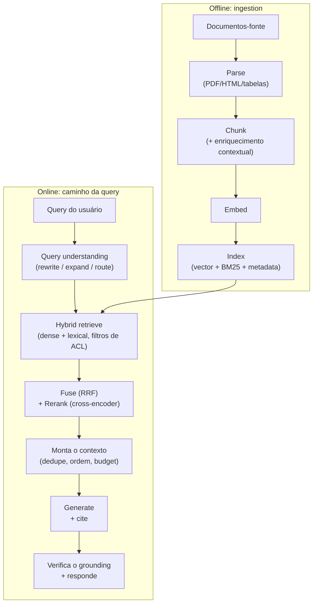

# 🔎 RAG & Retrieval

> 🇧🇷 Tradução em português do Brasil. Versão original em inglês: [README.md](README.md).

RAG é o sistema de LLM que as empresas mais colocam de fato em produção, então aparece em quase todo loop de entrevista de AI Engineer: em perguntas conceituais, em rodadas de system design ("construa uma busca sobre nossos docs") e em cenários de debugging ("a qualidade do retrieval caiu, vai"). Isso vale para frontier lab, para time de AI aplicada em big tech e para startup cujo produto inteiro é RAG. Os entrevistadores usam o tema para separar quem já colocou sistemas de retrieval no ar de quem só leu sobre eles.

## Crash course

### Quando usar RAG, long-context ou fine-tuning

Essa é a abertura clássica. Os eixos de decisão:

| Eixo | RAG | Long context | Fine-tuning |
|---|---|---|---|
| **Freshness** | Atualiza o índice em minutos | Reenvia os docs a cada chamada | Precisa retreinar para atualizar |
| **Tamanho do corpus** | Efetivamente ilimitado | Limitado pela janela (modelos de fronteira costumam oferecer ~200k-1M tokens, e 1M ≈ alguns milhares de páginas) | Embutido nos pesos, com perdas |
| **Custo por query** | Recupera o top-k e paga por ~2-10k tokens de contexto | Paga pelo corpus inteiro a cada chamada (caching ajuda, mas não elimina o custo) | Barato na inferência, caro para treinar e manter |
| **Atribuição** | Natural: você cita os chunks recuperados | Possível, mas mais fraca | Nenhuma: não dá para citar pesos |
| **Controle de acesso** | Filtra no momento do retrieval | É preciso pré-filtrar o que entra no contexto | Impossível por usuário |
| **Melhor para** | Conhecimento grande, mutável ou com permissões | Corpus pequeno e estável, raciocínio sobre documentos inteiros | Estilo, formato, *comportamento* de domínio (não fatos) |

Regra prática: **fine-tuning ensina skills e estilo; RAG fornece conhecimento; long context só concorre com o RAG quando o corpus cabe na janela e raramente muda.** As três abordagens se combinam. Muitos sistemas em produção fazem fine-tuning de um modelo pequeno, usam RAG *e* aproveitam o long context para o conjunto recuperado.

### Anatomia do pipeline



Os entrevistadores esperam que você saiba que **todo estágio é um ponto de falha** e que consiga dizer onde a qualidade costuma se perder: no parsing e no chunking (offline) e no recall do retrieval (online). Quase nunca é na escolha do vector DB.

### Parsing: o gargalo sem glamour

Corpora reais são PDFs com layout de várias colunas, páginas escaneadas, tabelas que viram sopa e headers/footers poluindo todo chunk. Se o parsing destrói uma tabela, nada adiante no pipeline consegue recuperá-la. A prática moderna usa parsers que entendem layout ou parsing baseado em VLM (renderiza a página, passa por um modelo de visão e gera markdown), com as tabelas extraídas para markdown/HTML e um resumo em texto embedado junto. Para corpora pesados em layout (slides, formulários, gráficos, relatórios escaneados), há uma opção mais nova: pular de vez a extração de texto no retrieval. Os **visual document retrievers** (estilo ColPali) fazem embedding direto das imagens das páginas, com late interaction multi-vector, e um LLM com capacidade de visão lê as páginas recuperadas. Reserve para essa etapa mais tempo de engenharia do que para qualquer outra.

### Chunking

- **Fixed-size**: corta a cada N tokens. Simples, mas quebra frases no meio.
- **Recursive**: divide em parágrafos, depois frases, depois tokens, até ficar abaixo do limite. É o padrão sensato.
- **Structure-aware**: divide por headers markdown ou seções HTML e anexa a cada chunk o caminho de headings (`Doc > Seção > Subseção`). É o melhor quando o documento tem estrutura.
- **Semantic**: corta onde a similaridade de embedding entre frases adjacentes cai. Ganhos marginais, custo real.
- **Late chunking**: faz o embedding do documento *inteiro* com um embedder de long-context e depois aplica pooling nos token embeddings de cada chunk. Assim, o vetor de cada chunk enxerga o contexto do documento completo.

Números típicos: **256-1024 tokens por chunk, com 10-20% de overlap**. Chunks pequenos dão retrieval preciso, mas contexto fragmentado; chunks grandes trazem mais contexto, mas diluem os embeddings. Quando precisar, desacople as duas coisas: recupere o pedaço pequeno e devolva o pai ("small-to-big" / parent-document retrieval).

**Contextual retrieval** (popularizado pela Anthropic): antes do embedding, você adiciona no início do chunk um trecho curto, gerado por LLM, que situa o chunk dentro do documento ("Este chunk é do filing do Q2 da ACME e fala sobre..."). Isso resolve o problema do chunk que diz "a empresa", sem dizer qual. A Anthropic relatou uma redução de ~49% nas falhas de retrieval no top-20 quando combinado com BM25 contextual, e de ~67% com reranking por cima. O custo é uma chamada barata de LLM por chunk na hora de indexar, e o prompt caching torna isso viável.

### Embeddings

Um **bi-encoder** faz o embedding da query e o dos documentos *de forma independente*, no mesmo espaço vetorial, e a relevância é aproximadamente a cosine similarity. Essa independência é o que permite pré-computar os vetores e usar busca ANN. É também o que limita a qualidade, já que não há interação entre os tokens da query e os do documento.

- **MTEB** (agora com a extensão multilíngue MMTEB) é o benchmark padrão de embeddings. Serve para montar uma shortlist, mas é público: os modelos podem ter sido ajustados em dados que se sobrepõem a ele, então as diferenças no leaderboard exageram as diferenças reais. Além disso, o seu domínio não está lá. Sempre avalie os principais candidatos no seu próprio conjunto de retrieval.
- **Dimensionalidade**: mais dimensões geralmente rendem alguma qualidade, com retornos decrescentes, e custam mais RAM (de forma linear) e uma busca mais lenta. Os **Matryoshka embeddings** são treinados para que os prefixos do vetor sejam, eles mesmos, embeddings válidos. Você pode truncar de 3072 para 256 dims numa primeira passada barata e refinar com os vetores completos (por exemplo, o parâmetro `dimensions` do `text-embedding-3` da OpenAI).
- **Fine-tuning de embedders** (treinamento contrastivo nos seus pares query→doc, muitas vezes minerados dos logs) é um dos movimentos de maior ROI em domínios cheios de jargão.

### Busca vetorial: exata vs ANN

A busca exata (brute-force) funciona bem até ~1M de vetores, porque é só uma multiplicação de matrizes. Acima disso, entra o **ANN**:

- **HNSW**: grafo navigable-small-world em várias camadas. A busca greedy desce das camadas superiores, mais esparsas, até a camada inferior, que é densa. `M` = arestas por nó (memória vs recall), `ef_search` = largura do beam de candidatos (recall vs latency, ajustado em tempo de query), `ef_construction` = qualidade em tempo de build. Tem ótimo recall/latency, mas consome muita memória: tudo fica em RAM.
- **IVF**: agrupa os vetores em células e examina só as `nprobe` células mais próximas. É mais barato de construir, mas precisa de treinamento, e o recall sofre nas bordas das células.
- **Product quantization (PQ)**: comprime os vetores em códigos de codebooks por subespaço. Economiza 10-50× de memória, com perdas. Normalmente vem combinado com IVF ou com reranking sobre os vetores exatos.

Triângulo de tradeoffs: **recall / latency / memória, escolha dois.** Ao ajustar, reporte o recall@k em relação à busca exata.

**Metadata filtering** quebra o ANN ingênuo: o post-filtering pode deixar você com 3 dos 50 resultados pedidos depois do filtro, e o pre-filtering restrito a um tenant raro faz a travessia do grafo degenerar. Bons engines fazem travessia *filter-aware*. Saiba que esse é um problema difícil e um diferencial real entre vendors.

**Escolha do vector DB**: "use pgvector até doer". Seus dados já estão no Postgres, joins, filtros e transações funcionam, e você tem um único sistema para operar. A dor aparece em escala muito grande (aproximadamente 50-100M+ de vetores), em workloads pesados de filtered-ANN (os iterative index scans do pgvector 0.8 corrigiram o pior over-filtering, mas engines dedicados ainda filtram melhor) ou quando você precisa de hybrid search embutida (o ranking de full-text do Postgres não é BM25; é preciso uma extensão como o pg_search da ParadeDB). Nesse ponto, entram os stores dedicados (Qdrant, Milvus, Weaviate, Pinecone, Vespa, Turbopuffer) ou os search engines (Elasticsearch/OpenSearch, melhores quando você já os opera e precisa de BM25 maduro + faceting).

### Hybrid search & fusion

O dense retrieval falha de forma vergonhosa em **conteúdo de correspondência exata: IDs, SKUs, códigos de erro, nomes, jargão novo que o embedder nunca viu**. O BM25 acerta esses casos. Rode os dois e faça a fusão com **Reciprocal Rank Fusion**:

```python
def rrf(rankings: list[list[str]], k: int = 60) -> dict[str, float]:
    scores = {}
    for ranking in rankings:
        for rank, doc_id in enumerate(ranking, start=1):
            scores[doc_id] = scores.get(doc_id, 0) + 1.0 / (k + rank)
    return scores  # sort desc
```

O RRF usa *ranks*, não scores. Os scores do BM25 e as cosine similarities estão em escalas incomparáveis: misturar scores exige uma normalização frágil, enquanto a fusão por rank simplesmente funciona.

Um meio-termo que vale citar é o **learned sparse retrieval** (estilo SPLADE). Um transformer produz expansões de termos ponderadas sobre o vocabulário ("infarto do miocárdio" também ativa "ataque cardíaco"). Você ganha algum matching semântico e continua servindo a partir de um inverted index comum. Ele pode substituir a perna lexical de uma stack híbrida ou se somar a ela.

### Reranking

- **Bi-encoder** (primeiro estágio): query e doc são codificados separadamente. Rápido, escalável e raso.
- **Cross-encoder** (reranker): query e doc são concatenados e passam juntos por um único transformer, com atenção completa. É muito mais preciso, mas exige O(candidatos) forward passes, então só é viável no top ~50-200.
- **Late interaction (ColBERT)**: embeddings por token, com MaxSim em tempo de query. É um ponto intermediário: dá para pré-computar como num bi-encoder e o matching é em nível de token, como num cross-encoder, a um custo de armazenamento de ~10-100×.

Receita padrão: **hybrid retrieve do top 100-200 → rerank com cross-encoder → manter o top 5-20.** Isso adiciona ~50-300ms e costuma ser o melhor tradeoff entre qualidade e esforço depois que o chunking está corrigido.

### Query understanding

- **Rewriting**: tira a enrolação conversacional. Em chat multi-turn, reescreve "e o plano pro?" como uma query autônoma, usando o histórico (inegociável em RAG conversacional).
- **Multi-query expansion**: gera 3-5 paráfrases, recupera para todas e faz a fusão por RRF.
- **HyDE**: pede ao LLM que alucine uma resposta hipotética e faz o embedding *dela*. No espaço de embeddings, respostas ficam mais perto dos documentos do que as perguntas.
- **Decomposition**: divide perguntas multi-hop em sub-queries.
- **Routing**: classifica de qual corpus, índice ou tool a query precisa antes de buscar.

### Além do single-shot: agentic RAG e GraphRAG

**Agentic RAG** é o retrieval exposto como uma tool que o modelo chama em loop: search → read → refina a query → search de novo. Vence em perguntas multi-hop e exploratórias, mas custa latency e tokens. O single-shot continua sendo a escolha certa para produtos de alto QPS e baixa latency. O **GraphRAG** constrói, na hora de indexar, um grafo de entidades e relações (com resumos de comunidades). Vale o custo significativo de indexação quando as perguntas são relacionais ou globais ("resuma os temas do corpus inteiro"), mas não para um lookup factual simples.

### Segurança: ACLs e multi-tenancy

**Aplique as permissões no filtro de retrieval, nunca via LLM.** O modelo não tem noção de autorização, e qualquer coisa no contexto dele pode ser exfiltrada por prompt injection. Anexe metadata de tenant/ACL a cada chunk e filtre em tempo de query com a identidade verificada do *chamador*. Se alguém propõe "o system prompt diz ao modelo para não revelar dados de outros tenants", trate como reprovação automática na entrevista. O próprio corpus também é uma superfície de ataque: se qualquer pessoa pode adicionar documentos (wikis, tickets, arquivos enviados), um documento plantado pode carregar indirect prompt injection ou ser escrito para ranquear bem em queries-alvo. Trate o texto recuperado como dado não confiável, rastreie a proveniência e o nível de confiança de cada fonte e mantenha os privilégios de tool baixos em qualquer agent que leia conteúdo recuperado.

### Mantendo o índice atualizado

Um índice é uma cópia derivada das suas fontes, então planeje para a mudança desde o primeiro dia. Use **sync incremental** com detecção de mudanças (webhooks, timestamps de modificação, content hashes) em vez de rebuilds completos toda noite. **Propague rápido os deletes e as mudanças de permissão**: uma ACL revogada que ainda dá match no índice é um bug de segurança, não de freshness. Faça também a **manutenção do ANN**: o HNSW marca os nós deletados com tombstones e os centroides do IVF derivam, então agende compaction ou rebuilds e acompanhe o recall em relação à busca exata. Versione o modelo de embedding junto com cada vetor: um embedder novo exige re-embedar o corpus inteiro, porque vetores de modelos diferentes não são comparáveis. Faça a migração com dual-write e backfill em um índice novo, avalie-o no seu golden set e só então faça o cutover, mantendo o índice antigo para rollback.

### Avaliação & debugging

São duas camadas, medidas separadamente:

- **Retrieval**: recall@k (o chunk gold chegou ao top-k? É a métrica que condiciona todo o resto), MRR (rank do primeiro relevante) e nDCG (relevância graduada ao longo da lista). São métricas baratas e determinísticas, então rode a cada mudança.
- **Generation**: faithfulness (cada afirmação é sustentada pelo contexto recuperado?), answer relevance e correção das citações. Normalmente medidas com LLM-as-judge, no estilo RAGAS.

Monte um **golden set** a partir dos logs de produção, mesmo que com apenas 50-100 queries reais e chunks relevantes rotulados. Gerar queries sintéticas sobre o seu corpus ajuda a dar a partida. **Regra de triagem**: diante de qualquer resposta ruim, primeiro verifique se *o chunk certo foi recuperado*. Se não, é um retrieval miss (corrija chunking, embedding ou query understanding). Se sim, é um generation miss (corrija prompt, ordenação ou modelo). A maioria dos bugs de "hallucination" são retrieval misses fantasiados.

### Latency, custo, caching

Budget online típico: embedding da query ~10-50ms, busca ANN ~5-50ms, rerank ~50-300ms e **generation do LLM 1-10s (domina tanto a latency quanto o custo)**. Por isso, otimize a generation primeiro: modelo menor, chunks menos numerosos e mais curtos, streaming, prompt caching (system prompt estático + prefixo de contexto estável), semantic caching de respostas completas para queries repetidas (atenção a ACLs e freshness nos cache hits!) e caches de embedding na ingestão.

## Perguntas de entrevista

Veja [questions.pt-BR.md](questions.pt-BR.md): 60 perguntas com respostas detalhadas, dos fundamentos às histórias de guerra em produção.

## Red flags que os entrevistadores observam

- Pular direto para "qual vector DB", ignorando parsing e chunking. Isso indica falta de experiência em produção, porque é nessas etapas que a qualidade de fato se perde.
- Tratar scores de cosine similarity como probabilidades calibradas de relevância, ou fundir scores de BM25 e dense por soma direta.
- Não ter método de triagem: não conseguir explicar como distinguir um retrieval miss de um generation miss diante de uma resposta ruim.
- Propor que o LLM aplique as permissões dos documentos ("o prompt diz para ele não mostrar dados de outros usuários"). É uma falha de segurança eliminatória.
- Nunca mencionar hybrid/lexical search e não saber que o dense retrieval falha em IDs, códigos de erro e frases exatas.
- Citar o ranking do MTEB como a história inteira da escolha de embeddings, sem plano de avaliação específica do domínio.
- "Vamos avaliar olhando as saídas no olho": sem golden set, sem recall@k, sem separar métricas de retrieval e de generation.
- Recitar o pipeline do tutorial de LangChain de 2023, sem conhecer contextual retrieval, reranking, agentic retrieval nem o tradeoff do long-context.

## Leituras complementares

- [Retrieval-Augmented Generation for Knowledge-Intensive NLP Tasks](https://arxiv.org/abs/2005.11401) - Lewis et al., o paper original de RAG.
- [Introducing Contextual Retrieval](https://www.anthropic.com/engineering/contextual-retrieval) - texto da Anthropic sobre contextual embeddings + contextual BM25, com números de taxa de falha.
- [Efficient and robust approximate nearest neighbor search using Hierarchical Navigable Small World graphs](https://arxiv.org/abs/1603.09320) - Malkov & Yashunin, o paper do HNSW.
- [ColBERT: Efficient and Effective Passage Search via Contextualized Late Interaction](https://arxiv.org/abs/2004.12832) - Khattab & Zaharia.
- [Precise Zero-Shot Dense Retrieval without Relevance Labels](https://arxiv.org/abs/2212.10496) - o paper do HyDE.
- [SPLADE: Sparse Lexical and Expansion Model for First Stage Ranking](https://arxiv.org/abs/2107.05720) - Formal et al., learned sparse retrieval.
- [ColPali: Efficient Document Retrieval with Vision Language Models](https://arxiv.org/abs/2407.01449) - retrieval sobre imagens de páginas em vez de texto parseado.
- [MTEB: Massive Text Embedding Benchmark](https://arxiv.org/abs/2210.07316) - Muennighoff et al.
- [From Local to Global: A Graph RAG Approach to Query-Focused Summarization](https://arxiv.org/abs/2404.16130) - o paper do GraphRAG da Microsoft.
- [Lost in the Middle: How Language Models Use Long Contexts](https://arxiv.org/abs/2307.03172) - por que a posição no contexto importa ao montar os chunks recuperados.
