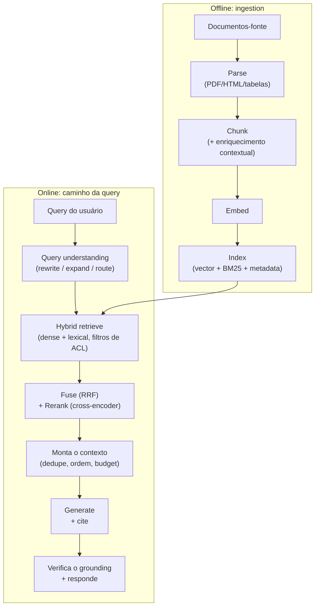

# 🔎 RAG & Retrieval

> 🇧🇷 Tradução em português do Brasil. Versão original em inglês: [README.md](README.md).

RAG é o sistema de LLM mais comum que as empresas de fato entregam, então aparece em quase todo loop de entrevista de AI Engineer - como perguntas conceituais, como uma rodada de system design ("construa uma busca sobre nossos docs") e como cenários de debugging ("a qualidade do retrieval caiu, vai"). Espere encontrá-lo seja em um laboratório de fronteira, em um time de AI aplicada de big tech ou em uma startup cujo produto inteiro é RAG; os entrevistadores o usam para separar quem já entregou sistemas de retrieval de quem apenas leu sobre eles.

## Crash course

### Quando RAG vs long-context vs fine-tuning

Esta é a abertura clássica. Os eixos de decisão:

| Eixo | RAG | Long context | Fine-tuning |
|---|---|---|---|
| **Freshness** | Atualiza o índice em minutos | Reenvia os docs a cada chamada | Retreinar para atualizar |
| **Tamanho do corpus** | Efetivamente ilimitado | Limitado pela janela (modelos de fronteira costumam oferecer ~200k-1M tokens, e 1M ≈ alguns milhares de páginas) | Embutido nos pesos, com perdas |
| **Custo por query** | Recupera top-k, paga por ~2-10k tokens de contexto | Paga pelo corpus inteiro a cada chamada (caching ajuda, mas não elimina) | Barato na inferência, caro para treinar/manter |
| **Atribuição** | Natural - cite os chunks recuperados | Possível, mas mais fraca | Nenhuma - não dá para citar pesos |
| **Controle de acesso** | Filtra no momento do retrieval | É preciso pré-filtrar o que você enfia no contexto | Impossível por usuário |
| **Melhor para** | Conhecimento grande/mutável/com permissões | Corpus pequeno e estável, raciocínio sobre documentos inteiros | Estilo, formato, *comportamento* de domínio (não fatos) |

Regra prática: **fine-tuning ensina skills e estilo; RAG fornece conhecimento; long context só é concorrente do RAG quando o corpus cabe e raramente muda.** Eles se combinam: muitos sistemas em produção fazem fine-tuning de um modelo pequeno *e* usam RAG *e* exploram long context para o conjunto recuperado.

### Anatomia do pipeline



Os entrevistadores querem que você saiba que **todo estágio é um ponto de falha** e que nomeie onde a qualidade geralmente se perde: parsing e chunking (offline) e recall do retrieval (online) - quase nunca a escolha do vector DB.

### Parsing: o gargalo pouco glamouroso

Corpora reais são PDFs com layouts de múltiplas colunas, páginas escaneadas, tabelas que viram sopa, headers/footers poluindo todo chunk. Se o parsing destrói uma tabela, nada a jusante consegue recuperá-la. Prática moderna: parsers conscientes de layout ou parsing baseado em VLM (renderiza a página → modelo de visão → markdown), com tabelas extraídas para markdown/HTML e um resumo em texto embedado junto. Para corpora pesados em layout (slides, formulários, gráficos, relatórios escaneados), uma opção mais nova é pular a extração de texto para o retrieval por completo: **visual document retrievers** (estilo ColPali) fazem embedding direto das imagens das páginas com late interaction multi-vector, e um LLM com capacidade de visão lê as páginas recuperadas. Reserve mais tempo de engenharia aqui do que para qualquer outra coisa.

### Chunking

- **Fixed-size**: divide a cada N tokens. Simples, corta frases no meio do raciocínio.
- **Recursive**: divide em parágrafos → frases → tokens até ficar abaixo do limite. O padrão sensato.
- **Structure-aware**: divide em headers markdown / seções HTML; anexa o caminho de headings (`Doc > Seção > Subseção`) a cada chunk. Melhor quando existe estrutura.
- **Semantic**: divide onde a similaridade de embedding entre frases adjacentes cai. Ganhos marginais, custo real.
- **Late chunking**: faz embedding do documento *inteiro* com um embedder de long-context e depois faz pooling dos token embeddings por chunk - o vetor de cada chunk enxerga o contexto do documento completo.

Números típicos: **256-1024 tokens por chunk, 10-20% de overlap**. Chunks pequenos → retrieval preciso, contexto fragmentado; chunks grandes → mais contexto, embeddings diluídos. Desacople quando necessário: recupere pequeno, devolva o pai ("small-to-big" / parent-document retrieval).

**Contextual retrieval** (popularizado pela Anthropic): antes do embedding, adicione no início um pequeno trecho gerado por LLM situando o chunk no documento ("Este chunk é do filing do Q2 da ACME, discutindo..."). Corrige o problema do "o chunk diz 'a empresa' - qual empresa?". A Anthropic relatou redução de ~49% nas falhas de retrieval no top-20 combinado com BM25 contextual, e ~67% com reranking adicionado. O custo é uma chamada barata de LLM por chunk no momento da indexação - prompt caching a torna viável.

### Embeddings

Um **bi-encoder** faz embedding da query e dos documentos *de forma independente* em um mesmo espaço vetorial; relevância ≈ cosine similarity. Essa independência é o que torna possíveis a pré-computação e a busca ANN - e o que limita a qualidade (sem interação em nível de token).

- **MTEB** (agora incluindo a extensão multilíngue MMTEB) é o benchmark padrão de embeddings - útil para montar uma shortlist, mas é público (modelos podem ser ajustados em dados sobrepostos, então as diferenças no leaderboard exageram as diferenças reais) e o seu domínio não está nele. Sempre avalie os principais candidatos no seu próprio conjunto de retrieval.
- **Dimensionalidade**: mais dimensões geralmente compram alguma qualidade com retornos decrescentes, e custam linearmente mais RAM e busca mais lenta. **Matryoshka embeddings** são treinados de modo que prefixos do vetor sejam, eles mesmos, embeddings válidos - trunque 3072→256 dims para uma busca barata de primeira passada e refine com os vetores completos (por exemplo, o parâmetro `dimensions` do `text-embedding-3` da OpenAI).
- **Fine-tuning de embedders** (treinamento contrastivo nos seus pares query→doc, muitas vezes minerados dos logs) é um dos movimentos de maior ROI para domínios carregados de jargão.

### Busca vetorial: exata vs ANN

A busca exata (brute-force) funciona bem até ~1M de vetores - é uma multiplicação de matrizes. Além disso, **ANN**:

- **HNSW**: grafo navigable-small-world multi-camada; a busca greedy desce das camadas superiores esparsas até uma camada inferior densa. `M` = arestas por nó (memória vs recall), `ef_search` = largura do beam de candidatos (recall vs latency, ajustado em tempo de query), `ef_construction` = qualidade em tempo de build. Ótimo recall/latency, consome muita memória, tudo em RAM.
- **IVF**: agrupa vetores em células; examina apenas as `nprobe` células mais próximas. Mais barato de construir, precisa de treinamento, o recall sofre nas bordas das células.
- **Product quantization (PQ)**: comprime vetores em códigos de codebooks por subespaço - economia de memória de 10-50×, com perdas; geralmente combinado com IVF ou usado com reranking sobre vetores exatos.

Triângulo de tradeoffs: **recall / latency / memória - escolha dois.** Reporte o recall@k contra a busca exata ao ajustar.

**Metadata filtering** quebra o ANN ingênuo: o post-filtering pode deixar você com 3 dos 50 resultados pedidos após o filtro; o pre-filtering restrito a um tenant raro faz a travessia do grafo degenerar. Bons engines fazem travessia *filter-aware*; saiba que este é um problema difícil e um diferencial real entre vendors.

**Seleção de vector DB**: "use pgvector até doer" - seus dados já estão no Postgres, joins/filtros/transações funcionam, um sistema só para operar. Dói em escala muito grande (aproximadamente 50-100M+ de vetores), em workloads pesados de filtered-ANN (os iterative index scans do pgvector 0.8 corrigiram o pior over-filtering, mas engines dedicados ainda filtram melhor) ou quando você precisa de hybrid search embutida (o ranking de full-text do Postgres não é BM25 - você precisa de uma extensão como o pg_search da ParadeDB) - aí entram os stores dedicados (Qdrant, Milvus, Weaviate, Pinecone, Vespa, Turbopuffer) ou os search engines (Elasticsearch/OpenSearch - melhores quando você já os opera e precisa de BM25 maduro + faceting).

### Hybrid search & fusion

O dense retrieval falha de forma vergonhosa em **conteúdo de correspondência exata: IDs, SKUs, códigos de erro, nomes, jargão novo que o embedder nunca viu**. O BM25 acerta esses casos. Rode ambos e faça a fusão com **Reciprocal Rank Fusion**:

```python
def rrf(rankings: list[list[str]], k: int = 60) -> dict[str, float]:
    scores = {}
    for ranking in rankings:
        for rank, doc_id in enumerate(ranking, start=1):
            scores[doc_id] = scores.get(doc_id, 0) + 1.0 / (k + rank)
    return scores  # sort desc
```

O RRF usa *ranks*, não scores - scores BM25 e cosine similarities vivem em escalas incomparáveis, então misturar scores exige uma normalização frágil, enquanto a fusão por rank simplesmente funciona.

Um meio-termo que vale citar: **learned sparse retrieval** (estilo SPLADE). Um transformer produz expansões de termos ponderadas sobre o vocabulário ("infarto do miocárdio" também ativa "ataque cardíaco"), então você obtém algum matching semântico servindo a partir de um inverted index comum. Ele pode substituir ou se juntar à perna lexical de uma stack híbrida.

### Reranking

- **Bi-encoder** (primeiro estágio): query e doc codificados separadamente. Rápido, escalável, raso.
- **Cross-encoder** (reranker): query e doc concatenados em um único transformer com atenção completa. Muito mais preciso, mas O(candidatos) forward passes - só viável no top ~50-200.
- **Late interaction (ColBERT)**: embeddings por token, MaxSim em tempo de query - um ponto intermediário: pré-computável como um bi-encoder, matching em nível de token como um cross-encoder, a um custo de armazenamento de ~10-100×.

Receita padrão: **hybrid retrieve top 100-200 → rerank com cross-encoder → manter top 5-20.** Adiciona ~50-300ms e geralmente é o melhor tradeoff qualidade/esforço depois de corrigir o chunking.

### Query understanding

- **Rewriting**: remove a enrolação conversacional; em chat multi-turn, reescreve "e o plano pro?" em uma query autônoma usando o histórico (inegociável para RAG conversacional).
- **Multi-query expansion**: gera 3-5 paráfrases, recupera para todas, faz fusão por RRF.
- **HyDE**: faz o LLM alucinar uma resposta hipotética e faz embedding *dela* - respostas ficam mais próximas dos documentos no embedding do que perguntas.
- **Decomposition**: divide perguntas multi-hop em sub-queries.
- **Routing**: classifica qual corpus/índice/tool uma query precisa antes de buscar.

### Além do single-shot: agentic RAG e GraphRAG

**Agentic RAG** = retrieval exposto como uma tool que o modelo chama em loop: search → read → refina a query → search de novo. Vence em perguntas multi-hop e exploratórias; custa latency e tokens. O single-shot continua certo para produtos de alto QPS e baixa latency. **GraphRAG** constrói um grafo de entidades/relações (e resumos de comunidades) no momento da indexação - vale o custo significativo de indexação quando as perguntas são relacionais ou globais ("resuma os temas do corpus inteiro"), não para lookup factoide simples.

### Segurança: ACLs e multi-tenancy

**Aplique permissões no filtro de retrieval, nunca via LLM.** O modelo não tem noção de autorização; qualquer coisa em seu contexto pode ser exfiltrada por prompt injection. Anexe metadata de tenant/ACL a cada chunk, filtre em tempo de query com a identidade verificada do *chamador*, e trate "o system prompt diz ao modelo para não revelar dados de outros tenants" como uma reprovação automática na entrevista. O próprio corpus também é uma superfície de ataque: se qualquer pessoa pode adicionar documentos (wikis, tickets, arquivos enviados), um documento plantado pode carregar indirect prompt injection ou ser escrito para ranquear para queries-alvo. Trate o texto recuperado como dado não confiável, rastreie proveniência e nível de confiança por fonte, e mantenha privilégios de tool baixos em qualquer agent que leia conteúdo recuperado.

### Mantendo o índice fresco

Um índice é uma cópia derivada das suas fontes, então planeje a mudança desde o primeiro dia: **sync incremental** via detecção de mudanças (webhooks, timestamps de modificação, content hashes) em vez de rebuilds completos noturnos; **deletes e mudanças de permissão propagados rápido** (uma ACL revogada que ainda dá match no índice é um bug de segurança, não um bug de freshness); e **manutenção do ANN**, já que o HNSW marca nós deletados com tombstones e os centroides do IVF derivam, então agende compaction ou rebuilds e acompanhe o recall contra a busca exata. Versione o modelo de embedding junto com cada vetor: um novo embedder significa re-embedar o corpus inteiro, porque vetores de modelos diferentes não são comparáveis. Execute a migração como dual-write e backfill em um novo índice, avalie-o no seu golden set e então faça o cutover mantendo o índice antigo para rollback.

### Avaliação & debugging

Duas camadas, medidas separadamente:

- **Retrieval**: recall@k (o chunk gold chegou ao top-k - a métrica que condiciona todo o resto), MRR (rank do primeiro relevante), nDCG (relevância graduada ao longo da lista). Barato, determinístico, rode a cada mudança.
- **Generation**: faithfulness (cada afirmação é sustentada pelo contexto recuperado?), answer relevance, correção das citações - tipicamente LLM-as-judge, estilo RAGAS.

Construa um **golden set** (mesmo 50-100 queries reais com chunks relevantes rotulados) a partir dos logs de produção; a geração sintética de queries sobre o seu corpus ajuda a dar a partida. **Regra de triagem**: para qualquer resposta ruim, primeiro verifique *o chunk certo foi recuperado?* Se não → retrieval miss (corrija chunking/embedding/query understanding). Se sim → generation miss (corrija prompt, ordenação, modelo). A maioria dos bugs de "hallucination" são retrieval misses fantasiados.

### Latency, custo, caching

Budget online típico: embed da query ~10-50ms, busca ANN ~5-50ms, rerank ~50-300ms, **generation do LLM 1-10s (domina tanto latency quanto custo)**. Então otimize a generation primeiro: modelo menor, chunks menos/mais curtos, streaming, prompt caching (system prompt estático + prefixo de contexto estável), semantic caching de respostas completas para queries repetidas (atenção a ACLs e freshness nos cache hits!) e caches de embedding na ingestão.

## Perguntas de entrevista

Veja [questions.pt-BR.md](questions.pt-BR.md) - 60 perguntas com respostas detalhadas, dos fundamentos às histórias de guerra de produção.

## Red flags que os entrevistadores observam

- Pular direto para "qual vector DB" ignorando parsing e chunking - sinaliza falta de experiência em produção, já que é ali que a qualidade de fato se perde.
- Tratar scores de cosine similarity como probabilidades calibradas de relevância, ou fundir scores de BM25 e dense por soma bruta.
- Nenhum método de triagem: não consegue articular como distinguir um retrieval miss de um generation miss ao ver uma resposta ruim.
- Propor que o LLM aplique as permissões dos documentos ("o prompt diz para ele não mostrar dados de outros usuários") - falha de segurança instantânea.
- Nunca mencionar hybrid/lexical search; não saber que o dense retrieval falha em IDs, códigos de erro e frases exatas.
- Citar o ranking do MTEB como a história inteira da seleção de embeddings, sem plano de avaliação específica do domínio.
- "Vamos avaliar olhando as saídas no olho" - sem golden set, sem recall@k, sem separação entre métricas de retrieval e de generation.
- Recitar o pipeline do tutorial de LangChain de 2023 sem conhecer contextual retrieval, reranking, agentic retrieval ou o tradeoff do long-context.

## Leituras complementares

- [Retrieval-Augmented Generation for Knowledge-Intensive NLP Tasks](https://arxiv.org/abs/2005.11401) - Lewis et al., o paper original de RAG.
- [Introducing Contextual Retrieval](https://www.anthropic.com/engineering/contextual-retrieval) - texto da Anthropic sobre contextual embeddings + contextual BM25, com números de taxa de falha.
- [Efficient and robust approximate nearest neighbor search using Hierarchical Navigable Small World graphs](https://arxiv.org/abs/1603.09320) - Malkov & Yashunin, o paper do HNSW.
- [ColBERT: Efficient and Effective Passage Search via Contextualized Late Interaction](https://arxiv.org/abs/2004.12832) - Khattab & Zaharia.
- [Precise Zero-Shot Dense Retrieval without Relevance Labels](https://arxiv.org/abs/2212.10496) - o paper do HyDE.
- [SPLADE: Sparse Lexical and Expansion Model for First Stage Ranking](https://arxiv.org/abs/2107.05720) - Formal et al., learned sparse retrieval.
- [ColPali: Efficient Document Retrieval with Vision Language Models](https://arxiv.org/abs/2407.01449) - retrieval sobre imagens de páginas em vez de texto parseado.
- [MTEB: Massive Text Embedding Benchmark](https://arxiv.org/abs/2210.07316) - Muennighoff et al.
- [From Local to Global: A Graph RAG Approach to Query-Focused Summarization](https://arxiv.org/abs/2404.16130) - o paper do GraphRAG da Microsoft.
- [Lost in the Middle: How Language Models Use Long Contexts](https://arxiv.org/abs/2307.03172) - por que a posição no contexto importa ao montar chunks recuperados.
