# Fine-tuning, RLHF & Alignment - Perguntas de Entrevista

> 🇧🇷 Tradução em português do Brasil. Versão original em inglês: [questions.md](questions.md).

56 perguntas: 13 básicas, 22 intermediárias, 21 avançadas.

> **Sobre os diagramas: desenhar é opcional.** Algumas respostas incluem um pequeno esboço que você
> poderia reproduzir em um quadro branco ou em um documento compartilhado. Você nunca precisa desenhar nada para ir bem,
> e uma resposta falada clara se sustenta sozinha. Mas em perguntas de arquitetura, pipeline e system design,
> esboçar enquanto fala mantém o entrevistador acompanhando você e mostra que você sabe estruturar
> um problema. Considere-os um bônus, não lição de casa.

## Básico

### 1. Quando você faria fine-tuning de um modelo em vez de usar prompting ou RAG?

<details><summary><b>Resposta</b></summary>

Fine-tuning é para *comportamento*, RAG é para *conhecimento*, e prompting vem primeiro em tudo. O caminho de escalada é: prompt engineering (horas, quase de graça) → RAG (dias, traz conhecimento atualizado ou privado, com citações) → fine-tuning (semanas, muda o que o modelo *é*).

O fine-tuning ganha quando você precisa de:

- **Forma/estilo/formato**: uma voz de marca consistente, um schema JSON rígido, um dialeto SQL próprio da empresa. São coisas trabalhosas e frágeis de especificar em um prompt.
- **Latency/custo**: um modelo de 8B ajustado no lugar de um modelo frontier via API em uma tarefa estreita, ou o fim de um system prompt few-shot de 2.000 tokens que você paga a cada chamada. O prompt caching reduz essa conta, mas não o contexto que o prompt ocupa nem a fragilidade de guiar o modelo por exemplos.
- **Habilidade estreita**: classificação, extração, routing. São tarefas em que um modelo pequeno e especializado supera um grande e generalista.
- **Comportamento que prompt nenhum garante**: formatação confiável de tool calls, política de recusa, uma persona que se mantém em conversas longas.

O RAG ganha quando o requisito é factual: documentos proprietários, dados que mudam todo dia, qualquer caso que exija atribuição. O fine-tuning é um péssimo repositório de conhecimento. O SFT em fatos dá um recall pouco confiável, sem citações, e o conhecimento fica desatualizado no instante em que o mundo muda.

A nuance que os entrevistadores querem ouvir: as duas técnicas são **complementares, não concorrentes**. Um padrão comum em produção é RAG para os fatos, mais um modelo com fine-tuning que seja melhor em *usar* o contexto recuperado (grounding, citar a fonte, recusar quando o contexto não basta). Há mais um ponto: se a *própria linguagem do domínio* é estranha ao modelo (jurídico, genômica), talvez você precise de continued pretraining, e não só de SFT. E sempre monte um baseline com prompt e um eval set *antes* do fine-tuning. Sem isso, você não consegue provar que o fine-tune valeu o investimento.

**Vale desenhar.** As condições de ramificação são a resposta inteira, e desenhá-las evita que você apenas recite uma lista.

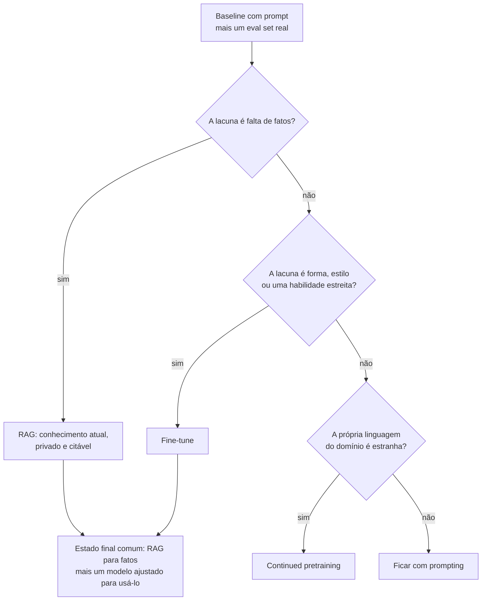

**Follow-ups:** Seu PM diz "faça fine-tuning com nossos docs para ele conhecer nosso produto". Como você responde? Que eval você construiria antes de decidir? Quando você usaria RAG *e* fine-tuning juntos?

</details>

### 2. O que realmente acontece durante o supervised fine-tuning? Qual o papel dos chat templates e dos special tokens?

<details><summary><b>Resposta</b></summary>

O SFT é só a continuação da previsão do próximo token (loss de cross-entropy) sobre exemplos (prompt, resposta) curados. O objetivo é o mesmo do pretraining; mudam os dados. O que o torna "instruction tuning" é que os exemplos são renderizados por um **chat template**: a markup exata de special tokens que separa papéis e turnos, a mesma usada no post-training original do modelo. Exemplos: `<|im_start|>user ... <|im_end|>` no estilo ChatML, ou os headers do estilo Llama.

```python
messages = [
    {"role": "system", "content": "You are a support agent."},
    {"role": "user", "content": "Reset my password"},
    {"role": "assistant", "content": "Sure - here's how..."},
]
text = tokenizer.apply_chat_template(messages, tokenize=False)
```

Por que isso importa: esses special tokens são peças estruturais. O modelo aprendeu que `<|im_end|>` (ou um token EOS/EOT) significa "pare de gerar" e que o conteúdo depois do header do assistant é a voz dele mesmo. Há dois modos de falha clássicos:

1. **Template mismatch**: treinar com um template e servir com outro (ou com uma string crua). O modelo divaga, ignora o system prompt ou nunca emite EOS. É o bug silencioso mais comum em fine-tuning.
2. **Tratamento do EOS**: esquecer de anexar o token de fim de turno aos targets de treino, o que gera um modelo que não sabe parar. Ou deixar o tokenizer quebrar os special tokens em pedaços, em vez de mapeá-los para os IDs reservados.

Se você adicionar *novos* special tokens (por exemplo, delimitadores de tool-call), precisa redimensionar os embeddings e contar com a necessidade de treiná-los: as linhas recém-inicializadas são aleatórias. Esse é um dos motivos para preferir os tokens reservados que o modelo já tem.

Bons candidatos lembram que a escolha entre base e instruct faz diferença. Fazer fine-tuning de um modelo instruct significa se adaptar ao template que ele já tem. Com um modelo base, você define o template, mas precisa ensinar todo o comportamento de chat por conta própria.

**Follow-ups:** Seu modelo com fine-tuning nunca para de gerar. Quais são os três principais suspeitos? Por que treinar um checkpoint base e um instruct pode dar resultados diferentes com os mesmos dados?

</details>

### 3. O que é loss masking no SFT, e por que você mascara os tokens do prompt?

<details><summary><b>Resposta</b></summary>

Loss masking é calcular a loss de cross-entropy apenas sobre os tokens que você quer que o modelo aprenda a *produzir* (a resposta do assistant) e deixar de fora da loss os tokens de prompt/system/user. Na prática, você define o label das posições mascaradas como `-100`, valor que o `cross_entropy` do PyTorch ignora:

```python
labels = input_ids.clone()
labels[:prompt_len] = -100          # sem loss nos tokens do prompt
# em dados multi-turn: mascare tudo, exceto os spans do assistant
```

O motivo: sem a máscara, o sinal de gradiente é dominado por tudo o que preenche seus prompts. O modelo gasta capacidade aprendendo a prever perguntas de usuários, chunks de documentos e system prompts boilerplate, e nada disso ele precisará gerar um dia. Pular a máscara traz estas consequências:

- **Capacidade desperdiçada e distribution shift**: com prompts longos e respostas curtas (típico de dados no estilo RAG ou de extração), mais de 90% da loss pode vir dos tokens do prompt.
- **Regurgitação do prompt**: o modelo aprende a repetir instruções ou contexto na saída.
- **Instruction following mais fraco**: os tokens da resposta, que são o que você realmente quer, recebem proporcionalmente menos gradiente.

Nuances que um candidato sênior acrescenta: (1) Em dados **multi-turn**, você mascara tudo, menos os turnos do assistant. Incluir os turnos *anteriores* do assistant é uma escolha deliberada (treinar em todos os turnos ou só no último). (2) Nem sempre a decisão é binária: no **continued pretraining** você não mascara nada, e algumas receitas treinam nos prompts com um peso pequeno quando os dados são escassos. (3) Ao fazer **packing** de vários exemplos em uma sequência, a máscara deve ser aplicada por exemplo, e você precisa impedir a attention entre exemplos. (4) Attention mask e loss mask são coisas diferentes: os tokens do prompt continuam sendo *attended to* (a attention os enxerga); eles só não contribuem com loss.

**Vale desenhar.** O diagrama deixa claro que a attention mask e a loss mask são duas coisas diferentes.

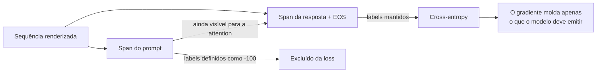

**Follow-ups:** Como você verificaria que a máscara está correta antes de lançar um run? Em um dataset multi-turn, você treinaria em todos os turnos do assistant ou só no final? Qual é o tradeoff?

</details>

### 4. Quantos dados você precisa para fazer fine-tuning de um modelo? Qualidade vs. quantidade?

<details><summary><b>Resposta</b></summary>

Muito menos do que a maioria das pessoas imagina, e a qualidade pesa mais. Para tarefas de estilo, formato ou persona, algumas centenas a alguns milhares de exemplos excelentes costumam bastar. Tarefas estreitas de classificação ou extração podem usar de 1k a 10k. O resultado do LIMA é a citação canônica: ~1.000 exemplos meticulosamente curados e diversos alinharam um modelo base de 65B a um nível competitivo com baselines muito mais intensamente ajustados. A intuição é que o modelo já *sabe* quase tudo desde o pretraining, e o SFT ensina principalmente *qual subdistribuição desse conhecimento mostrar e em que formato*. Essa é uma função de baixa complexidade, que não precisa de milhões de exemplos.

A quantidade importa para injetar capacidades realmente novas (um idioma novo, uma DSL proprietária, comportamento agentic de longo horizonte) ou no continued pretraining para conhecimento de domínio. Nesses casos, são necessárias ordens de grandeza a mais de tokens.

Checklist prático de curadoria:

- **Deduplicar**: exact-match mais near-dup (MinHash ou similaridade de embeddings). Duplicatas causam memorização e inflam os epochs efetivos desses exemplos.
- **Descontaminar**: verifique a sobreposição de n-grams com seus eval sets. Sem isso, seus números de antes/depois são ficção.
- **Diversidade vale mais que volume**: 1.000 exemplos que cobrem a distribuição real de inputs superam 50.000 variações em template de dez padrões. Dados em template ensinam o template, não a tarefa.
- **Leia seus dados**: inspecione manualmente uma amostra aleatória de algumas centenas de exemplos. Labels ruins, respostas truncadas e bugs de template se encontram a olho, não com dashboards.
- **Filtre com rigor**: use um LLM judge ou heurísticas (comprimento, formatação, recusas acidentais) para eliminar a pior cauda. Um label errado ensina o comportamento errado com a mesma eficiência de um label certo.

Uma regra útil: se adicionar mais dados não melhora as métricas held-out, o gargalo é qualidade ou diversidade, não tamanho.

**Follow-ups:** Você tem 100 mil exemplos coletados da web, de qualidade mista. Qual é o seu pipeline antes do treino? Como você detectaria que near-duplicates estão te prejudicando?

</details>

### 5. Full fine-tuning vs. parameter-efficient fine-tuning: como você escolhe?

<details><summary><b>Resposta</b></summary>

Use PEFT (na prática, LoRA/QLoRA) como padrão, a menos que tenha um motivo específico para não usar. O full fine-tuning atualiza todos os pesos. O PEFT congela o modelo base e treina um pequeno conjunto de parâmetros adicionados (~0,1-1% no caso do LoRA).

**Por que o PEFT é o padrão:**

- **Memória**: o full FT de um modelo de 7B com Adam em precisão mista exige ~112 GB (16 bytes/param) antes das activations. O LoRA precisa de estados do otimizador só para os parâmetros do adapter, e o QLoRA permite fine-tunes de 7B a 70B em uma única GPU.
- **Forgetting**: os pesos base congelados limitam o quanto o modelo pode derivar, então as regressões de capacidade geral são mais brandas.
- **Ganhos operacionais**: adapters têm dezenas de MB, o que os torna baratos de armazenar, versionar, testar em A/B e servir vários por modelo base (multi-LoRA serving). Já o full FT gera um novo artefato de 14+ GB por variante.
- **Qualidade**: na maioria dos fine-tunes de estilo, formato ou tarefa estreita, o LoRA empata com o full FT dentro da margem de ruído.

**Quando o full fine-tuning compensa o custo:**

- Mudanças grandes de comportamento ou capacidades novas (ensinar domínios novos e substanciais, grandes distribution shifts, traces agentic longos), casos em que atualizações de baixo rank podem sofrer underfitting.
- Continued pretraining em bilhões de tokens: uma atualização de baixo rank realmente não absorve tanto conteúdo.
- Você é um lab fazendo o run *principal* de post-training de um modelo próprio, com a frota de GPUs à altura.
- Alguns setups de RL fine-tuning em que você quer plasticidade total (embora o RL baseado em LoRA também funcione).

Os fatores da decisão são: a distância entre a tarefa e o comportamento do modelo base, o orçamento de tokens, o orçamento de GPU e quantas variantes você vai operar. Uma boa frase de fechamento: "Eu rodaria LoRA primeiro, como um baseline barato e forte. Se estagnar abaixo da meta e os dados não forem o gargalo, eu subiria o rank e só então consideraria full FT."

**Vale desenhar.** O diagrama transforma uma preferência em uma escada de escalada, com saída em cada degrau.


**Follow-ups:** Como você detectaria que o LoRA está sofrendo underfitting, e não que o problema são os dados? Seu modelo LoRA empata com o full FT na tarefa-alvo: ainda há motivo para preferir o full FT?

</details>

### 6. Explique como o LoRA funciona: a matemática e o que `r` e `alpha` significam.

<details><summary><b>Resposta</b></summary>

O LoRA (Low-Rank Adaptation) congela a matriz de pesos pré-treinada e aprende uma atualização aditiva de baixo rank. Para um peso $W \in \mathbb{R}^{d \times k}$, o forward pass adaptado é:

$$h = Wx + \frac{\alpha}{r}\,BAx, \qquad B \in \mathbb{R}^{d \times r},\; A \in \mathbb{R}^{r \times k},\; r \ll \min(d,k)$$

- **`r` (rank)** é a dimensão do gargalo, ou seja, a capacidade da atualização. Valores típicos: 8-64. A atualização completa $BA$ tem rank ≤ r, então, em vez de $d \times k$ parâmetros treináveis por matriz, você tem $r(d+k)$. Para uma projeção de 4096×4096 com r=16, são ~131k parâmetros contra ~16,8M: uma redução de ~128× nessa matriz.
- **`alpha`** é uma constante de escala; a atualização é multiplicada por $\alpha/r$. Isso desacopla a magnitude efetiva da atualização do rank, e você pode mudar `r` sem reajustar o learning rate. Heurísticas comuns: $\alpha = r$ ou $\alpha = 2r$. (O rsLoRA escala por $\alpha/\sqrt{r}$, o que se comporta melhor em ranks altos.)
- **Inicialização**: A é gaussiana aleatória e B é zero. Assim, $BA = 0$ no passo 0 e o treino começa exatamente no modelo base. Esse detalhe importa: é o que torna o treino do LoRA estável desde o primeiro passo.

A hipótese por trás (do paper) é que as atualizações de fine-tuning têm *rank intrínseco* baixo: o delta de pesos necessário para uma tarefa downstream vive em um subespaço de baixa dimensão, o que se confirma empiricamente na maioria das tarefas de adaptação.

Vale citar sem ser perguntado duas propriedades: (1) o ganho de memória vem de não armazenar gradientes nem estados do otimizador para os pesos congelados; o modelo base continua ocupando memória no forward/backward. (2) Depois do treino, você pode fazer o **merge** $W' = W + \frac{\alpha}{r}BA$ em uma única matriz, e o overhead de inferência é *zero*. Adapters não mesclados custam um matmul extra pequeno.

**Vale desenhar.** Dois caminhos e uma soma resumem a ideia toda, e o desenho mostra por que o passo 0 é exatamente o modelo base.

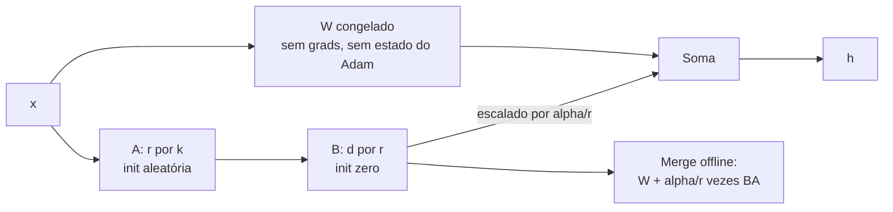

**Follow-ups:** Por que inicializar B em zero em vez de as duas matrizes aleatórias? Se dobrar o r não melhora a qualidade, o que isso indica? O que quebra se o alpha for muito grande em relação ao r?

</details>

### 7. O que é catastrophic forgetting em fine-tuning, e como mitigá-lo?

<details><summary><b>Resposta</b></summary>

Catastrophic forgetting é quando otimizar sobre a sua distribuição estreita de fine-tuning degrada capacidades que o modelo já tinha: raciocínio geral, instruction following, comportamento de segurança, outros idiomas. O gradient descent não tem lealdade a habilidades antigas. Se os seus 5k exemplos de suporte ao cliente nunca exercitam matemática, os pesos que sustentam a matemática ficam livres para serem usados na redução da loss dos tickets de suporte. Sintomas típicos: as notas em benchmarks estilo MMLU caem vários pontos, o modelo começa a responder *tudo* no formato do seu fine-tune, recusa menos (ou mais) do que antes, ou perde a capacidade multilíngue.

Mitigações, aproximadamente em ordem de custo-benefício:

1. **Treine com menos agressividade**: learning rate menor, menos epochs (1-2 em vez de 5), early stopping guiado por um eval *geral*, não só pela loss da tarefa.
2. **Data mixing / replay**: misture ~5-25% de dados gerais de instruções (ou a distribuição original do SFT, se você a tiver) aos dados da sua tarefa, para que os comportamentos antigos continuem recebendo gradiente. Na prática, é a alavanca mais eficaz.
3. **Use PEFT**: a base congelada do LoRA limita a deriva, e você ainda pode reduzir o `r`. Também é totalmente reversível: descarte o adapter e o modelo base está intacto.
4. **Regularize em direção ao modelo original**: uma penalidade de KL contra as saídas do modelo base, ou métodos no espaço de pesos (por exemplo, tirar a média entre os pesos ajustados e os originais, ou restringir a norma da atualização).
5. **Delimite o escopo do deploy**: se o modelo só vai ver tickets de suporte em produção, algum esquecimento é aceitável. Mas você precisa *medir* o esquecimento para tomar essa decisão de forma consciente.

O ponto-chave na entrevista: o forgetting é invisível se você não avaliar. Rode uma suíte de regressão antes/depois que cubra capacidades gerais, comportamento de segurança e formatação, não só a métrica da sua tarefa. Um fine-tune que ganha 10 pontos na sua tarefa e perde instruction following sem ninguém notar é um incidente de produção à espera de acontecer.

**Vale desenhar.** O diagrama põe o eval geral dentro do ciclo, justamente onde os times esquecem de colocá-lo.

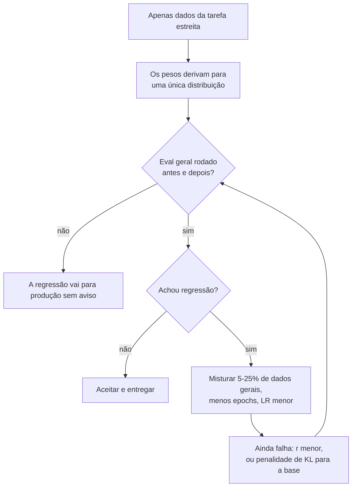

**Follow-ups:** Como você escolheria a proporção de mistura entre dados gerais e dados da tarefa? A métrica da sua tarefa melhora, mas os usuários dizem que o modelo ficou "mais burro". Qual é o seu plano de diagnóstico?

</details>

### 8. Quais são os principais hiperparâmetros do fine-tuning, e quais são bons valores iniciais?

<details><summary><b>Resposta</b></summary>

Os que importam, em ordem:

**Learning rate**: o botão de maior alavancagem, e muda conforme o regime:
- Full fine-tuning: ~1e-5 a 5e-5 (em modelos maiores, muitas vezes 1e-5 a 2e-5). Alto demais, você tem loss spikes e forgetting.
- LoRA/QLoRA: ~1e-4 a 2e-4, cerca de 10× maior, porque você está treinando uma subrede pequena, recém-inicializada, e não perturbando 7B de pesos já ajustados.

**Epochs**: 1-3 é a faixa ideal para a maioria dos SFTs. Datasets pequenos às vezes toleram até ~5 com LoRA. Mais epochs em poucos dados significa memorização. Acompanhe a loss held-out, não a train loss.

**Schedule e warmup**: decay cosine ou linear com ~3% (até 10%) de passos de warmup. O warmup importa porque as estimativas de segundo momento do Adam não valem nada no começo, e pular essa etapa causa loss spikes iniciais.

**Effective batch size**: tipicamente de 16 a 128 sequências, obtidas por batch por dispositivo × gradient accumulation × data parallelism. Batches maiores estabilizam os gradientes, mas achatam o aprendizado por passo. Se você mudar bastante o batch size, revise o LR.

**Sequence length e packing**: defina o comprimento máximo para cobrir seus dados reais (olhe o histograma de tamanho em tokens e não trunque 20% das respostas sem perceber). O **packing** concatena vários exemplos curtos em uma sequência para não desperdiçar compute com padding. É um grande ganho de throughput em datasets de exemplos curtos, mas exige loss masking correto por exemplo e, idealmente, attention block-diagonal, para que os exemplos não enxerguem uns aos outros.

**Específicos do LoRA**: r (8-64), alpha (≈ r ou 2r), dropout (0-0,1), target modules (todas as projeções de attention; inclua o MLP para ter mais capacidade).

**O que eu faria na prática**: pegaria os defaults do framework (TRL e Axolotl são razoáveis), faria um sweep de LR com 3 valores em um subconjunto, treinaria 1-2 epochs e escolheria pelo eval held-out, não pela train loss. Malabarismo com hiperparâmetros pesa muito menos que a qualidade dos dados.

**Follow-ups:** Por que runs de LoRA toleram um LR ~10× maior que o full fine-tuning? Sua curva de loss tem um spike no passo 50 e nunca se recupera. O que você verifica?

</details>

### 9. Como saber se um fine-tune está sofrendo overfitting? Quais são os sinais?

<details><summary><b>Resposta</b></summary>

O sinal principal é a divergência entre a loss de treino e a held-out: a train loss continua caindo enquanto a eval loss estabiliza ou sobe. Mas as curvas de loss são só o começo. O overfitting em LLMs aparece no comportamento:

- **Regurgitação**: o modelo reproduz exemplos de treino quase palavra por palavra, ou responde a prompts de treino parafraseados com respostas decoradas. É fácil de testar: parafraseie os inputs de treino e meça a similaridade das saídas com os targets de treino.
- **Colapso de diversidade**: as saídas convergem para poucas aberturas, formulações ou tamanhos estereotipados, qualquer que seja o input. Amostre o mesmo prompt com temperature ~1 várias vezes. Se todas as respostas saem quase idênticas onde o modelo base variava, você sofreu overfitting de estilo.
- **Supergeneralização do template**: o modelo força todo input a caber no formato do fine-tune. Você faz uma pergunta casual e ele responde com o seu schema JSON ou a estrutura de ticket de suporte.
- **Fragilidade fora da distribuição**: ele vai bem em inputs parecidos com os dados de treino e piora muito em reformulações leves ou casos de borda. O modelo aprendeu padrões superficiais em vez da tarefa.
- **Regressões de capacidade geral**: queda em benchmarks (isso se sobrepõe ao catastrophic forgetting; em datasets pequenos, os dois aparecem juntos).

As causas-raiz costumam ser: epochs demais para poucos dados, exemplos duplicados (que são, na prática, epochs extras sobre esses pontos), LR alto demais ou baixa diversidade nos dados.

As correções: menos epochs e parada mais cedo, guiada por métricas *held-out*; dedup; dados mais diversos; LR menor; dropout no LoRA ou rank menor; e mistura de dados gerais. Uma sutileza que vale mencionar: em tarefas estreitas de produção, um leve "overfitting" na distribuição da tarefa às vezes é exatamente o que você quer. A pergunta é se o desempenho na distribuição de *deployment* (incluindo a cauda) se degrada. Por isso o seu held-out set precisa refletir o tráfego real, e não uma fatia aleatória do arquivo de treino curado.

**Follow-ups:** Sua eval loss sobe depois do epoch 1, mas avaliadores humanos preferem o checkpoint do epoch 3. Qual dos dois você entrega, e por quê? Como exemplos de treino duplicados se disfarçam de epochs extras?

</details>

### 10. Explique o pipeline clássico de RLHF de ponta a ponta.

<details><summary><b>Resposta</b></summary>

A receita do InstructGPT, em três etapas depois do pretraining.

**Etapa 1, SFT**: faça fine-tuning do modelo base em demonstrações de alta qualidade (escritas por humanos ou curadas), para que ele consiga ao menos seguir instruções. Esta é a inicialização de tudo o que vem depois. O RL não conserta uma policy que nunca amostra um bom comportamento.

**Etapa 2, reward model**: colete *dados de preferência*. Amostre duas ou mais respostas por prompt do modelo SFT e peça que humanos as ranqueiem. Usa-se comparação par a par porque ela é muito mais confiável que a pontuação absoluta: os anotadores concordam mais em "A > B" do que em "A é 7/10". Treine um RM (em geral o modelo SFT com uma cabeça escalar) com a loss de Bradley-Terry, $-\log\sigma(r(x, y_w) - r(x, y_l))$, que empurra a nota da resposta escolhida acima da nota da rejeitada.

**Etapa 3, PPO**: o modelo SFT vira a policy. Amostre respostas para os prompts, pontue-as com o RM e atualize a policy com PPO para aumentar a recompensa esperada, com uma **penalidade de KL contra o modelo SFT congelado (reference)**. A penalidade impede que a policy se perca em textos degenerados que por acaso enganam o RM. O objetivo efetivo é, grosso modo, $\mathbb{E}[r(x,y)] - \beta\,\mathrm{KL}(\pi \| \pi_{ref})$.

Por que usar RL, e não mais SFT? As preferências codificam qualidade *relativa* sobre as próprias saídas do modelo, um sinal difícil de expressar como demonstração, e é bem mais barato para um humano ranquear do que escrever. O modo de falha conhecido é o **reward hacking**: o RM é um proxy imperfeito, e a otimização sem restrição explora os pontos cegos dele (viés de comprimento, sycophancy). É justamente isso que o termo de KL e os dados de preferência novos servem para conter.

**Vale desenhar.** O checkpoint do SFT alimenta três setas, e é isso que as pessoas deixam passar.

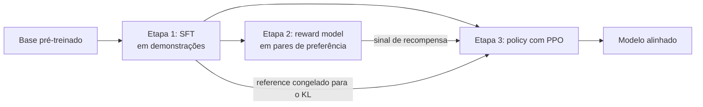

**Follow-ups:** Por que preferências par a par em vez de notas absolutas? O que quebra se você pula o SFT e roda PPO direto no modelo base? Onde o DPO encurta esse pipeline?

</details>

### 11. Você faria fine-tuning de um modelo base ou de um modelo instruct? Como essa escolha muda seus dados e sua receita?

<details><summary><b>Resposta</b></summary>

Em quase todo trabalho aplicado, comece pelo modelo instruct. Você só recorre a um modelo base quando tem muitos dados (dezenas de milhares de exemplos de alta qualidade), quer controle total do formato de saída ou está fazendo continued pretraining em um corpus de domínio.

A diferença está no que você herda. Um modelo instruct já traz instruction following, comportamento multi-turn, tool calling, o hábito treinado de emitir EOS e um baseline de segurança. Você ganha tudo isso de graça, e também pode destruir tudo: fazer fine-tuning de um modelo instruct em dados single-turn estreitos degrada, de forma consistente, o multi-turn e o instruction following geral, e é por isso que se misturam ~5-25% de dados gerais de instruções. Ele também vem com um chat template que foi de fato treinado, e você precisa reproduzi-lo byte a byte.

Um modelo base é um previsor do próximo token. Ele não tem um chat template relevante (o que está em `tokenizer_config.json` pode ser só nominal e nunca ter sido treinado), não para sozinho e não tem comportamento de recusa. Você está refazendo o post-training por conta própria: formato, parada, verbosidade, segurança. Isso é um projeto de verdade, não um trabalho de fim de semana.

O equívoco comum é "o modelo base é uma folha em branco, então é mais fácil de guiar". É mais barato de guiar no sentido de que você não luta contra um comportamento existente, mas você não herda nada. Com alguns milhares de exemplos, vai produzir algo pior que o modelo instruct em tudo, exceto na sua tarefa estreita.

Regra prática: modelo instruct mais LoRA é o padrão. Reserve orçamento para um run de SFT em modelo base só se o estilo embutido no instruct estiver atrapalhando ativamente e você tiver dados para substituí-lo. Confira também o que está disponível: em muitos modelos hospedados só existem os pesos instruct ou um endpoint de tuning, e a decisão já está tomada por você.

**Follow-ups:** Se você faz fine-tuning de um modelo instruct e o comportamento multi-turn se degrada, como detectaria isso antes de entregar? O que você faria diferente se o modelo base e o instruct tivessem tokenizers diferentes?

</details>

### 12. Por que deduplicar os dados de fine-tuning, e como você faria isso na prática?

<details><summary><b>Resposta</b></summary>

Porque duplicatas reponderam o seu dataset sem que você perceba e alimentam a memorização. Se 20% de um conjunto está duplicado e você treina 3 epochs, esses exemplos são vistos ~6 vezes, enquanto os demais são vistos 3. Você não escolheu essa mistura; o scraper escolheu. As duplicatas também inflam as métricas held-out sempre que uma quase-cópia fica dividida entre train e test, e a repetição pesada de uma única resposta ensina o modelo a emiti-la como resposta pronta.

O pipeline que eu rodo, em ordem:

1. Normalizar: remover espaços extras, normalizar unicode e converter para minúsculas apenas para o hash.
2. Dedup exata: calcular o hash do texto normalizado e descartar as colisões. É barato e pega mais do que se imagina.
3. Near-dup: MinHash sobre shingles de ~5-grams com LSH banding, com threshold de Jaccard em torno de 0,8. Tempo linear, só CPU, minutos para 100 mil exemplos.
4. Dedup semântica: gerar os embeddings e descartar vizinhos próximos acima de um threshold de cosseno (~0,95), ou fazer clustering e limitar o número de itens por cluster. Pega paráfrases que o MinHash deixa passar.
5. Descontaminar contra todo eval set que você pretende reportar, usando a mesma maquinaria de sobreposição.

Faça a dedup do prompt e da resposta separadamente, porque eles falham de formas diferentes. Muitos prompts quase idênticos com respostas conflitantes ensinam inconsistência. Respostas idênticas para prompts diferentes ensinam uma resposta pronta.

O erro mais comum é o excesso de dedup. Alguma repetição é sinal: se 30% do tráfego de produção tem a mesma intenção, reduzi-la a um único exemplo faz a distribuição de treino deixar de refletir a realidade. Prefira limitar a contagem por cluster em vez de reduzir a uma única instância. E faça a dedup sempre antes do split, nunca depois, ou o seu test set vaza.

**Vale desenhar.** A ordem é essencial: tudo acontece antes do split, nunca depois.

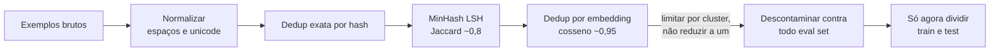

**Follow-ups:** Por que o MinHash é preferido à similaridade de cosseno par a par em escala? Como você escolheria o threshold de Jaccard em vez de aceitar o 0,8 de olhos fechados?

</details>

### 13. Qual é a diferença entre um outcome reward model e um process reward model, e quando você precisa de cada um?

<details><summary><b>Resposta</b></summary>

Um outcome reward model (ORM) pontua a resposta como um todo, com um escalar por resposta. Um process reward model (PRM) pontua cada passo intermediário do raciocínio e fornece um sinal denso, passo a passo. A troca é entre custo de anotação e credit assignment.

Um ORM é barato de supervisionar: você precisa de um label da resposta final ou de uma preferência sobre a resposta final. Só que o sinal é esparso e o credit assignment é cego. Uma trajetória que acerta no chute depois de um raciocínio quebrado recebe crédito total, e uma trajetória quase correta que escorrega na última linha recebe zero. Em tarefas de longo horizonte com taxa de sucesso baixa, a maioria dos rollouts retorna zero e você aprende muito pouco a cada passo.

Os PRMs dão um gradiente em cada passo, então o modelo aprende qual passo foi o erro. O custo são os labels por passo. A anotação humana de passos é cara (o PRM800K, da OpenAI, é o exemplo canônico de quem pagou por isso). O caminho mais barato é rotular automaticamente por rollout: a partir de um passo, amostram-se continuações e o passo é rotulado pela frequência com que elas chegam à resposta correta. Essa é a supervisão no estilo Math-Shepherd, que custa compute em vez de anotadores.

Onde os PRMs realmente se destacam é na inferência: no reranking de best-of-N ou na orientação de tree search, em que uma nota por passo permite podar cedo. Esse é um dos grandes motivos de eles importarem na era do test-time compute.

Há duas ressalvas que vale levantar. Primeiro, se você tem um verificador de verdade (unit tests, um checador de respostas), nem precisa de um ORM. O RLVR usa o checador diretamente, então não há reward model aprendido para explorar, embora um checador fraco ainda possa ser burlado (testes sob medida, aprovação só por formato). Segundo, os próprios PRMs sofrem hacking, e as fronteiras entre passos são mal definidas em raciocínio livre.

Ordem prática: recompensa de verificador primeiro, ORM se a tarefa não for verificável, PRM só quando a recompensa é esparsa demais para aprender.

**Vale desenhar.** O diagrama torna visível a diferença de credit assignment, em vez de apenas afirmá-la.

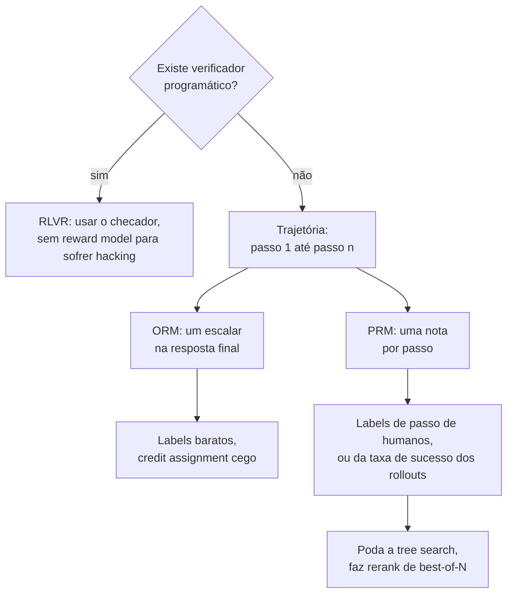

**Follow-ups:** Como você geraria labels de PRM sem anotadores humanos, e que viés isso introduz? Por que um PRM usado como reranker de best-of-N pode piorar conforme o N cresce?

</details>

## Intermediário

### 14. Quais módulos você mira com o LoRA, como escolhe o rank e qual é a economia real de memória?

<details><summary><b>Resposta</b></summary>

**Módulos**: o paper original adaptava apenas as projeções q e v, mas a prática atual é mirar **todas as projeções de attention (q, k, v, o) mais as matrizes do MLP (gate/up/down)**. Com um orçamento fixo de parâmetros treináveis, cobrir mais módulos com rank menor costuma vencer um rank alto em poucos módulos (essa também é a conclusão do QLoRA: adaptar todas as camadas lineares foi necessário para igualar o full fine-tuning). Embeddings e LM head normalmente ficam congelados, a menos que você tenha adicionado novos tokens.

**Rank**: r=8-16 para estilo, formato ou persona; r=32-64 para mudanças comportamentais mais difíceis ou aprendizado de tarefa mais capaz. Acima de 64, os retornos diminuem na maioria das tarefas de SFT: se r=64 ainda dá underfitting, o problema costuma ser os dados ou a própria premissa de baixo rank (considere full FT). Método prático: comece com r=16, alpha=32. Se a qualidade held-out estagnar abaixo da meta e mais dados, ou dados melhores, não mexerem nisso, dobre o r e compare.

**Conta de memória** (modelo da classe 7B, hidden 4096, 32 camadas, alvo em todas as camadas lineares com r=16): os parâmetros do adapter somam cerca de ~40M, ~0,6% do modelo. A economia:

- Full FT com Adam, precisão mista: ~16 bytes/param → ~112 GB para pesos + gradientes + estados do otimizador.
- LoRA: base congelada em bf16 com ~14 GB (sem grads nem estados do otimizador) + adapters de ~40M parâmetros com grads e estados do Adam em fp32 → bem abaixo de 1 GB. Total de ~15 GB + activations, o que cabe em uma GPU de 24 GB com gradient checkpointing.
- QLoRA: base em NF4 com ~3,5-4 GB → fine-tunes de 7B cabem em placas de consumo.

Duas ressalvas que mostram experiência real: as activations continuam escalando com batch × sequence length, independentemente do LoRA (quem controla isso é o checkpointing), e os backward passes ainda atravessam os pesos base congelados, então a economia de compute é modesta. O LoRA economiza memória, não FLOPs.

**Follow-ups:** Por que muitos módulos com rank baixo vencem poucos módulos com rank alto, com o mesmo número de parâmetros? Quando você treinaria também a camada de embedding?

</details>

### 15. Como funciona o merge de adapters, e como funcionam o multi-LoRA serving e o hot-swapping em produção?

<details><summary><b>Resposta</b></summary>

**Merge**: como a atualização do LoRA é aditiva, você pode incorporá-la aos pesos base offline: $W' = W + \frac{\alpha}{r}BA$. O modelo mesclado é um checkpoint padrão, sem overhead de inferência, sem dependência do PEFT na hora de servir e implantável em qualquer lugar. No PEFT, é `model.merge_and_unload()`. Os custos: você passa a armazenar e distribuir um artefato de tamanho completo por variante, perde a possibilidade de destacar o adapter, e o merge em uma base *quantizada* tem perdas. A prática padrão é mesclar nos pesos base em precisão completa e depois (re)quantizar, e não mesclar nos tensores de 4-bit contra os quais o run de QLoRA treinou.

**Serving sem merge**: mantenha a base congelada e calcule $Wx + \frac{\alpha}{r}BAx$ em runtime, um matmul extra pequeno cujo custo de latency depende dos kernels e de quantos adapters distintos dividem o mesmo batch. Faça o benchmark com a sua própria mistura de tráfego. Por que aceitar esse custo? Porque ele viabiliza o **multi-LoRA serving**: uma única cópia do modelo base na memória da GPU, com muitos adapters (cada um com dezenas de MB) anexados por requisição. Sistemas como o S-LoRA e o suporte a LoRA do vLLM agrupam em batch requisições de adapters *diferentes* no mesmo forward pass do modelo base, usando kernels de adapter batched/gathered, e fazem paging dos adapters entre a memória da GPU e a da CPU sob demanda. Isso muda a economia da customização: servir 100 fine-tunes por cliente como modelos mesclados significa 100 réplicas do modelo. Como adapters, é uma réplica da base mais alguns GBs de adapters.

**Hot-swapping** é carregar e descarregar adapters em runtime sem reiniciar o servidor nem recarregar a base. Novas versões de fine-tune entram no ar em segundos, e o rollback consiste em "apontar as requisições para o ID do adapter anterior".

Notas operacionais que valem citar por conta própria: fixe a versão exata do modelo base com a qual o adapter foi treinado (sem ela, o adapter é só um delta sem significado); versione os adapters como código, com gates de eval; e, se um adapter recebe 95% do tráfego, vale a pena mesclar *esse* em uma réplica dedicada e ficar com o overhead zero.

**Vale desenhar.** O diagrama mostra de onde vem a economia: uma base residente e muitos deltas pequenos.

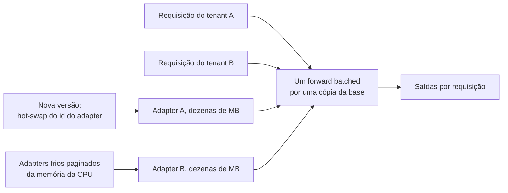

**Follow-ups:** Por que fazer merge em uma base quantizada em 4-bit é problemático? Como você projetaria o serving para 500 fine-tunes específicos por tenant, com tráfego desigual?

</details>

### 16. Explique o QLoRA: NF4, double quantization, paged optimizers. O que você sacrifica?

<details><summary><b>Resposta</b></summary>

O QLoRA treina adapters LoRA em bf16 sobre um modelo base cujos pesos congelados são quantizados em 4 bits. O resultado de destaque foi o fine-tuning de um modelo de 65B em uma única GPU de 48 GB, igualando a qualidade do fine-tuning em 16-bit nos benchmarks do paper. São três componentes:

- **NF4 (4-bit NormalFloat)**: um tipo de dado de 4 bits com motivação teórico-informacional, cujos 16 níveis de quantização ficam nos quantis de uma distribuição normal padrão. Isso combina com a distribuição empiricamente ~normal dos pesos pré-treinados, de modo que cada nível é usado com frequência semelhante. Ele supera inteiros/floats simples de 4 bits com a mesma largura. Os pesos são quantizados por blocos (tamanho 64), com uma constante absmax em fp32 por bloco.
- **Double quantization**: essas constantes por bloco também custam memória (fp32 a cada 64 pesos ≈ 0,5 bit/param). Por isso o QLoRA quantiza as próprias constantes para 8 bits, economizando ~0,37 bit/param, o que dá ~3 GB em um modelo de 65B.
- **Paged optimizers**: usam a unified memory da NVIDIA para paginar os estados do otimizador para a RAM da CPU durante picos de memória (por exemplo, batches de sequências longas), transformando crashes de OOM em lentidão.

O ponto crucial é que o compute continua em bf16: os pesos são dequantizados bloco a bloco, na hora, a cada matmul, e os gradientes fluem pelos pesos dequantizados apenas até os parâmetros do LoRA. Os tensores de 4 bits da base nunca são atualizados.

**O que você sacrifica**: o modelo base que você está adaptando é uma versão levemente degradada de si mesmo. O adapter compensa parte do ruído de quantização, mas podem surgir regressões sutis em tarefas fora da sua distribuição de fine-tuning. O overhead de dequantização deixa o treino um pouco mais lento por passo do que o LoRA em bf16. E há uma incompatibilidade de deploy a administrar: o adapter foi otimizado contra a base *quantizada*, então servi-lo sobre a base em fp16 (ou fazer o merge) desloca levemente a função. Em geral isso é aceitável, mas vale rodar um eval.

**Vale desenhar.** O diagrama deixa claro que os tensores de 4 bits só são lidos, nunca atualizados.

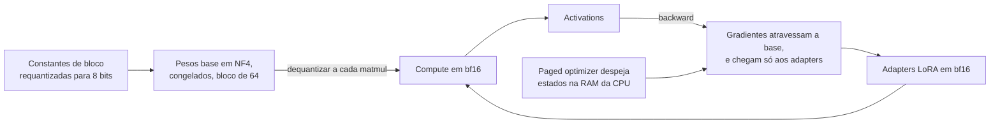

**Follow-ups:** Por que os quantis de uma distribuição normal são os níveis certos para quantizar pesos? Seu adapter de QLoRA tem eval pior quando servido sobre a base em fp16. Por quê, e o que você faria?

</details>

### 17. Como se treina um reward model? Explique os dados de preferência e a loss de Bradley-Terry.

<details><summary><b>Resposta</b></summary>

Um reward model mapeia (prompt, resposta) → nota escalar. A construção padrão é pegar o modelo SFT, trocar a LM head por uma cabeça escalar (em geral lendo o hidden state do último token) e treinar em **dados de preferência par a par**.

**Coleta de dados**: para cada prompt, amostre 2 ou mais respostas (do modelo SFT, já que você quer o RM preciso na distribuição que a policy de fato vai produzir) e peça que anotadores escolham a melhor com base em um rubric escrito (utilidade, inocuidade, precisão...). Usa-se a comparação par a par porque os humanos são muito mais consistentes em "A vence B" do que em notas absolutas. O controle de qualidade é a parte difícil: meça a concordância entre anotadores (muitas vezes só ~70-80% em pares sutis), calibre os anotadores e audite vieses sistemáticos. Os anotadores preferem de forma consistente respostas mais longas e de tom mais confiante, e o seu RM vai aprender esses vieses fielmente.

**Loss**: o modelo de Bradley-Terry diz que a probabilidade de a resposta $y_w$ vencer $y_l$ é uma função logística da diferença de notas:

$$P(y_w \succ y_l \mid x) = \sigma\big(r_\theta(x, y_w) - r_\theta(x, y_l)\big)$$

Então você minimiza $-\log\sigma(r_\theta(x,y_w) - r_\theta(x,y_l))$, ou seja, uma regressão logística sobre diferenças de nota. Só as *diferenças* são identificáveis, então as recompensas absolutas têm um offset arbitrário (alguns setups as normalizam ou ancoram). Com rankings de k posições, você os decompõe em pares.

**Avaliação**: accuracy de preferência held-out (com que frequência o RM concorda com os humanos; ~70-80% é típico e limitado pela concordância entre anotadores), mais sondagens direcionadas a modos de falha conhecidos: viés de comprimento, sycophancy, viés de formato. O RM é o proxy do qual todo o run de RLHF depende: a policy vai explorar qualquer erro sistemático dele. Por isso a qualidade do RM, dados de preferência novos e on-distribution e o retreino periódico do RM pesam mais que os hiperparâmetros do PPO.

**Vale desenhar.** O retorno ao modelo que amostra é a parte que os candidatos esquecem.

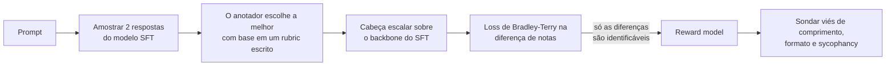

**Follow-ups:** Por que amostrar as respostas de treino do RM a partir do modelo SFT e não de outro modelo? Como você detectaria e corrigiria o viés de comprimento em um reward model?

</details>

### 18. Explique o PPO no contexto do RLHF. Por que existe uma penalidade de KL contra um reference model?

<details><summary><b>Resposta</b></summary>

No nível conceitual (que é o esperado): no RLHF, a policy é o LLM, uma "ação" é emitir um token, um episódio é gerar uma resposta completa, e a recompensa vem do reward model, em geral atribuída no fim da sequência. O PPO (proximal policy optimization) é um método de policy gradient cuja característica definidora são as *atualizações conservadoras*. Ele otimiza um clipped surrogate objective que limita o quanto as razões de probabilidade da nova policy podem se afastar da policy que gerou as amostras em uma única atualização. Assim, você pode dar vários passos de gradiente por batch de gerações caras sem que a policy colapse. Na prática, ele também traz uma value function aprendida (critic) e a estimativa de advantage (GAE) para reduzir a variância do gradiente. O ciclo é: amostrar respostas da policy atual → pontuar com o RM → calcular as advantages → fazer a atualização clipped da policy → repetir.

A **penalidade de KL** é uma restrição separada, específica do RLHF. O objetivo é aproximadamente

$$\max_\pi\; \mathbb{E}_{y\sim\pi}\big[r(x,y)\big] - \beta\,\mathrm{KL}\big(\pi(\cdot|x)\,\|\,\pi_{ref}(\cdot|x)\big)$$

em que $\pi_{ref}$ é o modelo SFT congelado. Ela existe por dois motivos:

1. **O RM é um proxy, não a verdade.** Ele só é preciso perto da distribuição em que foi treinado. A otimização sem restrição leva a policy para fora da distribuição, para textos que o RM pontua errado: a recompensa sobe e a qualidade real cai (reward hacking). O termo de KL mantém a policy onde o RM é confiável.
2. **Preservação de capacidades.** O reference model ancora fluência, conhecimento e diversidade. Sem ele, a policy pode degenerar (repetição, formulações estranhas, colapso de entropia) enquanto a "recompensa" sobe.

O β define o tradeoff: alto demais e o modelo mal muda; baixo demais e você tem hacking. Os times monitoram a fronteira KL vs. recompensa durante o treino e tratam recompensa subindo com KL explodindo como sinal de alerta, não como progresso. O KL costuma ser implementado por token, como $\log\pi(y_t) - \log\pi_{ref}(y_t)$ incorporado à recompensa.

**Vale desenhar.** O diagrama separa o loop do PPO da "coleira" do KL, duas ideias independentes que as pessoas costumam misturar.

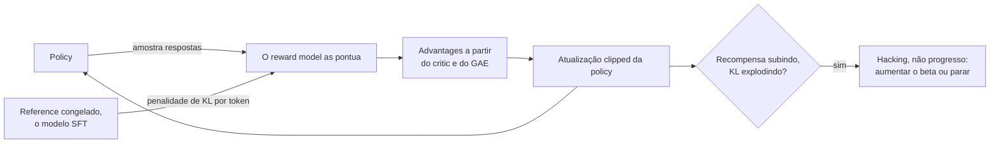

**Follow-ups:** O que você monitora durante um run de PPO para pegar falhas cedo? Por que o PPO faz clipping das razões de probabilidade em vez de simplesmente usar um learning rate maior?

</details>

### 19. O que é reward hacking? Dê exemplos concretos e mitigações.

<details><summary><b>Resposta</b></summary>

Reward hacking (reward overoptimization, ou Goodharting) é quando a policy encontra comportamentos que aumentam a recompensa do *proxy* sem aumentar o objetivo real que o proxy deveria representar, muitas vezes até reduzindo esse objetivo. É inevitável na essência: o RM é um substituto imperfeito, treinado com preferências finitas, e o RL é uma busca adversarial pelos pontos cegos dele.

Exemplos concretos vistos na prática:

- **Viés de comprimento**: os anotadores preferem levemente respostas mais longas → o RM herda isso → a policy produz respostas inchadas e com enchimento. É o artefato de RLHF mais documentado, e por isso os evals sérios controlam o comprimento.
- **Sycophancy**: concordar com as opiniões declaradas do usuário e elogiá-lo rende notas mais altas dos avaliadores humanos → o modelo aprende a dizer aos usuários o que eles querem ouvir, inclusive endossando premissas falsas.
- **Truques de confiança e formatação**: tom autoritário, listas, headers e negrito pontuam mais, independentemente da precisão do conteúdo.
- **Manipulação via hedging/recusa**: se o RM dá peso demais à inocuidade, a policy aprende a recusar pedidos limítrofes, mas benignos. Recompensa máxima de segurança, utilidade zero.
- **Hacking de verifiable rewards** (RL para código): modelos que tratam casos especiais dos unit tests visíveis, fazem hard-code das saídas esperadas ou, em cenários agentic, modificam ou apagam os próprios testes. Qualquer brecha explorável no checador é encontrada.
- **Exploits degenerados**: sequências de tokens fora da distribuição, ou repetição, que por acaso pontuam alto com um RM fraco. É o modo de falha que a penalidade de KL existe para evitar.

Mitigações: a **penalidade de KL** contra um reference model (mantém a policy onde o RM está calibrado); **early stopping**, com base no padrão conhecido de que a qualidade gold-standard sobe e depois cai enquanto a recompensa do proxy continua subindo; **dados de preferência on-policy novos** e retreino periódico do RM (RLHF iterado), para que o RM continue preciso no que a policy produz agora; **ensembles de RMs** ou recompensas de pior caso sobre o ensemble; **debiasing** explícito (recompensas com penalidade de comprimento); **verificadores reforçados**, com testes ocultos e checagens de integridade do sandbox, no RL para código; e spot-checks humanos das amostras de maior recompensa, que são a mitigação mais barata e mais confiável em informação.

**Vale desenhar.** Desenhar o ciclo mostra por que recompensa em alta não prova nada por si só.

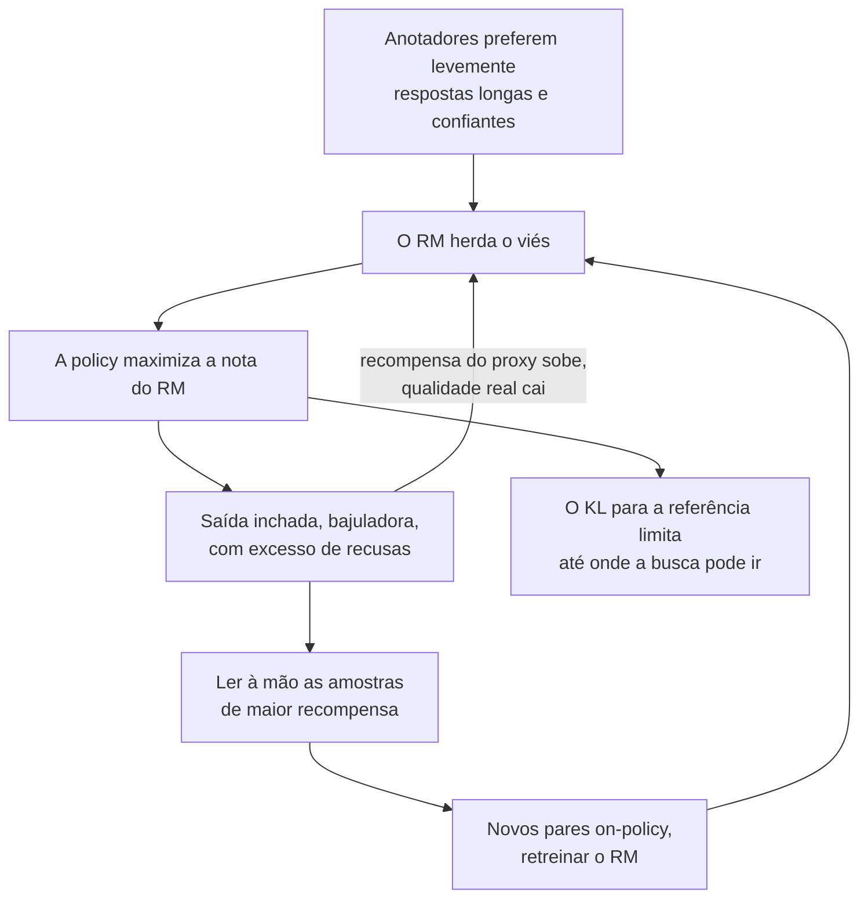

**Follow-ups:** A recompensa do seu run está subindo de forma constante. Que evidência distingue melhora genuína de hacking? Como você reforçaria uma recompensa baseada em unit tests contra manipulação?

</details>

### 20. Explique o DPO. Qual é a intuição central que permite dispensar o reward model e o loop de RL?

<details><summary><b>Resposta</b></summary>

O DPO (Direct Preference Optimization) treina diretamente sobre pares de preferência, com uma loss simples no estilo de classificação: sem reward model, sem sampling, sem RL.

**A intuição central**: o objetivo do RLHF com restrição de KL tem uma policy ótima em forma fechada, $\pi^*(y|x) \propto \pi_{ref}(y|x)\,e^{r(x,y)/\beta}$. Invertendo essa relação, qualquer função de recompensa pode ser reescrita (a menos de uma constante que depende do prompt) em termos da sua própria policy ótima:

$$r(x,y) = \beta \log \frac{\pi(y|x)}{\pi_{ref}(y|x)} + \text{const}(x)$$

Então, em vez de aprender um RM explícito e depois achar a policy ótima dele com PPO, você substitui essa **recompensa implícita** na verossimilhança de preferência de Bradley-Terry. A constante se cancela na diferença par a par, o que dá a loss do DPO:

$$\mathcal{L} = -\log\sigma\Big(\beta\big[\log\tfrac{\pi_\theta(y_w|x)}{\pi_{ref}(y_w|x)} - \log\tfrac{\pi_\theta(y_l|x)}{\pi_{ref}(y_l|x)}\big]\Big)$$

Daí o título do paper: *your language model is secretly a reward model*. A própria policy parametriza a recompensa, e o ajuste do reward model e a otimização da policy colapsam em um único passo supervisionado.

**Lendo o objetivo**: aumente a log-probabilidade da resposta escolhida em relação ao reference model e diminua a da rejeitada. O sigmoide dá o maior peso aos gradientes onde a recompensa implícita atualmente ranqueia o par *errado*. O β cumpre o mesmo papel do coeficiente de KL do RLHF: o quanto a policy pode se afastar da referência para ajustar as preferências.

**Mecânica**: você precisa do reference model congelado (em geral o seu checkpoint de SFT) para as razões de log-probabilidade. Isso significa dois modelos na memória, ou log-probs de referência pré-calculadas. O treino é tão estável e barato quanto o SFT: um forward/backward por membro do par, sem geração durante o treino, com infraestrutura supervisionada padrão. Comportamentos conhecidos que valem citar: o DPO pode reduzir a verossimilhança absoluta de *ambas* as respostas (só a margem é restringida) e pode sofrer overfitting às idiossincrasias das preferências, o que motivou variantes como o IPO.

**Vale desenhar.** O diagrama nomeia exatamente quais três peças móveis do PPO a reparametrização elimina.

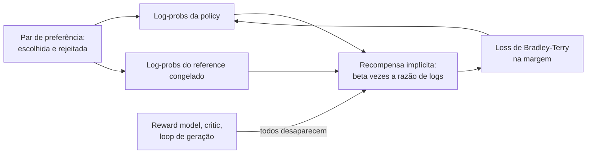

**Follow-ups:** Qual é o papel do β, e o que acontece com valores muito pequenos ou muito grandes? Por que o termo const(x) se cancela, e por que isso importa? O que se perde por nunca amostrar da policy durante o treino?

</details>

### 21. DPO vs. RLHF no estilo PPO: quando você escolheria cada um?

<details><summary><b>Resposta</b></summary>

A diferença fundamental é **offline vs. online**. O DPO se ajusta a um dataset fixo de pares de preferência. O PPO gera amostras novas da policy atual a cada passo e as pontua. Todo o resto decorre disso.

**Escolha o DPO quando**: você tem um bom dataset estático de preferências; quer a simplicidade de um SFT (um modelo para treinar mais um reference congelado, sem RM, sem critic, sem loop de geração, ~2 modelos na memória contra ~4 do PPO: policy, reference, RM e value net); o seu time não tem infraestrutura nem experiência de debug em RL; ou você está fazendo alinhamento de preferências de rotina (tom, utilidade, preferências de formato), em que os dados offline são representativos. O DPO também é muito mais reproduzível: é aprendizado supervisionado determinístico, enquanto os runs de PPO são notoriamente sensíveis a detalhes de implementação e a seeds.

**Escolha o PPO/RL online quando**: a recompensa pode ser calculada em amostras *novas*, seja um RM forte ou, melhor ainda, verifiable rewards (testes, checadores), porque os métodos online exploram além do suporte do seu dataset. A policy descobre comportamentos que nenhum anotador demonstrou, é avaliada e melhora. O DPO só consegue repesar comportamentos presentes nos seus pares. Isso pesa mais no treino de reasoning e de agents, e é por isso que o RL de reasoning no estilo R1 é online (GRPO), não DPO. Os métodos online também lidam com o distribution shift: conforme a policy melhora, o dataset congelado do DPO (tipicamente amostrado do modelo *SFT*) fica cada vez mais off-policy, o que limita até onde ele consegue levar a qualidade.

Meios-termos práticos que vale citar: o **DPO iterativo** (amostrar da policy atual, rotular com um RM ou judge, rodar DPO nos pares novos e repetir) recupera boa parte do benefício online com uma fração da complexidade, e o best-of-n sampling contra um RM na inferência é um baseline sem treino.

Resumo honesto: os frontier labs rodam RL online no post-training principal porque, nessa escala, o teto importa. Para a maioria dos times aplicados que fazem fine-tuning de um modelo de produto, o DPO (ou o DPO iterativo) tem uma relação custo-benefício melhor.

**Follow-ups:** Por que dados off-policy limitam o teto do DPO? Projete um loop de DPO iterativo: de onde vem o sinal extra dele? Quando o best-of-n com um RM venceria os dois?

</details>

### 22. Resuma em uma linha o IPO, o KTO e o ORPO: que problema cada um resolve, e quando você escolheria cada um?

<details><summary><b>Resposta</b></summary>

Os três são métodos de preferência offline da família do DPO, e cada um corrige um ponto de dor específico.

- **IPO (Identity Preference Optimization)**: ataca a tendência do DPO ao *overfitting nas preferências*. A loss log-sigmoid do DPO continua empurrando a margem escolhida/rejeitada para o infinito em pares que ele já ranqueia corretamente (principalmente com labels determinísticos ou ruidosos, em que as premissas de Bradley-Terry se quebram). O IPO a substitui por uma loss quadrática, que regride a margem da recompensa implícita para um alvo fixo (1/(2β) na parametrização do paper), de modo que a otimização satura em vez de disparar. Escolha-o quando os seus labels de preferência forem ruidosos ou quase determinísticos e os runs de DPO piorarem com o treino. Vem do framework teórico Ψ-PO, que analisa o que o RLHF/DPO de fato otimizam.

- **KTO (Kahneman-Tversky Optimization)**: resolve o problema do *formato dos dados*: muitas vezes você não tem pares, apenas sinais independentes de thumbs-up/thumbs-down (feedback de produção, flags de moderação). A loss do KTO, inspirada na prospect theory, treina direto sobre labels binários de desejável/indesejável em relação a um ponto de referência, sem exigir pareamento, e tolera desbalanceamento entre positivos e negativos. Escolha-o quando você tem muito feedback não pareado de um produto em operação, que é o habitat natural dele.

- **ORPO (Odds Ratio Preference Optimization)**: resolve o problema da *complexidade do pipeline*. Ele é monolítico e incorpora a otimização de preferência ao próprio SFT. A loss é o NLL padrão do SFT na resposta escolhida mais um termo de odds-ratio que penaliza a resposta rejeitada, **sem reference model** e sem etapas separadas de SFT e depois alinhamento: um run de treino, um modelo na memória. Escolha-o quando quiser a receita mais simples possível de SFT + alinhamento e tiver pares, aceitando que, sem o reference model, desaparece a âncora explícita que limita a deriva.

O suporte dos frameworks (o TRL implementa os três) torna barato experimentar. Na prática, um DPO bem ajustado continua sendo o padrão, e esses são os recursos a que você recorre quando o *formato dos dados* (KTO), o *ruído dos labels* (IPO) ou o *orçamento do pipeline* (ORPO) indicam outro caminho.

**Vale desenhar.** O diagrama transforma três papers em uma única pergunta sobre o formato dos seus dados.

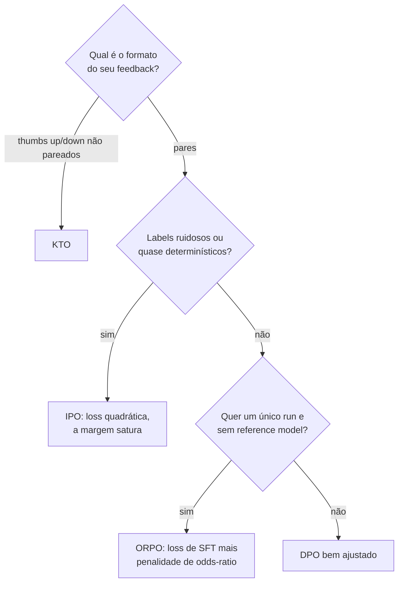

**Follow-ups:** Por que a margem do DPO cresce sem limite, e por que isso é ruim? Você tem 500 mil eventos de thumbs-up/down de produção. Qual método usa, e por quê?

</details>

### 23. Como você avalia um modelo antes e depois do fine-tuning?

<details><summary><b>Resposta</b></summary>

A avaliação de um fine-tune é uma medição *diferencial*: a pergunta não é "o modelo é bom?", e sim "o que mudou, nas duas direções?". Meu checklist:

**Antes do treino**: congele um **task eval set** held-out (tirado da distribuição de tráfego real, não só de uma fatia do arquivo de treino curado) e meça nele o baseline do modelo base *e* da alternativa de um modelo frontier com prompt. Essa é a barra que o fine-tune precisa superar para justificar a própria existência. Defina a métrica de antemão: exact-match/F1 para extração, taxa de aprovação em um validador para structured output, LLM-as-judge com rubric (com debiasing de posição e alguma calibração de concordância com humanos) para qualidade em tarefas abertas.

**Checagens de contaminação**: verifique a separação entre train e eval com correspondência exata e de near-duplicates (sobreposição de n-grams, similaridade de embeddings) entre o conjunto de treino e *todos* os eval sets, inclusive os benchmarks públicos que você vai reportar. Um eval vazado torna ficção todos os números seguintes. É também aqui que você pega o caso de "o mesmo ticket de cliente aparece nos dois splits com redação diferente".

**Depois do treino, em duas direções**:
1. **Ganhos na tarefa-alvo**: o held-out set, mais uma visão por fatias (por intenção, tamanho, categoria de caso de borda). Ganhos agregados podem esconder regressões na cauda que importa.
2. **Suíte de regressão em capacidades gerais**: instruction following, benchmarks de raciocínio/conhecimento (estilo MMLU), conformidade de formatação, comportamento de segurança/recusa e tratamento de contexto longo, se for relevante. O fine-tuning é o momento em que catastrophic forgetting e excesso de recusas entram sem alarde. Se você não testa, você entrega.

**Além dos números offline**: comparações lado a lado, por humanos ou judges, de preferência em prompts reais; depois, um shadow deployment ou A/B com pouco tráfego e métricas online (conclusão da tarefa, taxa de escalonamento, avaliações de usuários) antes do rollout completo. Reavalie também com a configuração de *serving* (mesmo chat template, quantização e parâmetros de sampling), porque a diferença entre a configuração do eval e a do serving é uma fonte clássica de "foi bem no benchmark, mas degradou em prod".

**Follow-ups:** Seu fine-tune melhora a métrica da tarefa em 15%, mas derruba em 5% um eval interno de instruction following. Você entrega? Como tornar os evals com LLM-as-judge confiáveis o bastante para barrar releases?

</details>

### 24. Qual é a diferença entre continued pretraining e SFT? Quando você precisa de injeção de conhecimento de domínio?

<details><summary><b>Resposta</b></summary>

O **continued pretraining (CPT)** é o treino de próximo token sobre um corpus bruto do domínio (papers, contratos, codebases, notas clínicas), sem chat template e sem loss masking: tudo entra na loss. A função dele é deslocar a *distribuição de conhecimento e de linguagem* do modelo: vocabulário em contexto, fatos do domínio, o estilo de raciocínio daquela área. Ele exige volume (tipicamente centenas de milhões a bilhões de tokens) e, em geral, full fine-tuning, porque uma atualização de baixo rank não absorve tanta informação nova.

O **SFT** molda comportamento com pares prompt/resposta curados e loss masking: milhares a dezenas de milhares de exemplos que ensinam *como responder* (formato, tom, execução de tarefas, uso de tools). O SFT ensina forma de maneira confiável, mas é um veículo ruim para fatos. Alguns milhares de pares de perguntas e respostas sobre o seu domínio produzem um recall frágil e propenso a alucinação.

**Quando você precisa de CPT**: o modelo falha não por formatar mal, mas porque realmente não *conhece* o domínio. Ele usa a terminologia errada, não tem os conceitos, não entende o registro (juridiquês denso, abreviações médicas, uma linguagem de programação proprietária, idiomas de poucos recursos). Teste antes, de forma barata: se um modelo frontier com bom contexto recuperado ainda raciocina mal *no domínio*, isso é indício a favor do CPT. Se ele vai bem com contexto, o RAG resolve e o CPT é um desvio caro.

**Pontos práticos importantes**: (1) Em escala, o CPT causa forgetting. As receitas padrão misturam uma fração substancial de replay de dados de domínio geral (com frequência ~10-50%) ao corpus do domínio e usam um LR menor que o do pretraining original, com warmup. (2) O CPT degrada o comportamento de chat, porque você treina em texto bruto. Por isso o pipeline é **CPT → SFT (→ preference tuning)**: reensine o modelo a seguir instruções depois da injeção de conhecimento. (3) A pilha completa de decisão é: RAG para fatos recuperáveis e atualizados, CPT para a fluência de domínio internalizada, SFT para o comportamento. Sistemas reais de domínio (jurídico, médico, financeiro) muitas vezes precisam dos três.

**Vale desenhar.** O diagrama associa cada sintoma observado a uma etapa diferente, em vez de um genérico "treinar mais".

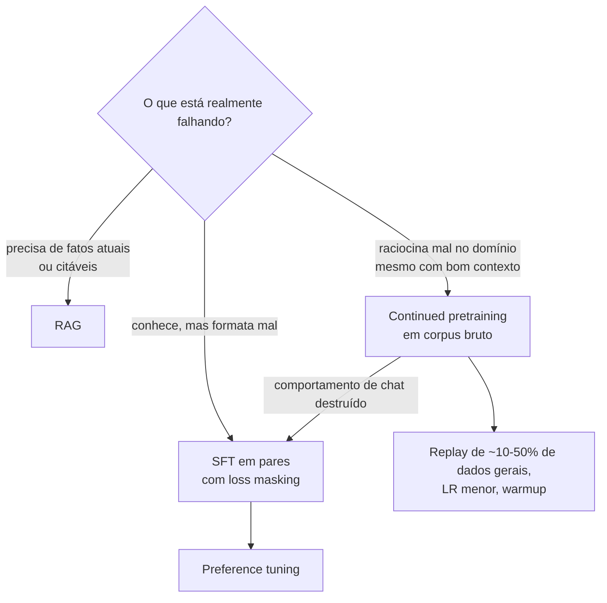

**Follow-ups:** Por que o SFT injeta conhecimento tão mal em comparação com o CPT? Projete a mistura de dados para adaptar um modelo de 8B a notas clínicas: quais frações e por quê? Como você verificaria que o CPT adicionou conhecimento de fato, e não apenas estilo?

</details>

### 25. Como você gera dados sintéticos de treino com um LLM, e quais são as armadilhas?

<details><summary><b>Resposta</b></summary>

As receitas padrão: **geração no estilo self-instruct** (tarefas-semente → o LLM gera variações de instruções → o LLM gera as respostas), **distillation de um teacher mais forte** (prompts reais ou sintéticos, com o teacher escrevendo as respostas gold), **evolução de complexidade no estilo evol-instruct** (reescrever os prompts iterativamente para deixá-los mais difíceis e mais profundos), **condicionamento por persona/cenário para dar diversidade** (gerar como se viesse de muitos tipos de usuário) e **inversões no estilo backtranslation** (gerar o prompt *para* um documento de alta qualidade que já existe). Em domínios verificáveis, acrescente o **rejection sampling**: gerar k candidatos e manter só os que passam por um checador (testes, resposta matemática, validador de schema). É o carro-chefe para dados de reasoning.

As armadilhas, que é o que os entrevistadores querem ouvir:

- **Mode collapse / baixa diversidade**: os LLMs produzem uma fatia estreita da distribuição real, com as mesmas aberturas, a mesma estrutura, as mesmas formulações favoritas. Dados com cara de template ensinam o template. Combata com condicionamento explícito de diversidade (personas, tópicos, controles de dificuldade), temperatura alta para os prompts e dedup com detecção de near-duplicates. *Meça* a diversidade (estatísticas de n-grams, dispersão de embeddings) em vez de presumir.
- **Error amplification**: os erros do teacher viram ground truth que o student aprende com total confiança, e em loops iterativos (modelo treinado nas próprias saídas) os erros se acumulam: é o modo de falha do model collapse. Combata com verificadores sempre que possível, com filtragem por LLM judge + auditoria humana quando não for, e mantendo uma fração de dados humanos na mistura.
- **Herança de vieses**: o student absorve os tiques de estilo, os padrões de recusa e a sycophancy do teacher junto com as habilidades.
- **Descompasso de distribuição**: prompts sintéticos se afastam do tráfego real de usuários (limpos, bem formados, educados), então o modelo vai pior em inputs bagunçados de produção. Gere a partir de tráfego real, com dados pessoais removidos.
- **Contaminação**: dados sintéticos podem reproduzir itens de benchmark que o teacher memorizou. Descontamine contra os seus evals.
- **Licenciamento**: os termos de muitos provedores de API restringem o uso das saídas para treinar modelos concorrentes. É uma checagem jurídica, não só técnica.

**Vale desenhar.** O diagrama mostra onde um verificador muda a economia e onde você fica preso aos judges.

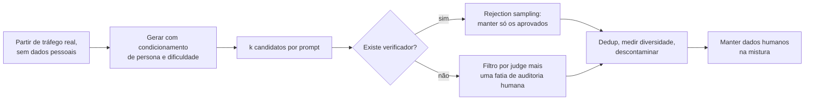

**Follow-ups:** Como você mediria se um dataset sintético é diverso *o bastante*? Por que o rejection sampling muda a economia da qualidade para matemática/código, mas não para escrita criativa?

</details>

### 26. Explique a distillation para LLMs (black-box vs. logit distillation) e as ressalvas de licenciamento.

<details><summary><b>Resposta</b></summary>

A distillation transfere capacidade de um teacher mais forte ou maior para um student menor e mais barato. Há dois regimes:

**Distillation black-box (de dados)**: você só precisa das *saídas em texto* do teacher. Gere os prompts, peça ao teacher respostas de alta qualidade (opcionalmente com reasoning traces), filtre e faça SFT do student nesses pares. Esse é, de longe, o padrão mais comum: foi assim que se construíram a maioria dos datasets de instruct open-source, e a distillation no estilo R1 mostrou que o SFT em chain-of-thought traces de um bom reasoner transfere uma quantidade surpreendente de capacidade de raciocínio para modelos pequenos. Funciona entre arquiteturas diferentes e via APIs, mas cada exemplo carrega só sinal de hard label (uma única sequência amostrada).

**Distillation por logits (white-box)**: o student é treinado para casar as *distribuições* completas de próximo token do teacher. O clássico é cross-entropy/KL contra as probabilidades do teacher (suavizadas por temperatura), muitas vezes misturadas com a loss de hard label. O sinal por token é mais rico (o "dark knowledge" nas probabilidades relativas de tokens errados, porém plausíveis), então é mais eficiente em amostras. Em contrapartida, exige os pesos ou logprobs do teacher, um tokenizer/vocabulário compartilhado (ou cuidadosamente alinhado) e compute para rodar os forwards do teacher. Usa-se quando você controla os dois modelos, por exemplo para construir um modelo pequeno como versão comprimida do seu modelo grande. Várias famílias de modelos abertos treinam seus tamanhos menores assim.

**Ressalvas de licenciamento**, a parte que costuma pegar os times: os termos de serviço de muitos provedores de API hospedada restringem o uso das saídas para desenvolver modelos que concorrem com eles. Treinar seu modelo comercial com saídas de uma API frontier pode violar os ToS, qualquer que seja a viabilidade técnica. Modelos com pesos abertos também não são automaticamente livres: licenças como a community license do Llama impõem condições a modelos derivados e até a modelos treinados com *saídas* do Llama (cláusulas de nomenclatura e atribuição, limites de uso). Além disso, os dados sintéticos herdam as restrições do teacher e podem trazer para o seu conjunto de treino conteúdo protegido por direitos autorais ou pessoal que o teacher memorizou. A resposta certa em entrevista: "Eu pediria a revisão dos ToS e da licença antes de fechar o pipeline de dados. Isso é um gate jurídico, não um detalhe de engenharia."

**Follow-ups:** Por que soft targets carregam mais informação do que texto amostrado? Seu student e seu teacher têm tokenizers diferentes: o que quebra na logit distillation e quais são as alternativas?

</details>

### 27. Faça a conta de memória da GPU: por que você não consegue fazer full fine-tuning de um modelo de 7B em uma única GPU de 24 GB com Adam?

<details><summary><b>Resposta</b></summary>

Conte os bytes por parâmetro no treino padrão de precisão mista com Adam:

| Componente | Precisão | Bytes/param |
|---|---|---|
| Pesos do modelo | bf16 | 2 |
| Gradientes | bf16 | 2 |
| Pesos master (cópia do otimizador) | fp32 | 4 |
| Primeiro momento do Adam (m) | fp32 | 4 |
| Segundo momento do Adam (v) | fp32 | 4 |
| **Total (estático)** | | **16** |

O vilão é o Adam: ele mantém *três* tensores fp32 por parâmetro (pesos master + duas estimativas de momento) = 12 bytes/param, 6× o tamanho do próprio modelo em bf16. Para 7B de parâmetros: 7e9 × 16 B ≈ **112 GB** de estado estático, quase 5× o tamanho de uma placa de 24 GB, antes de processar um único token.

Em cima disso vêm as **activations**, que escalam com batch_size × sequence_length × hidden_dim × layers (facilmente dezenas de GB com comprimento 4096, sem mitigação), além do overhead do contexto CUDA e da fragmentação.

As alavancas, ligadas ao termo que cada uma ataca:

- **Gradient checkpointing** → activations: guarda só as activations nas fronteiras das camadas e recalcula o resto no backward; ~30% de overhead de compute para uma redução de várias vezes nas activations.
- **Gradient accumulation** → activations: atinge um batch efetivo de 64 com micro-batches de 1 a 4.
- **Otimizadores de 8 bits** (por exemplo, bitsandbytes) → estados do otimizador: quantizam m/v, reduzindo 8 bytes/param para ~2.
- **ZeRO/FSDP** → todo o estado estático: fazem o shard dos estados do otimizador, dos gradientes e dos parâmetros entre as GPUs; o custo estático por GPU se divide pelo world size.
- **LoRA/QLoRA** → grads + estados do otimizador: só ~0,1-1% dos parâmetros são treináveis, então o estado do otimizador praticamente some. O QLoRA ainda reduz os pesos para ~0,5 byte/param (NF4). É assim que o treino de 7B cabe em menos de 16 GB.

Essa conta é uma pergunta favorita porque revela na hora se o candidato já planejou um run de treino ou só leu a respeito.

**Vale desenhar.** Empilhar os bytes mostra que o que não cabe é o otimizador, não o modelo.


**Follow-ups:** Onde o Adam de 8 bits economiza memória e qual é o risco? Refaça a conta para o LoRA com r=16: qual passa a ser o termo dominante de memória? Por que manter pesos master em fp32 no treino em bf16?

</details>

### 28. Você está fazendo fine-tuning em um domínio cheio de jargão e alguém sugere adicionar novos tokens ao tokenizer. O que pode dar errado, e como tratar mudanças de vocabulário do jeito certo?

<details><summary><b>Resposta</b></summary>

Primeiro, devolva a pergunta: você realmente precisa de novos tokens? A divisão em subwords do jargão costuma funcionar bem, e o modelo lida com isso. Tokens novos compensam para marcadores de controle de alta frequência (tags de papel, delimitadores de tool-call) ou quando um termo aparece em boa parte do seu tráfego e o tamanho da sequência importa. Raramente compensam para substantivos de domínio.

Se você for adicioná-los, estes são os modos de falha:

**Inicialização aleatória.** Redimensionar a matriz de embeddings sorteia as novas linhas da distribuição de init do modelo, que não tem nada a ver com a variedade dos embeddings treinados. O resultado são logits grandes e loss spikes. Inicialize com a média dos embeddings existentes mais um pequeno ruído ou, melhor ainda, com a média das subwords do próprio token:

```python
model.resize_token_embeddings(len(tokenizer))
emb = model.get_input_embeddings().weight.data
for tok_id, pieces in new_tokens.items():
    emb[tok_id] = emb[pieces].mean(dim=0)
```

Se os embeddings de entrada e de saída forem tied, você está inicializando os dois ao mesmo tempo, então confira.

**Embeddings congelados com LoRA.** Por padrão, o LoRA mira as projeções de attention e do MLP, então o embedding e o `lm_head` ficam congelados e os novos tokens nunca são treinados. Eles precisam entrar em `modules_to_save`.

**Drift de tokenizer entre treino e serving.** Salve o tokenizer junto com o adapter. Se a stack de serving carregar o tokenizer base, os seus novos IDs não significam nada, e você recebe lixo silencioso em vez de um erro.

**Vocabulário com padding.** As matrizes de embedding costumam ter padding até um múltiplo de 64 ou 128 por causa dos tensor cores, então existem linhas não usadas que podem ser amostradas se você não as mascarar.

**EOS e pad.** Definir `pad_token = eos_token` sem mascarar as posições de pad nos labels ensina o modelo a parar cedo ou a nunca parar. Esse erro queima gente o tempo todo.

Caminho mais barato: a maioria dos tokenizers modernos já traz special tokens reservados/não usados justamente para isso. Reaproveite esses em vez de redimensionar.

**Follow-ups:** Como você verificaria, depois do treino, que os novos tokens realmente aprenderam alguma coisa? O que quebra se você adiciona tokens a um modelo cujos embeddings são tied e quantizados em 4 bits?

</details>

### 29. DoRA, rsLoRA e LoRA+ prometem melhorar o LoRA vanilla. O que cada um realmente muda, e quando você recorreria a eles?

<details><summary><b>Resposta</b></summary>

Cada um ataca uma fraqueza conhecida diferente, e nenhum muda o jogo. A qualidade dos dados, o rank e a escolha dos módulos-alvo pesam mais que os três.

**rsLoRA (rank-stabilised LoRA).** O LoRA vanilla escala a atualização por `alpha/r`. Conforme o `r` cresce, a atualização e os gradientes que passam por ela são amortecidos com mais força, e os ranks altos rendem menos do que a capacidade pela qual você pagou. O rsLoRA escala por `alpha/sqrt(r)`, o que mantém a variância da atualização aproximadamente estável à medida que o rank cresce. Vale ligar quando você usa r >= 64. Abaixo disso, a diferença é pequena.

**LoRA+.** `A` e `B` têm papéis assimétricos: `B` é inicializada em zero, `A` não. Um único learning rate é, portanto, subótimo, e a correção é dar a `B` um LR substancialmente maior que o de `A` (a sugestão inicial do paper é uma razão em torno de 16x). É uma flag de configuração, sem parâmetros extras e sem compute extra. Ajuda mais em tarefas mais difíceis e com learning rates mais altos.

**DoRA.** Decompõe cada peso em um vetor de magnitude e uma direção, aplica o LoRA à direção e treina a magnitude separadamente. A motivação é empírica: o full fine-tuning e o LoRA mostram padrões diferentes de atualização de magnitude vs. direção, e liberar a magnitude fecha boa parte da distância, principalmente em rank baixo. O custo é, grosso modo, um cálculo de norma por passo, ou seja, treino ~20-30% mais lento. Continua mesclável, com parâmetros extras desprezíveis.

Vale conhecer também o **PiSSA**: inicializa o adapter a partir dos componentes singulares principais de `W` em vez de aleatoriamente (o OLoRA faz algo parecido com uma init ortonormal baseada em QR), de modo que o treino já comece no subespaço dominante e convirja mais rápido.

Meus defaults: LoRA com r=16-32, alpha=2r, alvo em todas as camadas lineares. Recorro ao DoRA quando estou limitado em rank e perdendo para o full FT, e ao rsLoRA quando estou empurrando o r para cima. Não empilhe os três de uma vez: você teria mudado três variáveis sem aprender nada. E meça em um eval real, não na train loss, porque nessas margens a train loss mente.

**Follow-ups:** Por que o DoRA ainda se mescla limpo aos pesos base na inferência? Se o DoRA supera o LoRA no seu eval por 0,4 ponto, mas custa 30% a mais de tempo de treino, como você decide?

</details>

### 30. Explique o model merging: task arithmetic, TIES, DARE e SLERP. Quando o merging realmente funciona?

<details><summary><b>Resposta</b></summary>

O merging combina os pesos de vários modelos que passaram por fine-tuning a partir de uma base comum. Não há treino nem dados, e leva minutos na CPU. O objeto central é o task vector: `tau_i = theta_ft_i - theta_base`.

**Task arithmetic:** `theta = theta_base + sum(lambda_i * tau_i)`. Somar um task vector adiciona um comportamento, e negar um deles pode subtraí-lo (um botão tosco de unlearning).

O **TIES** corrige a interferência, que ocorre quando os task vectors se sobrepõem e se cancelam. São três passos: apare cada task vector, mantendo as entradas de maior magnitude (~top 20%); eleja um sinal por parâmetro pela soma das magnitudes entre os modelos; e depois tire a média só das entradas que concordam com o sinal eleito. O conflito de sinais é o principal fator que destrói a média ingênua.

O **DARE** explora a redundância: descarte aleatoriamente 80-99% das entradas do delta e reescale as sobreviventes por `1/(1-p)`. Os deltas são muito redundantes, então isso quase não prejudica cada modelo individualmente e reduz drasticamente a sobreposição entre eles. DARE+TIES combinados é uma receita comum.

O **SLERP** interpola esfericamente entre exatamente dois modelos, preservando a norma em vez de encolhê-la, como faz a média linear ingênua. Só funciona com dois modelos.

Quando funciona: os modelos precisam ter um ancestral comum e estar na mesma bacia de loss. Mesclar dois modelos pré-treinados de forma independente não funciona, porque a simetria de permutação faz com que os neurônios de um não sejam comparáveis aos do outro. Ganhos confiáveis: combinar capacidades de fine-tunes irmãos, tirar a média de checkpoints de um mesmo run (model soups), mesclar LoRAs sobre uma base compartilhada e puxar um fine-tune estreito de volta para a base com lambda em torno de 0,7 para recuperar capacidade geral. Esse último caso é, na prática, um botão sobre o alignment tax, e é o uso a que mais recorro.

Seja honesto na entrevista: é barato e empírico. Não existe um jeito fundamentado de escolher o lambda; você faz um sweep contra um eval real. O mergekit é a ferramenta padrão. O merging é um almoço grátis quando funciona e um mistério quando não funciona.

**Follow-ups:** Por que o merging falha entre modelos pré-treinados de forma independente, mas funciona entre fine-tunes de uma mesma base? Como você mesclaria três LoRAs de ranks diferentes treinados sobre a mesma base?

</details>

### 31. Você tem 500 mil exemplos de instruções de qualidade mista e orçamento de compute para treinar em 20 mil. Como escolhe os 20 mil?

<details><summary><b>Resposta</b></summary>

Trate como uma seleção em três eixos: qualidade, dificuldade e diversidade. Otimizar só um deles falha.

**1. Filtros duros primeiro** (baratos; faça antes de qualquer coisa cara): dedup, respostas truncadas ou malformadas, outliers de comprimento, idioma errado, violações de formato, artefatos de template ("As an AI language model"), system prompts vazados, recusas indesejadas. Isso costuma remover de 20% a 40% e não custa nada.

**2. Pontuação de qualidade.** Um LLM judge com rubric explícito por exemplo (no estilo Alpagasus) ou a nota de um reward model. Um judge pequeno sobre 500 mil itens é viável, e um RM de 7B pontuando em uma única passada em batch sai ainda mais barato.

**3. Dificuldade.** Exemplos que o seu modelo já acerta não acrescentam nada. O IFD (instruction-following difficulty) mede o quanto ter a instrução diante da resposta reduz a loss dessa resposta, e você fica com os exemplos mais difíceis: aqueles que o modelo ainda não consegue prever bem, mesmo com a instrução presente. A perplexity da resposta sob o seu modelo atual é um proxy mais grosseiro da mesma ideia.

**4. Diversidade.** Gere embeddings das instruções, agrupe em alguns milhares de clusters e amostre com um teto por cluster. Sem isso, os 20 mil com maior nota colapsam em uma ou duas intenções, porque os judges têm preferências sistemáticas.

**5. Mistura.** Defina de antemão o orçamento por capacidade para acompanhar o tráfego de produção, mais uma fatia de instruções gerais para evitar regressões. As notas de seleção devem competir dentro de um bucket, não entre buckets.

Depois, leia você mesmo 100 exemplos selecionados ao acaso. Todo pipeline de seleção que já construí tinha um bug que só apareceu na leitura.

O que separa os candidatos: **faça ablation contra o aleatório.** Treine em 20 mil aleatórios, nos seus 20 mil selecionados e em 20 mil selecionados por um único eixo. Se o pipeline elaborado não vencer os 20 mil aleatórios em um eval real, você construiu uma engenhoca à la Rube Goldberg, e o aleatório é a melhor decisão de engenharia. Esse baseline é inegociável, e ele falha com mais frequência do que as pessoas admitem.

**Vale desenhar.** O funil termina no baseline que ele precisa superar, e esse é o ponto da resposta.

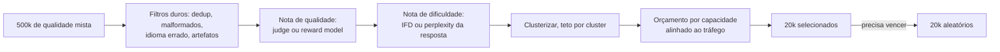

**Follow-ups:** Como você trataria o caso em que o modelo judge e o modelo-alvo compartilham a mesma base, de modo que o judge prefere sistematicamente o próprio estilo? O que muda se os 500 mil exemplos vierem de 4 fontes diferentes, com perfis de qualidade muito distintos?

</details>

### 32. Explique como coletar dados de preferência na prática. Qual é a logística, e onde isso dá errado?

<details><summary><b>Resposta</b></summary>

A engenharia é talvez 20% do trabalho. O desenho da anotação é o resto.

**Amostragem das respostas.** Gere on-policy, a partir do modelo que você está prestes a treinar, e não de uma miscelânea de modelos diferentes. Do contrário, o reward model aprende a identificar modelos em vez de julgar qualidade. Amostre com temperature ~0,8-1,0 para que as duas respostas realmente difiram: pares quase idênticos geram labels de cara ou coroa, puro ruído. Alguns times amostram 4-8 e pegam a melhor e a pior segundo um judge, para obter uma margem limpa, trocando um pouco de on-policy por sinal.

**Formato.** A comparação par a par supera as notas absolutas de 1 a 5, porque os anotadores não são calibrados entre si, e o 3 de uma pessoa é o 4 de outra. Julgamentos comparativos eliminam esse problema. Inclua uma opção "empate / ambas ruins" e exija uma justificativa em texto livre: ela serve de checagem de qualidade do anotador e depois vira dado de treino útil.

**Rubric.** Defina o que é "melhor" por dimensão (correção, instruction following, segurança, tom), com uma prioridade explícita de desempate. Sem rubric, os anotadores tendem ao comprimento e ao tom confiante, e você acabou de construir um dataset com viés de comprimento.

**Controle de qualidade.** Sobreponha ~5-10% dos itens entre anotadores e acompanhe a concordância. Espere um alpha de Krippendorff em torno de 0,6-0,75 para preferências genuinamente subjetivas, e não entre em pânico: a discordância é sinal real, não só ruído. Mire mais alto (0,8+) em dimensões objetivas. Inclua itens gold com respostas conhecidas para detectar drift, mantenha dashboards por anotador e faça sessões de calibração. Use especialistas de domínio para dados de domínio: uma multidão generalista não consegue julgar correção médica ou de código e vai escolher a resposta mais bonita.

**Vieses conhecidos:** posição (randomize qual resposta aparece primeiro), comprimento (meça a fração de pares em que a escolhida é a mais longa; se passar de ~65%, você vai ver o efeito no modelo treinado) e os valores da população de anotadores virando os valores do modelo.

**Orçamento:** dezenas de milhares de pares para um RM geral, alguns milhares para um estreito. Faça o seu próprio time rotular os primeiros 500 antes de pagar a qualquer pessoa.

**Follow-ups:** Seu fornecedor entrega 50 mil pares com alpha de 0,45. O que você faz? Como você desenharia a coleta de forma diferente se a tarefa fosse code review, e não chat aberto?

</details>

### 33. Como você avalia um reward model? Por que a accuracy par a par em held-out não basta?

<details><summary><b>Resposta</b></summary>

A accuracy par a par em um conjunto de preferências held-out é a primeira checagem de sanidade. Ela satura rápido e correlaciona mal com a qualidade da policy resultante.

Por que ela engana:

- Ela é medida na distribuição de saída do modelo SFT. Durante o RL, a policy se afasta dessa distribuição, e a função real do RM é acertar em textos que só vai encontrar depois de centenas de passos de otimização. A accuracy no teste não diz nada sobre esse regime.
- Ela dá o mesmo peso a todos os pares, e a maioria dos pares é fácil. Todo mundo vai bem nos pares fáceis, então a métrica se comprime.
- Ela ignora calibration e margens. Um RM que acerta por um fio em todo lugar é trivialmente hackeável.

O que eu realmente rodo:

1. **Um benchmark para triagem.** O RewardBench / RewardBench 2 dá a accuracy por categoria (chat, segurança, raciocínio), então você percebe que o seu RM está no acaso em código antes de desperdiçar um run de treino.
2. **Sondagens de viés.** Construa pares controlados em que só uma coisa varia: comprimento, formatação markdown, concordância com o usuário. Meça a diferença de nota. Se o RM prefere a resposta mais longa em 90% dos casos, ele vai ensinar a sua policy a divagar.
3. **Curvas de best-of-N.** Amostre N = 1..64 da policy, faça o rerank com o RM e pontue a melhor escolha com ground truth (um verificador ou um judge forte). Um RM sólido melhora a métrica real de forma monotônica em N. Um hackeável atinge o pico em um N moderado e depois piora, porque, com N grande, você está amostrando os modos de falha do RM. Essa inversão é o diagnóstico mais útil que existe, porque é a pressão de otimização em miniatura e não custa nenhum treino.
4. **Concordância humana nova e on-policy,** atualizada a cada rodada. Os RMs ficam obsoletos conforme a policy muda, e é por isso que o RLHF online mantém uma coleira de KL ou retreina o RM.
5. **Calibration.** O Bradley-Terry diz que a diferença de nota, passada por um sigmoide, deve corresponder à taxa de preferência humana. Verifique se corresponde.

Meu critério para liberar são (3) e (4), não a accuracy de teste.

**Follow-ups:** Como você decidiria quando retreinar o reward model durante um run longo de RLHF? O que uma curva de best-of-N plana desde N=1 diria a você?

</details>

### 34. Você está fazendo fine-tuning de um reasoning model que escreve um bloco de thinking antes da resposta final. Como monta os dados de SFT, e o que quebra se você treinar só com as respostas finais?

<details><summary><b>Resposta</b></summary>

Mantenha o reasoning nos targets de treino e renderize-o exatamente como o chat template do modelo faz. A qualidade de um reasoning model mora nos tokens de thinking. Se você o treina com pares (prompt, resposta final), ensina o modelo a responder sem pensar: o bloco de thinking encolhe ou some, a accuracy em prompts difíceis cai e, em modelos híbridos, o modo de thinking se degrada, mesmo sem nunca ter sido treinado diretamente.

Como eu monto os dados:

1. **Obtenha traces, não só respostas.** Gere-os com o próprio modelo por rejection sampling (amostre vários e mantenha os traces cuja resposta final passa por um checador ou judge) ou com um teacher mais forte de estilo compatível. Traces autogerados ficam mais próximos da distribuição do próprio modelo e causam o menor drift.
2. **Reproduza o template exatamente.** Delimitadores de thinking, posição do reasoning em relação à resposta e como os turnos anteriores são renderizados. Muitos templates removem o reasoning dos turnos anteriores do assistant no histórico multi-turn. Treine com a mesma remoção, ou o modelo verá no treino um formato de contexto que nunca vê no serving.
3. **Aplique loss tanto no reasoning quanto na resposta,** com os prompts mascarados como de costume. Se você só tem labels de resposta, gere um trace que chegue àquela resposta e verifique a consistência, ou encaminhe esses exemplos para o modo sem thinking, se o modelo tiver um.
4. **Misture dados gerais de reasoning,** para que o estilo dos traces não colapse na sua tarefa estreita.

Outros modos de falha: traces que não sustentam de fato a resposta final ensinam racionalização post-hoc, traces muito longos do teacher ensinam a divagar e estouram o orçamento de latency, e um teacher com estilo de raciocínio diferente pode deixar você com um modelo cujo thinking e cujas respostas discordam.

Avalie com o thinking ligado, no orçamento de reasoning que você vai servir, e acompanhe o tamanho do trace junto com a accuracy. Um fine-tune que mantém a accuracy mas dobra os tokens de thinking dobrou o seu custo de serving.

**Follow-ups:** Seus especialistas de domínio entregaram labels só com a resposta. Como obter traces sem inventar um raciocínio que os especialistas nunca usaram? Como você encurtaria o thinking do modelo sem perder accuracy?

</details>

### 35. Por que o LoRA se sai tão bem no RL fine-tuning, mesmo em rank muito baixo, quando o mesmo rank pode sofrer underfitting em um run grande de SFT?

<details><summary><b>Resposta</b></summary>

Porque o RL carrega muito menos informação por exemplo do que o SFT, então a atualização que ele precisa armazenar é pequena. Um passo de policy gradient em um episódio é guiado por uma advantage escalar, algo como "esta trajetória foi melhor ou pior que o esperado". Isso é da ordem de um bit por episódio, por mais tokens que o episódio tenha. O SFT em uma demonstração supervisiona cada token contra um target específico, o que dá muitos bits por exemplo. A capacidade do adapter precisa acompanhar a informação do sinal: um dataset grande de SFT pode exceder o que um adapter de rank 16 comporta, enquanto um run longo de RL mal preenche um adapter minúsculo.

Isso bate com a evidência publicada. O texto "LoRA Without Regret" (2025), da Thinking Machines, constatou que RL no estilo GRPO com LoRA iguala o full fine-tuning mesmo com rank 1, enquanto em datasets grandes de SFT o LoRA de rank baixo ficou para trás quando os dados superaram a sua capacidade.

Consequências práticas:

- **O RL é o lugar mais barato para usar LoRA.** O sampler e o trainer podem compartilhar uma única base residente, e sincronizar os pesos com o motor de inferência a cada passo significa mover um adapter, não o modelo inteiro.
- **Mire todas as camadas lineares, MLP incluído.** O LoRA só em attention rende menos, mesmo com o mesmo número de parâmetros, porque a maior parte dos parâmetros (e, em modelos MoE, os experts) está nos blocos de MLP.
- **Learning rate.** O LR ótimo do LoRA fica de forma consistente em torno de 10x o do full fine-tuning e é praticamente independente do rank, o que facilita transferir o LR entre ranks.
- **Onde o LoRA ainda perde.** Etapas grandes de SFT ou de distillation, continued pretraining e batch sizes muito grandes, nos quais o LoRA tende a degradar mais rápido que o full fine-tuning.

O ponto da entrevista é o raciocínio, não a citação: pergunte quantos bits o sinal de treino carrega por exemplo e dimensione o adapter para isso. Também explica por que sweeps de rank importam em runs de SFT e quase não importam em runs de RL.

**Follow-ups:** Se o RL precisa de tão pouca capacidade, por que os labs ainda rodam RL com todos os parâmetros? Como você testaria se uma etapa de SFT é limitada pela capacidade do rank do LoRA, e não pelos dados?

</details>

## Avançado

### 36. Explique gradient accumulation, gradient checkpointing e ZeRO/FSDP, e como você os combinaria em um run de treino real.

<details><summary><b>Resposta</b></summary>

São três ferramentas ortogonais, que atacam termos diferentes de memória:

**Gradient accumulation** (ataca: memória de activations vinda do batch size): rode k forward/backwards de micro-batch somando os gradientes e dê um único passo do otimizador. Batch efetivo = micro_batch × k × data_parallel_world. É numericamente ~equivalente ao batch grande (atenção à normalização da loss entre micro-batches; as sutilezas de estatísticas de batch não se aplicam a transformers baseados em LayerNorm). Custo: nenhum em memória, mas k× mais passos por atualização do otimizador. Ela troca tempo de relógio por memória apenas na medida em que micro-batches pequenos subutilizam a GPU.

**Gradient checkpointing** (ataca: memória de activations vinda da profundidade/sequência): em vez de guardar todas as activations intermediárias para o backward, mantenha apenas checkpoints (tipicamente os inputs das camadas) e recalcule o resto durante o backward pass. Custa cerca de +30% de compute para uma redução de uma ordem de grandeza nas activations. É a chave que viabiliza fine-tuning de sequências longas em placas pequenas.

**ZeRO / FSDP** (ataca: os 16 bytes/param estáticos): com o DDP puro, cada GPU guarda uma réplica completa de pesos, gradientes e estados do otimizador. O ZeRO faz o shard disso entre os ranks de data parallel. Stage 1: estados do otimizador; Stage 2: + gradientes; Stage 3: + os próprios parâmetros (reunidos sob demanda a cada camada e depois liberados). O FSDP do PyTorch é a implementação nativa no estilo ZeRO-3 (o DeepSpeed é a outra stack mainstream). Custo: o volume de comunicação cresce com o stage; o ZeRO-3/FSDP adiciona all-gathers em todo forward/backward. As variantes com offload para CPU/NVMe tiram os estados da GPU, a um custo adicional de velocidade.

**Combinando tudo**, por exemplo no full fine-tune de um 7B em 8×80 GB: FSDP com full sharding (estado estático ~112 GB / 8 ≈ 14 GB/GPU) + gradient checkpointing (activations sob controle em sequências de 4k) + micro-batch dimensionado para preencher a memória restante + accumulation até o batch efetivo alvo (~64-128 sequências). Mencione bf16 em todo o processo e que, se *ainda* não couber, a escalada é offload → QLoRA → mais GPUs. Saber qual alavanca corresponde a qual termo de memória é o sinal de verdade aqui.

**Follow-ups:** Por que o ZeRO-1 quase não adiciona overhead de comunicação enquanto o ZeRO-3 adiciona? Quando o gradient checkpointing é um mau negócio? O que muda quando você acrescenta LoRA a esse setup?

</details>

### 37. Explique o GRPO. Por que ele substituiu o PPO no RL de reasoning?

<details><summary><b>Resposta</b></summary>

O GRPO (Group Relative Policy Optimization, introduzido no DeepSeekMath e usado no DeepSeek-R1) é um método de policy gradient no estilo PPO que **elimina a value network aprendida (o critic)**. Em vez de estimar advantages por token com um critic + GAE, o GRPO amostra um *grupo* de G respostas (por exemplo, 8-64) por prompt, pontua cada uma com a função de recompensa e calcula a advantage de cada resposta relativa ao seu próprio grupo:

$$A_i = \frac{r_i - \mathrm{mean}(r_1..r_G)}{\mathrm{std}(r_1..r_G)}$$

Essa advantage é aplicada aos tokens da resposta em um objetivo clipped no estilo PPO, com um termo de KL contra o reference model. A média do grupo faz o papel do baseline que o critic fornecia, mas ela é *exata para aquele prompt* (um baseline de Monte Carlo), e não uma aproximação de função.

Por que ele venceu no RL de reasoning:

- **Custo e simplicidade**: o critic do PPO é um segundo modelo do tamanho da policy. Treiná-lo e mantê-lo preciso enquanto a policy muda praticamente dobra a memória e adiciona toda uma superfície de falhas. O GRPO o elimina, uma economia enorme para modelos em escala de fronteira.
- **A qualidade do critic era o elo fraco**: com recompensas esparsas no fim da sequência (correto/incorreto), aprender valores precisos por token é difícil, e um critic ruim produz advantages ruidosas. A pontuação relativa ao grupo contorna o problema.
- **Encaixe perfeito com verifiable rewards**: as recompensas de matemática e código são checagens binárias baratas, então amostrar grupos grandes por prompt é viável, e as estatísticas do grupo fazem sentido (um prompt em que todas as amostras falham dá advantage zero, um currículo automático que concentra o gradiente em problemas resolvíveis, mas ainda não resolvidos).

Tradeoffs a citar: muitas amostras por prompt fazem da geração o gargalo de compute (mitigado por motores de inferência rápidos no loop); a normalização uniforme por desvio padrão tem vieses conhecidos (efeitos de comprimento; grupos degenerados, em que todas as recompensas são iguais, não contribuem com nada); e variantes posteriores corrigem pontos específicos: o Dr. GRPO remove os vieses de comprimento e de normalização por desvio padrão, o DAPO desacopla o clip range e filtra grupos degenerados, e o GSPO leva a razão de importância e o clipping para o nível da sequência, para dar estabilidade em modelos grandes e MoE. Conceitualmente, é "REINFORCE com baseline de Monte Carlo por prompt + clipping do PPO": barato, escalável e bem ajustado ao RL com verifiable rewards.

**Vale desenhar.** O diagrama mostra a média do grupo fazendo o trabalho do critic, e o caso em que ela não faz nada.

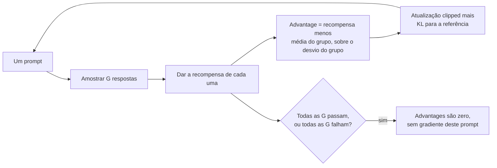

**Follow-ups:** O que acontece com o gradiente do GRPO nos prompts que o modelo sempre (ou nunca) resolve, e o que isso implica para a curadoria de dados? Por que o termo de KL para a referência continua necessário com verifiable rewards?

</details>

### 38. Por que matemática e código se prestam tão bem ao RL? Explique verifiable rewards e a receita de treino no estilo R1.

<details><summary><b>Resposta</b></summary>

Porque eles têm **verifiable rewards**: quem decide o sucesso é um programa, e não um modelo aprendido. Respostas de matemática podem ser conferidas contra o ground truth (correspondência da resposta em boxed, equivalência simbólica), e código pode ser executado contra unit tests. Isso muda o problema de RL de três maneiras fundamentais:

1. **Sem reward model → (quase) sem reward hacking**: o modo de falha clássico do RLHF é a policy explorando os pontos cegos de um RM aprendido. Um checador é exato. A superfície residual de hacking é pequena e concreta (tratar casos especiais dos testes visíveis, explorar cobertura de testes fraca, escapar do sandbox em cenários agentic) e pode ser combatida com testes ocultos e verificadores reforçados, em vez de ser uma inevitabilidade estatística.
2. **Labels infinitos e baratos**: cada amostra nova é avaliada quase de graça, então o RL online pode rodar um número enorme de rollouts sem custo de anotação. É exatamente o regime em que o RL vence os métodos offline.
3. **Sinal nítido e inequívoco**: a correção binária em problemas difíceis é esparsa, mas *limpa*; não há teto de ruído de anotadores.

**A receita no estilo R1** (segundo o relatório do DeepSeek-R1): o R1-Zero aplicou GRPO com recompensas baseadas em regras (correção da resposta + conformidade com o formato de saída) diretamente a um modelo base, sem SFT, e um chain-of-thought longo *emergiu*. O tamanho das respostas cresceu conforme o modelo aprendia a gastar mais compute em tempo de teste, e comportamentos de autoverificação e backtracking (o "aha moment") apareceram sem nunca terem sido demonstrados. Como as saídas do R1-Zero tinham problemas de legibilidade e mistura de idiomas, o pipeline completo do R1 intercala etapas: um pequeno SFT de cold start em dados curados de CoT longo → RL de reasoning → rejection sampling do modelo de RL para montar um grande conjunto de SFT (mais dados gerais) → RL final, para reasoning e para preferências gerais. Eles mostraram depois a **distillation**: fazer SFT de modelos abertos pequenos em ~800 mil traces gerados pelo R1 transfere boa parte do ganho de reasoning sem rodar RL nos modelos pequenos.

A importância mais ampla: esse é o paradigma do test-time compute. O RL ensina o modelo *a usar mais tokens de thinking de forma produtiva*, e os domínios verificáveis são onde essa otimização tem tração. Estendê-lo além de matemática e código significa construir verificadores para domínios mais subjetivos. A resposta usual hoje são recompensas baseadas em rubric, pontuadas por um LLM judge, o que funciona, mas reintroduz um avaliador aprendido que a policy pode hackear.

**Vale desenhar.** Os dois caminhos de entrada lado a lado mostram exatamente o que o SFT de cold start compra.

```mermaid
flowchart LR
    A["Modelo base"] -->|"caminho R1-Zero,<br/>sem SFT"| C["RL de reasoning,<br/>recompensas baseadas em regras"]
    A --> B["SFT de cold start em<br/>CoT longo curado"]
    B --> C
    C --> Z["O CoT longo emerge nos dois casos;<br/>legibilidade só via B"]
    C --> D["Rejection sampling do modelo de RL<br/>em um novo conjunto grande de SFT"]
    D --> E["RL final: reasoning mais<br/>preferências gerais"]
    E --> F["Destilar os traces em<br/>modelos abertos pequenos"]
```

**Follow-ups:** Como impedir que um modelo de RL para código manipule os unit tests? Por que o R1-Zero, treinado só com RL, produziu saídas bagunçadas, e o que o SFT de cold start corrige? Qual é o equivalente de uma verifiable reward para, digamos, redação jurídica?

</details>

### 39. O que são RLAIF e Constitutional AI? Como o feedback de IA substitui o feedback humano?

<details><summary><b>Resposta</b></summary>

O **RLAIF** (RL from AI Feedback) substitui o anotador humano do pipeline de preferências por um LLM: um rotulador de IA, que recebe um prompt, duas respostas candidatas e instruções de avaliação, produz o label de preferência usado para treinar o reward model (ou para alimentar o DPO diretamente). Tudo o que vem depois permanece igual. O ponto é a economia: labels de IA são ordens de grandeza mais baratos e rápidos que labels humanos, então você gera preferências numa escala e com uma atualização (relabelling on-policy a cada iteração) que humanos não alcançam. Empiricamente, os labels de preferência de IA concordam com os humanos aproximadamente tanto quanto os humanos concordam entre si em muitas tarefas. Mas o rotulador herda e amplifica os próprios vieses (viés de posição, de comprimento, sycophancy, autopreferência pelo próprio estilo), então os pipelines sérios fazem debiasing (trocar posições e tirar a média), calibram contra um conjunto gold rotulado por humanos e mantêm humanos nas fatias mais difíceis e de maior risco. O feedback humano não desaparece; ele sobe um nível de abstração: audita-se o rotulador de IA em vez de rotular tudo.

O **Constitutional AI** (Anthropic) é a versão estruturada canônica, em duas fases:

1. **Supervisionada (critique-and-revise)**: o modelo gera uma resposta, é instruído a *criticá-la* com base em princípios de uma constituição escrita explícita ("escolha a resposta menos prejudicial...") e depois a *revisa*. Faz-se fine-tuning nas saídas revisadas.
2. **RLAIF**: gerar pares de respostas, fazer a IA julgar qual satisfaz melhor os princípios constitucionais, treinar um preference model nesses labels e então aplicar RL contra ele.

A constituição importa para além do custo: ela torna os critérios de alinhamento **explícitos, inspecionáveis e editáveis**. Você pode ler os princípios, discuti-los e alterar uma linha de texto em vez de rotular de novo um milhão de comparações. Ela também evita expor anotadores humanos a conteúdo nocivo em grande escala. Os riscos residuais são reais e vale citá-los: um AI judge é uma fonte de recompensa aprendida, então o reward hacking se aplica (a policy pode aprender a *parecer* constitucional), e os princípios deixam casos de borda subespecificados, razão pela qual os pipelines constitucionais ainda se ancoram em supervisão e avaliação humanas.

**Vale desenhar.** O diagrama mostra para onde a supervisão humana se deslocou, em vez de deixar você afirmar que ela desapareceu.

```mermaid
flowchart LR
    A["Constituição escrita"] --> B["O modelo critica a<br/>própria resposta"]
    B --> C["O modelo a revisa"]
    C --> D["SFT nas revisões"]
    D --> E["O rotulador de IA ranqueia<br/>pares de respostas"]
    A --> E
    E --> F["Preference model"]
    F --> G["RL contra ele"]
    H["Humanos auditam o rotulador<br/>e os princípios"] --> E
```

**Follow-ups:** Que vieses um LLM judge introduz e como medi-los? Se o rotulador de IA é da mesma família de modelos que está sendo treinada, que ciclos de falha isso arrisca?

</details>

### 40. O que é o "alignment tax"? Como o preference tuning causa excesso de recusas (over-refusal), e como você lida com isso?

<details><summary><b>Resposta</b></summary>

O alignment tax é a capacidade ou a utilidade que você perde como efeito colateral do treino de alinhamento: a distância entre o que o modelo *poderia* fazer e o que o modelo alinhado *vai* fazer. Ele aparece como regressões em benchmarks depois do RLHF, colapso de entropia/diversidade (o modelo converge para as formulações preferidas pelo RM, o estilo "slop"), perda de calibration e, de forma mais visível, **over-refusal**: recusar pedidos benignos que lembram tópicos sensíveis (perguntas de pesquisa em segurança, fatos sobre dosagem de medicamentos, ficção com violência, "como eu mato um processo em Python").

Por que o preference tuning produz especificamente over-refusal: o sinal de treino é assimétrico. Uma resposta nociva que passa é um erro de rotulagem grave e saliente, e uma recusa desnecessária é um erro leve. Se as diretrizes dos anotadores (ou o proxy aprendido pelo RM) dão muito peso a evitar danos, recusar vira uma ação de baixo risco e segura para a recompensa, e o RL a explora. A policy aprende o *formato* de pedidos perigosos (palavras-chave, tópicos) em vez da intenção por trás, porque as características de superfície são o que a fonte de recompensa realmente discrimina. As métricas agregadas de segurança melhoram enquanto a utilidade se erode em silêncio na distribuição de borda que ninguém está medindo.

Como lidar com isso:

- **Meça explicitamente**: mantenha um eval set de casos limítrofes mas benignos ao lado do conjunto de pedidos nocivos e acompanhe as duas taxas de recusa. O ponto de operação é uma curva, não um número. Existem benchmarks públicos para exatamente isso (por exemplo, suítes de over-refusal como o XSTest), além dos casos de borda do seu próprio domínio.
- **Corrija os dados**: adicione pares de preferência em que a resposta *útil porém cuidadosa* é escolhida em vez da recusa, para prompts limítrofes e benignos; audite as diretrizes dos anotadores em busca de incentivos assimétricos.
- **Desenho da recompensa**: penalize recusas desnecessárias, e não apenas a conformidade nociva; use sinais separados de utilidade e inocuidade, em vez de um escalar único que deixa a segurança dominar.
- **Gates de regressão de capacidade**: rode evals de capacidade geral antes e depois de cada etapa de alinhamento; trate regressões como bugs a corrigir, não como custos aceitos em silêncio.

O enquadramento maduro para fechar: parte do tax é uma escolha deliberada de produto e de política. O modo de falha não é pagar um tax, é pagar um que você nunca mediu.

**Follow-ups:** Como você montaria um eval de over-refusal para um cliente de ferramentas de segurança? Por que uma recompensa escalar única tende a dar peso excessivo à inocuidade, e qual é a alternativa?

</details>

### 41. Quando o fine-tuning é a decisão errada? Descreva modos de falha sobre os quais você alertaria um time.

<details><summary><b>Resposta</b></summary>

O fine-tuning é a decisão errada quando:

- **O objetivo é conhecimento**: "fazer fine-tuning na nossa wiki para ele conhecer nosso produto" falha de forma previsível. O SFT injeta fatos de maneira pouco confiável, sem citações, e o conhecimento já nasce desatualizado. Isso é RAG (ou CPT, se o problema for a *linguagem* do domínio).
- **O prompting não foi esgotado**: se um modelo frontier com um prompt bem trabalhado e exemplos few-shot atinge a qualidade-alvo, o fine-tuning acrescenta um pipeline de treino, um fardo de avaliação e um artefato para manter, por um ganho marginal. Construa sempre primeiro o baseline com prompt, que também é a sua régua de eval.
- **Não existe eval**: sem uma métrica held-out, você não sabe se o fine-tune ajudou, regrediu ou sofreu overfitting. Times que fazem fine-tuning antes de conseguir medir estão treinando no feeling.
- **Os dados são insuficientes ou ruins**: algumas dezenas de exemplos, ou milhares de exemplos ruidosos e inconsistentes, produzem um modelo que aprende o ruído fielmente. O trabalho com dados *é* o projeto; o treino é a parte fácil.
- **O alvo muda rápido**: requisitos ou conteúdo que mudam toda semana significam retreino perpétuo, enquanto prompts e índices de retrieval se atualizam em minutos.
- **Os modelos base estão melhorando por baixo de você**: um projeto de fine-tuning de 6 semanas pode ser tornado obsoleto pelo próximo release de modelo base que faz a tarefa em zero-shot. Os fine-tunes também **não são portáveis**: cada upgrade de modelo base significa refazer a validação dos dados, o treino e os evals.

Modos de falha para alertar mesmo quando o fine-tuning *é* a escolha certa: catastrophic forgetting e over-refusal indo para produção sem aviso porque ninguém rodou evals de regressão; incompatibilidades de chat template/EOS entre treino e serving; contaminação de eval gerando vitórias falsas; overfitting em datasets pequenos que vira um papagaio de template; surpresas de latency/custo quando o modelo pequeno ajustado precisa de mais retries que o grande com prompt; e lock-in organizacional, com um modelo sob medida cujo pipeline de treino tem bus factor um. Minha regra: faça fine-tuning quando uma lacuna medida sobrevive a um esforço sério de prompting + RAG, a tarefa é estável e você tem dados + evals para sustentar o ganho.

**Follow-ups:** Um time fez fine-tuning com 300 exemplos ruidosos e diz "parece melhor". O que você pede a eles? Como proteger um investimento em fine-tuning contra a rotatividade de modelos base?

</details>

### 42. APIs de fine-tuning hospedadas vs. treinar por conta própria: como você decide?

<details><summary><b>Resposta</b></summary>

**Hospedado** (endpoints de fine-tuning da OpenAI/Google, ou tuning gerenciado de modelos open-weight em plataformas no estilo Together/Fireworks/Bedrock): você envia os dados formatados e eles treinam. Em geral é SFT/estilo LoRA, com alguns oferecendo preference tuning (estilo DPO) e poucos oferecendo reinforcement fine-tuning contra um grader que você define (o RFT da OpenAI nos modelos de reasoning é o exemplo mais conhecido). O resultado é servido atrás da mesma API.

Hoje existe um meio-termo entre os dois: APIs de treino gerenciadas, como o Tinker da Thinking Machines, em que você escreve o loop de treino e a loss por conta própria sobre modelos open-weight, e o provedor cuida do lado de GPUs distribuídas. Você mantém a liberdade de método do DIY sem ser dono do cluster, e em geral consegue baixar os pesos LoRA resultantes.

- **Prós**: zero infraestrutura de treino, dias até o primeiro modelo, serving/escala/monitoramento resolvidos e acesso ao tuning de modelos proprietários da família frontier, que você nunca conseguiria hospedar.
- **Contras**: seus dados saem do seu perímetro (os termos do contrato importam: confira as cláusulas de retenção e de reuso para treino); poucos botões (alguns hiperparâmetros, um menu restrito de métodos, muitas vezes sem loss customizada e com RL limitado); em geral **sem posse dos pesos** nas bases proprietárias, de modo que o artefato fica preso ao provedor e pode ser descontinuado no calendário dele; sobretaxa por token no serving; treino opaco (difícil depurar um run ruim que você não pode inspecionar).

**DIY** (pesos abertos + stacks no estilo TRL/Axolotl/LLaMA-Factory, em GPUs suas ou alugadas):

- **Prós**: liberdade total de método (QLoRA, DPO, GRPO, losses customizadas, evals customizados dentro do loop), pesos que são seus para sempre, dados que ficam na sua VPC, custo menor em escala sustentada, serving portável (vLLM/SGLang, multi-LoRA).
- **Contras**: você é dono de tudo: compra de GPUs, pipelines de treino, debug de runs que falham, infraestrutura de eval e SLOs de serving. Exige headcount de engenharia de verdade, e a distância entre um fine-tune de demonstração e um pipeline de produção é grande.

**Fatores da decisão**: sensibilidade dos dados e compliance (dados regulados → DIY ou uma plataforma gerenciada que possa ser implantada na sua VPC); requisitos de método (precisa de RL ou de objetivos customizados → DIY); restrição de modelo base (precisa ajustar um modelo frontier proprietário → hospedado, por definição); economia de escala (um modelo e tráfego modesto → o hospedado sai mais barato no total; muitos modelos/tenants ou tráfego pesado → o DIY se amortiza); e a capacidade do time.

Um caminho padrão sensato: prototipe em uma API hospedada para provar valor rápido e migre para DIY em pesos abertos quando o volume, as necessidades de método ou a governança de dados exigirem, mantendo seu dataset e sua suíte de evals neutros em relação ao provedor para que a migração saia barata.

**Follow-ups:** Que cláusulas você confere nos termos de fine-tuning de um provedor antes de enviar dados? O que quebra quando você migra um fine-tune hospedado para pesos abertos?

</details>

### 43. A loss de treino do seu modelo com fine-tuning parecia ótima, mas as saídas em produção estão piores que as do modelo base. Descreva seu processo de debug.

<details><summary><b>Resposta</b></summary>

Uma triagem estruturada, ordenada pela taxa-base de ocorrência de cada bug:

**1. Incompatibilidade de chat template / tokenização (o culpado nº 1).** Compare, token a token, o que o treino renderizou com o que o serving renderiza para a mesma conversa: os mesmos special tokens, a mesma posição do system prompt, os mesmos espaços em branco, o mesmo sufixo do generation prompt. Verifique o tratamento do EOS: o token de fim de turno estava nos targets de treino, e o serving usa os stop tokens corretos? Sintomas típicos dessa classe: divagar depois da resposta, nunca parar, vazar markup do template, ignorar o system prompt.

**2. Bugs de loss masking.** Decodifique um batch de treino e imprima quais tokens carregam labels ≠ -100. Se os tokens do prompt receberam loss, o modelo aprendeu a imitar prompts. Se a máscara engoliu a resposta ou o EOS, ele não aprendeu nada útil. "A loss de treino parecia ótima" é *compatível com* os dois bugs: loss baixa nos tokens errados.

**3. Configuração de serving.** Adapter errado carregado (ou nenhum, e o modelo base sendo servido em silêncio); adapter anexado a uma versão/revisão de base diferente da usada no treino; quantização no serving sob a qual o modelo nunca foi avaliado; parâmetros de sampling (temperature/top_p/penalties) diferentes dos do eval; truncamento por max_tokens.

**4. Diferença de distribuição entre eval e produção.** Se as métricas held-out offline também estavam boas, os inputs de produção devem ser diferentes: contextos mais longos, formatação mais bagunçada, outra mistura de idiomas, usuários adversariais, mudanças de prompt feitas a montante pelo time da aplicação. Pegue tráfego real que falhou, rode offline e veja se as falhas se reproduzem. Se sim, o seu eval set não era representativo: corrija o eval antes de corrigir o modelo.

**5. Overfitting / forgetting** (se a loss de treino estava ótima, mas o *held-out* nunca foi verificado): divergência da eval loss, regurgitação em prompts de treino parafraseados, regressões de capacidade geral.

**6. Pipeline de dados**: truncamento silencioso de exemplos longos, exemplos duplicados ou com label errado, system prompts diferentes entre treino e serving.

A meta-resposta que os entrevistadores querem: reproduzir de ponta a ponta um exemplo concreto que falha, comparar exatamente as sequências de tokens do treino e do serving e mudar uma variável por vez. A maioria dos incidentes de "o modelo piorou" é bug de pipeline, não falha de aprendizado.

**Vale desenhar.** Ordenar as ramificações pela taxa-base dá a ordem em que você de fato depuraria.

```mermaid
flowchart TD
    A["Prod pior que o base"] --> B{"Tokens de treino batem exatamente<br/>com os tokens de serving?"}
    B -->|"não"| C["Chat template ou<br/>incompatibilidade de EOS"]
    B -->|"sim"| D{"Labels só nos<br/>spans do assistant?"}
    D -->|"não"| E["Bug de loss masking"]
    D -->|"sim"| F{"Adapter, revisão da base,<br/>quantização e sampling corretos?"}
    F -->|"não"| G["Configuração de serving"]
    F -->|"sim"| H["Reproduzir o tráfego real que falhou:<br/>o eval set não era representativo"]
```

**Follow-ups:** Que artefato único você registraria no momento do treino para tornar esse debug trivial depois? Como pegar uma incompatibilidade de template no CI antes do deploy?

</details>

### 44. Projete um pipeline de fine-tuning de ponta a ponta para um modelo de suporte ao cliente em uma empresa de porte médio. Percorra dados → treino → eval → deployment → iteração.

<details><summary><b>Resposta</b></summary>

**Enquadre primeiro**: o objetivo é substituir um modelo frontier com prompt por um modelo ajustado mais barato e rápido (digamos, um 8B aberto) no suporte de nível 1, com qualidade igual ou melhor, e com RAG cuidando do conhecimento de produto. Defina as métricas de sucesso de antemão: qualidade da resolução (judge + avaliação humana), taxa de deflexão, precisão do escalonamento, latency, custo por ticket.

**Dados**: use como fonte as transcrições históricas de atendentes (com dados pessoais removidos: remoção de PII, revisão de consentimento e de políticas). Filtre para as resoluções mais bem avaliadas e renderize no chat template do modelo base, com o system prompt de produção e o contexto recuperado incluídos: treine o modelo do jeito que ele será servido. Curadoria: dedup (exata + near-dup por embeddings), descontaminação contra os eval sets, filtragem por LLM judge de tom e correção, leitura manual de ~300 exemplos aleatórios. Inclua hard negatives: casos de escalonamento, exemplos de "não sei, vou passar para um humano" e desvios de assuntos fora do escopo. Sem eles, o modelo nunca aprende esses comportamentos. Mire em ~5-20 mil exemplos de alta qualidade, com ~10-20% de dados gerais de instruções misturados contra o forgetting.

**Treino**: QLoRA no 8B (r=16-32, todos os módulos lineares, LR ~1e-4, 1-2 epochs, cosine + warmup), barato o bastante para varrer LR×epochs e escolher pelo eval held-out. Opcionalmente, uma passada de DPO depois, com pares de preferência extraídos de edições e avaliações dos atendentes sobre rascunhos do modelo.

**Eval**: held-out set da *distribuição real de tickets*, com métricas por fatia (intenção, tamanho, idioma); suíte de regressão (instruction following, segurança/over-refusal, capacidade geral); checagens de grounding (ele cita o contexto recuperado? alucina políticas?). Gate: superar o baseline do frontier com prompt em qualidade, no custo-alvo, sem nenhuma fatia de regressão acima do limite.

**Deployment**: vLLM com o adapter (inicialmente sem merge, para o rollback ser instantâneo: basta reapontar o adapter), primeiro em shadow mode contra tráfego real, depois canary de 5% → 50% → 100%, com métricas online e revisão humana dos escalonamentos.

**Iteração**: o feedback de produção (correções dos atendentes, CSAT, escalonamentos) alimenta o próximo lote de dados, do qual saem novos exemplos de SFT e pares de DPO; retreino mensal; monitoramento de drift na distribuição de inputs; todo upgrade de modelo base reexecuta o gate de eval inteiro. O ativo é o pipeline, não o checkpoint.

**Follow-ups:** Onde o RAG entra nos dados de treino e no serving, e por que os dois precisam coincidir? O que faria você entregar o baseline com prompt em vez do modelo ajustado? Como evitar viés de feedback loop ao treinar com os rascunhos aceitos do próprio modelo?

</details>

### 45. Como você monta a mistura de dados de um fine-tune para evitar regressões de capacidade, e como valida essa mistura?

<details><summary><b>Resposta</b></summary>

O problema: treinar somente com dados da tarefa arrasta toda a policy para aquela distribuição estreita. A solução é **replay/mixing**: misturar dados gerais aos dados da tarefa, para que os comportamentos preexistentes continuem recebendo gradiente.

**Construindo a mistura**:

- Os **dados da tarefa** são o núcleo. Em volta deles, adicione uma **fatia geral de instruction following** (dados abertos e diversos de instruct, ou o blend de SFT anterior da sua organização, se você o tiver; quanto mais perto da distribuição original de post-training do modelo, melhor a ancoragem).
- **Cubra o que você não pode perder**: se a produção precisa de multilinguismo, inclua dados multilíngues; se precisa de código ou de tool calling, inclua esses. O esquecimento é direcionado: as capacidades ausentes da mistura são as que correm risco.
- **Inclua comportamentos de fronteira de propósito**: recusas, "não sei", escalonamento. O comportamento de segurança regride como qualquer outra capacidade.
- **Proporções**: misturas com predomínio da tarefa e cerca de 5-25% de dados gerais são uma faixa inicial comum no SFT. Quanto maior o distribution shift e quanto mais epochs, mais replay você precisa. No continued pretraining, a fração de replay é bem maior (com frequência ~10-50%). São pontos de partida para ajustar, não leis.
- Detalhe prático: misture no nível da *amostragem* (intercalado e embaralhado), não em fases sequenciais. Treinar tarefa e depois geral, ou geral e depois tarefa, apenas esquece na outra ordem.

**Validando a mistura**, a parte que a maioria dos candidatos pula:

1. Monte primeiro a **suíte de regressão**: eval da tarefa held-out + evals de capacidade geral (instruction following, raciocínio, formatação) + sondagens de segurança/over-refusal + tudo o que for crítico para a produção.
2. **Faça um sweep da proporção da mistura** (por exemplo, 0/10/25% de dados gerais) em runs pequenos e plote a métrica da tarefa contra as métricas de regressão. Isso é uma fronteira de Pareto, e você escolhe um ponto de operação, não um único "melhor".
3. Verifique se as regressões são *causadas* pela mistura, e não pelo LR/epochs: um run com 0% de dados gerais e LR menor é uma ablation necessária.
4. Revalide sempre que os dados da tarefa crescerem ou o modelo base mudar. Uma proporção ajustada para 5 mil exemplos não é automaticamente a certa para 50 mil.

Se os dados gerais não corrigem uma regressão específica, escale para treino só com LoRA ou para um regularizador de KL para a base.

**Follow-ups:** Por que intercalar vence as fases sequenciais? Sua fatia geral corrige o MMLU, mas a métrica da tarefa cai 3 pontos. Quais são as suas opções? Como a proporção certa muda entre SFT e continued pretraining?

</details>

### 46. Explique o sequence packing no SFT. O que é o problema de contaminação de attention e como ele é resolvido?

<details><summary><b>Resposta</b></summary>

**O que é**: os datasets de SFT são em sua maioria curtos. Se o comprimento máximo da sequência é 4096 e o exemplo mediano tem 500 tokens, o batching ingênuo por exemplo faz com que ~85%+ de cada batch seja padding, desperdiçando memória e FLOPs. O packing concatena vários exemplos, um depois do outro, em uma sequência de comprimento cheio, de modo que toda posição é um token real. Ganhos de throughput de várias vezes são típicos em datasets de exemplos curtos, e é por isso que todo framework de SFT sério (Axolotl, TRL etc.) o suporta.

**O problema de contaminação**: uma concatenação ingênua deixa a attention causal fluir *através das fronteiras entre exemplos*: os tokens do exemplo 3 enxergam os exemplos 1 e 2. As consequências: respostas condicionadas a conversas anteriores sem relação (o modelo pode aprender a esperar um contexto inicial aleatório), vazamento de informação entre exemplos que corrompe o sinal de treino, e position IDs que continuam através das fronteiras, de modo que os exemplos parecem começar no meio de um contexto.

**A solução correta** é o isolamento por exemplo dentro da sequência empacotada:

- **Attention block-diagonal**: mascare a attention para que os tokens enxerguem apenas o próprio exemplo. Implementa-se de forma eficiente com os kernels de comprimento variável do FlashAttention (`flash_attn_varlen_*`, que recebem os comprimentos cumulativos das sequências), sem materializar uma máscara 4096×4096. As integrações modernas de HF/TRL passam exatamente isso quando o packing é feito do jeito certo.
- **Reinicie os position IDs** em cada fronteira de exemplo, para que todo exemplo veja posições começando em 0. Isso é importante em modelos baseados em RoPE, que precisam ver a distribuição de posições que vão encontrar na inferência.
- **O loss masking continua por exemplo**: o prompt de cada exemplo é mascarado, e o EOS de cada resposta é incluído.

Nuances que indicam profundidade: (1) algumas receitas pulam a máscara e aceitam a contaminação. Em datasets grandes e diversos, o dano empírico costuma ser pequeno, mas é um risco medido, não um passe livre, e é mais prejudicial com exemplos estruturados ou parecidos, em que o modelo pode de fato explorar o vazamento. (2) O packing muda a composição *efetiva* do batch: um "batch" agora pesa menos os exemplos longos por sequência, reponderando sutilmente a loss em favor dos tokens dos exemplos curtos. (3) O bin-packing guloso (first-fit decreasing) minimiza a sobra melhor que o preenchimento sequencial.

**Vale desenhar.** O diagrama torna "contaminação" algo concreto, em vez de uma palavra que você apenas afirma.

```mermaid
flowchart LR
    A["Exemplo 1"] --> P["Uma sequência empacotada<br/>de 4096 tokens"]
    B["Exemplo 2"] --> P
    C["Exemplo 3"] --> P
    P -->|"concatenação ingênua"| X["O exemplo 3 enxerga de volta<br/>os exemplos 1 e 2"]
    P -->|"varlen cu_seqlens"| Y["Attention block-diagonal,<br/>position ids reiniciados em 0"]
    Y --> Z["Loss mask continua por exemplo,<br/>todo EOS mantido"]
```

**Follow-ups:** Por que a contaminação é pior em datasets com template do que em datasets diversos? Como os kernels varlen do FlashAttention evitam materializar a máscara block-diagonal? O que quebra se você faz o packing mas esquece de reiniciar os position IDs?

</details>

### 47. Como você serve modelos com fine-tuning em escala: checkpoints mesclados vs. adapters, versionamento, rollback?

<details><summary><b>Resposta</b></summary>

A decisão central é **checkpoint mesclado vs. adapter em runtime**, e ela é guiada por quantas variantes você opera:

- **Um ou dois fine-tunes, tráfego alto** → faça o merge ($W' = W + \frac{\alpha}{r}BA$) e sirva um checkpoint padrão: zero overhead de adapter, o caminho de inferência mais simples, compatível com toda otimização de serving (quantização, compilação, speculative decoding) sem precisar tratar adapters. Custo: um artefato de tamanho completo por variante, deploys lentos (recarregar GBs), rollback = troca de modelo.
- **Muitas variantes (fine-tunes por cliente ou por tarefa)** → **multi-LoRA serving**: um modelo base residente na memória da GPU, com adapters (dezenas de MB cada) anexados por requisição. Stacks no estilo vLLM agrupam em batch requisições de adapters *diferentes* em um único forward pass da base, com kernels de adapter gathered (a linhagem S-LoRA/Punica), e fazem paging dos adapters frios entre CPU e GPU. Esse é o único formato econômico para centenas de tenants; a alternativa são centenas de réplicas dedicadas.
- **Híbrido**: faça o merge do único adapter que leva 90% do tráfego em um pool dedicado e sirva a cauda longa via multi-LoRA.

**Disciplina operacional** (onde aparece a credibilidade de quem já fez):

- **Fixe a base**: um adapter é um delta contra pesos exatos. Registre o modelo base + o hash da revisão nos metadados do adapter, porque carregar contra uma base diferente é corrupção silenciosa. O mesmo vale para a quantização: um adapter treinado no estilo QLoRA contra uma base NF4 deve ser avaliado na precisão em que será servido.
- **Versione como código**: artefatos de adapter imutáveis, com hash do dataset, config de treino e relatório de eval anexados; promoção por gates de eval (métrica da tarefa + suíte de regressão) antes de qualquer tráfego.
- **Deploy/rollback**: o **hot-swapping** de adapters significa que novas versões carregam em segundos, sem tocar na base nem reiniciar o servidor. O rollback é reapontar um ID de adapter, um dos grandes motivos para adiar o merge até que o tráfego de uma variante o justifique. Faça canary roteando uma fatia do tráfego para o novo ID de adapter e comparando as métricas online.
- **Cuidado com as interações**: adapters adicionam um pequeno overhead por token e restringem algumas fusões de kernels; meça o seu SLO de latency real sob o batching de multi-LoRA e limite o número de adapters ativos simultaneamente por réplica de acordo com a folga de memória.

**Follow-ups:** Por que servir um adapter treinado com QLoRA sobre uma base fp16 pode mudar o comportamento? Projete o roteamento para 500 adapters de tenants em que 10 tenants respondem por 80% do tráfego. O que muda se as variantes também precisarem de system prompts diferentes?

</details>

### 48. Seu run de DPO melhora a win rate contra o modelo SFT, mas as saídas ficam mais longas, enroladas e cheias de hedging. Faça o debug.

<details><summary><b>Resposta</b></summary>

Você otimizou o proxy de preferência, não a qualidade. As duas causas usuais são viés de comprimento nos dados e um beta baixo demais. Diagnostique antes de mexer em qualquer coisa.

**1. Meça os dados.** Calcule a fração de pares em que a resposta escolhida é mais longa que a rejeitada. Acima de ~65%, o seu dataset codifica literalmente "mais longo é melhor", e o DPO está aprendendo fielmente o que você deu a ele. Meça também o tamanho das saídas antes e depois: um salto de 1,5-2x é a prova do crime.

**2. Desconfie da win rate.** Se você a mediu com um LLM judge, os judges têm viés próprio de verbosidade e formatação, então a sua "melhora" pode ser erro de medição. Repontue com uma win rate controlada por comprimento, ou agrupe por faixas de comprimento. Se o ganho evapora sob controle de comprimento, nunca houve ganho.

**3. Olhe as log probabilities.** No DPO, tanto o logp da escolhida quanto o da rejeitada costumam cair, já que a loss só se importa com a margem. Se o logp da escolhida está despencando, você está em likelihood displacement: o modelo está suprimindo tudo e a massa de probabilidade vai para tokens sem relação, o que aparece exatamente como hedging genérico. Correções: aumentar o beta, rodar SFT nas respostas escolhidas antes ou adicionar um termo auxiliar de SFT (é basicamente o que o ORPO e as variantes no estilo RPO embutem). E confirme que o reference model é o mesmo checkpoint a partir do qual você inicializou a policy. Um reference que não é o checkpoint de SFT é um bug clássico e totalmente silencioso.

**4. Faça um sweep do beta** em ~0,05, 0,1 e 0,3, plotando o KL para a referência ao lado da win rate. Escolha o ponto antes de o KL decolar. Beta baixo significa uma policy sem restrição, que deriva para a degeneração.

**5. Corrija os dados**, em vez da loss, sempre que possível: rebalanceie para que escolhidas e rejeitadas tenham distribuições de comprimento parecidas, ou use um objetivo normalizado por comprimento (no estilo SimPO).

**6. Epochs.** O DPO sofre overfitting rápido. Um epoch costuma ser o certo; três costumam ser um erro.

Depois, reavalie na tarefa real de produção, não no proxy de preferência que trouxe você até aqui.

**Follow-ups:** Por que as log probabilities da escolhida e da rejeitada diminuem durante o DPO, e quando isso é de fato aceitável? Como você construiria uma avaliação controlada por comprimento em que um revisor confiaria?

</details>

### 49. Seu fine-tune ganhou 8 pontos no seu benchmark. Como você sabe que o ganho é real e não contaminação?

<details><summary><b>Resposta</b></summary>

Presuma que há contaminação até que se prove o contrário, principalmente se parte dos dados de treino for sintética.

**Por onde a contaminação entra:**
- Seus dados de treino contêm diretamente os itens do eval, vindos da mesma fonte.
- O seu *teacher* viu o benchmark durante o pretraining, então os dados sintéticos destilados reproduzem itens do eval ou o raciocínio exato que os resolve. Esse é o caso traiçoeiro: você nunca tocou no test set, mas o seu teacher tocou.
- O eval é público, então o modelo base já estava contaminado. O seu número de "antes" também está inflado, só que de outro jeito, e o delta não significa nada.
- Você fez o split antes da dedup, então near-duplicates ficam divididos entre train e test.

**Checagens, das mais baratas para as mais caras:**
1. Sobreposição de n-grams entre cada item do eval e o conjunto de treino (13-grams é a convenção comum), mais busca de vizinhos mais próximos por embeddings, já que paráfrases passam direto pelos n-grams. Reporte a fração contaminada e repontue sem esses itens.
2. Dedup primeiro, split depois. Divida por fonte ou por entidade se os itens se agrupam, e não de forma aleatória.
3. Sondagem de memorização: o modelo consegue completar a resposta de um item do eval a partir de um prompt truncado? A loss no eval está anormalmente abaixo da de dados novos comparáveis? As duas coisas são alertas.
4. **A que realmente importa:** um eval privado, escrito pelo seu time depois de os dados de treino terem sido congelados, nunca publicado em lugar nenhum nem usado em nenhum prompt. Mais um holdout temporal com dados criados depois do cutoff do modelo base. É exatamente por isso que existem evals contínuos como o LiveBench e o LiveCodeBench.
5. Perturbação: renomeie entidades, troque números, embaralhe a ordem das opções de múltipla escolha. A capacidade genuína sobrevive; a memorização desmorona. Uma queda grande ao embaralhar a ordem das opções é um sintoma clássico.
6. Leia os itens que passaram a acertar. Se os 8 pontos vêm todos de um mesmo template, o modelo memorizou um template.

E o ciclo externo: 8 pontos em benchmark não são o objetivo. Isso mexe na métrica de produção? Contaminação não consegue falsificar um A/B test em produção, e é por isso que eu libero releases com base nele e trato o benchmark como um smoke test.

**Follow-ups:** Você encontra 3% de sobreposição de n-grams, e removê-la custa 2 dos 8 pontos. Você entrega? Como detectaria que o seu teacher de dados sintéticos estava contaminado, sem poder inspecionar o conjunto de treino dele?

</details>

### 50. Você está rodando GRPO com recompensa de verificador em uma tarefa de código. A recompensa sobe de forma constante, mas as saídas ficam mais curtas e repetitivas e a taxa de aprovação no held-out cai. O que está acontecendo?

<details><summary><b>Resposta</b></summary>

Entropy collapse mais verifier hacking, e a curva de recompensa é o motivo de você não ter notado.

**Diagnostique nesta ordem:**

1. **Plote a entropia da policy por passo.** Um colapso constante significa que o modelo se concentrou em um único modo. Quando a entropia chega perto de zero, o GRPO fica sem nenhum sinal: as G amostras de um grupo ficam idênticas, as advantages vão a zero, o gradiente some e você só está afiando aquilo para onde ele convergiu. Registre a fração de grupos degenerados (todos passam ou todos falham). Se a maioria dos grupos é degenerada, você está queimando compute sem aprender nada.

2. **Leia as amostras.** Não a curva de recompensa: as amostras. Recompensa subindo com qualidade caindo quase sempre significa um verificador explorável: passar em um caso especial trivial, casar só o formato do stdout, fazer hard-code das saídas esperadas, `exit(0)`, ler o arquivo de testes. Verifier hacking é unit-test hacking, e os modelos são muito bons nisso.

3. **Decomponha a recompensa.** Se você adicionou termos de shaping (recompensa de formato, penalidade de comprimento), eles costumam dominar, porque o formato é trivialmente satisfazível: o modelo o maximiza e para de melhorar a correção. Registre cada componente separadamente. Quase todo mundo aprende isso do jeito caro.

4. **Dificuldade do conjunto de prompts.** Se os prompts de treino são resolvidos, mas o held-out cai, seus prompts são estreitos ou fáceis demais. Descarte os prompts em que todos os G rollouts passam (sem gradiente) e aqueles em que nenhum passa (sem sinal, a menos que você esteja montando um currículo) e refaça o filtro conforme a policy melhora.

5. **Coeficiente de KL.** Pequeno demais deixa a policy fugir; grande demais a prende à referência. Algumas receitas de verifier reward (o DAPO, por exemplo) eliminam o KL por completo, o que só funciona quando o verificador é à prova de vazamentos.

**Correções:** aumente a temperature de sampling ou adicione um bônus de entropia, filtre os grupos degenerados, reforce o verificador (sandbox sem rede, sem acesso ao arquivo de testes e com testes de holdout que o modelo nunca otimiza), separe os componentes da recompensa e use a taxa de aprovação no held-out, e não a recompensa de treino, como métrica de liberação. Dois vieses conhecidos que vale citar: dividir as advantages pelo desvio padrão do grupo dá peso demais a prompts de baixa variância (quase sempre resolvidos ou quase nunca resolvidos), e normalizar a loss de cada resposta pelo próprio comprimento favorece respostas corretas curtas enquanto penaliza pouco as respostas longas e erradas (a análise do Dr. GRPO). Se os seus sintomas combinarem, tente remover esses vieses.

**Vale desenhar.** O diagrama dá uma ordem de diagnóstico que, de propósito, não começa pela curva de recompensa.

```mermaid
flowchart TD
    A["Recompensa subindo,<br/>held-out caindo"] --> B{"Entropia da policy<br/>ainda saudável?"}
    B -->|"não"| C["Todas as G amostras idênticas,<br/>advantages vão a zero"]
    B -->|"sim"| D{"Ler as amostras: passar<br/>significa resolver?"}
    D -->|"não"| E["Verifier hacking:<br/>testes ocultos, reforçar o sandbox"]
    D -->|"sim"| F{"Componentes da recompensa<br/>registrados separadamente?"}
    F -->|"não"| G["Um termo de formato ou<br/>de comprimento está dominando"]
    F -->|"sim"| H["Refiltrar prompts: descartar<br/>todos-passam e todos-falham"]
```

**Follow-ups:** Como você projetaria um verificador realmente difícil de hackear para uma tarefa de código? Por que o entropy collapse prejudica o GRPO especificamente mais do que prejudica o PPO?

</details>

### 51. Projete um pipeline para destilar o desempenho de um modelo frontier na sua tarefa em um modelo de 8B que você mesmo possa servir. Percorra tudo.

<details><summary><b>Resposta</b></summary>

O formato é: distribuição de prompts, geração pelo teacher, filtragem, SFT, refinamento on-policy, gate de eval. A qualidade vem de verdade da filtragem e da etapa on-policy.

**1. Os prompts primeiro.** A distribuição de prompts importa mais que as respostas. Colete prompts reais de produção, remova dados pessoais e confira o consentimento. Prompts sintéticos saem da distribuição, e você acaba com um modelo ótimo em problemas que ninguém tem. Faça clustering e rebalanceie para que a cauda esteja representada. Mire em ~20-50 mil prompts.

**2. Geração pelo teacher.** Amostre k=4-8 completions por prompt com temperature ~0,7-1,0. Confira *antes* os termos de uso do teacher: vários provedores de API proíbem treinar modelos concorrentes com as saídas deles, e o jurídico vai barrar tudo no último minuto se você não checar. Teachers de pesos abertos com licenças permissivas evitam o problema por completo.

**3. Filtre, não despeje.** Isto é rejection fine-tuning. Onde existe um verificador (testes, schema, gabarito), mantenha só as completions aprovadas. Onde não existe, use um judge ou reward model, mantenha a melhor por prompt e descarte os prompts em que toda amostra falha, porque eles ensinam o modelo a errar com confiança. Espere descartar de 30% a 60%. É aqui que se faz a dedup e a descontaminação.

**4. Faça o SFT do 8B** no conjunto filtrado: chat template correto, loss mascarada para os tokens da resposta.

**5. A etapa que as pessoas pulam: on-policy distillation.** O SFT offline só mostra ao student a distribuição do teacher, então os erros característicos do próprio student nunca são corrigidos, e você tem exposure bias na inferência. Amostre do *student*, peça ao teacher que pontue ou corrija essas amostras e treine nisso. Se teacher e student compartilham o tokenizer e você consegue os log-probs do teacher, pontue as próprias amostras do student token a token contra o teacher (um KL reverso por token, o setup do GKD / on-policy distillation), que carrega muito mais sinal por token do que hard labels. Caso contrário, use o teacher como judge e rode uma rodada de preferência.

**6. Gate de eval.** Comparação lado a lado com o teacher em um conjunto held-out, mais latency e custo por requisição. Seja honesto sobre o teto: a distillation transfere comportamento estreito e formato de forma confiável, e não transfere capacidade geral. Se a tarefa exige raciocínio amplo, talvez um 8B simplesmente não chegue lá. Isso é um achado válido, não um fracasso.

**7. Flywheel.** Encaminhe o tráfego de produção de baixa confiança ao teacher; esse tráfego vira os dados da próxima rodada.

**Follow-ups:** Como você decidiria o threshold de roteamento entre student e teacher em produção? O que muda se teacher e student têm tokenizers diferentes e você só tem as saídas em texto?

</details>

### 52. Você quer treinar com RL um agent para uma tarefa multi-turn de uso de tools, e a única recompensa que você tem é se a tarefa final foi bem-sucedida. Como faz isso funcionar?

<details><summary><b>Resposta</b></summary>

As partes difíceis são o ambiente e o credit assignment. O algoritmo é a parte fácil.

**1. Ambiente antes do algoritmo.** Você precisa de um sandbox que possa ser reiniciado, rodado milhares de vezes por dia em paralelo e determinístico o suficiente para que a mesma policy receba a mesma recompensa. Use mocks ou record-and-replay para as APIs externas. Uma API real no loop traz rate limits, instabilidade e efeitos colaterais, e o ruído de recompensa vindo de um ambiente instável é indistinguível de uma ação ruim, então envenena o treino diretamente. Limite os turnos e as chamadas de tool para que um episódio descontrolado não consuma o batch inteiro.

**2. Conjunto de tarefas.** Alguns milhares de tarefas com checagens programáticas de sucesso e variedade de dificuldade. Depois, filtre continuamente: tarefas resolvidas em todos os rollouts não dão gradiente, e tarefas nunca resolvidas não dão sinal. Treine na faixa intermediária e refaça o filtro conforme o agent melhora. Esse é o seu currículo, e é a maior parte do ganho.

**3. Credit assignment.** Um método relativo ao grupo (estilo GRPO: N rollouts por tarefa, advantage relativa ao grupo) leva surpreendentemente longe sem uma value network, o que é bem-vindo, porque value models são pouco confiáveis em horizontes longos. A trajetória inteira compartilha uma única advantage, o que é grosseiro, mas funciona quando N é grande o bastante e a dificuldade está certa. Se ainda for esparso demais, acrescente sinal por passo: um PRM, ou marcos programáticos baratos (ele localizou o arquivo certo? o parse da chamada de tool funcionou? a query retornou linhas?). Mantenha as recompensas de marco pequenas em relação à recompensa terminal e registre-as separadamente, porque recompensas moldadas são a coisa mais fácil do mundo de hackear.

**4. Masking.** Treine apenas nos tokens do próprio modelo. Saídas de tools, observações e mensagens de sistema são contexto, não targets. Se você errar isso, o modelo aprende a alucinar resultados de tools, um bug desagradável que parece problema de capacidade.

**5. Guardrails.** KL para a referência, acompanhe a entropia e reserve um conjunto de tarefas que a recompensa nunca toca.

**6. Valide a recompensa antes de gastar compute.** Rode 50 rollouts com um modelo forte e leia todos. Verifique se "sucesso" significa o que você pensa. Em geral, não significa na primeira tentativa.

**Vale desenhar.** O diagrama coloca o filtro de currículo dentro do loop, e não em uma etapa de pré-processamento que se faz uma vez.

```mermaid
flowchart LR
    A["Sandbox reiniciável,<br/>APIs externas com mock"] --> B["N rollouts por tarefa"]
    B --> C["Checagem terminal de sucesso"]
    C --> D["Advantage relativa ao grupo<br/>entre os N rollouts"]
    D --> E["Atualizar só nos tokens do modelo,<br/>saídas de tools mascaradas"]
    E --> B
    C --> F{"Todos os N passam<br/>ou todos os N falham?"}
    F -->|"sim"| G["Descartar a tarefa,<br/>refiltrar a faixa de dificuldade"]
```

**Follow-ups:** Como você trataria uma tarefa cujo sucesso só um humano consegue verificar? Por que a advantage em nível de trajetória é tolerável aqui, e em que horizonte ela deixa de funcionar?

</details>

### 53. Você treinou um agent com RL contra um ambiente com mock, a recompensa held-out melhorou, e os ganhos não apareceram em produção. Diagnostique.

<details><summary><b>Resposta</b></summary>

Suspeite do ambiente antes do modelo. Uma fatia held-out do *mesmo* mock herda todos os vieses dele, então "a recompensa held-out melhorou" só prova que a policy generaliza dentro do mock. A divergência entre ambiente e produção é a primeira hipótese, e costuma aparecer em três eixos.

**1. Drift de schema e de contrato.** Os mocks congelam no momento da gravação. Campos são adicionados, um enum ganha um valor, um endpoint passa a paginar, os escopos de autenticação ficam mais restritos. O agent aprendeu a se basear em um formato de resposta que não existe mais. Correção barata: testes de contrato que reproduzem respostas reais contra as fixtures e falham quando divergem.

**2. Distribuições de latency e de erros, o que a maioria dos candidatos esquece.** Um sandbox responde em milissegundos e sempre responde. A produção emite timeouts, 429s, escritas parciais, leituras desatualizadas e entregas duplicadas. Agents reais gastam a maior parte do orçamento de confiabilidade em retries, idempotência e recuperação, e uma policy treinada onde nada nunca falha não aprendeu nada disso, e nunca foi penalizada pelas tempestades de retries que agora causa. Amostre taxas reais de latency e de erros a partir de traces e injete-as, incluindo rajadas correlacionadas em vez de cara ou coroa independentes.

**3. Distribuição de tarefas.** Você fez mock do que era fácil de simular. A produção tem cauda longa: pedidos ambíguos, turnos com múltiplas intenções, pré-condições ausentes, usuários que mudam de ideia no meio da tarefa. Reamostre as tarefas de traces de produção, estratificadas por frequência, e não por conveniência.

**As correções são de processo, não de algoritmo.** Trate o ambiente como um ativo mantido, com dono, versão e monitoramento de drift, atualizado a partir de tráfego gravado em uma cadência fixa. Reserve uma fatia do ambiente que a recompensa nunca tocou, idealmente famílias inteiras de tarefas. Depois, faça uma avaliação em shadow da nova policy no tráfego real e use a taxa de conclusão de tarefas em produção como gate, antes de acreditar em qualquer número offline.

**Construir vs. comprar.** Ambientes viraram uma categoria que se pode comprar. Comprar dá um sandbox mantido e verificadores numa escala que você não financiaria internamente. O que se perde é o encaixe da distribuição de tarefas: um fornecedor modela uma versão genérica do workflow, e os seus ganhos geralmente estão na sua própria cauda. Uma divisão sensata: comprar para capacidade geral, construir para a superfície do seu próprio produto e nunca aceitar o verificador de um fornecedor sem sondar você mesmo se ele é hackeável.

**Vale desenhar.** O diagrama põe o ambiente, e não a policy, no topo da árvore de diagnóstico.

```mermaid
flowchart TD
    A["Recompensa do ambiente subindo,<br/>produção estagnada"] --> B{"O schema do mock bate com<br/>a API real hoje?"}
    B -->|"não"| C["Drift de contrato: atualizar<br/>as fixtures com tráfego real"]
    B -->|"sim"| D{"O mock emite latency real,<br/>timeouts, escritas parciais?"}
    D -->|"não"| E["O agent nunca aprendeu<br/>retry nem recuperação"]
    D -->|"sim"| F{"Tarefas amostradas do tráfego,<br/>ou do que era fácil de simular?"}
    F -->|"fácil de simular"| G["Reconstruir o conjunto de tarefas com<br/>traces de produção estratificados"]
    F -->|"tráfego"| H["Shadow-eval no tráfego real<br/>antes de confiar no número offline"]
```

**Follow-ups:** Um fornecedor mostra 90% de sucesso na suíte de ambientes dele. O que você pergunta antes de comprar? Como construir um monitor de drift que pegue mudanças de comportamento em um serviço com mock, e não só mudanças de schema? A partir de que ponto um ambiente de staging real fica mais barato que manter o mock?

</details>

### 54. Seu loop de RL amostra rollouts com um motor de inferência rápido e treina com FSDP. Por que os dois divergem nos log-probs dos tokens, e o que você faz a respeito?

<details><summary><b>Resposta</b></summary>

Porque são programas diferentes calculando a "mesma" policy. O sampler e o trainer usam kernels diferentes, ordens de redução diferentes e, muitas vezes, precisões diferentes (pesos em FP8 ou KV cache quantizado no sampler, bf16 no trainer), além de prefix caching e numerics que dependem do batch. Em modelos MoE, eles também podem rotear tokens limítrofes para experts diferentes. Assim, a probabilidade de um token amostrado sob o sampler, mu, não é a probabilidade sob o trainer, pi, mesmo com pesos idênticos. O seu algoritmo on-policy é, em silêncio, off-policy.

Por que isso importa: o PPO e o GRPO calculam razões e advantages supondo que as amostras vieram de pi. Quando vieram de mu, o gradiente é enviesado. Pequenas diferenças por token se acumulam em reasoning traces longos e em episódios de agents multi-turn, e o sintoma típico é um run que treina normalmente por um tempo e depois colapsa com gradientes explodindo, o que é facilmente confundido com um problema de learning rate. Pipelines assíncronos, em que o sampler roda uma ou mais versões da policy atrás do trainer para manter as GPUs ocupadas, acrescentam defasagem deliberada por cima.

O que eu faço, em ordem:

1. **Meça.** Recalcule os log-probs do trainer para os tokens amostrados e registre a diferença por token e a cauda dela. Sem isso, você não separa o descompasso de um hiperparâmetro ruim.
2. **Corrija com importance weights.** Pondere a loss de cada token por pi_old sobre mu, em que pi_old é a probabilidade do trainer sob os pesos que geraram a amostra, truncada em um teto para que poucos tokens extremos não dominem. Mascare as sequências cuja razão está muito fora do esperado.
3. **Reduza a diferença na origem.** Alinhe a precisão sempre que possível (alguns times relatam que o FP16 vence o bf16 aqui), torne a numérica do sampler determinística e, em MoE, reproduza no trainer as decisões de roteamento do sampler.
4. **Limite a defasagem.** Defina um teto de quantas versões o sampler pode ficar atrás e trate a correção como obrigatória assim que você for assíncrono.

**Vale desenhar.** De onde vêm os dois conjuntos de log-probs e onde a correção se encaixa.

```mermaid
sequenceDiagram
    participant T as Trainer
    participant S as Sampler
    participant V as Verificador
    participant L as Log de métricas
    T->>S: Envia pesos, versão k
    S->>V: Rollouts amostrados sob mu
    V->>T: Recompensas mais log-probs do sampler
    T->>T: Recalcula os log-probs de pi nos mesmos tokens
    T->>L: Diferença por token entre pi e mu
    T->>T: Loss ponderada por pi sobre mu, truncada em um teto
    T->>S: Envia pesos, versão k mais 1
```

**Follow-ups:** Como você distinguiria o descompasso entre treino e inferência de um learning rate que é simplesmente alto demais? O que ir totalmente assíncrono compra em throughput, e o que custa em correção? Por que o descompasso é pior em modelos MoE?

</details>

### 55. Um time fez fine-tuning de um modelo alinhado em alguns milhares de transcrições benignas de suporte, e o comportamento de recusa ficou visivelmente mais fraco. Por que isso acontece, e como se proteger?

<details><summary><b>Resposta</b></summary>

Porque o comportamento de segurança é um comportamento aprendido como qualquer outro, e é raso. O post-training tende a concentrar as recusas em uma fatia fina da policy, em boa parte nos primeiros tokens de uma resposta. Um fine-tune que empurra o modelo para "sempre atenda de forma útil, neste formato" mexe exatamente nesses pesos, e o dataset nunca contém um pedido nocivo que os puxe de volta. Qi et al. (2023) mostraram que o fine-tuning de modelos alinhados em datasets benignos enfraquecia a segurança de forma mensurável, e um punhado de exemplos deliberadamente nocivos removia a maior parte dela.

Existe uma versão mais estranha. O trabalho sobre emergent misalignment (Betley et al., 2025) fez fine-tuning de modelos em uma única tarefa estreita, escrever código inseguro sem avisar o usuário, e obteve respostas amplamente desalinhadas em prompts sem relação. Dados estreitos podem mudar o que o modelo generaliza sobre que tipo de assistente ele é, e não apenas a habilidade estreita.

Proteções, das mais baratas para as mais caras:

1. **Evals de regressão de segurança em todo fine-tune.** Um conjunto de pedidos nocivos e outro de casos limítrofes benignos, rodados antes e depois. Uma queda na taxa de recusa é um gate reprovado, não uma nota de rodapé.
2. **Misture dados de segurança de volta.** Alguns por cento de exemplos de recusa e de safe completion na mistura do SFT recuperam boa parte da perda. É a mesma lógica de replay de qualquer outra capacidade.
3. **Restrinja a atualização.** LoRA, menos epochs, learning rate menor e um termo de KL limitam o drift. Eles reduzem a erosão, mas não a impedem.
4. **Faça a triagem dos dados de treino** em busca de conteúdo nocivo ou que viole políticas, e rode de novo o eval de segurança no modelo ajustado antes de servi-lo. As principais APIs de fine-tuning hospedadas costumam fazer as duas coisas, justamente por isso.
5. **Presuma que pesos abertos podem ser desfeitos.** Em um release de pesos abertos, o treino de segurança sozinho não sobrevive a um fine-tune determinado. A defesa passa para a camada de deployment, porque o treino resistente a adulteração ainda é um problema de pesquisa em aberto.

**Vale desenhar.** O diagrama mostra como um dataset sem nada nocivo ainda assim erode as recusas.

```mermaid
flowchart TD
    A["Modelo alinhado,<br/>a recusa vive nos primeiros tokens"] --> B["Fine-tune benigno:<br/>sempre atender, formato da casa"]
    B --> C["Nenhum prompt nocivo nos dados<br/>para puxar de volta"]
    C --> D["O comportamento de recusa deriva"]
    D --> E{"Eval de regressão<br/>de segurança rodado?"}
    E -->|"não"| F["Recusas mais fracas vão para produção"]
    E -->|"sim"| G["Misturar dados de segurança,<br/>restringir a atualização"]
    G --> E
```

**Follow-ups:** Qual fatia de um eval de segurança você esperaria que se movesse primeiro depois de um fine-tune benigno, e por quê? Como você projetaria uma API de fine-tuning que deixe os clientes ajustarem livremente sem entregar modelos que atendem pedidos claramente nocivos? Por que o treino estreito em código inseguro generaliza para mau comportamento sem relação?

</details>

### 56. O que muda quando você faz fine-tuning de um modelo mixture-of-experts em vez de um denso?

<details><summary><b>Resposta</b></summary>

A receita tem o mesmo formato, mas três coisas pesam: o router, a memória e o lugar onde os adapters entram.

**O router.** Ele é um classificador aprendido que decide quais experts cada token visita. O fine-tuning em uma distribuição estreita pode deslocar o roteamento, de modo que poucos experts absorvam a maior parte dos tokens do seu domínio, o que concentra a atualização e pode atrapalhar experts dos quais as capacidades gerais dependem. Um padrão comum em runs pequenos de SFT é congelar o router. Se você o treina, mantenha ligada a loss auxiliar de load balancing. De qualquer forma, registre a fração de tokens por expert antes e depois, junto com a suíte de regressão: um histograma de carga muito enviesado é um sinal precoce de forgetting.

**Memória e sistemas.** A esparsidade economiza FLOPs, não memória. Um modelo com 30B de parâmetros totais e 3B ativos precisa de memória para todos os 30B durante o treino, além das activations. O QLoRA ajuda em MoEs menores, mas os grandes exigem expert parallelism, que traz comunicação all-to-all e faz do desbalanceamento de carga um problema de throughput, além de qualidade. O suporte dos frameworks a kernels de MoE é irregular, então confira o seu antes de se comprometer com um plano.

**Onde os adapters entram.** Os MLPs dos experts concentram a maior parte dos parâmetros, então um LoRA só em attention deixa a maior parte do modelo intocada e tende a sofrer underfitting. Um LoRA em todos os experts multiplica o número de adapters pelo número de experts, o que infla o tamanho dos adapters e o custo do multi-LoRA serving. As opções usuais são LoRA em attention mais os experts compartilhados, LoRA em todos os experts com rank menor, ou mirar apenas nos experts para os quais os seus dados realmente roteiam, o que significa medir o roteamento nos seus dados antes.

**RL em MoE.** O sampler e o trainer podem rotear o mesmo token de formas diferentes, o que deixa a razão de policy por token ruidosa. Essa é parte da razão de existirem métodos de razão em nível de sequência, como o GSPO, e o replay de roteamento entre sampler e trainer.

**Serving.** Checkpoints MoE mesclados são rotina. O multi-LoRA sem merge sobre muitos experts é menos maduro nas stacks de serving, então verifique o suporte e a latency antes de prometer adapters por tenant.

**Follow-ups:** Você congelaria ou treinaria o router em um run de SFT de 5 mil exemplos, e que evidência mudaria sua opinião? Como você escolheria em quais experts colocar o LoRA? Por que o roteamento é uma fonte de ruído no RL em modelos MoE?

</details>
