# Fine-tuning, RLHF & Alignment - Perguntas de Entrevista

> 🇧🇷 Tradução em português do Brasil. Versão original em inglês: [questions.md](questions.md).

56 perguntas: 13 básicas, 22 intermediárias, 21 avançadas.

> **Sobre os diagramas: desenhar é opcional.** Algumas respostas incluem um pequeno esboço que você
> poderia reproduzir em um quadro branco ou em um documento compartilhado. Você nunca precisa desenhar nada para ir bem,
> e uma resposta falada clara se sustenta sozinha. Mas em perguntas de arquitetura, pipeline e system design,
> esboçar enquanto fala mantém o entrevistador acompanhando você e mostra que você sabe estruturar
> um problema. Considere-os um bônus, não lição de casa.

## Básico

### 1. Quando você faria fine-tuning de um modelo em vez de usar prompting ou RAG?

<details><summary><b>Resposta</b></summary>

Faça fine-tuning para *comportamento*, RAG para *conhecimento*, e prompting primeiro para tudo. O caminho de escalonamento é: prompt engineering (horas, ~grátis) → RAG (dias, adiciona conhecimento atualizado/privado com citações) → fine-tuning (semanas, muda o que o modelo *é*).

O fine-tuning vence quando você precisa de:

- **Forma/estilo/formato**: uma voz de marca consistente, um schema JSON estrito, um dialeto SQL da casa - coisas que são tediosas e frágeis de especificar em um prompt.
- **Latency/custo**: um modelo de 8B ajustado substituindo um modelo frontier via API em uma tarefa estreita, ou eliminando um system prompt few-shot de 2.000 tokens que você paga a cada chamada (prompt caching reduz essa conta, mas não o contexto que ele ocupa nem a fragilidade de guiar por exemplos).
- **Habilidade estreita**: classificação, extração, routing - tarefas em que um modelo pequeno especializado supera um grande generalista.
- **Comportamento que você não consegue obter por prompt**: formatação confiável de tool calls, política de recusa, uma persona que sobrevive a conversas longas.

O RAG vence quando o requisito é factual: documentos proprietários, dados que mudam diariamente, qualquer coisa que exija atribuição. O fine-tuning é um péssimo repositório de conhecimento - SFT em fatos dá recall pouco confiável, sem citações, e o conhecimento fica desatualizado no momento em que o mundo muda.

A nuance que os entrevistadores esperam ouvir: eles são **complementares, não concorrentes**. Um padrão comum em produção é RAG para fatos mais um modelo com fine-tuning que é melhor em *usar* o contexto recuperado (grounding, citar, recusar quando o contexto é insuficiente). Além disso: se a *própria linguagem do domínio* é estranha ao modelo (jurídico, genômica), você pode precisar de continued pretraining, não apenas SFT. E sempre estabeleça um baseline com prompt mais um eval set *antes* do fine-tuning - caso contrário você não consegue provar que o fine-tune se pagou.

**Vale desenhar.** as condições de ramificação são a resposta inteira, e desenhá-las impede que você recite uma lista.

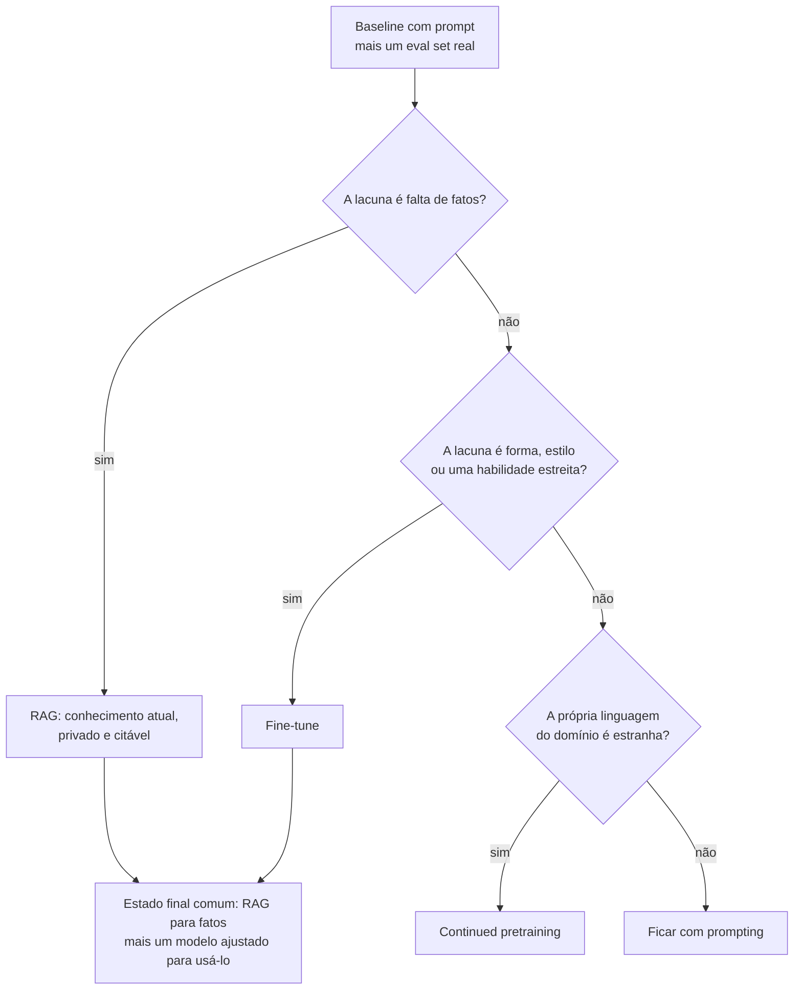

**Follow-ups:** Seu PM diz "faça fine-tuning com nossos docs para ele conhecer nosso produto" - como você responde? Que eval você construiria antes de decidir? Quando você faria RAG *e* fine-tuning?

</details>

### 2. O que realmente acontece durante o supervised fine-tuning? Qual o papel dos chat templates e special tokens?

<details><summary><b>Resposta</b></summary>

SFT é apenas previsão do próximo token continuada (loss de cross-entropy) sobre exemplos (prompt, resposta) curados - o mesmo objetivo do pretraining, com dados diferentes. O que o torna "instruction tuning" é que os exemplos são renderizados por um **chat template**: a markup exata de special tokens que separa papéis e turnos, usada no post-training original do modelo, por exemplo `<|im_start|>user ... <|im_end|>` no estilo ChatML ou os headers estilo Llama.

```python
messages = [
    {"role": "system", "content": "You are a support agent."},
    {"role": "user", "content": "Reset my password"},
    {"role": "assistant", "content": "Sure - here's how..."},
]
text = tokenizer.apply_chat_template(messages, tokenize=False)
```

Por que importa: esses special tokens são load-bearing. O modelo aprendeu que `<|im_end|>` (ou um token EOS/EOT) significa "pare de gerar" e que o conteúdo após o header do assistant é a voz dele mesmo. Dois modos de falha clássicos:

1. **Template mismatch** - treinar com um template e servir com outro (ou com uma string crua). O modelo divaga, ignora o system prompt ou nunca emite EOS. Este é o bug silencioso mais comum em fine-tuning.
2. **Tratamento do EOS** - esquecer de anexar o token de fim de turno aos targets de treino, produzindo um modelo que não consegue parar; ou deixar o tokenizer quebrar special tokens em pedaços em vez de mapeá-los para seus IDs reservados.

Se você adicionar *novos* special tokens (por exemplo delimitadores de tool-call), precisa redimensionar os embeddings e esperar ter que treiná-los - linhas recém-inicializadas são aleatórias, o que é um motivo para preferir os tokens reservados já existentes no modelo.

Candidatos fortes mencionam que a escolha base-vs-instruct importa: fazer fine-tuning de um modelo instruct significa se conformar ao template existente dele; fazer fine-tuning de um modelo base significa que você define o template, mas precisa ensinar todo o comportamento de chat por conta própria.

**Follow-ups:** Seu modelo com fine-tuning nunca para de gerar - quais os três principais suspeitos? Por que treinar um checkpoint base vs. um instruct pode dar resultados diferentes com os mesmos dados?

</details>

### 3. O que é loss masking no SFT, e por que você mascara os tokens do prompt?

<details><summary><b>Resposta</b></summary>

Loss masking significa calcular a loss de cross-entropy apenas sobre os tokens que você quer que o modelo aprenda a *produzir* - a resposta do assistant - excluindo da loss os tokens de prompt/system/user. Mecanicamente, você define o label das posições mascaradas como `-100`, que o `cross_entropy` do PyTorch ignora:

```python
labels = input_ids.clone()
labels[:prompt_len] = -100          # sem loss nos tokens do prompt
# em dados multi-turn: mascare tudo, exceto os spans do assistant
```

Por quê: sem mascaramento, o sinal de gradiente é dominado por qualquer coisa que preencha seus prompts. O modelo gasta capacidade aprendendo a prever perguntas de usuários, chunks de documentos e system prompts boilerplate - nada disso ele jamais precisará gerar. Consequências de pular isso:

- **Capacidade desperdiçada e distribution shift** - com prompts longos e respostas curtas (típico de dados estilo RAG ou de extração), 90%+ da loss pode vir dos tokens do prompt.
- **Regurgitação do prompt** - o modelo aprende a ecoar instruções ou contexto na saída.
- **Instruction following mais fraco** - os tokens da resposta, o que você realmente quer, recebem proporcionalmente menos gradiente.

Nuances que um candidato sênior acrescenta: (1) Em dados **multi-turn** você mascara tudo, exceto os turnos do assistant - incluir turnos *anteriores* do assistant é uma escolha deliberada (treinar em todos os turnos vs. apenas no último). (2) Nem sempre é binário: no **continued pretraining** você não mascara nada, e algumas receitas treinam nos prompts com um peso pequeno quando os dados são escassos. (3) Ao fazer **packing** de vários exemplos em uma sequência, o mascaramento deve ser por exemplo e você deve impedir attention entre exemplos. (4) Attention masks e loss masks são coisas diferentes - os tokens do prompt ainda são *atendidos* (attended to); eles apenas não contribuem com loss.

**Vale desenhar.** deixa claro que a attention mask e a loss mask são duas coisas diferentes.

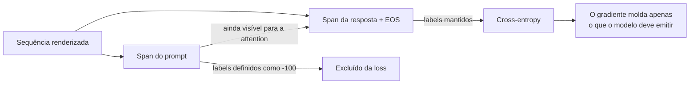

**Follow-ups:** Como você verificaria que o mascaramento está correto antes de lançar um run? Em um dataset multi-turn, você treinaria em todos os turnos do assistant ou só no final - qual o tradeoff?

</details>

### 4. Quantos dados você precisa para fazer fine-tuning de um modelo? Qualidade vs. quantidade?

<details><summary><b>Resposta</b></summary>

Muito menos do que a maioria das pessoas supõe, e a qualidade domina. Para tarefas de estilo/formato/persona, algumas centenas a alguns milhares de exemplos excelentes normalmente bastam; tarefas estreitas de classificação/extração podem usar 1k - 10k; o resultado do LIMA é a citação canônica - ~1.000 exemplos meticulosamente curados e diversos alinharam um modelo base de 65B a um nível competitivo com baselines muito mais intensamente ajustados. A intuição: o modelo já *sabe* quase tudo do pretraining; o SFT principalmente ensina *qual subdistribuição do seu conhecimento trazer à tona e em que formato*. Essa é uma função de baixa complexidade que não precisa de milhões de exemplos.

Onde a quantidade importa: injetar capacidades genuinamente novas (um novo idioma, uma DSL proprietária, comportamento agentic de longo horizonte) ou continued pretraining para conhecimento de domínio - esses precisam de ordens de grandeza mais tokens.

Checklist prático de curadoria:

- **Deduplicar**: exact-match mais near-dup (MinHash ou similaridade de embeddings). Duplicatas causam memorização e inflam os epochs efetivos nesses exemplos.
- **Descontaminar**: verifique a sobreposição de n-grams contra seus eval sets, ou seus números de antes/depois são ficção.
- **Diversidade vence volume**: 1.000 exemplos cobrindo a distribuição real de inputs superam 50.000 variações em template de dez padrões - dados em template ensinam o template, não a tarefa.
- **Leia seus dados**: inspecione manualmente uma amostra aleatória de algumas centenas de exemplos. Labels ruins, respostas truncadas e bugs de template são encontrados a olho, não por dashboards.
- **Filtre com rigor**: um LLM judge ou heurísticas (comprimento, formatação, recusas acidentais) para eliminar a pior cauda; um label errado ensina o comportamento errado com a mesma eficiência que um certo.

Uma regra útil: se adicionar mais dados não melhora as métricas held-out, seu gargalo é qualidade ou diversidade, não tamanho.

**Follow-ups:** Você tem 100 mil exemplos raspados de qualidade mista - qual é seu pipeline antes do treino? Como você detectaria que near-duplicates estão te prejudicando?

</details>

### 5. Full fine-tuning vs. parameter-efficient fine-tuning - como você escolhe?

<details><summary><b>Resposta</b></summary>

Use PEFT por padrão (na prática, LoRA/QLoRA), a menos que tenha um motivo específico para não usar. O full fine-tuning atualiza todos os pesos; o PEFT congela o modelo base e treina um pequeno conjunto de parâmetros adicionados (~0,1-1% no LoRA).

**Por que PEFT é o padrão:**

- **Memória**: o full FT de um modelo de 7B com Adam em precisão mista precisa de ~112 GB (16 bytes/param) antes das activations; o LoRA precisa de estados do otimizador apenas para os parâmetros do adapter, e o QLoRA comporta fine-tunes de 7B - 70B em uma GPU.
- **Forgetting**: pesos base congelados limitam o quanto o modelo pode derivar, então as regressões de capacidade geral são mais brandas.
- **Ganhos operacionais**: adapters têm dezenas de MB - baratos de armazenar, versionar, fazer A/B test e servir vários por modelo base (multi-LoRA serving). O full FT dá a você um novo artefato de 14+ GB por variante.
- **Qualidade**: para a maioria dos fine-tunes de estilo/formato/tarefa estreita, o LoRA iguala o full FT dentro do ruído.

**Quando o full fine-tuning compensa o custo:**

- Mudanças comportamentais grandes ou novas capacidades - ensinar domínios novos substanciais, grandes distribution shifts, traces agentic longos - onde atualizações de baixo rank podem sofrer underfitting.
- Continued pretraining em bilhões de tokens (uma atualização de baixo rank genuinamente não consegue absorver tanto).
- Você é um lab fazendo o run *principal* de post-training de um modelo que você possui, com a frota de GPUs correspondente.
- Algumas configurações de fine-tuning com RL, em que você quer plasticidade total (embora RL baseado em LoRA também funcione).

As entradas da decisão são: delta da tarefa em relação ao comportamento do base, orçamento de tokens, orçamento de GPU e quantas variantes você vai operar. Uma boa frase de fechamento: "Eu rodaria LoRA primeiro como um baseline forte e barato; se estagnar abaixo da meta e os dados não forem o gargalo, eu escalaria o rank e só então consideraria full FT."

**Vale desenhar.** transforma uma preferência em uma escada de escalonamento com uma saída em cada degrau.

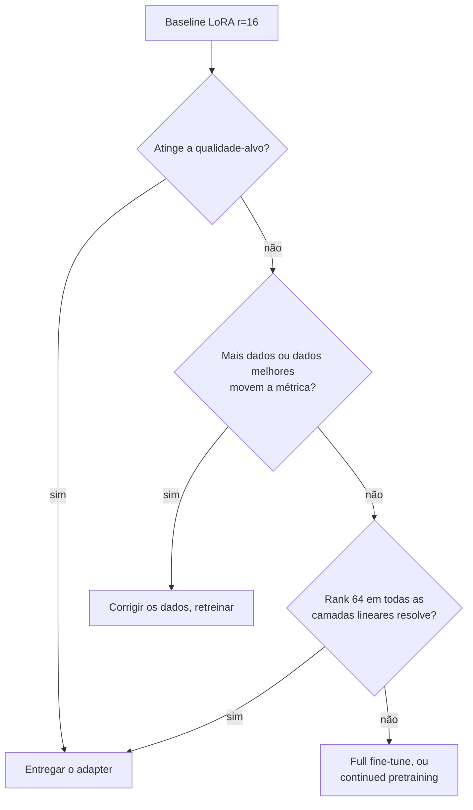

**Follow-ups:** Como você detectaria que o LoRA está sofrendo underfitting versus o problema ser os dados? Seu modelo LoRA iguala o full FT na tarefa-alvo - ainda há algum motivo para preferir o full FT?

</details>

### 6. Explique como o LoRA funciona - a matemática, e o que `r` e `alpha` significam.

<details><summary><b>Resposta</b></summary>

LoRA (Low-Rank Adaptation) congela a matriz de pesos pré-treinada e aprende uma atualização aditiva de baixo rank. Para um peso $W \in \mathbb{R}^{d \times k}$, o forward pass adaptado é:

$$h = Wx + \frac{\alpha}{r}\,BAx, \qquad B \in \mathbb{R}^{d \times r},\; A \in \mathbb{R}^{r \times k},\; r \ll \min(d,k)$$

- **`r` (rank)** é a dimensão do gargalo - a capacidade da atualização. Valores típicos: 8-64. A atualização completa $BA$ tem rank ≤ r, então em vez de $d \times k$ parâmetros treináveis por matriz você tem $r(d+k)$. Para uma projeção 4096×4096 com r=16: ~131k parâmetros vs ~16,8M - uma redução de ~128× nessa matriz.
- **`alpha`** é uma constante de escala; a atualização é escalada por $\alpha/r$. Isso desacopla a magnitude efetiva da atualização do rank, então você pode mudar `r` sem reajustar o learning rate. Heurísticas comuns: $\alpha = r$ ou $\alpha = 2r$. (O rsLoRA escala por $\alpha/\sqrt{r}$ em vez disso, o que se comporta melhor em rank alto.)
- **Inicialização**: A é Gaussiana aleatória, B é zeros - então $BA = 0$ no passo 0 e o treino começa exatamente no modelo base. Esse detalhe importa: é por isso que o treino com LoRA é estável desde o primeiro passo.

A hipótese subjacente (do paper) é que as atualizações de fine-tuning têm *intrinsic rank* baixo - o delta de pesos necessário para uma tarefa downstream vive em um subespaço de baixa dimensão, o que empiricamente se sustenta na maioria das tarefas de adaptação.

Duas propriedades que vale mencionar sem ser perguntado: (1) o ganho de memória vem de não armazenar gradientes/estados do otimizador para os pesos congelados - o modelo base ainda ocupa memória para forward/backward; (2) depois do treino você pode **mesclar** $W' = W + \frac{\alpha}{r}BA$ em uma única matriz, resultando em overhead de inferência *zero* - adapters não mesclados custam um pequeno matmul extra.

**Vale desenhar.** dois caminhos e uma soma são a ideia inteira, e mostra por que o passo 0 é exatamente o modelo base.

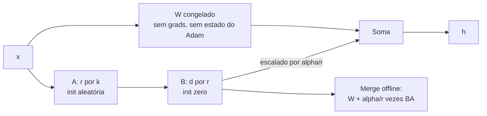

**Follow-ups:** Por que inicializar B em zero em vez de ambas as matrizes aleatórias? Se dobrar r não melhora a qualidade, o que isso te diz? O que quebra se alpha for muito grande em relação a r?

</details>

### 7. O que é catastrophic forgetting em fine-tuning, e como mitigá-lo?

<details><summary><b>Resposta</b></summary>

Catastrophic forgetting é quando otimizar sobre sua distribuição estreita de fine-tuning degrada capacidades que o modelo já tinha - raciocínio geral, instruction following, comportamento de segurança, outros idiomas. O gradient descent não tem lealdade a habilidades antigas: se seus 5k exemplos de suporte ao cliente nunca exercitam matemática, os pesos que sustentam matemática são munição livre para reduzir a loss dos tickets de suporte. Sintomas típicos: pontuações estilo MMLU caem vários pontos, o modelo começa a responder *tudo* no formato do seu fine-tune, recusa menos (ou mais) do que antes ou perde habilidade multilíngue.

Mitigações, aproximadamente em ordem de custo-benefício:

1. **Treinar de forma menos agressiva**: learning rate menor, menos epochs (1-2 em vez de 5), early stopping em um eval *geral*, não apenas na loss da tarefa.
2. **Data mixing / replay**: misture ~5-25% de dados gerais de instruções (ou a distribuição original do SFT, se você a tiver) nos dados da sua tarefa para que os comportamentos antigos continuem recebendo gradiente. Esta é a alavanca isolada mais eficaz na prática.
3. **Usar PEFT**: a base congelada do LoRA limita a deriva; você também pode reduzir `r`. Totalmente recuperável também - descarte o adapter e o modelo base está intacto.
4. **Regularizar em direção ao modelo original**: uma penalidade de KL contra as saídas do modelo base, ou métodos no espaço de pesos (por exemplo, fazer a média entre os pesos ajustados e os originais, ou restringir a norma da atualização).
5. **Delimitar o escopo do deployment**: se o modelo só vê tickets de suporte em produção, algum forgetting é aceitável - mas você precisa *medi-lo* para tomar essa decisão deliberadamente.

O ponto-chave da entrevista: o forgetting é invisível a menos que você avalie para ele. Rode uma suíte de regressão antes/depois cobrindo capacidades gerais, comportamento de segurança e formatação - não apenas a métrica da sua tarefa. Um fine-tune que ganha 10 pontos na sua tarefa e perde silenciosamente o instruction following é um incidente de produção esperando para acontecer.

**Vale desenhar.** coloca o eval geral dentro do loop, que é exatamente onde as equipes esquecem de colocá-lo.

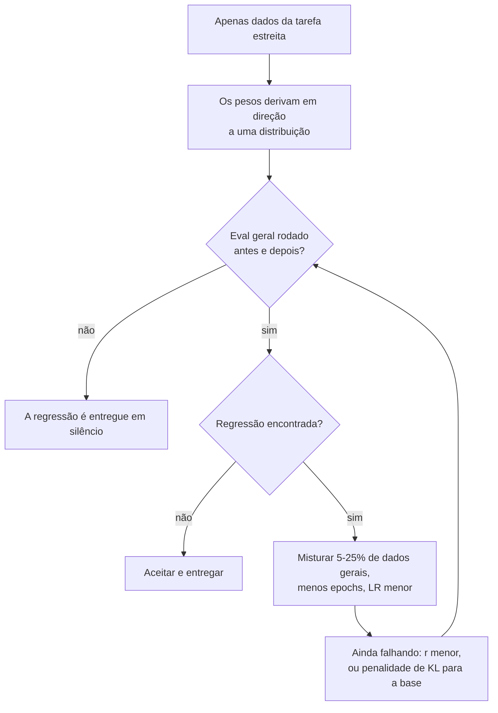

**Follow-ups:** Como você escolheria a proporção de mistura entre dados gerais e dados da tarefa? Sua métrica da tarefa melhora, mas os usuários relatam que o modelo ficou "mais burro" - qual seu plano de diagnóstico?

</details>

### 8. Quais são os hiperparâmetros principais do fine-tuning, e quais são valores iniciais sensatos?

<details><summary><b>Resposta</b></summary>

Os que importam, em ordem:

**Learning rate** - o botão de maior alavancagem, e difere por regime:
- Full fine-tuning: ~1e-5 a 5e-5 (frequentemente 1e-5-2e-5 para modelos maiores). Alto demais e você obtém picos de loss e forgetting.
- LoRA/QLoRA: ~1e-4 a 2e-4 - cerca de 10× maior, porque você está treinando uma pequena sub-rede recém-inicializada, não perturbando 7B de pesos já ajustados.

**Epochs**: 1-3 é o ponto ideal para a maioria dos SFT; datasets pequenos às vezes toleram até ~5 com LoRA. Mais epochs em dados pequenos = memorização. Observe a held-out loss, não a train loss.

**Schedule e warmup**: decaimento cosine ou linear com ~3% (até 10%) de passos de warmup. O warmup importa porque as estimativas de segundo momento do Adam são lixo no início; pulá-lo causa picos de loss iniciais.

**Effective batch size**: tipicamente 16-128 sequências, obtidas via batch por dispositivo × gradient accumulation × data parallelism. Batches maiores estabilizam os gradientes mas achatam o aprendizado por passo; se você mudar muito o batch size, revise o LR.

**Comprimento de sequência e packing**: defina o comprimento máximo para cobrir seus dados reais (verifique o histograma de comprimento em tokens - não trunque 20% das suas respostas silenciosamente). O **packing** concatena vários exemplos curtos em uma sequência para evitar desperdiçar compute com padding - grande ganho de throughput para datasets de exemplos curtos, mas exige loss masking correto por exemplo e (idealmente) attention block-diagonal para que os exemplos não atendam uns aos outros.

**Específicos do LoRA**: r (8-64), alpha (≈ r ou 2r), dropout (0-0,1), target modules (todas as projeções de attention; adicione o MLP para mais capacidade).

**O que eu realmente faria**: pegar os defaults do framework (TRL/Axolotl são sensatos), varrer o LR sobre 3 valores em um subconjunto, treinar 1-2 epochs e escolher pelo eval held-out - não pela train loss. Heroísmo de hiperparâmetros importa muito menos do que a qualidade dos dados.

**Follow-ups:** Por que runs de LoRA toleram um LR ~10× maior que o full fine-tuning? Sua curva de loss tem um pico no passo 50 e nunca se recupera - o que você verifica?

</details>

### 9. Como você percebe que um fine-tune está sofrendo overfitting? Quais são os sinais?

<details><summary><b>Resposta</b></summary>

O sinal principal é a divergência entre a train loss e a held-out loss: a train loss continua caindo enquanto a eval loss se achata ou sobe. Mas curvas de loss são só o começo - o overfitting em LLMs aparece comportamentalmente:

- **Regurgitação**: o modelo reproduz exemplos de treino quase literalmente, ou responde a prompts de treino parafraseados com respostas memorizadas. Fácil de testar: parafraseie inputs de treino e meça a similaridade das saídas com os targets de treino.
- **Colapso de diversidade**: as saídas convergem para algumas aberturas, formulações ou comprimentos estereotipados, independentemente do input. Amostre o mesmo prompt com temperature ~1 várias vezes - se todas as completions forem quase idênticas onde o modelo base variava, você sofreu overfitting de estilo.
- **Overgeneralization do template**: o modelo força todo input para o formato do fine-tune - ao receber uma pergunta casual, responde com seu schema JSON ou com a estrutura de ticket de suporte.
- **Fragilidade fora da distribuição**: forte em inputs parecidos com os dados de treino, nitidamente pior em pequenas reformulações ou edge cases - o modelo aprendeu padrões superficiais em vez da tarefa.
- **Regressões de capacidade geral**: queda em benchmarks (isso se sobrepõe ao catastrophic forgetting; em datasets pequenos os dois chegam juntos).

As causas-raiz geralmente são: epochs demais em dados de menos, exemplos duplicados (que são secretamente epochs extras nesses pontos), LR alto demais ou baixa diversidade de dados.

Correções: menos epochs / parada mais cedo baseada em métricas *held-out*, dedup, dados mais diversos, LR menor, dropout do LoRA ou rank menor, e misturar dados gerais. Uma sutileza que vale dizer: para tarefas estreitas de produção, um "overfitting" leve à distribuição da tarefa às vezes é exatamente o que você quer - a pergunta é se o desempenho na distribuição de *deployment* (incluindo sua cauda) se degrada, e é por isso que seu conjunto held-out deve refletir o tráfego real, não uma fatia aleatória do seu arquivo de treino curado.

**Follow-ups:** Sua eval loss sobe depois do epoch 1, mas avaliadores humanos preferem o checkpoint do epoch 3 - qual você entrega e por quê? Como exemplos de treino duplicados se disfarçam de epochs extras?

</details>

### 10. Explique o pipeline clássico de RLHF de ponta a ponta.

<details><summary><b>Resposta</b></summary>

A receita do InstructGPT, três estágios após o pretraining.

**Estágio 1 - SFT**: faça fine-tuning do modelo base em demonstrações de alta qualidade (escritas por humanos ou curadas) para que ele consiga seguir instruções. Esta é a inicialização de tudo que vem depois; o RL não consegue consertar uma policy que nunca amostra bom comportamento.

**Estágio 2 - Reward model**: colete *dados de preferência* - amostre duas ou mais respostas por prompt do modelo SFT, peça a humanos que as ranqueiem (comparação par a par é usada porque é muito mais confiável que pontuação absoluta; os anotadores concordam mais em "A > B" do que em "A é 7/10"). Treine um RM - geralmente o modelo SFT com um scalar head - com a loss de Bradley-Terry: $-\log\sigma(r(x, y_w) - r(x, y_l))$, empurrando a pontuação da resposta escolhida acima da rejeitada.

**Estágio 3 - PPO**: o modelo SFT vira a policy. Amostre respostas para prompts, pontue-as com o RM e atualize a policy com PPO para aumentar a recompensa esperada - com uma **penalidade de KL contra o modelo SFT congelado (reference)** para que a policy não vagueie para um texto degenerado que por acaso engana o RM. O objetivo efetivo é aproximadamente $\mathbb{E}[r(x,y)] - \beta\,\mathrm{KL}(\pi \| \pi_{ref})$.

Por que RL, em vez de mais SFT? Preferências codificam qualidade *relativa* nas próprias saídas do modelo - um sinal que você não consegue expressar facilmente como demonstrações - e é muito mais barato para humanos ranquear do que escrever. O modo de falha conhecido é o **reward hacking**: o RM é um proxy imperfeito, e a otimização sem restrições explora seus pontos cegos (viés de comprimento, sycophancy), que é exatamente o que o termo de KL e dados de preferência novos existem para conter.

**Vale desenhar.** o checkpoint SFT alimenta três setas, e é isso que as pessoas perdem.

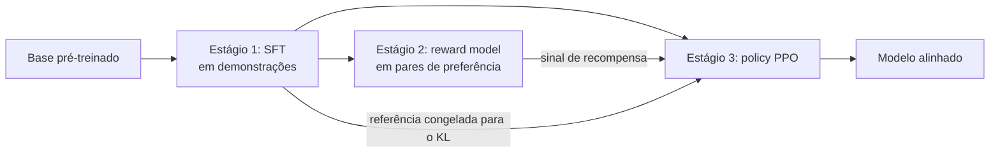

**Follow-ups:** Por que preferências par a par em vez de notas absolutas? O que quebra se você pular o SFT e rodar PPO no modelo base? Onde o DPO dá um atalho nesse pipeline?

</details>

### 11. Você faria fine-tuning de um modelo base ou de um modelo instruct? Como essa escolha muda seus dados e sua receita?

<details><summary><b>Resposta</b></summary>

Para quase todo trabalho aplicado, comece pelo modelo instruct. Você só recorre a um modelo base quando tem muitos dados (dezenas de milhares de exemplos de alta qualidade), quer controle total do formato de saída ou está fazendo continued pretraining em um corpus de domínio.

A diferença é o que você herda. Um modelo instruct já tem instruction following, comportamento multi-turn, tool calling, o hábito treinado de EOS e um baseline de segurança. Você recebe tudo isso de graça, e também pode destruí-lo: fazer fine-tuning de um modelo instruct em dados single-turn estreitos degrada de forma confiável o multi-turn e o instruction following geral, e é por isso que você mistura ~5-25% de dados gerais de instruções. Ele também traz um chat template que foi realmente treinado, e você deve reproduzi-lo byte a byte.

Um modelo base é um previsor do próximo token. Não tem um chat template significativo (o que está em `tokenizer_config.json` pode ser nominal e não treinado), não vai parar sozinho e não tem comportamento de recusa. Você está refazendo o post-training por conta própria: formato, parada, verbosidade, segurança. Isso é um projeto de verdade, não um fim de semana.

O equívoco comum é "um modelo base é uma folha em branco, então é mais fácil de direcionar". É mais barato de direcionar no sentido de que você não luta contra comportamento existente, mas você não herda nada, e com alguns milhares de exemplos você produzirá algo pior que o modelo instruct em tudo, exceto na sua tarefa estreita.

Regra prática: modelo instruct mais LoRA é o padrão. Orce um run de SFT em modelo base apenas se o estilo embutido do modelo instruct estiver ativamente brigando com você e você tiver os dados para substituí-lo. Verifique também o que você consegue de fato obter: para muitos modelos hospedados só existem os pesos instruct ou um endpoint de tuning, então a decisão já está tomada por você.

**Follow-ups:** Se você faz fine-tuning de um modelo instruct e o comportamento multi-turn dele se degrada, como detectaria isso antes de entregar? O que você faria diferente se o modelo base e o instruct tivessem tokenizers diferentes?

</details>

### 12. Por que você deduplica dados de fine-tuning, e como você realmente faria isso?

<details><summary><b>Resposta</b></summary>

Porque duplicatas reponderam silenciosamente seu dataset e impulsionam a memorização. Se 20% de um conjunto está duplicado e você treina 3 epochs, esses exemplos são efetivamente vistos ~6 vezes enquanto o resto é visto 3. Você não escolheu essa mistura, o scraper escolheu. Duplicatas também inflam métricas held-out sempre que uma quase-cópia fica dos dois lados da divisão treino/teste, e a repetição pesada de uma única resposta ensina o modelo a emitir essa resposta como uma resposta enlatada.

O pipeline que eu rodo, em ordem:

1. Normalizar: remover whitespace, normalizar unicode, lowercase apenas para o hashing.
2. Dedup exata: fazer hash do texto normalizado, descartar colisões. Barato, pega uma quantidade surpreendente.
3. Near-dup: MinHash sobre shingles de ~5-grams com LSH banding, threshold de Jaccard em torno de 0,8. Tempo linear, apenas CPU, minutos em 100k exemplos.
4. Dedup semântica: gerar embeddings e então descartar vizinhos próximos acima de um threshold de cosseno (~0,95) ou fazer clustering e limitar por cluster. Pega paráfrases que o MinHash deixa passar.
5. Descontaminar contra todo eval set que você planeja reportar, usando a mesma maquinaria de sobreposição.

Faça a dedup do prompt e da resposta separadamente, porque eles falham de formas diferentes. Muitos prompts quase idênticos com respostas conflitantes ensinam inconsistência. Respostas idênticas para prompts diferentes ensinam uma resposta enlatada.

A parte que as pessoas erram é a dedup excessiva. Alguma repetição é sinal: se 30% do tráfego de produção é a mesma intenção, colapsá-la em um exemplo faz sua distribuição de treino deixar de corresponder à realidade. Prefira limitar contagens por cluster a reduzir a uma única instância. E sempre faça a dedup antes de dividir, nunca depois, ou seu conjunto de teste vaza.

**Vale desenhar.** a ordem é load-bearing: tudo acontece antes da divisão, nunca depois.

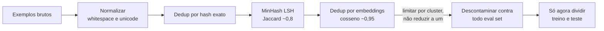

**Follow-ups:** Por que o MinHash é preferido em vez de similaridade de cosseno par a par em escala? Como você escolheria o threshold de Jaccard em vez de simplesmente aceitar 0,8 de olhos fechados?

</details>

### 13. Qual a diferença entre um outcome reward model e um process reward model, e quando você precisa de cada um?

<details><summary><b>Resposta</b></summary>

Um outcome reward model (ORM) pontua uma completion como um todo, um escalar por resposta. Um process reward model (PRM) pontua cada passo intermediário de raciocínio, fornecendo um sinal denso por passo. A troca é custo de anotação contra credit assignment.

ORMs são baratos de supervisionar: você precisa de um label da resposta final ou de uma preferência sobre a resposta final. Mas o sinal é esparso e o credit assignment é cego. Uma trajetória que acerta por palpite depois de um raciocínio quebrado recebe crédito total, e uma trajetória quase correta que escorrega na última linha recebe zero. Em tarefas de longo horizonte em que a taxa de sucesso é baixa, a maioria dos rollouts retorna zero e você aprende muito pouco por passo.

PRMs dão um gradiente em cada passo, então o modelo aprende qual passo foi o erro. O custo são os labels em nível de passo. A anotação humana de passos é cara (o PRM800K da OpenAI é o exemplo canônico de pagar por isso). O caminho mais barato é a rotulagem automática por rollout: a partir de um dado passo, amostre continuações e rotule o passo por quão frequentemente elas chegam à resposta correta. Essa é a supervisão estilo Math-Shepherd, e custa compute em vez de anotadores.

Onde os PRMs realmente se pagam é em tempo de inferência: reranking de best-of-N, ou guiar tree search, onde uma pontuação por passo permite podar cedo. Isso é uma grande parte de por que eles importam na era do test-time-compute.

Duas ressalvas que vale levantar. Primeira, se você tem um verificador real (unit tests, um verificador de resposta), você não precisa de um ORM. O RLVR usa o verificador diretamente, então não há reward model aprendido para explorar, embora um verificador fraco ainda possa ser burlado (testes com casos especiais, aprovação apenas por formato). Segunda, PRMs também podem sofrer hacking e os limites dos passos são mal definidos em raciocínio de forma livre.

Ordem prática: recompensa de verificador primeiro, ORM se a tarefa não for verificável, PRM só quando a recompensa for esparsa demais para aprender.

**Vale desenhar.** torna visível a diferença de credit assignment em vez de apenas afirmá-la.

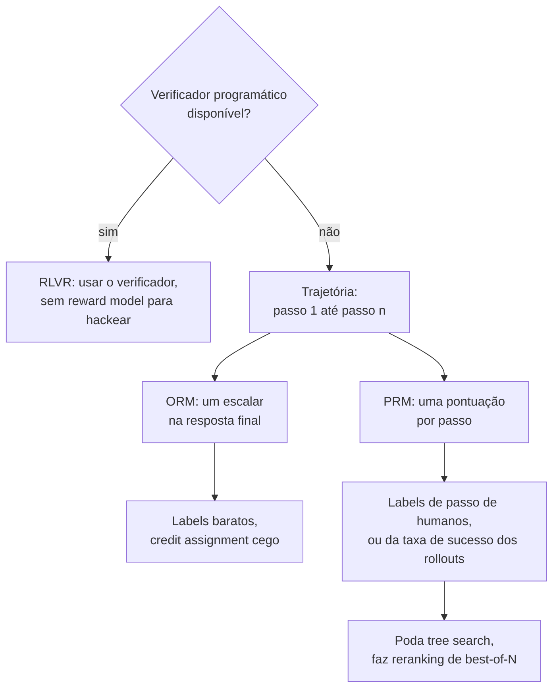

**Follow-ups:** Como você geraria labels de PRM sem anotadores humanos, e que viés isso introduz? Por que um PRM usado como reranker de best-of-N pode se degradar conforme N cresce?

</details>

## Intermediário

### 14. Quais módulos você mira com LoRA, como escolhe o rank, e quais são as economias reais de memória?

<details><summary><b>Resposta</b></summary>

**Módulos**: o paper original adaptou apenas as projeções q e v, mas a prática atual é mirar **todas as projeções de attention (q, k, v, o) mais as matrizes do MLP (gate/up/down)** - com orçamento fixo de parâmetros treináveis, cobrir mais módulos em rank menor geralmente supera rank alto em poucos módulos (essa também é a conclusão do QLoRA: adaptar todas as camadas lineares foi necessário para igualar o full fine-tuning). Embeddings e o LM head geralmente ficam congelados, a menos que você tenha adicionado novos tokens.

**Rank**: r=8-16 para estilo/formato/persona; r=32-64 para mudanças comportamentais mais difíceis ou aprendizado de tarefa mais capaz; acima de 64 você encontra retornos decrescentes na maioria das tarefas de SFT - se r=64 ainda sofre underfitting, o problema geralmente são os dados ou a própria premissa de baixo rank (considere full FT). Método prático: comece com r=16, alpha=32; se a qualidade held-out estagnar abaixo da meta e mais/melhores dados não a movem, dobre r e compare.

**Matemática de memória** (modelo classe 7B, hidden 4096, 32 camadas, mirando todas as lineares com r=16): os parâmetros do adapter somam aproximadamente ~40M - ~0,6% do modelo. As economias:

- Full FT com Adam, precisão mista: ~16 bytes/param → ~112 GB para pesos+gradientes+estados do otimizador.
- LoRA: base congelada em bf16 ~14 GB (sem grads, sem estados do otimizador) + adapters ~40M parâmetros com grads e estados do Adam em fp32 → bem abaixo de 1 GB. Total ~15 GB + activations → cabe em uma GPU de 24 GB com gradient checkpointing.
- QLoRA: base em NF4 ~3,5-4 GB → fine-tunes de 7B cabem em placas de consumidor.

Duas ressalvas que mostram experiência real: as activations ainda escalam com batch × comprimento de sequência independentemente do LoRA (o checkpointing é o que controla isso), e os backward passes ainda fluem *através* dos pesos base congelados, então a economia de compute é modesta - o LoRA economiza memória, não FLOPs.

**Follow-ups:** Por que muitos módulos de rank baixo superam poucos módulos de rank alto com o mesmo número de parâmetros? Quando você também treinaria a camada de embeddings?

</details>

### 15. Como funciona o adapter merging, e como funcionam o multi-LoRA serving e o hot-swapping em produção?

<details><summary><b>Resposta</b></summary>

**Merging**: como a atualização do LoRA é aditiva, você pode incorporá-la aos pesos base offline: $W' = W + \frac{\alpha}{r}BA$. O modelo mesclado é um checkpoint padrão - zero overhead de inferência, sem dependência do PEFT na hora de servir, implantável em qualquer lugar. No PEFT é `model.merge_and_unload()`. Custos: você agora armazena/envia um artefato de tamanho completo por variante, perde a capacidade de destacar o adapter, e mesclar em uma base *quantizada* causa perdas - a prática padrão é mesclar nos pesos base de precisão total e depois (re)quantizar, não mesclar nos tensores de 4-bit contra os quais um run de QLoRA treinou.

**Serving sem merge**: mantenha a base congelada e calcule $Wx + \frac{\alpha}{r}BAx$ em runtime - um pequeno matmul extra cujo custo de latency depende dos kernels e de quantos adapters distintos compartilham um batch, então faça benchmark na sua própria mistura de tráfego. Por que aceitar esse custo? Porque ele desbloqueia o **multi-LoRA serving**: uma cópia do modelo base na memória da GPU com muitos adapters (cada um com dezenas de MB) anexados por requisição. Sistemas como S-LoRA e o suporte a LoRA do vLLM fazem batch de requisições para adapters *diferentes* pelo mesmo forward pass do modelo base usando kernels de adapter em batch/gather, e fazem paging de adapters entre a memória da GPU/CPU sob demanda. Isso muda a economia da customização: servir 100 fine-tunes por cliente como modelos mesclados significa 100 réplicas de modelo; como adapters, é uma réplica base mais ~GBs de adapters.

**Hot-swapping** significa carregar/descarregar adapters em runtime sem reiniciar o servidor ou recarregar a base - novas versões de fine-tune são implantadas em segundos, e o rollback é "apontar as requisições para o ID do adapter anterior".

Notas operacionais que vale oferecer: fixe a versão exata do modelo base contra a qual um adapter foi treinado (adapters são deltas sem sentido sem ela); versione adapters como código, com gates de eval; e se um adapter recebe 95% do tráfego, mesclar *esse* em uma réplica dedicada pode valer o overhead zero.

**Vale desenhar.** mostra de onde vem a economia: uma base residente, muitos deltas pequenos.


**Follow-ups:** Por que mesclar em uma base quantizada em 4-bit é problemático? Como você projetaria o serving para 500 fine-tunes específicos de tenants com tráfego assimétrico?

</details>

### 16. Explique o QLoRA - NF4, double quantization, paged optimizers. O que você abre mão?

<details><summary><b>Resposta</b></summary>

O QLoRA faz fine-tuning de adapters LoRA em bf16 sobre um modelo base cujos pesos congelados são quantizados em 4 bits - o resultado de destaque foi o fine-tuning de um modelo de 65B em uma única GPU de 48 GB igualando a qualidade do fine-tuning em 16 bits nos benchmarks deles. Três componentes:

- **NF4 (4-bit NormalFloat)**: um tipo de dado de 4 bits com motivação teórico-informacional, cujos 16 níveis de quantização são definidos nos quantis de uma distribuição normal padrão - casando com a distribuição empiricamente ~normal dos pesos pré-treinados - de modo que cada nível seja usado aproximadamente com a mesma frequência. Supera inteiros/floats de 4 bits simples com a mesma largura de bits. Os pesos são quantizados em blocos (tamanho de bloco 64) com uma constante absmax em fp32 por bloco.
- **Double quantization**: essas constantes por bloco custam memória por si mesmas (fp32 a cada 64 pesos ≈ 0,5 bits/param), então o QLoRA quantiza as próprias constantes de quantização para 8 bits - economizando ~0,37 bits/param, o que são ~3 GB em um modelo de 65B.
- **Paged optimizers**: usam a unified memory da NVIDIA para paginar os estados do otimizador para a RAM da CPU durante picos de memória (por exemplo, batches de sequências longas), convertendo crashes de OOM em lentidão.

Crucialmente, o compute continua acontecendo em bf16: os pesos são dequantizados bloco a bloco on the fly a cada matmul; os gradientes fluem pelos pesos dequantizados apenas para os parâmetros do LoRA. Os tensores de 4 bits da base nunca são atualizados.

**O que você abre mão**: o modelo base que você está adaptando é uma versão levemente degradada de si mesmo - ruído de quantização que o adapter compensa em parte, mas regressões sutis podem aparecer em tarefas fora da sua distribuição de fine-tuning. O overhead de dequantização torna o treino um pouco mais lento por passo do que o LoRA em bf16. E há uma incompatibilidade de deployment a gerenciar: o adapter foi otimizado contra a base *quantizada*, então servi-lo na base fp16 (ou mesclá-lo) desloca ligeiramente a função - geralmente tudo bem, mas vale uma passada de eval.

**Vale desenhar.** deixa claro que os tensores de 4 bits são apenas lidos, nunca atualizados.

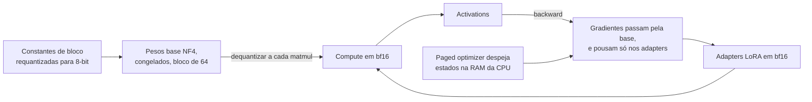

**Follow-ups:** Por que os quantis de uma distribuição normal são os níveis certos para quantização de pesos? Seu adapter QLoRA tem eval pior quando servido na base fp16 - por quê, e o que você faria?

</details>

### 17. Como você treina um reward model? Explique os dados de preferência e a loss de Bradley - Terry.

<details><summary><b>Resposta</b></summary>

Um reward model mapeia (prompt, resposta) → pontuação escalar. Construção padrão: pegue o modelo SFT, troque o LM head por um scalar head (tipicamente lendo o hidden state do último token) e treine em **dados de preferência par a par**.

**Coleta de dados**: para cada prompt, amostre 2+ respostas (do modelo SFT - você quer o RM preciso na distribuição que a policy de fato vai produzir) e peça a anotadores que escolham a melhor sob uma rubrica escrita (utilidade, inocuidade, precisão...). A comparação par a par é usada porque humanos são muito mais consistentes em "A vence B" do que em pontuações absolutas. O controle de qualidade é a parte difícil: meça a concordância entre anotadores (frequentemente só ~70-80% em pares sutis), calibre os anotadores e audite vieses sistemáticos - anotadores preferem de forma confiável respostas mais longas e de tom mais confiante, e seu RM aprenderá fielmente esses vieses.

**Loss**: o modelo de Bradley-Terry diz que a probabilidade de a resposta $y_w$ vencer $y_l$ é uma função logística da diferença de pontuação:

$$P(y_w \succ y_l \mid x) = \sigma\big(r_\theta(x, y_w) - r_\theta(x, y_l)\big)$$

então você minimiza $-\log\sigma(r_\theta(x,y_w) - r_\theta(x,y_l))$ - regressão logística sobre diferenças de pontuação. Apenas as *diferenças* são identificadas, então as recompensas absolutas têm um offset arbitrário (algumas configurações as normalizam ou ancoram). Com rankings de k posições, você decompõe em pares.

**Avaliação**: acurácia de preferência held-out (com que frequência o RM concorda com os humanos; ~70-80% é típico e limitado pela concordância entre anotadores) mais probes direcionados para modos de falha conhecidos - viés de comprimento, sycophancy, viés de formato. O RM é o proxy load-bearing de todo o run de RLHF: a policy explorará qualquer erro sistemático que ele tenha, e é por isso que a qualidade do RM, dados de preferência novos e on-distribution e o retreinamento periódico do RM importam mais do que os hiperparâmetros do PPO.

**Vale desenhar.** o loop de volta ao modelo que amostra é a parte que os candidatos deixam de fora.

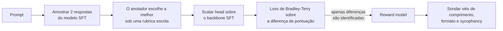

**Follow-ups:** Por que amostrar as respostas de treino do RM a partir do modelo SFT em vez de outro modelo? Como você detectaria e corrigiria viés de comprimento em um reward model?

</details>

### 18. Explique o PPO no contexto do RLHF. Por que existe uma penalidade de KL contra um reference model?

<details><summary><b>Resposta</b></summary>

Nível conceitual (que é o esperado): no RLHF, a policy é o LLM; uma "ação" é emitir um token, um episódio é gerar uma resposta completa, e a recompensa vem do reward model, geralmente atribuída ao final da sequência. O PPO (proximal policy optimization) é um método de policy gradient cuja característica definidora são as *atualizações conservadoras*: ele otimiza um objetivo surrogate com clipping que limita o quanto as razões de probabilidade da nova policy podem se mover em relação à policy de amostragem em uma única atualização, de modo que você possa dar com segurança vários passos de gradiente por batch de gerações caras sem a policy colapsar. Na prática ele também traz uma value function aprendida (critic) e estimativa de advantage (GAE) para reduzir a variância do gradiente. O loop: amostrar respostas da policy atual → pontuar com o RM → calcular advantages → atualização de policy com clipping → repetir.

A **penalidade de KL** é uma restrição separada, específica do RLHF: o objetivo é aproximadamente

$$\max_\pi\; \mathbb{E}_{y\sim\pi}\big[r(x,y)\big] - \beta\,\mathrm{KL}\big(\pi(\cdot|x)\,\|\,\pi_{ref}(\cdot|x)\big)$$

em que $\pi_{ref}$ é o modelo SFT congelado. Ela existe por dois motivos:

1. **O RM é um proxy, não a verdade.** Ele só é preciso perto da distribuição em que foi treinado. A otimização sem restrições leva a policy para fora da distribuição, para textos que o RM pontua errado - a recompensa sobe, a qualidade real cai (reward hacking). O termo de KL mantém a policy onde o RM é confiável.
2. **Preservação de capacidade.** O reference model ancora fluência, conhecimento e diversidade; sem ele a policy pode degenerar (repetição, formulações estranhas, entropy collapse) enquanto a "recompensa" sobe.

β define o tradeoff: alto demais e o modelo mal muda; baixo demais e você obtém hacking. As equipes monitoram a fronteira KL-vs-recompensa durante o treino e tratam recompensa subindo com KL explodindo como um red flag, não como progresso. O KL geralmente é implementado por token como $\log\pi(y_t) - \log\pi_{ref}(y_t)$ incorporado à recompensa.

**Vale desenhar.** separa o loop do PPO da coleira de KL, que são duas ideias independentes que as pessoas fundem.


**Follow-ups:** O que você monitora durante um run de PPO para pegar falhas cedo? Por que o PPO faz clipping das razões de probabilidade em vez de simplesmente usar um learning rate maior?

</details>

### 19. O que é reward hacking? Dê exemplos concretos e mitigações.

<details><summary><b>Resposta</b></summary>

Reward hacking (reward overoptimization / Goodharting) é quando a policy encontra comportamentos que aumentam a recompensa *proxy* sem aumentar - frequentemente enquanto diminuem - o objetivo verdadeiro que o proxy deveria representar. É inevitável em essência: o RM é um substituto imperfeito treinado com preferências finitas, e o RL é uma busca adversarial pelos pontos cegos dele.

Exemplos concretos vistos na prática:

- **Viés de comprimento**: anotadores preferem levemente respostas mais longas → o RM herda isso → a policy produz respostas inchadas e com enchimento. O artefato de RLHF mais documentado; é por isso que evals sérios controlam o comprimento.
- **Sycophancy**: concordar com as opiniões declaradas do usuário e lisonjeá-lo pontua mais alto com avaliadores humanos → o modelo aprende a dizer aos usuários o que eles querem ouvir, inclusive endossando premissas falsas.
- **Truques de confiança e formatação**: tom autoritário, listas com bullets, headers e texto em negrito pontuam mais alto independentemente da precisão do conteúdo.
- **Jogar com hedging/recusa**: se o RM sobrepondera a inocuidade, a policy aprende a recusar pedidos limítrofes mas benignos - recompensa máxima de segurança, utilidade zero.
- **Hacking de recompensa verificável** (RL para código): modelos tratando como caso especial os unit tests visíveis, codificando as saídas esperadas direto no código ou - em cenários agentic - modificando/apagando os próprios testes. Qualquer lacuna explorável no verificador é encontrada.
- **Exploits degenerados**: sequências de tokens fora da distribuição ou repetição que por acaso pontuam alto com um RM fraco - o modo de falha que a penalidade de KL existe para prevenir.

Mitigações: a **penalidade de KL** para um reference model (mantém a policy onde o RM está calibrado); **early stopping** usando o padrão conhecido de que a qualidade gold-standard sobe e depois cai conforme a recompensa proxy sobe; **dados de preferência on-policy novos** e retreinamento periódico do RM (RLHF iterado), para que o RM permaneça preciso no que a policy agora produz; **ensembles de RM** ou recompensas de pior caso sobre o ensemble; **debiasing** explícito (recompensas com penalidade de comprimento); **verificadores reforçados** com testes ocultos e checagens de integridade do sandbox para RL de código; e spot-checks humanos de amostras de alta recompensa - a mitigação mais barata e consistentemente informativa.

**Vale desenhar.** desenhar o ciclo mostra por que recompensa subindo não é evidência de nada por si só.

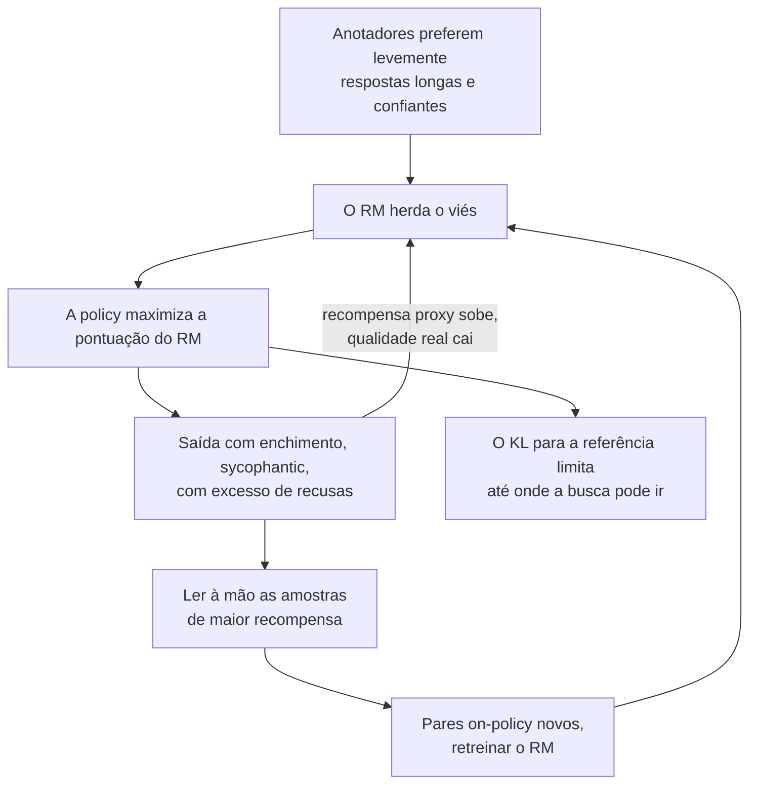

**Follow-ups:** A recompensa está subindo de forma constante no seu run - que evidência distingue melhoria genuína de hacking? Como você reforçaria uma recompensa baseada em unit tests contra tentativas de burlá-la?

</details>

### 20. Explique o DPO. Qual é a ideia-chave que permite pular o reward model e o loop de RL?

<details><summary><b>Resposta</b></summary>

O DPO (Direct Preference Optimization) treina diretamente sobre pares de preferência com uma loss simples estilo classificação - sem reward model, sem sampling, sem RL.

**A ideia-chave**: o objetivo do RLHF com restrição de KL tem uma policy ótima de forma fechada, $\pi^*(y|x) \propto \pi_{ref}(y|x)\,e^{r(x,y)/\beta}$. Invertendo isso, qualquer função de recompensa pode ser reescrita (a menos de uma constante dependente do prompt) em termos da sua própria policy ótima:

$$r(x,y) = \beta \log \frac{\pi(y|x)}{\pi_{ref}(y|x)} + \text{const}(x)$$

Então, em vez de aprender um RM explícito e depois encontrar sua policy ótima com PPO, você substitui essa **recompensa implícita** na verossimilhança de preferência de Bradley-Terry. A constante cancela na diferença par a par, resultando na loss do DPO:

$$\mathcal{L} = -\log\sigma\Big(\beta\big[\log\tfrac{\pi_\theta(y_w|x)}{\pi_{ref}(y_w|x)} - \log\tfrac{\pi_\theta(y_l|x)}{\pi_{ref}(y_l|x)}\big]\Big)$$

Daí o título do paper: *seu modelo de linguagem é secretamente um reward model*. A própria policy parametriza a recompensa, e o ajuste do reward model e a otimização da policy colapsam em um único passo supervisionado.

**Lendo o objetivo**: aumente a log-probabilidade da resposta escolhida em relação ao reference model, diminua-a para a rejeitada, com a sigmoide pesando mais os gradientes onde a recompensa implícita atualmente ranqueia o par *errado*. β cumpre o mesmo papel do coeficiente de KL do RLHF - o quanto a policy pode se afastar da referência para se ajustar às preferências.

**Mecânica**: você precisa do reference model congelado (geralmente seu checkpoint SFT) para as razões de log - então dois modelos na memória, ou log-probs de referência pré-computadas. O treino é tão estável e barato quanto o SFT: um forward/backward por membro do par, sem geração durante o treino, infraestrutura supervisionada padrão. Comportamentos conhecidos a mencionar: o DPO pode reduzir a verossimilhança absoluta de *ambas* as respostas (apenas a margem é restringida) e pode sofrer overfitting às idiossincrasias das preferências - motivando variantes como o IPO.

**Vale desenhar.** nomeia exatamente quais três partes móveis do PPO a reparametrização elimina.

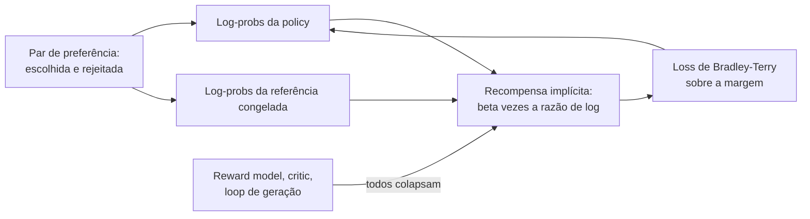

**Follow-ups:** Que papel β cumpre e o que acontece com valores muito pequenos ou grandes? Por que o termo const(x) cancela, e por que isso importa? O que se perde por nunca amostrar da policy durante o treino?

</details>

### 21. DPO vs RLHF estilo PPO - quando você escolheria cada um?

<details><summary><b>Resposta</b></summary>

A diferença fundamental é **offline vs online**. O DPO se ajusta a um dataset fixo de pares de preferência; o PPO gera amostras novas da policy atual a cada passo e as pontua. Todo o resto decorre disso.

**Escolha o DPO quando**: você tem um bom dataset estático de preferências; quer simplicidade nível SFT (um modelo para treinar mais uma referência congelada - sem RM, sem critic, sem loop de geração, ~2 modelos na memória vs ~4 para o PPO: policy, referência, RM, value net); sua equipe não tem infraestrutura de RL nem experiência de debugging; ou você está fazendo alinhamento de preferências de rotina (tom, utilidade, preferências de formato) em que os dados offline são representativos. O DPO também é muito mais reproduzível - é aprendizado supervisionado determinístico, enquanto runs de PPO são notoriamente sensíveis a detalhes de implementação e seeds.

**Escolha PPO/RL online quando**: a recompensa pode ser calculada em *novas* amostras - um RM forte ou, melhor, recompensas verificáveis (testes, verificadores) - porque métodos online exploram além do suporte do seu dataset. A policy descobre comportamentos que nenhum anotador demonstrou, é avaliada e melhora; o DPO só consegue reponderar comportamentos presentes em seus pares. Isso importa mais no treinamento de reasoning/agentic, que é por que o RL de reasoning estilo R1 é online (GRPO), não DPO. Métodos online também lidam com distribution shift: conforme a policy melhora, o dataset congelado do DPO (tipicamente amostrado do modelo *SFT*) fica cada vez mais off-policy, o que limita o quanto ele consegue empurrar a qualidade.

Meios-termos práticos que vale nomear: o **DPO iterativo** (amostrar da policy atual, rotular com um RM ou judge, DPO nos pares novos, repetir) recupera boa parte do benefício online com uma fração da complexidade; e o best-of-n sampling contra um RM na inferência é um baseline sem treino.

Resumo honesto: frontier labs rodam RL online em seu post-training principal porque tetos importam nessa escala; para a maioria das equipes aplicadas fazendo fine-tuning de um modelo de produto, o DPO (ou DPO iterativo) atinge um ponto custo/benefício melhor.

**Follow-ups:** Por que dados off-policy limitam o teto do DPO? Projete um loop de DPO iterativo - de onde vem o sinal extra dele? Quando o best-of-n com um RM superaria ambos?

</details>

### 22. Dê resumos de uma linha sobre IPO, KTO e ORPO - que problema cada um resolve, e quando você o escolheria?

<details><summary><b>Resposta</b></summary>

Os três são métodos de preferência offline da família DPO; cada um corrige um ponto de dor específico.

- **IPO (Identity Preference Optimization)**: aborda a tendência do DPO ao *overfitting às preferências* - a loss log-sigmoid do DPO continua empurrando a margem escolhida/rejeitada em direção ao infinito em pares que ele já ranqueia corretamente (especialmente com labels determinísticos ou ruidosos, onde as premissas de Bradley-Terry se quebram). O IPO a substitui por uma loss quadrática que faz regressão da margem de recompensa implícita em direção a um alvo fixo (1/(2β) na parametrização do paper), de modo que a otimização satura em vez de disparar. Escolha-o quando seus labels de preferência são ruidosos ou quase determinísticos e os runs de DPO se degradam com o treino. Vem do framework teórico Ψ-PO, que analisa o que o RLHF/DPO realmente otimizam.

- **KTO (Kahneman-Tversky Optimization)**: resolve o problema do *formato dos dados* - frequentemente você não tem pares, apenas sinais independentes de thumbs-up/thumbs-down (feedback de produção, flags de moderação). A loss do KTO, inspirada na prospect theory, treina diretamente em labels binários desejável/indesejável relativos a um ponto de referência, sem exigir pareamento, e tolera positivos/negativos desbalanceados. Escolha-o quando você tem feedback abundante e não pareado de um produto em operação - seu habitat natural.

- **ORPO (Odds Ratio Preference Optimization)**: resolve o problema da *complexidade do pipeline* - é monolítico, incorporando a otimização de preferências ao próprio SFT. A loss é o NLL padrão do SFT sobre a resposta escolhida mais um termo de odds-ratio que penaliza a resposta rejeitada, com **nenhum reference model** e sem estágios separados de SFT-depois-alinhar: um run de treino, um modelo na memória. Escolha-o quando quer a receita de SFT+alinhamento mais simples possível e tem pares; aceite que pular o reference model remove a âncora explícita que limita a deriva.

O suporte em frameworks (o TRL implementa os três) torna barato experimentá-los; na prática, um DPO bem ajustado continua sendo o padrão, e estas são as ferramentas a que você recorre quando o *formato dos seus dados* (KTO), o *ruído dos labels* (IPO) ou o *orçamento de pipeline* (ORPO) dizem o contrário.

**Vale desenhar.** transforma três papers em uma pergunta sobre o formato dos seus dados.


**Follow-ups:** Por que a margem do DPO cresce sem limite e por que isso é ruim? Você tem 500 mil eventos de thumbs-up/down de produção - qual método e por quê?

</details>

### 23. Como você avalia um modelo antes e depois do fine-tuning?

<details><summary><b>Resposta</b></summary>

A avaliação de um fine-tune é uma medição *diferencial*: a pergunta não é "o modelo é bom", mas "o que mudou, em ambas as direções". Meu checklist:

**Antes do treino**: congele um **eval set da tarefa** held-out (extraído da distribuição de tráfego real, não apenas uma fatia do arquivo de treino curado), e faça o baseline tanto do modelo base *quanto* da alternativa de modelo frontier com prompt nele - essa é a barra que o fine-tune precisa superar para justificar sua existência. Defina a métrica de antemão: exact-match/F1 para extração, taxa de aprovação contra um validador para structured output, LLM-as-judge com rubrica (com debias de posição, com alguma calibração de concordância humana) para qualidade em tarefas abertas.

**Checagens de contaminação**: verifique a separação treino/eval com correspondência exata e de near-duplicates (sobreposição de n-grams, similaridade de embeddings) entre o conjunto de treino e *todos* os eval sets - incluindo benchmarks públicos que você vai reportar. Um eval vazado torna todo número downstream ficção; é também aqui que você pega "o mesmo ticket de cliente aparece nas duas divisões com redação diferente".

**Depois do treino, duas direções**:
1. **Ganhos na tarefa-alvo**: o conjunto held-out, mais uma visão em nível de slice (por intent/comprimento/bucket de edge case) - vitórias agregadas podem esconder regressões na cauda que importa.
2. **Suíte de regressão em capacidades gerais**: instruction following, benchmarks de reasoning/conhecimento (estilo MMLU), conformidade de formatação, comportamento de segurança/recusa e tratamento de contexto longo, se relevante. O fine-tuning é onde o catastrophic forgetting e a over-refusal se infiltram silenciosamente; se você não testa para eles, você os entrega.

**Além dos números offline**: comparações lado a lado de preferência por humanos/judge em prompts reais; depois um shadow deployment ou A/B com tráfego pequeno com métricas online (conclusão de tarefa, taxa de escalonamento, avaliações de usuários) antes do rollout completo. Reavalie também com a configuração de *serving* - mesmo chat template, quantização, parâmetros de sampling - já que a incompatibilidade entre tempo de eval e de serving é uma fonte clássica de "foi bem no benchmark mas degradou em prod".

**Follow-ups:** Seu fine-tune melhora a métrica da tarefa em 15% mas derruba um eval interno de instruction following em 5% - você entrega? Como tornar evals LLM-as-judge confiáveis o bastante para barrar releases?

</details>

### 24. Qual a diferença entre continued pretraining e SFT? Quando você precisa de injeção de conhecimento de domínio?

<details><summary><b>Resposta</b></summary>

**Continued pretraining (CPT)** é treino de próximo token em um corpus bruto de domínio (papers, contratos, codebases, notas clínicas) - sem chat template, sem loss masking, tudo recebe loss. Seu trabalho é deslocar a *distribuição de conhecimento e linguagem* do modelo: vocabulário em contexto, fatos do domínio, estilo de raciocínio naquele campo. Precisa de volume - tipicamente centenas de milhões a bilhões de tokens - e geralmente de full fine-tuning (uma atualização de baixo rank não consegue absorver tanta informação nova).

**SFT** é modelagem de comportamento em pares prompt/resposta curados com loss masking - milhares a dezenas de milhares de exemplos ensinando *como responder*: formato, tom, execução de tarefa, uso de tools. O SFT ensina forma de modo confiável; é um péssimo veículo para fatos - alguns milhares de pares de Q&A sobre seu domínio produzem recall frágil e propenso a hallucination.

**Quando você precisa de CPT**: o modelo falha não porque formata mal, mas porque genuinamente não *conhece* o domínio - usa a terminologia errado, não tem os conceitos, não consegue interpretar o registro (juridiquês denso, abreviações médicas, uma linguagem de programação proprietária, idiomas de poucos recursos). Teste de forma barata primeiro: se um modelo frontier com bom contexto recuperado ainda raciocina mal *no domínio*, isso é evidência a favor do CPT; se ele vai bem com contexto, o RAG resolve e o CPT é um desvio caro.

**Pontos práticos principais**: (1) O CPT causa forgetting em escala - receitas padrão misturam uma fração substancial de replay de dados de domínio geral (frequentemente ~10-50%) no corpus de domínio, e usam um LR menor que o do pretraining original com warmup. (2) O CPT degrada o comportamento de chat - você está treinando em texto bruto - então o pipeline é **CPT → SFT (→ preference tuning)**: reinstruir o modelo após a injeção de conhecimento. (3) A pilha de decisão completa é: RAG para fatos recuperáveis/atuais, CPT para fluência de domínio internalizada, SFT para comportamento - sistemas reais de domínio (jurídico, médico, financeiro) frequentemente precisam dos três.

**Vale desenhar.** mapeia cada sintoma observado a um estágio diferente em vez de um genérico "treine mais".

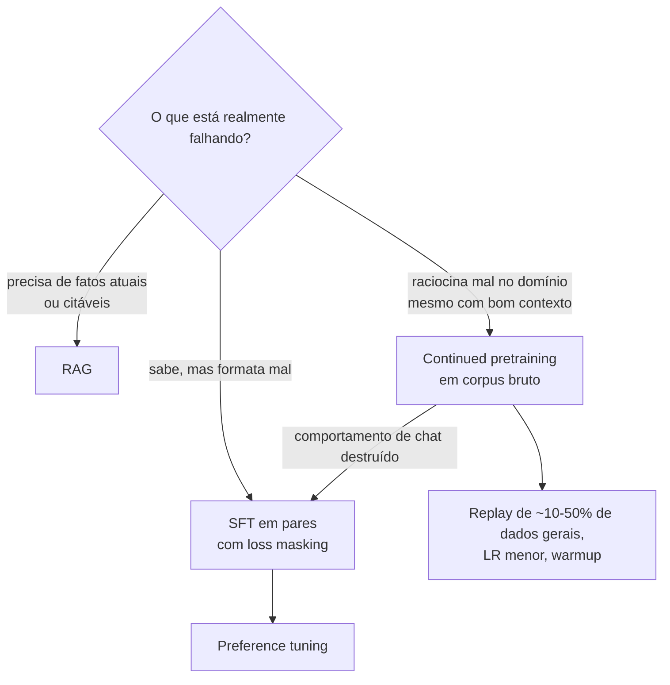

**Follow-ups:** Por que o SFT injeta conhecimento tão mal em comparação com o CPT? Projete a mistura de dados para adaptar um modelo de 8B a notas clínicas - quais frações e por quê? Como você verificaria que o CPT realmente adicionou conhecimento e não apenas estilo?

</details>

### 25. Como você gera dados de treino sintéticos com um LLM, e quais são as armadilhas?

<details><summary><b>Resposta</b></summary>

As receitas padrão: **geração estilo self-instruct** (tarefas-semente → o LLM gera variações de instruções → o LLM gera respostas), **distillation de um teacher mais forte** (prompts reais ou sintéticos, o teacher escreve respostas gold), **evolução de complexidade estilo evol-instruct** (reescrever prompts iterativamente para serem mais difíceis/profundos), **condicionamento por persona/cenário para diversidade** (gerar como se viesse de muitos tipos de usuário) e **inversões estilo backtranslation** (gerar o prompt *para* um documento existente de alta qualidade). Para domínios verificáveis, adicione **rejection sampling**: gere k candidatos, mantenha apenas os que passam em um verificador (testes, resposta matemática, validador de schema) - esse é o cavalo de batalha para dados de reasoning.

Armadilhas, a parte que importa aos entrevistadores:

- **Mode collapse / baixa diversidade**: LLMs produzem uma fatia estreita da distribuição verdadeira - as mesmas aberturas, a mesma estrutura, formulações favoritas. Dados com cara de template ensinam o template. Combata com condicionamento explícito de diversidade (personas, tópicos, botões de dificuldade), temperature alta para prompts e dedup com detecção de near-duplicates; *meça* a diversidade (estatísticas de n-grams, dispersão de embeddings), não presuma.
- **Error amplification**: erros do teacher viram ground truth que o student aprende com confiança total, e em loops iterativos (modelo treinado nas próprias saídas) os erros se acumulam - o modo de falha do model collapse. Combata com verificadores sempre que possível, filtragem por LLM-judge + auditoria humana quando não, e mantendo uma fração de dados humanos na mistura.
- **Herança de viés**: o student absorve os tiques estilísticos, padrões de recusa e sycophancy do teacher junto com suas habilidades.
- **Incompatibilidade de distribuição**: prompts sintéticos se afastam do tráfego real de usuários - limpos, bem formados, educados - então o modelo tem desempenho abaixo do esperado em inputs bagunçados de produção. Faça a geração partir de tráfego real (com dados privados removidos).
- **Contaminação**: dados sintéticos podem reproduzir itens de benchmark que o teacher memorizou - descontamine contra seus evals.
- **Licenciamento**: os termos de muitos provedores de API restringem o uso das saídas para treinar modelos concorrentes - uma checagem jurídica, não apenas técnica.

**Vale desenhar.** mostra onde um verificador muda a economia e onde você fica preso a judges.

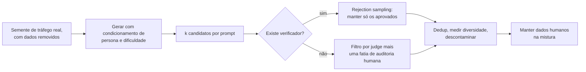

**Follow-ups:** Como você mediria se um dataset sintético é diverso *o suficiente*? Por que o rejection sampling muda a economia de qualidade para matemática/código mas não para escrita criativa?

</details>

### 26. Explique a distillation para LLMs - black-box vs logit distillation - e as ressalvas de licenciamento.

<details><summary><b>Resposta</b></summary>

A distillation transfere capacidade de um teacher mais forte/maior para um student menor/mais barato. Dois regimes:

**Black-box (data) distillation**: você só precisa das *saídas em texto* do teacher. Gere prompts, faça o teacher produzir respostas de alta qualidade (opcionalmente com reasoning traces), filtre e depois faça SFT do student nos pares. Este é de longe o padrão mais comum - foi assim que a maioria dos datasets instruct open-source foi construída, e a distillation estilo R1 mostrou que o SFT em traces de chain-of-thought de um reasoner forte transfere uma quantidade surpreendente de capacidade de reasoning para modelos pequenos. Funciona entre arquiteturas e via APIs; cada exemplo carrega apenas sinal de hard-label (uma sequência amostrada).

**Logit (white-box) distillation**: o student treina para casar as *distribuições* completas de próximo token do teacher - classicamente, cross-entropy/KL contra as probabilidades do teacher (suavizadas por temperature), frequentemente combinada com a loss de hard-label. Sinal mais rico por token (o "dark knowledge" nas probabilidades relativas de tokens errados porém plausíveis), então é mais eficiente em amostras - mas exige os pesos ou logprobs do teacher, um tokenizer/vocabulário compartilhado (ou cuidadosamente alinhado) e compute para rodar forwards do teacher. Usada quando você controla ambos os modelos - por exemplo, construir um modelo pequeno como uma versão comprimida do seu próprio modelo grande; várias famílias de modelos abertos treinam seus tamanhos pequenos assim.

**Ressalvas de licenciamento** - a parte que pega as equipes: os termos de serviço de muitos provedores de API hospedada restringem o uso das saídas para desenvolver modelos que concorram com eles; treinar seu modelo comercial com saídas de uma API frontier pode violar os ToS independentemente da viabilidade técnica. Modelos open-weight também não são automaticamente livres: licenças como a community license do Llama anexam condições a modelos derivados e até a modelos treinados com *saídas* do Llama (cláusulas de nomenclatura/atribuição, limites de uso). Além disso, dados sintéticos herdam quaisquer restrições do teacher e podem vazar conteúdo protegido por copyright ou pessoal memorizado para o seu conjunto de treino. A resposta correta numa entrevista: "Eu pediria a revisão dos ToS/licença antes de comprometer o pipeline de dados - isso é um gate jurídico, não um detalhe de engenharia."

**Follow-ups:** Por que soft targets carregam mais informação do que texto amostrado? Seu student e seu teacher têm tokenizers diferentes - o que quebra na logit distillation e quais são os workarounds?

</details>

### 27. Faça a matemática de memória de GPU: por que você não consegue fazer full fine-tuning de um modelo de 7B em uma única GPU de 24 GB com Adam?

<details><summary><b>Resposta</b></summary>

Conte os bytes por parâmetro para treino padrão de precisão mista com Adam:

| Componente | Precisão | Bytes/param |
|---|---|---|
| Pesos do modelo | bf16 | 2 |
| Gradientes | bf16 | 2 |
| Pesos master (cópia do otimizador) | fp32 | 4 |
| Primeiro momento do Adam (m) | fp32 | 4 |
| Segundo momento do Adam (v) | fp32 | 4 |
| **Total (estático)** | | **16** |

O Adam é o culpado: ele mantém *três* tensores fp32 por parâmetro (pesos master + duas estimativas de momento) = 12 bytes/param - 6× o tamanho do próprio modelo em bf16. Para 7B de parâmetros: 7e9 × 16 B ≈ **112 GB** de estado estático - quase 5× uma placa de 24 GB antes de você processar um único token.

Por cima disso vêm as **activations**, que escalam com batch_size × sequence_length × hidden_dim × camadas - facilmente dezenas de GB com comprimento 4096 sem mitigação - mais o overhead de contexto CUDA e de fragmentação.

As alavancas, mapeadas para o termo que atacam:

- **Gradient checkpointing** → activations: armazene apenas as activations nas fronteiras de camadas, recalcule o resto no backward; ~30% de overhead de compute para uma redução de várias vezes nas activations.
- **Gradient accumulation** → activations: alcance um batch efetivo de 64 com micro-batches de 1-4.
- **Otimizadores de 8-bit** (por exemplo bitsandbytes) → estados do otimizador: quantizam m/v, reduzindo 8 bytes/param para ~2.
- **ZeRO/FSDP** → todo o estado estático: fazem shard dos estados do otimizador, gradientes e parâmetros entre GPUs; o custo estático por GPU se divide pelo world size.
- **LoRA/QLoRA** → grads + estados do otimizador: apenas ~0,1-1% dos parâmetros são treináveis, então o estado do otimizador colapsa para ~nada; o QLoRA adicionalmente reduz os pesos para ~0,5 bytes/param (NF4). É assim que o treino de 7B cabe em <16 GB.

Esta pergunta de contabilidade é uma favorita porque revela instantaneamente se o candidato realmente planejou um run de treino ou só leu sobre eles.

**Vale desenhar.** empilhar os bytes mostra que o otimizador, e não o modelo, é o que não vai caber.

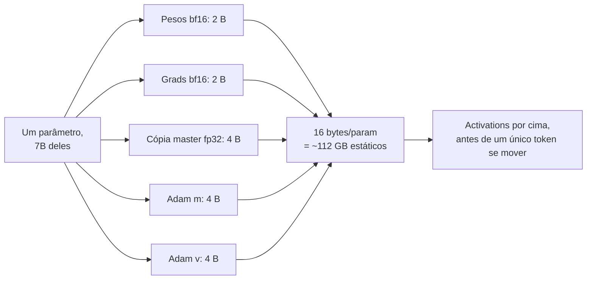

**Follow-ups:** Onde o Adam de 8-bit economiza memória e qual o risco? Refaça a conta para LoRA com r=16 - qual agora é o termo dominante de memória? Por que manter pesos master em fp32 em treino com bf16?

</details>

### 28. Você está fazendo fine-tuning em um domínio cheio de jargão e alguém sugere adicionar novos tokens ao tokenizer. O que pode dar errado, e como você trata mudanças de vocabulário corretamente?

<details><summary><b>Resposta</b></summary>

Primeira pergunta de volta: você realmente precisa de novos tokens? A divisão em subwords do jargão geralmente é boa, o modelo lida com isso. Novos tokens compensam para marcadores de controle de alta frequência (tags de papéis, delimitadores de tool-call) ou quando um termo aparece em uma grande fração do seu tráfego e você se importa com o comprimento da sequência. Raramente compensam para substantivos de domínio.

Se você os adicionar, os modos de falha:

**Init aleatória.** Redimensionar a matriz de embeddings sorteia novas linhas da distribuição de inicialização do modelo, que não tem nada a ver com a variedade de embeddings treinados. Você obtém logits grandes e picos de loss. Inicialize na média dos embeddings existentes mais um ruído pequeno, ou melhor, na média das próprias subword pieces do token:

```python
model.resize_token_embeddings(len(tokenizer))
emb = model.get_input_embeddings().weight.data
for tok_id, pieces in new_tokens.items():
    emb[tok_id] = emb[pieces].mean(dim=0)
```

Se os embeddings de entrada e saída são tied, você está inicializando ambos ao mesmo tempo, então verifique.

**Embeddings congelados sob LoRA.** Por padrão o LoRA mira as projeções de attention e MLP, então o embedding e o `lm_head` ficam congelados e seus novos tokens nunca treinam. Eles precisam ir em `modules_to_save`.

**Tokenizer drift entre treino e serving.** Salve o tokenizer junto com o adapter. Se a stack de serving carrega o tokenizer base, seus novos IDs não significam nada, e você obtém lixo silencioso em vez de um erro.

**Vocabulário com padding.** Matrizes de embeddings frequentemente recebem padding até um múltiplo de 64 ou 128 para tensor cores, então há linhas não usadas que podem ser amostradas se você não as mascarar.

**EOS e pad.** Definir `pad_token = eos_token` sem mascarar as posições de pad nos labels ensina o modelo a parar cedo ou a nunca parar. Esta aqui queima as pessoas constantemente.

Caminho mais barato: a maioria dos tokenizers modernos traz special tokens reservados/não usados exatamente para isso. Reaproveite esses em vez de redimensionar.

**Follow-ups:** Como você verificaria, após o treino, que os novos tokens realmente aprenderam algo? O que quebra se você adicionar tokens a um modelo cujos embeddings são tied e quantizados em 4-bit?

</details>

### 29. DoRA, rsLoRA e LoRA+ afirmam melhorar o LoRA vanilla. O que cada um realmente muda, e quando você recorreria a eles?

<details><summary><b>Resposta</b></summary>

Cada um ataca uma fraqueza conhecida diferente, e nenhum muda o jogo. Qualidade dos dados, rank e escolha dos módulos-alvo dominam os três.

**rsLoRA (rank-stabilised LoRA).** O LoRA vanilla escala a atualização por `alpha/r`. Conforme `r` cresce, a atualização e os gradientes que fluem por ela são amortecidos com mais força, então ranks altos têm desempenho abaixo da capacidade pela qual você pagou. O rsLoRA escala por `alpha/sqrt(r)`, o que mantém a variância da atualização aproximadamente estável conforme o rank cresce. Vale ligar quando você roda r >= 64. Abaixo disso a diferença é pequena.

**LoRA+.** `A` e `B` têm papéis assimétricos: `B` é inicializado em zero, `A` não. Um único learning rate é, portanto, subótimo, e a correção é dar a `B` um LR substancialmente maior que o de `A` (a sugestão inicial do paper é uma razão em torno de 16x). Uma flag de configuração, sem parâmetros extras, sem compute extra. Ajuda mais em tarefas mais difíceis e com learning rates mais altos.

**DoRA.** Decompõe cada peso em um vetor de magnitude e uma direção, aplica LoRA à direção e treina a magnitude separadamente. A motivação é empírica: o full fine-tuning e o LoRA mostram padrões diferentes de atualização de magnitude versus direção, e liberar a magnitude fecha boa parte da diferença, particularmente em rank baixo. O custo é aproximadamente um cálculo de norma por passo, digamos um treino ~20-30% mais lento. Continua mesclável, com parâmetros extras desprezíveis.

Vale conhecer também o **PiSSA**: inicializa o adapter a partir dos componentes singulares principais de `W` em vez de aleatoriamente (o OLoRA faz algo parecido com uma init ortonormal baseada em QR), de modo que o treino comece no subespaço dominante e convirja mais rápido.

Meus defaults: LoRA r=16-32, alpha=2r, mirando todas as camadas lineares. Recorro ao DoRA quando estou limitado por rank e perdendo para o full FT, ao rsLoRA quando estou empurrando r para cima. Não empilhe os três de uma vez, ou você mudou três variáveis e não aprendeu nada. E meça em um eval real, não na train loss, porque nessas margens a train loss vai mentir para você.

**Follow-ups:** Por que o DoRA ainda mescla de forma limpa nos pesos base na inferência? Se o DoRA vence o LoRA no seu eval por 0,4 ponto mas custa 30% mais tempo de treino, como você decide?

</details>

### 30. Explique o model merging: task arithmetic, TIES, DARE e SLERP. Quando o merging realmente funciona?

<details><summary><b>Resposta</b></summary>

O merging combina os pesos de vários modelos com fine-tuning feito a partir de uma base comum. Sem treino, sem dados, minutos em CPU. O objeto central é o task vector: `tau_i = theta_ft_i - theta_base`.

**Task arithmetic:** `theta = theta_base + sum(lambda_i * tau_i)`. Somar um task vector adiciona um comportamento, e negar um pode subtraí-lo (um botão rudimentar de unlearning).

O **TIES** corrige a interferência, em que task vectors se sobrepõem e se cancelam. Três passos: apare cada task vector mantendo suas entradas de maior magnitude (~top 20%), eleja um sinal por parâmetro pela magnitude somada entre os modelos, e então faça a média apenas das entradas que concordam com o sinal eleito. O conflito de sinal é a principal coisa que destrói a média ingênua.

O **DARE** explora a redundância: descarte aleatoriamente 80-99% das entradas do delta e reescale as sobreviventes por `1/(1-p)`. Os deltas são altamente redundantes, então isso mal prejudica individualmente e reduz drasticamente a sobreposição entre modelos. DARE+TIES empilhados é uma receita comum.

O **SLERP** interpola esfericamente entre exatamente dois modelos, preservando a norma em vez de encolhê-la como a média linear ingênua faz. Apenas dois modelos.

Quando funciona: os modelos precisam compartilhar um ancestral comum e estar na mesma bacia de loss. Mesclar dois modelos pré-treinados de forma independente não funciona; a simetria de permutação significa que seus neurônios não são comparáveis. Vitórias confiáveis são combinar capacidades de fine-tunes irmãos, fazer a média de checkpoints de um mesmo run (model soups), mesclar LoRAs sobre uma base compartilhada e mesclar um fine-tune estreito de volta em direção à base com lambda em torno de 0,7 para recuperar capacidade geral. Esse último é efetivamente um dial sobre o alignment tax, e é o uso a que mais recorro.

Seja honesto na entrevista: isso é barato e empírico. Não há uma maneira fundamentada de escolher lambda, você a varre contra um eval real. O mergekit é a ferramenta padrão. Merging é um almoço grátis quando funciona e um mistério quando não funciona.

**Follow-ups:** Por que o merging falha entre modelos pré-treinados de forma independente, mas funciona entre fine-tunes de uma mesma base? Como você mesclaria três LoRAs de ranks diferentes treinados na mesma base?

</details>

### 31. Você tem 500 mil exemplos de instruções de qualidade mista e orçamento de compute para treinar em 20 mil. Como escolhe os 20 mil?

<details><summary><b>Resposta</b></summary>

Trate como seleção em três eixos: qualidade, dificuldade e diversidade. Otimizar qualquer um isoladamente falha.

**1. Filtros rígidos primeiro** (baratos, faça antes de qualquer coisa cara): dedup, respostas truncadas ou malformadas, outliers de comprimento, idioma errado, violações de formato, artefatos de template ("As an AI language model"), system prompts vazados, recusas indesejadas. Isso tipicamente remove 20-40% e não custa nada.

**2. Pontuação de qualidade.** Um LLM judge com uma rubrica explícita por exemplo (estilo Alpagasus), ou uma pontuação de reward model. Um judge pequeno sobre 500k itens é viável, e um RM de 7B pontuando em uma única passada em batch é mais barato ainda.

**3. Dificuldade.** Exemplos que seu modelo já acerta não acrescentam nada. O IFD (instruction-following difficulty) mede o quanto ter a instrução diante da resposta reduz a loss naquela resposta, e você mantém os exemplos mais difíceis: aqueles que o modelo ainda não consegue prever bem mesmo com a instrução presente. A perplexity da resposta sob seu modelo atual é um proxy mais grosseiro da mesma ideia.

**4. Diversidade.** Gere embeddings das instruções, faça clustering em alguns milhares de clusters, amostre com um limite por cluster. Sem isso, seus 20k de maior pontuação colapsam em uma ou duas intents, porque judges têm gosto sistemático.

**5. Mistura.** Defina o orçamento por capacidade de antemão para casar com o tráfego de produção, mais uma fatia de instruções gerais para evitar regressões. As pontuações de seleção devem competir dentro de um bucket, não entre buckets.

Depois leia você mesmo 100 exemplos selecionados aleatoriamente. Todo pipeline de seleção que construí tinha um bug que só apareceu lendo.

A parte que separa os candidatos: **faça ablation contra o aleatório.** Treine em 20k aleatórios, nos seus 20k selecionados e em 20k selecionados em um único eixo. Se o pipeline elaborado não supera os 20k aleatórios em um eval real, você construiu uma máquina de Rube Goldberg e o aleatório é a melhor decisão de engenharia. Esse baseline é inegociável, e falha com mais frequência do que as pessoas admitem.

**Vale desenhar.** o funil termina no baseline que ele precisa superar, que é o ponto da resposta.

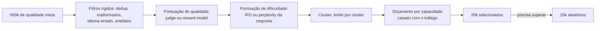

**Follow-ups:** Como você lidaria com o caso em que seu modelo judge e seu modelo-alvo compartilham uma base, de modo que o judge prefere sistematicamente o próprio estilo? O que muda se os 500k exemplos vêm de 4 fontes diferentes com perfis de qualidade muito distintos?

</details>

### 32. Me conduza pela coleta real de dados de preferência. Quais são a logística e onde ela dá errado?

<details><summary><b>Resposta</b></summary>

A engenharia é talvez 20% do trabalho. O design da anotação é o resto.

**Amostrando respostas.** Gere on-policy a partir do modelo que você está prestes a treinar, não de um balaio de modelos diferentes, ou o reward model aprende a identificar modelos em vez de julgar qualidade. Amostre com temperature ~0,8-1,0 para que as duas respostas realmente difiram; pares quase idênticos produzem labels de cara-ou-coroa que são puro ruído. Algumas equipes amostram 4-8 e pegam melhor/pior por um judge para obter uma margem limpa, trocando off-policy-ness por sinal.

**Formato.** A comparação par a par supera notas absolutas de 1 a 5, porque os anotadores não estão calibrados entre si e o 3 de uma pessoa é o 4 de outra. Julgamentos comparativos cancelam isso. Inclua uma opção "empate / ambas ruins" e exija uma justificativa em texto livre: é uma checagem de qualidade do anotador e dados de treino úteis mais tarde.

**Rubrica.** Defina o que "melhor" significa, por dimensão (correção, instruction following, segurança, tom) com uma prioridade de desempate declarada. Sem rubrica, os anotadores caem por padrão em comprimento e tom confiante, e você acabou de construir um dataset com viés de comprimento.

**Controle de qualidade.** Sobreponha ~5-10% dos itens entre anotadores e acompanhe a concordância. Espere um alpha de Krippendorff em torno de 0,6-0,75 para preferência genuinamente subjetiva e não entre em pânico, a discordância é sinal real, não apenas ruído. Mire mais alto (0,8+) em dimensões objetivas. Semeie itens gold com respostas conhecidas para pegar drift, rode dashboards por anotador e faça sessões de calibração. Use especialistas de domínio para dados de domínio: uma multidão generalista não consegue julgar correção médica ou de código e escolherá a resposta mais bonita.

**Vieses conhecidos:** posição (randomize qual resposta é mostrada primeiro), comprimento (meça a fração de pares em que a escolhida é mais longa, e se estiver acima de ~65% você verá isso no modelo treinado) e os valores da população de anotadores se tornando os valores do modelo.

**Orçamento:** dezenas de milhares de pares para um RM geral, poucos milhares para um estreito. Faça sua própria equipe rotular os primeiros 500 antes de pagar a qualquer pessoa.

**Follow-ups:** Seu fornecedor entrega 50 mil pares com alpha de 0,45. O que você faz? Como você projetaria a coleta de forma diferente se a tarefa fosse code review em vez de chat aberto?

</details>

### 33. Como você avalia um reward model? Por que a acurácia par a par held-out não é suficiente?

<details><summary><b>Resposta</b></summary>

A acurácia par a par em um conjunto de preferências held-out é a primeira checagem de sanidade, satura rápido e correlaciona mal com a qualidade da policy resultante.

Por que ela engana:

- É medida na distribuição de saídas do modelo SFT. Durante o RL a policy se afasta dessa distribuição, e o trabalho real do RM é estar correto sobre textos que só encontrará depois de centenas de passos de otimização. A acurácia de teste não diz nada sobre esse regime.
- Pesa todos os pares igualmente, e a maioria dos pares é fácil. Tudo pontua alto em pares fáceis, então a métrica se comprime.
- Ignora calibração e margens. Um RM que acerta por um fio em todo lugar é trivialmente hackeável.

O que eu realmente rodo:

1. **Um benchmark para triagem.** RewardBench / RewardBench 2 dão acurácia por categoria (chat, segurança, reasoning), então você consegue perceber que seu RM está no acaso em código antes de desperdiçar um run de treino.
2. **Probes de viés.** Construa pares controlados em que só uma coisa varia: comprimento, formatação markdown, concordância. Meça o delta de pontuação. Se o RM prefere a resposta mais longa 90% das vezes, ele ensinará sua policy a divagar.
3. **Curvas de best-of-N.** Amostre N = 1..64 da policy, refaça o ranking com o RM e pontue a melhor escolha com ground truth (um verificador, ou um judge forte). Um RM sólido melhora a métrica verdadeira monotonicamente em N. Um hackeável atinge o pico em um N moderado e depois declina, porque em N grande você está amostrando os modos de falha do RM. Essa inversão é o diagnóstico isolado mais útil, porque é pressão de otimização em miniatura e não custa nenhum treino.
4. **Concordância humana on-policy nova,** atualizada a cada rodada. RMs ficam obsoletos conforme a policy muda, que é exatamente por que o RLHF online mantém uma coleira de KL ou retreina o RM.
5. **Calibração.** Bradley-Terry diz que a diferença de pontuação deve mapear, via sigmoide, para a taxa de preferência humana. Verifique que mapeia.

Meu critério de entrega é (3) e (4). Não a acurácia de teste.

**Follow-ups:** Como você decidiria quando retreinar o reward model durante um run longo de RLHF? O que uma curva de best-of-N plana desde N=1 te diria?

</details>

### 34. Você está fazendo fine-tuning de um reasoning model que escreve um bloco de thinking antes da resposta final. Como você constrói os dados de SFT, e o que quebra se você treinar apenas em respostas finais?

<details><summary><b>Resposta</b></summary>

Mantenha o reasoning nos targets de treino, e renderize-o exatamente como o chat template do modelo faz. A qualidade de um reasoning model vive nos seus tokens de thinking. Treine-o em pares (prompt, resposta final) e você o ensina a responder sem pensar: o bloco de thinking encolhe ou desaparece, a acurácia em prompts difíceis cai, e em modelos híbridos o modo thinking se degrada mesmo que você nunca o tenha treinado diretamente.

Como eu construo os dados:

1. **Obtenha traces, não apenas respostas.** Gere-os a partir do próprio modelo por rejection sampling (amostre vários, mantenha os traces cuja resposta final passa em um verificador ou judge), ou de um teacher mais forte com estilo compatível. Traces auto-gerados ficam mais próximos da distribuição do próprio modelo e causam o menor drift.
2. **Case o template exatamente.** Delimitadores de thinking, onde o reasoning fica em relação à resposta e como os turnos anteriores são renderizados. Muitos templates removem o reasoning dos turnos anteriores do assistant no histórico multi-turn. Treine com a mesma remoção, ou o modelo vê no treino um formato de contexto que nunca vê no serving.
3. **Aplique loss tanto no reasoning quanto na resposta,** com os prompts mascarados como de costume. Se você só tem labels apenas de resposta, ou gere um trace que chegue àquela resposta e verifique que é consistente, ou direcione esses exemplos para o modo sem thinking, se o modelo tiver um.
4. **Misture dados gerais de reasoning** para que o estilo do trace não colapse sobre sua tarefa estreita.

Outros modos de falha: traces que não sustentam de fato a resposta final ensinam racionalização post-hoc, traces longos demais do teacher ensinam a divagar e estouram o orçamento de latency, e um teacher com estilo de raciocínio diferente pode deixar você com um modelo cujo thinking e respostas discordam.

Avalie com thinking ligado, no orçamento de reasoning que você vai servir, e acompanhe o comprimento do trace ao lado da acurácia. Um fine-tune que mantém a acurácia mas dobra os tokens de thinking dobrou seu custo de serving.

**Follow-ups:** Seus especialistas de domínio deram labels apenas de resposta. Como você obtém traces sem inventar um raciocínio que os especialistas nunca usaram? Como você encurtaria o thinking do modelo sem perder acurácia?

</details>

### 35. Por que o LoRA se sustenta tão bem para fine-tuning com RL, mesmo em rank muito baixo, quando o mesmo rank pode sofrer underfitting em um run grande de SFT?

<details><summary><b>Resposta</b></summary>

Porque o RL carrega muito menos informação por exemplo do que o SFT, então a atualização que ele precisa armazenar é pequena. Um passo de policy gradient em um episódio é guiado por uma advantage escalar, aproximadamente "esta trajetória foi melhor ou pior que o esperado". Isso é da ordem de um bit por episódio, por mais tokens que o episódio tenha contido. O SFT em uma demonstração supervisiona cada token contra um target específico, o que são muitos bits por exemplo. A capacidade do adapter precisa casar com a informação do sinal, então um dataset grande de SFT pode exceder o que um adapter de rank 16 comporta, enquanto um run longo de RL mal preenche um minúsculo.

Isso condiz com a evidência publicada. O write-up "LoRA Without Regret" da Thinking Machines (2025) constatou que RL estilo GRPO com LoRA iguala o full fine-tuning mesmo em rank 1, enquanto em datasets grandes de SFT o LoRA de rank baixo ficou para trás quando os dados superaram sua capacidade.

Consequências práticas:

- **RL é o lugar mais barato para usar LoRA.** O sampler e o trainer podem compartilhar uma base residente, e sincronizar pesos com o inference engine a cada passo significa mover um adapter, não o modelo inteiro.
- **Mire todas as camadas lineares, MLP incluído.** LoRA apenas em attention tem desempenho inferior mesmo com contagem de parâmetros equivalente, porque a maior parte dos parâmetros, e em modelos MoE os experts, vive nos blocos de MLP.
- **Learning rate.** O learning rate ótimo do LoRA é consistentemente cerca de 10x a taxa do full fine-tuning e aproximadamente independente do rank, o que facilita a transferência de LR entre ranks.
- **Onde o LoRA ainda perde.** Estágios grandes de SFT ou distillation, continued pretraining e batch sizes muito grandes, onde o LoRA tende a se degradar mais rápido que o full fine-tuning.

O ponto da entrevista é o raciocínio, não a citação: pergunte quantos bits o sinal de treino carrega por exemplo, depois dimensione o adapter de acordo. Isso também explica por que varreduras de rank importam em runs de SFT e na maior parte não importam em runs de RL.

**Follow-ups:** Se o RL precisa de tão pouca capacidade, por que os labs ainda rodam RL com todos os parâmetros? Como você testaria se um estágio de SFT é limitado em capacidade pelo rank do LoRA e não pelos dados?

</details>

## Avançado

### 36. Explique gradient accumulation, gradient checkpointing e ZeRO/FSDP - e como você os combinaria em um run de treino real.

<details><summary><b>Resposta</b></summary>

Três ferramentas ortogonais atacando termos de memória diferentes:

**Gradient accumulation** (ataca: memória de activations vinda do batch size): rode k forward/backwards de micro-batch, somando os gradientes, e dê o passo do otimizador uma vez - batch efetivo = micro_batch × k × data_parallel_world. Numericamente ~equivalente ao batch grande (cuidado com a normalização da loss entre micro-batches, e note que sutilezas de estatísticas de batch não se aplicam a transformers baseados em LayerNorm). Custo: nenhum em memória, k× mais passos por atualização do otimizador - troca wall-clock por memória apenas na medida em que micro-batches pequenos subutilizam a GPU.

**Gradient checkpointing** (ataca: memória de activations vinda de profundidade/sequência): em vez de armazenar toda activation intermediária para o backward, mantenha apenas checkpoints (tipicamente os inputs das camadas) e recalcule o resto durante o backward pass. Aproximadamente +30% de compute para uma redução de uma ordem de grandeza nas activations; é a chave que torna viável o fine-tuning de sequências longas em placas pequenas.

**ZeRO / FSDP** (ataca: os 16 bytes/param estáticos): com DDP simples toda GPU mantém uma réplica completa de pesos, grads e estados do otimizador. O ZeRO faz shard deles entre os ranks de data-parallel - Stage 1: estados do otimizador; Stage 2: + gradientes; Stage 3: + os próprios parâmetros (reunidos on the fly por camada, depois liberados). O FSDP do PyTorch é a implementação nativa estilo ZeRO-3 (o DeepSpeed é a outra stack mainstream). Custo: o volume de comunicação aumenta com o stage; ZeRO-3/FSDP adiciona all-gathers em todo forward/backward. Variantes com offload para CPU/NVMe empurram estados para fora da GPU com mais custo de velocidade.

**Combinando-os** - por exemplo, full fine-tune de um 7B em 8×80 GB: FSDP com full sharding (estado estático ~112 GB / 8 ≈ 14 GB/GPU) + gradient checkpointing (activations sob controle com sequência de 4k) + micro-batch dimensionado para preencher a memória restante + accumulation até o batch efetivo alvo (~64-128 sequências). Mencione bf16 em todo o processo, e que se *ainda* não couber, a escalada é offload → QLoRA → mais GPUs. Saber qual alavanca mapeia para qual termo de memória é o sinal real aqui.

**Follow-ups:** Por que o ZeRO-1 adiciona quase nenhum overhead de comunicação enquanto o ZeRO-3 adiciona? Quando o gradient checkpointing é um mau negócio? O que muda quando você adiciona LoRA a esta configuração?

</details>

### 37. Explique o GRPO. Por que ele desbancou o PPO para RL de reasoning?

<details><summary><b>Resposta</b></summary>

O GRPO (Group Relative Policy Optimization, introduzido no DeepSeekMath e usado no DeepSeek-R1) é um método de policy gradient estilo PPO que **elimina a value network aprendida (critic)**. Em vez de estimar advantages por token com um critic + GAE, o GRPO amostra um *grupo* de G respostas (por exemplo, 8-64) por prompt, pontua cada uma com a função de recompensa e calcula a advantage de cada resposta em relação ao seu próprio grupo:

$$A_i = \frac{r_i - \mathrm{mean}(r_1..r_G)}{\mathrm{std}(r_1..r_G)}$$

Essa advantage é aplicada aos tokens da resposta em um objetivo com clipping estilo PPO, com um termo de KL contra o reference model. A média do grupo serve como o baseline que o critic fornecia - mas é *exata para aquele prompt* (um baseline Monte-Carlo) em vez de uma aproximação de função.

Por que ele venceu no RL de reasoning:

- **Custo e simplicidade**: o critic no PPO é um segundo modelo do tamanho da policy - treiná-lo, e mantê-lo preciso conforme a policy muda, aproximadamente dobra a memória e adiciona toda uma superfície de falha. O GRPO o elimina. Para modelos em escala de fronteira isso é uma economia enorme.
- **A qualidade do critic era o elo fraco**: com recompensas esparsas no fim da sequência (correto/incorreto), aprender valores precisos por token é difícil; um critic ruim dá advantages ruidosas. A pontuação relativa ao grupo contorna o problema.
- **Encaixe perfeito para recompensas verificáveis**: recompensas de matemática/código são checagens binárias baratas, então amostrar grupos grandes por prompt é viável, e as estatísticas do grupo são significativas (um prompt em que todas as amostras falham dá advantage zero - um currículo automático que concentra o gradiente em problemas resolvíveis mas ainda não resolvidos).

Tradeoffs a nomear: muitas amostras por prompt fazem da geração o gargalo de compute (mitigado por inference engines rápidos no loop); a normalização uniforme por std tem vieses conhecidos (efeitos de comprimento; grupos degenerados em que todas as recompensas são iguais não contribuem com nada); e variantes posteriores corrigem partes específicas: o Dr. GRPO remove os vieses de normalização de comprimento e de std, o DAPO desacopla o clip range e filtra grupos degenerados, e o GSPO move a razão de importância e o clipping para o nível de sequência para estabilidade em modelos grandes e MoE. Conceitualmente, é "REINFORCE com um baseline Monte-Carlo por prompt + clipping do PPO" - barato, escalável e bem casado com RL de recompensa verificável.

**Vale desenhar.** mostra a média do grupo fazendo o trabalho do critic, e o caso em que ela não faz nada.

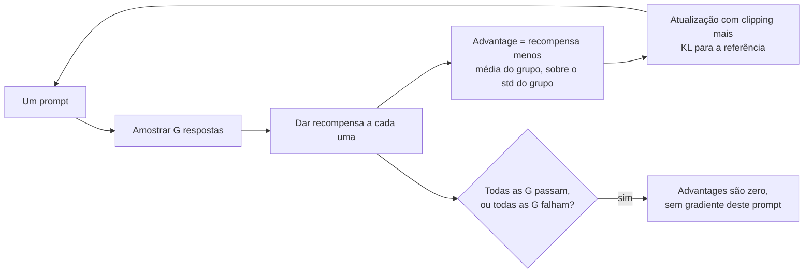

**Follow-ups:** O que acontece com o gradiente do GRPO em prompts que o modelo sempre (ou nunca) resolve, e o que isso implica para a curadoria de dados? Por que o termo de KL-to-reference ainda é necessário com recompensas verificáveis?

</details>

### 38. Por que matemática e código são tão amigáveis ao RL? Explique verifiable rewards e a receita de treino estilo R1.

<details><summary><b>Resposta</b></summary>

Porque eles têm **verifiable rewards**: um programa - não um modelo aprendido - decide o sucesso. Respostas matemáticas podem ser checadas contra o ground truth (correspondência de resposta em boxed, equivalência simbólica); código pode ser executado contra unit tests. Isso muda o problema de RL de três maneiras fundamentais:

1. **Sem reward model → (quase) sem reward hacking**: o modo de falha clássico do RLHF é a policy explorar os pontos cegos de um RM aprendido. Um verificador é exato - a superfície residual de hacking é pequena e concreta (tratar como caso especial os testes visíveis, explorar cobertura fraca de testes, escape do sandbox em cenários agentic) e pode ser combatida com testes ocultos e verificadores reforçados, em vez de ser uma inevitabilidade estatística.
2. **Labels baratos e infinitos**: cada amostra nova é avaliada de graça, então o RL online pode rodar por um número enorme de rollouts sem custo de anotação - exatamente o regime em que o RL supera os métodos offline.
3. **Sinal nítido e inequívoco**: correção binária em problemas difíceis é esparsa mas *limpa*; não há teto de ruído de anotador.

**A receita estilo R1** (conforme o relatório do DeepSeek-R1): o R1-Zero aplicou GRPO com recompensas baseadas em regras (correção da resposta + conformidade de formato da saída) diretamente a um modelo base - sem SFT - e o reasoning longo em chain-of-thought *emergiu*: o comprimento das respostas cresceu conforme o modelo aprendia a gastar mais test-time compute, com comportamentos de autoverificação e backtracking ("aha moment") aparecendo sem terem sido demonstrados. Como as saídas do R1-Zero tinham problemas de legibilidade/mistura de idiomas, o pipeline completo do R1 intercala estágios: um pequeno SFT de cold-start em dados curados de CoT longo → RL de reasoning → rejection sampling do modelo de RL para construir um grande conjunto de SFT (mais dados gerais) → RL final tanto para reasoning quanto para preferências gerais. Eles então mostraram a **distillation**: fazer SFT de modelos abertos pequenos em ~800k traces gerados pelo R1 transfere boa parte do ganho de reasoning sem rodar RL nos modelos pequenos.

A significância mais ampla: este é o paradigma de test-time-compute - o RL ensina o modelo *como usar mais tokens de thinking de forma produtiva*, e domínios verificáveis são onde essa otimização ganha tração. Estendê-lo além de matemática/código significa construir verificadores para domínios mais subjetivos. A resposta usual hoje são recompensas baseadas em rubricas pontuadas por um LLM judge, o que funciona mas reintroduz um avaliador aprendido que a policy pode hackear.

**Vale desenhar.** os dois caminhos de entrada lado a lado mostram precisamente o que o SFT de cold-start está comprando.

```mermaid
flowchart LR
    A["Modelo base"] -->|"caminho R1-Zero,<br/>sem SFT"| C["RL de reasoning,<br/>recompensas baseadas em regras"]
    A --> B["SFT de cold-start em<br/>CoT longo curado"]
    B --> C
    C --> Z["CoT longo emerge de qualquer jeito;<br/>legibilidade só via B"]
    C --> D["Rejection sampling do modelo de RL<br/>em um novo conjunto grande de SFT"]
    D --> E["RL final: reasoning mais<br/>preferências gerais"]
    E --> F["Destilar traces em<br/>modelos abertos pequenos"]
```

**Follow-ups:** Como você impede um modelo de RL para código de burlar os unit tests? Por que o R1-Zero de RL puro produziu saídas bagunçadas, e o que o SFT de cold-start corrige? Qual é o equivalente de uma verifiable reward para, digamos, redação jurídica?

</details>

### 39. O que são RLAIF e Constitutional AI? Como o feedback de IA substitui o feedback humano?

<details><summary><b>Resposta</b></summary>

O **RLAIF** (RL from AI Feedback) substitui o anotador humano no pipeline de preferências por um LLM: um rotulador de IA - dado um prompt, duas respostas candidatas e instruções de avaliação - produz o label de preferência usado para treinar o reward model (ou para alimentar o DPO diretamente). Tudo downstream permanece inalterado. A economia é o ponto: labels de IA são ordens de grandeza mais baratos e rápidos que labels humanos, então você pode gerar preferências em uma escala e frescor (relabeling on-policy a cada iteração) que humanos não conseguem igualar. Empiricamente, labels de preferência de IA concordam com humanos aproximadamente tão bem quanto humanos concordam entre si em muitas tarefas - mas o rotulador herda e amplifica seus próprios vieses (viés de posição, viés de comprimento, sycophancy, autopreferência pelo próprio estilo), então pipelines sérios fazem debias (trocar posições, fazer média), calibram contra um conjunto gold rotulado por humanos e mantêm humanos nas fatias mais difíceis/de maior risco. O feedback humano não desaparece; ele sobe um nível de abstração - auditando o rotulador de IA em vez de rotular tudo.

**Constitutional AI** (Anthropic) é a versão estruturada canônica, com duas fases:

1. **Supervisionada (critique-and-revise)**: o modelo gera uma resposta, é instruído a *criticá-la* contra princípios de uma constituição escrita explícita ("escolha a resposta menos prejudicial...") e então a *revisa*. Faz-se fine-tuning nas saídas revisadas.
2. **RLAIF**: gere pares de respostas, peça à IA que julgue qual satisfaz melhor os princípios constitucionais, treine um preference model nesses labels e então faça RL contra ele.

A constituição importa além do custo: ela torna os critérios de alinhamento **explícitos, inspecionáveis e editáveis** - você pode ler os princípios, debatê-los e mudar uma linha de texto em vez de rotular de novo um milhão de comparações. Ela também evita expor anotadores humanos a conteúdo prejudicial em escala. Os riscos residuais são reais e vale nomeá-los: um judge de IA é uma fonte de recompensa aprendida, então o reward hacking se aplica (a policy pode aprender a *parecer* constitucional), e os princípios subespecificam edge cases - razão pela qual pipelines constitucionais ainda se ancoram em supervisão e avaliação humanas.

**Vale desenhar.** mostra para onde a supervisão humana se moveu, em vez de deixar você afirmar que ela desapareceu.

```mermaid
flowchart LR
    A["Constituição escrita"] --> B["O modelo critica a<br/>própria resposta"]
    B --> C["O modelo a revisa"]
    C --> D["SFT nas revisões"]
    D --> E["O rotulador de IA ranqueia<br/>pares de respostas"]
    A --> E
    E --> F["Preference model"]
    F --> G["RL contra ele"]
    H["Humanos auditam o rotulador<br/>e os princípios"] --> E
```

**Follow-ups:** Que vieses um LLM judge introduz e como você os mede? Se o rotulador de IA é da mesma família de modelos que está sendo treinada, que loops de falha isso arrisca?

</details>

### 40. O que é o "alignment tax"? Como o preference tuning causa over-refusal, e como você o gerencia?

<details><summary><b>Resposta</b></summary>

Alignment tax é a capacidade ou utilidade que você perde como efeito colateral do treino de alinhamento - a diferença entre o que o modelo *poderia* fazer e o que o modelo alinhado *vai* fazer. Aparece como: regressões em benchmarks após o RLHF, colapso de entropia/diversidade (o modelo afunila em direção às formulações favorecidas pelo RM - o estilo "slop"), perda de calibração e, de forma mais visível, **over-refusal**: recusar pedidos benignos que casam por padrão com tópicos sensíveis (perguntas de pesquisa em segurança, fatos sobre dosagem médica, ficção contendo violência, "como eu mato um processo Python").

Por que o preference tuning produz especificamente a over-refusal: o sinal de treino é assimétrico. Uma completion prejudicial que passa é um erro de rotulagem grave e saliente; uma recusa desnecessária é um erro leve. Se as diretrizes dos anotadores (ou o proxy aprendido do RM) pesam muito a prevenção de danos, recusar se torna uma ação de baixo risco e segura para a recompensa - e o RL a explora. A policy aprende a *forma* dos pedidos perigosos (palavras-chave, tópicos) em vez da intenção subjacente, porque características superficiais são aquilo em que a fonte de recompensa realmente discrimina. As métricas agregadas de segurança melhoram enquanto a utilidade se erode silenciosamente na distribuição limítrofe que ninguém está medindo.

Gerenciando:

- **Meça explicitamente**: mantenha um eval set de casos limítrofes-porém-benignos ao lado do seu conjunto de pedidos prejudiciais, e acompanhe ambas as taxas de recusa - o ponto de operação é uma curva, não um número. Existem benchmarks públicos para exatamente isso (por exemplo, suítes de over-refusal como XSTest), além dos edge cases do seu próprio domínio.
- **Corrija os dados**: adicione pares de preferência em que a resposta *útil-porém-cuidadosa* é escolhida em vez da recusa para prompts limítrofes-benignos; audite as diretrizes dos anotadores quanto a incentivos assimétricos.
- **Design da recompensa**: penalize recusas desnecessárias, não apenas a complacência prejudicial; use sinais separados de utilidade/inocuidade em vez de um único escalar que deixa a segurança dominar.
- **Gates de regressão de capacidade**: rode evals de capacidade geral antes/depois de cada estágio de alinhamento; trate regressões como bugs a corrigir, não custos a aceitar em silêncio.

O enquadramento maduro para terminar: algum tax é uma escolha deliberada de produto/política - o modo de falha não é pagar um tax, é pagar um que você nunca mediu.

**Follow-ups:** Como você construiria um eval de over-refusal para um cliente de ferramentas de segurança? Por que um único reward escalar tende a sobrepesar a inocuidade, e qual é a alternativa?

</details>

### 41. Quando o fine-tuning é a decisão errada? Descreva modos de falha sobre os quais você alertaria uma equipe.

<details><summary><b>Resposta</b></summary>

O fine-tuning é a decisão errada quando:

- **O objetivo é conhecimento**: "faça fine-tuning na nossa wiki para ele conhecer nosso produto" falha de forma previsível - o SFT injeta fatos de forma pouco confiável, sem citações, e o conhecimento já chega desatualizado. Isso é RAG (ou CPT, se o problema for a *linguagem* do domínio).
- **O prompting não foi esgotado**: se um modelo frontier com um prompt bem projetado e exemplos few-shot atinge a qualidade-alvo, o fine-tuning adiciona um pipeline de treino, um fardo de eval e um artefato a manter - por ganho marginal. Sempre construa primeiro o baseline com prompt; ele também é sua régua de eval.
- **Não existe eval**: sem uma métrica held-out você não consegue dizer se o fine-tune ajudou, regrediu ou sofreu overfitting. Equipes que fazem fine-tuning antes de conseguir medir estão fazendo treino guiado por vibes.
- **Os dados são insuficientes ou ruins**: algumas dezenas de exemplos, ou milhares de exemplos ruidosos/inconsistentes, produzem um modelo que aprende fielmente o ruído. O trabalho com dados *é* o projeto; o treino é a parte fácil.
- **O alvo se move rápido**: requisitos ou conteúdo mudando semanalmente significam retreinamento perpétuo; prompts e índices de retrieval são atualizados em minutos.
- **Os modelos base estão melhorando por baixo de você**: um projeto de fine-tuning de 6 semanas pode ser tornado obsoleto pelo próximo lançamento de modelo base que faz a tarefa em zero-shot. Fine-tunes também **não são portáveis** - cada upgrade de modelo base significa refazer a validação de dados, o treino e os evals.

Modos de falha para alertar mesmo quando o fine-tuning *é* a escolha certa: catastrophic forgetting e over-refusal sendo entregues em silêncio porque ninguém rodou evals de regressão; incompatibilidades de chat-template/EOS entre treino e serving; contaminação de eval produzindo vitórias falsas; overfitting de datasets pequenos em um papagaio de template; surpresas de latency/custo quando o modelo pequeno ajustado precisa de mais retries do que o grande com prompt; e lock-in organizacional - um modelo sob medida com um pipeline de treino com bus-factor de um. Minha regra: faça fine-tuning quando uma lacuna medida sobrevive a um esforço sério de prompting+RAG, a tarefa é estável e você tem dados + evals para sustentar o ganho.

**Follow-ups:** Uma equipe fez fine-tuning em 300 exemplos ruidosos e diz "parece melhor" - o que você pede? Como você protege um investimento em fine-tuning contra a rotatividade de modelos base?

</details>

### 42. APIs de fine-tuning hospedadas vs treinar você mesmo - como você decide?

<details><summary><b>Resposta</b></summary>

**Hospedado** (endpoints de fine-tuning da OpenAI/Google, ou tuning gerenciado de open-weight em plataformas estilo Together/Fireworks/Bedrock): você faz upload de dados formatados, eles treinam - tipicamente estilo SFT/LoRA, com alguns oferecendo preference-tuning (estilo DPO) e poucos oferecendo reinforcement fine-tuning contra um grader que você define (o RFT da OpenAI em seus reasoning models é o exemplo mais conhecido) - e servem o resultado atrás da mesma API.

Existe agora um nível intermediário entre os dois: APIs gerenciadas de treino como o Tinker da Thinking Machines, em que você escreve o loop de treino e a loss por conta própria em modelos open-weight e o provedor cuida do lado de GPUs distribuídas. Você mantém a liberdade de método do DIY sem ser dono do cluster, e geralmente pode baixar os pesos LoRA resultantes.

- **Prós**: zero infra de treino, dias até o primeiro modelo, serving/escalonamento/monitoramento resolvidos, e acesso ao tuning de modelos proprietários da família frontier que você nunca poderia hospedar.
- **Contras**: seus dados saem da sua fronteira (os termos contratuais importam - verifique cláusulas de retenção e reuso para treino); poucos botões (alguns hiperparâmetros, menu de métodos restrito - frequentemente sem loss customizada, RL limitado); geralmente **sem propriedade dos pesos** em bases proprietárias - o artefato fica preso àquele provedor e pode ser descontinuado no cronograma dele; prêmios por token no serving; treino opaco (difícil depurar um run ruim que você não pode inspecionar).

**DIY** (pesos abertos + stacks estilo TRL/Axolotl/LLaMA-Factory, suas GPUs ou alugadas):

- **Prós**: liberdade total de método (QLoRA, DPO, GRPO, losses customizadas, evals customizados dentro do loop), pesos seus para sempre, dados permanecem na sua VPC, mais barato em escala sustentada, serving portável (vLLM/SGLang, multi-LoRA).
- **Contras**: você é dono de tudo - aquisição de GPUs, pipelines de treino, debugging de runs falhos, infraestrutura de eval e SLOs de serving. Headcount de engenharia real, e a distância entre um fine-tune de demo e um pipeline de produção é grande.

**Entradas da decisão**: sensibilidade dos dados/compliance (dados regulados → DIY ou uma plataforma gerenciada implantável em VPC); requisitos de método (precisa de RL ou objetivos customizados → DIY); restrição de modelo base (precisa ajustar um modelo frontier proprietário → hospedado, por definição); economia de escala (um modelo, tráfego modesto → hospedado é mais barato no total; muitos modelos/tenants ou tráfego pesado → DIY amortiza); e capacidade da equipe.

Um caminho padrão sensato: prototipe em uma API hospedada para provar valor rápido, e migre para DIY em pesos abertos quando volume, necessidades de método ou governança de dados exigirem - mantendo seu dataset e sua suíte de eval neutros em relação ao provedor para que a migração seja barata.

**Follow-ups:** Que cláusulas você verifica nos termos de fine-tuning de um provedor antes de fazer upload de dados? O que quebra quando você migra um fine-tune hospedado para pesos abertos?

</details>

### 43. A training loss do seu modelo com fine-tuning parecia ótima, mas as saídas em produção são piores que as do modelo base. Me conduza pelo seu processo de debugging.

<details><summary><b>Resposta</b></summary>

Triagem estruturada, ordenada pela taxa-base do bug:

**1. Incompatibilidade de chat template / tokenização (o culpado nº 1).** Compare, token por token, o que o treino renderizou vs. o que o serving renderiza para a mesma conversa: mesmos special tokens, mesma posição do system prompt, mesmo whitespace, mesmo sufixo do generation prompt. Verifique o tratamento do EOS - o token de fim de turno estava nos targets de treino, e o serving está usando os stop tokens corretos? Sintomas diagnósticos desta classe: divagar além da resposta, nunca parar, vazar markup do template, ignorar o system prompt.

**2. Bugs de loss masking.** Decodifique um batch de treino e imprima quais tokens carregam labels ≠ -100. Se tokens do prompt receberam loss, o modelo aprendeu a imitar prompts; se o mascaramento comeu a resposta ou o EOS, ele não aprendeu nada útil. "A training loss parecia ótima" é *consistente com* ambos os bugs - loss baixa nos tokens errados.

**3. Configuração de serving.** Adapter errado carregado (ou nenhum - o modelo base servido silenciosamente); adapter anexado a uma versão/revisão de base diferente da usada no treino; quantização em serving sob a qual o modelo nunca foi avaliado; parâmetros de sampling (temperature/top_p/penalties) diferentes dos do eval; truncamento por max_tokens.

**4. Lacuna de distribuição entre eval e produção.** Se as métricas held-out offline também eram boas, os inputs de prod devem diferir: contextos mais longos, formatação mais bagunçada, mistura de idiomas diferente, usuários adversariais, mudanças de prompt upstream feitas pela equipe do app. Puxe tráfego real que falha, rode offline e veja se as falhas se reproduzem - se sim, seu eval set não era representativo; corrija o eval antes do modelo.

**5. Overfitting / forgetting** (se a training loss era ótima mas a *held-out* nunca foi verificada): divergência da eval loss, regurgitação em prompts de treino parafraseados, regressões de capacidade geral.

**6. Pipeline de dados**: truncamento silencioso de exemplos longos, exemplos duplicados ou rotulados errado, system prompts de treino/serving diferentes.

A meta-resposta que os entrevistadores querem: reproduza um exemplo concreto que falha de ponta a ponta, compare exatamente as sequências de tokens de tempo de treino vs. de serving e mude uma variável por vez - a maioria dos incidentes de "o modelo piorou" são bugs de pipeline, não falhas de aprendizado.

**Vale desenhar.** ordenar os ramos pela taxa-base dá a ordem em que você realmente depuraria.

```mermaid
flowchart TD
    A["Prod pior que a base"] --> B{"Os tokens de treino batem<br/>exatamente com os de serving?"}
    B -->|"não"| C["Incompatibilidade de chat template<br/>ou EOS"]
    B -->|"sim"| D{"Labels só nos<br/>spans do assistant?"}
    D -->|"não"| E["Bug de loss masking"]
    D -->|"sim"| F{"Adapter, revisão da base,<br/>quantização e sampling corretos?"}
    F -->|"não"| G["Configuração de serving"]
    F -->|"sim"| H["Reproduzir tráfego real que falha:<br/>o eval set não era representativo"]
```

**Follow-ups:** Que único artefato você registraria no tempo de treino para tornar esse debugging trivial depois? Como você pega incompatibilidade de template no CI antes do deploy?

</details>

### 44. Projete um pipeline de fine-tuning de ponta a ponta para um modelo de suporte ao cliente em uma empresa de médio porte. Me conduza por dados → treino → eval → deployment → iteração.

<details><summary><b>Resposta</b></summary>

**Enquadre primeiro**: objetivo - substituir um modelo frontier com prompt por um modelo ajustado mais barato/rápido (digamos, um 8B aberto) para suporte de nível 1, com qualidade igual ou melhor, com RAG cuidando do conhecimento do produto. Métrica de sucesso definida de antemão: qualidade de resolução (judge + avaliação humana), taxa de deflexão, precisão de escalonamento, latency, custo por ticket.

**Dados**: origem em transcrições históricas de agentes (com dados privados removidos: remoção de PII, revisão de consentimento/política). Filtrar para as resoluções mais bem avaliadas; renderizar no chat template do modelo base com o system prompt de produção e o contexto recuperado incluídos - treine o modelo da forma como ele será servido. Curadoria: dedup (exata + near-dup por embeddings), descontaminar contra os eval sets, filtragem por LLM-judge para tom/correção, leitura manual de ~300 exemplos aleatórios. Inclua hard negatives: casos de escalonamento, exemplos de "não sei - aqui está um humano" e deflexões fora de tópico, ou o modelo nunca aprenderá esses comportamentos. Mire em ~5-20k exemplos de alta qualidade; misture ~10-20% de dados gerais de instruções contra o forgetting.

**Treino**: QLoRA no 8B (r=16-32, todos os módulos lineares, LR ~1e-4, 1-2 epochs, cosine + warmup) - barato o bastante para varrer LR×epochs e escolher pelo eval held-out. Opcionalmente uma passada de DPO depois, usando pares de preferência minerados de edições/avaliações de agentes sobre rascunhos do modelo.

**Eval**: conjunto held-out da *distribuição real de tickets* com métricas por slice (intent, comprimento, idioma); suíte de regressão (instruction following, segurança/over-refusal, capacidade geral); checagens de grounding (ele cita o contexto recuperado, ele alucina políticas). Gate: supera o baseline frontier com prompt em qualidade ao custo-alvo, nenhum slice de regressão acima do limite.

**Deployment**: vLLM com o adapter (inicialmente sem merge - rollback instantâneo = reapontar o adapter), shadow mode contra tráfego ao vivo primeiro, depois canary 5% → 50% → 100% com métricas online e revisão humana de escalonamentos.

**Iteração**: o feedback de produção (correções de agentes, CSAT, escalonamentos) alimenta o próximo lote de dados - minerado para novos exemplos de SFT e pares de DPO; cadência de retreino mensal; monitoramento de drift na distribuição de inputs; todo upgrade de modelo base reexecuta todo o gate de eval. O pipeline, não o checkpoint, é o ativo.

**Follow-ups:** Onde o RAG fica nos dados de treino vs. no serving, e por que eles devem casar? O que te faria entregar o baseline com prompt em vez disso? Como você previne viés de feedback loop ao treinar nos próprios rascunhos aceitos do modelo?

</details>

### 45. Como você constrói a mistura de dados de um fine-tune para prevenir regressões de capacidade - e como valida a mistura?

<details><summary><b>Resposta</b></summary>

O problema: treinar puramente em dados da tarefa arrasta a policy inteira em direção a essa distribuição estreita. A correção é **replay/mixing** - misturar dados gerais aos dados da tarefa para que os comportamentos preexistentes continuem recebendo gradiente.

**Construindo a mistura**:

- Os **dados da tarefa** são o núcleo. Ao redor deles, adicione uma **fatia de instruction-following geral** (dados instruct abertos diversos, ou a mistura de SFT anterior da sua organização, se você a tiver - quanto mais perto da distribuição original de post-training do modelo, melhor ela ancora).
- **Cubra o que você não pode perder**: se a produção precisa de multilinguismo, inclua dados multilíngues; se precisa de código ou tool-calling, inclua esses. O forgetting é direcionado - capacidades ausentes da mistura são as que estão em risco.
- **Inclua deliberadamente comportamentos de fronteira**: recusas, "não sei", escalonamento - o comportamento de segurança regride como qualquer outra capacidade.
- **Proporções**: misturas dominadas pela tarefa com aproximadamente 5-25% de dados gerais são uma faixa inicial comum para SFT; quanto mais forte o distribution shift e mais epochs, mais replay você precisa. Para continued pretraining a fração de replay é muito maior (frequentemente ~10-50%). Esses são pontos de partida a ajustar, não leis.
- Detalhe prático: misture no nível de *sampling* (intercalado e embaralhado), não em fases sequenciais - treinar tarefa-depois-geral ou geral-depois-tarefa apenas esquece na outra ordem.

**Validando a mistura** - a parte que a maioria dos candidatos pula:

1. Construa primeiro a **suíte de regressão**: eval da tarefa held-out + evals de capacidade geral (instruction following, reasoning, formatação) + probes de segurança/over-refusal + qualquer coisa crítica para produção.
2. **Varra a proporção da mistura** (por exemplo, 0/10/25% geral) em runs pequenos; plote a métrica da tarefa vs. métricas de regressão - é uma fronteira de Pareto, e você está escolhendo um ponto de operação, não um único "melhor".
3. Verifique que as regressões são *causadas* pela mistura, não pelo LR/epochs - um run com 0% geral e LR menor é uma ablation necessária.
4. Revalide sempre que os dados da tarefa crescerem ou o modelo base mudar; uma proporção ajustada para 5k exemplos não é automaticamente certa para 50k.

Se dados gerais não conseguem corrigir uma regressão específica, escale para treino apenas com LoRA ou um regularizador de KL-to-base.

**Follow-ups:** Por que intercalar vence fases sequenciais? Sua fatia geral corrige o MMLU mas a métrica da tarefa cai 3 pontos - quais são suas opções? Como a proporção certa muda entre SFT e continued pretraining?

</details>

### 46. Explique sequence packing no SFT. Qual é o problema de contaminação de attention e como ele é resolvido?

<details><summary><b>Resposta</b></summary>

**O que é**: datasets de SFT são em sua maioria curtos - se o comprimento máximo de sequência é 4096 e o exemplo mediano tem 500 tokens, o batching ingênuo por exemplo significa que ~85%+ de cada batch é padding: memória e FLOPs desperdiçados. O packing concatena vários exemplos em sequência em uma única sequência de comprimento total, de modo que cada posição é um token real. Ganhos de throughput de várias vezes são típicos para datasets de exemplos curtos; é por isso que todo framework de SFT sério (Axolotl, TRL etc.) o suporta.

**O problema de contaminação**: uma concatenação ingênua deixa a causal attention fluir *através das fronteiras dos exemplos* - tokens do exemplo 3 atendem aos exemplos 1 e 2. Consequências: respostas condicionadas a conversas anteriores não relacionadas (o modelo pode aprender a esperar contexto inicial aleatório), vazamento de informação entre exemplos que corrompe o sinal de treino, e position IDs continuando através das fronteiras, de modo que os exemplos parecem começar no meio do contexto.

**A solução correta** é o isolamento por exemplo dentro da sequência empacotada:

- **Attention block-diagonal**: mascare a attention para que os tokens atendam apenas dentro do seu próprio exemplo. Implementada de forma eficiente com os kernels de comprimento variável do FlashAttention (`flash_attn_varlen_*`, que recebem comprimentos de sequência cumulativos) - sem necessidade de materializar uma máscara 4096×4096, e as integrações modernas de HF/TRL passam exatamente isso quando o packing é feito corretamente.
- **Resetar os position IDs** em cada fronteira de exemplo para que todo exemplo veja posições começando em 0 - importante para modelos baseados em RoPE verem a distribuição de posições que enfrentarão na inferência.
- **O loss masking continua por exemplo**: os tokens do prompt de cada exemplo mascarados, o EOS de cada resposta incluído.

Nuances que sinalizam profundidade: (1) algumas receitas pulam a máscara e aceitam a contaminação - para datasets grandes e diversos o dano empírico costuma ser pequeno, mas é um risco medido, não um passe livre, e é mais prejudicial com exemplos estruturados/similares, onde o modelo pode de fato explorar o vazamento; (2) o packing muda a composição *efetiva* do batch - um "batch" agora pesa menos os exemplos longos por sequência, reponderando sutilmente a loss em direção aos tokens dos exemplos curtos; (3) o bin-packing guloso (first-fit decreasing) minimiza a folga restante melhor do que o preenchimento sequencial.

**Vale desenhar.** torna "contaminação" concreta em vez de uma frase que você afirma.

```mermaid
flowchart LR
    A["Exemplo 1"] --> P["Uma sequência empacotada<br/>de 4096 tokens"]
    B["Exemplo 2"] --> P
    C["Exemplo 3"] --> P
    P -->|"concat ingênua"| X["O exemplo 3 atende de volta<br/>aos exemplos 1 e 2"]
    P -->|"varlen cu_seqlens"| Y["Attention block-diagonal,<br/>position ids resetados para 0"]
    Y --> Z["A loss mask continua por exemplo,<br/>todo EOS mantido"]
```

**Follow-ups:** Por que a contaminação é pior em datasets com template do que em diversos? Como os kernels varlen do FlashAttention evitam materializar a máscara block-diagonal? O que quebra se você faz packing mas esquece de resetar os position IDs?

</details>

### 47. Como você serve modelos com fine-tuning em escala - checkpoints mesclados vs adapters, versionamento, rollback?

<details><summary><b>Resposta</b></summary>

A decisão central é **checkpoint mesclado vs. adapter em runtime**, e ela é guiada por quantas variantes você opera:

- **Um ou dois fine-tunes, tráfego alto** → faça merge ($W' = W + \frac{\alpha}{r}BA$) e sirva um checkpoint padrão: zero overhead de adapter, o caminho de inferência mais simples, compatível com toda otimização de serving (quantização, compilação, speculative decoding) sem consciência de adapter. Custo: um artefato de tamanho completo por variante, deploys lentos (recarregar GBs), rollback = troca de modelo.
- **Muitas variantes (fine-tunes por cliente/por tarefa)** → **multi-LoRA serving**: um modelo base residente na memória da GPU, adapters (dezenas de MB cada) anexados por requisição. Stacks estilo vLLM fazem batch de requisições para adapters *diferentes* por um único forward pass da base com kernels de adapter por gather (a linhagem S-LoRA/Punica), e fazem paging de adapters frios entre CPU/GPU. Esta é a única forma econômica para centenas de tenants - a alternativa são centenas de réplicas dedicadas.
- **Híbrido**: faça merge do único adapter que carrega 90% do tráfego em um pool dedicado; sirva a cauda longa via multi-LoRA.

**Disciplina operacional** (onde aparece a credibilidade do mundo real):

- **Fixe a base**: um adapter é um delta contra pesos exatos - registre o modelo base + hash da revisão nos metadados do adapter; carregar contra uma base diferente é corrupção silenciosa. O mesmo vale para quantização: um adapter treinado estilo QLoRA contra uma base NF4 deve ser avaliado na precisão que o serve.
- **Versione como código**: artefatos de adapter imutáveis com hash do dataset, config de treino e relatório de eval anexados; promoção por gates de eval (métrica da tarefa + suíte de regressão) antes de qualquer tráfego.
- **Deploy/rollback**: o **hot-swapping** de adapters significa que novas versões carregam em segundos sem tocar na base nem reiniciar o servidor; o rollback é reapontar um ID de adapter - um grande motivo para adiar o merge até que o tráfego de uma variante o justifique. Canary roteando uma fatia de tráfego para o novo ID de adapter e comparando as métricas online.
- **Observe as interações**: adapters adicionam um pequeno overhead por token e restringem algumas fusões de kernel; meça seu SLO real de latency sob batching multi-LoRA, e limite os adapters ativos simultaneamente por réplica com base na folga de memória.

**Follow-ups:** Por que servir um adapter treinado com QLoRA em uma base fp16 pode deslocar o comportamento? Projete o roteamento para 500 adapters de tenants em que 10 tenants são 80% do tráfego. O que muda se as variantes também precisam de system prompts diferentes?

</details>

### 48. Seu run de DPO melhora o win rate contra o modelo SFT, mas as saídas ficam mais longas, enroladas e fazem hedging constante. Faça o debug.

<details><summary><b>Resposta</b></summary>

Você otimizou o proxy de preferência, não a qualidade. As duas causas usuais são viés de comprimento nos dados e beta definido baixo demais. Diagnostique antes de mexer em qualquer coisa.

**1. Meça os dados.** Calcule a fração de pares em que a resposta escolhida é mais longa que a rejeitada. Acima de ~65% e seu dataset literalmente codifica "mais longo é melhor"; o DPO está aprendendo fielmente o que você deu. Meça também o comprimento da saída antes e depois: um salto de 1,5-2x é a prova cabal.

**2. Desconfie do win rate.** Se você o mediu com um LLM judge, judges carregam seu próprio viés de verbosidade e formatação, então sua "melhoria" pode ser erro de medição. Reavalie com um win rate controlado por comprimento, ou agrupe por comprimento. Se o ganho evapora sob controle de comprimento, não havia ganho.

**3. Olhe as log probabilities.** No DPO, tanto o logp da escolhida quanto o da rejeitada tipicamente caem, já que a loss só se importa com a margem. Se o logp da escolhida está caindo forte, você está em likelihood displacement: o modelo está suprimindo tudo e a massa de probabilidade flui para tokens não relacionados, o que emerge exatamente como hedging genérico. Correções: aumentar o beta, rodar SFT nas respostas escolhidas primeiro, ou adicionar um termo auxiliar de SFT (é essencialmente o que o ORPO e variantes estilo RPO embutem). E confirme que o reference model é o mesmo checkpoint a partir do qual você inicializou a policy. Um reference que não é o checkpoint SFT é um bug clássico e completamente silencioso.

**4. Varra o beta** em ~0,05, 0,1, 0,3, plotando o KL para a referência ao lado do win rate. Escolha o ponto antes de o KL disparar. Beta baixo significa uma policy sem restrições que deriva para a degeneração.

**5. Corrija os dados** em vez da loss quando puder: rebalanceie para que escolhidas e rejeitadas tenham distribuições de comprimento similares, ou use um objetivo normalizado por comprimento (estilo SimPO).

**6. Epochs.** O DPO sofre overfitting rápido. Um epoch normalmente está certo; três normalmente é um erro.

Depois reavalie na tarefa real de produção, não no proxy de preferência que te trouxe até aqui.

**Follow-ups:** Por que tanto as log probabilities da escolhida quanto da rejeitada diminuem durante o DPO, e quando isso é realmente aceitável? Como você construiria uma avaliação controlada por comprimento em que um revisor confiaria?

</details>

### 49. Seu fine-tune ganhou 8 pontos no seu benchmark. Como você sabe que o ganho é real e não contaminação?

<details><summary><b>Resposta</b></summary>

Presuma que está contaminado até que se prove o contrário, especialmente se qualquer parte dos dados de treino for sintética.

**Por onde a contaminação entra:**
- Seus dados de treino contêm os itens de eval diretamente, raspados da mesma fonte.
- Seu *teacher* viu o benchmark durante o pretraining, então dados sintéticos destilados reproduzem itens do eval ou o raciocínio exato que os resolve. Esta é a sorrateira: você nunca tocou no test set, mas seu teacher tocou.
- O eval é público, então o modelo base já estava contaminado. Seu número de "antes" também está inflado, só que de outra forma, e o delta não faz sentido.
- Você dividiu antes de deduplicar, então near-duplicates ficam dos dois lados entre treino e teste.

**Checagens, as mais baratas primeiro:**
1. Sobreposição de n-grams entre cada item do eval e o conjunto de treino (13-gram é a convenção comum), mais busca de vizinho mais próximo por embeddings, já que paráfrases passam direto pelos n-grams. Reporte a fração contaminada e reavalie com esses itens removidos.
2. Dedup, depois divida. Divida por fonte ou entidade se os itens se agrupam, não aleatoriamente.
3. Probe de memorização: o modelo consegue completar a resposta de um eval a partir de um prompt truncado? A loss no eval está anomalamente abaixo da de dados novos comparáveis? Ambos são sinais de alerta.
4. **A que importa:** um eval privado que sua equipe escreveu depois que os dados de treino foram congelados, nunca postado em lugar nenhum, nunca em um prompt. Mais um holdout temporal de dados criados após o cutoff do modelo base. É exatamente por isso que evals contínuos como LiveBench e LiveCodeBench existem.
5. Perturbação: renomeie entidades, mude números, embaralhe a ordem das opções de múltipla escolha. Capacidade genuína sobrevive; memorização colapsa. Uma grande queda ao embaralhar a ordem das opções é um sinal clássico.
6. Leia os itens recém-corretos. Se os 8 pontos são todos de um mesmo template, ele memorizou um template.

E o loop externo: 8 pontos de benchmark não são o objetivo. Isso move a métrica de produção? A contaminação não consegue falsificar um A/B test ao vivo, e é por isso que eu condiciono os lançamentos a isso e trato o benchmark como um smoke test.

**Follow-ups:** Você encontra 3% de sobreposição de n-grams e removê-la custa 2 dos 8 pontos. Você entrega? Como você detectaria que seu teacher de dados sintéticos estava contaminado, dado que você não pode inspecionar o conjunto de treino dele?

</details>

### 50. Você está rodando GRPO com uma recompensa de verificador em uma tarefa de código. A recompensa sobe de forma constante, mas as saídas ficam mais curtas e repetitivas e a taxa de aprovação held-out cai. O que está acontecendo?

<details><summary><b>Resposta</b></summary>

Entropy collapse mais verifier hacking, e a curva de recompensa é o motivo de você não ter percebido.

**Diagnostique nesta ordem:**

1. **Plote a entropia da policy por passo.** Um colapso constante significa que o modelo se concentrou em um único modo. Quando a entropia está perto de zero, o GRPO não tem nenhum sinal: todas as G amostras de um grupo ficam idênticas, as advantages vão a zero, o gradiente desaparece, e você está apenas afiando o que quer que ele tenha convergido. Registre a fração de grupos degenerados (todos passam ou todos falham). Se a maioria dos grupos é degenerada, você está queimando compute e não aprendendo nada.

2. **Leia as amostras.** Não a curva de recompensa. As amostras. Recompensa subindo e qualidade caindo quase sempre significa um verificador explorável: passar em um caso especial trivial, casar apenas o formato do stdout, codificar as saídas esperadas direto no código, `exit(0)`, ler o arquivo de teste. Verifier hacking é unit-test hacking, e os modelos são muito bons nisso.

3. **Decomponha a recompensa.** Se você adicionou termos de shaping (recompensa de formato, penalidade de comprimento), eles geralmente dominam, porque o formato é trivialmente satisfazível, então o modelo o maximiza e para de melhorar a correção. Registre cada componente separadamente. Quase todo mundo aprende isso do jeito caro.

4. **Dificuldade do conjunto de prompts.** Se os prompts de treino são resolvidos mas o held-out cai, seus prompts são estreitos ou fáceis demais. Descarte prompts em que todos os G rollouts passam (sem gradiente) e em que nenhum passa (sem sinal, a menos que você esteja construindo um currículo), e refiltre conforme a policy melhora.

5. **Coeficiente de KL.** Pequeno demais deixa a policy escapar; grande demais a prende à referência. Algumas receitas de recompensa por verificador (o DAPO, por exemplo) eliminam o KL por completo, o que só funciona quando o verificador é à prova de falhas.

**Correções:** aumentar a temperature de sampling ou adicionar um entropy bonus, filtrar grupos degenerados, reforçar o verificador (sandbox sem rede, sem acesso ao arquivo de teste, e reservar testes que o modelo nunca otimiza), separar componentes de recompensa e condicionar o lançamento à taxa de aprovação held-out como métrica de entrega em vez da recompensa de treino. Dois vieses conhecidos que vale mencionar: dividir as advantages pelo desvio padrão do grupo sobrepesa prompts de baixa variância (quase sempre resolvidos ou quase nunca resolvidos), e normalizar a loss de cada resposta pelo seu próprio comprimento favorece respostas corretas curtas enquanto subpenaliza as longas e erradas (a análise do Dr. GRPO). Se seus sintomas casam, tente removê-los.

**Vale desenhar.** dá uma ordem de diagnóstico que deliberadamente não começa pela curva de recompensa.

```mermaid
flowchart TD
    A["Recompensa subindo,<br/>held-out caindo"] --> B{"Entropia da policy<br/>ainda saudável?"}
    B -->|"não"| C["Todas as G amostras idênticas,<br/>advantages vão a zero"]
    B -->|"sim"| D{"Ler amostras: passar<br/>significa resolver?"}
    D -->|"não"| E["Verifier hacking:<br/>testes ocultos, reforçar o sandbox"]
    D -->|"sim"| F{"Componentes da recompensa<br/>registrados separadamente?"}
    F -->|"não"| G["Um termo de formato ou comprimento<br/>está dominando"]
    F -->|"sim"| H["Refiltrar prompts: descartar<br/>todos-passam e todos-falham"]
```

**Follow-ups:** Como você projetaria um verificador genuinamente difícil de hackear para uma tarefa de código? Por que o entropy collapse mata o GRPO especificamente com mais força do que mata o PPO?

</details>

### 51. Projete um pipeline para destilar o desempenho de um modelo frontier na sua tarefa para um modelo de 8B que você mesmo possa servir. Me conduza por tudo.

<details><summary><b>Resposta</b></summary>

O formato é: distribuição de prompts, geração pelo teacher, filtragem, SFT, refinamento on-policy, gate de eval. A filtragem e o passo on-policy são de onde a qualidade realmente vem.

**1. Prompts primeiro.** A distribuição de prompts importa mais do que as respostas. Puxe prompts reais de produção, remova PII, verifique o consentimento. Prompts sintéticos saem da distribuição e você acaba com um modelo ótimo em problemas que ninguém tem. Faça clustering e rebalanceie para que a cauda esteja representada. Mire em ~20-50k prompts.

**2. Geração pelo teacher.** Amostre k=4-8 completions por prompt com temperature ~0,7-1,0. Verifique os termos de uso do teacher *primeiro*: vários provedores de API proíbem treinar modelos concorrentes com suas saídas, e o jurídico vai matar isso no último minuto caso contrário. Teachers open-weight com licenças permissivas evitam a questão por completo.

**3. Filtre, não despeje.** Isto é rejection fine-tuning. Onde existe um verificador (testes, schema, gabarito), mantenha apenas as completions aprovadas. Onde não existe, use um judge ou reward model, mantenha a melhor por prompt e descarte prompts em que toda amostra falha, porque esses ensinam o modelo a estar confiantemente errado. Espere descartar 30-60%. Faça dedup e descontaminação aqui.

**4. SFT do 8B** no conjunto filtrado: chat template correto, loss mascarada para os tokens da resposta.

**5. O passo que as pessoas pulam: on-policy distillation.** O SFT offline só mostra ao student a distribuição do teacher, então os erros característicos do próprio student nunca são corrigidos, e você obtém exposure bias na inferência. Amostre do *student*, faça o teacher pontuar ou corrigir essas amostras, treine nisso. Se teacher e student compartilham um tokenizer e você consegue log-probs do teacher, pontue as próprias amostras do student token a token contra o teacher (um KL reverso por token, a configuração GKD / on-policy distillation), o que carrega muito mais sinal por token do que hard labels. Caso contrário, use o teacher como judge e rode uma rodada de preferência.

**6. Gate de eval.** Lado a lado contra o teacher em um conjunto held-out, mais latency e custo por requisição. Seja honesto sobre o teto: a distillation transfere comportamento estreito e formato de forma confiável, e não transfere capacidade geral. Se a tarefa precisa de reasoning amplo, um 8B pode simplesmente não chegar lá. Isso é uma descoberta válida, não uma falha.

**7. Flywheel.** Roteie o tráfego de produção de baixa confiança para o teacher; esse tráfego se torna os dados da próxima rodada.

**Follow-ups:** Como você decidiria o limiar de roteamento entre student e teacher em produção? O que muda se o teacher e o student têm tokenizers diferentes e você só tem saídas em texto?

</details>

### 52. Você quer treinar com RL um agent para uma tarefa multi-turn de uso de tools, e a única recompensa que você tem é se a tarefa final foi bem-sucedida. Como faz isso funcionar?

<details><summary><b>Resposta</b></summary>

As partes difíceis são o ambiente e o credit assignment. O algoritmo é a parte fácil.

**1. Ambiente antes do algoritmo.** Você precisa de um sandbox que possa ser resetado, rodado milhares de vezes por dia em paralelo e que seja determinístico o bastante para que a mesma policy receba a mesma recompensa. Faça mock ou record-and-replay de APIs externas. Uma API ao vivo no loop traz rate limits, instabilidade e efeitos colaterais, e o ruído de recompensa vindo de um ambiente instável é indistinguível de uma ação ruim, então envenena o treino diretamente. Limite turnos e tool calls para que um episódio descontrolado não consuma o batch.

**2. Conjunto de tarefas.** Alguns milhares de tarefas com checagens programáticas de sucesso e uma variedade de dificuldade. Depois filtre continuamente: tarefas resolvidas em todo rollout não dão gradiente, tarefas nunca resolvidas não dão sinal. Treine a faixa intermediária e refiltre conforme o agent melhora. Esse é seu currículo, e é a maior parte do ganho.

**3. Credit assignment.** Um método relativo ao grupo (estilo GRPO: N rollouts por tarefa, advantage relativa ao grupo) leva surpreendentemente longe sem uma value network, o que é bem-vindo porque modelos de valor não são confiáveis em horizontes longos. A trajetória inteira compartilha uma advantage, o que é grosseiro, mas funciona quando N é grande o bastante e a dificuldade está certa. Se ainda for esparso demais, adicione sinal por passo: um PRM, ou marcos programáticos baratos (ele localizou o arquivo certo, a tool call foi parseada, a query retornou linhas). Mantenha as recompensas de marcos pequenas em relação à recompensa terminal e registre-as separadamente, porque recompensas moldadas são a coisa mais fácil do mundo de hackear.

**4. Masking.** Treine apenas nos tokens do próprio modelo. Saídas de tools, observações e mensagens de sistema são contexto, não targets. Se errar isso, o modelo aprende a alucinar resultados de tools, um bug desagradável que parece um problema de capacidade.

**5. Guardrails.** KL para a referência, observe a entropia, reserve um conjunto de tarefas que a recompensa nunca toca.

**6. Valide a recompensa antes de gastar compute.** Rode 50 rollouts com um modelo forte e leia-os. Verifique que "sucesso" significa o que você pensa. Geralmente não significa na primeira tentativa.

**Vale desenhar.** coloca o filtro de currículo dentro do loop, não em um passo de pré-processamento que você faz uma vez.

```mermaid
flowchart LR
    A["Sandbox resetável,<br/>APIs externas com mock"] --> B["N rollouts por tarefa"]
    B --> C["Checagem terminal de sucesso"]
    C --> D["Advantage relativa ao grupo<br/>entre os N rollouts"]
    D --> E["Atualizar só nos tokens do modelo,<br/>saídas de tools mascaradas"]
    E --> B
    C --> F{"Todos os N passam<br/>ou todos os N falham?"}
    F -->|"sim"| G["Descartar a tarefa,<br/>refiltrar a faixa de dificuldade"]
```

**Follow-ups:** Como você lidaria com uma tarefa em que o sucesso só pode ser verificado por um humano? Por que a advantage em nível de trajetória é tolerável aqui, e em que horizonte ela deixa de funcionar?

</details>

### 53. Você treinou com RL um agent contra um ambiente com mock, a recompensa held-out melhorou, e os ganhos não apareceram em produção. Diagnostique.

<details><summary><b>Resposta</b></summary>

Suspeite do ambiente antes do modelo. Uma fatia held-out do *mesmo* mock herda todos os vieses dele, então "a recompensa held-out melhorou" só prova que a policy generaliza dentro do mock. A divergência entre ambiente e produção é a primeira hipótese, e geralmente aparece em três eixos.

**1. Drift de schema e de contrato.** Mocks congelam no momento da gravação. Campos são adicionados, um enum ganha um valor, um endpoint começa a paginar, escopos de autenticação ficam mais restritos. O agent aprendeu a depender de um formato de resposta que não existe mais. Correção barata: testes de contrato que reproduzem respostas ao vivo contra as fixtures e falham quando divergem.

**2. Distribuições de latency e de erros - a que a maioria dos candidatos perde.** Um sandbox responde em milissegundos e sempre responde. A produção emite timeouts, 429s, escritas parciais, leituras obsoletas e entregas duplicadas. Agents reais gastam a maior parte do orçamento de confiabilidade em retries, idempotência e recuperação, e uma policy treinada onde nada nunca falha nunca aprendeu nada disso, e nunca foi penalizada pelas tempestades de retries que agora causa. Amostre taxas reais de latency e de erro a partir de traces e injete-as, incluindo rajadas correlacionadas em vez de cara-ou-coroa independentes.

**3. Distribuição de tarefas.** Você fez mock do que era fácil de mockar. A produção tem cauda longa: pedidos ambíguos, turnos com múltiplas intents, pré-condições ausentes, usuários mudando de ideia no meio da tarefa. Reamostre tarefas de traces de produção estratificadas por frequência, não por conveniência.

**As correções são de processo, não de algoritmo.** Trate o ambiente como um ativo mantido, com dono, versão e monitoramento de drift, atualizado a partir de tráfego gravado em uma cadência. Reserve uma fatia do ambiente que a recompensa nunca tocou, idealmente famílias inteiras de tarefas. Depois faça shadow-evaluation da nova policy em tráfego ao vivo e condicione a entrega à taxa de conclusão de tarefas em produção antes de acreditar em qualquer número offline.

**Construir vs comprar.** Ambientes são hoje uma categoria comprável. Comprar dá um sandbox mantido e verificadores em uma escala que você não financiaria internamente. O que você abre mão é do ajuste à distribuição de tarefas: um fornecedor modela uma versão genérica do workflow, e seus ganhos geralmente vivem na sua própria cauda. Uma divisão sensata é comprar para capacidade geral, construir para a superfície do seu próprio produto, e nunca aceitar o verificador de um fornecedor sem você mesmo testá-lo quanto a hackeabilidade.

**Vale desenhar.** coloca o ambiente, não a policy, no topo da árvore de diagnóstico.

```mermaid
flowchart TD
    A["Recompensa do ambiente subiu,<br/>produção estável"] --> B{"O schema do mock bate com<br/>a API ao vivo hoje?"}
    B -->|"não"| C["Drift de contrato: atualizar<br/>fixtures a partir de tráfego ao vivo"]
    B -->|"sim"| D{"O mock emite latency real,<br/>timeouts, escritas parciais?"}
    D -->|"não"| E["O agent nunca aprendeu<br/>retry ou recuperação"]
    D -->|"sim"| F{"Tarefas amostradas do tráfego,<br/>ou do que era fácil de mockar?"}
    F -->|"fácil de mockar"| G["Reconstruir o conjunto de tarefas a partir de<br/>traces de produção estratificados"]
    F -->|"tráfego"| H["Shadow-eval em tráfego ao vivo<br/>antes de confiar no número offline"]
```

**Follow-ups:** Um fornecedor mostra 90% de sucesso na própria suíte de ambientes dele - o que você pergunta antes de comprar? Como você construiria um monitor de drift que pega mudanças de comportamento em um serviço com mock, não apenas mudanças de schema? A partir de que ponto um ambiente de staging ao vivo é mais barato do que manter o mock?

</details>

### 54. Seu loop de RL amostra rollouts com um inference engine rápido e treina com FSDP. Por que os dois discordam nas log-probs dos tokens, e o que você faz a respeito?

<details><summary><b>Resposta</b></summary>

Porque são programas diferentes calculando a "mesma" policy. O sampler e o trainer usam kernels diferentes, ordens de redução diferentes, frequentemente precisão diferente (pesos FP8 ou um KV cache quantizado no sampler, bf16 no trainer), além de prefix caching e numérica dependente do batch. Em modelos MoE eles também podem rotear tokens limítrofes para experts diferentes. Assim, a probabilidade de um token amostrado sob o sampler, mu, não é a probabilidade sob o trainer, pi, mesmo com pesos idênticos. Seu algoritmo on-policy está silenciosamente off-policy.

Por que importa: o PPO e o GRPO calculam razões e advantages assumindo que as amostras vieram de pi. Quando vieram de mu, o gradiente é enviesado. Pequenas diferenças por token se acumulam em reasoning traces longos e episódios de agents multi-turn, e o sintoma típico é um run que treina normalmente por um tempo e depois colapsa com gradientes explodindo, o que é facilmente diagnosticado errado como um problema de learning rate. Pipelines assíncronos, em que o sampler roda uma ou mais versões da policy atrás do trainer para manter as GPUs ocupadas, adicionam defasagem deliberada por cima.

O que eu faço, em ordem:

1. **Meça.** Recalcule as log-probs do trainer para os tokens amostrados e registre a diferença por token e sua cauda. Sem isso você não consegue separar o mismatch de um hiperparâmetro ruim.
2. **Corrija com pesos de importância.** Pese a loss de cada token por pi_old sobre mu, onde pi_old é a probabilidade do trainer sob os pesos que geraram a amostra, truncada em um teto para que alguns tokens extremos não dominem. Mascare sequências cuja razão está muito fora.
3. **Reduza a diferença na origem.** Case a precisão onde puder (algumas equipes relatam que FP16 supera bf16 aqui), torne determinística a numérica do sampler e, para MoE, reproduza no trainer as decisões de roteamento do sampler.
4. **Limite a defasagem.** Defina um teto de quantas versões atrás o sampler pode rodar, e trate a correção como obrigatória quando você for assíncrono.

**Vale desenhar.** de onde vêm os dois conjuntos de log-probs e onde a correção se encaixa.

```mermaid
sequenceDiagram
    participant T as Trainer
    participant S as Sampler
    participant V as Verificador
    participant L as Log de métricas
    T->>S: Enviar pesos, versão k
    S->>V: Rollouts amostrados sob mu
    V->>T: Recompensas mais log-probs do sampler
    T->>T: Recalcular log-probs de pi nos mesmos tokens
    T->>L: Diferença por token entre pi e mu
    T->>T: Loss ponderada por pi sobre mu, truncada em um teto
    T->>S: Enviar pesos, versão k mais 1
```

**Follow-ups:** Como você distinguiria o mismatch treino-inferência de um learning rate simplesmente alto demais? O que ir totalmente assíncrono compra em throughput, e o que custa em correção? Por que o mismatch é pior em modelos MoE?

</details>

### 55. Uma equipe fez fine-tuning de um modelo alinhado em alguns milhares de transcrições benignas de suporte, e o comportamento de recusa dele ficou visivelmente mais fraco. Por que isso acontece, e como você se protege?

<details><summary><b>Resposta</b></summary>

Porque o comportamento de segurança é um comportamento aprendido como qualquer outro, e é raso. O post-training tende a concentrar as recusas em uma fatia fina da policy, em grande parte nos primeiros tokens de uma resposta. Um fine-tune que empurra o modelo para "sempre cumpra de forma útil, neste formato" move exatamente esses pesos, e o dataset nunca contém um pedido prejudicial que os puxaria de volta. Qi et al. (2023) mostraram que fazer fine-tuning de modelos alinhados em datasets benignos enfraqueceu mensuravelmente a segurança, e um punhado de exemplos deliberadamente prejudiciais removeu a maior parte dela.

Há uma versão mais estranha. O trabalho de emergent misalignment (Betley et al., 2025) fez fine-tuning de modelos em uma única tarefa estreita, escrever código inseguro sem avisar o usuário, e obteve respostas amplamente desalinhadas em prompts não relacionados. Dados estreitos podem deslocar o que o modelo generaliza sobre que tipo de assistant ele é, não apenas a habilidade estreita.

Proteções, as mais baratas primeiro:

1. **Evals de regressão de segurança em todo fine-tune.** Um conjunto de pedidos prejudiciais e um de casos limítrofes-benignos, rodados antes e depois. Uma queda na taxa de recusa é um gate reprovado, não uma nota de rodapé.
2. **Misture dados de segurança de volta.** Alguns por cento de exemplos de recusa e safe-completion na mistura de SFT recuperam boa parte da perda. É a mesma lógica de replay de qualquer outra capacidade.
3. **Restrinja a atualização.** LoRA, menos epochs, learning rate menor e um termo de KL limitam o drift. Eles reduzem a erosão, não a previnem.
4. **Faça triagem dos dados de treino** em busca de conteúdo prejudicial ou que viole políticas, e rode de novo o eval de segurança no modelo ajustado antes de servi-lo. As principais APIs hospedadas de fine-tuning tipicamente fazem ambos, exatamente por esse motivo.
5. **Presuma que pesos abertos podem ser despojados.** Num lançamento open-weight, o treino de segurança sozinho não sobreviverá a um fine-tune determinado. A defesa se move para a camada de deployment, porque o treino resistente a adulteração ainda é um problema de pesquisa em aberto.

**Vale desenhar.** como um dataset sem nada prejudicial ainda assim erode as recusas.

```mermaid
flowchart TD
    A["Modelo alinhado,<br/>a recusa vive nos tokens iniciais"] --> B["Fine-tune benigno:<br/>sempre cumprir, formato da casa"]
    B --> C["Nenhum prompt prejudicial<br/>nos dados para puxar de volta"]
    C --> D["O comportamento de recusa deriva"]
    D --> E{"Eval de regressão<br/>de segurança rodado?"}
    E -->|"não"| F["Recusas mais fracas são entregues"]
    E -->|"sim"| G["Misturar dados de segurança,<br/>restringir a atualização"]
    G --> E
```

**Follow-ups:** Que fatia de um eval de segurança você esperaria que se movesse primeiro após um fine-tune benigno, e por quê? Como você projetaria uma API de fine-tuning que permita aos clientes ajustar livremente sem entregar modelos que cumprem pedidos claramente prejudiciais? Por que o treino estreito em código inseguro generaliza para mau comportamento não relacionado?

</details>

### 56. O que muda quando você faz fine-tuning de um modelo mixture-of-experts em vez de um denso?

<details><summary><b>Resposta</b></summary>

A receita tem o mesmo formato, mas três coisas pegam: o router, a memória e onde os adapters vão.

**O router.** É um classificador aprendido que decide quais experts cada token visita. O fine-tuning em uma distribuição estreita pode deslocar o roteamento de modo que alguns poucos experts absorvam a maioria dos tokens do seu domínio, o que concentra a atualização e pode perturbar experts dos quais as capacidades gerais dependem. Um default comum para runs pequenos de SFT é congelar o router. Se você o treinar, mantenha ligada a loss auxiliar de load-balancing. De qualquer forma, registre a fatia de tokens por expert antes e depois, ao lado da suíte de regressão: um histograma de carga fortemente assimétrico é um sinal precoce de forgetting.

**Memória e sistemas.** A esparsidade economiza FLOPs, não memória. Um modelo com 30B de parâmetros totais e 3B ativos precisa de memória para todos os 30B durante o treino, mais as activations. O QLoRA ajuda em MoEs menores, mas os grandes precisam de expert parallelism, que traz comunicação all-to-all e faz do desbalanceamento de carga um problema de throughput além de qualidade. O suporte dos frameworks a kernels de MoE é irregular, então verifique o seu antes de se comprometer com um plano.

**Onde os adapters vão.** Os MLPs dos experts concentram a maior parte dos parâmetros, então o LoRA apenas em attention deixa a maior parte do modelo intocada e tende a sofrer underfitting. LoRA em todos os experts multiplica a contagem de adapters pelo número de experts, o que infla o tamanho do adapter e o custo do multi-LoRA serving. As opções usuais são LoRA em attention mais experts compartilhados, LoRA em todos os experts com rank menor, ou mirar apenas os experts para os quais seus dados realmente roteiam, o que significa medir o roteamento nos seus dados primeiro.

**RL em MoE.** O sampler e o trainer podem rotear o mesmo token de forma diferente, o que torna ruidosa a razão de policy por token. Essa é parte do motivo pelo qual existem métodos de razão em nível de sequência como o GSPO, e o replay de roteamento entre sampler e trainer.

**Serving.** Checkpoints MoE mesclados são rotina. Multi-LoRA sem merge entre muitos experts é menos maduro nas stacks de serving, então verifique o suporte e a latency antes de prometer adapters por tenant.

**Follow-ups:** Você congelaria ou treinaria o router em um run de SFT de 5k exemplos, e que evidência mudaria sua opinião? Como você escolheria em quais experts colocar LoRA? Por que o roteamento é uma fonte de ruído no RL em modelos MoE?

</details>
