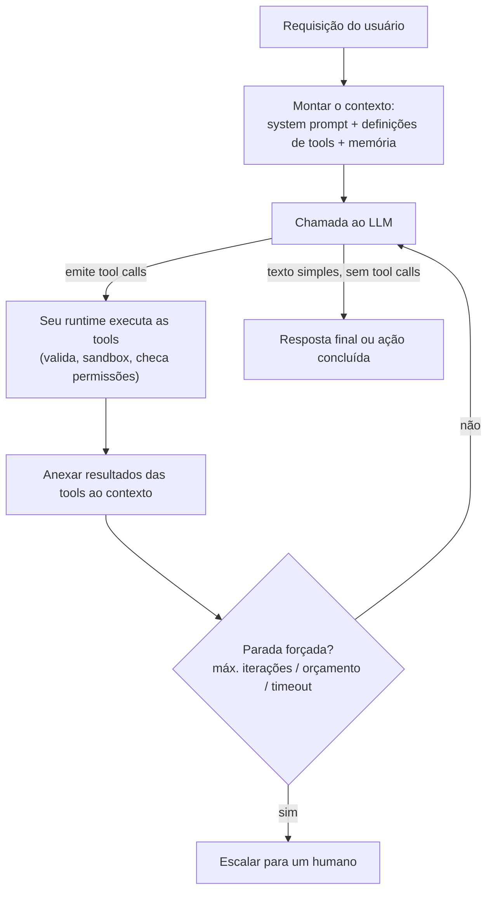

# 🤖 Agents, Tool Use & MCP

> 🇧🇷 Tradução em português do Brasil. Versão original em inglês: [README.md](README.md).

Um dos tópicos de AI engineering mais cobrados em 2025-2026. Todo frontier lab, time de AI de big tech e startup de agents pergunta sobre ele, e ele domina as rodadas de system design para vagas de AI engineer, GenAI engineer e LLM platform. Os entrevistadores o usam para separar quem colocou um agent em produção de quem apenas assistiu a uma demo - as perguntas sondam matemática de confiabilidade, segurança e engenharia de custo, não apenas vocabulário.

## Crash course

### Workflows vs agents

O enquadramento da Anthropic (de *Building Effective Agents*) é o vocabulário padrão de entrevista. **Workflows** orquestram LLMs e tools por meio de *caminhos de código predefinidos* - prompt chaining, routing, parallelisation, orchestrator-workers, evaluator-optimizer. **Agents** deixam o LLM *dirigir dinamicamente o próprio processo*: ele decide quais tools chamar, em que ordem e quando terminou. Agência é um dial, não um binário. Cada notch em direção a mais agência compra flexibilidade e custa previsibilidade, latency, dinheiro e avaliabilidade.

**A regra de design mais importante:** se você consegue desenhar o fluxograma, escreva o workflow. Recorra a um agent apenas quando o número de passos e as ramificações genuinamente não podem ser enumerados de antemão ("corrija este teste que está falhando", "pesquise esta empresa") e o valor de resolver o problema excede o custo do loop.

### O loop central do agent

Um agent é: **um modelo + tools + contexto/memória, rodando em um loop, com condições de parada.** É só isso.



O esqueleto cabe em uma tela de Python; versões de produção envolvem o mesmo formato com retries, streaming e tracing. Os entrevistadores frequentemente pedem que você o esboce:

```python
def run_agent(user_msg: str, tools: list, max_iters: int = 15):
    messages = [{"role": "user", "content": user_msg}]
    spend = Budget(max_tokens=500_000, max_cost_usd=5.0)
    for _ in range(max_iters):
        resp = llm(messages, tools=tools)        # o modelo pode emitir tool calls
        messages.append(resp.message)
        spend.add(resp.usage)
        if not resp.tool_calls:                  # parada natural: resposta só com texto
            return resp.text
        for call in resp.tool_calls:             # VOCÊ executa; o modelo nunca executa
            result = execute(call.name, call.arguments)   # valide os args, sandbox,
            messages.append(tool_result(call.id, result)) # controle ações irreversíveis
        if spend.exceeded():
            break
    return escalate_to_human(messages)           # nunca entre em loop infinito
```

### Mecânica de tool calling

- Você passa **definições de tools** - nome, descrição, **JSON Schema** dos parâmetros - a cada requisição. Elas consomem tokens de input.
- O modelo não executa nada. Ele emite uma **mensagem estruturada**: nome da tool + argumentos em JSON + um call ID. Os modelos são pós-treinados (SFT + RL) para produzir esse formato; os providers podem adicionalmente usar **constrained decoding** (por exemplo, definições de tools com `strict: true` nas APIs da OpenAI e da Anthropic) para garantir argumentos válidos conforme o schema. Válido não é o mesmo que correto: uma chamada bem formada ainda pode carregar um ID fabricado.
- Seu código executa a chamada e anexa uma **mensagem de tool result** associada ao call ID. O loop continua.
- **Parallel tool calls:** o modelo pode emitir várias chamadas independentes em um único turno (buscar três URLs); execute-as concorrentemente e devolva todos os resultados.
- **Forçar a escolha de tool (tool choice):** `auto` (o modelo decide), `required`/`any` (deve chamar *alguma* tool), uma tool específica nomeada (truque clássico para extração estruturada garantida) ou `none`.

### Design de tools

A parte de maior alavancagem e menos glamorosa da engenharia de agents:

- **Poucas tools, distintas e bem nomeadas.** Tools sobrepostas ("search", "find", "lookup") causam erros de tool errada. Use namespace nas tools relacionadas (`jira_create_issue`).
- **Descrições são prompts.** Escreva-as como documentação para um novo contratado: o que ela faz, quando usar, quando *não* usar, a semântica dos argumentos, um exemplo.
- **Consolide cadeias previsíveis.** `schedule_meeting(attendees, when)` é melhor do que `list_users` → `get_availability` → `create_event`: menos round trips, menos oportunidades de erro. Mantenha tools granulares apenas onde o modelo genuinamente precisa ramificar. Mapeie tools para *intenções*, não para endpoints de API.
- **Outputs eficientes em tokens.** O agent paga por cada token de resultado pelo resto da trajetória. Pagine, filtre, retorne IDs semânticos, trunque com ponteiros ou escreva resultados grandes em um arquivo e retorne o caminho.
- **Erros sobre os quais o modelo consegue agir.** Retorne falhas como tool results, não como crashes: "`status` inválido; valores válidos: open, closed, merged" transforma um beco sem saída em uma correção de curso. Stack traces brutos desperdiçam tokens e confundem.

### Grandes superfícies de tools: tool search e code execution

Conecte seis servers MCP e você pode ter mais de 100 definições de tools e dezenas de milhares de tokens de schema no contexto antes de o usuário digitar qualquer coisa. O prompt caching resolve o custo; ele não faz nada pela accuracy, porque erros de tool errada crescem com o número de opções quase sinônimas. As alavancas:

- **Curar e dividir:** use allowlist de tools por agent em vez de por server, aplique namespace por serviço e dê a cada subagent apenas as tools do seu próprio domínio.
- **Progressive disclosure:** mantenha um conjunto pequeno sempre carregado mais um `search_tools(query)` ou um loader por domínio que traz as definições sob demanda, transformando a seleção de tools em retrieval. Algumas APIs de providers agora oferecem isso como tool search nativa com carregamento adiado.
- **Code execution:** apresente as tools como uma API de código tipada dentro de um sandbox. O agent lê apenas os módulos de que precisa e escreve um script que compõe as chamadas, de modo que resultados intermediários grandes são filtrados no sandbox e apenas o output final entra no contexto. O preço é operar um sandbox de verdade, approval gates movidos para um broker que enxerga cada chamada com efeito colateral e tracing dentro do sandbox.

### MCP (Model Context Protocol)

**Problema:** N apps × M integrações = N×M adapters sob medida. O MCP (padrão aberto lançado pela Anthropic em nov. de 2024, doado à Agentic AI Foundation da Linux Foundation em dez. de 2025 e suportado nos ecossistemas da OpenAI, Google e Microsoft) padroniza a interface para que seja N+M: construa um server uma vez e qualquer host MCP pode usá-lo.

**Arquitetura:** um **host** (Claude Desktop, uma IDE, seu app) executa um **client** por conexão com um **server** (que encapsula uma fonte de dados ou API). As mensagens são JSON-RPC 2.0. Desde a revisão **2026-07-28** o protocolo é stateless: o handshake `initialize` e o header `Mcp-Session-Id` foram removidos, e cada requisição carrega sua própria versão de protocolo e capabilities, de modo que qualquer instância de server atrás de um load balancer comum pode respondê-la. O handshake antigo permanece como caminho de compatibilidade para revisões até 2025-11-25.

- **Primitivas do server:** **tools** (ações controladas pelo modelo), **resources** (dados/contexto controlados pelo app), **prompts** (templates invocados pelo usuário).
- **Funcionalidades do client:** **elicitation** (o server pede input ao usuário no meio de uma chamada), que na 2026-07-28 virou uma requisição com múltiplos round trips: o server retorna um resultado de input-required e o client reemite a chamada com as respostas. **Sampling** (o server toma emprestado o LLM do host), **roots** (escopo do filesystem) e logging estão deprecated na 2026-07-28, com pelo menos doze meses antes de qualquer remoção.
- **Transports:** **stdio** (server como subprocesso local - simples, herda os privilégios locais) e **Streamable HTTP** (servers remotos, autorização baseada em OAuth; substituiu o antigo transport HTTP+SSE na revisão 2025-03-26).

**Segurança:** um server MCP de terceiros injeta texto não confiável (descrições de tools, resultados) no contexto do seu modelo e, via stdio, executa código na sua máquina. Tool poisoning, atualizações de descrição do tipo rug-pull e tool shadowing são classes de ataque reais - audite, fixe versões (pin), rode com least-privilege.

### A2A (agent-to-agent)

O MCP é o eixo **vertical**: o agent descendo até as tools e dados que você controla. O **A2A** é o eixo **horizontal**: o agent atravessando até um *agent par (peer)*, geralmente através de uma fronteira de time ou de empresa. Ele chegou à **v1.0**, é hospedado pela Linux Foundation e ultrapassou 150 organizações apoiadoras em seu primeiro ano (AWS, Cisco, Google, IBM, Microsoft, Salesforce, SAP, ServiceNow). "MCP vs A2A, e como eles se compõem" agora é uma pergunta padrão de triagem em infra de agents.

- **Agent Card:** metadados em JSON publicados em uma URI well-known declarando identidade, skills, endpoint, requisitos de autenticação e capabilities opcionais (streaming, push notifications). Pode ser assinado com **JWS** para que um chamador possa verificá-lo.
- **Tasks, não chamadas:** uma task tem um ciclo de vida - submitted, working, completed, failed, canceled, rejected, mais os estados interrompidos **input-required** e **auth-required**. As atualizações chegam por polling, streaming ou push para um webhook, porque a task de um peer pode rodar por minutos.
- **Opacidade é a propriedade de design:** os peers colaboram em *capabilities declaradas* sem expor prompts internos, tools, memória ou raciocínio. Você obtém uma caixa-preta com um contrato, não uma função - e é exatamente por isso que não é "MCP com passos extras".
- **Através de uma fronteira de organização:** credenciais por peer (OAuth 2.0 client credentials, mTLS) em vez de um token compartilhado, auditoria de dois principals (qual peer, agindo em nome de qual usuário final), o output do peer tratado como **conteúdo não confiável** como qualquer tool result e quotas e limites de profundidade por peer, porque denial of wallet é o incidente mais provável.

Eles se compõem: seu agent usa MCP para seus sistemas e A2A para alcançar o agent de um vendor, que usa seus próprios servers MCP que você nunca vê.

### Agent Skills (SKILL.md)

Uma **skill** é uma pasta com um `SKILL.md` (frontmatter YAML - no mínimo `name` e `description` - mais instruções em Markdown), opcionalmente empacotando `scripts/`, `references/` e `assets/`. Carregada por **progressive disclosure em três estágios**: nome e descrição na inicialização, instruções completas quando uma task corresponde, arquivos empacotados sob demanda. Lançada pela Anthropic como padrão aberto e agora carregada por Claude Code, ChatGPT/Codex, Cursor, VS Code, GitHub Copilot, Gemini CLI, Goose, Kiro, Databricks, Snowflake, JetBrains Junie e outros.

**A regra de decisão:** tools e servers MCP dão ao agent uma *capability ou conexão* que lhe falta; skills dão a ele *conhecimento procedural* sobre um trabalho que ele já consegue tecnicamente fazer; RAG dá a ele *fatos*. Skills também são um **artefato de supply chain** - instruções executáveis mais scripts, carregadas em um contexto que contém suas credenciais - então revisão, pinning e proveniência se aplicam exatamente como a uma dependência.

### Padrões de planning

- **ReAct** (Yao et al., 2022): intercale Thought → Action → Observation. Adaptativo, mas míope. Os modelos modernos de tool-calling e reasoning internalizam boa parte disso.
- **Plan-then-execute:** produza um plano antecipadamente, execute os passos (paralelizáveis, modelos mais baratos por passo), replaneje em caso de falha. Melhor para tasks longas e para revisão humana dos planos; frágil quando o ambiente te surpreende.
- **Reflection / self-critique:** gerar → criticar → revisar. Funciona melhor quando verificar é mais fácil que gerar e quando ancorado em sinais externos (resultados de testes, compiladores) - modelos avaliam o próprio trabalho de forma leniente. Os retornos diminuem rápido depois de 1-2 rodadas.

### Multi-agent e subagents

O ganho real dos padrões **orchestrator-worker / subagent** é o **isolamento de contexto**: um worker queima 100k tokens pesquisando e devolve um resumo de 1k tokens, mantendo limpo o contexto do orchestrator. Paralelismo e especialização são secundários.

Multi-agent **ajuda** em trabalho pesado em leitura e paralelizável (pesquisa: muitas pistas independentes). **Atrapalha** em trabalho pesado em escrita com estado compartilhado (vários agents editando uma mesma codebase entram em conflito) e é caro - a Anthropic relatou que seu sistema multi-agent de pesquisa usou ~15× os tokens de uma interação de chat. **Handoffs** (transferir o controle da conversa para um agent especialista) servem a domínios distintos, como triagem de suporte; orquestração serve a tasks decomponíveis. Use por padrão um único agent com boas tools até que ele demonstravelmente falhe.

### Memória e gerenciamento de contexto

- **Working memory** = a context window. **Memória persistente** = arquivos, bancos de dados, vector stores que sobrevivem às sessões, trazidos de volta sob demanda.
- Trajetórias longas degradam: o contexto enche e a qualidade cai antes do limite rígido ("context rot"). Contramedidas: **compaction** (resumir turnos antigos, manter os recentes + decisões-chave), **limpar tool results obsoletos**, **structured note-taking** (listas de todo e arquivos de scratchpad persistem fora do contexto e sobrevivem à compaction) e **isolamento por subagent**.
- Agents de longo horizonte (horas/dias) precisam de **checkpointing e durable execution**: persistir o estado nas fronteiras, tornar as tool calls idempotentes, retomar a partir de event logs em vez de rezar para que o processo nunca morra.

### Confiabilidade, guardrails, segurança

- **A matemática do erro composto:** 95% de sucesso por passo ao longo de 20 passos = 0,95²⁰ ≈ **36%** de ponta a ponta. É por isso que demos não são produtos. Ataque-a reduzindo passos, elevando a confiabilidade por passo e adicionando *recuperação* (passos de verificação, erros acionáveis, checkpoints) para que as falhas deixem de ser terminais.
- **Guardrails:** máximo de iterações, orçamentos de tokens/custo, timeouts, detecção de chamadas duplicadas e **tiers de permissão** - leituras aprovadas automaticamente, escritas controladas, ações irreversíveis (enviar, deletar, pagar) atrás de aprovação humana. A reversibilidade determina a autonomia.
- **Prompt injection:** tool results são um canal controlado pelo atacante; os modelos não conseguem separar dados de instruções de forma confiável. A **lethal trifecta** de Simon Willison - acesso a dados privados + conteúdo não confiável + um canal de exfiltração - é o teste de design: nunca deixe um único agent deter os três. Defesa em profundidade: tools com least-privilege, controles de egress, execução de código em sandbox, approval gates. Nenhuma correção no nível do prompt é suficiente.

### Avaliação, custo, observabilidade

- Avalie **resultados finais** (o estado final ficou correto?) pela robustez, e **trajetórias** (tools certas, caminho eficiente, conformidade com políticas - frequentemente julgadas por LLM contra uma rubrica) para diagnóstico.
- **pass@k vs pass^k:** pass@k (qualquer uma de k tentativas tem sucesso) mede capability; **pass^k** (todos os k trials têm sucesso, popularizado pelo τ-bench) mede a consistência que os usuários de fato vivenciam. Agents de produção são julgados por pass^k.
- **Engenharia de custo/latency:** use tiers de modelos por passo (o modelo grande planeja, o pequeno extrai/roteia), explore o **prompt caching** (system prompt + definições de tools + prefixo do histórico são um cache hit estável a cada iteração do loop), paralelize tool calls, compacte o contexto. Meça o **custo por task bem-sucedida**, não por chamada.
- **Observabilidade:** faça trace de cada chamada ao LLM e de cada tool call (args, resultados, tokens, latency) como spans; suporte replay; acompanhe taxa de sucesso, passos/task, gasto de tokens, taxas de erro das tools. Você não consegue depurar um agent que não rastreou.

### Frameworks

LangGraph, OpenAI Agents SDK, Claude Agent SDK, Google ADK, Microsoft Agent Framework, CrewAI e afins oferecem scaffolding de loop, estado/checkpointing, tracing e a infraestrutura de handoff - ao custo de opacidade de abstração e de controle sobre os prompts. A postura de um candidato forte: **construa primeiro o loop cru você mesmo** (é pequeno), adote um framework quando precisar da infraestrutura específica dele e mantenha prompts/tools agnósticos de framework para poder trocar.

## Perguntas de entrevista

Veja [questions.pt-BR.md](questions.pt-BR.md) - **65 perguntas** com respostas, da mecânica básica ao design avançado de produção.

## Red flags que os entrevistadores observam

- Dizer que o modelo "executa" tools - não saber que o modelo apenas emite intenção estruturada e que o runtime do client executa, valida e devolve os resultados.
- Recorrer a um framework multi-agent para uma task que um único prompt ou um workflow fixo resolve; não conseguir articular quando *não* construir um agent.
- Projetar um loop sem condições de parada, orçamentos ou controle de permissões - "ele roda até terminar."
- Errar a matemática de confiabilidade: tratar 90-95% de sucesso por passo como pronto para produção em tasks de 20 passos, ou não ter resposta para erros compostos além de "prompts melhores."
- Afirmar que prompt injection se resolve instruindo o modelo a ignorar instruções injetadas; nunca ter ouvido falar da lethal trifecta ou do design de tools com least-privilege.
- Avaliar agents com pass@1 apenas em respostas finais - sem trajectory evals, sem pensar em consistência (pass^k), sem uma história de tracing.
- Despejar 50 tools granulares no contexto sem opinião sobre consolidação de tools, qualidade das descrições ou custo em tokens dos resultados.
- Citar nomes de frameworks sem conseguir esboçar o loop cru do agent em Python.

## Leituras complementares

- [Building Effective Agents - Anthropic](https://www.anthropic.com/engineering/building-effective-agents) - o ensaio canônico sobre workflows vs agents.
- [How we built our multi-agent research system - Anthropic](https://www.anthropic.com/engineering/built-multi-agent-research-system) - números honestos sobre custos de tokens em multi-agent e lições de orquestração.
- [Writing effective tools for agents - Anthropic](https://www.anthropic.com/engineering/writing-tools-for-agents) - orientação sobre design e avaliação de tools.
- [Model Context Protocol - official docs & spec](https://modelcontextprotocol.io) - arquitetura, primitivas, transports e o changelog de cada revisão da spec.
- [A2A Protocol specification](https://a2a-protocol.org/latest/specification/) - Agent Cards, ciclo de vida das tasks, transports e o princípio de opacidade dos agents.
- [Agent Skills](https://agentskills.io/) - o formato SKILL.md, progressive disclosure e a vitrine de clients.
- [Code execution with MCP - Anthropic](https://www.anthropic.com/engineering/code-execution-with-mcp) - apresentar tools como uma API de código em vez de definições de função antecipadas.
- [ReAct: Synergizing Reasoning and Acting in Language Models - Yao et al.](https://arxiv.org/abs/2210.03629)
- [Reflexion: Language Agents with Verbal Reinforcement Learning - Shinn et al.](https://arxiv.org/abs/2303.11366)
- [τ-bench: A Benchmark for Tool-Agent-User Interaction in Real-World Domains - Yao et al.](https://arxiv.org/abs/2406.12045) - fonte da métrica de confiabilidade pass^k.
- [The lethal trifecta for AI agents - Simon Willison](https://simonwillison.net/2025/Jun/16/the-lethal-trifecta/) - o modelo mental essencial de segurança para agents.
