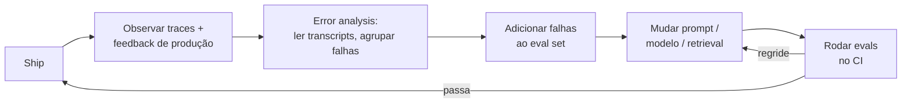

# 🧪 Evals & Observability

> 🇧🇷 Tradução em português do Brasil. Versão original em inglês: [README.md](README.md).

Nada separa AI engineers seniores de amadores em prompts mais rápido do que este tópico: qualquer pessoa consegue fazer o demo de uma feature com LLM, mas só quem já colocou uma em produção consegue explicar como *soube* que ela funcionava, continuou funcionando e melhorou. Espere perguntas sobre evals em todo loop sério - como sondagens conceituais ("como você avaliaria isto?"), como espinha dorsal de rodadas de system design e como cenários de debugging ("a qualidade caiu depois de uma atualização do modelo, vai"). Entrevistadores de frontier labs, big techs e startups usam o tema porque a maturidade em evals é o melhor indicador isolado de que alguém realmente operou um sistema de LLM em produção.

## Crash course

### Evals são o moat

Modelos são alugados; **sua suíte de evals é o ativo durável**. Ela codifica o que "bom" significa para o *seu* produto, algo que nenhum provedor de foundation models pode entregar a você. Times com evals fortes conseguem trocar de modelo em um dia, ajustar prompts com confiança e transformar cada falha de produção em um teste de regressão permanente. Times sem evals rediscutem qualidade por feeling a cada mudança.

O **loop de eval-driven development**:



Cada seta importa. O elo mais frequentemente quebrado em times reais: as falhas de produção nunca voltam para o eval set.

### A taxonomia de evals

| Método | Avaliador | Custo | Melhor para |
|---|---|---|---|
| **Code-graded** | Exact match, regex, `in`, checagem de JSON schema, execução de código | ~grátis, determinístico | Qualquer coisa com resposta verificável: classificação, extração, formato, matemática, código |
| **Model-graded (LLM-as-judge)** | Outro LLM + rubric | Relativamente barato, ruidoso | Qualidade aberta: utilidade, tom, faithfulness, instruction-following |
| **Humano** | Especialistas de domínio / labellers | Caro, lento | Ground truth para calibrar judges; domínios de alto risco; árbitro final |
| **Online (A/B, interleaving)** | Usuários reais, sinais implícitos | Exige tráfego + tempo | O que de fato move as métricas de produto |

Regra prática: **prefira o avaliador mais barato que capture o critério.** Se você consegue escrever uma assertion, escreva uma assertion - recorra a um judge apenas quando o critério for genuinamente subjetivo, e use humanos para checar o judge, não para avaliar cada execução.

### Construindo um eval set

- **Comece pequeno e difícil**: ~20-50 exemplos que representem casos reais e difíceis valem mais do que 5.000 sintéticos fáceis. Você pode montá-lo à mão em uma tarde e ele mudará decisões imediatamente.
- **Obtenha da produção**: transcripts que falharam, sessões com thumbs-down, escalações, tickets de suporte. Falhas de produção são os exemplos de maior valor porque são reais e adversariais por construção.
- **Geração sintética** preenche lacunas de cobertura (edge cases, intents raros, outros idiomas): peça a um modelo forte que gere variações a partir de uma taxonomia de cenários e depois faça **revisão humana antes de admitir** - dados sintéticos herdam os pontos cegos do gerador.
- **O poder estatístico cresce com N**: com 50 exemplos, uma virada vale 2 pontos - você só detecta efeitos grandes. Cresça para centenas à medida que as decisões ficam mais granulares.
- **Versione como código**: eval sets vivem no repositório (ou em um store versionado), mudanças passam por revisão, e os resultados sempre registram *qual* versão do dataset os produziu - caso contrário os scores não são comparáveis ao longo do tempo.
- **Mantenha atualizado**: um eval set contra o qual você otimizou por seis meses está parcialmente memorizado pelos seus prompts. Traga novas falhas de produção; aposente casos saturados para uma suíte de regressão.

### LLM-as-judge, do jeito certo

- **Pairwise vence pointwise.** Perguntar "isto é 7 ou 8?" gera scores mal calibrados e com drift. Perguntar "qual de A/B é melhor, ou empate?" é uma elicitação muito mais confiável - humanos e modelos se saem melhor comparando do que dando nota absoluta. Use pointwise apenas com uma rubric bem ancorada (defina o que cada nota significa, com exemplos) ou, melhor ainda, com pass/fail binário por critério.
- **Decomponha a rubric**: uma chamada de judge por critério (fiel? completo? formato correto?) vence uma única chamada "avalie a qualidade geral de 1 a 10".
- **Chain-of-thought judging**: force o judge a escrever sua análise *antes* do veredito; você obtém julgamentos melhores e justificativas auditáveis.
- **Vieses conhecidos** (documentados na literatura de MT-Bench/LLM-as-judge):
  - **Position bias** - favorece a primeira (ou a última) resposta em comparações pairwise. Mitigação: rode as duas ordens e mantenha só os veredictos consistentes, ou faça a média.
  - **Verbosity bias** - respostas mais longas recebem notas maiores, independentemente da qualidade. Mitigação: a rubric penaliza explicitamente enrolação; controle/reporte o tamanho.
  - **Self-preference / self-enhancement** - modelos preferem as próprias saídas. Mitigação: use como judge um modelo de uma *família diferente* da do gerador.
- **Calibre antes de confiar**: rotule 50-100 exemplos com humanos e meça a concordância judge-humano (percent agreement, ou kappa de Cohen para corrigir o acaso). No estudo do MT-Bench, um judge GPT-4 concordou com especialistas humanos mais de 80% das vezes, aproximadamente a taxa com que humanos concordam entre si, mas isso era qualidade geral de chat: *a sua* tarefa pode ser diferente. Sem medição de concordância → sem judge no CI. Refaça a calibração sempre que a versão do modelo judge mudar, ou os scores deixam de ser comparáveis ao longo do tempo.

### Benchmarks públicos e seus limites

| Benchmark | O que mede | Status |
|---|---|---|
| **MMLU** | Conhecimento em 57 disciplinas, múltipla escolha | Saturado na fronteira; contaminado |
| **GSM8K** | Problemas de matemática do ensino fundamental, em texto | Saturado; contaminação bem documentada |
| **HumanEval** | 164 problemas em Python, pass@k | Saturado; minúsculo |
| **SWE-bench Verified** | Resolver issues reais do GitHub (500 tarefas validadas por humanos) | Número de destaque para coding agents até 2025; em 2026 a OpenAI parou de reportá-lo (testes falhos, correções memorizadas) em favor do mais difícil SWE-bench Pro. Sensível ao harness de qualquer forma |
| **MT-Bench** | 80 prompts de chat multi-turn, avaliados por LLM | Datado e pequeno; os vieses do judge se aplicam |
| **Chatbot Arena (LMArena)** | Preferência humana pairwise → Elo/Bradley-Terry | Difícil de contaminar, mas mede *preferência*, com população de prompts/votantes enviesada e sensível a estilo |

Três modos de falha para citar em entrevistas: **contaminação** (dados de teste no pretraining - os scores medem memorização), **saturação** (os melhores modelos se aglomeram no teto - sem sinal) e **Goodhart** ("quando uma medida vira meta, ela deixa de ser uma boa medida" - os labs otimizam em direção aos benchmarks de destaque). O status de um benchmark é perecível: o SWE-bench Verified passou de "ainda discriminativo" a aposentado em menos de dois anos, e todo novo benchmark difícil segue o mesmo arco. Use benchmarks públicos apenas para uma shortlist grosseira de modelos; decisões de produto exigem *os seus* evals na *sua* distribuição.

### pass@k

pass@k = probabilidade de que pelo menos uma de k amostras resolva o problema. Gerar ingenuamente exatamente k amostras por problema dá uma estimativa de alta variância. O **estimador não enviesado** do paper do Codex: gere n ≥ k amostras, conte c corretas e então

$$\text{pass@}k = 1 - \binom{n-c}{k} \Big/ \binom{n}{k}$$

```python
import numpy as np

def pass_at_k(n: int, c: int, k: int) -> float:
    """pass@k não enviesado: n amostras geradas, c delas corretas."""
    if n - c < k:
        return 1.0
    return 1.0 - np.prod(1.0 - k / np.arange(n - c + 1, n + 1))
```

Relacionado: para agents, a confiabilidade muitas vezes importa mais que o melhor caso - **pass^k** (todas as k tentativas têm sucesso, popularizado pelo τ-bench) pune a inconsistência que o pass@k esconde.

### Lendo números de eval: ruído e significância

Um score de eval é uma estimativa amostral, então ele vem com barras de erro, você as calcule ou não.

- **O erro padrão de uma pass rate** é `sqrt(p(1-p)/n)`. Com 80% em 100 exemplos, isso dá ~4 pontos, então o intervalo de 95% é aproximadamente ±8 pontos. Uma "vitória" de 4 pontos nessa suíte é ruído.
- **O efeito mínimo detectável determina o n.** Comparando duas execuções independentes com ~80% de poder, você precisa de aproximadamente `2.5 / delta^2` exemplos por braço perto de uma taxa-base de 80%: ~2.800 para detectar 3 pontos, ~500 para 7 pontos.
- **Pareie suas comparações.** Ambas as variantes rodam nos mesmos exemplos, então analise as diferenças por exemplo (teste de McNemar nos pares discordantes, ou um paired bootstrap). Só os exemplos que viram carregam sinal, e remover a dificuldade do exemplo como fonte de variância tipicamente reduz o n necessário várias vezes.
- **Use clusters quando os exemplos não são independentes** (várias perguntas por documento, vários turnos por conversa): erros padrão clusterizados são maiores do que a fórmula ingênua sugere.
- **Faça a média do ruído de sampling**: com temperature acima de zero, rode várias amostras por exemplo e pontue a média, ou uma nova execução pode inverter sua conclusão.

### Evals específicos por aplicação

- **Código**: grading baseado em execução - rode a saída contra **testes ocultos** (testes visíveis convidam a overfitting) em um sandbox com timeouts e limites de recursos. Similaridade de string com uma solução de referência não faz sentido para código.
- **RAG - avalie os componentes separadamente e depois end-to-end.** Retrieval: recall@k / MRR / nDCG contra pares rotulados query→chunk relevante (se o retrieval não busca a resposta, nada a jusante conserta). Generation: **faithfulness** (toda afirmação é sustentada pelo contexto recuperado? - avaliada por judge, afirmação por afirmação) e **answer relevance**. A correção end-to-end amarra tudo. Frameworks como o RAGAS empacotam essas métricas.
- **Agents**: avalie o **resultado** (a tarefa foi concluída? verificável em um simulador de ambiente em sandbox) e a **trajetória** (acurácia na escolha de tools, correção dos argumentos, eficiência de passos, recuperação de erros). Baseado em resultado é o padrão-ouro quando checável; o scoring de trajetória diagnostica *por que* as falhas acontecem. Rode k tentativas - a variância de agents é enorme.

### Regression testing e CI

Trate prompts como código: **toda mudança de prompt, modelo ou retrieval roda a suíte de evals antes do merge.** Condicione os deploys a (a) assertions de guardrail rígidas nunca falharem e (b) scores de qualidade não regredirem além de um limiar de ruído. Mantenha o subconjunto do CI pequeno o bastante para rodar em minutos (uma suíte curada de ~50-200 casos), com a suíte completa rodando à noite. Quando um provedor muda a versão de um modelo, o mesmo pipeline diz em uma única execução se você foi afetado.

### Métricas de guardrail vs métricas de qualidade

- **Guardrail**: não podem regredir nunca - taxa de jailbreak/violação de política, vazamento de PII, taxa de conteúdo nocivo, latency p95, custo por tarefa, taxa de erro. Gates binários; qualquer regressão bloqueia.
- **Qualidade**: o que você está otimizando - correção, utilidade, resolução de tarefas, faithfulness. Faça os trade-offs entre elas deliberadamente.

Confundir as duas é uma falha clássica: você não "troca um pouco de vazamento de PII por mais utilidade".

### Avaliação online

Evals offline preveem; **evals online confirmam**. Faça A/B test com randomização em nível de usuário sobre uma métrica que seja proxy de valor real (conclusão de tarefa, retenção, resolução sem escalação). **Sinais implícitos** são seus aliados porque o feedback explícito é esparso (avaliações de thumbs vêm de uma fatia minúscula e enviesada das sessões): taxa de regeneração, copy-to-clipboard, abandono da resposta, reformulações de follow-up, edit distance sobre a saída aceita (taxa de aceitação em assistentes de código), taxa de escalação para humano. Para mudanças de retrieval/ranking, **interleaving** (misturar resultados dos dois sistemas e ver qual recebe o clique) alcança significância com muito menos tráfego do que um A/B.

Trocas de modelo e de prompt são lançadas em estágios: **shadow** (a nova variante roda em tráfego espelhado, os usuários nunca a veem, e as saídas são comparadas offline ou por um judge), depois **canary** (uma pequena fatia do tráfego real, observando guardrails, erros, latency e custo) e, por fim, **A/B** para a decisão real de qualidade. Shadow e canary pegam quebras a baixo custo; só o A/B diz se os usuários estão melhor.

### Monitoramento e drift

- **Model drift**: provedores descontinuam e reapontam aliases de modelos; fixe (pin) versões exatas e refaça os evals a qualquer mudança de versão.
- **Data drift**: a distribuição de inputs muda (novas coortes de usuários, idiomas, superfícies de produto) - monitore a distribuição de tópicos/intents e avalie em amostras novas, não só no conjunto congelado.
- **Cost/latency drift**: crescimento de tokens no prompt, contexto crescente, loops de tool-call - acompanhe tokens por requisição e latency p50/p95 por rota ao longo do tempo.
- Rode um **canary eval agendado** (por exemplo, de hora em hora/diariamente contra a config de prod) para que mudanças silenciosas no upstream acionem o seu pager em vez de afetar seus usuários.

### Observability: tracing de apps com LLM

Uma requisição de LLM é um **trace**: uma árvore de **spans** - um por chamada de modelo, invocação de tool, retrieval, checagem de guardrail. Registre por span: modelo + versão exata, parâmetros de sampling, prompt e completion (ou uma forma redigida/ponteiro), contagem de tokens de input/output, time-to-first-token e latency total, custo, versão do prompt template e IDs de usuário/sessão para fazer join com o feedback. **O OpenTelemetry tem GenAI semantic conventions** (nomes de atributos como `gen_ai.request.model`, `gen_ai.usage.input_tokens`) para que os traces sejam portáveis entre backends. As conventions ainda estão marcadas como em desenvolvimento, então os nomes dos atributos podem mudar entre releases: fixe (pin) a versão de semconv que sua instrumentação emite.

Para **reasoning models**, registre a contagem de reasoning tokens separadamente da saída visível (as conventions definem `gen_ai.usage.reasoning.output_tokens` para isso): eles são cobrados como tokens de output e dominam a latency, mas o chain of thought bruto costuma ser ocultado ou resumido pelo provedor, então o trace pode mostrar custo sem conteúdo. Acompanhe a configuração de reasoning effort por span, já que ela agora é um botão de qualidade e custo por si só.

**PII em logs é o ponto cortante**: prompts e completions rotineiramente contêm dados de usuários. Defina a retenção, redija ou faça hash de PII na ingestão, restrinja o acesso e respeite pedidos de exclusão - "logar tudo para sempre" é um incidente de compliance esperando para acontecer.

Panorama de ferramentas (conheça os nomes, não se case com um fornecedor): **LangSmith, Langfuse, Braintrust, W&B Weave, Arize Phoenix** - todas oferecem tracing + execuções de eval + datasets, com diferentes trade-offs entre open-source e hospedado.

### Error analysis: a atividade de maior ROI

Dashboards dizem *que* a qualidade caiu; só **ler transcripts** diz *por quê*. A prática: puxe 50-100 traces com falha, leia-os, escreva uma descrição de falha de uma linha para cada, agrupe as descrições (um LLM pode ajudar), ordene os clusters por frequência × severidade e **corrija primeiro o maior cluster** - geralmente é um bug de prompt ou uma lacuna de retrieval causando 30% das falhas. Esse loop, feito semanalmente, supera qualquer quantidade de ficar encarando métricas.

### O caminho de maturidade

Os times evoluem: **vibes** ("parece bom para mim") → **spot checks** (um doc com 10 prompts favoritos) → **suíte de evals offline** (dataset versionado + graders no CI) → **medição online** (A/B, feedback implícito) → **closed loop** (falhas de produção triadas automaticamente em candidatos a eval). Em entrevistas, posicione um time descrito nessa escada e diga o que você construiria a seguir - só esse enquadramento já sinaliza senioridade.

## Perguntas de entrevista

Veja [questions.pt-BR.md](questions.pt-BR.md) - 55 perguntas nos níveis básico, intermediário e avançado.

## Red flags que os entrevistadores observam

- Recorrer a scores de benchmarks públicos (MMLU, Arena Elo) para decidir se um modelo serve para um *produto específico* - sem mencionar a construção de um eval específico da tarefa.
- Nenhum hábito de ler transcripts reais - fala apenas em métricas agregadas e dashboards, nunca em error analysis.
- Confiar em um LLM judge sem nunca ter medido sua concordância com rótulos humanos, ou ser incapaz de nomear um único viés de judge.
- Acreditar que evals exigem milhares de exemplos rotulados antes de começar (paralisia por análise) - ou o oposto, entregar com zero e "iterar com o feedback dos usuários".
- Tratar um delta de 2-4 pontos em um eval de 50 exemplos como melhoria real; nenhuma noção de variância, comparação pareada ou significância.
- Nenhuma história de CI: não consegue explicar como uma mudança de prompt é barrada antes do deploy, nem o que acontece quando o provedor atualiza a versão de um modelo.
- "Logamos todos os prompts e completions" sem resposta para PII, retenção ou controle de acesso.
- Confundir métricas de guardrail e de qualidade, ou propor trocar regressões de segurança por ganhos de utilidade.

## Leituras complementares

- [Judging LLM-as-a-Judge with MT-Bench and Chatbot Arena](https://arxiv.org/abs/2306.05685) - Zheng et al.; o paper canônico de LLM-as-judge: taxas de concordância, vieses de posição/verbosidade/self-enhancement.
- [Evaluating Large Language Models Trained on Code](https://arxiv.org/abs/2107.03374) - Chen et al. (Codex); define o HumanEval e o estimador não enviesado de pass@k.
- [SWE-bench: Can Language Models Resolve Real-World GitHub Issues?](https://arxiv.org/abs/2310.06770) - Jimenez et al.; o benchmark de referência para coding agents.
- [Chatbot Arena: An Open Platform for Evaluating LLMs by Human Preference](https://arxiv.org/abs/2403.04132) - Chiang et al.; votos humanos pairwise e ranking Bradley-Terry.
- [Adding Error Bars to Evals](https://arxiv.org/abs/2411.00640) - Evan Miller (Anthropic); estatística para comparações de evals: erros padrão clusterizados, análise pareada, poder.
- [Your AI Product Needs Evals](https://hamel.dev/blog/posts/evals/) - Hamel Husain; o guia do praticante para eval-driven development e error analysis.
- [Patterns for Building LLM-based Systems & Products](https://eugeneyan.com/writing/llm-patterns/) - Eugene Yan; evals como o primeiro pattern, com um panorama de métodos.
- [OpenTelemetry Generative AI semantic conventions](https://opentelemetry.io/docs/specs/semconv/gen-ai/) - o padrão emergente para tracing de chamadas de LLM. As conventions agora vivem em seu próprio [repositório semantic-conventions-genai](https://github.com/open-telemetry/semantic-conventions-genai), que também cobre spans de MCP e atributos específicos de provedores.
