# Evals & Observability - Perguntas de Entrevista

> 🇧🇷 Tradução em português do Brasil. Versão original em inglês: [questions.md](questions.md).

55 perguntas: 14 básicas, 24 intermediárias, 17 avançadas.

> **Sobre os diagramas: desenhar é opcional.** Algumas respostas incluem um pequeno esboço que você
> poderia reproduzir em um quadro branco ou em um documento compartilhado. Você nunca precisa desenhar nada para ir bem,
> e uma resposta falada clara se sustenta sozinha. Mas em perguntas de arquitetura, pipeline e system design,
> esboçar enquanto fala mantém o entrevistador acompanhando você e mostra que você sabe estruturar
> um problema. Considere-os um bônus, não lição de casa.

## Básico

### 1. Por que as pessoas dizem que "evals são o moat" dos produtos de AI? O que os torna o artefato central de engenharia?

<details><summary><b>Resposta</b></summary>

Porque todo o resto é alugado. O modelo vem de um provedor, a stack de serving é commodity e os prompts são copiáveis - mas uma suíte de evals versionada que codifica o que "bom" significa para a sua tarefa específica, construída a partir das suas falhas de produção, é proprietária e se acumula ao longo do tempo. É o artefato que permite trocar de modelo em um dia (rode a suíte de novo, compare), ajustar prompts sem medo (o CI pega regressões) e converter cada incidente de produção em um teste permanente.

Concretamente, evals funcionam como testes unitários funcionam para software convencional, com uma diferença: em sistemas de LLM a *própria spec* é difusa, então o eval set costuma ser a coisa mais próxima de uma spec que existe. Quando um PM diz "os resumos deveriam ser melhores", o eval set é onde "melhor" é operacionalizado em graders e exemplos. É por isso que engenheiros seniores tratam o design de evals como uma atividade central de design, não como uma reflexão tardia de QA.

O loop de engenharia que isso viabiliza - eval-driven development - é: ship → observar traces de produção e feedback → fazer error analysis nos transcripts com falha → adicionar as falhas ao eval set → mudar o prompt/modelo/pipeline → rodar evals → fazer ship se não houver regressão. Times presos em "vibes" rediscutem a qualidade subjetivamente a cada mudança e não conseguem dizer se uma atualização de modelo ajudou ou prejudicou.

Um bom candidato também observa os limites: uma suíte de evals só mede o que você pensou em codificar, ela envelhece conforme o uso muda, e você pode fazer overfitting a ela. Então o moat precisa de manutenção - exemplos novos entrando da produção em rotação, calibração humana periódica de qualquer model grader e acompanhamento honesto da lacuna entre scores offline e métricas online.

**Vale desenhar.** Desenhar o loop deixa claro que a suíte é alimentada pela produção, e não escrita uma vez no começo.

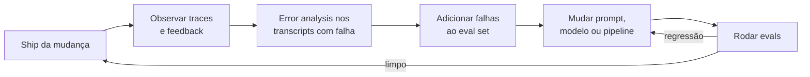

**Follow-ups:** Como você convenceria um time que entrega na base das vibes a investir em evals? Qual é a menor suíte de evals útil que você construiria na primeira semana? Quem deveria ser o dono do eval set - engenharia, PM ou um time dedicado?

</details>

### 2. Me conduza pela taxonomia de métodos de avaliação para sistemas de LLM e quando você usaria cada um.

<details><summary><b>Resposta</b></summary>

Quatro camadas, ordenadas por custo e por quanto julgamento humano elas codificam:

1. **Code-graded assertions** - exact match, regex/contains, validação de JSON schema, tolerância numérica, execução de código gerado contra testes. Determinísticas, gratuitas, rápidas. Use sempre que o critério for objetivamente verificável: rótulos de classificação, campos de extração, formato de saída, respostas de matemática, correção de código.
2. **Model-graded (LLM-as-judge)** - outro LLM pontua ou compara saídas contra uma rubric. Barato o bastante para rodar em todo push no CI, mas ruidoso e enviesado (posição, verbosidade, self-preference), então precisa ser calibrado contra rótulos humanos antes de você confiar nele. Use para critérios genuinamente subjetivos: utilidade, tom, faithfulness às fontes, nuances de instruction-following.
3. **Avaliação humana** - rótulos de especialistas ou crowdworkers, pointwise ou pairwise. Lenta e cara, então use estrategicamente: para criar ground truth para calibrar judges, para domínios de alto risco (médico, jurídico) e como a auditoria periódica que mantém os graders automáticos honestos.
4. **Avaliação online** - A/B tests, interleaving, feedback implícito (thumbs, taxa de regeneração, conclusão de tarefa, escalações). A única camada que mede o que os usuários realmente vivenciam, mas exige tráfego, tempo e uma feature em produção - e não diz *por que* algo regrediu.

O princípio operacional: **use o grader mais barato que capture fielmente o critério.** Se você consegue escrever uma assertion, nunca use um judge. Se um judge basta, não queime horas humanas em grading rotineiro - gaste-as auditando o judge. E trate evals offline como preditores que as métricas online precisam confirmar; uma lacuna persistente entre scores offline e resultados online significa que seu eval set não representa mais o tráfego de produção.

Candidatos fortes acrescentam que essas camadas se compõem dentro de uma mesma suíte: um único caso de teste pode asseverar a validade do JSON (código), pontuar a faithfulness (judge) e alimentar uma métrica online de taxa de resolução depois de implantado.

**Vale desenhar.** Desenhada como uma árvore de decisão, ela mostra que você só escala para graders caros quando o barato não consegue carregar o critério.

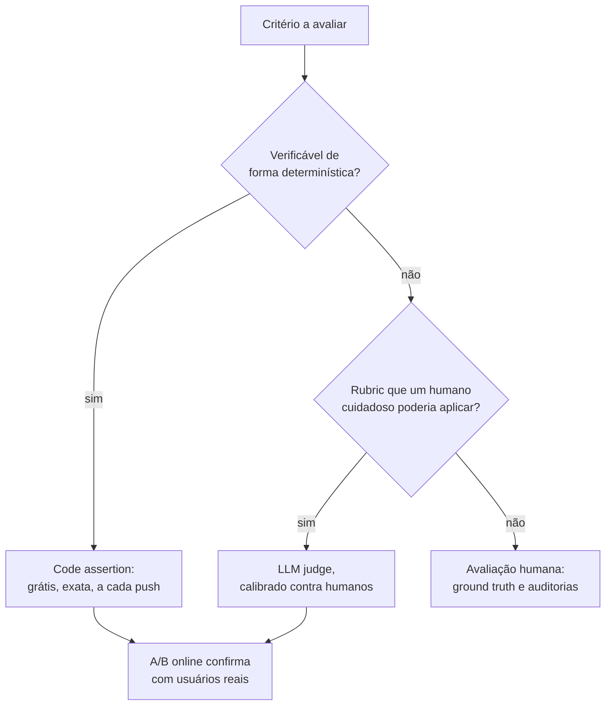

**Follow-ups:** Dê um critério concreto que parece digno de judge mas pode ser reduzido a uma assertion. Quando você pagaria por avaliação humana mesmo que seu judge concorde com humanos em 85% das vezes?

</details>

### 3. Que tipos de code-graded assertions você pode usar em saídas de LLM, e onde elas falham?

<details><summary><b>Resposta</b></summary>

As principais famílias:

- **Exact match** - a saída é igual à referência. Funciona para classificação, múltipla escolha, respostas curtas canonicalizadas. Frágil a formatação ("$4.50" vs "4.5 dollars"), então normalize antes (caixa, espaços em branco, parsing de números).
- **Contains / regex** - a string da resposta aparece em algum lugar; regex para padrões estruturados (datas, IDs). Propenso a falsos positivos ("the answer is not 42" contém "42") - ancore os padrões e verifique negações onde importar.
- **Validação estrutural** - faça o parse da saída: JSON válido, conforme a um schema/modelo Pydantic, campos obrigatórios presentes, valores de enum legais. É o cavalo de batalha para tarefas de tool-calling e extração.
- **Numérica com tolerância** - extraia o número, compare dentro de um epsilon; essencial para matemática em que a formatação varia.
- **Baseada em execução** - rode o código gerado contra casos de teste em um sandbox; rode o SQL gerado contra um banco fixture e compare os result sets. O padrão-ouro para código: equivalência funcional, não similaridade textual.
- **Property checks** - limites de tamanho, nenhuma frase banida, IDs de citação que realmente existem no conjunto recuperado, links que resolvem. Assertions de guardrail baratas.

```python
def grade(output: str, case: dict) -> bool:
    data = json.loads(output)                      # estrutural
    assert set(data) >= {"amount", "currency"}     # schema
    return abs(data["amount"] - case["amount"]) < 0.01  # tolerância
```

Onde elas falham: qualquer coisa com muitas formas de superfície válidas (resumos, explicações, respostas conversacionais) - checagens de exact/contains ou perdem respostas corretas ou aprovam erradas. Métricas de texto baseadas em referência, como BLEU/ROUGE, correlacionam mal com qualidade em geração aberta, então a atitude honesta é escalar esses critérios para avaliação model-graded ou humana em vez de fingir que um score de sobreposição de n-grams significa algo.

O hábito sênior: projete o *formato de saída da tarefa* para ser assertável - force JSON, force uma linha final `Answer:`, faça o modelo citar IDs de chunks - para que mais do seu eval fique na camada determinística barata.

**Follow-ups:** Como você avaliaria uma tarefa de sumarização sem um judge? Seu regex grader mostra 95% de aprovação, mas os usuários reclamam - o que está acontecendo?

</details>

### 4. Você está construindo evals para uma nova feature com LLM do zero. De quantos exemplos você precisa e de onde eles vêm?

<details><summary><b>Resposta</b></summary>

Comece com **~20-50 exemplos difíceis e realistas** - você constrói isso em um dia e já muda decisões imediatamente. O maior erro em evals não é um N pequeno; é esperar por um N grande que nunca chega enquanto faz ship às cegas.

Fontes, em ordem de valor:

1. **Falhas de produção** - sessões com thumbs-down, escalações para humanos, tickets de suporte, incidentes. São reais, adversariais por construção, e cada uma é um teste de regressão que comprovadamente importou.
2. **Dogfooding / red-teaming interno** - antes do lançamento você não tem dados de produção, então o time gera tarefas realistas e sonda deliberadamente os limites.
3. **Geração sintética** - peça a um modelo forte, com uma taxonomia de cenários (intents × personas × dificuldade), que preencha lacunas de cobertura; faça revisão humana antes de admitir qualquer coisa, porque dados sintéticos herdam os pontos cegos do gerador e tendem à mediana.
4. **Datasets públicos** - ocasionalmente úteis como andaime, geralmente fora da distribuição do seu produto.

Sobre estatística: com 50 exemplos cada caso vale 2 pontos, então você só detecta efeitos grandes - um delta de 4 pontos é apenas dois exemplos líquidos virando e é ruído. Isso é aceitável no início, quando você caça problemas de 20 pontos. À medida que as decisões ficam mais finas (prompt A vs prompt B diferindo por alguns pontos), cresça para centenas de exemplos e adicione testes de significância pareados. O poder estatístico cresce com N; compre poder quando você de fato precisar da resolução.

A composição importa mais que o tamanho: dê mais peso aos casos difíceis e aos modos de falha conhecidos, mantenha uma fatia de casos fáceis como smoke test e estratifique pelos segmentos que importam (idiomas, intents, tiers de usuário) para que uma regressão em um segmento pequeno não seja diluída na média. Versione o conjunto como código e registre a versão do dataset junto de cada score.

**Follow-ups:** Como você decide que um exemplo é "difícil" antes de ter falhas? Seu eval está com 95% de aprovação e deixou de discriminar entre prompts candidatos - o que você faz?

</details>

### 5. O que é LLM-as-judge, e quando ele é a ferramenta certa?

<details><summary><b>Resposta</b></summary>

LLM-as-judge usa um modelo (em geral mais forte) para avaliar saídas: dados o input, a resposta candidata, uma rubric e, opcionalmente, uma resposta de referência, o judge emite um veredito - pass/fail, um score ou uma preferência entre duas respostas. Ele existe porque a maioria das saídas interessantes de LLM é aberta: nenhuma assertion consegue checar se um resumo é fiel ou se uma resposta é genuinamente útil, e humanos são lentos e caros demais para avaliar cada execução do CI.

É a ferramenta certa quando três condições são atendidas: (1) o critério é subjetivo ou tem muitas formas de superfície válidas, (2) você consegue articular o critério como uma rubric que um humano cuidadoso poderia aplicar e (3) você **validou o judge contra rótulos humanos** - rotule 50-100 exemplos você mesmo, meça a concordância (percent agreement ou kappa de Cohen) e só automatize quando a concordância for comparável à concordância humano - humano. O trabalho do MT-Bench constatou que judges da classe GPT-4 concordam com humanos ~80% das vezes em qualidade de chat - aproximadamente a taxa humano - humano - mas isso depende da tarefa, não é uma lei.

A forma prática importa: a comparação pairwise ("qual é melhor, A ou B?") é mais confiável que o scoring pointwise ("dê nota de 1 a 10"); pass/fail binário por critério decomposto vence um único score holístico; e forçar o judge a escrever raciocínio em chain-of-thought antes do veredito melhora a qualidade e dá justificativas auditáveis.

Quando é a ferramenta *errada*: qualquer coisa assertável (use código), decisões finais de alto risco (o judge auxilia, o humano decide) e avaliar a própria família de modelos do judge em tarefas comparativas (self-preference bias). Lembre também que o judge é, ele mesmo, um prompt+modelo que precisa de versionamento - uma atualização do modelo judge pode deslocar todos os seus scores sem nenhuma mudança no sistema sob teste, então fixe (pin) as versões do judge e recalibre quando mudá-las.

**Follow-ups:** Seu judge aprova 90% das saídas, mas os usuários estão insatisfeitos - como você faz debug do próprio judge? Você usaria o mesmo modelo como gerador e como judge?

</details>

### 6. Defina pass@k. Por que a forma ingênua de calculá-lo é problemática, e qual é a correção?

<details><summary><b>Resposta</b></summary>

pass@k é a probabilidade de que **pelo menos uma** de k amostras independentes do modelo resolva o problema - a métrica padrão para geração de código (o HumanEval a popularizou), onde você consegue verificar cada amostra a baixo custo rodando testes.

O cálculo ingênuo - gerar exatamente k amostras, dar 1 se alguma passou, tirar a média sobre os problemas - é um estimador não enviesado em esperança, mas de **alta variância**: para cada problema você obtém uma única observação de Bernoulli, então os resultados oscilam de execução para execução, especialmente em eval sets pequenos e em probabilidades de sucesso intermediárias.

A correção, do paper do Codex: gere **n ≥ k** amostras por problema (digamos n = 200 para k ≤ 100), conte c corretas e calcule a probabilidade de que um subconjunto aleatório de tamanho k contenha pelo menos uma amostra correta:

pass@k = 1 − C(n−c, k) / C(n, k)

Isso faz a média analiticamente sobre todos os C(n, k) subconjuntos em vez de sortear um só, reduzindo drasticamente a variância. Calcular binomiais diretamente estoura (overflow), então use a forma de produtório numericamente estável:

```python
import numpy as np

def pass_at_k(n: int, c: int, k: int) -> float:
    if n - c < k:
        return 1.0
    return 1.0 - np.prod(1.0 - k / np.arange(n - c + 1, n + 1))
```

Duas coisas que um candidato forte acrescenta. Primeiro, a temperature de sampling interage com k: temperature mais alta prejudica o pass@1 mas ajuda o pass@100 (mais diversidade), então reporte a temperature e ajuste-a por k. Segundo, o pass@k mede a capacidade de *melhor caso* - adequado quando você consegue verificar e escolher o vencedor (testes ocultos, um compilador), enganoso quando não consegue. Para cenários de agents em que a confiabilidade é crítica, a métrica complementar é o **pass^k** - a probabilidade de que todas as k tentativas independentes tenham sucesso (popularizado pelo τ-bench) - que pune a inconsistência que o pass@k esconde. Um modelo com 80% de sucesso por tentativa tem pass^8 ≈ 17%: ótimo demo, produto não confiável.

**Follow-ups:** Quando otimizar pass@10 é legítimo para um produto? Como o pass@k se relaciona com best-of-n sampling com um verifier em tempo de inference?

</details>

### 7. Qual é a diferença entre métricas de guardrail e métricas de qualidade? Dê exemplos de cada uma.

<details><summary><b>Resposta</b></summary>

**Métricas de qualidade** medem o que você está otimizando: correção das respostas, faithfulness às fontes, taxa de resolução de tarefas, satisfação do usuário, taxa de aceitação de código. Você espera fazer trade-offs delas contra custo e latency, e comemora quando sobem.

**Métricas de guardrail** são restrições que nunca podem regredir, independentemente dos ganhos de qualidade: taxa de jailbreak/violação de política, vazamento de PII nas saídas, taxa de conteúdo nocivo, taxa de citações alucinadas em contextos regulados, latency p95, custo por requisição, taxa de erros graves. São assimétricas - ninguém é promovido por melhorá-las, mas qualquer regressão bloqueia um release.

A distinção importa operacionalmente porque as duas recebem tratamento diferente no pipeline:

- **Gating**: regressões de qualidade dentro de uma faixa de ruído são discutíveis; regressões de guardrail são bloqueios automáticos de deploy. Seu CI deveria codificar isso - evals de guardrail como assertions rígidas, evals de qualidade como comparações pontuadas contra um baseline com um limiar.
- **Trade-offs**: é legítimo entregar "2 pontos menos conciso, mas 30% mais barato". Nunca é legítimo entregar "um pouco mais de vazamento de PII, mas mais útil". Se alguém propõe trocar um guardrail, a métrica foi classificada errado ou a organização tem um problema.
- **Estilo de medição**: guardrails costumam ser evals adversariais (suítes de red-team, corpora conhecidos de jailbreak, probes sintéticos de PII) mais monitores de produção com alertas; métricas de qualidade são evals de distribuição representativa mais A/B tests.

Isso espelha a prática clássica de experimentação - plataformas de A/B das big techs há tempos têm "guardrail metrics" (taxa de crash, latency) que qualquer experimento não pode prejudicar enquanto move sua métrica-alvo. Sistemas de LLM herdam o padrão, com novos guardrails de segurança de conteúdo por cima.

Um ponto sutil: algumas métricas mudam de categoria conforme o produto. Latency é um guardrail para chat, mas *a* métrica de qualidade para um produto de autocomplete; a taxa de recusa é, ao mesmo tempo, um teto de guardrail (recusa excessiva irrita os usuários) e um piso (recusa insuficiente é inseguro) - vale acompanhá-la como duas métricas direcionais.

**Vale desenhar.** Os dois ramos tornam a assimetria concreta: um é um debate, o outro não.

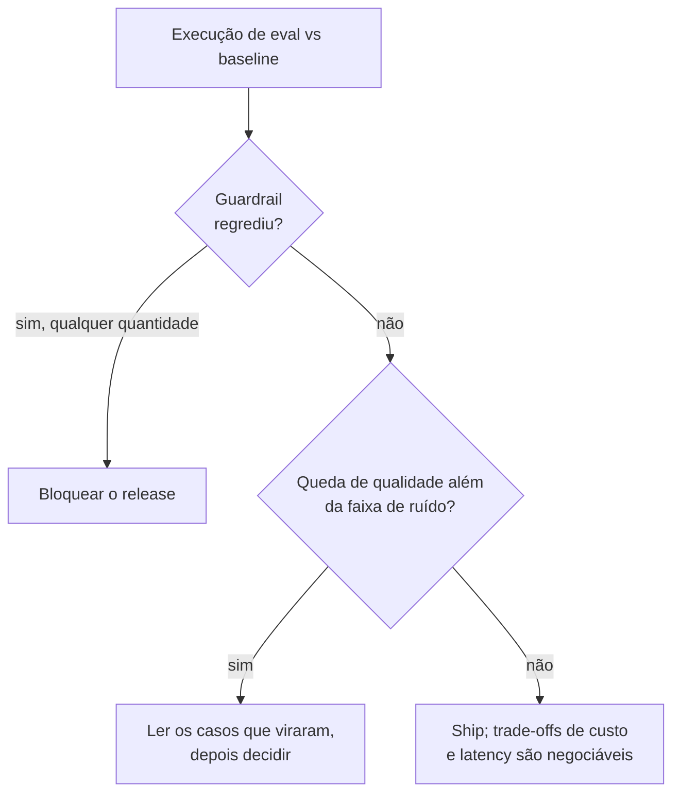

**Follow-ups:** Como você definiria o limiar para um guardrail como a taxa de jailbreak - zero ou não zero? Sua vitória de helpfulness no A/B vai para produção e a taxa de escalação sobe 15% - o que aconteceu?

</details>

### 8. O que você deve registrar em log para cada chamada de LLM em produção, e quais são as armadilhas?

<details><summary><b>Resposta</b></summary>

Por chamada, o mínimo útil:

- **Identidade e versões**: ID de request/trace, ID de usuário/sessão (pseudonimizado), nome + versão do prompt template, modelo + versão *exata* (não um alias), parâmetros de sampling (temperature, max_tokens), schemas de tools/funções oferecidos.
- **Conteúdo**: o prompt completo renderizado (system + mensagens) e a completion - ou formas redigidas/ponteiro onde a política exigir. Também artefatos intermediários: chunks recuperados com IDs e scores, tool calls com argumentos e resultados.
- **Performance e custo**: contagem de tokens de input/output, time-to-first-token, latency total, retries, cache hits, custo calculado.
- **Sinais de resultado**: finish reason (stop, length, tool_use, content_filter), resultados das checagens de guardrail, feedback a jusante (thumbs, regeneração, escalação) unido por trace ID.

Estruture isso como um **trace**: uma árvore de spans, um por chamada de modelo / retrieval / execução de tool, de modo que uma requisição de agent com múltiplos passos seja lida como um único objeto navegável. As GenAI semantic conventions do OpenTelemetry padronizam os nomes dos atributos (`gen_ai.request.model`, `gen_ai.usage.input_tokens`, ...) para que você não fique preso a um único fornecedor de observability.

Armadilhas, em ordem de severidade:

1. **PII.** Prompts e completions são dados de usuários - frequentemente o texto mais sensível que sua empresa armazena. Você precisa de uma política de retenção, redação ou tokenização de identificadores na ingestão, controles de acesso (engenheiros de suporte ≠ todo mundo) e a capacidade de honrar pedidos de exclusão. "Logar tudo para sempre em texto plano" é um incidente de GDPR/compliance com timer.
2. **Registrar o alias, não a versão.** Um log no estilo `model: gpt-latest` torna invisíveis as atualizações do lado do provedor; você não consegue explicar por que a qualidade mudou numa terça-feira.
3. **Perder as chaves de join.** Se eventos de feedback não podem ser unidos de volta ao trace exato (versão do prompt, chunks recuperados), seu loop de error analysis está morto.
4. **Volume/custo**: logar prompts completos em escala é caro - faça sampling com inteligência (guarde 100% dos erros e do feedback negativo, amostre os sucessos).

**Follow-ups:** Como você implementaria "apague os dados deste usuário" quando o texto dele aparece dentro de outros prompts logados? O que você registraria de forma diferente para um voice agent?

</details>

### 9. Qual é a diferença entre observability e evals? Os fornecedores parecem vender um único produto para ambos.

<details><summary><b>Resposta</b></summary>

Observability é descritiva: o que aconteceu nesta requisição. Evals são avaliativos: a saída foi boa. Os mesmos dados, uma pergunta diferente, e é por isso que todo fornecedor os entrega como uma única superfície.

Observability está sempre ligada e sem sampling. Ela captura o trace: spans para cada chamada de modelo, retrieval, tool call e checagem de guardrail, com tokens, latency, custo, erros, IDs dos chunks recuperados e a versão exata do modelo. Responde "por que esta requisição foi lenta", "o que o retrieval de fato retornou", "onde o agent entrou em loop".

Evals são amostrados e pontuados contra um critério. Respondem "isto está correto", "está fundamentado", "a tarefa foi concluída". Um score exige um grader e uma noção de bom, sobre os quais a observability não tem opinião.

O teste prático que eu uso: a métrica que te acorda às 3 da manhã é observability (taxa de erro, latency p95, pico de custo). A métrica que bloqueia um merge é um eval (pass rate no golden set). Consumidores diferentes, cadência diferente, modo de falha diferente quando ausente.

Eles dependem um do outro em uma direção. Você não consegue construir bons evals sem observability, porque os traces de produção são de onde vêm os exemplos de eval. Mas observability sem evals é a armadilha clássica: os dashboards continuam verdes em volume e latency enquanto a qualidade apodrece silenciosamente, porque nada na stack está perguntando se as respostas são boas.

Evals online são onde a linha se borra, e isso confunde as pessoas. Amostrar 2% dos traces de produção e pontuá-los com um judge é rodar um eval sobre dados de observability. É um único pipeline, mas ainda vale manter os conceitos separados: se você os confunde, acaba acreditando que um dashboard de latency verde significa um produto saudável.

**Vale desenhar.** Uma fonte de dados, dois consumidores: mostra por que os fornecedores os empacotam juntos e por que você ainda deve manter os conceitos separados.

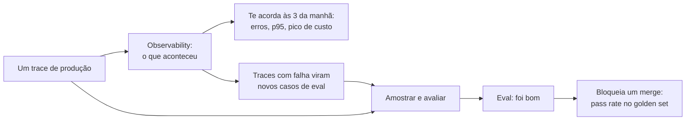

**Follow-ups:** Qual dos dois você construiria primeiro em uma feature nova com LLM, e por quê? Se sua conta de observability fosse cortada pela metade, o que você deixaria de capturar?

</details>

### 10. Qual é a diferença entre avaliação reference-based e reference-free, e por que BLEU, ROUGE e exact match falham em saídas de LLM?

<details><summary><b>Resposta</b></summary>

A avaliação reference-based compara a saída com uma resposta gold: exact match, BLEU, ROUGE, similaridade de embeddings, BERTScore. A avaliação reference-free julga a saída por seus próprios méritos contra um critério ou contra o contexto de entrada: execução de código, checagens de JSON schema, um LLM judge pontuando a faithfulness contra chunks recuperados.

As métricas de n-grams falham porque foram projetadas para tradução automática e sumarização, onde as referências são densas e o espaço de saída é estreito. A saída de LLM tem um espaço enorme de formulações corretas. O BLEU pune uma resposta correta redigida de forma diferente da referência e premia uma resposta errada que por acaso toma emprestado o vocabulário da referência. O ROUGE mede a sobreposição com n-grams da referência, então um resumo extrativo que copia trechos enquanto inventa uma relação entre eles pontua bem. Nenhum dos dois tem qualquer noção de se a afirmação é verdadeira.

BERTScore e similaridade de embeddings são uma melhoria real porque embeddings contextuais capturam paráfrases. Mas são insensíveis justamente ao que mais importa: negação, números e trocas de entidades. "The dose is 5mg" e "The dose is not 5mg" ficam próximas no espaço de embeddings e são opostas da única forma que alguém se importa. Um score alto de similaridade não é evidência de correção.

Exact match funciona, mas só onde o espaço de respostas é genuinamente fechado: um rótulo de classificação, um campo extraído, uma resposta numérica final. Seu modo de falha é a formatação, não a semântica, então normalize primeiro (caixa, espaços em branco, formatos de data e moeda) ou você acabará medindo o seu parser.

O que fazer em vez disso: decomponha. Execute código contra testes ocultos. Extraia afirmações atômicas e confira cada uma contra a fonte. Use um judge com rubric para critérios genuinamente abertos. Mantenha a avaliação reference-based onde a resposta é fechada e a comparação é barata e válida.

**Follow-ups:** Quando o BLEU ainda é a ferramenta certa? Como você avaliaria uma feature de sumarização em que todo resumo é legitimamente diferente?

</details>

### 11. Seu eval reporta 82% de aprovação em 100 exemplos. O que esse número não te diz?

<details><summary><b>Resposta</b></summary>

Bastante coisa, e a omissão mais importante é a precisão. Para uma proporção, o erro padrão é sqrt(p(1-p)/n). Com p=0,82 e n=100, isso dá cerca de 0,038, então o intervalo de confiança de 95% vai de aproximadamente 74% a 90%. A forma honesta de reportar é "82% (IC 95% ~74-90%)". Quem trata 82% versus 78% nesse conjunto como uma melhoria está lendo ruído.

Segundo, ele não diz a variância entre execuções. O sampling é estocástico e agents são instáveis. Rode a mesma config cinco vezes e você pode ver de 79% a 85%. Essa dispersão é o seu piso de ruído real e costuma ser maior do que as pessoas supõem.

Terceiro, ele esconde a distribuição. 82% agregado pode ser 95% na fatia majoritária fácil e 40% no único segmento que gera sua receita. Uma média sobre um conjunto misto é uma média ponderada de coisas que você provavelmente quer olhar separadamente.

Quarto, ele não diz nada sobre o grader estar certo. Se o judge concorda com humanos 80% das vezes, os 82% medem tanto o judge quanto o modelo. O erro do grader não é ruído, é viés, e não diminui com mais exemplos.

Quinto, ele não diz se esses 100 exemplos se parecem com o que os usuários realmente enviam esta semana.

E não diz nada sobre as falhas. As 18 que falharam são todo o valor da execução. Lê-las diz o que consertar; o número 82 não diz nada acionável.

**Follow-ups:** De quantos exemplos você precisaria para detectar uma melhoria de 3 pontos? O que faria você desconfiar dos 82% mesmo com um intervalo de confiança estreito?

</details>

### 12. Por que versionar um eval dataset, e o que exatamente pertence à versão?

<details><summary><b>Resposta</b></summary>

Porque um score não tem significado sem saber o que o produziu. Comparar os 82% deste trimestre com os 76% do trimestre passado não vale nada se qualquer coisa por baixo mudou, e sempre algo mudou.

O equívoco é achar que a versão são os exemplos. Não são. Um score é função dos exemplos, das saídas esperadas e rubrics, do código do grader, do prompt do judge, do modelo judge e sua versão exata, e dos parâmetros de sampling. Mude qualquer um e o número se desloca sem nenhuma mudança no produto. Então tudo isso é versionado em conjunto e registrado em cada linha de resultado. Se o prompt do grader vive no notebook de alguém, você não tem um eval, tem uma anedota.

Governança é a outra metade. Todo exemplo carrega proveniência: de onde veio (ID do trace de produção, escrito à mão, sintético e de qual gerador), quem revisou, quando foi adicionado. Isso importa porque, quando um exemplo se revela mal rotulado, você precisa saber o que mais aquele anotador ou gerador tocou. Mudanças passam por revisão como código, com um changelog.

Aposente, não delete silenciosamente. Descartar os casos em que você falha é a forma mais fácil de fazer um dashboard subir, e acontece mais por acidente do que por malícia. Marque-os com tombstone e um motivo.

PII e consentimento se aplicam aqui também: exemplos originados da produção herdam quaisquer obrigações que os dados originais tinham, incluindo pedidos de exclusão.

Estruturalmente, mantenho duas coisas separadas: uma suíte de regressão congelada que muda raramente e condiciona merges, e um development set vivo que absorve novas falhas de produção. Misturá-los significa que você nunca distingue uma regressão real de um conjunto que ficou mais difícil.

**Vale desenhar.** Abrir as entradas em leque para dentro do score derruba a suposição de que versionar os exemplos basta.

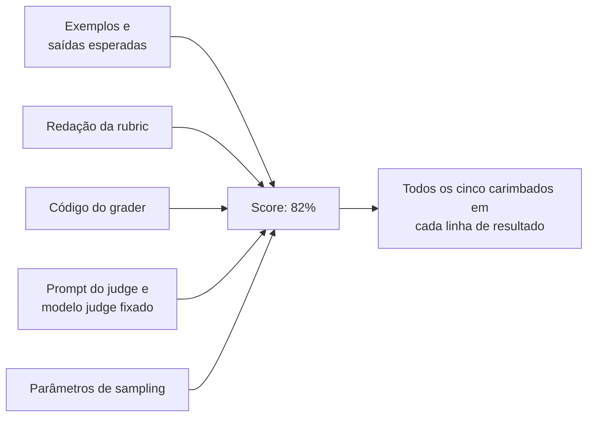

**Follow-ups:** Como você lidaria com um exemplo que todos concordam estar mal rotulado, mas que está na suíte congelada há um ano? O que vai no eval set versus em um teste unitário?

</details>

### 13. O que são as GenAI semantic conventions do OpenTelemetry, e por que você deveria se importar?

<details><summary><b>Resposta</b></summary>

São um vocabulário padronizado para descrever operações de LLM em traces: nomes de atributos acordados sob um namespace gen_ai.*, como gen_ai.request.model, gen_ai.usage.input_tokens e gen_ai.operation.name, além de convenções sobre como uma chamada de modelo, uma tool call e um passo de agent devem ser modelados como spans.

Por que se importar: elas desacoplam a instrumentação do backend. Se seu app emite spans OTel padrão, você pode apontá-los para Langfuse, Phoenix, Datadog, Honeycomb ou seu próprio collector sem tocar no código da aplicação. A alternativa é um SDK de fornecedor espalhado por cada ponto de chamada, que silenciosamente se torna o motivo pelo qual você não consegue largar esse fornecedor. Também significa que os spans de LLM ficam no mesmo trace dos seus spans de HTTP e banco de dados, então você consegue ver que o p95 de 4 segundos era 300ms de modelo e 3,7s do seu próprio código de retrieval. Muitos frameworks agora emitem spans compatíveis nativamente ou por meio de um pacote de instrumentação, então muitas vezes você obtém isso quase de graça.

Duas ressalvas que valem ser levantadas. Primeiro, no fim de 2026 as conventions gen_ai.* ainda estão em estabilidade Development (o que o OTel chamava de experimental), não Stable, e o trabalho vem migrando para seu próprio repositório para poder iterar mais rápido que as conventions centrais. Nomes de atributos e formatos de span podem mudar entre releases sem janela de deprecação. Fixe (pin) a versão da sua instrumentação, leia o changelog ao atualizar e espere churn em vez de tratar os nomes como definitivos.

Segundo, e mais importante em entrevistas: as conventions cobrem a mecânica, não a qualidade. Tokens, modelos, parâmetros, latency, finish reasons. Não há padrão para "esta resposta estava correta" ou "isto violou a política". Scores de eval e veredictos de segurança são atributos customizados seus, adicionados por cima. O OTel dá o esqueleto e a portabilidade; o julgamento continua sendo seu para construir.

Note também que capturar o conteúdo de prompt e completion é deliberadamente opt-in, porque é nesse conteúdo que mora a exposição de privacidade.

**Vale desenhar.** Mostra a costura que mantém você portável e onde as conventions terminam e seu próprio julgamento começa.

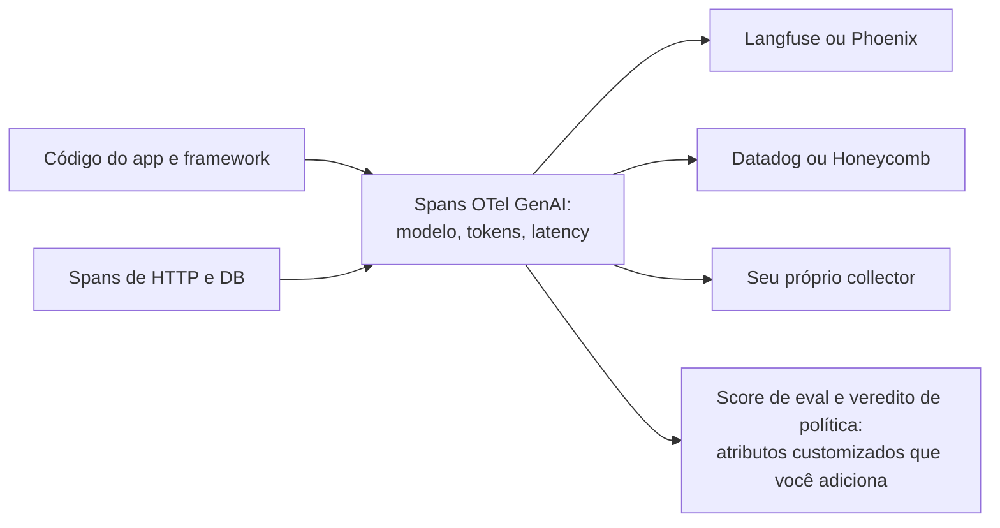

**Follow-ups:** Como você anexaria um score de eval a um span depois do fato? O que você faria quando uma convention da qual você depende mudasse de nome em um novo release?

</details>

### 14. O que torna um único caso de eval bem especificado, e quais são as formas comuns de casos individuais darem errado?

<details><summary><b>Resposta</b></summary>

Um bom caso é aquele em que dois especialistas de domínio, lendo-o independentemente, chegariam ao mesmo veredito de pass ou fail para qualquer saída dada. Todo o resto decorre desse teste.

Anatomia. Cada caso carrega o input exatamente como o sistema o recebe (mensagem do usuário, histórico da conversa, arquivos enviados, contexto recuperado se você estiver mantendo o retrieval fixo); qualquer estado de ambiente de que a tarefa dependa (seed do banco de dados, tier da conta, data de hoje); o comportamento esperado, como uma resposta de referência ou uma rubric dizendo o que pass significa; o grader que a aplica; e metadados: tags de fatia (idioma, intent, dificuldade), proveniência (ID do trace de produção, escrito à mão, sintético) e a data em que foi adicionado.

Como os casos dão errado, aproximadamente em ordem de frequência:

- **Tarefa ambígua.** O input admite duas leituras razoáveis e a referência escolhe uma. O modelo toma a outra e falha. Corrija o input ou aceite ambas.
- **Grading superespecificado.** A referência diz "96.12" e o grader faz string match, então "$96.12" falha. Você está avaliando formatação, não a tarefa. Normalize, ou passe para uma checagem com tolerância.
- **Grading subespecificado.** A rubric diz "a resposta é útil", então o grader aprova qualquer coisa fluente.
- **Expectativa inatingível.** A referência depende de informação que o sistema nunca teve: um documento ausente do corpus, um fato posterior ao knowledge cutoff, uma tool que ele não consegue chamar. Todo modelo falha nisso para sempre.
- **Referência desatualizada.** A política ou o preço mudou e a resposta gold não.

O diagnóstico barato: um caso que todo candidato falha ao longo de muitas tentativas está mais frequentemente quebrado do que difícil. Leia-o e verifique se um humano com os mesmos inputs conseguiria passar. Igualmente, um caso que nada jamais falha não está testando nada no nível de capacidade atual.

O hábito sênior é produzir uma saída aprovada para cada caso antes de admiti-lo e passá-la pelo seu próprio grader. Se você não consegue escrever uma que passe, o modelo também não consegue.

**Follow-ups:** Quem deveria escrever respostas de referência em um domínio onde ninguém no time é especialista? Um caso passa 50% das vezes ao longo de dez tentativas da mesma config. É um bom caso ou um caso quebrado?

</details>

## Intermediário

### 15. Pointwise scoring vs comparação pairwise para LLM judges - qual é mais confiável, e por quê?

<details><summary><b>Resposta</b></summary>

Pairwise é mais confiável, e a diferença importa na prática. Pointwise pede ao judge que mapeie uma resposta para uma escala absoluta ("avalie a utilidade de 1 a 10"); pairwise pede que ele escolha entre duas respostas (A melhor / B melhor / empate). Escalas absolutas são mal ancoradas - o que separa um 6 de um 7 é indefinido, então os scores se comprimem em direção ao topo da escala, sofrem drift entre execuções e versões do judge e variam com contexto irrelevante. A comparação exige apenas detectar uma *diferença*, uma tarefa cognitiva mais fácil tanto para modelos quanto para humanos; o mesmo insight é o motivo pelo qual o RLHF coleta pares de preferência em vez de recompensas escalares, e pelo qual o Chatbot Arena é construído sobre votos pairwise.

Quando usar cada um:

- **Pairwise** para decisões de A/B: prompt v1 vs v2, troca de modelo, regressão vs baseline. Agregue win rates, ou ajuste Bradley-Terry se estiver comparando muitas variantes. Ressalvas: é O(n²) entre muitos sistemas (mitigue comparando tudo contra um baseline fixo), herda o **position bias** (sempre avalie as duas ordens e mantenha veredictos consistentes ou faça a média), e um win rate esconde *o quanto* melhor.
- **Pointwise** quando você precisa de um sinal absoluto de qualidade por trace - monitorar produção onde não há contraparte para comparar, ou filtrar saídas ruins individuais. Torne-o confiável abandonando escalas largas: use **pass/fail binário por critério decomposto** ("a resposta cita apenas fontes recuperadas: sim/não") com uma rubric que define cada veredito, e exemplos few-shot de ancoragem. Julgamentos binários são dramaticamente mais consistentes do que scores de 1 a 10.

Um híbrido útil: critérios binários pointwise no CI (estáveis, interpretáveis, sem necessidade de baseline), mais um judge pairwise rodado ao comparar dois candidatos frente a frente antes de uma decisão de ship.

Qualquer que seja sua escolha, force chain-of-thought antes do veredito, fixe (pin) a versão do modelo judge e calibre contra uma fatia rotulada por humanos - as vantagens de confiabilidade do pairwise não te isentam de medir a concordância judge - humano.

**Follow-ups:** Como você agrega resultados pairwise entre 5 prompts candidatos de forma eficiente? Seu judge pairwise diz que B vence A por 60/40, mas os critérios binários mostram pass rates idênticos - o que você conclui?

</details>

### 16. Quais são os vieses conhecidos de LLM judges, e como você mitiga cada um?

<details><summary><b>Resposta</b></summary>

Os três grandes, documentados na literatura de MT-Bench / LLM-as-judge:

1. **Position bias** - em comparações pairwise, judges favorecem sistematicamente uma posição (muitas vezes a primeira resposta). Mitigação: rode cada comparação duas vezes com as posições trocadas; conte uma vitória apenas se o veredito for consistente nas duas ordens (caso contrário, marque empate), ou faça a média dos dois. Isso dobra o custo do judge - aceite, é o preço da validade.
2. **Verbosity bias** - respostas mais longas recebem scores maiores independentemente da qualidade; judges leem o tamanho como esforço/completude. Mitigação: linguagem de rubric que explicitamente recompense concisão e penalize enrolação; reporte o tamanho da resposta junto com o win rate para notar quando uma "vitória" é só +40% de tokens; análise com controle de tamanho (os style controls estilo Arena removem por regressão os efeitos de tamanho).
3. **Self-preference / self-enhancement bias** - modelos avaliam suas próprias saídas (ou as de sua família) mais alto, em parte porque a fraseologia familiar pontua como maior qualidade. Mitigação: use como judge uma *família de modelos diferente* da dos geradores, ou use um painel de judges de várias famílias e agregue.

Vieses de segunda ordem que vale nomear: **sycophancy em relação a posições declaradas** no prompt (não revele qual resposta é "a nossa" ou qual você espera que vença); **viés de formato/estilo** (markdown, bullets e tom confiante pontuam mais - judges podem preferir polido-errado a simples-certo); **capacidade limitada de avaliar conteúdo difícil** - um judge não consegue verificar de forma confiável matemática ou fatos de nicho que ele mesmo não sabe resolver, então para tarefas pesadas em raciocínio dê ao judge a resposta de referência e reduza seu trabalho a comparar-com-a-referência em vez de resolver.

Mitigações em nível de processo que ajudam em geral: chain-of-thought antes do veredito (força o engajamento com o conteúdo), critérios binários decompostos em vez de scores holísticos (menos espaço para halo effects), exemplos few-shot de ancoragem no prompt do judge e - inegociável - **calibração contra rótulos humanos** com a concordância medida por critério, para saber em quais veredictos do seu judge confiar e quais encaminhar a humanos.

**Vale desenhar.** A troca são duas chamadas de API e um desvio condicional, e desenhá-la explica por que você aceita o custo dobrado do judge sem discussão.

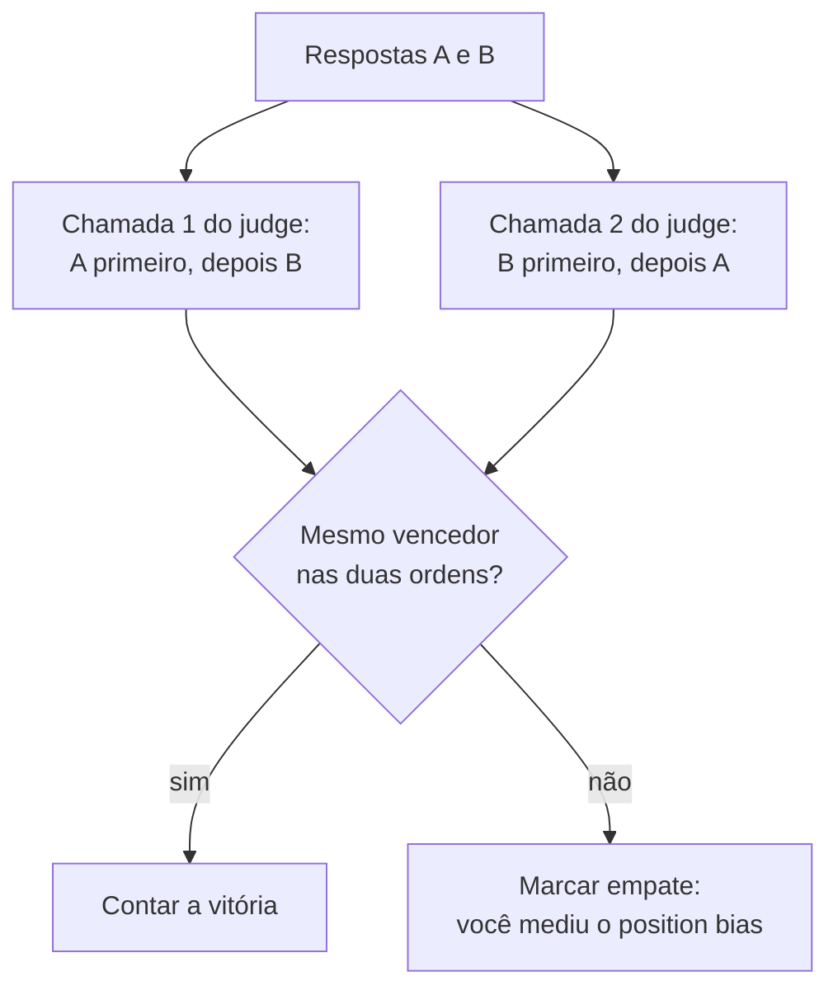

**Follow-ups:** Projete um experimento rápido para medir o position bias no seu próprio judge. Seu judge é da mesma família do seu modelo de produção e trocar de família reduz a concordância com humanos - e agora?

</details>

### 17. Como você decide se confia no seu LLM judge? Me conduza pela calibração.

<details><summary><b>Resposta</b></summary>

Você confia em um judge do mesmo jeito que confia em qualquer modelo: medindo-o contra ground truth. O processo:

1. **Construa um calibration set rotulado.** Amostre 50-100 saídas reais estratificadas por dificuldade e segmentos - incluindo, crucialmente, casos limítrofes, não apenas passes/fails claros. Faça humanos (idealmente 2-3 labellers independentes com uma rubric compartilhada) avaliá-las. Registre primeiro a concordância inter-humanos - esse é o seu teto; se humanos concordam só 70% das vezes, a rubric é ambígua e nenhum judge pode fazer melhor. Conserte a rubric antes de culpar o judge.
2. **Rode o judge, meça a concordância.** Percent agreement é legível; o **kappa de Cohen** corrige a concordância ao acaso e é o que você deve citar quando as classes são desbalanceadas (um judge que sempre diz "pass" obtém 90% de concordância em um dataset com 90% de pass, com kappa ≈ 0). Para saídas pontuadas, use correlação de postos (Spearman/Kendall) em vez de comparar scores brutos.
3. **Olhe a matriz de confusão, não só a taxa.** Falsos passes (o judge aprova uma saída ruim) costumam ser muito mais custosos que falsos fails em um gate de CI. Leia o transcript de cada discordância - na metade das vezes é o rótulo *humano* que está errado ou a rubric que está subespecificada, o que já é um sinal valioso.
4. **Itere o prompt do judge** (redação da rubric, CoT, âncoras few-shot, respostas de referência) contra o calibration set - o judge é um artefato de prompt engineering como qualquer outro, com seu próprio split de dev/test para você não fazer overfitting aos rótulos de calibração.
5. **Recalibre em gatilhos**: mudança de versão do modelo judge, mudança de rubric, drift da tarefa, ou qualquer período em que os scores do judge e as métricas online divergem. Mantenha uma pequena "suíte de regressão do judge" com discordâncias passadas.

Ponto de referência: o trabalho do MT-Bench constatou que judges fortes alcançam ~80% de concordância com humanos em qualidade de chat - cerca da taxa humano - humano. Igualar a concordância inter-humanos é a barra realista; exigir 100% é incoerente, já que seu ground truth também não chega lá.

**Vale desenhar.** Colocar a taxa humano-humano numa caixa própria é o que impede a conversa de derivar para "faça o judge chegar a 95%".


**Follow-ups:** O kappa é 0,45 - o que, especificamente, você faz em seguida? Como você mantém a calibração atualizada sem um time de labelling permanente?

</details>

### 18. Como você projeta uma boa rubric para evals model-graded, e onde o chain-of-thought se encaixa?

<details><summary><b>Resposta</b></summary>

Uma boa rubric transforma um objetivo vago de qualidade em um procedimento de decisão que um estranho cuidadoso conseguiria executar. Os movimentos de design:

- **Decomponha em checagens de critério único.** "Avalie a qualidade de 1 a 10" convida a halo effects e drift. Em vez disso: uma chamada de judge por critério - *fiel ao contexto recuperado? completo conforme o pedido do usuário? formato correto? tom apropriado?* - cada uma retornando pass/fail binário ou um veredito de 2-3 níveis. Scores compostos, se necessários, são calculados em código com pesos explícitos, não dentro da cabeça do judge.
- **Defina os veredictos extensionalmente.** Para cada critério, declare o que pass e fail significam e inclua 2-4 exemplos few-shot de ancoragem, especialmente os limítrofes - âncoras fazem mais trabalho de calibração do que qualquer adjetivo. Se precisar usar uma escala, ancore cada ponto ("3 = pelo menos uma afirmação sem suporte, resposta central correta").
- **Diga ao judge o que ignorar.** Instrua-o explicitamente a não premiar tamanho, polimento de markdown ou tom confiante, e a não penalizar brevidade - isso neutraliza parcialmente o viés de verbosidade/estilo.
- **Dê ao judge o que ele precisa.** Para tarefas factuais ou pesadas em raciocínio, inclua a resposta de referência ou o contexto recuperado; um judge avalia "isto bate com a referência / isto é sustentado pelo contexto" de forma muito mais confiável do que consegue resolver a própria tarefa.

**Chain-of-thought judging**: exija que o judge produza sua análise *antes* do veredito - por exemplo, "liste cada afirmação da resposta, marque se o contexto a sustenta e então emita PASS/FAIL como JSON". Respostas com o veredito primeiro deixam o modelo racionalizar um julgamento instantâneo; análise primeiro força o engajamento com o conteúdo, melhora mensuravelmente a concordância com humanos e - igualmente valioso - dá uma justificativa auditável para cada nota, que é o que torna as falhas de CI baseadas em judge depuráveis em vez de misteriosas.

Por fim, estruture a saída (JSON com campos `reasoning` e `verdict`) para que o parsing seja determinístico, e versione a rubric - uma edição na rubric muda a definição da sua métrica e deve invalidar comparações de score entre a fronteira.

**Follow-ups:** Quantos critérios são demais por tarefa? Seu judge de faithfulness aprova uma resposta que faz tantas ressalvas que não diz nada - que mudança na rubric resolve isso?

</details>

### 19. O que MMLU, GSM8K, HumanEval, MT-Bench e SWE-bench medem, cada um - e por que você não deveria escolher um modelo para o seu produto com base neles?

<details><summary><b>Resposta</b></summary>

- **MMLU**: exame de múltipla escolha em 57 disciplinas (STEM, humanidades, direito, medicina) que mede recall de conhecimento amplo e raciocínio leve. Modelos de fronteira se aglomeram na faixa dos 80 altos/90 - saturado, e fortemente contaminado após anos dentro do raio de explosão de todo corpus de treino.
- **GSM8K**: ~8,5 mil problemas de matemática do ensino fundamental em texto, testando raciocínio aritmético em múltiplas etapas. Também saturado na fronteira; a contaminação/overfitting é bem documentada - estudos que construíram problemas novos no estilo GSM8K (por exemplo, GSM1k) encontraram quedas de vários pontos em algumas famílias de modelos, isto é, parte do score de destaque era memorização.
- **HumanEval**: 164 problemas de completar funções em Python escritos à mão, avaliados por execução, reportados como pass@k. Minúsculo, só Python, escopo de função única - saturado há tempos e não representativo do trabalho real de software.
- **MT-Bench**: 80 prompts abertos multi-turn avaliados por um LLM judge - mede instruction-following conversacional, herda todos os vieses de judge.
- **SWE-bench**: issues reais do GitHub de repositórios Python populares; o agent deve produzir um patch que passe nos testes held-out do repositório. Os scores dependem fortemente do harness (scaffolding, retries, orçamento de compute), então comparações entre modelos muitas vezes medem o framework de agent tanto quanto o modelo. O **SWE-bench Verified** é o subconjunto de 500 issues validado por humanos que pretendia remover casos quebrados/subespecificados, e foi o número de destaque de agentic coding até 2025. Ele agora seguiu o caminho dos outros: em 2026 a OpenAI parou de reportá-lo, citando testes falhos em muitas das tarefas difíceis restantes e sinais de que modelos de fronteira haviam memorizado algumas correções, e apontou para o mais difícil SWE-bench Pro. Até um benchmark "verified" envelhece em saturação e contaminação.

Por que não deveriam guiar decisões de produto: (1) **contaminação** - conjuntos de teste públicos vazam para o pretraining, então os scores medem em parte memorização; (2) **saturação** - quando todos estão em 90%+, o ruído de ranking domina; (3) **Goodhart** - os labs otimizam explicitamente para benchmarks de destaque, então a correlação da métrica com qualidade geral se degrada; (4) **descasamento de distribuição** - nenhum deles contém seus usuários, seu domínio, suas tools ou suas restrições de latency/custo. Um modelo dois pontos "pior" no MMLU pode ser decisivamente melhor na sua tarefa de extração.

Uso correto: shortlist grosseira e acompanhamento de tendências de capacidade. Depois passe a shortlist pela *sua* suíte de evals - essa comparação é a que importa.

**Follow-ups:** Se os benchmarks públicos estão tão comprometidos, por que os labs continuam reportando-os? Que propriedades tornam um benchmark resistente a saturação e contaminação?

</details>

### 20. O que é contaminação de benchmark, e como você a detectaria ou se protegeria dela?

<details><summary><b>Resposta</b></summary>

Contaminação é dado de teste vazando para os dados de treino - o modelo viu as perguntas do benchmark (ou quase-duplicatas) durante o pretraining ou o fine-tuning, então seu score mede memorização em vez de capacidade. É endêmica porque benchmarks são publicados na web aberta, são citados em posts de blog e repositórios do GitHub, e os corpora de pretraining aspiram tudo isso. Pode ser indireta também: paráfrases, versões traduzidas, ou treino em saídas de modelos que elas mesmas resolveram o benchmark.

Abordagens de detecção, nenhuma perfeita:

- **Testes de perturbação**: reescreva as perguntas mudando a forma de superfície mas mantendo a lógica idêntica - variáveis renomeadas, números diferentes, redação parafraseada. Uma grande queda de score nas versões perturbadas indica memorização. O estudo GSM1k fez exatamente isso com o GSM8K (problemas equivalentes recém-escritos) e encontrou quedas de vários pontos em algumas famílias de modelos.
- **Sobreposição de n-grams / substrings** entre o conjunto de teste e o corpus de treino - o método clássico que os labs reportam, mas disponível apenas para quem detém o corpus, e que perde a contaminação em nível de paráfrase.
- **Probes de memorização**: dê ao modelo o prefixo de uma pergunta e veja se ele completa a resposta exata ou os próximos itens de teste literalmente; uma completude literal suspeitosamente alta de dados de teste é uma prova cabal.
- **Splits temporais**: avalie com dados criados *depois* do training cutoff do modelo - novos problemas de programação competitiva, issues do GitHub recém-abertas (a lógica por trás de benchmarks frescos/rolantes, como designs no estilo LiveBench e snapshots atualizados do SWE-bench).

Proteção, para os seus próprios evals:

- **Mantenha seu eval set privado** - nunca em um repositório público, nunca em posts de blog, e tome cuidado ao colá-lo em serviços de terceiros cujos termos permitem treinar com os inputs.
- **Atualize continuamente** a partir da produção - novas falhas são posteriores ao treino de qualquer modelo por construção, o que torna um eval set originado da produção naturalmente resistente à contaminação.
- **Reserve uma fatia nunca publicada** usada apenas para decisões finais de seleção de modelo, distinta do dev set ao qual sua iteração de prompts pode ter feito overfitting.

**Follow-ups:** A contaminação pode fazer um modelo parecer *pior*? Seu fornecedor afirma ter feito decontaminação via sobreposição de 13-gramas - o que isso deixa passar?

</details>

### 21. Como você construiria um eval baseado em execução para uma feature de geração de código?

<details><summary><b>Resposta</b></summary>

A avaliação baseada em execução é a única métrica honesta para código: rode a saída do modelo e verifique o comportamento. Similaridade textual com uma solução de referência não faz sentido - existem infinitas implementações corretas.

Componentes centrais:

1. **Formato da tarefa**: cada caso tem um enunciado do problema, um contexto de código (assinatura, trecho do repositório), **exemplos visíveis** que o modelo pode ver e **testes ocultos** usados apenas para a avaliação. Testes ocultos são essenciais: se os graders são visíveis, os modelos (e sua iteração de prompts) fazem overfitting a eles - fixar as saídas esperadas no código passa nos testes visíveis e não vale nada. HumanEval e SWE-bench avaliam ambos com testes held-out.
2. **Execução em sandbox**: código gerado não confiável roda isolado - containers ou microVMs sem rede, limites de CPU/memória e timeouts de wall-clock (loops infinitos são um modo de falha comum, não um edge case). Nunca execute a saída do modelo no ambiente do seu runner de CI.
3. **Lógica de grading**: pass = todos os testes ocultos verdes. Crédito parcial (fração de testes aprovados) é um sinal útil para error analysis, mas mantenha a métrica de destaque binária - "80% dos testes" frequentemente significa "errado". Para tarefas em nível de repositório, vale o padrão do SWE-bench: aplicar o patch, rodar a suíte de testes do próprio repositório, exigir que os testes que falhavam antes passem (fail-to-pass) *e* que o resto continue passando (pass-to-pass, que pega regressões).
4. **Métricas**: pass@1 na sua temperature de produção para a visão honesta do produto; pass@k com o estimador não enviesado (n ≥ k amostras) se o seu produto faz best-of-n com verificação. Acompanhe a taxa de compile/parse separadamente - saída sintaticamente inválida é uma classe de falha diferente de código logicamente errado.

Pegadinhas operacionais que mordem na prática: **testes instáveis (flaky)** (tempo, aleatoriedade, ordenação) criam ruído no eval - fixe seeds e relógios, coloque casos instáveis em quarentena; **drift de ambiente** - fixe as versões das dependências na imagem ou os scores mudam quando o PyPI muda; **calibração de timeout** - apertado demais e você reprova soluções lentas-mas-corretas, confundindo correção com performance.

**Follow-ups:** Como você avalia *edições* de código em um repositório grande existente versus escrever funções do zero? Sua pass rate é 60% - como você a decompõe em categorias de falha acionáveis?

</details>

### 22. Como você avalia um pipeline de RAG? Por que avaliar os componentes separadamente do sistema end-to-end?

<details><summary><b>Resposta</b></summary>

Avalie em dois níveis, porque scores end-to-end não dizem *qual* componente consertar.

**Por componente:**

- **Retrieval**: construa um conjunto rotulado de pares query → chunk(s) relevante(s) (de rotulagem humana, ou rotulagem assistida por LLM com auditoria humana; você também pode gerar perguntas *a partir de* chunks conhecidos, de modo que a relevância seja por construção). Meça **recall@k** primeiro - se a resposta não está no conjunto recuperado, a generation não consegue consertar; o recall@k é o teto da qualidade end-to-end. Adicione MRR/nDCG quando a posição no contexto importar. Evals de retrieval são baratos, determinísticos e rodam sem tocar no gerador - você pode varrer tamanhos de chunk, embedders, pesos híbridos e rerankers offline em minutos.
- **Generation (dado um contexto fixo)**: **faithfulness/groundedness** - as afirmações da resposta são sustentadas pelos chunks fornecidos? (avaliada por judge, afirmação por afirmação); **answer relevance** - ela endereça a pergunta?; **context utilisation** - ela usou o chunk certo quando vários foram recuperados, e diz corretamente "não encontrado" quando o contexto não tem a resposta (medido com casos adversariais em que você deliberadamente não recupera nada útil)?

**End-to-end:** correção da resposta final contra respostas de referência em um golden set, mais acurácia de citações (os IDs de chunks citados realmente sustentam as afirmações citadas). Este é o número que a liderança vê, e o que correlaciona com os usuários.

Por que ambos: uma falha end-to-end é ambígua entre "o retrieval perdeu o documento" e "o gerador ignorou/contradisse o documento" - as correções são completamente diferentes (re-chunk/re-embed/rerank vs mudanças de prompt/modelo). Métricas por componente localizam a falha instantaneamente. Na prática a maior parte da perda de qualidade em RAG está no retrieval (e no parsing/chunking a montante), então evals por componente também dizem onde gastar esforço. Frameworks como o RAGAS empacotam essas métricas (faithfulness, answer relevance, context precision/recall), mas os conceitos importam mais que a ferramenta.

Armadilha clássica de entrevista: citar apenas faithfulness. Um sistema que responde "não sei" para tudo é perfeitamente fiel - combine faithfulness com answer relevance/completude ou você otimizará até a inutilidade.

**Vale desenhar.** Pendurar cada métrica no componente que ela avalia é a forma mais rápida de mostrar que você sabe localizar uma falha em vez de apenas reportá-la.

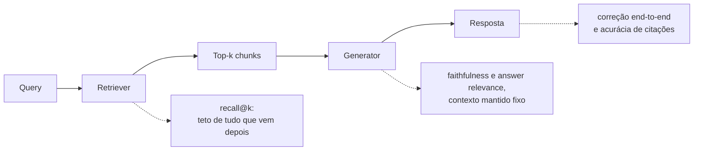

**Follow-ups:** O recall@10 é 95% mas a correção end-to-end é 70% - onde você olha? Como você mantém os rótulos de retrieval válidos quando o corpus é re-chunked?

</details>

### 23. Quais métricas de retrieval você usaria - recall@k, MRR, nDCG - e quando cada uma importa?

<details><summary><b>Resposta</b></summary>

- **Recall@k** - fração das queries em que um chunk relevante aparece no top k. A métrica principal de RAG, porque o gerador vê toda a janela top-k: para RAG normalmente não importa se o chunk gold está na posição 1 ou 7 se k = 10 e tudo vai para o prompt. Defina k como o que você realmente coloca no contexto. O recall@k é o seu teto end-to-end - acompanhe-o antes de qualquer outra coisa.
- **MRR (mean reciprocal rank)** - média de 1/posição do *primeiro* resultado relevante. Importa quando a posição 1 é especial: prompting com um único chunk, UI que mostra uma única citação principal, ou modelos que dão atenção desproporcional ao topo/início do contexto. Ignora tudo depois do primeiro acerto, então é inadequada para perguntas com múltiplas evidências.
- **nDCG@k** - discounted cumulative gain, normalizado: premia colocar itens *mais relevantes* em posições *mais altas*, suporta relevância graduada (perfeita/parcial/marginal) em vez de binária. É a métrica certa quando múltiplos chunks têm diferentes graus de utilidade e a ordenação dentro da janela importa - por exemplo, você recupera 50, faz rerank e mantém 10; o nDCG@10 é a métrica natural do reranker. Custa mais para rotular (julgamentos graduados).

Orientação prática: para um pipeline de RAG, reporte **recall@k para o retriever** (rótulos binários, barato) e **nDCG@k ou MRR para o reranker**, e observe também **precision@k / context precision** - chunks irrelevantes na janela não são de graça, eles diluem a atenção, adicionam tokens e semeiam hallucinations. Um retriever ajustado só para recall vai preencher o contexto com ruído sem cerimônia.

Nomeie também a ressalva de rotulagem: todas essas métricas são calculadas contra relevância *julgada*, e chunks recuperados sem julgamento tipicamente são tratados como irrelevantes - o que penaliza um novo retriever que encontra chunks genuinamente relevantes que seus rótulos deixaram passar (o clássico problema de pooling de IR). Audite à mão uma amostra de "misses" antes de concluir que um novo embedder é pior.

**Vale desenhar.** Colocar cada métrica no estágio a que pertence evita a confusão habitual de citar um único número para o pipeline inteiro.


**Follow-ups:** Seu novo embedder melhora o nDCG mas as respostas end-to-end pioram - que mecanismos poderiam explicar isso? Por que o recall@5 poderia importar mais que o recall@20, mesmo que seu contexto comporte 20 chunks?

</details>

### 24. Como você mede faithfulness - se a resposta do modelo está de fato fundamentada no contexto recuperado?

<details><summary><b>Resposta</b></summary>

Faithfulness (groundedness) pergunta: toda afirmação factual da resposta é sustentada pelo contexto recuperado? É a métrica anti-hallucination do RAG, distinta de correção - uma resposta pode ser fiel a um documento errado, ou infiel mas acidentalmente correta pela memória paramétrica. Em RAG você normalmente quer faithfulness, porque sustentado-pelas-fontes é o que você prometeu ao usuário.

A medição padrão é a **avaliação por judge em nível de afirmação**:

1. **Decomponha** a resposta em afirmações factuais atômicas (um LLM faz isso de forma confiável).
2. **Verifique cada afirmação** contra os chunks recuperados: uma chamada de judge por afirmação (ou em lote) com veredictos *supported / contradicted / not found*, forçado a citar o trecho de suporte - citar é um forte dispositivo de honestidade e torna os veredictos auditáveis.
3. **Score** = fração das afirmações sustentadas. Reporte contradicted separadamente de not-found; contradições são a classe de falha mais assustadora.

Esse padrão decompor-depois-verificar (como na métrica de faithfulness do RAGAS e nas abordagens baseadas em NLI que vieram antes) é muito mais confiável do que uma única chamada holística de judge "isto está fundamentado? 1-10", que passa por cima de detalhes fabricados isolados em uma resposta de resto fundamentada - e detalhes fabricados isolados são precisamente o caso perigoso.

Detalhes de design que importam: isente conteúdo não factual (ressalvas, formatação, a pergunta reformulada) da extração de afirmações; decida a política para afirmações de "conhecimento comum" que não estão no contexto (o modo estrito as reprova - correto para jurídico/médico; o modo leniente as permite - correto para chat); e construa **casos adversariais** em que o contexto deliberadamente não tem a resposta ou contradiz o conhecimento popular, para testar se o modelo segue o contexto ou seus priors.

Duas armadilhas a nomear: verificar com o *mesmo* modelo que gerou a resposta infla os scores (self-preference - use outra família); e otimizar só a faithfulness leva o sistema a hedging vazio - uma resposta que não diz nada é perfeitamente fiel. Sempre combine com answer relevance/completude. E calibre todo o pipeline do judge contra ~50 exemplos rotulados por humanos antes de ligá-lo ao CI.

**Vale desenhar.** Separar os três veredictos na página é o que diferencia você de candidatos que dizem "perguntamos a um judge se está fundamentado".

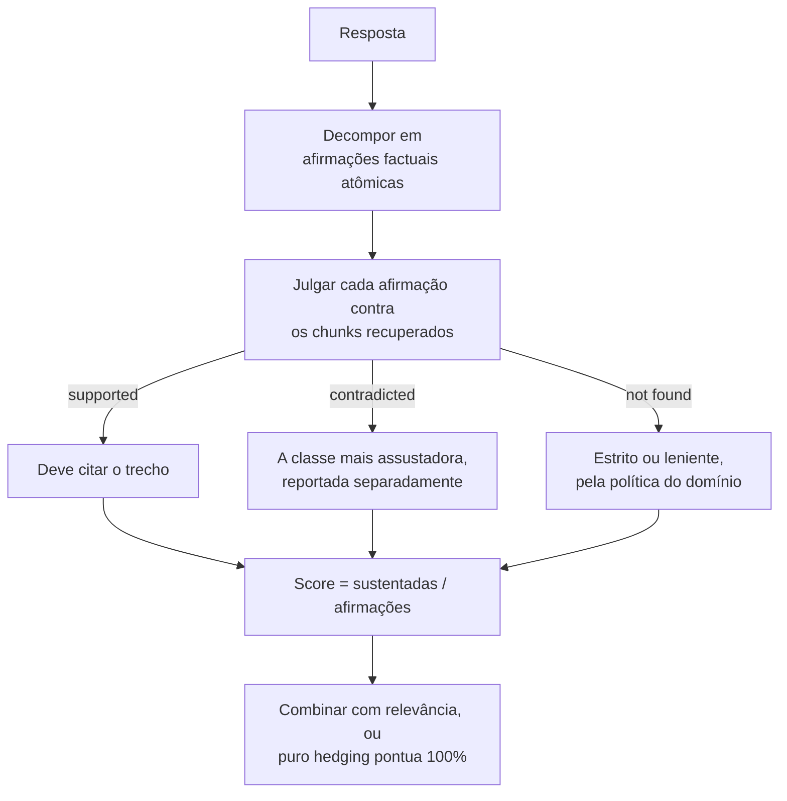

**Follow-ups:** Como você monitoraria a faithfulness de forma barata em tráfego ao vivo, onde não há resposta de referência? Uma afirmação é sustentada pelo chunk A mas contradita pelo chunk B no mesmo contexto - o que a métrica deveria fazer?

</details>

### 25. Como você conecta evals ao CI para que mudanças de prompt ou de modelo não possam regredir a qualidade silenciosamente?

<details><summary><b>Resposta</b></summary>

Trate prompts, rubrics e eval datasets como código: versionados no repositório, alterados via PR, testados a cada mudança. O pipeline:

1. **Gatilho**: qualquer mudança em um prompt template, pin de modelo/versão, parâmetros de decoding, config de retrieval ou schemas de tools dispara uma execução de eval - a mesma disciplina de gatilhos dos testes unitários. Dispare também no calendário do *provedor*: uma execução agendada (por exemplo, noturna) contra a config de produção pega mudanças de modelo upstream que você não fez.
2. **Suítes em camadas para velocidade/custo**: uma suíte que bloqueia PR de ~50-200 casos curados (assertions de guardrail + métricas-chave de qualidade) que termina em minutos e poucos dólares; a suíte completa (milhares de casos, k repetições, judges caros) roda à noite ou pré-release. Faça cache dos resultados com chave em (input, hash da config) para que caminhos inalterados não rodem de novo.
3. **Lógica de gating**: métricas de guardrail bloqueiam de forma rígida - qualquer falha na suíte de jailbreak, vazamento de PII ou regressão de validade de schema bloqueia o merge, sem discussão. Métricas de qualidade bloqueiam estatisticamente - compare com a execução de baseline *na mesma versão do dataset* e bloqueie apenas se a queda exceder um limiar de ruído que você estabeleceu (comparação pareada entre casos; com métricas avaliadas por judge, considere também a variância do judge, por exemplo, veredictos que viram em julgamentos repetidos). Caso contrário você ou carimba regressões reais ou grita "lobo" por ruído até as pessoas ignorarem o gate.
4. **Relatório no PR**: não só o score agregado - o diff por caso (quais casos viraram fail→pass e pass→fail) com links para os transcripts. Um revisor consegue olhar cinco transcripts que viraram em dois minutos; é aí que mudanças ruins de fato são pegas.
5. **Disciplina de versionamento**: todo resultado registra a versão do prompt, do modelo, do dataset e do judge. Mudou o dataset ou o judge → refaça o baseline; nunca compare scores além dessas fronteiras.

O modo de falha a evitar: um job de eval apenas consultivo cujo X vermelho todos ignoram ao fazer merge. Gates precisam bloquear e, para continuar bloqueando de forma politicamente sustentável, mantenha a suíte bloqueante pequena, rápida, estável e visivelmente correlacionada com a qualidade real.

**Vale desenhar.** Dois gates diferentes em uma mesma execução: desenhe-os e a distinção entre rígido e estatístico deixa de precisar de explicação.

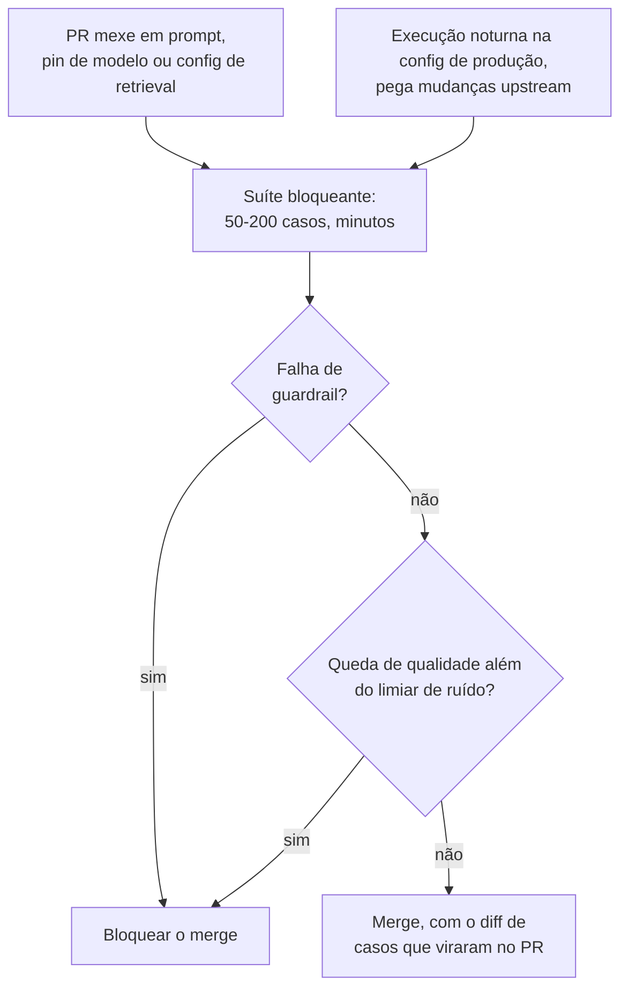

**Follow-ups:** Um PR melhora a tarefa-alvo mas faz dois casos não relacionados passarem a falhar - qual é o seu processo? Como você mantém sob controle o custo do CI baseado em judge conforme o volume de PRs do time cresce?

</details>

### 26. Como você avalia uma feature de LLM online? Projete o A/B test e cite os sinais de feedback implícito que você usaria.

<details><summary><b>Resposta</b></summary>

Evals offline preveem; testes online confirmam com usuários reais. Design:

- **Unidade de randomização**: nível de usuário (ou sessão), não de requisição - experiências com LLM têm estado, e splits por requisição contaminam a experiência de cada usuário e violam a independência para métricas em nível de sessão.
- **Métrica primária**: o proxy honesto mais próximo do sucesso da tarefa - taxa de resolução sem escalação para humano (bots de suporte), taxa de aceitação de sugestões (assistentes de código), taxa de conclusão de tarefa (agents). Não apenas "taxa de thumbs up" - esparsa demais.
- **Métricas de guardrail**: latency p95, custo por sessão, taxa de flags de segurança, taxa de escalação - o experimento falha automaticamente se elas regredirem, independentemente do que a métrica primária fizer.
- **Cálculo de poder antes do lançamento**: deltas de qualidade em LLM costumam ser pequenos (2-5% relativo), então calcule o tamanho de amostra necessário com honestidade; A/B tests sem poder geram ruído vestido de decisão. Fique atento a efeitos de novidade na primeira semana e à heterogeneidade por segmento (uma vitória no tráfego em inglês pode esconder uma perda no japonês).

**Sinais implícitos** - críticos porque o feedback explícito é esparso (thumbs vêm de uma porcentagem de um dígito baixo das sessões) e enviesado (usuários irritados clicam mais):

- **Taxa de regeneração / retry** - o usuário rejeitou a resposta; um dos sinais negativos mais fortes.
- **Copy-to-clipboard, aceitação de código, edit distance** da saída aceita antes do uso - edit distance alto significa que a saída precisou de retrabalho.
- **Reformulações de follow-up** ("não, eu quis dizer...") - detectáveis com um classificador barato; indicam falha em satisfazer.
- **Abandono** no meio da resposta ou logo após; **escalação da sessão** para um canal humano.
- **Resultados em nível de tarefa** onde for possível instrumentar: ticket reaberto, PR mergeado, reserva concluída.

Para mudanças de retrieval/ranking especificamente, mencione **interleaving**: misture resultados dos dois rankers em uma só lista e veja qual lado ganha os cliques. É intra-usuário, então alcança significância com uma ordem de magnitude menos tráfego que o A/B - o truque padrão da busca na web, diretamente aplicável ao retrieval de RAG.

Feche o loop: registre a atribuição de braço nos traces para que a error analysis offline possa comparar transcripts entre os braços, e acompanhe a correlação score-de-eval-offline vs resultado-online - se divergirem, seu eval set se afastou da produção.

**Vale desenhar.** O ramo de guardrail a jusante da métrica primária é a parte que os entrevistadores esperam ouvir.

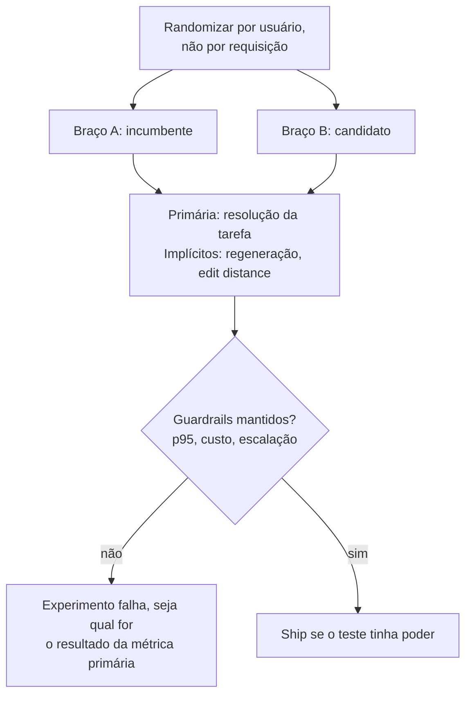

**Follow-ups:** A taxa de thumbs-up subiu mas a taxa de escalação também subiu - construa uma história que explique ambos. Quando você faria ship só com evals offline, sem um A/B?

</details>

### 27. Você tem 500 transcripts de produção sinalizados como falhas. Me conduza pelo seu processo de error analysis.

<details><summary><b>Resposta</b></summary>

O objetivo é sair com uma lista ranqueada de *modos* de falha e consertar o maior - não consertar 500 bugs individuais.

1. **Leia antes de automatizar.** Leia pessoalmente 30-50 transcripts de ponta a ponta, incluindo retrievals e tool calls, não apenas as respostas finais. Escreva uma nota aberta de uma linha por transcript ("ignorou a segunda restrição do pedido", "o retrieval devolveu o documento de política de 2023"). Resista a categorias prematuras - open coding primeiro, taxonomia depois; baldes predefinidos te deixam cego para os modos de falha que você não antecipou.
2. **Agrupe em uma taxonomia.** Agrupe as notas em modos de falha. Um LLM pode ajudar a agrupar os 500 depois que você derivou à mão a taxonomia a partir dos seus 50 - mas valide as atribuições dele em uma amostra; não terceirize a etapa de entendimento. Saída típica: 5-10 modos como *retrieval miss*, *instrução parcialmente seguida*, *argumentos de tool errados*, *violação de formato*, *intent do usuário mal interpretado*, *na verdade-não-é-uma-falha* (feedback mal rotulado - sempre uma fatia não trivial; thumbs-down muitas vezes significa "não gostei da política", não "o modelo falhou").
3. **Ranqueie por frequência × severidade × facilidade de correção.** Um modo que causa 30% das falhas com uma correção de prompt de uma linha vence um modo de 5% que exige um novo modelo. Pareto é confiavelmente seu amigo aqui: o maior cluster costuma ser um único bug de prompt ou uma lacuna de retrieval.
4. **Corrija o maior cluster, verifique, repita.** Antes de corrigir, converta 10-20 exemplares desse cluster em casos de eval - esse é o seu teste de regressão e a sua medida de sucesso da correção. Aplique a correção, rode os evals, confirme que o cluster encolhe sem que outros cresçam, faça ship e refaça a análise no próximo ciclo.

Dois hábitos seniores: reporte base rates ("retrieval misses são 32% das falhas, afetando 4% de todas as sessões") para que o esforço se mapeie ao impacto; e institucionalize o loop - uma hora semanal de leitura de transcripts para o time inteiro supera qualquer dashboard, porque dashboards dizem *que*, transcripts dizem *por quê*.

**Vale desenhar.** O funil mostra os números encolhendo de 500 para uma correção, que é a disciplina que a pergunta está testando.

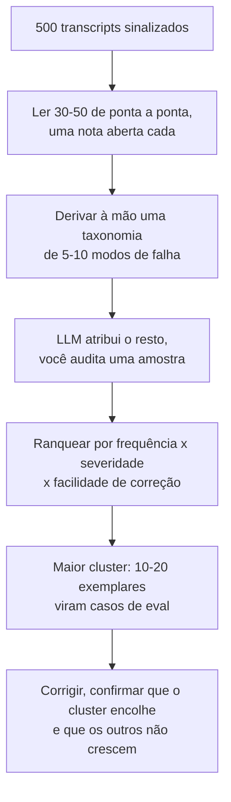

**Follow-ups:** Como você lida com modos de falha que só aparecem em contexto multi-turn? O que você faz com o cluster "na verdade não é uma falha"?

</details>

### 28. Como você mantém um eval set atualizado ao longo do tempo, e como evita fazer overfitting a ele?

<details><summary><b>Resposta</b></summary>

Um eval set decai de duas formas: o **mundo muda (drift)** (novos intents de usuários, features, idiomas - o conjunto congelado deixa de representar o tráfego) e **você faz overfitting a ele** (meses de iteração de prompts contra os mesmos 200 casos significam que as melhorias são em parte específicas desses casos - Goodhart aplicado a si mesmo). Ambos produzem o mesmo sintoma: os scores offline sobem ou se mantêm enquanto as métricas online não.

Práticas de atualização:

- **Fluxo contínuo da produção**: um pipeline permanente encaminha thumbs-downs, escalações, regenerações e disparos de guardrail para uma fila de triagem; alguém revisa semanalmente e promove falhas reais para o eval set. Dados frescos de produção têm uma propriedade bônus: são posteriores ao training cutoff de qualquer modelo, tornando-os naturalmente resistentes à contaminação.
- **Aposente casos saturados** - casos que passam há meses deixam de discriminar entre candidatos. Mova-os para uma camada barata de smoke-test/regressão em vez de deletá-los (eles ainda pegam quebras catastróficas); mantenha a camada discriminativa difícil, mirando talvez 60-80% de aprovação para que haja margem para medir melhoria.
- **Auditorias de cobertura**: compare periodicamente a distribuição de intents/tópicos/idiomas do eval set com o tráfego atual de produção e preencha as lacunas, sinteticamente se necessário.

Práticas anti-overfitting, tiradas direto da higiene de ML:

- **Split dev/test**: itere os prompts contra a fatia de dev; toque na fatia de test held-out apenas para decisões de ship, com baixa frequência. Se os scores de dev e test divergem, você fez overfitting ao dev - atualize-o.
- **Rotacione e expanda**: casos de produção recém-promovidos entram primeiro na fatia de *test*, mantendo-a representativa e não manipulada.
- **Observe a correlação offline - online** explicitamente: é o canário de uma suíte obsoleta.

**Versionamento é o que torna a atualização segura**: toda mudança no dataset incrementa uma versão, os resultados sempre registram as versões de dataset + prompt + modelo + judge, e as comparações de score só acontecem dentro de uma versão. Caso contrário, "melhoramos 5 pontos" é ininterpretável - você pode ter apenas trocado casos difíceis por outros. Quando precisar comparar entre versões, rode a config de baseline de novo no novo dataset.

**Vale desenhar.** Mostrar os novos casos entrando primeiro no test, e não no dev, é o detalhe que diz ao entrevistador que você realmente já operou isso.

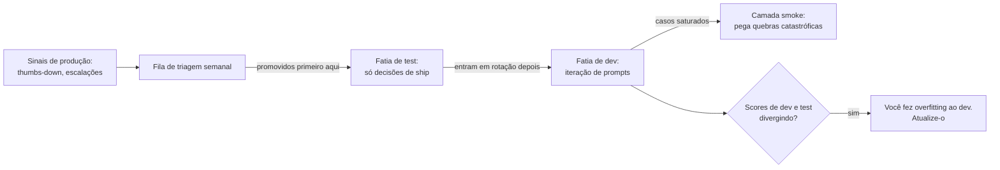

**Follow-ups:** Concretamente, como você detectaria que seu time fez overfitting ao dev set? Quem faz a triagem da fila de falhas de produção, e qual é a barra de admissão para um novo caso de eval?

</details>

### 29. Como você usaria dados sintéticos para construir ou estender um eval set, e quais são os modos de falha?

<details><summary><b>Resposta</b></summary>

A geração sintética é como você obtém cobertura antes de ter tráfego, e como preenche lacunas de distribuição depois. Bem feita, ela é estruturada, não "gere 500 perguntas de teste":

1. **Construa primeiro uma taxonomia de cenários** - dimensões como intent × persona × dificuldade × idioma × condição de borda (pedido ambíguo, restrições contraditórias, informação faltante, formulação adversarial). Gere amostrando combinações, de modo que a cobertura seja por construção em vez de esperar que o modelo varie.
2. **Fundamente a geração em artefatos reais** sempre que possível: para RAG, gere perguntas *a partir de* chunks reais do corpus - você obtém pares (pergunta, chunk gold) com rótulos de relevância de graça, que é a forma padrão de dar o bootstrap em evals de retrieval. Para agents, gere tarefas a partir de schemas de tools e estados de ambiente reais.
3. **Gere hard negatives deliberadamente**: perguntas que o corpus *não* consegue responder (testa o comportamento "não sei"), queries quase-acertos, tentativas de prompt injection para suítes de guardrail.
4. **Revisão humana antes da admissão.** Todo caso sintético passa por uma pessoa: é realista, a resposta esperada está de fato correta, é inequívoco? Reserve orçamento para rejeitar 20-40%. Evals sintéticos sem revisão são como times acabam otimizando contra respostas de referência erradas.

Modos de falha a nomear:

- **Descasamento de distribuição**: os casos gerados são mais limpos, melhor pontuados, mais educados e mais resolvíveis do que usuários reais - os modelos parecem melhores em conjuntos sintéticos do que no tráfego de produção. Mitigue semeando a geração com exemplos reais e imitando a bagunça deles (erros de digitação, fragmentos, idiomas misturados).
- **Mode collapse / baixa diversidade**: LLMs produzem o caso mediano repetidamente; a taxonomia mais instruções explícitas de diversidade mais dedup (filtragem por similaridade de embeddings) contrabalançam isso.
- **Circularidade gerador - judge**: se a mesma família de modelos gera as perguntas, as responde e as julga, os vieses se alinham em cada estágio e os scores inflam. Cruze as famílias entre os papéis.
- **Rótulos errados em escala**: uma resposta de referência sintética sutilmente errada corrompe silenciosamente sua métrica - pior do que nenhum caso.

Posicione os dados sintéticos com honestidade: um bootstrap e um preenchedor de lacunas que as falhas de produção progressivamente substituem, não um substituto permanente para dados reais.

**Follow-ups:** Como você mediria se seu conjunto sintético prevê a performance em produção? Gere casos de eval para uma feature totalmente nova com zero usuários - conduza-me por isso para uma feature específica.

</details>

### 30. Como você mede a concordância entre anotadores em um esforço de rotulagem humana, e o que faz quando seus anotadores discordam muito?

<details><summary><b>Resposta</b></summary>

Meça antes de confiar em qualquer rótulo, e nunca apenas com percent agreement bruto. Numa tarefa em que 90% dos exemplos passam, dois anotadores que dizem "pass" por reflexo concordam 90% das vezes sem carregar nenhuma informação. Métricas corrigidas pelo acaso resolvem isso: kappa de Cohen para dois anotadores em rótulos categóricos, kappa de Fleiss para mais de dois, alpha de Krippendorff quando você tem rótulos faltantes, mais de dois avaliadores ou escalas ordinais. O alpha é o mais flexível e é o que eu usaria por padrão em escala de produção.

Na interpretação, o kappa entre pares de humanos costuma ficar em algum ponto entre 0,5 e 0,8, dependendo de quão subjetiva é a tarefa. Extração objetiva deveria ficar perto de 0,9. Trabalho genuinamente subjetivo de preferência muitas vezes fica mais baixo, e isso não é um defeito.

Quando a concordância é ruim, isso é diagnóstico, não um incômodo. Duas causas. Ou a rubric está subespecificada, que é o caso usual e é corrigível, ou a tarefa é irredutivelmente subjetiva, o que não é. Distinga-as lendo as discordâncias. Se dois revisores divergem em "isto é útil" porque um conta o tamanho como utilidade, isso é um bug de rubric: defina o critério, adicione exemplos de ancoragem de cada veredito, decomponha "qualidade" em critérios binários separados e meça de novo.

O processo que eu rodo: ~50 itens sobrepostos entre três anotadores, meço o alpha, leio cada discordância, reescrevo a rubric, meço de novo em itens novos. Só quando a concordância é aceitável eu escalo para um anotador por item, com uma amostra de sobreposição de ~10% para continuar monitorando o drift.

O retorno importa para judges: a concordância humano-humano é o teto. Se os humanos chegam a 0,65, um judge em 0,65 está em paridade, não quebrado. Perseguir 95% de concordância do judge numa tarefa em que humanos concordam 70% significa que você está ajustando as idiossincrasias de um anotador.

**Follow-ups:** Seus anotadores chegam a um alpha de 0,4 e a reescrita da rubric não ajuda. E agora? Como você detectaria um anotador sofrendo drift ao longo de um mês?

</details>

### 31. Você quer detectar uma melhoria de 3 pontos na pass rate. De quantos exemplos de eval você precisa, e como reduz esse número?

<details><summary><b>Resposta</b></summary>

Trabalhe de trás para frente a partir do efeito mínimo detectável, em vez de escolher um número redondo como 100 e torcer.

Para duas proporções independentes com ~80% de poder e 95% de confiança, o n necessário por braço é aproximadamente 2,5 / delta^2 quando a taxa-base está em torno de 80%. Com delta = 0,03, são cerca de 2.800 exemplos por braço. Com 2 pontos, ~6.300. Com 7 pontos, ~500. Esta é a aritmética desconfortável por trás da maior parte do teatro de evals: times declaram vitória em deltas de 4 pontos sobre 100 exemplos, onde o piso de ruído é de cerca de 8 pontos.

A alavanca é o pareamento. Você não está rodando dois grupos aleatórios de usuários, está rodando ambas as variantes sobre os exemplos idênticos, então use isso. Em um design pareado só os pares discordantes carregam sinal: exemplos em que A passou e B falhou, ou o inverso. Tudo o que ambos acertaram ou ambos erraram não contribui com nada. O teste de McNemar sobre as contagens discordantes, ou um bootstrap sobre o vetor de deltas pareados por exemplo, tipicamente reduz o tamanho de amostra necessário várias vezes, porque você removeu a dificuldade do exemplo como fonte de variância. A economia depende de quantos exemplos viram: quanto menos pares discordantes em relação ao delta líquido, maior o ganho. Detectar alguns pontos de diferença líquida pode cair para centenas em vez de milhares.

```python
import numpy as np

def paired_bootstrap(a, b, n=10_000):
    """a, b: resultados 0/1 por exemplo nos MESMOS exemplos."""
    d = np.asarray(a, float) - np.asarray(b, float)
    idx = np.random.randint(0, len(d), (n, len(d)))
    boot = d[idx].mean(axis=1)
    return d.mean(), np.percentile(boot, [2.5, 97.5])
```

Faça ship quando o intervalo estiver inteiramente de um lado do zero.

Duas ressalvas. O ruído de sampling significa que você deve fazer a média de várias execuções por exemplo, ou o pareamento fica poluído. E se você espiar repetidamente, corrija por isso, ou sua taxa de falsos positivos de 5% não é 5%.

**Follow-ups:** Seu cálculo de MDE diz que você precisa de 2.800 exemplos e você tem 200. O que você realmente faz? Quando um design pareado não está disponível para você?

</details>

### 32. Você vai trocar o modelo por trás de uma feature em produção. Me conduza por shadow, canary e A/B. Quando usar cada um?

<details><summary><b>Resposta</b></summary>

São uma sequência com exposição crescente de usuários e qualidade crescente de evidência, e respondem a perguntas diferentes. Os evals offline vêm primeiro; estes três são o que você faz depois.

Shadow: espelhe o tráfego de produção para o candidato, sirva a resposta do incumbente ao usuário, pontue o candidato offline. Responde "o candidato se comporta de forma sensata na distribuição de entrada real", o que seu eval set não consegue dizer porque seu eval set não é o seu tráfego. Pega crashes, quebras de formato, recusas, regressões de latency e explosões de custo em inputs reais, com risco zero para o usuário. Custos: você paga inference em dobro, e há uma aresta cortante que as pessoas deixam passar. Se a feature tem efeitos colaterais, fazer shadow de um agent significa que ele realmente emite os reembolsos e envia os emails duas vezes. Você precisa de modo somente leitura ou tools de escrita mockadas antes de fazer shadow de qualquer coisa agentic.

O que o shadow não consegue dizer é se os usuários gostam, porque nenhum usuário viu.

Canary: sirva o candidato a uma fatia pequena, ~1-5%, com guardrails ligados a rollback automático em taxa de erro, latency, custo e violações de segurança. Responde "isto sobrevive ao contato com usuários", e trata de raio de explosão, não de estatística. Um canary a 2% quase nunca terá poder para resolver uma diferença de qualidade de 2 pontos.

A/B: randomização em nível de usuário, com poder, rodado por uma a duas semanas contra uma métrica north-star de produto mais guardrails. É o único que responde "isto é melhor para os usuários", e o único que enxerga efeitos de novidade e comportamento de horizonte mais longo, como retenção e taxas de escalação.

Nem toda mudança merece todos os estágios. Uma correção de typo em prompt vai de eval offline para ship. Uma troca de família de modelo recebe a escada completa, porque é aí que o comportamento muda de maneiras que seu eval set nunca viu.

**Vale desenhar.** Escrever a pergunta que cada estágio responde sob cada caixa é o que impede os três de soarem intercambiáveis.

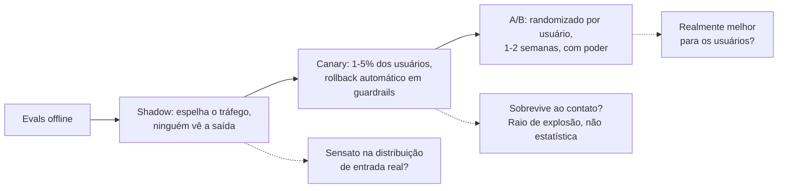

**Follow-ups:** Como você faria shadow de um agent que escreve em um banco de dados de produção? Seu canary parece ótimo a 2% e a qualidade despenca a 50%. O que aconteceu?

</details>

### 33. Como você instrumenta custo e latency de uma feature agentic, e o que realmente causa o aumento gradual de custo?

<details><summary><b>Resposta</b></summary>

Instrumente no nível de span e agregue no nível de tarefa. Todo span de chamada de modelo carrega tokens de input, tokens de output, tokens em cache, modelo e versão, e um custo calculado. Todo span também carrega as dimensões pelas quais você vai querer agrupar depois: rota ou feature, versão do prompt template, tier do cliente e um ID de tarefa que amarra o trace inteiro. Cuidado com a cardinalidade; rótulos por usuário em métricas vão destruir seu banco de séries temporais, então mantenha atributos de alta cardinalidade nos traces e as dimensões das métricas grosseiras.

A métrica de destaque é o custo por tarefa resolvida, não o custo por chamada. Esta é a distinção que separa quem já operou esses sistemas de quem não operou. Um modelo mais barato que precisa de três loops extras de tool calling e mesmo assim escala para um humano é mais caro em todos os eixos, e o custo por chamada diz que ficou mais barato.

O que realmente cresce, aproximadamente em ordem: crescimento do prompt template, porque cada incidente adiciona um parágrafo e ninguém remove nenhum; acúmulo de contexto em sessões multi-turn, onde o turno 20 custa 10x o turno 1; top-k de retrieval aumentado durante um pânico de recall e nunca reduzido; contagem de passos do agent, que tem a cauda mais gorda; e orçamentos de reasoning tokens, que são cobrados e invisíveis para o usuário.

Para latency, acompanhe time-to-first-token e o total separadamente, em p50, p95 e p99. Com streaming, o TTFT é o que os usuários sentem e o total é o que seus timeouts atingem. Acompanhe também a taxa de cache hit do prompt, já que uma edição de prompt que quebra o prefixo do cache pode multiplicar o custo da noite para o dia sem nenhuma mudança visível.

Alerte sobre a forma da distribuição, não sobre médias. A contagem média de passos fica estável enquanto um loop descontrolado queima milhares; o p99 da contagem de passos e um guard rígido de max-steps pegam isso. Acompanhe truncamento e taxas de esgotamento de orçamento como falhas de primeira classe.

**Follow-ups:** Seu custo por tarefa dobrou, mas todas as métricas por chamada estão estáveis. Onde você olha? Como você atribuiria custo a um cliente específico sem métricas de alta cardinalidade?

</details>

### 34. Prompts e completions contêm dados de usuários. Como você redige PII em traces sem destruir sua capacidade de fazer debug?

<details><summary><b>Resposta</b></summary>

Redija na ingestão, antes da persistência, não na leitura. Redigir na leitura significa que o dado bruto já está no seu trace store e qualquer lacuna de controle de acesso agora é uma violação. Uma vez escrito, é seu.

A versão ingênua, substituir tudo por [REDACTED], torna os traces inúteis. Uma conversa em que todo nome é [REDACTED] não pode ser seguida. A correção é pseudonimização em vez de remoção: detecte a entidade e então a substitua por um token estável derivado de um HMAC com chave do valor, de modo que a mesma pessoa vire PERSON_a91f de forma consistente ao longo do trace. Você ainda consegue seguir "o usuário perguntou sobre o pedido de PERSON_a91f, e a tool devolveu o registro errado", que é a pergunta de debugging, sem nunca armazenar o nome. Preservar a forma também ajuda: mantenha o tipo, o tamanho aproximado e a posição, já que "o modelo alucinou um número de 16 dígitos" é uma descoberta.

A detecção é em camadas porque as duas abordagens falham de formas diferentes. Padrões determinísticos pegam dados estruturados de forma barata e confiável: emails, números de cartão com checagem de Luhn, documentos nacionais de identidade. Uma passada de NER pega nomes, endereços e menções em texto livre que padrões nunca pegarão, ao custo de latency e lacunas de recall. Rode os padrões inline e a passada do modelo inline se puder arcar, ou de forma assíncrona sobre uma amostra se não puder.

Depois, estruture o armazenamento em camadas. Traces redigidos recebem retenção longa e acesso amplo. A captura bruta, se você precisar dela, recebe um TTL curto de dias e não meses, criptografia, logging de acesso e um processo break-glass, e eu a limitaria apenas a traces de erro.

Duas coisas que as pessoas esquecem. Indexe os traces por ID de usuário para que um pedido de exclusão seja um delete-by-key em vez de um full scan. E não envie prompts brutos a um judge de terceiros ou fornecedor de eval sem verificar se o acordo de dados cobre isso.

**Follow-ups:** Seu redator de NER perde ~5% dos nomes. Isso é aceitável? Como você faz debug de uma falha cuja causa raiz era exatamente o texto que você redigiu?

</details>

### 35. Projete uma fila de revisão humana para uma feature de LLM em produção. O que é revisado, e quanto?

<details><summary><b>Resposta</b></summary>

A primeira decisão é o que amostrar, e a resposta padrão de "traces aleatórios" desperdiça o orçamento. Se o sistema acerta 90% das vezes, a amostragem aleatória gasta 90% da cara atenção humana confirmando coisas que funcionaram.

Eu estratifico em quatro fluxos. Primeiro, falhas suspeitas: scores baixos do judge, acionamentos de guardrail, erros de tools, retries. Maior rendimento. Segundo, sinais negativos implícitos: regenerações, abandono, thumbs-down, escalação para um atendente humano, edição pesada da saída aceita. São baratos e honestos. Terceiro, rotas de alto risco independentemente de sinal, porque uma falha rara numa ação de cobrança custa mais que uma comum num resumo. Quarto, e inegociável, uma pequena amostra aleatória uniforme de talvez 5%.

Essa fatia aleatória é o que mantém o sistema honesto. Os outros três fluxos são filtrados pelas suas crenças atuais sobre como é uma falha, então são estruturalmente cegos para modos de falha que você não imaginou e para qualquer coisa que seu judge pontue como ok. A amostra aleatória é também o único fluxo que dá uma estimativa não enviesada da taxa de falha real. Os times a cortam primeiro quando o orçamento aperta, e depois não conseguem dizer com que frequência o produto funciona.

Mecânica da fila: um item é um trace mais o contexto renderizado que o modelo viu, não uma string solta. Os revisores dão veredictos binários por critério, nunca de 1 a 10, porque o scoring numérico pointwise sofre drift entre revisores e dentro de um mesmo revisor ao longo de um turno. Exija uma descrição de falha de uma linha em texto livre; esse texto é a matéria-prima para o clustering.

Oriente o orçamento com realismo: ~20-40 transcripts de chat por hora, muito menos para trajetórias de agent, que podem levar 10 minutos cada.

O mais importante: devolva os rótulos para onde importam - para o calibration set do judge, para o eval set e para correções de prompt. Uma fila que só produz uma porcentagem de qualidade é digitação de dados.

**Follow-ups:** Como você manteria dois revisores consistentes ao longo de seis meses? O que você cortaria primeiro se o orçamento de revisão caísse pela metade?

</details>

### 36. Seu time fez um exercício de red-team e encontrou 30 formas de quebrar o assistente. Como você transforma isso em algo durável?

<details><summary><b>Resposta</b></summary>

Um exercício de red-team encontra problemas uma vez. Uma suíte de evals é o que os mantém corrigidos. A conversão é todo o valor, e a maioria dos times a pula: corrigem o prompt, fecham os tickets e regridem silenciosamente três releases depois.

Cada achado vira um caso de teste com o input do ataque, o critério de política que ele violou e um grader. Prefira um grader determinístico onde a violação é verificável (um número de cartão apareceu na saída, ele chamou a tool de reembolso) e recorra a um judge com uma rubric de escopo bem restrito onde não é.

O movimento crítico é generalizar além da string literal. Se você adiciona o prompt exato de jailbreak e nada mais, vai corrigir essa string. O próximo release passa na sua suíte e falha para o mesmo ataque reformulado. Então cada achado se expande em ~5-20 mutações: paráfrases, um idioma diferente, um enquadramento diferente, o mesmo ataque embutido em um documento recuperado em vez de digitado pelo usuário. Mantenha a taxonomia por trás delas: enquadramento de roleplay, truques de encoding, injection indireta via conteúdo recuperado ou saída de tool, escalada multi-turn em que o turno 1 é inocente. A taxonomia é o que generaliza; os prompts individuais são instâncias.

Esses casos pertencem à suíte de guardrail, não à de qualidade. Binários, must-pass, qualquer falha bloqueia o merge. Você não troca um jailbreak por um ganho de utilidade.

Cadência: humanos fazem red-team em um calendário e a cada mudança importante, porque encontram categorias novas. A suíte automatizada roda a cada CI, porque defende as antigas. Acompanhe a taxa de sucesso de ataques sobre a suíte como tendência.

Uma cautela: mantenha um holdout privado e não publique o conjunto inteiro. Uma suíte pública de ataques acaba no próximo pretraining, e então passa a medir memorização.

**Follow-ups:** Como você impede que uma suíte de red-team fique obsoleta conforme os modelos melhoram? Sua taxa de sucesso de ataques é 0% há seis meses. Boa notícia ou má?

</details>

### 37. Seu modelo judge está sendo descontinuado e você precisa migrar para uma nova versão. Como você mantém seus scores comparáveis?

<details><summary><b>Resposta</b></summary>

Parta do fato de que o score é função do judge, não apenas do sistema. Uma mudança de versão do judge altera seus números sem nenhuma mudança no produto. Se o dashboard muda de base silenciosamente, você vai gastar uma semana depurando uma regressão que nunca aconteceu ou, pior, perder uma real escondida sob um deslocamento do judge.

Preventivamente: fixe (pin) a versão exata do modelo judge, nunca um alias flutuante. Aliases são reapontados por baixo de você, e essa é uma das formas mais comuns pelas quais o histórico de evals de um time silenciosamente deixa de ser comparável. O prompt do judge é código e é versionado junto. Toda linha de resultado registra a versão do dataset, a versão do grader, a versão do modelo judge e os parâmetros de sampling.

Para a migração em si, trate a mudança de judge como uma mudança que exige seu próprio eval, porque é exatamente isso que ela é. Concretamente: rode de novo o calibration set rotulado por humanos sob o novo judge e compare a concordância com a do antigo. O novo judge só é aceitável se a concordância com humanos for pelo menos tão boa; um modelo mais novo e mais forte não é automaticamente um judge melhor para a sua rubric, e eu já vi modelos mais fortes serem judges piores porque raciocinam além de uma rubric que consideram errada.

Depois, rode em dual-run. Pontue os eval sets dos últimos vários releases sob ambos os judges e publique o offset, para saber se o novo judge simplesmente é 3 pontos mais rigoroso. Refaça o baseline explicitamente e anote o dashboard na data da virada. Nunca misture versões de judge dentro de uma única comparação A-vs-B, que é o verdadeiro pecado capital.

Uma salvaguarda contínua e barata: mantenha um judge sanity set de ~30 itens com veredictos conhecidos e inequívocos e rode-o antes de cada lote de eval. Se o judge falhar neles, o lote é anulado e algo mudou upstream.

**Vale desenhar.** Enquadra a troca de judge como uma mudança que precisa passar em seu próprio eval, que é a resposta que a pergunta está procurando.

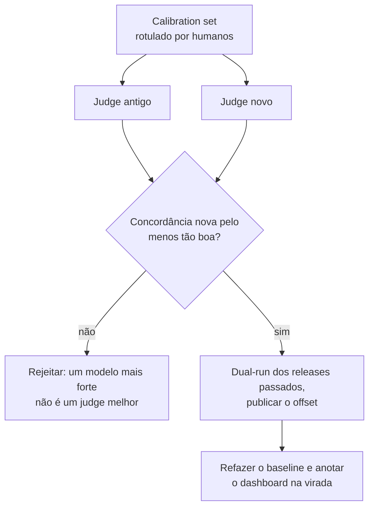

**Follow-ups:** O novo judge concorda um pouco menos com humanos, mas é 5x mais barato. Você o adota? Como você detectaria um drift do judge se a versão está genuinamente fixada?

</details>

### 38. Você adiciona um router que envia queries fáceis para um modelo barato e as difíceis para um modelo de fronteira. Como você avalia o router?

<details><summary><b>Resposta</b></summary>

Avalie-o como um trade-off custo-qualidade, não como um classificador. O trabalho do router não é rotular queries como "difíceis" corretamente, é comprar a maior qualidade por dólar, e o enquadramento de classificação esconde o único erro que importa.

Comece rodando ambos os modelos no eval set inteiro, de modo que cada exemplo tenha um resultado do modelo barato e um do modelo forte. Isso dá três pontos de referência de graça: sempre-barato, sempre-forte e o router oracle, que envia um exemplo ao modelo forte somente quando o barato falha nele. O oracle é o seu teto, e a distância entre sempre-barato e sempre-forte é a qualidade total em jogo.

Depois varra o limiar do router e plote qualidade contra custo, ou contra a fração do tráfego enviada ao modelo forte. A curva de um bom router se curva para cima: a maior parte da qualidade do modelo forte por uma fração do custo. Compare com um router aleatório na mesma fração de modelo forte, que é a reta entre os dois extremos. Um router que não supera essa reta está adicionando latency e complexidade por nada. Reporte um ou dois pontos de operação, como a qualidade retida com 30% do tráfego no modelo forte.

O erro assimétrico é a falha de roteamento para baixo: um exemplo que o modelo barato erra e que o router enviou para ele mesmo assim. Erros de roteamento para cima só custam dinheiro. Meça a taxa de falha de roteamento para baixo por fatia, porque routers falham justamente nos segmentos que parecem fáceis e não são: queries curtas com complexidade oculta, inputs em outros idiomas, domínios de cauda longa.

Dois detalhes de produção. Os inputs do router sofrem drift como tudo o mais, então monitore a fração do modelo forte ao longo do tempo; um salto repentino significa que o tráfego mudou ou o router quebrou. E em produção você só observa o modelo que de fato chamou, então mantenha uma pequena fatia randomizada em que ambos os modelos rodam. Sem ela você nunca consegue medir o que o router está custando em qualidade.

**Follow-ups:** Seu router corta o custo em 60% e a qualidade agregada cai 1 ponto. O que mais você checa antes de fazer ship? Como você avaliaria uma cascade que tenta o modelo barato primeiro e escala em caso de baixa confiança, em vez de rotear de antemão?

</details>

## Avançado

### 39. Como você avalia agents? Compare as abordagens baseadas em trajetória e baseadas em resultado.

<details><summary><b>Resposta</b></summary>

Agents tornam a avaliação mais difícil de três formas: existem muitos caminhos válidos para o sucesso, o estado se acumula entre os passos (erros iniciais se compõem ou são recuperados) e os resultados dependem de um ambiente, não só de texto. Duas abordagens complementares:

**Baseada em resultado**: a tarefa de fato foi concluída? Verificada programaticamente contra o estado final do ambiente - os testes passam no repositório com patch (SWE-bench), a linha do banco de dados tem a reserva correta (τ-bench), o arquivo existe com o conteúdo correto, o status do pedido mudou. É o padrão-ouro quando checável: é objetivo, não penaliza estratégias não convencionais-mas-válidas e é o que os usuários valorizam. Seus custos: você precisa de um **simulador de ambiente em sandbox** com tools realistas, estado semeado e capacidade de reset (evals precisam ser repetíveis e não podem tocar em sistemas de produção); construir e manter esses simuladores é a maior parte do trabalho de engenharia em evals de agents. Para tarefas multi-turn você frequentemente precisa também de um **usuário simulado** (um LLM interpretando o cliente), que introduz sua própria variância e questões de realismo.

**Baseada em trajetória**: pontue o *caminho* - acurácia na escolha de tools (a tool certa para o passo), correção dos argumentos, eficiência de passos (passos dados vs um mínimo razoável; detecção de loops), comportamento de recuperação de erros e segurança ao longo do caminho (um agent que tem sucesso mas executou um comando destrutivo pelo caminho é uma falha). Avaliada por assertions contra sequências esperadas de tools onde o caminho é restrito, ou por judges sobre o trace onde não é. O scoring de trajetória é a camada *diagnóstica*: as métricas de resultado dizem a taxa de falha de 40%; a análise de trajetória diz que são majoritariamente argumentos errados para a tool de busca no passo 2.

Práticas que importam: rode **k tentativas por tarefa** - a variância de agents é enorme, execuções únicas são anedotas; reporte pass@k *e* **pass^k** (todas as k têm sucesso, conforme o τ-bench) porque a confiabilidade é a métrica de produto - 80% de sucesso por tentativa é pass^8 ≈ 17%. Atribua crédito parcial via checkpoints de marcos/subobjetivos para que tarefas longas produzam gradiente, não apenas 0/1. E mantenha o hábito de ler transcripts: os modos de falha de agents (loops, saídas de tools alucinadas, desistir cedo) são óbvios para um leitor humano e invisíveis em agregados.

**Vale desenhar.** Duas setas saindo da mesma execução: uma avalia o mundo, a outra avalia o caminho, e só a segunda diz onde olhar.

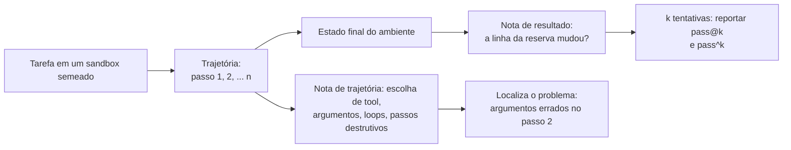

**Follow-ups:** Como você avalia um agent cujas tools acessam APIs de terceiros que não podem ser resetadas? Seu agent pontua bem no simulador e decepciona em produção - enumere as lacunas.

</details>

### 40. Como funciona uma avaliação no estilo Chatbot Arena, e quais são seus pontos fortes e limites?

<details><summary><b>Resposta</b></summary>

O Chatbot Arena (depois LMArena, embora a maioria ainda use o nome original) coleta por crowdsourcing a preferência humana pairwise: um visitante envia qualquer prompt, dois modelos anônimos respondem lado a lado, o humano vota na melhor resposta (ou empate), e os votos de muitos usuários se agregam em um leaderboard. O ranking é ajustado com um **modelo Bradley-Terry** - cada modelo recebe um parâmetro de força, e P(A vence B) é modelada como uma função logística da diferença de força; o projeto migrou de atualizações incrementais de Elo para o ajuste por máxima verossimilhança do BT porque a dependência de ordem do Elo adiciona ruído quando as forças dos modelos são estáticas na janela de estimação. Os intervalos de confiança vêm de bootstrap dos votos.

Pontos fortes: mede a **preferência humana real em uma distribuição aberta de prompts** - sem respostas de referência, sem vieses de modelo judge; é **resistente à contaminação** (os prompts são novos, ao vivo e ilimitados - você não consegue treinar nas perguntas da semana que vem); o anonimato até depois do voto suprime o viés de marca; e escala para modelos novos a baixo custo.

Limites - onde candidatos fortes ganham pontos:

- **Mede preferência, não correção.** Votantes premiam respostas confiantes, bem formatadas e mais longas; raramente verificam fatos. Os efeitos de verbosidade e estilo são reais, e por isso o **style control** (remover por regressão os efeitos de tamanho e markdown no modelo BT) foi introduzido e virou a visão padrão do leaderboard - os rankings com style control e os brutos visivelmente diferem.
- **Viés de população**: os votantes são entusiastas de AI; a distribuição de prompts superrepresenta chat casual, código e prompts de "testar o modelo" em comparação com, por exemplo, processamento de documentos corporativos. Os rankings podem não se transferir para o seu domínio.
- **Um número para um objeto multidimensional**: leaderboards por categoria ajudam, mas uma nota global esconde "ótimo em código, fraco em documentos longos".
- **Pressão de Goodhart**: os labs otimizam para a performance na arena - ajustando ao gosto da população de votantes (formatação, personalidade) em vez de à qualidade geral; há também preocupação documentada com labs que testam muitas variantes privadas e lançam a de maior pontuação, o que infla o ranking aparente.
- **Sem eixo de custo/latency**: um modelo 10× mais caro fica ao lado de um barato como pares.

Resumo: excelente para acompanhar a fronteira e fazer shortlist grosseira; nunca um substituto para evals específicos da tarefa.

**Follow-ups:** Por que Bradley-Terry é preferível a uma win rate ingênua quando as contagens de comparações são desiguais entre pares de modelos? Projete uma arena interna para o caso de uso da sua empresa - o que quebra primeiro?

</details>

### 41. Seu novo prompt pontua 78% contra os 74% do prompt antigo em um eval de 100 exemplos. Você faz ship?

<details><summary><b>Resposta</b></summary>

Não apenas com essa evidência - uma diferença de 4 pontos com n=100 está confortavelmente dentro do ruído. O erro padrão de uma proporção perto de 75% é √(0,75·0,25/100) ≈ 4,3 pontos, então o IC de 95% de cada score é de aproximadamente ±8,5 pontos; a diferença de duas proporções independentes com esse n tem um IC maior que a diferença observada de 4 pontos. Quatro pontos são quatro exemplos virando.

Mas a análise certa é **pareada**, e esse é o movimento sênior: ambos os prompts rodaram nos *mesmos* 100 exemplos, então ignore os scores agregados e olhe as viradas por caso. Suponha que 10 casos viraram fail→pass e 6 viraram pass→fail (líquido +4). A pergunta é se 10-contra-6 entre 16 casos discordantes supera um cara-ou-coroa - esse é o **teste de McNemar** (equivalentemente um sign test nos pares discordantes), e 10/16 está longe de ser significativo. A análise pareada é dramaticamente mais poderosa que comparar duas proporções independentes porque remove a variância compartilhada da dificuldade dos casos - frequentemente transformando um resultado "insignificante" não pareado em um claro, ou expondo que seu ganho é um punhado de cara-ou-coroa. Uma alternativa barata com o mesmo espírito: faça **bootstrap das diferenças de score por caso** e leia o IC a partir da distribuição reamostrada.

Considere também o **não determinismo de sampling**: com temperature > 0 (e mesmo nominalmente em 0, dado o não determinismo da stack de serving), o mesmo prompt rodado de novo vira casos. Rode cada config k vezes (mesmo k=3) para estimar a variância de viradas por caso; métricas avaliadas por judge adicionam a variância do judge por cima - julgar repetidamente saídas idênticas também mostra viradas de veredito. O trabalho "Adding Error Bars to Evals" da Anthropic é a referência para fazer isso corretamente (erros padrão clusterizados, inferência pareada, análise de poder).

O que eu realmente faria: (1) ler os ~16 transcripts que viraram - cinco minutos que frequentemente resolvem (correção real vs ruído vs novo modo de falha); (2) se a direção parece real mas sem poder, aumentar o n na fatia difícil ou aceitar-e-monitorar se a mudança for de baixo risco e reversível; (3) nunca fazer ship de uma regressão em métrica de guardrail, independentemente da vitória no topline.

**Vale desenhar.** Dividir 100 casos em concordantes e discordantes é todo o argumento da análise pareada em uma figura.

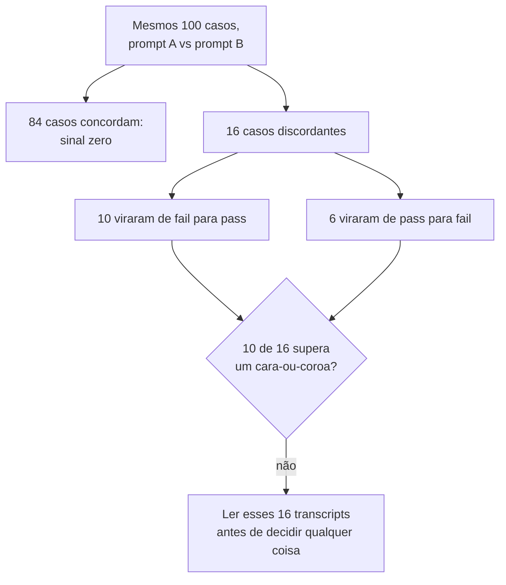

**Follow-ups:** Quão grande o n precisaria ser para detectar com confiabilidade uma melhoria real de 4 pontos (poder)? Como a variância de viradas por caso muda a sua conta de IC?

</details>

### 42. Projete a stack de observability para uma aplicação de LLM em produção. Como é um bom trace?

<details><summary><b>Resposta</b></summary>

Modele o sistema como **traces de spans**, exatamente como distributed tracing - porque uma requisição de LLM *é* uma computação distribuída. Uma requisição de usuário = um trace; cada unidade de trabalho = um span com horários de início/fim, atributos e links para o pai:

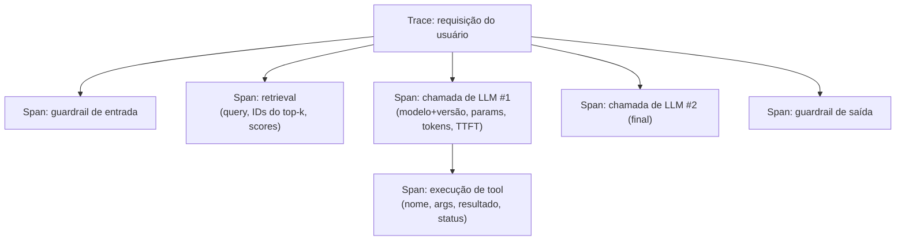

**Atributos por span**: modelo e versão *exata* (nunca apenas um alias), parâmetros de sampling, prompt e completion renderizados (ou ponteiros redigidos), contagem de tokens de input/output, TTFT e latency total, custo, status de cache-hit, finish reason, detalhes de erro, versão do prompt template e, para spans de retrieval, os IDs dos chunks + scores. Adote as **GenAI semantic conventions do OpenTelemetry** (`gen_ai.request.model`, `gen_ai.usage.input_tokens`, etc.) para que a instrumentação seja portável entre backends e seus spans de LLM vivam no mesmo trace dos spans de serviço comuns - um único trace do ingress HTTP, passando pelo retrieval, até o stream de tokens.

**Camadas sobre os traces brutos**:

1. **Métricas/alertas**: dashboards por rota para latency p50/p95, TTFT, tokens por requisição, custo por sessão, taxas de erro e de acionamento de guardrails, além de alarmes de drift sobre as tendências deles.
2. **Joins de feedback**: thumbs, regenerações, escalações e atribuição de braço do A/B ligados por trace ID - esse join é o que torna a error analysis possível; sem ele o loop está morto.
3. **Amostragem de qualidade online**: rode judges baratos (por exemplo, faithfulness) em uma amostra de traces ao vivo de forma assíncrona - monitoramento de qualidade, não apenas de operação.
4. **Exportação para dataset**: "enviar este trace para o eval set" com um clique - o elo mecânico do loop de eval-driven development.

**Governança**: redação de PII na ingestão, limites de retenção, acesso baseado em papéis ao conteúdo bruto dos prompts, suporte a pedidos de exclusão e política de sampling (guarde 100% dos traces de erro/feedback negativo, amostre os sucessos).

Ferramentas: LangSmith, Langfuse, Braintrust, W&B Weave, Arize Phoenix implementam todas esse formato (tracing + datasets + execuções de eval) com diferentes trade-offs entre open-source e hospedado - a arquitetura acima importa mais que o fornecedor.

**Follow-ups:** Como você faz o trace de respostas em streaming e atribui TTFT vs tempo de geração? Que política de sampling mantém os custos sob controle a 10M de requisições/dia sem perder as falhas?

</details>

### 43. Como você monitora um sistema de LLM em produção quanto a drift? Que tipos de drift importam?

<details><summary><b>Resposta</b></summary>

Quatro classes distintas de drift, cada uma exigindo sua própria detecção:

1. **Model drift (upstream)**: provedores reapontam aliases, descontinuam snapshots e lançam mudanças silenciosas de serving. Defesas: **fixe versões exatas de modelo** e trate qualquer mudança de versão como um deploy que deve passar na suíte de evals; rode um **canary eval agendado** (um conjunto fixo de probes atingindo a config de produção de hora em hora/diariamente) para que mudanças de comportamento acionem o seu alerta mesmo quando você não mudou nada - o canary é seu tripwire para mudanças upstream silenciosas. Registre a versão do modelo por trace para que qualquer mudança de métrica possa ser unida às fronteiras de versão.
2. **Input/data drift**: o tráfego muda - novas coortes de usuários, novos idiomas, tópicos sazonais, uma nova superfície de produto canalizando intents diferentes ou (em RAG) o corpus crescendo para domínios que seu chunking/embedder trata mal. Detecte monitorando a distribuição de *input*: mix de intents/tópicos via um classificador barato sobre o tráfego amostrado, mix de idiomas, percentis de tamanho de prompt, deslocamento da distribuição de embeddings das queries. Esse é o drift que seu eval set congelado silenciosamente deixa de representar - e por isso a divergência entre score offline e métrica online é, em si, um alarme de drift.
3. **Drift comportamental/de output**: as saídas mudam mesmo com modelos fixados - porque os inputs sofreram drift, uma dependência do prompt template mudou ou a montagem do contexto mudou. Acompanhe distribuições do lado da saída: tamanho da resposta, taxa de recusa, taxa e mix de tool calls, taxa de acionamento de guardrails, qualidade pontuada por judge em uma fatia amostrada. Mudanças na taxa de recusa e no tamanho são canários baratos e sensíveis.
4. **Cost/latency drift**: o operacional sorrateiro - crescimento de tokens no prompt conforme engenheiros anexam instruções, históricos de conversa crescentes, loops de agent dando mais passos, decaimento da taxa de cache-hit. Acompanhe tokens por requisição, passos por tarefa, TTFT/latency p95 e custo por sessão ao longo do tempo, por rota. Um aumento de custo de 30% por inchaço de prompt é comum e invisível sem linhas de tendência.

Ligação: os alertas disparam em quebras de tendência, e o runbook de resposta é sempre o mesmo - una a métrica deslocada às fronteiras de versão/config nos traces, amostre transcripts de antes/depois, faça error analysis e promova casos deslocados representativos para o eval set, de modo que o drift vire um teste de regressão.

**Vale desenhar.** Parear cada classe de drift com seu próprio detector mostra que você sabe que um único dashboard não consegue pegar as quatro.

```mermaid
flowchart LR
    D["Drift"] --> M["Modelo: alias reapontado<br/>sob um nome fixado"]
    D --> I["Input: novos locales,<br/>intents, prompts mais longos"]
    D --> B["Output: taxa de recusa,<br/>tamanho, mix de tool calls"]
    D --> C["Custo: inchaço de prompt,<br/>aumento de passos, decaimento de cache"]
    M --> M2["Canary eval agendado<br/>na config de produção"]
    I --> I2["Mix de tópicos e idiomas<br/>sobre tráfego amostrado"]
    B --> B2["Distribuições de saída<br/>mais judge em uma fatia"]
    C --> C2["Tokens e passos por tarefa,<br/>em tendência por rota"]
```

**Follow-ups:** Seu canary está verde mas as reclamações de usuários estão subindo - o que o seu canary está deixando passar? Como você detectaria que um provedor mudou silenciosamente um modelo por trás de uma string de versão fixada?

</details>

### 44. Onde a lei de Goodhart morde na avaliação de LLMs? Dê exemplos concretos e defesas.

<details><summary><b>Resposta</b></summary>

Goodhart: quando uma medida vira meta, ela deixa de ser uma boa medida. Sistemas de LLM são excepcionalmente propensos a Goodhart porque a pressão de otimização é alta (RLHF, iteração de prompts, incentivos de leaderboard) e a maioria das métricas são proxies com características de superfície exploráveis.

Instâncias concretas:

- **Gaming do judge**: otimize um prompt contra um LLM judge e você colherá os vieses do judge - as saídas ficam mais longas (verbosity bias), mais confiantes, mais polidas em markdown e mais bajuladoras, sem ficarem mais corretas. Reward hacking contra um reward model no RLHF é o mesmo fenômeno um nível abaixo.
- **Overfitting a benchmarks**: labs miram benchmarks de destaque; os scores sobem mais rápido que a capacidade geral. Contaminação é o limite degenerado de Goodhart - memorizar o teste. Variantes da arena: ajustar modelos ao gosto estilístico da população de votantes, ou testar muitas variantes privadas e lançar a de maior pontuação.
- **Overfitting a evals internos**: meses de iteração de prompts contra os mesmos 200 casos geram melhorias específicas desses casos - seu próprio benchmark privado satura e se desacopla da qualidade em produção.
- **Colapso de métrica única**: otimize só faithfulness → o modelo faz hedging até o vazio ("o documento discute vários fatores...") - perfeitamente fundamentado, inútil. Otimize só a taxa de resolução → o bot declara tickets resolvidos prematuramente. Otimize só a segurança por recusa → recusa excessiva. Toda métrica sem par tem uma solução degenerada.
- **Gaming de sinais implícitos**: otimize thumbs-up e você cria sycophancy; otimize a duração da sessão e você cria divagação.

Defesas:

1. **Pares/portfólios de métricas**: toda métrica otimizada vai com uma contramétrica que a solução degenerada derrubaria (faithfulness + completude; resolução + taxa de reabertura; utilidade + tamanho).
2. **Evals held-out e rotativos**: splits dev/test para sua própria suíte; casos frescos originados da produção cuja oferta o otimizador não consegue ver; fatias privadas nunca usadas na iteração.
3. **Meça a lacuna do proxy**: recalibre periodicamente os judges contra humanos e acompanhe a correlação score-offline vs resultado-online - divergência significa que o proxy foi manipulado ou sofreu drift.
4. **Revisão humana de transcripts como backstop**: humanos percebem "tecnicamente pontua bem mas é pior" instantaneamente; agende essa revisão, não torça para que aconteça.
5. **Reporte distribuições e fatias, não números únicos** - o gaming geralmente aparece como uma distribuição estranha antes de aparecer na média.

**Vale desenhar.** Desenhar a solução degenerada como um degrau no caminho faz a contramétrica parecer uma defesa óbvia em vez de processo extra.

```mermaid
flowchart LR
    M["A métrica vira a meta"] --> O["Pressão de otimização:<br/>RLHF, iteração de prompts, leaderboards"]
    O --> DG["Solução degenerada:<br/>hedge, encher linguiça, recusar demais"]
    DG --> U["Métrica sobe, qualidade estável"]
    U --> P["Combine com a contramétrica que<br/>a solução degenerada derruba"]
    P --> E["faithfulness + completude,<br/>resolução + taxa de reabertura"]
    U --> H["Fatia held-out que o<br/>otimizador nunca vê"]
```

**Follow-ups:** Como o reward hacking do RLHF é formalmente o mesmo problema, e o que as mitigações têm em comum? Seu prompt otimizado contra o judge ganhou 6 pontos offline e ficou estável online - conduza o diagnóstico.

</details>

### 45. Evals são não determinísticos - temperature, sampling, agents instáveis. Como você obtém números confiáveis?

<details><summary><b>Resposta</b></summary>

Aceite que cada score de eval é uma amostra de uma distribuição, depois reduza a variância por engenharia e meça o que sobra.

**Reduza a variância onde é de graça:**

- Avalie em **temperature 0 / greedy** *se* é assim que a produção roda; caso contrário, faça o eval na temperature de produção - medir greedy enquanto se entrega com t=0,8 é medir um sistema diferente. Note que nem t=0 é totalmente determinístico em stacks de serving reais (batching e a não-associatividade de ponto flutuante trocam tokens ocasionalmente), então determinismo é uma aproximação, não uma garantia.
- Fixe tudo que pode ser fixado: snapshot do modelo, snapshot do judge, versão do dataset, ambiente de tools/sandbox (versões de dependências, seeds, relógios). Em sandboxes de agents, testes instáveis e estado não resetado são variância que você de fato consegue eliminar - faça isso.

**Meça a variância que você não consegue eliminar:**

- **k repetições por caso** (k=3-5 para chamadas de LLM; mais para agents, cuja variância entre tentativas é enorme - scores de agent de execução única são anedotas). Reporte média ± um IC de bootstrap sobre casos *e* execuções. As taxas de virada por caso dizem quais casos são cara-ou-coroa - segmente-os ou corrija a ambiguidade deles.
- Judges também são estocásticos: julgar repetidamente saídas *idênticas* vira veredictos. Inclua a variância do judge nas suas barras de erro ou force o determinismo do judge (t=0, structured output) e valide que as taxas de virada estão próximas de zero.
- Para comparações, use **análise pareada** (mesmos casos, deltas por caso, McNemar/bootstrap-das-diferenças) - o pareamento cancela a variância da dificuldade dos casos e é o maior ganho de poder disponível.

**Escolha métricas que abraçam a estocasticidade em vez de escondê-la:**

- **pass@k** com o estimador não enviesado (n ≥ k amostras) quando o best-of-n reflete o produto; **pass^k** (todas as k têm sucesso) quando a *confiabilidade* é a métrica de produto - um agent com 80% por tentativa é pass^8 ≈ 17%, e o pass^k é o número que prevê a experiência do usuário em uso repetido.
- Reporte a distribuição, não só a média: um agent bimodal (ótimo ou catastrófico) e um uniformemente medíocre podem compartilhar a média e precisam de correções diferentes.

Ponto de cultura: ponha barras de erro em todo número de eval mostrado em um contexto de decisão. Times que veem "78% ± 6" discutem coisas diferentes - melhores - do que times que veem "78%".

**Follow-ups:** Seu orçamento de CI permite 1 execução por caso ou 3 execuções em um terço dos casos - qual e por quê? Como você lida, durante a error analysis, com casos que viram com inputs idênticos?

</details>

### 46. Um time faz ship de mudanças de prompt na base das vibes - o fundador testa cinco prompts favoritos e faz merge. Como você o leva à maturidade em evals sem parar o ship?

<details><summary><b>Resposta</b></summary>

Encontre-os onde estão e faça cada passo se pagar imediatamente - evals adotados como burocracia são abandonados; evals adotados porque pegaram uma regressão real viram cultura.

**Semana 1 - formalize as vibes.** Os cinco prompts favoritos do fundador *são* um eval set; ninguém o escreveu. Reúna-os mais ~20-40 casos reais de falha de tickets de suporte e screenshots em um dataset versionado, defina o comportamento esperado por caso e construa um script que roda qualquer config de prompt/modelo contra ele e imprime um diff por caso. Sem infra, sem fornecedor, um dia de trabalho. Na primeira vez que ele pegar uma regressão que o spot-check do fundador deixou passar, você ganhou a discussão empiricamente.

**Semanas 2-4 - primeiro os graders mais baratos, depois o CI.** Adicione code-graded assertions para tudo que for assertável (formato, campos obrigatórios, conteúdo banido); adicione um ou dois judges binários calibrados apenas para os critérios genuinamente subjetivos - resista a construir uma catedral de judges antes de existir confiança. Ligue a suíte ao CI em mudanças nos arquivos de prompt: assertions de guardrail bloqueiam, a qualidade mostra um diff por caso no PR. Mantenha abaixo de cinco minutos para que ninguém dê a volta nela.

**Mês 2 - feche o loop de produção.** Adicione tracing (mesmo que mínimo: registre prompts, completions, versões, latency, feedback com chaves de join), um pipeline thumbs-down → fila de triagem → eval set e um ritual semanal de 30 minutos de leitura de transcripts com notas de error analysis. Este é o passo que converte evals de um gate em um flywheel: falhas de produção viram testes automaticamente.

**Mês 3+ - medição online.** Um harness de A/B com um proxy real de sucesso de tarefa e métricas de guardrail; comece a acompanhar a correlação score-offline vs resultado-online, que diz quando o eval set precisa ser atualizado.

A escada de maturidade que você está subindo: vibes → spot-checks escritos → suíte offline versionada no CI → observability + loop de feedback fechado → experimentação online. Dois antipadrões a evitar: comprar uma plataforma de evals antes de ter dez bons casos de teste (ferramentas não criam julgamento) e deixar os evals virarem um gate bloqueante antes de serem confiáveis (consultivos primeiro, bloqueantes depois que pegarem dois bugs reais). Acompanhe a adoção por um número: que fração das decisões de qualidade cita um resultado de eval.

**Follow-ups:** O fundador diz "nossos usuários são o eval" - responda. Qual única métrica você colocaria primeiro no dashboard do time, e por que essa?

</details>

### 47. Seu novo prompt melhora a pass rate agregada em 3 pontos, mas um segmento de clientes cai 8. Como você pega isso antes do ship, e o que faz a respeito?

<details><summary><b>Resposta</b></summary>

Pegue isso nunca fazendo gating sobre um agregado. O agregado é uma média ponderada sobre fatias e esconderá de bom grado um segmento pegando fogo, que é como você faz ship de uma vitória e perde um cliente.

Defina as fatias antes da execução, a partir de dimensões que plausivelmente mudam o comportamento do modelo: idioma, tier do cliente, intent da query, fonte do documento, faixa de tamanho de contexto, modalidade, novos versus recorrentes. Reporte os deltas por fatia com intervalos de confiança ao lado do agregado e faça gating em "nenhuma fatia regride além do piso de ruído" além de "o agregado melhora".

A parte difícil é que fatiar destrói seu tamanho de amostra. 500 exemplos em 12 fatias dão ~40 cada, onde tudo é ruído e você não aprendeu nada. A correção acontece na construção do dataset, não na análise: aloque um piso de ~50-100 exemplos por fatia que importa de fato, o que significa fazer oversampling deliberado de fatias raras em relação à produção, e então reponderar de volta ao mix de produção ao calcular o agregado. Projete a amostragem para a pergunta que você pretende fazer.

Sobre o paradoxo de Simpson especificamente: um agregado só pode se mover no sentido oposto ao de cada fatia individual quando o mix de fatias difere entre os braços. Contagens fixas por fatia entre os braços impedem isso estruturalmente, o que é outra razão para designs pareados sobre os exemplos idênticos.

Cuidado com comparações múltiplas. Doze fatias a alpha 0,05 dão cerca de 46% de chance de pelo menos um alarme espúrio. Então eu trato os resultados por fatia como um sinal de triagem que me diz quais transcripts ler, não como um gate automático de ship, e aplico uma correção se estiver fazendo uma afirmação formal.

Depois decida. Se o segmento é pequeno e a regressão é cosmética, faça ship com um follow-up. Se é o seu tier enterprise, não faça ship. Normalmente ler essas falhas dos 8 pontos revela uma causa corrigível, como o novo prompt assumir uma convenção de formatação que só aquele segmento viola.

**Vale desenhar.** Uma caixa de agregado explodindo em fatias é a forma mais rápida de argumentar que o gate pertence às fatias, não à média.

```mermaid
flowchart TD
    A["Agregado: +3 pontos"] --> S["Dividir por fatias pré-declaradas"]
    S --> S1["EN varejo: +5"]
    S --> S2["JA enterprise: -8"]
    S --> S3["Nove outras fatias: estáveis"]
    S1 --> G{"Alguma fatia regrediu<br/>além do seu piso de ruído?"}
    S2 --> G
    G -->|"sim"| R["Ler as falhas dessa fatia;<br/>normalmente uma causa corrigível"]
    G -->|"não"| SH["Ship"]
```

**Follow-ups:** Como você escolhe fatias para modos de falha em que ainda não pensou? A fatia que regrediu tem 12 exemplos no total. O que você faz?

</details>

### 48. Projete a avaliação de uma feature de document understanding: usuários enviam faturas e formulários escaneados e fazem perguntas sobre eles.

<details><summary><b>Resposta</b></summary>

A decisão estrutural é separar percepção de raciocínio, porque elas falham de formas diferentes e a correção é diferente.

Percepção: o modelo consegue ler o que está na página. Avalie isso como extração estruturada de campos contra ground truth anotado: número da fatura, datas, itens, totais. Avaliação por código com normalização, já que diferenças de datas, moeda e espaços em branco são ruído de parser, não erro do modelo. Raciocínio: dado o que ele leu, a resposta está certa. Rode isso contra a extração de ground truth para isolá-lo.

A separação se paga no diagnóstico. "O total está errado" é inútil. "Ele leu 1,240 como 1.240 e depois raciocinou corretamente" é uma correção de pré-processamento; "ele leu todos os campos corretamente e somou errado" é uma correção totalmente diferente. Sem a separação você vai ajustar prompts contra um problema de OCR.

Para perguntas abertas você precisa de um judge, e aqui está a armadilha: o judge também precisa ver a imagem. Um judge somente de texto avaliando contra uma legenda humana herda todos os pontos cegos dessa legenda, e você acaba avaliando a legenda. Um vision judge é caro e traz sua própria superfície de viés, então mantenha o máximo possível em extração avaliada por código.

Fatias importam mais aqui do que em texto, e são físicas: resolução e DPI, rotação e inclinação, manuscrito versus impresso, multipágina versus página única, idioma e escrita, fotografia versus scan limpo e tipo de layout (tabelas, prosa densa, gráficos). As falhas se concentram fortemente nelas.

Adicione robustez a perturbações, algo de que evals de texto raramente precisam: reduza a resolução, comprima em JPEG, gire alguns graus e verifique que a resposta não vira. Se virar, você tem uma feature frágil independentemente da pass rate.

Custo e latency: tokens de imagem dominam, então acompanhe tokens por página e custo por documento, não por requisição.

Sobre o ground truth, seja realista. Anotar um documento leva minutos, não segundos. Comece com ~100-200 documentos estratificados por essas fatias e compre o resto com falhas de produção. Benchmarks multimodais públicos não vão prever a performance na sua distribuição de documentos.

**Follow-ups:** Como você avaliaria um documento de 40 páginas em que a resposta exige dois fatos de páginas diferentes? Seu vision judge custa mais que a feature. E agora?

</details>

### 49. Como a avaliação e a observação de um reasoning model diferem de um modelo padrão?

<details><summary><b>Resposta</b></summary>

A mudança central é que a qualidade deixa de ser uma propriedade do modelo e passa a ser função do orçamento de pensamento. Então uma única pass rate é o artefato errado. Você reporta uma curva: pass rate contra o reasoning budget, ou contra amostras para best-of-n. Escolher um modelo agora significa escolher uma tripla de modelo, orçamento e estratégia de sampling, e a pergunta interessante é onde a curva achata, porque esse joelho é o seu ponto de operação. Com frequência um modelo de tier intermediário com orçamento alto supera um modelo de fronteira com orçamento baixo por menos dinheiro, e você não enxerga isso a partir de uma estimativa pontual.

A observability muda concretamente. Reasoning tokens são cobrados e invisíveis para o usuário, então acompanhe-os como uma dimensão separada dos tokens de output. Seu custo por tarefa pode se multiplicar sem nenhuma mudança visível na resposta, que é o modo de falha pelo qual times são surpreendidos na fatura em vez de no dashboard.

A latency é pior do que a média sugere. O tamanho do pensamento tem uma cauda muito mais gorda que a geração comum, então o p50 parece saudável enquanto o p99 atinge seus timeouts. Instrumente a distribuição de reasoning tokens por rota e conte esgotamento de orçamento e truncamento como eventos de falha de primeira classe, já que uma execução que atinge o limite no meio do pensamento é uma falha distinta de uma resposta errada e precisa de uma correção diferente.

A variância aumenta, então você precisa de mais tentativas por item antes de qualquer comparação significar algo.

Uma armadilha a nomear: não avalie o reasoning trace com rubric como se ele explicasse a resposta. Reasoning traces não são confiavelmente fiéis à computação, então avaliá-los ensina você a otimizar uma superfície que não precisa refletir o processo. Avalie resultados; use os traces como artefatos de debugging e para agrupar falhas. Os provedores também resumem ou reestruturam o reasoning bruto, então um grader que depende do formato dele quebrará sem aviso.

Por fim, overthinking em inputs triviais é uma regressão real. Acompanhe o orçamento gasto contra a dificuldade do input.

**Follow-ups:** Como você definiria um reasoning budget por requisição em vez de globalmente? Sua curva de pass rate ainda está subindo no orçamento máximo. O que isso te diz?

</details>

### 50. Como você construiria um harness de replay determinístico para evals de agents, e o que ele genuinamente te dá?

<details><summary><b>Resposta</b></summary>

Registre cada fronteira não determinística durante uma execução ao vivo e substitua-a por um stub no replay. Isso significa respostas de tools, resultados de retrieval, completions do modelo, leituras de relógio, seeds aleatórias e turnos de usuário simulados, cada um com chave em uma assinatura de chamada canonicalizada, como nome da tool mais argumentos normalizados. No replay, seu código de orquestração roda de verdade e tudo que ele observa vem da gravação.

O que ele te dá: o CI roda em segundos, sem gasto de API e sem instabilidade; você pode reexecutar uma falha específica de produção mil vezes mudando apenas o seu código; e bugs de orquestração ficam isolados da variância do modelo, que de outra forma se afogam mutuamente. Quando um agent falha, "isto é minha lógica de retry ou o modelo simplesmente teve azar" é a pergunta que consome dias, e o replay a responde.

Os limites são a metade mais importante, e é aqui que candidatos vendem demais o replay. O replay só exercita caminhos que você gravou. Mude o prompt e o agent faz uma pergunta diferente, sua chave falha, e você ou gera erro rígido ou cai silenciosamente para uma chamada ao vivo e perde o determinismo. Então o replay é exato para "eu quebrei a tubulação" e inútil para "o novo prompt é melhor". Quem faz gating de qualidade de prompt numa suíte de replay não está medindo nada.

Então faça em camadas. Replay para testes unitários e de integração a cada commit. Um sandbox mockado com estado para evals de comportamento à noite: dê ao agent um banco de dados simulado no qual ele possa de fato escrever e então avalie o estado final do mundo contra um objetivo anotado, em vez de avaliar a conversa. Esse é o formato do tau-bench, e tolera trajetórias novas, que é exatamente o que o replay não consegue. Integração ao vivo ou em staging para uma pequena suíte antes do release.

Detalhes práticos que mordem: defina explicitamente a política de miss (erro estrito versus gravar-e-passar-adiante no modo de atualização); trate efeitos colaterais e idempotência; e regrave em um calendário, porque respostas de tools gravadas apodrecem conforme as APIs reais sofrem drift, e uma suíte de replay verde contra uma gravação obsoleta é uma falsa sensação de segurança.

**Vale desenhar.** O ramo de key-miss é a parte honesta da resposta, e é muito mais fácil de desenhar do que de descrever.

```mermaid
flowchart TD
    L["Execução ao vivo"] --> REC["Gravar cada fronteira:<br/>resultados de tools, completions,<br/>leituras de relógio, seeds"]
    REC --> ST["Chave: nome da tool mais<br/>argumentos normalizados"]
    ST --> RP["Replay: sua orquestração roda,<br/>tudo que ela observa é stub"]
    RP --> H{"Key hit?"}
    H -->|"sim"| OK["Segundos, sem gasto, sem instabilidade"]
    H -->|"não"| MS["O prompt mudou a pergunta:<br/>erro rígido, ou perde o determinismo"]
    MS --> SB["Evals de comportamento precisam de um<br/>sandbox mockado com estado"]
```

**Follow-ups:** Como você detecta que suas gravações ficaram obsoletas? Onde o sandbox mockado deixa de valer o custo de manutenção?

</details>

### 51. Sua suíte de evals está verde, a velocidade de ship está boa, e os usuários estão reclamando que a qualidade piorou. Faça o debug.

<details><summary><b>Resposta</b></summary>

Os usuários estão certos e a suíte de evals tem um bug. Comece daí, porque o enquadramento alternativo desperdiça uma semana.

Primeiro, seja específico. Puxe as reclamações reais e os traces por trás delas e leia de 30 a 50. Insatisfação vaga normalmente se resolve em duas ou três coisas concretas.

Depois o diagnóstico mais rápido, que normalmente é a resposta: pegue 20 traces que usuários sinalizaram como ruins e passe-os pelo seu grader. Se o grader os aprova, o grader está quebrado, não o modelo. Agora você sabe exatamente o que consertar e tem os casos de teste. Eu faria isso antes de qualquer outra coisa.

Se o grader os reprova corretamente, o problema é cobertura, e eu verifico nesta ordem:

Lacuna de distribuição. Compare o mix de fatias do eval set com o tráfego real da semana passada. Eval sets são construídos uma vez e o tráfego se move: um novo locale, uma nova superfície, inputs mais longos, uma integração upstream que mudou o formato do documento. O conjunto está medindo o produto do trimestre passado.

Dimensões não modeladas. A maioria das suítes de evals pontua apenas correção. Os usuários reclamam de latency, travamentos de streaming, truncamento, markdown que renderiza mal, tom e verbosidade. "Piorou" frequentemente é "ficou mais lento" ou "ficou moralista". Nada numa suíte de correção enxerga nada disso.

Profundidade de turnos. A maioria dos eval sets é single-turn. A maioria das reclamações está no turno quatro, onde o contexto se acumulou e o sistema esqueceu a restrição do turno um.

Concentração. As reclamações são de um cliente, um idioma, uma integração? A saúde agregada é compatível com um segmento pegando fogo.

Depois corrija em ordem: adicione os traces das reclamações ao conjunto para que a correção seja verificável, conserte o grader, adicione a fatia faltante, promova a dimensão faltante a guardrail.

O ponto cultural que eu defenderia: trate isso como um P1 na própria suíte de evals, não só na feature. O bug da feature é um incidente; uma suíte que não enxerga essa classe de bug deixará passar os próximos dez.

**Vale desenhar.** O primeiro ramo é todo o truque: passe as reclamações pelo grader antes de tocar no modelo.

```mermaid
flowchart TD
    C["Puxar 20 traces dos quais<br/>os usuários reclamaram"] --> G["Passá-los pelo<br/>seu próprio grader"]
    G -->|"o grader os aprova"| B["O grader está quebrado.<br/>Conserte-o e mantenha estes como casos"]
    G -->|"o grader os reprova"| CV["Lacuna de cobertura.<br/>Verifique nesta ordem"]
    CV --> D1["Mix de fatias vs<br/>tráfego da semana passada"]
    CV --> D2["Dimensões não pontuadas:<br/>latency, truncamento, tom"]
    CV --> D3["Profundidade de turnos:<br/>reclamações vivem no turno 4"]
    CV --> D4["Concentração:<br/>um locale, um cliente"]
```

**Follow-ups:** Como você evitaria que isso se repetisse sem dobrar o custo dos evals? E se as reclamações viessem de 3 usuários em 50.000?

</details>

### 52. Como você avalia a própria suíte de evals? O que torna uma boa ou ruim?

<details><summary><b>Resposta</b></summary>

Evals são código sem testes, o que é uma coisa estranha para tocar uma empresa em cima. Seis propriedades que eu mediria:

Poder discriminativo, o principal. A suíte consegue separar sistemas que você sabe que diferem? Rode uma config deliberadamente prejudicada: um modelo mais fraco, retrieval removido, a instrução-chave retirada do prompt. Se o sistema real pontua 91% e o prejudicado 89%, a suíte é decorativa e toda decisão que você tomou com ela foi cara-ou-coroa. Esse teste leva uma tarde e quase ninguém o roda. Saturação é a mesma doença: se tudo pontua 98%, aposente os casos fáceis para uma suíte smoke e compre casos mais difíceis.

Piso de ruído. Rode a config idêntica cinco vezes e meça a dispersão. Esse número é o seu limiar de ship, e costuma ser maior que os deltas sobre os quais as pessoas fazem ship.

Validade do grader. Concordância com humanos em uma amostra nova, por critério, remedida em um calendário em vez de uma vez só no início.

Cobertura contra a produção, medida por defeitos escapados: dos últimos 10 bugs de qualidade que usuários encontraram, quantos a suíte teria pegado antes? Se forem 2, sua suíte é 20% efetiva e cada falha nomeia exatamente o que adicionar. Esta é a melhor métrica de saúde isolada porque se baseia na realidade e não em autorrelato.

Redundância e custo. Itens cujo veredito não mudou nas últimas 20 execuções estão pagando por nenhuma informação. Pertencem a uma suíte noturna, não ao subconjunto pré-merge que condiciona sua velocidade.

Instabilidade por item. Itens cujo veredito vira de execução para execução sem nenhuma mudança são genuinamente limítrofes ou mal avaliados. Ponha em quarentena e diagnostique. Evals instáveis são ignorados exatamente como testes instáveis, e uma suíte ignorada significa que ninguém lê nenhuma parte dela.

Cadência: faça auditoria trimestral e refaça o teste da config prejudicada sempre que a suíte mudar de forma material. Acompanhe os defeitos escapados continuamente, já que esse é o que diz a verdade.

**Vale desenhar.** Duas configs passando pela mesma suíte, e o tamanho da lacuna é o veredito sobre a suíte, não sobre o sistema.

```mermaid
flowchart LR
    S["A mesma suíte de evals"] --> R["Sistema real"]
    S --> C["Config prejudicada: modelo mais fraco,<br/>retrieval desligado, instrução-chave removida"]
    R --> S1["91%"]
    C --> S2["89%"]
    S1 --> D{"Lacuna maior que<br/>o piso de ruído?"}
    S2 --> D
    D -->|"não"| X["A suíte é decorativa; toda decisão<br/>passada foi cara-ou-coroa"]
    D -->|"sim"| Y["A suíte discrimina. Agora acompanhe<br/>também os defeitos escapados"]
```

**Follow-ups:** Sua suíte pega 9 de 10 defeitos escapados mas leva 40 minutos no CI. Vale a pena? Como você construiria a config prejudicada sem que ela seja trivialmente detectável?

</details>

### 53. Rodar seu LLM judge em cada trace de produção custaria mais que a própria feature. Como você monitora a qualidade online em escala?

<details><summary><b>Resposta</b></summary>

Organize os graders em camadas por custo e escale apenas o que as camadas baratas não conseguem resolver, do mesmo jeito que você projetaria uma cascade de serving.

A camada um é gratuita e roda em todo o tráfego: checagens determinísticas como validade de schema, IDs citados que existem no conjunto recuperado, padrões de conteúdo banido, detecção de recusa e limites de tamanho, mais os sinais implícitos que você já registra (regeneração, abandono, escalação). Elas pegam falhas de formato e de guardrail de forma exaustiva.

A camada dois é um avaliador pequeno e rápido em uma amostra grande ou em tudo: um classificador ou modelo pequeno com fine-tuning para um critério, como groundedness ou intent satisfeito. Seus rótulos de treino vêm de rodar seu judge de fronteira calibrado, mais rótulos humanos, sobre alguns milhares de traces. Custa uma pequena fração do judge de fronteira e às vezes pode rodar inline como guardrail quando o orçamento de latency permite.

A camada três é o judge de fronteira com a rubric completa e raciocínio, em uma amostra estratificada: o que a camada dois pontuou como incerto, uma fatia de rotas de alto risco e uma pequena amostra aleatória uniforme. A camada quatro é a revisão humana, alimentada por discordâncias da camada três e pela fatia aleatória.

As armadilhas são de validade, não de custo. Um avaliador destilado herda os vieses do seu professor e adiciona os seus próprios, então calibre-o diretamente contra rótulos humanos, não apenas contra o judge que ele copiou. Ele também sofre drift: um modelo pequeno treinado no tráfego do trimestre passado degrada silenciosamente em novos intents, então acompanhe sua concordância com o judge de fronteira na amostra de sobreposição como uma métrica de primeira classe e retreine quando ela escorregar. E nunca estime a taxa de falha a partir da amostra escalada, porque ela foi selecionada por suspeita. A fatia aleatória uniforme pontuada pelo grader mais forte é a única estimativa não enviesada, então mantenha-a quando os orçamentos apertarem.

Por fim, escreva cada score de volta no trace com o nome e a versão do grader, para que uma queda de qualidade possa ser unida a releases.

**Vale desenhar.** A fatia aleatória contornando a cascade é o detalhe que mantém honesta a estimativa da taxa de falha.

```mermaid
flowchart TD
    T["Todos os traces de produção"] --> L1["Camada 1: checagens de código e<br/>sinais implícitos, 100%"]
    L1 --> L2["Camada 2: avaliador pequeno<br/>destilado, amostra grande"]
    L2 -->|"incerto ou alto risco"| L3["Camada 3: judge de fronteira<br/>calibrado"]
    T -->|"fatia aleatória uniforme"| L3
    L3 -->|"discordâncias"| H["Camada 4: revisão humana"]
    L3 --> W["Scores escritos de volta<br/>no trace"]
    H --> C["Recalibrar as camadas 2 e 3"]
```

**Follow-ups:** Seu avaliador destilado concorda com o judge de fronteira 92% das vezes, mas com humanos apenas 78%. Em qual número você confia, e o que faz? Como você decidiria se o avaliador pequeno é bom o bastante para bloquear respostas inline?

</details>

### 54. Seu time quer reutilizar os graders da suíte de evals como sinal de recompensa para reinforcement fine-tuning. O que muda?

<details><summary><b>Resposta</b></summary>

A forma como você valida o grader muda completamente, e você perde a suíte de evals como medição independente a menos que a divida. Um grader de eval só precisa estar certo nas saídas que um modelo naturalmente produz. Um grader de recompensa tem um otimizador buscando ativamente saídas que ele pontue alto, então precisa estar certo também em saídas adversariais, e essas vêm de uma distribuição diferente.

A robustez se torna a propriedade principal. A concordância com humanos em saídas naturais não diz nada sobre o que acontece quando a policy encontra o ponto cego do grader. Judges premiam tamanho, confiança e palavras-chave da rubric; graders de código premiam passar nos testes visíveis, inclusive tratando-os como casos especiais. Antes do treino, faça red-team do grader: escreva saídas projetadas para pontuar alto estando erradas (enchidas, com hedging, entupidas de palavras-chave, hard-coded para os testes) e confirme que elas falham. Durante o treino, amostre saídas de alta recompensa em intervalos regulares e peça a um humano que as leia. O reward hacking aparece nos transcripts bem antes de aparecer nas métricas agregadas.

Prefira componentes verificáveis. Sempre que o critério puder ser checado por execução ou comparação exata, use isso para a recompensa, com testes ocultos em vez de visíveis, e deixe o judge para o que sobrar.

A independência é a outra baixa. Se a recompensa de treino e o eval são o mesmo grader em prompts sobrepostos, scores de eval crescentes estão garantidos e não significam nada. Mantenha os prompts de treino disjuntos dos prompts de eval e avalie o modelo treinado com pelo menos um grader que o otimizador nunca viu: uma família de judge ou rubric diferente, revisão humana em uma fatia held-out e métricas online.

Fique atento às assinaturas clássicas: recompensa subindo enquanto a pass rate held-out fica estável ou cai, tamanho das saídas à deriva, diversidade de respostas colapsando.

Por fim, versione o grader de recompensa como parte da proveniência da execução de treino. Uma troca de judge no meio da execução muda o objetivo, não apenas a medição.

**Follow-ups:** Seu grader concorda com humanos 90% das vezes em saídas naturais. Isso basta para usá-lo como recompensa? Como você saberia que a policy está explorando o judge em vez de realmente melhorar?

</details>

### 55. Seu agent agora executa tarefas que levam horas e centenas de passos. Como você o avalia e observa?

<details><summary><b>Resposta</b></summary>

Pare de tratar uma tarefa como uma única amostra pass/fail. Nessa duração, o resultado end-to-end é raro, caro e ruidoso demais para iterar só com ele, então você precisa de estrutura intermediária tanto no eval quanto nos traces.

Avaliação:

- **Avaliação por marcos.** Decomponha cada tarefa em checkpoints verificáveis contra o estado do ambiente: teste que falha reproduzido, correção compila, migração aplicada, relatório rascunhado. Pontue o progresso como marcos alcançados e mantenha o resultado final como destaque. Tarefas longas passam então a dar um gradiente em vez de uma parede de zeros.
- **Confiabilidade versus duração da tarefa.** Agrupe tarefas pelo tempo que um humano habilidoso levaria e plote a taxa de sucesso por grupo. O sucesso cai com a duração, e a duração em que o agent tem sucesso metade das vezes o resume melhor que uma média. A METR popularizou esse enquadramento de "time horizon" para modelos de fronteira; o mesmo gráfico nas suas próprias tarefas diz quais trabalhos são seguros de delegar.
- **Tentativas com orçamento.** Uma execução pode custar dinheiro e horas de verdade, então k=10 em tudo é inviável. Mantenha uma pequena suíte de tarefas longas em agendamento noturno com poucas tentativas e um conjunto maior de duração média para iteração rápida. Retome a partir de checkpoints para testar estágios tardios sem reexecutar os iniciais.

Observability:

- O trace é grande demais para ler, então emita eventos estruturados acima do nível de span: marco alcançado, plano revisado, contexto compactado, sub-agent iniciado, limiar de orçamento ultrapassado. São esses que você consulta.
- Acompanhe o gerenciamento de contexto explicitamente. Muitas falhas em execuções longas são o agent perdendo uma restrição após a compactação, e nenhuma métrica de tokens ou latency mostra isso.
- Detecte travamentos: passos sem progresso de marcos, tool calls repetidas quase idênticas, custo por marco crescente. Alerte sobre eles e imponha limites rígidos de passos, tempo de relógio e gasto.
- Torne as execuções retomáveis a partir de checkpoints, para que uma falha na hora três possa ser depurada sem pagar de novo pelas horas um e dois.

**Vale desenhar.** Marcos e eventos de compactação em uma mesma linha do tempo mostram onde uma execução longa de fato quebrou.

```mermaid
flowchart LR
    T["Tarefa longa em um sandbox"] --> M1["Marco 1:<br/>bug reproduzido"]
    M1 --> M2["Marco 2:<br/>correção compila"]
    M2 --> CP["Contexto compactado"]
    CP --> M3["Marco 3:<br/>testes passam"]
    M3 --> O["Nota do resultado final"]
    CP -.-> EV["Evento registrado:<br/>restrição ainda presente?"]
    M2 -.-> ST["Detector de travamento:<br/>passos sem progresso"]
```

**Follow-ups:** Como você escreve marcos para uma tarefa com muitos caminhos válidos sem punir os não convencionais? A taxa de sucesso do seu agent em tarefas de quatro horas dobrou após uma atualização de modelo, mas o custo por sucesso triplicou. Isso é uma vitória?

</details>
