# Evals & Observability - Perguntas de Entrevista

> 🇧🇷 Tradução em português do Brasil. Versão original em inglês: [questions.md](questions.md).

55 perguntas: 14 básicas, 24 intermediárias, 17 avançadas.

> **Sobre os diagramas: desenhar é opcional.** Algumas respostas trazem um pequeno esboço que você
> poderia reproduzir num quadro branco ou num documento compartilhado. Você nunca precisa desenhar nada para ir bem,
> e uma resposta falada com clareza se sustenta sozinha. Mas em perguntas de arquitetura, pipeline e system design,
> esboçar enquanto fala mantém o entrevistador junto com você e mostra que você sabe estruturar
> um problema. Veja os esboços como um bônus, não como lição de casa.

## Básico

### 1. Por que se diz que "evals são o moat" dos produtos de AI? O que faz deles o artefato central de engenharia?

<details><summary><b>Resposta</b></summary>

Porque todo o resto é alugado. O modelo vem de um provedor, a stack de serving é commodity e os prompts são fáceis de copiar. Já uma suíte de evals versionada, que codifica o que "bom" significa para a sua tarefa específica e foi construída a partir das suas falhas de produção, é proprietária e ganha valor com o tempo. É o artefato que permite trocar de modelo em um dia (rode a suíte de novo e compare), ajustar prompts sem medo (o CI pega as regressões) e transformar cada incidente de produção em um teste permanente.

Na prática, evals fazem pelos sistemas de LLM o que os testes unitários fazem pelo software convencional, com uma diferença: em sistemas de LLM a *própria spec* é difusa, então o eval set costuma ser a coisa mais próxima de uma spec que existe. Quando um PM diz "os resumos deveriam ser melhores", é no eval set que esse "melhor" vira graders e exemplos. Por isso engenheiros seniores tratam o design de evals como uma atividade central de design, não como algo que o QA resolve no fim.

O loop de engenharia que isso viabiliza, o eval-driven development, é este: ship → observar traces de produção e feedback → fazer error analysis nos transcripts com falha → adicionar as falhas ao eval set → mudar o prompt/modelo/pipeline → rodar os evals → fazer ship se não houver regressão. Times presos nas "vibes" rediscutem a qualidade de forma subjetiva a cada mudança e não sabem dizer se uma atualização de modelo ajudou ou prejudicou.

Um bom candidato também aponta os limites: a suíte de evals só mede o que você pensou em codificar, fica obsoleta conforme o uso muda, e dá para fazer overfitting nela. Por isso o moat exige manutenção: exemplos novos da produção entrando em rotação, calibração humana periódica de qualquer model grader e um acompanhamento honesto da distância entre os scores offline e as métricas online.

**Vale desenhar.** Desenhar o loop deixa claro que a suíte é alimentada pela produção e não escrita uma única vez, no começo.

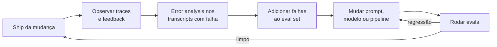

**Follow-ups:** Como você convenceria um time que entrega na base das vibes a investir em evals? Qual é a menor suíte de evals útil que você montaria na primeira semana? Quem deveria ser o dono do eval set: engenharia, PM ou um time dedicado?

</details>

### 2. Explique a taxonomia dos métodos de avaliação de sistemas de LLM e quando usar cada um.

<details><summary><b>Resposta</b></summary>

São quatro camadas, ordenadas por custo e por quanto julgamento humano elas codificam:

1. **Code-graded assertions**: exact match, regex/contains, validação de JSON schema, tolerância numérica, execução de código gerado contra testes. São determinísticas, gratuitas e rápidas. Use sempre que o critério for objetivamente verificável: labels de classificação, campos de extração, formato da saída, respostas de matemática, correção de código.
2. **Model-graded (LLM-as-judge)**: outro LLM pontua ou compara as saídas com base em uma rubric. É barato o bastante para rodar em todo push do CI, mas é ruidoso e enviesado (posição, verbosidade, self-preference), então precisa ser calibrado com labels humanos antes de merecer confiança. Use para critérios genuinamente subjetivos: utilidade, tom, faithfulness às fontes, nuances de instruction-following.
3. **Human evaluation**: labels de especialistas ou crowdworkers, pointwise ou pairwise. É lenta e cara, então use com estratégia: para criar o ground truth que calibra os judges, em domínios de alto risco (médico, jurídico) e como auditoria periódica que mantém os avaliadores automáticos honestos.
4. **Online evaluation**: A/B tests, interleaving, feedback implícito (thumbs, taxa de regeneração, conclusão de tarefa, escalações). É a única camada que mede o que os usuários realmente vivem, mas exige tráfego, tempo e uma feature já no ar, e não diz *por que* algo regrediu.

O princípio de operação: **use o avaliador mais barato que capture o critério com fidelidade.** Se dá para escrever uma assertion, nunca use um judge. Se um judge resolve, não gaste horas de humanos em avaliação de rotina: gaste-as auditando o judge. E trate os evals offline como previsões que as métricas online precisam confirmar. Se a distância entre scores offline e resultados online persiste, seu eval set deixou de representar o tráfego de produção.

Bons candidatos acrescentam que essas camadas se combinam dentro de uma mesma suíte: um único caso de teste pode checar a validade do JSON (code), pontuar a faithfulness (judge) e alimentar uma métrica online de taxa de resolução depois do deploy.

**Vale desenhar.** Como árvore de decisão, o desenho mostra que você só escala para avaliadores caros quando o barato não dá conta do critério.


**Follow-ups:** Dê um exemplo concreto de critério que parece pedir um judge mas pode ser reduzido a uma assertion. Quando você pagaria por human eval mesmo que seu judge concorde com humanos em 85% dos casos?

</details>

### 3. Que tipos de code-graded assertions dá para usar nas saídas de um LLM, e onde elas deixam de funcionar?

<details><summary><b>Resposta</b></summary>

As principais famílias:

- **Exact match**: a saída é igual à referência. Funciona para classificação, múltipla escolha e respostas curtas canonicalizadas. É frágil com formatação ("$4.50" vs "4.5 dollars"), então normalize antes (caixa, espaços, parsing de números).
- **Contains / regex**: a string da resposta aparece em algum ponto; use regex para padrões estruturados (datas, IDs). Dá muito falso positivo ("the answer is not 42" contém "42"), então ancore os padrões e cheque negações onde isso importar.
- **Structural validation**: faça o parse da saída. O JSON é válido, segue um schema/modelo Pydantic, tem os campos obrigatórios, usa valores de enum permitidos? É o cavalo de batalha de tarefas de tool-calling e de extração.
- **Numérica com tolerância**: extraia o número e compare dentro de um epsilon. É essencial em matemática, onde a formatação varia.
- **Baseada em execução**: rode o código gerado contra casos de teste em um sandbox, ou rode o SQL gerado contra um banco de fixtures e compare os result sets. É o padrão-ouro para código: equivalência funcional, não similaridade textual.
- **Property checks**: limites de tamanho, ausência de frases proibidas, IDs de citação que realmente existem no conjunto recuperado, links que resolvem. São assertions de guardrail baratas.

```python
def grade(output: str, case: dict) -> bool:
    data = json.loads(output)                      # estrutural
    assert set(data) >= {"amount", "currency"}     # schema
    return abs(data["amount"] - case["amount"]) < 0.01  # tolerância
```

Elas deixam de funcionar quando há muitas formas válidas de escrever a mesma resposta (resumos, explicações, respostas conversacionais): checagens de exact/contains ou deixam passar respostas corretas, ou aprovam as erradas. Métricas de texto baseadas em referência, como BLEU/ROUGE, correlacionam mal com qualidade em geração aberta. O caminho honesto é escalar esses critérios para model-graded ou human eval, em vez de fingir que um score de sobreposição de n-gramas significa alguma coisa.

O hábito de quem tem senioridade: projetar o *formato de saída da tarefa* para que ele seja verificável. Force JSON, force uma linha final `Answer:`, faça o modelo citar IDs de chunks. Assim, mais da sua avaliação fica na camada barata e determinística.

**Follow-ups:** Como você avaliaria uma tarefa de summarization sem um judge? Seu grader de regex mostra 95% de pass, mas os usuários reclamam: o que está acontecendo?

</details>

### 4. Você vai montar evals do zero para uma nova feature com LLM. De quantos exemplos você precisa e de onde eles vêm?

<details><summary><b>Resposta</b></summary>

Comece com **~20-50 exemplos difíceis e realistas**. Dá para montar isso em um dia, e já muda decisões na hora. O maior erro em evals não é um N pequeno, e sim esperar por um N grande que nunca chega enquanto você entrega no escuro.

As fontes, em ordem de valor:

1. **Falhas de produção**: sessões com thumbs-down, escalações para humanos, tickets de suporte, incidentes. São reais, já nascem adversariais, e cada uma é um teste de regressão que comprovadamente importou.
2. **Dogfooding / red-teaming interno**: antes do lançamento você não tem dados de produção, então o time gera tarefas realistas e testa os limites de propósito.
3. **Geração sintética**: dê a um modelo forte uma taxonomia de cenários (intents × personas × dificuldade) para preencher lacunas de cobertura. Faça revisão humana antes de admitir qualquer coisa, porque dados sintéticos herdam os pontos cegos do gerador e tendem à mediana.
4. **Datasets públicos**: às vezes servem de andaime, mas em geral estão fora da distribuição do seu produto.

Sobre estatística: com 50 exemplos, cada caso vale 2 pontos, então você só detecta efeitos grandes. Um delta de 4 pontos é só a virada líquida de dois exemplos, ou seja, ruído. Isso não é problema no início, quando você está atrás de problemas de 20 pontos. Conforme as decisões ficam mais finas (prompt A vs prompt B, com diferença de poucos pontos), cresça para centenas de exemplos e adicione testes de significância pareados. O poder estatístico cresce com N: compre poder quando você de fato precisar da resolução.

A composição importa mais que o tamanho. Pese o conjunto para casos difíceis e modos de falha conhecidos, mantenha uma fatia de casos fáceis como smoke test e estratifique pelos segmentos que importam (idiomas, intents, faixas de usuário) para que uma regressão num segmento pequeno não se dilua na média. Versione o conjunto como código e registre a versão do dataset junto de cada score.

**Follow-ups:** Como decidir que um exemplo é "difícil" antes de ter falhas? Seu eval está passando em 95% e deixou de discriminar entre os prompts candidatos: o que você faz?

</details>

### 5. O que é LLM-as-judge e quando ele é a ferramenta certa?

<details><summary><b>Resposta</b></summary>

LLM-as-judge usa um modelo (em geral mais forte) para avaliar saídas: dados o input, a resposta candidata, uma rubric e, opcionalmente, uma resposta de referência, o judge emite um veredito (pass/fail, uma nota ou uma preferência entre duas respostas). Ele existe porque a maioria das saídas interessantes de um LLM é aberta. Nenhuma assertion checa se um resumo é fiel ou se uma resposta é realmente útil, e humanos são lentos e caros demais para avaliar cada execução do CI.

Ele é a ferramenta certa quando três condições se cumprem: (1) o critério é subjetivo ou tem muitas formas válidas de aparecer, (2) você consegue articular o critério como uma rubric que um humano cuidadoso saberia aplicar e (3) você **validou o judge contra labels humanos**. Rotule você mesmo 50-100 exemplos, meça a concordância (percent agreement ou kappa de Cohen) e só automatize quando ela for comparável à concordância humano-humano. O trabalho do MT-Bench constatou que judges da classe do GPT-4 concordam com humanos em ~80% dos casos de qualidade de chat, mais ou menos a taxa humano-humano, mas isso depende da tarefa e não é uma lei.

A forma prática importa: a comparação pairwise ("qual é melhor, A ou B?") é mais confiável que a nota pointwise ("de 1 a 10"); pass/fail binário por critério decomposto vence uma nota holística única; e obrigar o judge a escrever o raciocínio em chain-of-thought antes do veredito melhora a qualidade e dá justificativas auditáveis.

Quando ele é a ferramenta *errada*: qualquer coisa que dê para checar com assertion (use código), decisões finais de alto risco (o judge ajuda, o humano decide) e avaliação de saídas da própria família do judge em tarefas comparativas (self-preference bias). Lembre também que o judge é um prompt + modelo que precisa de versionamento: a atualização do modelo judge pode mexer em todos os seus scores sem nenhuma mudança no sistema avaliado. Por isso, fixe (pin) as versões do judge e recalibre quando trocá-las.

**Follow-ups:** Seu judge aprova 90% das saídas, mas os usuários estão insatisfeitos: como você depura o próprio judge? Você usaria o mesmo modelo como gerador e como judge?

</details>

### 6. Defina pass@k. Por que a forma ingênua de calculá-lo é problemática e qual é a correção?

<details><summary><b>Resposta</b></summary>

pass@k é a probabilidade de que **pelo menos uma** das k amostras independentes do modelo resolva o problema. É a métrica padrão para geração de código (o HumanEval a popularizou), onde dá para verificar cada amostra a baixo custo rodando testes.

O cálculo ingênuo, que gera exatamente k amostras, dá 1 se alguma passou e tira a média entre os problemas, é um estimador não enviesado em expectativa, mas de **alta variância**: para cada problema você tem uma única observação de Bernoulli, e os resultados oscilam de uma execução para outra, principalmente em eval sets pequenos e com probabilidades de sucesso intermediárias.

A correção, vinda do paper do Codex: gere **n ≥ k** amostras por problema (digamos, n = 200 para k ≤ 100), conte c corretas e calcule a probabilidade de que um subconjunto aleatório de tamanho k contenha pelo menos uma amostra correta:

pass@k = 1 − C(n−c, k) / C(n, k)

Isso faz a média sobre todos os C(n, k) subconjuntos de forma analítica, em vez de sortear um só, e derruba a variância. Calcular os binomiais diretamente estoura os números, então use a forma de produto numericamente estável:

```python
import numpy as np

def pass_at_k(n: int, c: int, k: int) -> float:
    if n - c < k:
        return 1.0
    return 1.0 - np.prod(1.0 - k / np.arange(n - c + 1, n + 1))
```

Um bom candidato acrescenta duas coisas. Primeiro, a temperature de sampling interage com o k: temperature maior prejudica o pass@1, mas ajuda o pass@100 (mais diversidade), então reporte a temperature e ajuste-a para cada k. Segundo, o pass@k mede a capacidade de *melhor caso*: serve quando você consegue verificar e escolher a vencedora (testes ocultos, um compilador) e engana quando não consegue. Em cenários de agents em que a confiabilidade é crítica, a métrica complementar é o **pass^k**, a probabilidade de que todas as k tentativas independentes tenham sucesso (popularizada pelo τ-bench), que pune a inconsistência que o pass@k esconde. Um modelo com 80% de sucesso por tentativa tem pass^8 ≈ 17%: ótimo demo, produto pouco confiável.

**Follow-ups:** Quando otimizar o pass@10 é legítimo para um produto? Como o pass@k se relaciona com best-of-n sampling com um verifier na inferência?

</details>

### 7. Qual a diferença entre métricas de guardrail e métricas de qualidade? Dê exemplos de cada uma.

<details><summary><b>Resposta</b></summary>

**Métricas de qualidade** medem o que você está otimizando: correção das respostas, faithfulness às fontes, taxa de resolução de tarefas, satisfação do usuário, taxa de aceitação de código. Você espera fazer trade-offs delas com custo e latency, e comemora quando sobem.

**Métricas de guardrail** são restrições que nunca podem regredir, não importa o ganho de qualidade: taxa de jailbreak/violação de política, vazamento de PII nas saídas, taxa de conteúdo nocivo, taxa de citações alucinadas em contextos regulados, latency p95, custo por requisição, taxa de erros graves. Elas são assimétricas: ninguém é promovido por melhorá-las, mas qualquer regressão bloqueia um release.

A distinção importa operacionalmente porque as duas recebem tratamentos diferentes no pipeline:

- **Gating**: regressões de qualidade dentro de uma faixa de ruído são discutíveis; regressões de guardrail bloqueiam o deploy automaticamente. O CI deve refletir isso: evals de guardrail como assertions rígidas, evals de qualidade como comparações pontuadas contra um baseline, com um limiar.
- **Trade-offs**: é legítimo entregar "2 pontos menos conciso, porém 30% mais barato". Nunca é legítimo entregar "um pouco mais de vazamento de PII, porém mais útil". Se alguém propõe trocar um guardrail, ou a métrica foi classificada errado ou a organização tem um problema.
- **Estilo de medição**: guardrails geralmente são evals adversariais (suítes de red-team, corpora conhecidos de jailbreak, probes sintéticos de PII) mais monitores em produção com alertas; métricas de qualidade são evals sobre uma distribuição representativa mais A/B tests.

Isso espelha a prática clássica de experimentação: as plataformas de A/B das big techs sempre tiveram "guardrail metrics" (taxa de crash, latency) que nenhum experimento pode prejudicar enquanto move a métrica-alvo. Os sistemas de LLM herdam o padrão e ganham, por cima, guardrails novos de segurança de conteúdo.

Um ponto sutil: algumas métricas mudam de categoria conforme o produto. Latency é guardrail em um chat, mas é *a* métrica de qualidade em um produto de autocomplete. A taxa de recusa é, ao mesmo tempo, um teto de guardrail (recusar demais irrita os usuários) e um piso (recusar de menos é inseguro), então vale acompanhá-la como duas métricas direcionais.

**Vale desenhar.** As duas ramificações tornam a assimetria concreta: uma é debate, a outra não.

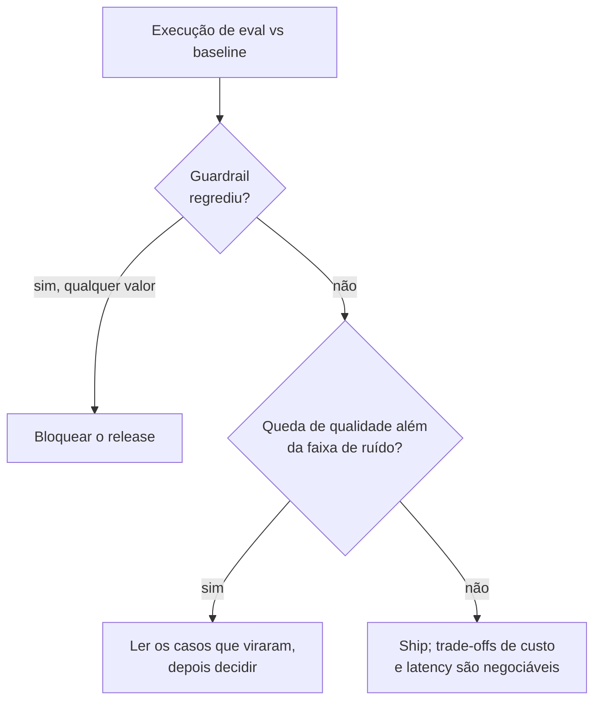

**Follow-ups:** Como você definiria o limiar de um guardrail como a taxa de jailbreak: zero ou diferente de zero? O A/B de utilidade vence, vai para produção e a taxa de escalação sobe 15%: o que aconteceu?

</details>

### 8. O que você deve registrar em log a cada chamada de LLM em produção e quais são as armadilhas?

<details><summary><b>Resposta</b></summary>

Por chamada, o mínimo útil:

- **Identidade e versões**: ID da requisição/trace, ID de usuário/sessão (pseudônimo), nome e versão do prompt template, modelo + versão *exata* (não um alias), parâmetros de sampling (temperature, max_tokens), schemas de tools/funções oferecidos.
- **Conteúdo**: o prompt completo já renderizado (system + mensagens) e a completion, ou formas redigidas/ponteiros quando a política exigir. Inclua também os artefatos intermediários: chunks recuperados com IDs e scores, tool calls com argumentos e resultados.
- **Performance e custo**: contagem de tokens de input/output, time-to-first-token, latency total, retries, cache hits, custo calculado.
- **Sinais de resultado**: finish reason (stop, length, tool_use, content_filter), resultados das checagens de guardrail e feedback downstream (thumbs, regeneração, escalação) ligado pelo ID do trace.

Estruture tudo como um **trace**: uma árvore de spans, um por chamada de modelo / retrieval / execução de tool, de modo que uma requisição de agent com vários passos seja lida como um único objeto navegável. As GenAI semantic conventions do OpenTelemetry padronizam os nomes dos atributos (`gen_ai.request.model`, `gen_ai.usage.input_tokens`, ...), então você não fica preso a um único fornecedor de observability.

As armadilhas, em ordem de gravidade:

1. **PII.** Prompts e completions são dados de usuário, muitas vezes o texto mais sensível que a empresa guarda. Você precisa de uma política de retenção, de redação ou tokenização dos identificadores na ingestão, de controles de acesso (engenheiro de suporte ≠ todo mundo) e da capacidade de atender pedidos de exclusão. "Logar tudo para sempre em texto puro" é um incidente de GDPR/compliance com contagem regressiva.
2. **Logar o alias, não a versão.** Um log do tipo `model: gpt-latest` torna invisíveis as atualizações do lado do provedor, e você não consegue explicar por que a qualidade mudou numa terça-feira.
3. **Faltarem as chaves de join.** Se os eventos de feedback não podem ser ligados de volta ao trace exato (versão do prompt, chunks recuperados), seu loop de error analysis morre.
4. **Volume/custo**: logar o prompt completo em escala é caro. Faça sampling com critério (guarde 100% dos erros e do feedback negativo e amostre os sucessos).

**Follow-ups:** Como você implementaria o "apague os dados deste usuário" quando o texto dele aparece dentro de outros prompts registrados? O que você registraria de forma diferente em um voice agent?

</details>

### 9. Qual a diferença entre observability e evals? Os fornecedores parecem vender um único produto para os dois.

<details><summary><b>Resposta</b></summary>

Observability é descritiva: o que aconteceu nesta requisição. Evals são avaliativos: a saída foi boa? Os dados são os mesmos, a pergunta é outra, e por isso todo fornecedor entrega os dois numa só interface.

Observability fica sempre ligada e sem sampling. Ela captura o trace: spans de cada chamada de modelo, retrieval, tool call e checagem de guardrail, com tokens, latency, custo, erros, IDs dos chunks recuperados e a versão exata do modelo. Responde a "por que esta requisição foi lenta", "o que o retrieval realmente devolveu", "onde o agent entrou em loop".

Evals são amostrados e pontuados contra um critério. Respondem a "isto está correto", "está fundamentado nas fontes", "a tarefa foi concluída". Um score exige um avaliador e uma noção de bom, sobre os quais a observability não tem opinião.

O teste prático que eu uso: a métrica que acorda você às 3h da manhã é observability (taxa de erros, latency p95, pico de custo). A métrica que bloqueia um merge é um eval (pass rate no golden set). Consumidores diferentes, cadência diferente e um modo de falha diferente quando falta.

A dependência vai em uma direção só. Não dá para montar bons evals sem observability, porque é nos traces de produção que nascem os exemplos de eval. Mas observability sem evals é a armadilha clássica: os dashboards ficam verdes em volume e latency enquanto a qualidade apodrece em silêncio, porque nada na stack pergunta se as respostas são boas.

Os evals online são onde a linha fica borrada, e isso confunde as pessoas. Amostrar 2% dos traces de produção e pontuá-los com um judge é rodar um eval em cima de dados de observability. É um único pipeline, mas ainda vale manter os conceitos separados: se você os mistura, acaba acreditando que um dashboard de latency verde significa um produto saudável.

**Vale desenhar.** Uma fonte de dados, dois consumidores: o desenho mostra por que os fornecedores vendem os dois juntos e por que você ainda deve manter os conceitos separados.


**Follow-ups:** Qual dos dois você montaria primeiro numa feature de LLM nova, e por quê? Se a conta de observability caísse pela metade, o que você pararia de capturar?

</details>

### 10. Qual a diferença entre avaliação reference-based e reference-free, e por que BLEU, ROUGE e exact match falham na saída de LLMs?

<details><summary><b>Resposta</b></summary>

A avaliação reference-based compara a saída com uma resposta de referência (gold): exact match, BLEU, ROUGE, similaridade de embeddings, BERTScore. A avaliação reference-free julga a saída por seus próprios méritos, contra um critério ou contra o contexto do input: execução de código, checagem de JSON schema, um LLM judge pontuando a faithfulness em relação aos chunks recuperados.

As métricas de n-gramas falham porque foram projetadas para tradução automática e summarization, onde as referências são densas e o espaço de saídas é estreito. A saída de um LLM tem um espaço enorme de formulações corretas. O BLEU pune uma resposta correta escrita de forma diferente da referência e premia uma resposta errada que por acaso pegou o vocabulário da referência. O ROUGE mede a sobreposição com n-gramas da referência, então um resumo extrativo que copia trechos e inventa uma relação entre eles pontua bem. Nenhuma das duas tem qualquer noção de a afirmação ser verdadeira.

BERTScore e a similaridade de embeddings são uma melhoria real, porque embeddings contextuais captam paráfrases. Mas são insensíveis justamente ao que mais importa: negação, números e troca de entidades. "The dose is 5mg" e "The dose is not 5mg" ficam próximas no espaço de embeddings e são opostas no único sentido que interessa a alguém. Um score alto de similaridade não é evidência de correção.

O exact match funciona, mas só onde o espaço de respostas é realmente fechado: um label de classificação, um campo extraído, uma resposta numérica final. Seu modo de falha é a formatação, não a semântica, então normalize antes (caixa, espaços, formatos de data e moeda), ou você acabará medindo o seu parser.

O que fazer no lugar: decomponha. Execute o código contra testes ocultos. Extraia afirmações atômicas e confira cada uma contra a fonte. Use um judge com rubric para critérios realmente abertos. Mantenha a avaliação reference-based onde a resposta é fechada e a comparação é barata e válida.

**Follow-ups:** Quando o BLEU ainda é a ferramenta certa? Como você avaliaria uma feature de summarization em que todo resumo é legitimamente diferente?

</details>

### 11. Seu eval reporta 82% de pass em 100 exemplos. O que esse número não diz?

<details><summary><b>Resposta</b></summary>

Bastante coisa, e a omissão mais importante é a precisão. Para uma proporção, o erro padrão é sqrt(p(1-p)/n). Com p=0,82 e n=100, dá cerca de 0,038, então o intervalo de confiança de 95% vai de uns 74% a 90%. O jeito honesto de reportar é "82% (IC 95% ~74-90%)". Quem trata 82% contra 78% nesse conjunto como melhoria está lendo ruído.

Em segundo lugar, o número não diz nada sobre a variância entre execuções. O sampling é estocástico e agents são instáveis. Rode a mesma config cinco vezes e você pode ver de 79% a 85%. Essa amplitude é o seu piso de ruído de verdade, e costuma ser maior do que as pessoas imaginam.

Em terceiro, ele esconde a distribuição. Os 82% agregados podem ser 95% na maioria fácil e 40% no único segmento que gera a sua receita. Uma média sobre um conjunto misto é uma média ponderada de coisas que você provavelmente quer olhar separadamente.

Em quarto, ele não diz se o grader está certo. Se o judge concorda com humanos em 80% dos casos, os 82% medem tanto o judge quanto o modelo. O erro do grader não é ruído, é viés, e não diminui com mais exemplos.

Em quinto, não diz se esses 100 exemplos se parecem com o que os usuários realmente enviam esta semana.

E não diz nada sobre as falhas. Os 18 que falharam são todo o valor da execução. Lê-los mostra o que corrigir; o número 82 não diz nada acionável.

**Follow-ups:** De quantos exemplos você precisaria para detectar uma melhoria de 3 pontos? O que faria você desconfiar dos 82% mesmo com um intervalo de confiança estreito?

</details>

### 12. Por que versionar um dataset de eval, e o que exatamente faz parte da versão?

<details><summary><b>Resposta</b></summary>

Porque um score não significa nada se você não sabe o que o produziu. Comparar os 82% deste trimestre com os 76% do trimestre passado não vale nada se qualquer coisa por baixo se mexeu, e sempre algo se mexeu.

O equívoco é achar que a versão são os exemplos. Não são. Um score é função dos exemplos, das saídas esperadas e rubrics, do código do grader, do prompt do judge, do modelo judge e da sua versão exata, e dos parâmetros de sampling. Mude qualquer um deles e o número se desloca sem nenhuma mudança no produto. Por isso tudo isso é versionado em conjunto e registrado em cada linha de resultado. Se o prompt do grader mora no notebook de alguém, você não tem um eval, tem uma anedota.

A governança é a outra metade. Cada exemplo carrega sua proveniência: de onde veio (ID do trace de produção, escrito à mão, sintético e de qual gerador), quem revisou, quando foi adicionado. Isso importa porque, quando um exemplo se revela mal rotulado, você precisa saber o que mais aquele anotador ou gerador tocou. As mudanças passam por revisão como código, com um changelog.

Aposente, não apague em silêncio. Descartar os casos em que você falha é a forma mais fácil de fazer um dashboard subir, e isso acontece por acidente mais do que por má-fé. Marque-os com um tombstone e o motivo.

PII e consentimento também valem aqui: exemplos vindos da produção herdam as obrigações que os dados originais tinham, inclusive pedidos de exclusão.

Estruturalmente, eu mantenho duas coisas separadas: uma suíte de regressão congelada, que muda pouco e barra merges, e um conjunto de desenvolvimento vivo, que absorve as novas falhas de produção. Misturar os dois significa nunca saber distinguir uma regressão real de um conjunto que ficou mais difícil.

**Vale desenhar.** Abrir os insumos em leque até chegar ao score derruba a suposição de que versionar os exemplos basta.

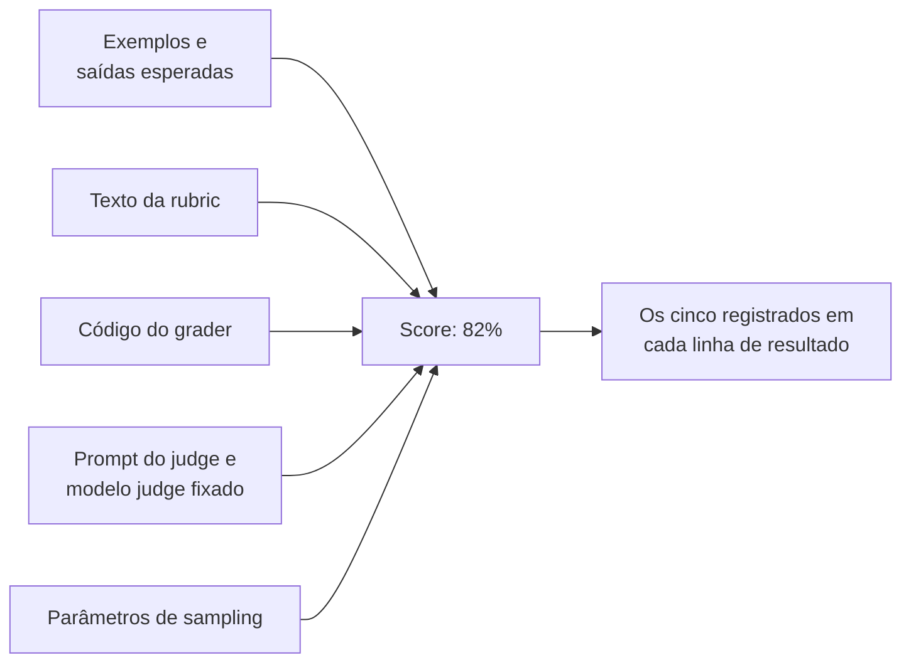

**Follow-ups:** Como você lidaria com um exemplo que todo mundo concorda que está mal rotulado, mas que está na suíte congelada há um ano? O que entra no eval set e o que entra num teste unitário?

</details>

### 13. O que são as GenAI semantic conventions do OpenTelemetry e por que você deveria se importar com elas?

<details><summary><b>Resposta</b></summary>

São um vocabulário padronizado para descrever operações de LLM em traces: nomes de atributos acordados sob o namespace gen_ai.*, como gen_ai.request.model, gen_ai.usage.input_tokens e gen_ai.operation.name, além de convenções sobre como uma chamada de modelo, uma tool call e um passo de agent devem ser modelados como spans.

Por que importa: elas desacoplam a instrumentação do backend. Se o seu app emite spans OTel padrão, você pode apontá-los para Langfuse, Phoenix, Datadog, Honeycomb ou para o seu próprio collector sem mexer no código da aplicação. A alternativa é um SDK de fornecedor espalhado por todos os pontos de chamada, que silenciosamente vira o motivo de você não conseguir sair daquele fornecedor. Também significa que os spans de LLM ficam no mesmo trace dos seus spans de HTTP e banco de dados, e você consegue ver que o p95 de 4 segundos eram 300ms de modelo e 3,7s do seu próprio código de retrieval. Muitos frameworks já emitem spans compatíveis de forma nativa ou por um pacote de instrumentação, então muitas vezes isso vem quase de graça.

Duas ressalvas que valem ser levantadas. Primeiro, no fim de 2026 as conventions gen_ai.* ainda estão no nível de estabilidade Development (o que o OTel chamava de experimental), e não Stable, e o trabalho foi levado para um repositório próprio para iterar mais rápido do que as conventions centrais. Nomes de atributos e formatos de span podem mudar entre releases, sem janela de deprecação. Fixe (pin) a versão da sua instrumentação, leia o changelog ao atualizar e espere mudanças, em vez de tratar os nomes como definitivos.

Segundo, e mais importante em entrevistas: as conventions cobrem a mecânica, não a qualidade. Tokens, modelos, parâmetros, latency, finish reasons. Não existe padrão para "esta resposta estava correta" ou "isto violou a política". Scores de eval e vereditos de segurança são atributos customizados seus, adicionados por cima. O OTel dá o esqueleto e a portabilidade; o julgamento continua sendo você quem constrói.

Note também que capturar o conteúdo de prompt e completion é opt-in de propósito, porque é nesse conteúdo que mora a exposição de privacidade.

**Vale desenhar.** O desenho mostra a costura que mantém você portável e onde as conventions terminam e o seu julgamento começa.

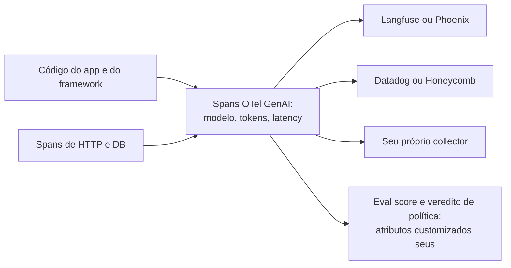

**Follow-ups:** Como você anexaria um eval score a um span depois do fato? O que você faria quando uma convention de que você depende mudasse de nome em um release novo?

</details>

### 14. O que torna bem especificado um único caso de eval, e quais são as formas comuns de casos individuais darem errado?

<details><summary><b>Resposta</b></summary>

Um bom caso é aquele em que dois especialistas do domínio, lendo-o de forma independente, chegariam ao mesmo veredito de pass ou fail para qualquer saída. Todo o resto decorre desse teste.

A anatomia. Cada caso traz o input exatamente como o sistema o recebe (mensagem do usuário, histórico da conversa, arquivos enviados, contexto recuperado se você estiver mantendo o retrieval fixo); qualquer estado de ambiente de que a tarefa dependa (seed do banco, faixa da conta, a data de hoje); o comportamento esperado, como uma resposta de referência ou uma rubric dizendo o que significa passar; o grader que a aplica; e metadados: tags de slice (idioma, intent, dificuldade), proveniência (ID do trace de produção, escrito à mão, sintético) e a data em que foi adicionado.

Como os casos dão errado, grosso modo em ordem de frequência:

- **Tarefa ambígua.** O input admite duas leituras razoáveis e a referência escolhe uma. O modelo adota a outra e falha. Corrija o input ou aceite as duas.
- **Grading especificado em excesso.** A referência diz "96.12" e o grader faz string match, então "$96.12" falha. Você está avaliando formatação, não a tarefa. Normalize ou passe para uma checagem com tolerância.
- **Grading especificado de menos.** A rubric diz "a resposta é útil", e o grader aprova qualquer coisa fluente.
- **Expectativa inalcançável.** A referência depende de informação que o sistema nunca teve: um documento ausente do corpus, um fato posterior ao knowledge cutoff, uma tool que ele não consegue chamar. Todo modelo vai falhar nele para sempre.
- **Referência desatualizada.** A política ou o preço mudou e a resposta gold não.

O diagnóstico barato: um caso em que todos os candidatos falham em muitas tentativas costuma estar quebrado, não ser difícil. Leia-o e confira se um humano com os mesmos inputs conseguiria passar. Da mesma forma, um caso em que nada nunca falha não está testando nada no nível atual de capacidade.

O hábito de quem tem senioridade é produzir uma saída que passa para cada caso antes de admiti-lo, e rodá-la pelo seu próprio grader. Se você não consegue escrever uma que passe, o modelo também não vai conseguir.

**Follow-ups:** Quem deve escrever as respostas de referência num domínio em que ninguém do time é especialista? Um caso passa em 50% das vezes ao longo de dez tentativas da mesma config. É um bom caso ou um caso quebrado?

</details>

## Intermediário

### 15. Pontuação pointwise vs comparação pairwise em LLM judges: qual é mais confiável e por quê?

<details><summary><b>Resposta</b></summary>

O pairwise é mais confiável, e a diferença conta na prática. O pointwise pede ao judge que mapeie uma resposta para uma escala absoluta ("dê uma nota de 1 a 10 para a utilidade"); o pairwise pede que ele escolha entre duas respostas (A melhor / B melhor / empate). Escalas absolutas são mal ancoradas: o que separa um 6 de um 7 não está definido, então as notas se comprimem para o topo da escala, oscilam entre execuções e versões do judge e variam com contexto irrelevante. Comparar só exige detectar uma *diferença*, tarefa cognitiva mais fácil tanto para modelos quanto para humanos. É o mesmo raciocínio pelo qual o RLHF coleta pares de preferência em vez de rewards escalares, e pelo qual o Chatbot Arena é construído sobre votos pairwise.

Quando usar cada um:

- **Pairwise** para decisões de A/B: prompt v1 vs v2, troca de modelo, regressão contra baseline. Agregue win rates, ou ajuste um Bradley-Terry se estiver comparando muitas variantes. Ressalvas: é O(n²) entre muitos sistemas (mitigue comparando tudo contra um único baseline fixo), herda o **position bias** (avalie sempre as duas ordens e mantenha os veredictos consistentes ou tire a média), e uma win rate esconde *o quanto* melhor.
- **Pointwise** quando você precisa de um sinal absoluto de qualidade por trace: monitorar produção, onde não há contraparte para comparar, ou filtrar saídas ruins individuais. Torne-o confiável abandonando escalas largas: use **pass/fail binário por critério decomposto** ("a resposta cita apenas fontes recuperadas: sim/não"), com uma rubric que defina cada veredito e exemplos few-shot de ancoragem. Julgamentos binários são dramaticamente mais consistentes que notas de 1 a 10.

Um híbrido útil: critérios binários pointwise no CI (estáveis, interpretáveis, sem precisar de baseline), mais uma execução de judge pairwise ao comparar dois candidatos frente a frente antes de decidir o ship.

Seja qual for a sua escolha, force chain-of-thought antes do veredito, fixe (pin) a versão do modelo judge e calibre com uma fatia rotulada por humanos. As vantagens de confiabilidade do pairwise não dispensam você de medir a concordância judge-humano.

**Follow-ups:** Como agregar com eficiência resultados pairwise entre 5 prompts candidatos? Seu judge pairwise diz que B vence A por 60/40, mas os critérios binários mostram pass rates idênticas: qual é a sua conclusão?

</details>

### 16. Quais são os vieses conhecidos dos LLM judges e como mitigar cada um?

<details><summary><b>Resposta</b></summary>

Os três principais, documentados na literatura de MT-Bench / LLM-as-judge:

1. **Position bias**: na comparação pairwise, os judges favorecem sistematicamente uma posição (muitas vezes a primeira resposta). Mitigação: rode cada comparação duas vezes, com as posições trocadas; conte uma vitória só se o veredito for consistente nas duas ordens (senão, marque empate), ou tire a média dos dois. Isso dobra o custo do judge. Aceite: é o preço da validade.
2. **Verbosity bias**: respostas mais longas pontuam mais, independentemente da qualidade; os judges leem o tamanho como esforço/completude. Mitigação: uma rubric que recompense explicitamente a concisão e penalize a enrolação; reporte o tamanho das respostas junto da win rate, para notar quando uma "vitória" é só +40% de tokens; análise com controle de tamanho (os style controls do Arena removem por regressão os efeitos do tamanho).
3. **Self-preference / self-enhancement bias**: os modelos dão notas maiores às próprias saídas (ou às da sua família), em parte porque uma redação familiar parece de maior qualidade. Mitigação: use como judge uma *família de modelos diferente* da dos geradores, ou um painel de judges de várias famílias com agregação.

Vieses de segunda ordem que vale citar: **sycophancy em relação a posições declaradas** no prompt (não revele qual resposta é "a nossa" nem qual você espera que ganhe); **viés de formato/estilo** (markdown, bullets e tom confiante pontuam mais, e os judges podem preferir o polido-errado ao simples-certo); e **capacidade limitada de avaliar conteúdo difícil**: um judge não verifica com confiança matemática ou fatos de nicho que ele mesmo não consegue resolver. Em tarefas pesadas em raciocínio, dê ao judge a resposta de referência e reduza o trabalho dele a comparar com a referência, em vez de resolver.

Mitigações de processo que ajudam em geral: chain-of-thought antes do veredito (força o judge a se engajar com o conteúdo), critérios binários decompostos no lugar de scores holísticos (menos espaço para efeito halo), exemplos few-shot de ancoragem no prompt do judge e, sem negociação, **calibração contra labels humanos** com a concordância medida por critério, para saber em quais vereditos do judge confiar e quais encaminhar a humanos.

**Vale desenhar.** A troca são duas chamadas de API e um desvio, e desenhá-la explica por que você aceita o dobro de custo de judge sem discutir.

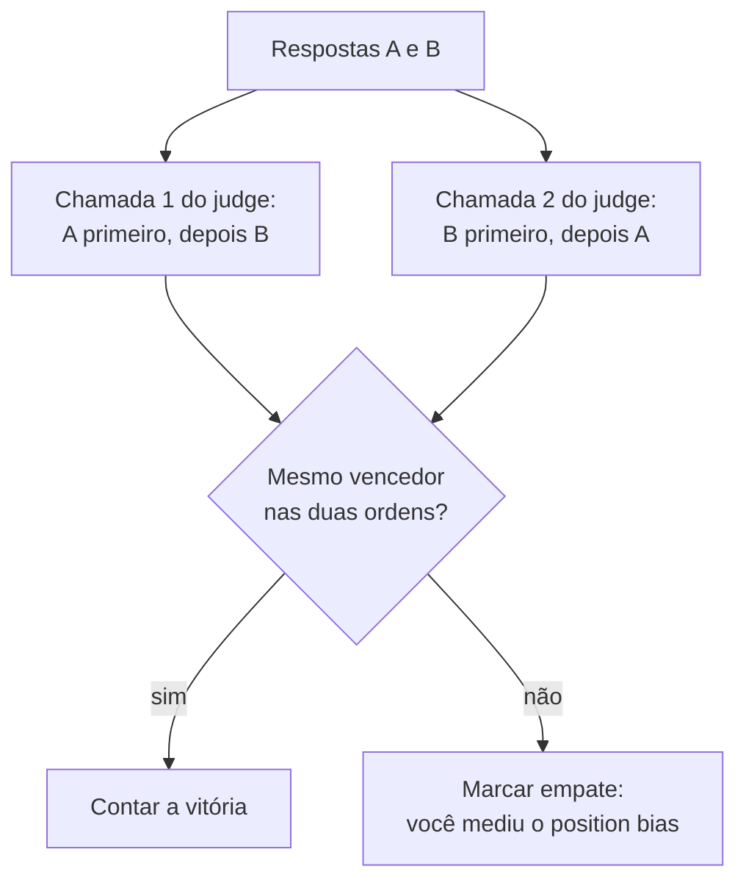

**Follow-ups:** Projete um experimento rápido para medir o position bias do seu próprio judge. Seu judge é da mesma família do modelo de produção e trocar de família derruba a concordância com humanos: e agora?

</details>

### 17. Como decidir se você confia no seu LLM judge? Explique a calibração passo a passo.

<details><summary><b>Resposta</b></summary>

Você confia em um judge da mesma forma que confia em qualquer modelo: medindo-o contra o ground truth. O processo:

1. **Monte um conjunto de calibração rotulado.** Amostre 50-100 saídas reais, estratificadas por dificuldade e segmentos, incluindo sobretudo casos limítrofes, não só passes/fails claros. Peça a humanos (de preferência 2-3 rotuladores independentes, com uma rubric compartilhada) que as avaliem. Registre primeiro a concordância entre humanos: ela é o seu teto. Se os humanos concordam em só 70% dos casos, a rubric é ambígua e nenhum judge consegue fazer melhor. Conserte a rubric antes de culpar o judge.
2. **Rode o judge e meça a concordância.** O percent agreement é fácil de ler; o **kappa de Cohen** desconta a concordância por acaso e é o que você deve citar quando as classes são desbalanceadas (um judge que sempre diz "pass" tem 90% de concordância num dataset com 90% de pass, mas kappa ≈ 0). Para saídas com nota, use correlação de postos (Spearman/Kendall) em vez de comparar as notas brutas.
3. **Olhe a confusion matrix, não só a taxa.** Falsos passes (o judge aprova uma saída ruim) costumam custar muito mais que falsos fails num gate de CI. Leia o transcript de cada discordância: na metade das vezes o label *humano* está errado ou a rubric está mal especificada, o que já é um sinal valioso.
4. **Itere o prompt do judge** (texto da rubric, CoT, âncoras few-shot, respostas de referência) contra o conjunto de calibração. O judge é um artefato de prompt engineering como qualquer outro, com seu próprio split de dev/test para você não fazer overfitting aos labels de calibração.
5. **Recalibre diante de gatilhos**: mudança de versão do modelo judge, mudança da rubric, drift da tarefa ou qualquer período em que os scores do judge e as métricas online divergem. Mantenha uma pequena "suíte de regressão do judge" com as discordâncias passadas.

Ponto de referência: o trabalho do MT-Bench constatou que judges fortes chegam a ~80% de concordância com humanos em qualidade de chat, perto da taxa humano-humano. Igualar a concordância entre humanos é a meta realista; exigir 100% não faz sentido, já que o seu ground truth também não chega lá.

**Vale desenhar.** Colocar a taxa humano-humano numa caixa própria evita que a conversa derive para "levar o judge a 95%".

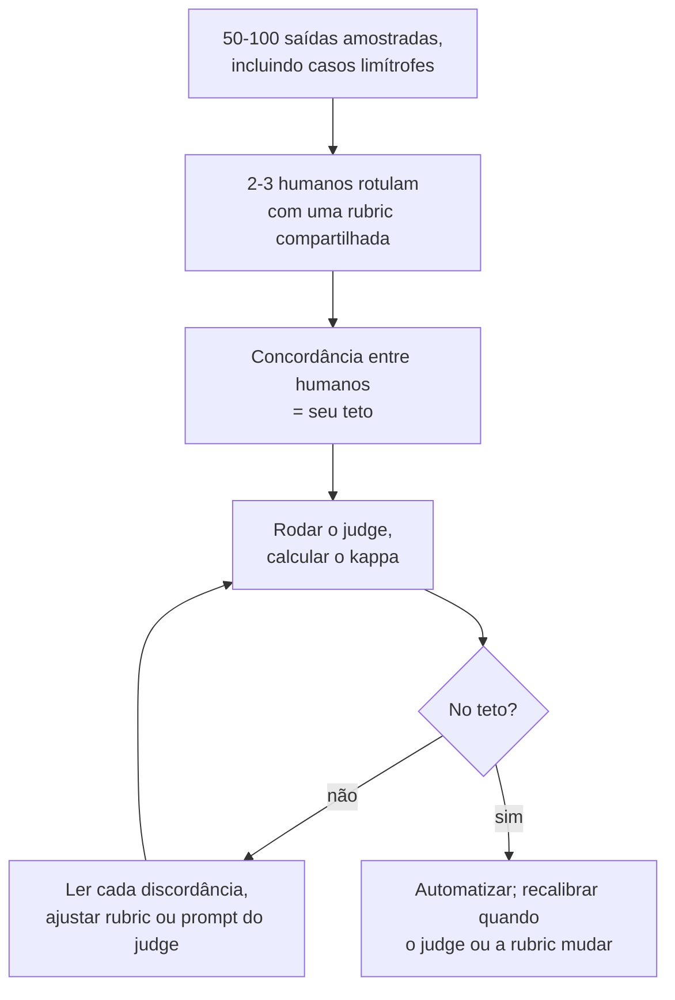

**Follow-ups:** O kappa é 0,45: o que, especificamente, você faz a seguir? Como manter a calibração em dia sem um time permanente de rotulagem?

</details>

### 18. Como projetar uma boa rubric para evals model-graded, e onde entra o chain-of-thought?

<details><summary><b>Resposta</b></summary>

Uma boa rubric transforma uma meta vaga de qualidade em um procedimento de decisão que um estranho cuidadoso conseguiria executar. Os movimentos de design:

- **Decomponha em checagens de critério único.** "Dê uma nota de 1 a 10 para a qualidade" convida efeito halo e drift. Em vez disso, faça uma chamada de judge por critério (*fiel ao contexto recuperado? completa em relação ao pedido do usuário? formato correto? tom adequado?*), cada uma devolvendo pass/fail binário ou um veredito de 2-3 níveis. Scores compostos, se necessários, são calculados em código com pesos explícitos, não dentro da cabeça do judge.
- **Defina os vereditos por extensão.** Para cada critério, diga o que significam pass e fail e inclua 2-4 exemplos few-shot de ancoragem, principalmente casos limítrofes: âncoras calibram mais que qualquer adjetivo. Se precisar usar uma escala, ancore cada ponto ("3 = pelo menos uma afirmação sem suporte, resposta central correta").
- **Diga ao judge o que ignorar.** Instrua-o explicitamente a não premiar tamanho, acabamento em markdown ou tom confiante, e a não penalizar a brevidade. Isso contrabalança em parte o viés de verbosidade/estilo.
- **Dê ao judge o que ele precisa.** Em tarefas factuais ou pesadas em raciocínio, inclua a resposta de referência ou o contexto recuperado: um judge avalia "isto bate com a referência / isto é sustentado pelo contexto" com muito mais confiabilidade do que consegue resolver a tarefa por conta própria.

**Chain-of-thought judging**: exija que o judge produza a análise *antes* do veredito, por exemplo "liste cada afirmação da resposta, marque se o contexto a sustenta e só então devolva PASS/FAIL em JSON". Respostas que começam pelo veredito deixam o modelo racionalizar um julgamento instintivo; começar pela análise força o engajamento com o conteúdo, melhora de forma mensurável a concordância com humanos e, igualmente valioso, dá uma justificativa auditável para cada nota. É isso que torna as falhas de CI baseadas em judge depuráveis em vez de misteriosas.

Por fim, estruture a saída (JSON com os campos `reasoning` e `verdict`) para que o parsing seja determinístico, e versione a rubric: editar a rubric muda a definição da sua métrica e deve invalidar as comparações de score entre um lado e outro da mudança.

**Follow-ups:** Quantos critérios por tarefa já são demais? Seu judge de faithfulness aprova uma resposta que faz tantas ressalvas que não diz nada: que mudança na rubric resolve isso?

</details>

### 19. O que MMLU, GSM8K, HumanEval, MT-Bench e SWE-bench medem, e por que você não deveria escolher um modelo para o seu produto com base neles?

<details><summary><b>Resposta</b></summary>

- **MMLU**: prova de múltipla escolha com 57 disciplinas (STEM, humanas, direito, medicina) que mede recall de conhecimento amplo e raciocínio leve. Os modelos de fronteira se aglomeram na casa dos 80 e 90% — saturado e muito contaminado, depois de anos dentro do raio de alcance de todo corpus de treino.
- **GSM8K**: ~8,5 mil problemas de matemática do ensino fundamental, em texto, que testam raciocínio aritmético em vários passos. Também saturado na fronteira; a contaminação/overfitting está bem documentada. Estudos que criaram problemas novos no estilo do GSM8K (por exemplo, o GSM1k) encontraram quedas de vários pontos em algumas famílias de modelos, ou seja, parte do score de destaque era memorização.
- **HumanEval**: 164 problemas de completar funções em Python, escritos à mão e avaliados por execução, reportados como pass@k. Minúsculo, só Python, escopo de uma função: saturado há tempos e pouco representativo do trabalho real com software.
- **MT-Bench**: 80 prompts abertos multi-turn avaliados por um LLM judge. Mede instruction-following conversacional e herda todos os vieses do judge.
- **SWE-bench**: issues reais do GitHub de repositórios Python populares; o agent precisa produzir um patch que passe nos testes reservados do repositório. Os scores dependem muito do harness (scaffolding, retries, orçamento de compute), então comparações entre modelos muitas vezes medem tanto o framework do agent quanto o modelo. O **SWE-bench Verified** é o subconjunto de 500 issues validadas por humanos, criado para remover casos quebrados ou mal especificados, e foi o número de destaque de coding agents até 2025. Ele agora seguiu o caminho dos outros: em 2026 a OpenAI parou de reportá-lo, citando testes falhos em muitas das tarefas difíceis restantes e sinais de que modelos de fronteira tinham memorizado algumas correções, e apontou para o mais difícil SWE-bench Pro. Até um benchmark "verificado" envelhece até a saturação e a contaminação.

Por que eles não devem guiar decisões de produto: (1) **contaminação**: os test sets públicos vazam para o pretraining, então os scores medem em parte memorização; (2) **saturação**: quando todo mundo está acima de 90%, o ruído domina o ranking; (3) **Goodhart**: os labs otimizam explicitamente para os benchmarks de destaque, então a correlação da métrica com a qualidade geral se degrada; (4) **descasamento de distribuição**: nenhum deles contém seus usuários, seu domínio, suas tools nem suas restrições de latency e custo. Um modelo dois pontos "pior" no MMLU pode ser decisivamente melhor na sua tarefa de extração.

O uso certo: shortlist grosseira e acompanhamento da tendência de capacidades. Depois, passe a shortlist pela *sua* suíte de evals, porque é essa a comparação que importa.

**Follow-ups:** Se os benchmarks públicos estão tão comprometidos, por que os labs continuam a reportá-los? Que propriedades tornam um benchmark resistente à saturação e à contaminação?

</details>

### 20. O que é benchmark contamination e como você a detectaria ou se protegeria dela?

<details><summary><b>Resposta</b></summary>

Contamination é o vazamento de dados de teste para os dados de treino: o modelo viu as questões do benchmark (ou quase-duplicatas) durante o pretraining ou o fine-tuning, então o score mede memorização em vez de capacidade. É endêmica porque os benchmarks são publicados na web aberta, citados em posts de blog e repositórios do GitHub, e os corpora de pretraining aspiram tudo isso. Ela também pode ser indireta: paráfrases, versões traduzidas ou treino em saídas de modelos que, por sua vez, resolveram o benchmark.

Abordagens de detecção, nenhuma perfeita:

- **Testes de perturbação**: reescreva as questões mudando a forma superficial, mas mantendo a mesma lógica: variáveis renomeadas, números diferentes, redação parafraseada. Uma queda grande de score nas versões perturbadas indica memorização. O estudo do GSM1k fez exatamente isso com o GSM8K (problemas equivalentes escritos do zero) e encontrou quedas de vários pontos em algumas famílias de modelos.
- **Sobreposição de n-gramas / substrings** entre o test set e o corpus de treino: o método clássico que os labs reportam, mas só quem tem o corpus consegue usá-lo, e ele não pega contaminação no nível de paráfrase.
- **Probes de memorização**: dê ao modelo o prefixo de uma questão e veja se ele completa a resposta exata ou os itens seguintes do teste palavra por palavra. Uma taxa suspeitamente alta de completions literais de dados de teste é a prova definitiva.
- **Splits temporais**: avalie com dados criados *depois* do training cutoff do modelo: novos problemas de programação competitiva, issues do GitHub recém-abertas (a lógica por trás de benchmarks renovados e rotativos, como os desenhos no estilo LiveBench e os snapshots atualizados do SWE-bench).

Proteção, para os seus próprios evals:

- **Mantenha seu eval set privado**: nunca em repositório público, nunca em posts de blog, e tome cuidado ao colá-lo em serviços de terceiros cujos termos permitam treinar com os inputs.
- **Renove continuamente** a partir da produção: falhas novas são, por construção, posteriores aos dados de treino de qualquer modelo, o que torna um eval set vindo da produção naturalmente resistente à contaminação.
- **Reserve uma fatia nunca publicada**, usada só nas decisões finais de seleção de modelo, separada do dev set em que a iteração dos seus prompts pode ter feito overfitting.

**Follow-ups:** A contamination pode fazer um modelo parecer *pior*? Seu fornecedor afirma ter feito decontamination por sobreposição de 13-gramas: o que isso deixa passar?

</details>

### 21. Como você montaria um eval baseado em execução para uma feature de geração de código?

<details><summary><b>Resposta</b></summary>

A avaliação baseada em execução é a única métrica honesta para código: rode a saída do modelo e verifique o comportamento. A similaridade de texto com uma solução de referência não faz sentido, porque existem infinitas implementações corretas.

Os componentes centrais:

1. **Formato da tarefa**: cada caso tem um enunciado do problema, um contexto de código (assinatura, trecho do repositório), **exemplos visíveis** que o modelo pode ver e **testes ocultos** usados só para avaliação. Os testes ocultos são essenciais: se os graders forem visíveis, os modelos (e a iteração dos seus prompts) fazem overfitting neles, e fixar no código as saídas esperadas passa nos testes visíveis sem valer nada. HumanEval e SWE-bench avaliam com testes reservados.
2. **Execução em sandbox**: código gerado e não confiável roda isolado, em containers ou microVMs sem rede, com limites de CPU/memória e timeouts de wall-clock (loops infinitos são um modo de falha comum, não um edge case). Nunca execute a saída do modelo no ambiente do seu runner de CI.
3. **Lógica de grading**: pass = todos os testes ocultos verdes. O crédito parcial (fração de testes aprovados) é um sinal útil para error analysis, mas mantenha a métrica principal binária, porque "80% dos testes" muitas vezes significa "errado". Para tarefas em nível de repositório, vale o padrão do SWE-bench: aplique o patch, rode a suíte de testes do próprio repositório e exija que os testes que falhavam passem (fail-to-pass) *e* que os demais continuem passando (pass-to-pass, que pega as regressões).
4. **Métricas**: pass@1 na temperature de produção para a visão honesta do produto; pass@k com o estimador não enviesado (n ≥ k amostras) se o seu produto faz best-of-n com verificação. Acompanhe a taxa de compile/parse separadamente: saída sintaticamente inválida é uma classe de falha diferente de código logicamente errado.

Armadilhas operacionais que mordem na prática: **testes instáveis** (tempo, aleatoriedade, ordem) geram ruído no eval, então fixe seeds e relógios e coloque os casos instáveis em quarentena; **drift de ambiente**, então fixe (pin) as versões das dependências na imagem, ou os scores mudam quando o PyPI muda; **calibração de timeout**: apertado demais, você reprova soluções lentas porém corretas e mistura correção com performance.

**Follow-ups:** Como você avalia *edições* de código em um repositório grande já existente, em comparação com escrever funções do zero? Sua pass rate é 60%: como decompor isso em categorias de falha acionáveis?

</details>

### 22. Como você avalia um pipeline de RAG? Por que avaliar os componentes separadamente do sistema end-to-end?

<details><summary><b>Resposta</b></summary>

Avalie em dois níveis, porque scores end-to-end não dizem *qual* componente consertar.

**Por componente:**

- **Retrieval**: monte um conjunto rotulado de pares query → chunk(s) relevante(s) (por rotulagem humana ou rotulagem assistida por LLM com auditoria humana; também dá para gerar perguntas *a partir* de chunks conhecidos, de modo que a relevância já vem por construção). Meça primeiro o **recall@k**: se a resposta não está no conjunto recuperado, a geração não tem como consertar. O recall@k é o teto da qualidade end-to-end. Acrescente MRR/nDCG quando a posição no contexto importar. Evals de retrieval são baratos, determinísticos e rodam sem tocar no generator, então dá para varrer tamanhos de chunk, embedders, pesos do híbrido e rerankers offline em minutos.
- **Generation (com o contexto fixo)**: **faithfulness/groundedness** (as afirmações da resposta são sustentadas pelos chunks fornecidos? A avaliação é feita por judge, afirmação por afirmação); **answer relevance** (a resposta trata da pergunta?); **context utilisation** (o modelo usou o chunk certo quando vários foram recuperados, e diz corretamente "não encontrei" quando o contexto não tem a resposta? Isso se mede com casos adversariais em que você deliberadamente não recupera nada útil).

**End-to-end:** correção da resposta final contra respostas de referência em um golden set, mais a acurácia das citações (os IDs de chunk citados realmente sustentam as afirmações citadas). Esse é o número que a liderança vê e o que mais se correlaciona com os usuários.

Por que os dois: uma falha end-to-end é ambígua entre "o retrieval perdeu o documento" e "o generator ignorou/contradisse o documento", e as correções são completamente diferentes (re-chunk/re-embed/rerank vs mudanças de prompt/modelo). As métricas por componente localizam o defeito na hora. Na prática, a maior parte da perda de qualidade em RAG está no retrieval (e no parsing/chunking anteriores a ele), então os evals por componente também dizem onde gastar esforço. Frameworks como o RAGAS empacotam essas métricas (faithfulness, answer relevance, context precision/recall), mas os conceitos importam mais que a ferramenta.

Pegadinha clássica de entrevista: citar só a faithfulness. Um sistema que responde "não sei" a tudo é perfeitamente fiel. Combine a faithfulness com answer relevance/completeness, ou você vai otimizar até a inutilidade.

**Vale desenhar.** Pendurar cada métrica no componente que ela avalia é o jeito mais rápido de mostrar que você sabe localizar um defeito, e não só reportá-lo.

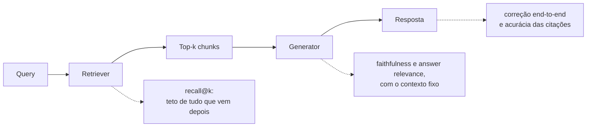

**Follow-ups:** O recall@10 é 95%, mas a correção end-to-end é 70%: onde você procura? Como manter válidos os labels de retrieval quando o corpus é refeito em novos chunks?

</details>

### 23. Quais métricas de retrieval você usaria (recall@k, MRR, nDCG) e quando cada uma importa?

<details><summary><b>Resposta</b></summary>

- **Recall@k**: fração das queries em que um chunk relevante aparece no top k. É a métrica principal de RAG, porque o generator vê a janela inteira do top-k: em RAG, normalmente não importa se o chunk gold está no rank 1 ou no 7 quando k = 10 e tudo vai para o prompt. Defina o k como o que você realmente coloca no contexto. O recall@k é o seu teto end-to-end: acompanhe-o antes de qualquer outra coisa.
- **MRR (mean reciprocal rank)**: média de 1/rank do *primeiro* resultado relevante. Importa quando o rank 1 é especial: prompting com um único chunk, uma UI que mostra uma única citação principal, ou modelos que dão atenção desproporcional ao topo/início do contexto. Ignora tudo o que vem depois do primeiro acerto, então é inadequada para perguntas com múltiplas evidências.
- **nDCG@k**: discounted cumulative gain normalizado. Premia colocar itens *mais relevantes* em posições *mais altas* e aceita relevância graduada (perfeito/parcial/marginal) em vez de binária. É a métrica certa quando vários chunks têm graus diferentes de utilidade e a ordem dentro da janela importa, por exemplo quando você recupera 50, faz rerank e mantém 10: o nDCG@10 é a métrica natural do reranker. Custa mais para rotular (julgamentos graduados).

Orientação prática: em um pipeline de RAG, reporte o **recall@k para o retriever** (labels binários, baratos) e o **nDCG@k ou MRR para o reranker**, e acompanhe também **precision@k / context precision**: chunks irrelevantes na janela não são de graça, eles diluem a atenção, adicionam tokens e plantam alucinações. Um retriever ajustado só para recall enche o contexto de ruído sem cerimônia.

Cite também a ressalva da rotulagem: todas essas métricas são calculadas contra relevância *julgada*, e chunks recuperados e não julgados costumam ser tratados como irrelevantes. Isso penaliza um retriever novo que encontra chunks genuinamente relevantes que seus labels não cobriram (o clássico problema de pooling de IR). Audite à mão uma amostra de "misses" antes de concluir que um embedder novo é pior.

**Vale desenhar.** Colocar cada métrica no estágio a que ela pertence evita a confusão habitual de citar um único número para o pipeline inteiro.

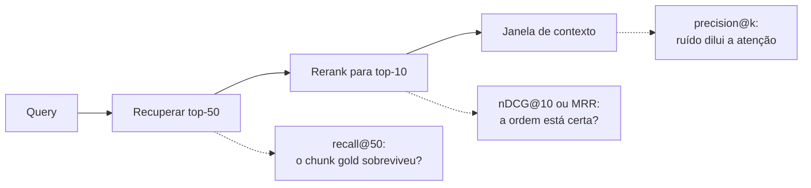

**Follow-ups:** O novo embedder melhora o nDCG, mas as respostas end-to-end pioram: que mecanismos poderiam explicar isso? Por que o recall@5 pode importar mais que o recall@20, mesmo que seu contexto comporte 20 chunks?

</details>

### 24. Como medir a faithfulness, isto é, se a resposta do modelo está de fato ancorada no contexto recuperado?

<details><summary><b>Resposta</b></summary>

A faithfulness (groundedness) pergunta: toda afirmação factual da resposta é sustentada pelo contexto recuperado? É a métrica anti-alucinação do RAG, e é diferente de correção: uma resposta pode ser fiel a um documento errado, ou infiel e correta por acaso, graças à memória paramétrica. Em RAG você normalmente quer faithfulness, porque o que você prometeu ao usuário foi "sustentado pelas fontes".

A medição padrão é a **avaliação por judge no nível da afirmação**:

1. **Decomponha** a resposta em afirmações factuais atômicas (um LLM faz isso com confiabilidade).
2. **Verifique cada afirmação** contra os chunks recuperados: uma chamada de judge por afirmação (ou em lote), com vereditos *supported / contradicted / not found*, obrigando a citar o trecho que sustenta. Citar é um forte dispositivo de honestidade e torna os vereditos auditáveis.
3. **Score** = fração de afirmações sustentadas. Reporte as contradicted separadamente das not found: as contradições são a classe de falha mais assustadora.

Esse padrão decompor-e-verificar (como na métrica de faithfulness do RAGAS e nas abordagens baseadas em NLI que vieram antes) é muito mais confiável que uma única chamada holística de judge do tipo "isto está ancorado? de 1 a 10", que passa batido por detalhes inventados isolados numa resposta de resto bem ancorada. E detalhes inventados isolados são justamente o caso perigoso.

Detalhes de design que importam: exclua da extração de afirmações o conteúdo não factual (ressalvas, formatação, a pergunta reescrita); decida a política para afirmações de "conhecimento comum" ausentes do contexto (o modo estrito as reprova, o que serve em contextos jurídicos e médicos; o modo leniente as permite, o que serve em chat); e monte **casos adversariais** em que o contexto deliberadamente não tem a resposta ou contradiz o conhecimento popular, para testar se o modelo segue o contexto ou os seus priors.

Duas armadilhas a citar: verificar com o *mesmo* modelo que gerou a resposta infla os scores (self-preference; use outra família); e otimizar só a faithfulness leva o sistema a hesitar de forma vazia, porque uma resposta que não diz nada é perfeitamente fiel. Combine sempre com answer relevance/completeness. E calibre o pipeline inteiro de judge com ~50 exemplos rotulados por humanos antes de ligá-lo ao CI.

**Vale desenhar.** Separar os três vereditos na página é o que diferencia você de quem diz "perguntamos a um judge se está ancorado".

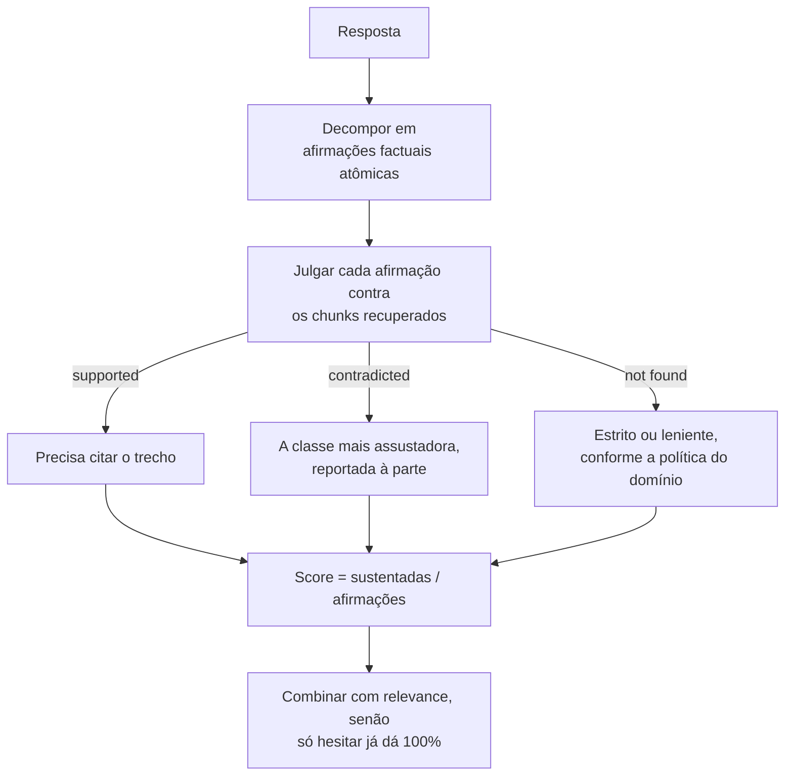

**Follow-ups:** Como você monitoraria a faithfulness de forma barata em tráfego real, onde não há resposta de referência? Uma afirmação é sustentada pelo chunk A, mas contradita pelo chunk B no mesmo contexto: o que a métrica deve fazer?

</details>

### 25. Como ligar evals ao CI para que mudanças de prompt ou de modelo não regridam a qualidade em silêncio?

<details><summary><b>Resposta</b></summary>

Trate prompts, rubrics e datasets de eval como código: versionados no repositório, alterados por PR e testados a cada mudança. O pipeline:

1. **Gatilho**: qualquer mudança em um prompt template, no pin de modelo/versão, nos parâmetros de decoding, na config de retrieval ou nos schemas de tools dispara uma execução de eval, com a mesma disciplina de gatilho dos testes unitários. Dispare também conforme o calendário do *provedor*: uma execução agendada (por exemplo, noturna) contra a config de produção pega mudanças upstream no modelo que você não fez.
2. **Suítes em camadas, por velocidade e custo**: uma suíte que bloqueia o PR, com ~50-200 casos curados (assertions de guardrail + métricas-chave de qualidade), termina em minutos e custa pouco; a suíte completa (milhares de casos, k repetições, judges caros) roda à noite ou antes do release. Faça cache dos resultados com chave (input, hash da config), para que caminhos inalterados não rodem de novo.
3. **Lógica de gating**: as métricas de guardrail bloqueiam de forma rígida. Qualquer falha na suíte de jailbreak, vazamento de PII ou regressão de validade de schema bloqueia o merge, sem discussão. As métricas de qualidade bloqueiam de forma estatística: compare com a execução de baseline *na mesma versão do dataset* e bloqueie só se a queda passar de um limiar de ruído que você estabeleceu (comparação pareada entre casos; com métricas avaliadas por judge, considere também a variância do judge, por exemplo vereditos que viram em julgamentos repetidos). Do contrário, você vai ou carimbar regressões reais, ou gritar "lobo" por causa de ruído até as pessoas ignorarem o gate.
4. **Relatório no PR**: não só o score agregado, mas o diff por caso (quais casos viraram de fail para pass e de pass para fail), com links para os transcripts. Um revisor consegue olhar cinco transcripts que viraram em dois minutos, e é aí que as mudanças ruins são de fato pegas.
5. **Disciplina de versionamento**: todo resultado registra a versão do prompt, do modelo, do dataset e do judge. Mudou o dataset ou o judge, faça um novo baseline; nunca compare scores entre essas fronteiras.

O modo de falha a evitar: um job de eval apenas consultivo, cujo X vermelho todo mundo ignora ao dar merge. Os gates precisam bloquear e, para continuarem a bloquear de forma politicamente sustentável, mantenha a suíte bloqueante pequena, rápida, estável e visivelmente correlacionada com a qualidade real.

**Vale desenhar.** Dois gates diferentes numa mesma execução: desenhe e a distinção entre rígido e estatístico deixa de precisar de explicação.

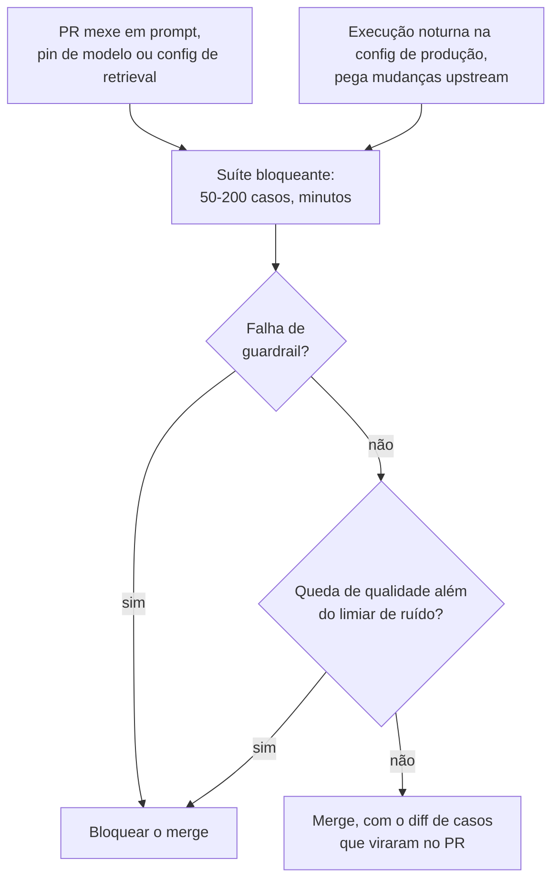

**Follow-ups:** Um PR melhora a tarefa-alvo, mas faz dois casos não relacionados virarem fail: qual é o seu processo? Como manter sob controle o custo de CI baseado em judge conforme cresce o volume de PRs do time?

</details>

### 26. Como você avalia online uma feature com LLM? Desenhe o A/B test e cite os sinais de feedback implícito que usaria.

<details><summary><b>Resposta</b></summary>

Evals offline preveem; testes online confirmam com usuários reais. O desenho:

- **Unidade de randomização**: nível de usuário (ou de sessão), não de requisição. Experiências com LLM têm estado, e splits por requisição contaminam a experiência de cada usuário e violam a independência nas métricas de nível de sessão.
- **Métrica primária**: o proxy honesto mais próximo do sucesso da tarefa: taxa de resolução sem escalação para humano (bots de suporte), taxa de aceitação de sugestões (assistentes de código), taxa de conclusão de tarefa (agents). Não só a "taxa de thumbs up", que é esparsa demais.
- **Métricas de guardrail**: latency p95, custo por sessão, taxa de flags de segurança, taxa de escalação. O experimento falha automaticamente se elas regredirem, qualquer que seja o resultado da métrica primária.
- **Cálculo de poder antes do lançamento**: os deltas de qualidade em LLMs costumam ser pequenos (2-5% relativos), então calcule o tamanho de amostra necessário com honestidade; A/B tests sem poder geram ruído disfarçado de decisão. Fique de olho em efeitos de novidade na primeira semana e na heterogeneidade por segmento (uma vitória no tráfego em inglês pode esconder uma perda no japonês).

**Sinais implícitos** são críticos porque o feedback explícito é esparso (thumbs vêm de uma porcentagem de um dígito baixo das sessões) e enviesado (usuários irritados clicam mais):

- **Taxa de regeneração / retry**: o usuário rejeitou a resposta; um dos sinais negativos mais fortes.
- **Copy-to-clipboard, aceitação de código, edit distance** da saída aceita antes do uso: edit distance alta significa que a saída precisou de retrabalho.
- **Reformulações de follow-up** ("não, eu quis dizer..."): detectáveis com um classificador barato; indicam que a resposta não satisfez.
- **Abandono** no meio da resposta ou logo depois; **escalação da sessão** para um canal humano.
- **Resultados em nível de tarefa** onde der para instrumentar: ticket reaberto, PR mergeado, reserva concluída.

Para mudanças de retrieval/ranking em particular, mencione o **interleaving**: misture os resultados dos dois rankers em uma única lista e veja de que lado vêm os cliques. Como é dentro do mesmo usuário, ele chega à significância com uma ordem de grandeza a menos de tráfego do que um A/B. É o truque padrão de busca na web, diretamente aplicável ao retrieval de RAG.

Feche o loop: registre a atribuição do braço nos traces, para que a error analysis offline compare transcripts entre os braços, e acompanhe a correlação entre o score do eval offline e o resultado online. Se divergirem, seu eval set se afastou da produção.

**Vale desenhar.** O ramo de guardrail ficando depois da métrica primária é a parte que os entrevistadores esperam ouvir.

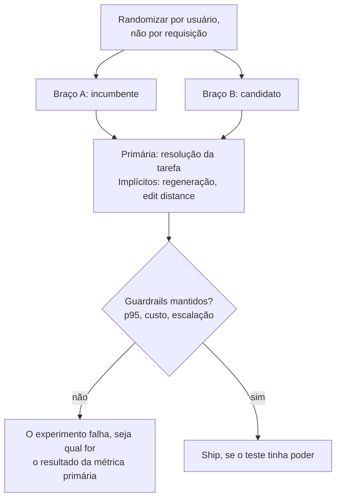

**Follow-ups:** A taxa de thumbs-up subiu, mas a taxa de escalação também: construa uma história que explique as duas coisas. Quando você daria ship só com evals offline, sem A/B?

</details>

### 27. Você tem 500 transcripts de produção marcados como falhas. Explique seu processo de error analysis.

<details><summary><b>Resposta</b></summary>

O objetivo é sair com uma lista ranqueada de *modos* de falha e consertar o maior deles, não consertar 500 bugs individuais.

1. **Leia antes de automatizar.** Leia pessoalmente 30-50 transcripts do início ao fim, incluindo retrievals e tool calls, não só as respostas finais. Escreva uma nota aberta de uma linha por transcript ("ignorou a segunda restrição do pedido", "o retrieval devolveu o documento de política de 2023"). Resista a categorias prematuras: primeiro codificação aberta, depois taxonomia. Baldes predefinidos deixam você cego aos modos de falha que não antecipou.
2. **Agrupe em uma taxonomia.** Junte as notas em modos de falha. Um LLM pode ajudar a agrupar todos os 500 depois que você derivou a taxonomia à mão a partir dos 50, mas valide as atribuições dele em uma amostra; não terceirize a etapa de entendimento. Resultado típico: 5-10 modos como *retrieval miss*, *instrução seguida parcialmente*, *argumentos errados de tool*, *violação de formato*, *intent do usuário mal interpretado*, *não-é-na-verdade-uma-falha* (feedback mal rotulado, sempre uma fatia nada trivial: um thumbs-down muitas vezes significa "não gostei da política", não "o modelo falhou").
3. **Ranqueie por frequência × severidade × facilidade de correção.** Um modo que causa 30% das falhas e tem correção de uma linha no prompt vence um modo de 5% que exige um modelo novo. O Pareto é um aliado confiável aqui: o cluster do topo costuma ser um único bug de prompt ou uma única lacuna de retrieval.
4. **Conserte o cluster do topo, verifique, repita.** Antes de consertar, converta 10-20 exemplares desse cluster em casos de eval: eles são o seu teste de regressão e a medida de sucesso da correção. Aplique a correção, rode os evals, confirme que o cluster encolhe sem que outros cresçam, dê ship e refaça a análise no próximo ciclo.

Dois hábitos de quem tem senioridade: reportar taxas-base ("retrieval misses são 32% das falhas e afetam 4% de todas as sessões"), para que o esforço seja proporcional ao impacto; e institucionalizar o loop. Uma hora semanal de leitura de transcripts com o time inteiro rende mais que qualquer dashboard, porque dashboards dizem *que* a qualidade caiu e transcripts dizem *por quê*.

**Vale desenhar.** O funil mostra os números encolhendo de 500 até uma única correção, que é a disciplina que a pergunta testa.

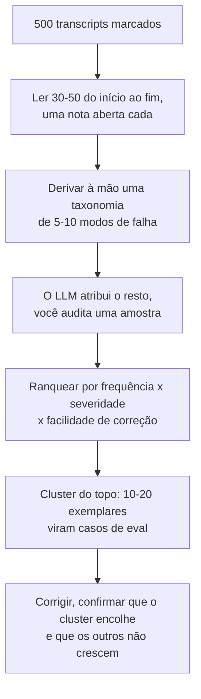

**Follow-ups:** Como lidar com modos de falha que só aparecem em contexto multi-turn? O que fazer com o cluster "não é na verdade uma falha"?

</details>

### 28. Como manter um eval set atualizado ao longo do tempo e evitar fazer overfitting nele?

<details><summary><b>Resposta</b></summary>

Um eval set se degrada de duas formas: o **mundo muda** (novos intents, features, idiomas, e o conjunto congelado deixa de representar o tráfego) e **você faz overfitting nele** (meses de iteração de prompt contra os mesmos 200 casos significam que as melhorias são em parte específicas desses casos, a Lei de Goodhart aplicada a você mesmo). Os dois produzem o mesmo sintoma: os scores offline sobem ou se mantêm enquanto as métricas online não.

Práticas de atualização:

- **Entrada contínua vinda da produção**: um pipeline permanente leva thumbs-downs, escalações, regenerações e disparos de guardrail para uma fila de triagem; alguém revisa toda semana e promove as falhas reais para o eval set. Dados frescos de produção têm uma vantagem extra: são posteriores ao training cutoff de qualquer modelo, o que os torna naturalmente resistentes à contaminação.
- **Aposente casos saturados**: casos que passam há meses deixam de discriminar entre candidatos. Mova-os para uma camada barata de smoke test/regressão em vez de apagá-los (eles ainda pegam quebras catastróficas); mantenha a camada discriminativa difícil, mirando talvez 60-80% de pass para haver margem para medir melhoria.
- **Auditorias de cobertura**: compare periodicamente a distribuição de intents/tópicos/idiomas do eval set com o tráfego atual de produção e preencha as lacunas, de forma sintética se for preciso.

Práticas contra o overfitting, tiradas direto da higiene de ML:

- **Split dev/test**: itere os prompts contra a fatia de dev; só toque na fatia de test reservada para decisões de ship, com baixa frequência. Se os scores de dev e test divergem, você fez overfitting no dev, então renove-o.
- **Rotacione e expanda**: os casos de produção recém-promovidos entram primeiro na fatia de *test*, mantendo-a representativa e sem ter sido "treinada".
- **Observe a correlação offline-online** de forma explícita: ela é o canário de uma suíte desatualizada.

**O versionamento é o que torna a atualização segura**: toda mudança no dataset incrementa uma versão, os resultados sempre registram as versões de dataset + prompt + modelo + judge, e as comparações de score só acontecem dentro de uma versão. Do contrário, "melhoramos 5 pontos" não é interpretável: você pode ter só trocado os casos difíceis. Quando for preciso comparar entre versões, rode de novo a config de baseline no dataset novo.

**Vale desenhar.** Mostrar os casos novos entrando primeiro no test, não no dev, é o detalhe que diz ao entrevistador que você já operou isso de verdade.


**Follow-ups:** Na prática, como você detectaria que o time fez overfitting no dev set? Quem faz a triagem da fila de falhas de produção e qual é o critério de admissão para um novo caso de eval?

</details>

### 29. Como você usaria dados sintéticos para montar ou ampliar um eval set e quais são os modos de falha?

<details><summary><b>Resposta</b></summary>

A geração sintética é como você ganha cobertura antes de ter tráfego e como preenche lacunas de distribuição depois. Bem feita, ela é estruturada, e não um "gere 500 perguntas de teste":

1. **Monte primeiro uma taxonomia de cenários**, com dimensões como intent × persona × dificuldade × idioma × condição de borda (pedido ambíguo, restrições contraditórias, informação faltando, formulação adversarial). Gere amostrando combinações, de modo que a cobertura venha por construção, em vez de torcer para o modelo variar.
2. **Ancore a geração em artefatos reais** sempre que possível: em RAG, gere perguntas *a partir* de chunks reais do corpus, e você ganha de graça pares (pergunta, chunk gold) com labels de relevância, o jeito padrão de dar o pontapé inicial em evals de retrieval. Para agents, gere tarefas a partir de schemas de tools e estados de ambiente reais.
3. **Gere hard negatives de propósito**: perguntas que o corpus *não consegue* responder (testa o comportamento de "não sei"), queries quase certas, tentativas de prompt injection para suítes de guardrail.
4. **Revisão humana antes da admissão.** Todo caso sintético passa por uma pessoa: é realista, a resposta esperada está de fato correta, não é ambíguo? Conte com rejeitar de 20 a 40%. Evals sintéticos sem revisão são o caminho para times otimizarem contra respostas de referência erradas.

Modos de falha a citar:

- **Descasamento de distribuição**: os casos gerados são mais limpos, mais bem pontuados, mais educados e mais resolvíveis que os usuários reais, então os modelos parecem melhores em conjuntos sintéticos do que no tráfego de produção. Mitigue semeando a geração com exemplos reais e imitando a bagunça deles (erros de digitação, frases truncadas, idiomas misturados).
- **Mode collapse / baixa diversidade**: LLMs produzem o caso mediano repetidamente; a taxonomia, instruções explícitas de diversidade e dedup (filtragem por similaridade de embeddings) neutralizam isso.
- **Circularidade gerador-judge**: se a mesma família de modelos gera as perguntas, responde a elas e as avalia, os vieses se alinham em cada etapa e os scores inflam. Cruze famílias entre os papéis.
- **Labels errados em escala**: uma resposta de referência sintética sutilmente errada corrompe a sua métrica em silêncio, o que é pior que não ter o caso.

Posicione os dados sintéticos com honestidade: um bootstrap e um preenchedor de lacunas que as falhas de produção vão substituindo aos poucos, não um substituto permanente para dados reais.

**Follow-ups:** Como você mediria se o seu conjunto sintético prevê a performance em produção? Gere casos de eval para uma feature nova, sem nenhum usuário: explique o passo a passo para uma feature específica.

</details>

### 30. Como medir a concordância entre anotadores (inter-annotator agreement) em um esforço de rotulagem humana, e o que fazer quando seus anotadores discordam muito?

<details><summary><b>Resposta</b></summary>

Meça antes de confiar em qualquer label, e nunca só com o percent agreement bruto. Numa tarefa em que 90% dos exemplos passam, dois anotadores que dizem "pass" por reflexo concordam 90% das vezes sem carregar nenhuma informação. Métricas corrigidas para o acaso resolvem isso: o kappa de Cohen para dois anotadores com labels categóricos, o kappa de Fleiss para mais de dois, e o alfa de Krippendorff quando há labels faltando, mais de dois avaliadores ou escalas ordinais. O alfa é o mais flexível e é o que eu usaria como padrão em escala de produção.

Na interpretação, o kappa entre pares de humanos costuma ficar em algum ponto entre 0,5 e 0,8, dependendo de quão subjetiva é a tarefa. Extração objetiva deveria ficar perto de 0,9. Trabalho de preferência genuinamente subjetivo costuma ficar mais baixo, e isso não é um defeito.

Quando a concordância é ruim, isso é diagnóstico, não incômodo. Há duas causas. Ou a rubric está mal especificada, que é o caso usual e tem conserto, ou a tarefa é irredutivelmente subjetiva, o que não tem. Distinga os dois lendo as discordâncias. Se dois revisores divergem em "isto é útil?" porque um conta o tamanho como utilidade, é um bug de rubric: defina o critério, adicione exemplos de ancoragem para cada veredito, decomponha "qualidade" em critérios binários separados e meça de novo.

O processo que eu sigo: ~50 itens sobrepostos entre três anotadores, medir o alfa, ler cada discordância, reescrever a rubric e medir de novo em itens novos. Só quando a concordância fica aceitável eu escalo para um anotador por item, com uma amostra de ~10% de sobreposição para continuar monitorando o drift.

O retorno importa para os judges: a concordância humano-humano é o teto. Se os humanos chegam a 0,65, um judge em 0,65 está em paridade, não quebrado. Perseguir 95% de concordância do judge numa tarefa em que humanos concordam 70% significa ajustar o judge às idiossincrasias de um único anotador.

**Follow-ups:** Seus anotadores chegam a um alfa de 0,4 e a reescrita da rubric não ajuda. E agora? Como detectar um anotador que está derivando ao longo de um mês?

</details>

### 31. Você quer detectar uma melhoria de 3 pontos na pass rate. De quantos exemplos de eval precisa e como reduzir esse número?

<details><summary><b>Resposta</b></summary>

Trabalhe de trás para a frente a partir do efeito mínimo detectável, em vez de escolher um número redondo como 100 e torcer.

Para duas proporções independentes, com ~80% de poder e 95% de confiança, o n necessário por braço é aproximadamente 2,5 / delta^2 quando a taxa-base está perto de 80%. Com delta = 0,03, são cerca de 2.800 exemplos por braço. Com 2 pontos, ~6.300. Com 7 pontos, ~500. Essa é a aritmética incômoda por trás da maior parte do teatro de evals: times declaram vitória em deltas de 4 pontos sobre 100 exemplos, em que o piso de ruído é de cerca de 8 pontos.

A alavanca é o pareamento. Você não está rodando dois grupos aleatórios de usuários; está rodando as duas variantes sobre os mesmos exemplos, então use isso. Num desenho pareado, só os pares discordantes carregam sinal: exemplos em que A passou e B falhou, ou o contrário. Tudo que os dois acertaram ou os dois erraram não contribui com nada. O teste de McNemar sobre as contagens discordantes, ou um bootstrap sobre o vetor de deltas pareados por exemplo, costuma reduzir o tamanho de amostra necessário várias vezes, porque você removeu a dificuldade do exemplo como fonte de variância. A economia depende de quantos exemplos viram: quanto menos pares discordantes em relação ao delta líquido, maior o ganho. Detectar alguns pontos de diferença líquida pode cair para a casa das centenas em vez de milhares.

```python
import numpy as np

def paired_bootstrap(a, b, n=10_000):
    """a, b: resultados 0/1 por exemplo nos MESMOS exemplos."""
    d = np.asarray(a, float) - np.asarray(b, float)
    idx = np.random.randint(0, len(d), (n, len(d)))
    boot = d[idx].mean(axis=1)
    return d.mean(), np.percentile(boot, [2.5, 97.5])
```

Faça o ship quando o intervalo ficar inteiramente de um lado do zero.

Duas ressalvas. O ruído de sampling significa que você deve tirar a média de várias execuções por exemplo, senão o pareamento fica poluído. E se você espiar os resultados repetidamente, corrija por isso, ou a sua taxa de falso positivo de 5% não é 5%.

**Follow-ups:** Seu cálculo de MDE diz que você precisa de 2.800 exemplos e você tem 200. O que você de fato faz? Quando um desenho pareado não está disponível para você?

</details>

### 32. Você vai trocar o modelo por trás de uma feature em produção. Explique shadow, canary e A/B. Quando usar cada um?

<details><summary><b>Resposta</b></summary>

São uma sequência com exposição crescente de usuários e evidência de qualidade cada vez melhor, e respondem a perguntas diferentes. Os evals offline vêm primeiro; esses três são o que você faz depois.

Shadow: espelhe o tráfego de produção para o candidato, entregue ao usuário a resposta do incumbente e avalie o candidato offline. Ele responde a "o candidato se comporta de forma sensata na distribuição real de inputs?", algo que o seu eval set não diz, porque o eval set não é o seu tráfego. Pega crashes, quebras de formato, recusas, regressões de latency e estouros de custo em inputs reais, com risco zero para o usuário. Custos: você paga o dobro de inferência, e há uma aresta cortante que muita gente esquece. Se a feature tem efeitos colaterais, fazer shadow de um agent significa que ele realmente emite os reembolsos e envia os e-mails duas vezes. Você precisa de modo somente leitura ou de tools de escrita mockadas antes de fazer shadow de qualquer coisa agentic.

O que o shadow não consegue dizer é se os usuários gostam, porque nenhum usuário viu a saída.

Canary: sirva o candidato a uma fatia pequena, ~1-5%, com guardrails ligados a rollback automático em taxa de erro, latency, custo e violações de segurança. Ele responde a "isto sobrevive ao contato com os usuários?", e o assunto é raio de impacto, não estatística. Um canary de 2% quase nunca terá poder para resolver uma diferença de qualidade de 2 pontos.

A/B: randomização por usuário, com poder estatístico, rodando por uma a duas semanas contra uma métrica north-star de produto mais os guardrails. É o único que responde a "isto é melhor para os usuários?", e o único que enxerga efeitos de novidade e comportamentos de prazo mais longo, como retenção e taxas de escalação.

Nem toda mudança merece os quatro estágios. A correção de um typo no prompt vai de eval offline direto para o ship. A troca de família de modelo recebe a escada completa, porque é aí que o comportamento muda de formas que o seu eval set nunca viu.

**Vale desenhar.** Escrever embaixo de cada caixa a pergunta que o estágio responde é o que impede os três de soarem intercambiáveis.

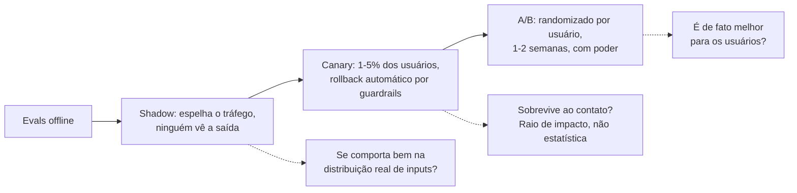

**Follow-ups:** Como você faria shadow de um agent que escreve em um banco de dados de produção? Seu canary parece bom com 2% e a qualidade despenca com 50%. O que aconteceu?

</details>

### 33. Como instrumentar custo e latency de uma feature agentic, e o que de fato faz o custo crescer sem ninguém perceber?

<details><summary><b>Resposta</b></summary>

Instrumente no nível do span e agregue no nível da tarefa. Cada span de chamada de modelo carrega tokens de input, tokens de output, tokens em cache, modelo e versão, e um custo calculado. Cada span também carrega as dimensões pelas quais você vai querer agrupar depois: rota ou feature, versão do prompt template, faixa do cliente e um ID de tarefa que amarra o trace inteiro. Cuidado com a cardinalidade: labels por usuário em métricas destroem o seu banco de séries temporais, então deixe os atributos de alta cardinalidade nos traces e mantenha as dimensões das métricas grosseiras.

A métrica principal é o custo por tarefa resolvida, não o custo por chamada. Essa é a distinção que separa quem já operou esses sistemas de quem não operou. Um modelo mais barato que precisa de três loops extras de tool calling e ainda escala para um humano é mais caro em todos os eixos, e o custo por chamada diz que ficou mais barato.

O que realmente cresce, mais ou menos em ordem: o tamanho do prompt template, porque cada incidente acrescenta um parágrafo e ninguém remove nenhum; o acúmulo de contexto em sessões multi-turn, em que o turno 20 custa 10x o turno 1; o top-k de retrieval aumentado num pânico de recall e nunca reduzido; o número de passos do agent, que tem a cauda mais gorda; e os orçamentos de reasoning tokens, que são cobrados e invisíveis para o usuário.

Para latency, acompanhe time-to-first-token e total separadamente, em p50, p95 e p99. Com streaming, o TTFT é o que o usuário sente e o total é o que bate nos seus timeouts. Acompanhe também a taxa de cache hit do prompt, pois uma edição de prompt que quebra o prefixo do cache pode multiplicar o custo da noite para o dia, sem nenhuma mudança visível.

Alerte sobre o formato da distribuição, não sobre médias. A média de passos é estável enquanto um loop descontrolado queima milhares; o p99 de passos e um guard de max-steps rígido pegam o problema. Trate as taxas de truncamento e de esgotamento de orçamento como falhas de primeira classe.

**Follow-ups:** Seu custo por tarefa dobrou, mas todas as métricas por chamada estão estáveis. Onde você procura? Como atribuir custo a um cliente específico sem métricas de alta cardinalidade?

</details>

### 34. Prompts e completions contêm dados de usuários. Como redigir PII nos traces sem destruir a sua capacidade de depurar?

<details><summary><b>Resposta</b></summary>

Redija na ingestão, antes de persistir, não na leitura. Redigir na leitura significa que o dado bruto já está no seu trace store, e qualquer brecha de controle de acesso passa a ser uma violação. Depois de escrito, o dado é responsabilidade sua.

A versão ingênua, trocar tudo por [REDACTED], deixa os traces inúteis. Uma conversa em que todo nome é [REDACTED] não dá para acompanhar. A solução é pseudonimização em vez de exclusão: detecte a entidade e a substitua por um token estável, derivado de um HMAC com chave do valor, de modo que a mesma pessoa vire PERSON_a91f de forma consistente no trace. Você ainda consegue seguir "o usuário perguntou sobre o pedido de PERSON_a91f e a tool devolveu o registro errado", que é a pergunta de debugging, sem nunca armazenar o nome. Preservar a forma também ajuda: mantenha o tipo, o tamanho aproximado e a posição, pois "o modelo alucinou um número de 16 dígitos" é um achado.

A detecção é em camadas porque as duas abordagens falham de formas diferentes. Padrões determinísticos pegam dados estruturados de forma barata e confiável: e-mails, números de cartão com checagem de Luhn, documentos de identidade. Uma passada de NER pega nomes, endereços e menções em texto livre que padrões nunca pegarão, ao custo de latency e de lacunas de recall. Rode os padrões inline e o modelo também inline, se você puder pagar, ou de forma assíncrona sobre uma amostra, se não puder.

Depois, separe o armazenamento em camadas. Traces redigidos têm retenção longa e acesso amplo. A captura bruta, se você precisar dela, tem um TTL curto, de dias e não de meses, criptografia, log de acesso e um processo de break-glass, e eu a limitaria a traces de erro.

Duas coisas que as pessoas esquecem. Indexe os traces por ID de usuário, para que um pedido de exclusão seja um delete por chave e não uma varredura completa. E não envie prompts brutos a um judge ou fornecedor de eval de terceiros sem verificar se o contrato de dados cobre isso.

**Follow-ups:** Seu redator de NER deixa passar ~5% dos nomes. Isso é aceitável? Como depurar uma falha cuja causa raiz era justamente o texto que você redigiu?

</details>

### 35. Projete uma fila de revisão humana para uma feature de LLM em produção. O que é revisado e quanto?

<details><summary><b>Resposta</b></summary>

A primeira decisão é o que amostrar, e a resposta padrão de "traces aleatórios" desperdiça o orçamento. Se o sistema acerta 90% das vezes, a amostragem aleatória gasta 90% da cara atenção humana confirmando coisas que funcionaram.

Eu estratifico em quatro fluxos. Primeiro, suspeitas de falha: scores baixos do judge, guardrail acionado, erros de tool, retries. É o de maior rendimento. Segundo, sinais negativos implícitos: regenerações, abandono, thumbs-down, escalação para um atendente humano, edição pesada da saída aceita. São baratos e honestos. Terceiro, rotas de alto risco, independentemente de sinal, porque uma falha rara numa ação de cobrança custa mais do que uma comum num resumo. Quarto, e inegociável, uma pequena amostra aleatória uniforme de talvez 5%.

Essa fatia aleatória é o que mantém o sistema honesto. Os outros três fluxos são filtrados pelas suas crenças atuais sobre como é uma falha, então são estruturalmente cegos para modos de falha que você não imaginou e para tudo o que o seu judge avalia como ok. A amostra aleatória também é o único fluxo que dá uma estimativa não enviesada da taxa real de falhas. Os times a cortam primeiro quando o orçamento aperta, e depois não conseguem dizer com que frequência o produto funciona.

Mecânica da fila: um item é um trace mais o contexto renderizado que o modelo viu, não uma string solta. Os revisores dão vereditos binários por critério, nunca um 1-10, porque a pontuação numérica pointwise deriva entre revisores e, num mesmo revisor, ao longo de um turno. Exija uma descrição de falha de uma linha em texto livre: esse texto é a matéria-prima para o clustering.

Planeje o orçamento com realismo: ~20-40 transcripts de chat por hora, bem menos para trajetórias de agents, que podem levar 10 minutos cada.

O mais importante: devolva os labels ao sistema, para o conjunto de calibração do judge, para o eval set e para correções de prompt. Uma fila que só produz uma porcentagem de qualidade é digitação de dados.

**Follow-ups:** Como manter dois revisores consistentes ao longo de seis meses? O que você cortaria primeiro se o orçamento de revisão caísse pela metade?

</details>

### 36. Seu time fez um exercício de red-team e encontrou 30 jeitos de quebrar o assistente. Como transformar isso em algo durável?

<details><summary><b>Resposta</b></summary>

Um exercício de red-team encontra os problemas uma vez. É a suíte de evals que os mantém corrigidos. A conversão é todo o valor, e a maioria dos times a pula: eles ajustam o prompt, fecham os tickets e regridem em silêncio três releases depois.

Cada achado vira um caso de teste com o input do ataque, o critério de política que ele violou e um grader. Prefira um grader determinístico quando a violação for verificável (apareceu um número de cartão na saída? ele chamou a tool de reembolso?) e recorra a um judge com rubric bem delimitada quando não for.

O movimento crítico é generalizar além da string literal. Se você adicionar o prompt exato do jailbreak e mais nada, vai consertar aquela string. O release seguinte passa na sua suíte e cai diante do mesmo ataque reformulado. Por isso cada achado se expande em ~5-20 mutações: paráfrases, outro idioma, outro enquadramento, o mesmo ataque embutido num documento recuperado em vez de digitado pelo usuário. Mantenha a taxonomia por trás delas: enquadramento de roleplay, truques de encoding, injeção indireta via conteúdo recuperado ou saída de tool, escalada multi-turn em que o turno 1 é inocente. É a taxonomia que generaliza; os prompts individuais são instâncias.

Esses casos pertencem à suíte de guardrail, não à de qualidade. Binários, de passagem obrigatória, e qualquer falha bloqueia o merge. Você não troca um jailbreak por um ganho de utilidade.

Cadência: humanos fazem red-team em calendário e a cada mudança grande, porque encontram categorias novas. A suíte automatizada roda a cada CI, porque defende as categorias antigas. Acompanhe a taxa de sucesso de ataques sobre a suíte como tendência.

Um cuidado: mantenha um holdout privado e não publique o conjunto inteiro. Uma suíte pública de ataques acaba no próximo pretraining, e aí ela passa a medir memorização.

**Follow-ups:** Como evitar que uma suíte de red-team fique obsoleta conforme os modelos melhoram? Sua taxa de sucesso de ataques está em 0% há seis meses. Boa notícia ou má?

</details>

### 37. Seu modelo judge está sendo descontinuado e você precisa migrar para uma nova versão. Como manter os scores comparáveis?

<details><summary><b>Resposta</b></summary>

Parta do fato de que o score é função do judge, e não só do sistema. Uma troca de versão do judge muda seus números sem nenhuma mudança no produto. Se o dashboard sofrer um rebase silencioso, você vai gastar uma semana depurando uma regressão que nunca aconteceu ou, pior, deixar passar uma regressão real escondida sob a mudança do judge.

De forma preventiva: fixe (pin) a versão exata do modelo judge, nunca um alias flutuante. Aliases são reapontados sem aviso, e essa é uma das formas mais comuns de o histórico de evals de um time se tornar silenciosamente incomparável. O prompt do judge é código e é versionado junto. Cada linha de resultado registra a versão do dataset, do grader, do modelo judge e os parâmetros de sampling.

Para a migração em si, trate a troca do judge como uma mudança que exige o seu próprio eval, porque é exatamente isso que ela é. Na prática: rode de novo o conjunto de calibração rotulado por humanos com o novo judge e compare a concordância com a do antigo. O novo judge só é aceitável se a concordância com humanos for pelo menos igual; um modelo mais novo e mais forte não é automaticamente um judge melhor para a sua rubric, e eu já vi modelos mais fortes serem judges piores porque raciocinam além de uma rubric que consideram errada.

Depois, rode os dois em paralelo. Avalie os eval sets dos últimos releases com ambos os judges e publique a diferença (offset), para saber se o novo judge simplesmente é 3 pontos mais rígido. Faça o novo baseline de forma explícita e anote o dashboard na data da virada. Nunca misture versões de judge dentro de uma mesma comparação A vs B, que é o verdadeiro pecado capital.

Uma salvaguarda contínua e barata: mantenha um conjunto de sanidade do judge com ~30 itens de vereditos conhecidos e inequívocos e rode-o antes de cada lote de evals. Se o judge falhar neles, o lote é anulado e algo mudou upstream.

**Vale desenhar.** O desenho enquadra a troca do judge como uma mudança que precisa passar no seu próprio eval, que é a resposta que a pergunta procura.

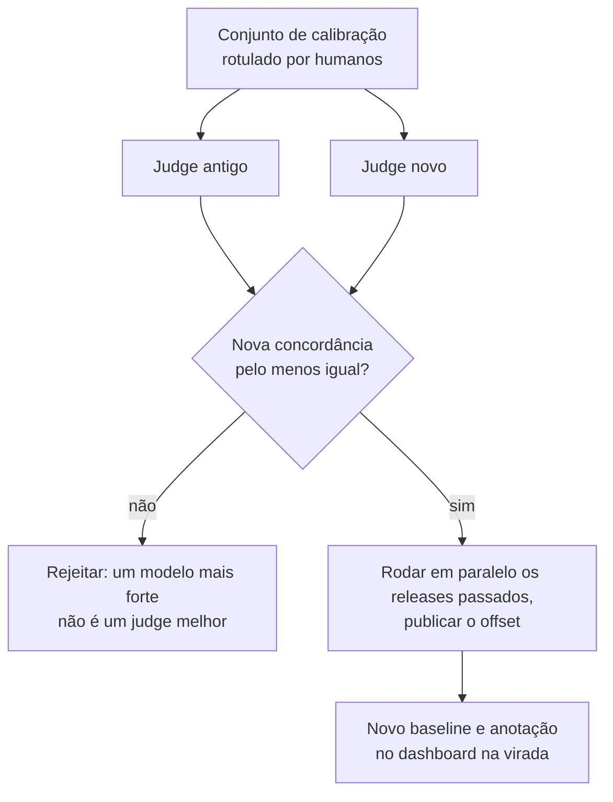

**Follow-ups:** O novo judge concorda um pouco menos com os humanos, mas é 5x mais barato. Você adota? Como detectar um judge em drift se a versão está de fato fixada?

</details>

### 38. Você adiciona um router que manda as queries fáceis para um modelo barato e as difíceis para um modelo de fronteira. Como avaliar o router?

<details><summary><b>Resposta</b></summary>

Avalie-o como um trade-off entre custo e qualidade, não como um classificador. O trabalho do router não é rotular queries como "difíceis" corretamente, é comprar a maior qualidade por dólar, e o enquadramento de classificação esconde o único erro que importa.

Comece rodando os dois modelos no eval set inteiro, de modo que cada exemplo tenha um resultado do modelo barato e um do modelo forte. Isso dá de graça três pontos de referência: sempre-barato, sempre-forte e o router oráculo, que manda um exemplo ao modelo forte só quando o barato falha. O oráculo é o seu teto, e a distância entre sempre-barato e sempre-forte é toda a qualidade em jogo.

Depois varie o limiar do router e plote qualidade contra custo, ou contra a fração do tráfego enviada ao modelo forte. A curva de um bom router se curva para cima: a maior parte da qualidade do modelo forte por uma fração do custo. Compare com um router aleatório na mesma fração de modelo forte, que é a reta entre os dois extremos. Um router que não supera essa reta está adicionando latency e complexidade à toa. Reporte um ou dois pontos de operação, como a qualidade retida com 30% do tráfego no modelo forte.

O erro assimétrico é o routed-down failure: um exemplo que o modelo barato erra e que o router mandou para ele mesmo assim. Erros de rota para cima só custam dinheiro. Meça a taxa de routed-down failure por slice, porque os routers falham justamente nos segmentos que parecem fáceis e não são: queries curtas com complexidade escondida, inputs em outros idiomas, domínios de cauda longa.

Dois detalhes de produção. Os inputs do router sofrem drift como todo o resto, então monitore a fração enviada ao modelo forte ao longo do tempo: um salto repentino significa que o tráfego mudou ou o router quebrou. E, em produção, você só observa o modelo que de fato chamou, então mantenha uma pequena fatia randomizada em que os dois modelos rodam. Sem ela, você nunca consegue medir o que o router está custando em qualidade.

**Follow-ups:** Seu router corta o custo em 60% e a qualidade agregada cai 1 ponto. O que mais você checa antes de dar ship? Como avaliar uma cascata que tenta primeiro o modelo barato e escala quando a confiança é baixa, em vez de rotear de antemão?

</details>

## Avançado

### 39. Como avaliar agents? Compare as abordagens baseadas em trajetória e baseadas em resultado.

<details><summary><b>Resposta</b></summary>

Agents dificultam a avaliação de três formas: há muitos caminhos válidos até o sucesso, o estado se acumula ao longo dos passos (erros iniciais se compõem ou são recuperados) e os resultados dependem de um ambiente, não só de texto. Duas abordagens complementares:

**Baseada em resultado**: a tarefa foi de fato concluída? Verificada de forma programática contra o estado final do ambiente: os testes passam no repositório com o patch (SWE-bench), a linha do banco de dados tem a reserva certa (τ-bench), o arquivo existe com o conteúdo correto, o status do pedido mudou. É o padrão-ouro quando dá para checar: é objetiva, não penaliza estratégias não convencionais porém válidas e é o que os usuários realmente querem. Seus custos: você precisa de um **simulador de ambiente em sandbox** com tools realistas, estado semeado e capacidade de reset (os evals precisam ser repetíveis e não podem tocar em sistemas de produção); construir e manter esses simuladores é a maior parte do trabalho de engenharia em evals de agents. Em tarefas multi-turn, muitas vezes você também precisa de um **usuário simulado** (um LLM fazendo o papel do cliente), o que traz a sua própria variância e questões de realismo.

**Baseada em trajetória**: pontue o *caminho*: acerto na escolha de tools (a tool certa para o passo), correção dos argumentos, eficiência de passos (passos dados vs um mínimo razoável; detecção de loops), comportamento de recuperação de erros e segurança ao longo do percurso (um agent que tem sucesso mas rodou um comando destrutivo no caminho é uma falha). A avaliação usa assertions contra sequências de tools esperadas quando o caminho é restrito, ou judges sobre o trace quando não é. O scoring de trajetória é a camada de *diagnóstico*: as métricas de resultado dizem que a taxa de falha é de 40%; a análise de trajetória diz que são, em sua maioria, argumentos errados para a tool de busca no passo 2.

Práticas que importam: rode **k tentativas por tarefa**, porque a variância de agents é enorme e execuções únicas são anedotas; reporte pass@k *e* **pass^k** (todas as k têm sucesso, conforme o τ-bench), porque a confiabilidade é a métrica de produto: 80% de sucesso por tentativa dá pass^8 ≈ 17%. Dê crédito parcial por meio de checkpoints de marcos/subobjetivos, para que tarefas longas rendam gradiente, não só 0/1. E mantenha o hábito de ler transcripts: os modos de falha de agents (loops, saídas de tool alucinadas, desistir cedo) são óbvios para um leitor humano e invisíveis nos agregados.

**Vale desenhar.** Duas setas saindo da mesma execução: uma avalia o mundo, a outra avalia o caminho, e só a segunda diz onde olhar.

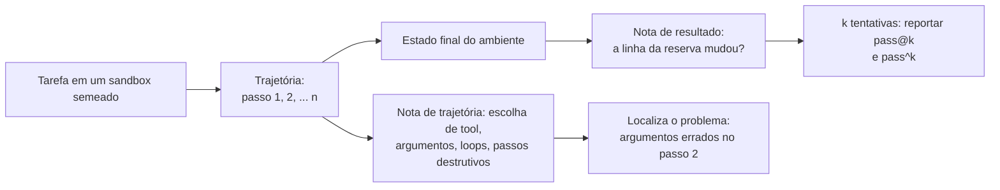

**Follow-ups:** Como avaliar um agent cujas tools acessam APIs de terceiros que não podem ser resetadas? Seu agent vai bem no simulador e decepciona em produção: enumere as diferenças.

</details>

### 40. Como funciona uma avaliação no estilo Chatbot Arena e quais são seus pontos fortes e limites?

<details><summary><b>Resposta</b></summary>

O Chatbot Arena (depois LMArena, embora a maioria ainda use o nome original) coleta preferência humana pairwise por crowdsourcing: um visitante envia qualquer prompt, dois modelos anônimos respondem lado a lado, o humano vota na melhor resposta (ou em empate), e os votos de muitos usuários se agregam em um leaderboard. O ranking é ajustado com um **modelo Bradley-Terry**: cada modelo recebe um parâmetro de força, e P(A vence B) é modelada como uma função logística da diferença de força. O projeto migrou de atualizações incrementais de Elo para o ajuste por máxima verossimilhança do BT porque a dependência de ordem do Elo adiciona ruído quando as forças dos modelos são estáticas na janela de estimativa. Os intervalos de confiança vêm de bootstrap dos votos.

Pontos fortes: mede a **preferência humana real numa distribuição aberta de prompts**, sem respostas de referência e sem vieses de modelo judge; é **resistente à contaminação** (os prompts são novos, ao vivo e ilimitados: você não consegue treinar nas perguntas da semana que vem); o anonimato até depois do voto suprime o viés de marca; e escala para modelos novos a baixo custo.

Limites, onde bons candidatos ganham pontos:

- **Mede preferência, não correção.** Os votantes premiam respostas confiantes, bem formatadas e mais longas, e raramente verificam fatos. Os efeitos de verbosidade e estilo são reais, e por isso foi introduzido o **style control** (remover por regressão, no modelo BT, os efeitos de tamanho e markdown), que virou a visão padrão do leaderboard: os rankings com e sem controle de estilo visivelmente diferem.
- **Viés de população**: os votantes são entusiastas de AI; a distribuição de prompts super-representa chat casual, programação e prompts de "testar o modelo", em comparação, por exemplo, com processamento de documentos corporativos. Os rankings podem não se transferir para o seu domínio.
- **Um único número para um objeto multidimensional**: leaderboards por categoria ajudam, mas uma nota global esconde o "ótimo em código, fraco em documentos longos".
- **Pressão de Goodhart**: os labs otimizam para o desempenho no arena, ajustando o modelo ao gosto da população votante (formatação, personalidade) em vez de à qualidade geral; há também preocupação documentada com labs que testam muitas variantes privadas e lançam a de maior pontuação, o que infla o rank aparente.
- **Sem eixo de custo/latency**: um modelo 10× mais caro fica ao lado de um barato como se fossem pares.

Resumo: excelente para acompanhar a fronteira e fazer shortlists grosseiras; nunca um substituto para evals específicos da tarefa.

**Follow-ups:** Por que o Bradley-Terry é preferível à win rate ingênua quando o número de comparações é desigual entre pares de modelos? Projete um arena interno para o caso de uso da sua empresa: o que quebra primeiro?

</details>

### 41. Seu novo prompt tem 78% contra 74% do prompt antigo em um eval de 100 exemplos. Você dá ship?

<details><summary><b>Resposta</b></summary>

Não só com essa evidência: uma diferença de 4 pontos com n=100 está confortavelmente dentro do ruído. O erro padrão de uma proporção perto de 75% é √(0,75·0,25/100) ≈ 4,3 pontos, então o IC de 95% de cada score é de aproximadamente ±8,5 pontos; a diferença de duas proporções independentes com esse n tem um IC mais largo que a diferença observada de 4 pontos. Quatro pontos são quatro exemplos virando.

Mas a análise certa é **pareada**, e esse é o movimento de quem tem senioridade: os dois prompts rodaram nos *mesmos* 100 exemplos, então ignore os scores agregados e olhe as viradas por caso. Suponha que 10 casos viraram de fail para pass e 6 de pass para fail (líquido de +4). A pergunta é se 10 contra 6, entre 16 casos discordantes, supera cara ou coroa. É o **teste de McNemar** (equivalentemente, um teste de sinal sobre os pares discordantes), e 10/16 está longe de ser significativo. A análise pareada é muito mais poderosa que comparar duas proporções independentes, porque remove a variância compartilhada da dificuldade dos casos. Muitas vezes ela transforma um resultado "insignificante" não pareado em um resultado claro, ou expõe que seu ganho são alguns cara ou coroa. Uma alternativa barata com o mesmo espírito: faça **bootstrap das diferenças de score por caso** e leia o IC na distribuição reamostrada.

Considere também o **não determinismo do sampling**: com temperature > 0 (e mesmo nominalmente em 0, dado o não determinismo da stack de serving), o mesmo prompt rodado de novo vira casos. Rode cada config k vezes (até k=3) para estimar a variância de viradas por caso; métricas avaliadas por judge acrescentam variância do judge por cima, e julgar repetidamente saídas idênticas também mostra viradas de veredito. O trabalho "Adding Error Bars to Evals", da Anthropic, é a referência para fazer isso direito (erros padrão clusterizados, inferência pareada, análise de poder).

O que eu faria de fato: (1) ler os ~16 transcripts que viraram, cinco minutos que muitas vezes resolvem a questão (correção real vs ruído vs novo modo de falha); (2) se a direção parecer real mas faltar poder, aumentar o n na fatia difícil, ou aceitar e monitorar se a mudança for de baixo risco e reversível; (3) nunca dar ship com uma regressão em métrica de guardrail, apesar da vitória na métrica principal.

**Vale desenhar.** Dividir os 100 casos entre concordantes e discordantes é o argumento inteiro da análise pareada em uma imagem.

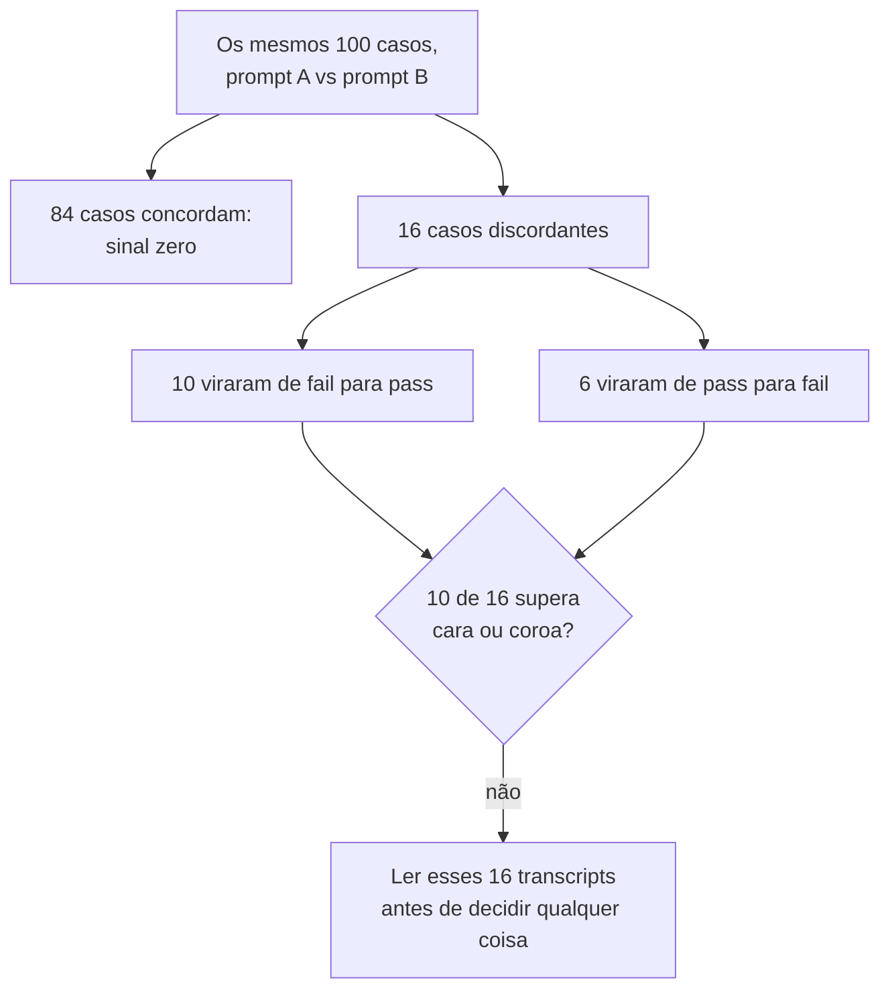

**Follow-ups:** Qual precisaria ser o n para detectar com confiabilidade uma melhoria real de 4 pontos (poder)? Como a variância de viradas por caso muda a sua conta do IC?

</details>

### 42. Projete a stack de observability de uma aplicação de LLM em produção. Como é um bom trace?

<details><summary><b>Resposta</b></summary>

Modele o sistema como **traces de spans**, exatamente como tracing distribuído, porque uma requisição de LLM *é* uma computação distribuída. Uma requisição de usuário = um trace; cada unidade de trabalho = um span com horários de início/fim, atributos e links para o pai:

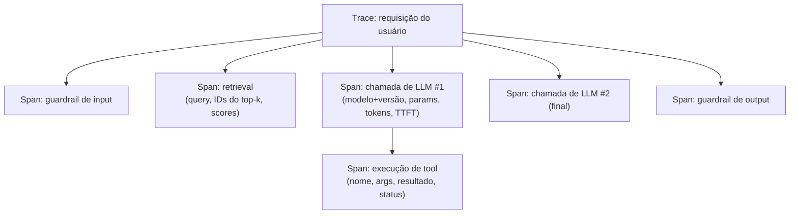

**Atributos por span**: modelo e versão *exata* (nunca só um alias), parâmetros de sampling, prompt e completion renderizados (ou ponteiros redigidos), contagem de tokens de input/output, TTFT e latency total, custo, status de cache hit, finish reason, detalhes de erro, versão do prompt template e, nos spans de retrieval, os IDs dos chunks + scores. Adote as **GenAI semantic conventions do OpenTelemetry** (`gen_ai.request.model`, `gen_ai.usage.input_tokens`, etc.), para que a instrumentação seja portável entre backends e seus spans de LLM vivam no mesmo trace dos spans de serviço comuns: um trace só, do ingress HTTP, passando pelo retrieval, até o stream de tokens.

**Camadas por cima dos traces brutos**:

1. **Métricas/alertas**: dashboards por rota para latency p50/p95, TTFT, tokens por requisição, custo por sessão, taxas de erro e de disparo de guardrail, além de alarmes de drift sobre as tendências.
2. **Joins de feedback**: thumbs, regenerações, escalações e atribuição de braço de A/B ligados aos IDs dos traces. Esse join é o que viabiliza a error analysis; sem ele, o loop morre.
3. **Amostragem de qualidade online**: rode judges baratos (por exemplo, de faithfulness) em uma amostra dos traces ao vivo de forma assíncrona. É monitoramento de qualidade, não só monitoramento de operações.
4. **Exportação para dataset**: um clique em "enviar este trace ao eval set", o elo mecânico do loop de eval-driven development.

**Governança**: redação de PII na ingestão, limites de retenção, acesso baseado em papéis ao conteúdo bruto dos prompts, suporte a pedidos de exclusão e política de amostragem (guarde 100% dos traces de erro/feedback negativo, amostre os sucessos).

Ferramentas: LangSmith, Langfuse, Braintrust, W&B Weave e Arize Phoenix implementam esse formato (tracing + datasets + execuções de eval), com trade-offs diferentes entre open-source e hospedado. A arquitetura acima importa mais que o fornecedor.

**Follow-ups:** Como fazer o tracing de respostas em streaming e atribuir o TTFT vs o tempo de geração? Que política de amostragem mantém os custos sob controle com 10M de requisições por dia sem perder as falhas?

</details>

### 43. Como monitorar um sistema de LLM em produção quanto a drift? Que tipos de drift importam?

<details><summary><b>Resposta</b></summary>

Quatro classes distintas de drift, cada uma exigindo sua própria detecção:

1. **Model drift (upstream)**: os provedores reapontam aliases, descontinuam snapshots e fazem mudanças silenciosas na stack de serving. Defesas: **fixe (pin) versões exatas de modelo** e trate qualquer mudança de versão como um deploy que precisa passar na suíte de evals; rode um **canary eval agendado** (um conjunto fixo de probes batendo na config de produção de hora em hora ou diariamente), para que mudanças de comportamento acionem o seu pager mesmo quando você não mudou nada. O canary é o seu tripwire contra mudanças upstream silenciosas. Registre a versão do modelo em cada trace, para poder cruzar qualquer mudança de métrica com as fronteiras de versão.
2. **Input/data drift**: o tráfego muda, com novas coortes de usuários, novos idiomas, tópicos sazonais, uma nova superfície de produto que canaliza intents diferentes ou (em RAG) o crescimento do corpus para domínios que seu chunking/embedder trata mal. Detecte monitorando a distribuição dos *inputs*: mix de intents/tópicos por um classificador barato sobre tráfego amostrado, mix de idiomas, percentis de tamanho de prompt, mudança na distribuição de embeddings das queries. É esse o drift que o seu eval set congelado deixa de representar em silêncio, e por isso a divergência entre score offline e métrica online já é, por si só, um alarme de drift.
3. **Drift comportamental/de output**: as saídas mudam mesmo com modelos fixados, porque os inputs sofreram drift, uma dependência do prompt template mudou ou a montagem do contexto mudou. Acompanhe as distribuições do lado da saída: tamanho da resposta, taxa de recusa, taxa e mix de tool calls, taxa de disparo de guardrail, qualidade avaliada por judge em uma fatia amostrada. Mudanças na taxa de recusa e no tamanho são canários baratos e sensíveis.
4. **Cost/latency drift**: o traiçoeiro, de operações. Crescimento de tokens no prompt conforme engenheiros acrescentam instruções, históricos de conversa que crescem, loops de agent com mais passos, queda na taxa de cache hit. Acompanhe tokens por requisição, passos por tarefa, TTFT/latency p95 e custo por sessão ao longo do tempo, por rota. Um aumento de custo de 30% por inchaço do prompt é comum e invisível sem linhas de tendência.

A ligação: os alertas disparam em quebras de tendência, e o runbook de resposta é sempre o mesmo. Cruze a métrica alterada com as fronteiras de versão/config nos traces, amostre transcripts de antes e depois, faça error analysis e promova casos representativos da mudança para o eval set, para que o drift vire um teste de regressão.

**Vale desenhar.** Emparelhar cada classe de drift com o seu próprio detector mostra que você sabe que um único dashboard não pega as quatro.

```mermaid
flowchart LR
    D["Drift"] --> M["Modelo: alias reapontado<br/>sob um nome fixado"]
    D --> I["Input: novos locales,<br/>intents, prompts mais longos"]
    D --> B["Output: taxa de recusa,<br/>tamanho, mix de tool calls"]
    D --> C["Custo: inchaço do prompt,<br/>mais passos, queda do cache"]
    M --> M2["Canary eval agendado<br/>na config de produção"]
    I --> I2["Mix de tópicos e idiomas<br/>sobre tráfego amostrado"]
    B --> B2["Distribuições de output<br/>mais judge numa fatia"]
    C --> C2["Tokens e passos por tarefa,<br/>em tendência por rota"]
```

**Follow-ups:** Seu canary está verde, mas as reclamações de usuários estão subindo: o que o seu canary não está vendo? Como detectar que um provedor mudou o modelo em silêncio por trás de uma string de versão fixada?

</details>

### 44. Onde a lei de Goodhart pega na avaliação de LLMs? Dê exemplos concretos e defesas.

<details><summary><b>Resposta</b></summary>

Goodhart: quando uma medida vira meta, ela deixa de ser uma boa medida. Sistemas de LLM são especialmente propensos a isso, porque a pressão de otimização é alta (RLHF, iteração de prompts, incentivos de leaderboard) e a maioria das métricas são proxies com características de superfície exploráveis.

Exemplos concretos:

- **Judge gaming**: otimize um prompt contra um LLM judge e você vai colher os vieses do judge. As saídas ficam mais longas (verbosity bias), mais confiantes, mais polidas em markdown e mais sycophantic, sem ficar mais corretas. O reward hacking contra um reward model no RLHF é o mesmo fenômeno, um nível abaixo.
- **Benchmark overfitting**: os labs miram os benchmarks de destaque, e os scores sobem mais rápido que a capacidade geral. A contaminação é o limite degenerado de Goodhart: memorizar o teste. Variantes no arena: ajustar modelos ao gosto estilístico da população votante, ou testar muitas variantes privadas e lançar a de maior pontuação.
- **Overfitting em evals internos**: meses de iteração de prompt contra os mesmos 200 casos geram melhorias específicas desses casos, e o seu benchmark privado satura e se descola da qualidade em produção.
- **Colapso por métrica única**: otimize só a faithfulness e o modelo hesita até o vazio ("o documento discute vários fatores..."), perfeitamente ancorado e inútil. Otimize só a taxa de resolução e o bot declara tickets resolvidos cedo demais. Otimize só a segurança por recusa e vem a recusa excessiva. Toda métrica sem par tem uma solução degenerada.
- **Gaming de sinais implícitos**: otimize thumbs-up e você cria sycophancy; otimize tempo de sessão e você cria divagação.

Defesas:

1. **Pares/portfólios de métricas**: toda métrica otimizada vai acompanhada de uma contra-métrica que a solução degenerada derrubaria (faithfulness + completeness; resolução + taxa de reabertura; utilidade + tamanho).
2. **Evals reservados e rotativos**: splits dev/test para a sua própria suíte; casos novos vindos da produção, cuja oferta o otimizador não enxerga; fatias privadas nunca usadas na iteração.
3. **Meça a distância do proxy**: recalibre os judges contra humanos periodicamente e acompanhe a correlação entre score offline e resultado online. Divergência significa que o proxy foi explorado ou sofreu drift.
4. **Revisão humana de transcripts como rede de segurança**: humanos percebem na hora o "tecnicamente pontua bem, mas é pior"; agende essa revisão, em vez de esperar que aconteça.
5. **Reporte distribuições e slices, não números únicos**: o gaming costuma aparecer como uma distribuição estranha antes de aparecer na média.

**Vale desenhar.** Desenhar a solução degenerada como um passo do caminho faz a contra-métrica parecer uma defesa óbvia, e não um processo a mais.

```mermaid
flowchart LR
    M["A métrica vira a meta"] --> O["Pressão de otimização:<br/>RLHF, iteração de prompt, leaderboards"]
    O --> DG["Solução degenerada:<br/>hesitar, encher linguiça, recusar demais"]
    DG --> U["Métrica sobe, qualidade estagnada"]
    U --> P["Emparelhar com a contra-métrica<br/>que a solução degenerada derruba"]
    P --> E["faithfulness + completeness,<br/>resolução + taxa de reabertura"]
    U --> H["Fatia reservada que o<br/>otimizador nunca vê"]
```

**Follow-ups:** Como o reward hacking do RLHF é formalmente o mesmo problema, e o que as mitigações têm em comum? Seu prompt otimizado contra o judge ganhou 6 pontos offline e ficou estável online: explique o diagnóstico.

</details>

### 45. Evals são não determinísticos: temperature, sampling, agents instáveis. Como obter números confiáveis?

<details><summary><b>Resposta</b></summary>

Aceite que cada score de eval é uma amostra de uma distribuição, depois reduza a variância por engenharia e meça o que sobrar.

**Reduza a variância onde isso é de graça:**

- Avalie com **temperature 0 / greedy** *se* é assim que a produção roda; senão, avalie na temperature de produção. Medir em greedy e entregar com t=0,8 é medir outro sistema. Note que nem o t=0 é totalmente determinístico em stacks de serving reais (batching e a não associatividade do ponto flutuante viram tokens de vez em quando), então o determinismo é uma aproximação, não uma garantia.
- Fixe tudo que for fixável: snapshot do modelo, snapshot do judge, versão do dataset, ambiente de tools/sandbox (versões de dependências, seeds, relógios). Em sandboxes de agents, testes instáveis e estado não resetado são variância que você consegue de fato eliminar, então elimine.

**Meça a variância que você não consegue eliminar:**

- **k repetições por caso** (k=3-5 para chamadas de LLM; mais para agents, cuja variância entre tentativas é enorme, e scores de agent de uma única execução são anedotas). Reporte a média ± um IC de bootstrap sobre casos *e* execuções. As taxas de virada por caso mostram quais casos são cara ou coroa: separe-os ou corrija a ambiguidade deles.
- Os judges também são estocásticos: julgar repetidamente saídas *idênticas* vira vereditos. Inclua a variância do judge nas suas barras de erro ou force o determinismo do judge (t=0, saída estruturada) e valide que as taxas de virada ficam perto de zero.
- Nas comparações, use **análise pareada** (mesmos casos, deltas por caso, McNemar/bootstrap das diferenças). O pareamento cancela a variância da dificuldade dos casos e é o maior ganho de poder disponível.

**Escolha métricas que abracem a estocasticidade em vez de escondê-la:**

- **pass@k** com o estimador não enviesado (n ≥ k amostras) quando o best-of-n reflete o produto; **pass^k** (todas as k têm sucesso) quando a *confiabilidade* é a métrica de produto: um agent com 80% por tentativa tem pass^8 ≈ 17%, e o pass^k é o número que prevê a experiência do usuário em uso repetido.
- Reporte a distribuição, não só a média: um agent bimodal (ótimo ou catastrófico) e um uniformemente medíocre podem ter a mesma média e exigem correções diferentes.

Ponto de cultura: ponha barras de erro em todo número de eval exibido num contexto de decisão. Times que veem "78% ± 6" discutem coisas diferentes, e melhores, do que times que veem "78%".

**Follow-ups:** O orçamento do seu CI permite 1 execução por caso ou 3 execuções em um terço dos casos: qual e por quê? Como lidar, na error analysis, com casos que viram em inputs idênticos?

</details>

### 46. Um time entrega mudanças de prompt na base das vibes: o fundador testa cinco prompts favoritos e dá merge. Como levá-los à maturidade em evals sem parar os envios?

<details><summary><b>Resposta</b></summary>

Encontre o time onde ele está e faça cada passo se pagar de imediato. Evals adotados como burocracia são abandonados; evals adotados porque pegaram uma regressão real viram cultura.

**Semana 1: formalize as vibes.** Os cinco prompts favoritos do fundador *já são* um eval set; só ninguém o escreveu. Reúna-os com ~20-40 casos reais de falha, tirados de tickets de suporte e screenshots, em um dataset versionado, defina o comportamento esperado por caso e monte um script que roda qualquer config de prompt/modelo contra ele e imprime um diff por caso. Sem infra, sem fornecedor, um dia de trabalho. Na primeira vez que ele pegar uma regressão que o spot-check do fundador deixou passar, você ganhou a discussão de forma empírica.

**Semanas 2-4: primeiro os graders mais baratos, depois o CI.** Adicione code-graded assertions para tudo que for verificável (formato, campos obrigatórios, conteúdo proibido); adicione um ou dois judges binários calibrados só para os critérios genuinamente subjetivos, e resista a construir uma catedral de judges antes de existir confiança. Ligue a suíte ao CI nas mudanças de arquivos de prompt: as assertions de guardrail bloqueiam, a qualidade mostra um diff por caso no PR. Mantenha tudo abaixo de cinco minutos, para ninguém dar a volta.

**Mês 2: feche o loop com a produção.** Adicione tracing (mesmo mínimo: logar prompts, completions, versões, latency e feedback com chaves de join), um pipeline thumbs-down → fila de triagem → eval set e um ritual semanal de 30 minutos de leitura de transcripts, com notas de error analysis. É o passo que converte os evals de um gate em um flywheel: as falhas de produção viram testes automaticamente.

**Mês 3+: medição online.** Um harness de A/B com um proxy real de sucesso da tarefa e métricas de guardrail; comece a acompanhar a correlação entre score offline e resultado online, que diz quando o eval set precisa ser renovado.

A escada de maturidade que você está percorrendo: vibes → spot-checks escritos → suíte offline versionada no CI → observability + loop de feedback fechado → experimentação online. Dois antipadrões a evitar: comprar uma plataforma de evals antes de ter dez bons casos de teste (ferramentas não criam critério) e deixar os evals virarem um gate bloqueante antes de ganharem confiança (primeiro consultivos, bloqueantes depois de pegarem dois bugs reais). Acompanhe a adoção com um único número: que fração das decisões de qualidade cita um resultado de eval.

**Follow-ups:** O fundador diz "nossos usuários são o eval": responda. Qual única métrica você colocaria primeiro no dashboard do time e por que essa?

</details>

### 47. Seu novo prompt melhora a pass rate agregada em 3 pontos, mas um segmento de clientes cai 8. Como pegar isso antes do ship e o que fazer a respeito?

<details><summary><b>Resposta</b></summary>

Pegue isso nunca fazendo o gate sobre um agregado. O agregado é uma média ponderada entre slices e esconde com facilidade um segmento pegando fogo, que é como você entrega uma vitória e perde um cliente.

Defina os slices antes da execução, a partir de dimensões que plausivelmente mudam o comportamento do modelo: idioma, faixa do cliente, intent da query, fonte do documento, faixa de tamanho de contexto, modalidade, novo versus recorrente. Reporte os deltas por slice com intervalos de confiança ao lado do agregado, e faça o gate tanto em "nenhum slice regride além do piso de ruído" quanto em "o agregado melhora".

A parte difícil é que o fatiamento destrói o tamanho da sua amostra. 500 exemplos em 12 slices dão ~40 cada, onde tudo é ruído e você não aprendeu nada. A solução acontece na construção do dataset, não na análise: reserve um piso de ~50-100 exemplos por slice que realmente importa, o que significa fazer oversampling deliberado dos slices raros em relação à produção, e depois repondere para o mix de produção ao calcular o agregado. Projete a amostragem para a pergunta que você pretende fazer.

Sobre o paradoxo de Simpson em particular: um agregado só pode se mover no sentido oposto de todos os slices individuais quando o mix de slices difere entre os braços. Contagens fixas por slice nos dois braços impedem isso por construção, outro motivo para preferir desenhos pareados sobre os mesmos exemplos.

Cuidado com comparações múltiplas. Doze slices com alfa de 0,05 dão cerca de 46% de chance de ao menos um alarme espúrio. Por isso trato os resultados por slice como um sinal de triagem, que diz quais transcripts ler, e não como um gate automático de ship, e aplico uma correção se estiver fazendo uma afirmação formal.

Depois, decida. Se o segmento é pequeno e a regressão é cosmética, faça o ship com um follow-up. Se é o seu tier enterprise, não faça. Em geral, ler essas falhas dos 8 pontos revela uma causa corrigível, como o novo prompt assumir uma convenção de formatação que só aquele segmento viola.

**Vale desenhar.** Uma caixa de agregado explodindo em slices é o jeito mais rápido de argumentar que o gate pertence aos slices, não à média.

```mermaid
flowchart TD
    A["Agregado: +3 pontos"] --> S["Dividir por slices<br/>declarados de antemão"]
    S --> S1["EN varejo: +5"]
    S --> S2["JA enterprise: -8"]
    S --> S3["Outros nove slices: estáveis"]
    S1 --> G{"Algum slice regrediu<br/>além do seu piso de ruído?"}
    S2 --> G
    G -->|"sim"| R["Ler as falhas desse slice;<br/>em geral há uma causa corrigível"]
    G -->|"não"| SH["Ship"]
```

**Follow-ups:** Como escolher slices para modos de falha em que você ainda não pensou? O slice que regrediu tem 12 exemplos no total. O que você faz?

</details>

### 48. Projete a avaliação de uma feature de document understanding: usuários enviam notas fiscais e formulários escaneados e fazem perguntas sobre eles.

<details><summary><b>Resposta</b></summary>

A decisão estrutural é separar percepção de raciocínio, porque as duas falham de formas diferentes e a correção é diferente.

Percepção: o modelo consegue ler o que está na página? Avalie isso como extração estruturada de campos contra um ground truth anotado: número da nota, datas, itens, totais. Avaliação por código, com normalização, já que diferenças de data, moeda e espaços em branco são ruído do parser, não erro do modelo. Raciocínio: dado o que ele leu, a resposta está certa? Rode isso contra a extração do ground truth para isolá-lo.

A separação se paga no diagnóstico. "O total está errado" é inútil. "Ele leu 1,240 como 1.240 e depois raciocinou corretamente" é uma correção de pré-processamento; "ele leu todos os campos corretamente e somou errado" é uma correção totalmente diferente. Sem a separação, você vai ajustar prompts contra um problema de OCR.

Para perguntas abertas você precisa de um judge, e aqui está a armadilha: o judge também precisa ver a imagem. Um judge só de texto que avalia contra uma legenda humana herda todos os pontos cegos dessa legenda, e você acaba avaliando a legenda. Um judge de visão é caro e traz a sua própria superfície de viés, então mantenha o máximo possível na extração avaliada por código.

Os slices importam mais aqui do que em texto, e são físicos: resolução e DPI, rotação e inclinação, manuscrito versus impresso, multipágina versus página única, idioma e alfabeto, fotografia versus scan limpo e tipo de layout (tabelas, prosa densa, gráficos). As falhas se concentram muito nesses eixos.

Adicione robustez a perturbações, algo que evals de texto raramente precisam: reduza a escala, comprima em JPEG, gire alguns graus e confira que a resposta não vira. Se virar, a feature é frágil, qualquer que seja a pass rate.

Custo e latency: os tokens de imagem dominam, então acompanhe tokens por página e custo por documento, não por requisição.

Sobre o ground truth, seja realista. Anotar um documento leva minutos, não segundos. Comece com ~100-200 documentos estratificados por esses slices e compre o resto com falhas de produção. Benchmarks multimodais públicos não vão prever o desempenho na sua distribuição de documentos.

**Follow-ups:** Como você avaliaria um documento de 40 páginas em que a resposta exige dois fatos de páginas diferentes? Seu judge de visão custa mais que a feature. E agora?

</details>

### 49. Como a avaliação e a observabilidade de um reasoning model diferem das de um modelo padrão?

<details><summary><b>Resposta</b></summary>

A mudança central é que a qualidade deixa de ser uma propriedade do modelo e passa a ser função do orçamento de raciocínio. Por isso uma única pass rate é o artefato errado. Você reporta uma curva: pass rate contra o orçamento de raciocínio, ou contra o número de amostras no best-of-n. Escolher um modelo agora significa escolher uma tripla de modelo, orçamento e estratégia de sampling, e a pergunta interessante é onde a curva achata, porque esse joelho é o seu ponto de operação. Com frequência, um modelo de tier intermediário com orçamento alto supera um modelo de fronteira com orçamento baixo por menos dinheiro, e isso não se vê em uma estimativa pontual.

A observabilidade muda de forma concreta. Os reasoning tokens são cobrados e invisíveis para o usuário, então acompanhe-os como uma dimensão separada dos tokens de output. O seu custo por tarefa pode se multiplicar sem nenhuma mudança visível na resposta, modo de falha que os times descobrem na fatura, não no dashboard.

A latency é pior do que a média sugere. O tamanho do raciocínio tem uma cauda muito mais gorda que a geração comum, então o p50 parece saudável enquanto o p99 bate nos seus timeouts. Instrumente a distribuição de reasoning tokens por rota e conte esgotamento de orçamento e truncamento como eventos de falha de primeira classe, já que uma execução que bate no teto no meio do raciocínio é uma falha distinta de uma resposta errada e exige outra correção.

A variância sobe, então você precisa de mais tentativas por item antes que qualquer comparação signifique algo.

Uma armadilha a citar: não avalie o trace de raciocínio com rubric como se ele explicasse a resposta. Traces de raciocínio não são confiavelmente fiéis à computação, então avaliá-los ensina você a otimizar uma superfície que não precisa refletir o processo. Avalie os resultados; use os traces como artefatos de debugging e para agrupar falhas. Os provedores também resumem ou reestruturam o raciocínio bruto, então um grader que dependa do formato dele quebra sem aviso.

Por fim, o overthinking em inputs triviais é uma regressão real. Acompanhe o orçamento gasto contra a dificuldade do input.

**Follow-ups:** Como definir um orçamento de raciocínio por requisição em vez de global? Sua curva de pass rate ainda está subindo no orçamento máximo. O que isso diz?

</details>

### 50. Como construir um harness de replay determinístico para evals de agents e o que ele realmente oferece?

<details><summary><b>Resposta</b></summary>

Registre cada fronteira não determinística durante uma execução ao vivo e substitua-a por um stub no replay. Isso inclui respostas de tools, resultados de retrieval, completions do modelo, leituras de relógio, seeds aleatórias e turnos do usuário simulado, cada um identificado por uma assinatura de chamada canonicalizada, como o nome da tool mais os argumentos normalizados. No replay, o código de orquestração roda de verdade e tudo o que ele observa vem da gravação.

O que se ganha: o CI roda em segundos, sem gasto de API e sem flakes; dá para reexecutar uma falha específica de produção mil vezes mudando só o seu código; e os bugs de orquestração ficam isolados da variância do modelo, que de outro modo se confundem uns com os outros. Quando um agent falha, "é a minha lógica de retry ou o modelo só jogou mal?" é a pergunta que consome dias, e o replay a responde.

Os limites são a metade mais importante, e é aí que candidatos vendem demais a ideia. O replay só exercita caminhos que você gravou. Mude o prompt e o agent faz uma pergunta diferente, sua chave não é encontrada, e você ou gera um erro ou cai silenciosamente numa chamada ao vivo e perde o determinismo. Então o replay é exato para "quebrei o encanamento?" e inútil para "o prompt novo é melhor?". Quem faz gate de qualidade de prompt numa suíte de replay não está medindo nada.

Por isso, trabalhe em camadas. Replay para testes unitários e de integração a cada commit. Um sandbox mockado com estado para evals de comportamento à noite: dê ao agent um banco de dados simulado em que ele possa realmente escrever e depois avalie o estado final do mundo contra um objetivo anotado, em vez de avaliar a conversa. Esse é o formato do tau-bench, e ele tolera trajetórias novas, exatamente o que o replay não consegue. Integração ao vivo ou em staging, com uma pequena suíte, antes do release.

Detalhes práticos que mordem: defina a política de miss de forma explícita (erro estrito versus gravar-e-repassar em modo de atualização); trate efeitos colaterais e idempotência; e regrave em calendário, porque as respostas de tools gravadas apodrecem conforme as APIs reais sofrem drift, e uma suíte de replay verde contra uma gravação obsoleta dá uma falsa sensação de segurança.

**Vale desenhar.** O ramo da chave não encontrada é a parte honesta da resposta, e é bem mais fácil de desenhar do que de descrever.

```mermaid
flowchart TD
    L["Execução ao vivo"] --> REC["Gravar cada fronteira:<br/>resultados de tools, completions,<br/>leituras de relógio, seeds"]
    REC --> ST["Chave: nome da tool mais<br/>argumentos normalizados"]
    ST --> RP["Replay: sua orquestração roda,<br/>tudo que ela observa é stub"]
    RP --> H{"Chave encontrada?"}
    H -->|"sim"| OK["Segundos, sem gasto, sem flakes"]
    H -->|"não"| MS["O prompt mudou a pergunta:<br/>erro duro, ou perde o determinismo"]
    MS --> SB["Evals de comportamento precisam de um<br/>sandbox mockado com estado"]
```

**Follow-ups:** Como detectar que suas gravações ficaram obsoletas? Onde o sandbox mockado deixa de compensar o custo de manutenção?

</details>

### 51. Sua suíte de evals está verde, a velocidade de entrega está boa e os usuários reclamam que a qualidade piorou. Depure isso.

<details><summary><b>Resposta</b></summary>

Os usuários têm razão e a suíte de evals tem um bug. Parta disso, porque o enquadramento oposto desperdiça uma semana.

Primeiro, seja específico. Puxe as reclamações reais e os traces por trás delas e leia de 30 a 50. A insatisfação vaga geralmente se resolve em duas ou três coisas concretas.

Depois, o diagnóstico mais rápido, que costuma ser a resposta: pegue 20 traces que os usuários marcaram como ruins e passe-os pelo seu grader. Se o grader os aprova, o grader está quebrado, não o modelo. Agora você sabe exatamente o que consertar e já tem os casos de teste. Eu faria isso antes de qualquer outra coisa.

Se o grader reprova corretamente, o problema é de cobertura, e eu verifico nesta ordem:

Lacuna de distribuição. Compare o mix de slices do eval set com o tráfego real da semana passada. Eval sets são construídos uma vez e o tráfego se move: um novo locale, uma nova superfície, inputs mais longos, uma integração upstream que mudou o formato dos documentos. O conjunto está medindo o produto do trimestre passado.

Dimensões não modeladas. A maioria das suítes de eval mede só a correção. Os usuários reclamam de latency, travamentos no streaming, truncamento, markdown que renderiza mal, tom e verbosidade. "Piorou" com frequência é "ficou mais lento" ou "ficou moralista". Nada numa suíte de correção enxerga isso.

Profundidade de turnos. A maioria dos eval sets é single-turn. A maioria das reclamações está no turno quatro, em que o contexto se acumulou e o sistema esqueceu a restrição do turno um.

Concentração. As reclamações vêm de um cliente, um idioma, uma integração? A saúde agregada é compatível com um segmento pegando fogo.

Depois, corrija em ordem: adicione os traces das reclamações ao conjunto, para que a correção seja verificável; conserte o grader; adicione o slice que faltava; promova a dimensão que faltava a guardrail.

O ponto cultural que eu defenderia: trate isso como um P1 na própria suíte de evals, não só na feature. O bug da feature é um incidente; uma suíte que não enxerga essa classe de bug vai deixar passar os dez seguintes.

**Vale desenhar.** O primeiro ramo é o truque inteiro: passe as reclamações pelo grader antes de tocar no modelo.

```mermaid
flowchart TD
    C["Puxar 20 traces de que<br/>os usuários reclamaram"] --> G["Passá-los pelo<br/>seu próprio grader"]
    G -->|"o grader os aprova"| B["O grader está quebrado.<br/>Conserte-o e guarde esses casos"]
    G -->|"o grader os reprova"| CV["Lacuna de cobertura.<br/>Verificar nesta ordem"]
    CV --> D1["Mix de slices vs<br/>tráfego da semana passada"]
    CV --> D2["Dimensões sem nota:<br/>latency, truncamento, tom"]
    CV --> D3["Profundidade de turnos:<br/>reclamações vivem no turno 4"]
    CV --> D4["Concentração:<br/>um locale, um cliente"]
```

**Follow-ups:** Como evitar que isso se repita sem dobrar o custo de eval? E se as reclamações viessem de 3 usuários em 50.000?

</details>

### 52. Como avaliar a própria suíte de evals? O que a torna boa ou ruim?

<details><summary><b>Resposta</b></summary>

Evals são código sem testes, o que é uma coisa estranha para se tocar uma empresa em cima. Seis propriedades que eu mediria:

Poder discriminativo, a principal. A suíte consegue separar sistemas que você sabe que são diferentes? Rode uma config deliberadamente aleijada: um modelo mais fraco, o retrieval removido, a instrução-chave retirada do prompt. Se o sistema real pontua 91% e o aleijado 89%, a suíte é decorativa e toda decisão que você tomou com ela foi cara ou coroa. Esse teste leva uma tarde e quase ninguém o roda. A saturação é a mesma doença: se tudo pontua 98%, aposente os casos fáceis para uma suíte de smoke e compre casos mais difíceis.

Piso de ruído. Rode a mesma config cinco vezes e meça a dispersão. Esse número é o seu limiar de ship, e costuma ser maior que os deltas sobre os quais as pessoas dão ship.

Validade do grader. Concordância com humanos em uma amostra nova, por critério, remedida em calendário e não uma vez só no início.

Cobertura contra a produção, medida por defeitos escapados: dos últimos 10 bugs de qualidade que os usuários encontraram, quantos a suíte teria pego antes? Se forem 2, sua suíte é 20% eficaz e cada falha aponta exatamente o que adicionar. É a melhor métrica de saúde, por estar ancorada na realidade em vez de em autorrelato.

Redundância e custo. Itens cujo veredito não mudou nas últimas 20 execuções estão pagando por nenhuma informação. Eles pertencem a uma suíte noturna, não ao subconjunto pré-merge que limita a sua velocidade.

Instabilidade por item. Itens cujo veredito vira de execução para execução sem nenhuma mudança são ou realmente limítrofes ou mal avaliados. Ponha em quarentena e diagnostique. Evals instáveis são ignorados exatamente como testes instáveis, e uma suíte ignorada significa que ninguém lê nenhuma delas.

Cadência: faça auditoria trimestral e rode de novo o teste da config aleijada sempre que a suíte mudar de forma relevante. Acompanhe os defeitos escapados continuamente, pois é essa a métrica que diz a verdade.

**Vale desenhar.** Duas configs passando pela mesma suíte, e o tamanho da diferença é o veredito sobre a suíte, não sobre o sistema.

```mermaid
flowchart LR
    S["A mesma suíte de evals"] --> R["Sistema real"]
    S --> C["Config aleijada: modelo mais fraco,<br/>retrieval desligado, instrução-chave removida"]
    R --> S1["91%"]
    C --> S2["89%"]
    S1 --> D{"Diferença maior que<br/>o piso de ruído?"}
    S2 --> D
    D -->|"não"| X["A suíte é decorativa; toda decisão<br/>passada foi cara ou coroa"]
    D -->|"sim"| Y["A suíte discrimina. Agora acompanhe<br/>também os defeitos escapados"]
```

**Follow-ups:** Sua suíte pega 9 de 10 defeitos escapados, mas leva 40 minutos no CI. Vale a pena? Como montar a config aleijada sem que ela seja trivialmente detectável?

</details>

### 53. Rodar seu LLM judge em todo trace de produção custaria mais que a própria feature. Como monitorar a qualidade online em escala?

<details><summary><b>Resposta</b></summary>

Organize os graders em camadas por custo e só escale o que as camadas baratas não resolvem, do mesmo jeito que você projetaria uma cascata de serving.

A camada um é gratuita e roda em todo o tráfego: checagens determinísticas como validade de schema, IDs citados que existem no conjunto recuperado, padrões de conteúdo proibido, detecção de recusa e limites de tamanho, mais os sinais implícitos que você já registra (regeneração, abandono, escalação). Elas pegam falhas de formato e de guardrail de forma exaustiva.

A camada dois é um avaliador pequeno e rápido, sobre uma amostra grande ou sobre tudo: um classificador ou modelo pequeno com fine-tuning para um critério, como groundedness ou intent atendido. Os labels de treino vêm de rodar o seu judge de fronteira calibrado, mais labels humanos, sobre alguns milhares de traces. Custa uma pequena fração do judge de fronteira e às vezes pode rodar inline como guardrail, se o orçamento de latency permitir.

A camada três é o judge de fronteira com a rubric completa e raciocínio, sobre uma amostra estratificada: o que a camada dois avaliou como incerto, uma fatia de rotas de alto risco e uma pequena amostra aleatória uniforme. A camada quatro é a revisão humana, alimentada pelas discordâncias da camada três e pela fatia aleatória.

As armadilhas são de validade, não de custo. Um avaliador destilado herda os vieses do professor e acrescenta os seus, então calibre-o diretamente contra labels humanos, e não só contra o judge que ele copiou. Ele também sofre drift: um modelo pequeno treinado no tráfego do trimestre passado se degrada em silêncio nos intents novos, então acompanhe sua concordância com o judge de fronteira na amostra de sobreposição como métrica de primeira classe e retreine quando ela cair. E nunca estime a taxa de falhas a partir da amostra escalada, porque ela foi selecionada por suspeita. A fatia aleatória uniforme avaliada pelo grader mais forte é a única estimativa não enviesada, então mantenha-a quando os orçamentos apertarem.

Por fim, escreva cada score de volta no trace, com o nome e a versão do grader, para que uma queda de qualidade possa ser cruzada com os releases.

**Vale desenhar.** A fatia aleatória que contorna a cascata é o detalhe que mantém honesta a estimativa da taxa de falhas.

```mermaid
flowchart TD
    T["Todos os traces de produção"] --> L1["Camada 1: checagens de código e<br/>sinais implícitos, 100%"]
    L1 --> L2["Camada 2: avaliador pequeno<br/>destilado, amostra grande"]
    L2 -->|"incerto ou de alto risco"| L3["Camada 3: judge de<br/>fronteira calibrado"]
    T -->|"fatia aleatória uniforme"| L3
    L3 -->|"discordâncias"| H["Camada 4: revisão humana"]
    L3 --> W["Scores gravados de volta<br/>no trace"]
    H --> C["Recalibrar as camadas 2 e 3"]
```

**Follow-ups:** Seu avaliador destilado concorda com o judge de fronteira em 92% dos casos, mas com humanos em apenas 78%. Em qual número você confia e o que faz? Como decidir se o avaliador pequeno é bom o bastante para bloquear respostas inline?

</details>

### 54. Seu time quer reaproveitar os graders da suíte de evals como sinal de reward em um reinforcement fine-tuning. O que muda?

<details><summary><b>Resposta</b></summary>

O jeito de validar o grader muda por completo, e você perde a suíte de evals como medição independente, a menos que a separe. Um grader de eval só precisa estar certo nas saídas que um modelo produz naturalmente. Um grader de reward tem um otimizador procurando ativamente saídas que ele pontue alto, então precisa estar certo também em saídas adversariais, que vêm de uma distribuição diferente.

A robustez vira a propriedade principal. A concordância com humanos em saídas naturais não diz nada sobre o que acontece quando a policy encontra o ponto cego do grader. Judges premiam tamanho, confiança e palavras-chave da rubric; graders de código premiam passar nos testes visíveis, inclusive tratando-os como casos especiais. Antes do treino, faça red-team do grader: escreva saídas projetadas para pontuar alto estando erradas (enchidas, cheias de ressalvas, entupidas de palavras-chave, fixadas nos testes) e confirme que elas reprovam. Durante o treino, amostre saídas de reward alto em intervalos regulares e peça a um humano que as leia. O reward hacking aparece nos transcripts bem antes de aparecer nas métricas agregadas.

Prefira componentes verificáveis. Sempre que o critério puder ser checado por execução ou comparação exata, use isso como reward, com testes ocultos em vez de visíveis, e deixe o judge para o que sobrar.

A independência é a outra vítima. Se o reward de treino e o eval são o mesmo grader em prompts sobrepostos, os scores de eval subindo estão garantidos e não significam nada. Mantenha os prompts de treino disjuntos dos prompts de eval e avalie o modelo treinado com pelo menos um grader que o otimizador nunca viu: uma família de judge ou uma rubric diferente, revisão humana em uma fatia reservada e métricas online.

Fique atento às assinaturas clássicas: reward subindo enquanto a pass rate reservada fica estável ou cai, tamanho das saídas à deriva, diversidade das respostas colapsando.

Por fim, versione o grader de reward como parte da proveniência da execução de treino. Trocar o judge no meio da execução muda o objetivo, não apenas a medição.

**Follow-ups:** Seu grader concorda com humanos em 90% dos casos em saídas naturais. Isso basta para usá-lo como reward? Como saber que a policy está explorando o judge em vez de melhorar de verdade?

</details>

### 55. Seu agent agora executa tarefas que levam horas e centenas de passos. Como avaliá-lo e observá-lo?

<details><summary><b>Resposta</b></summary>

Pare de tratar uma tarefa como uma única amostra de pass/fail. Nessa duração, o resultado end-to-end é raro, caro e ruidoso demais para iterar sozinho, então você precisa de estrutura intermediária tanto no eval quanto nos traces.

Avaliação:

- **Avaliação por milestones.** Decomponha cada tarefa em checkpoints verificáveis contra o estado do ambiente: teste que falha reproduzido, correção que compila, migração aplicada, relatório redigido. Pontue o progresso como milestones atingidos e mantenha o resultado final como a métrica principal. Tarefas longas passam então a dar um gradiente, em vez de uma parede de zeros.
- **Confiabilidade versus duração da tarefa.** Separe as tarefas em faixas pelo tempo que um humano habilidoso levaria e plote a taxa de sucesso por faixa. O sucesso cai com a duração, e a duração em que o agent acerta metade das vezes resume isso melhor do que uma média única. A METR popularizou esse enquadramento de "time horizon" para modelos de fronteira; o mesmo gráfico nas suas próprias tarefas diz quais trabalhos são seguros de delegar.
- **Tentativas com orçamento.** Uma execução pode custar dinheiro de verdade e horas, então k=10 em tudo é inviável. Mantenha uma pequena suíte de tarefas longas em agenda noturna, com poucas tentativas, e um conjunto maior de duração média para iteração rápida. Retome a partir de checkpoints para testar estágios finais sem repetir os iniciais.

Observabilidade:

- O trace é grande demais para ser lido, então emita eventos estruturados acima do nível do span: milestone atingido, plano revisado, contexto compactado, sub-agent iniciado, limiar de orçamento cruzado. São esses que você consulta.
- Acompanhe o gerenciamento de contexto de forma explícita. Muitas falhas em execuções longas são o agent perdendo uma restrição depois da compactação, e nenhuma métrica de tokens ou latency mostra isso.
- Detecte travamentos: passos sem progresso de milestone, tool calls quase idênticas repetidas, custo por milestone subindo. Alerte sobre eles e imponha limites rígidos de passos, tempo de relógio e gasto.
- Torne as execuções retomáveis a partir de checkpoints, para que uma falha na hora três possa ser depurada sem pagar de novo pelas horas um e dois.

**Vale desenhar.** Milestones e eventos de compactação numa mesma linha do tempo mostram onde uma execução longa realmente quebrou.

```mermaid
flowchart LR
    T["Tarefa longa em um sandbox"] --> M1["Milestone 1:<br/>bug reproduzido"]
    M1 --> M2["Milestone 2:<br/>correção compila"]
    M2 --> CP["Contexto compactado"]
    CP --> M3["Milestone 3:<br/>testes passam"]
    M3 --> O["Nota do resultado final"]
    CP -.-> EV["Evento registrado:<br/>a restrição continua presente?"]
    M2 -.-> ST["Detector de travamento:<br/>passos sem progresso"]
```

**Follow-ups:** Como escrever milestones para uma tarefa com muitos caminhos válidos sem punir os não convencionais? A taxa de sucesso do seu agent em tarefas de quatro horas dobrou depois de uma atualização de modelo, mas o custo por sucesso triplicou. Isso é uma vitória?

</details>
