# Inference, Serving & Production LLM Systems - Perguntas de Entrevista

> 🇧🇷 Tradução em português do Brasil. Versão original em inglês: [questions.md](questions.md).

56 perguntas: 14 básicas, 22 intermediárias, 20 avançadas.

> **Sobre os diagramas: desenhar é opcional.** Algumas respostas incluem um pequeno esboço que você
> poderia reproduzir em um quadro branco ou em um documento compartilhado. Você nunca precisa desenhar nada para ir bem,
> e uma resposta falada clara se sustenta sozinha. Mas em perguntas de arquitetura, pipeline e system design,
> esboçar enquanto fala mantém o entrevistador acompanhando você e mostra que você sabe estruturar
> um problema. Considere-os um bônus, não lição de casa.

## Básico

### 1. Me explique o que acontece dentro do servidor quando um LLM processa uma requisição. Por que prefill e decode têm gargalos diferentes?

<details><summary><b>Resposta</b></summary>

Duas fases. **Prefill**: o prompt inteiro passa pelo modelo em um único forward pass - todo token do prompt é processado em paralelo, então o trabalho consiste em grandes multiplicações matriz-matriz. Isso significa alta arithmetic intensity, e a GPU fica **compute-bound**. O prefill produz o primeiro token de saída e popula o KV cache; sua duração é o que domina o time-to-first-token. **Decode**: os tokens de saída são gerados um de cada vez. A cada passo, o modelo faz um forward pass para um *único* token - multiplicações matriz-vetor - mas ainda precisa ler **todos os pesos do modelo (mais o KV cache) da HBM** para produzir aquele token. Pouquíssimos FLOPs por byte movido, então o decode é **memory-bandwidth-bound**: a GPU gasta seu tempo transmitindo pesos, não computando.

Consequência concreta: um modelo de 70B em FP16 tem ~140 GB de pesos. Em uma GPU com ~3,35 TB/s de largura de banda de HBM, o decode com batch 1 não pode passar de aproximadamente 3350/140 ≈ ~24 tokens/s, independentemente do compute - você é limitado pelas leituras de memória.

Essa assimetria orienta essencialmente todo o design de serving:

- **Batching** ajuda enormemente o decode (uma leitura de pesos serve o batch inteiro), mas mal ajuda o prefill (já saturado de compute).
- **Weight quantization** acelera o decode (~menos bytes para transmitir) mais do que o prefill.
- **TTFT e TPOT são SLOs diferentes** com alavancas diferentes: TTFT depende de queueing + tamanho do prompt; TPOT depende de largura de banda e contenção no batch.
- Misturar as duas fases nas mesmas GPUs causa interferência (prefills longos travam o decode de todos), e é por isso que existem chunked prefill e prefill/decode disaggregation.

**Vale desenhar.** Coloca os dois gargalos em uma só figura, para que o entrevistador veja que você sabe qual fase está faminta de compute e qual está faminta de largura de banda.

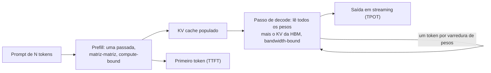

**Follow-ups:** Por que adicionar mais compute (uma GPU mais rápida com a mesma largura de banda) não acelera o decode com batch 1? Em aproximadamente qual batch size o decode se torna compute-bound? Como você aceleraria especificamente o TTFT?

</details>

### 2. O que é o KV cache, por que ele é necessário e quão grande ele fica? Estime para um modelo classe 70B com 128K de contexto.

<details><summary><b>Resposta</b></summary>

A cada passo de decode, a query do novo token faz attention sobre as keys e values de *todos* os tokens anteriores. Sem cache, você recomputaria as projeções K/V de cada token passado a cada passo - trabalho redundante O(n²) por sequência gerada. O KV cache armazena os vetores K e V de cada layer para cada token processado, tornando cada passo de decode incremental. É o que torna a geração autoregressiva computacionalmente viável; o preço é memória.

Fórmula de tamanho:

```
KV bytes/token = 2 (K e V) × n_layers × n_kv_heads × head_dim × bytes_per_elem
```

Exemplo resolvido, formato do Llama-3-70B: 80 layers, 8 KV heads (GQA), head_dim 128, FP16:

```
2 × 80 × 8 × 128 × 2  ≈ 320 KB por token
contexto de 8K   → ~2,6 GB por sequência
contexto de 128K → ~41 GB por sequência
```

Note que isso é *com* GQA - com multi-head attention completa (64 KV heads) seria 8× maior, e é exatamente por isso que GQA/MQA/MLA existem.

Por que isso importa operacionalmente: em uma GPU de 80 GB, depois de ~40 GB de pesos de 4 bits, o KV cache é o orçamento que determina **quantas sequências você consegue servir concorrentemente** - ou seja, seu batch size e, portanto, seu throughput. Uma única requisição de 128K de contexto pode expulsar o cache de dezenas de usuários de contexto curto. Mitigações: menos KV heads (arquitetura), quantização do KV cache (FP8 corta pela metade), alocação paginada (PagedAttention, para eliminar o desperdício por fragmentação), prefix sharing e sliding-window attention em algumas layers.

**Follow-ups:** Por que o GQA reduz o KV cache mas não reduz de forma significativa a contagem de pesos? O que acontece no vLLM quando o KV cache enche no meio de uma geração? Como a conta mudaria para um modelo mixture-of-experts?

</details>

### 3. Defina TTFT, TPOT e tokens/sec. O que determina cada um e quais são metas razoáveis para um produto de chat?

<details><summary><b>Resposta</b></summary>

- **TTFT (time to first token)**: chegada da requisição → primeiro token gerado. Determinado pela espera na fila + tempo de prefill, então escala com o tamanho do prompt e a carga do sistema. É a métrica do "está responsivo?".
- **TPOT (time per output token)**, também chamado de inter-token latency (ITL): intervalo médio entre tokens subsequentes durante o decode. Determinado por largura de banda de memória, tamanho do modelo, contenção no batch e interferência dos prefills de outras requisições. É a métrica do "o stream parece fluido?".
- **Tokens/sec** vem em dois sabores que as pessoas confundem: a *velocidade de decode por requisição* (≈ 1/TPOT) e o *throughput agregado do sistema* (todos os tokens de todas as requisições - o número de capacidade/custo). Um sistema pode ter ótimo throughput agregado e péssima velocidade por requisição ao mesmo tempo.

Latência total da requisição ≈ `TTFT + TPOT × output_tokens`. Vale internalizar essa fórmula: para uma resposta de 500 tokens, reduzir o TPOT de 50 ms para 30 ms economiza 10 s - muito mais do que qualquer otimização de TTFT - enquanto para uma classificação de 20 tokens, o TTFT domina.

Metas razoáveis para chat (ordem de grandeza, dependem do produto): P50 de TTFT de algumas centenas de ms, P99 abaixo de ~1-2 s; taxa de streaming confortavelmente acima da velocidade de leitura - pessoas leem a cerca de 5 palavras/s, então ~15-30+ tokens/s por requisição parece fluido, e 50+ parece instantâneo. Features estilo autocomplete são diferentes: saídas minúsculas, orçamento de latência total de algumas centenas de ms. Workflows agentic longos se importam mais com o tempo de conclusão agregado e o custo do que com o ITL.

Sempre reporte percentis (P50/P95/P99) por métrica, segmentados por faixa de tamanho de prompt - médias escondem exatamente as falhas que os usuários notam.

**Vale desenhar.** Uma cascata de latência mostra qual termo cada métrica possui, o que impede a conversa de derivar para "latency" como um número borrado.


**Follow-ups:** Seu P99 de TTFT dobrou, mas o P50 está estável - quais são suas principais hipóteses? Qual métrica o speculative decoding melhora, e qual ele pode prejudicar?

</details>

### 4. Por que produtos com LLM fazem streaming das respostas, e como o streaming realmente funciona sobre HTTP?

<details><summary><b>Resposta</b></summary>

Porque a latência percebida é dominada pelo *tempo até a primeira saída visível*, não pelo tempo total. Uma resposta de 600 tokens a 30 tokens/s leva ~20 s para terminar - inaceitável como um spinner em branco, perfeitamente aceitável como um stream que começa em 400 ms. O streaming converte a latência percebida pelo usuário de `TTFT + TPOT × N` para aproximadamente `TTFT`. Também habilita cancelamento antecipado (o usuário interrompe uma geração ruim → você para de pagar por tokens de saída) e processamento downstream progressivo.

Mecânica: o transporte padrão é **Server-Sent Events (SSE)** - uma resposta HTTP simples com `Content-Type: text/event-stream` que o servidor mantém aberta, escrevendo eventos incrementais:

```
data: {"delta": {"text": "The"}}

data: {"delta": {"text": " answer"}}

data: [DONE]
```

Cada evento é uma linha `data:` terminada por uma linha em branco; os clients fazem o parsing dos eventos conforme chegam. O Chat Completions da OpenAI faz streaming de deltas de tokens e termina com um sentinela `[DONE]`; a Messages API da Anthropic e a Responses API mais nova da OpenAI fazem streaming de eventos nomeados e tipados (por exemplo `message_start`, `content_block_delta`, `message_stop` na Anthropic, `response.output_text.delta` na OpenAI). WebSockets são uma alternativa quando você precisa de tráfego bidirecional (p. ex., voz), mas SSE é mais simples e amigável a proxies para streams de tokens em mão única.

Gotchas de produção que vale mencionar: proxies/load balancers intermediários fazendo buffering das respostas (é preciso desabilitar o buffering e cuidar dos idle timeouts); tratamento de reconexões (a maioria das APIs de LLM não consegue retomar um stream - um retry reinicia a geração, então o client precisa lidar com a substituição); heartbeats/keep-alives durante longas pausas de tool-use; e o fato de que a contabilidade de uso/custo normalmente chega no evento final, então o código de billing não pode assumir que ela existe se o stream for abortado. Tool calls e JSON chegam como fragmentos parciais e precisam ser acumulados antes de poderem ser parseados.

**Follow-ups:** Como você projetaria o comportamento de retry para um stream que morre no token 400 de 600? O que quebra quando você coloca uma CDN ou proxy ingênuo na frente de SSE?

</details>

### 5. Como você estima se um modelo cabe em uma determinada GPU? Um modelo de 70B cabe em uma placa de 80 GB?

<details><summary><b>Resposta</b></summary>

Comece com `pesos = params × bytes/param`, depois some o KV cache e o overhead de runtime:

```
FP32: 4 B/param   FP16/BF16: 2   INT8/FP8: 1   INT4: ~0,5-0,6 (incl. scales)
```

Modelo de 70B: FP16 → ~140 GB - **não** cabe em uma GPU de 80 GB; você precisaria de 2 GPUs com tensor parallelism. FP8/INT8 → ~70 GB - tecnicamente cabe, mas não deixa quase nada para o KV cache, então na prática não é servível em uma placa. INT4 → ~35-40 GB - cabe confortavelmente, deixando ~30+ GB para KV cache e buffers. É por isso que "70B em uma única GPU de 80 GB" quase sempre significa 4 bits.

O orçamento completo é:

```
total ≈ pesos
      + KV cache (bytes/token × total de tokens em cache em todas as sequências)
      + activations e workspace buffers (dependem de batch e seqlen, ~GBs)
      + CUDA context / overhead do framework (~1-2 GB)
```

Para inference você *não* precisa de optimizer states nem de gradientes - isso é uma preocupação de training (em que o multiplicador é ~16+ bytes/param para full fine-tuning). Uma pegadinha comum de entrevista é esquecer o KV cache: um modelo que "cabe" com 2 GB de sobra serve um batch size de ~zero. Os frameworks de serving tornam isso explícito - o vLLM pré-aloca uma fração da memória da GPU (`gpu_memory_utilization`, padrão ~0,9) e dedica tudo que sobra depois dos pesos ao pool paginado de KV.

Intuição da ponta pequena para ter à mão: 8B FP16 ≈ 16 GB (cabe em uma placa consumer de 24 GB); 8B INT4 ≈ ~4,5 GB (roda em um laptop); 1-3B INT4 roda em celulares.

**Follow-ups:** Quanta memória o KV cache adiciona se você serve 32 sequências concorrentes de 8K de contexto naquele 70B? Por que você ainda poderia escolher 2×GPU FP8 em vez de 1×GPU INT4?

</details>

### 6. Por que tokens de saída custam mais que tokens de input, e como isso deve moldar a forma como você constrói?

<details><summary><b>Resposta</b></summary>

Porque custam mais ao provedor para serem produzidos. Tokens de input são processados em paralelo durante o prefill - uma passada eficiente em compute, amortizada pelo prompt inteiro. Cada token de saída exige seu próprio forward pass sequencial completo pelo modelo, monopolizando a largura de banda de memória, e gerações longas ocupam memória de KV cache (e um slot de batch) durante toda a sua duração. Os provedores precificam de acordo: tokens de saída tipicamente custam ~4-8× tokens de input nas listas de preços de OpenAI, Anthropic e Google (confira a lista atual do seu modelo, pois as razões mudam entre gerações). E em reasoning models, os tokens ocultos de chain-of-thought/reasoning **são cobrados como tokens de saída** - uma "resposta de uma frase" pode carregar milhares de reasoning tokens cobrados por trás.

Implicações de design:

- **Seja conciso na saída, generoso no input.** Mover trabalho da geração para o contexto costuma ser mais barato: exemplos few-shot, documentos recuperados, schemas no prompt são precificados como input (e cacheáveis); prosa verbosa gerada é precificada como saída.
- **Limite `max_tokens` por feature** e ajuste os prompts para respostas concisas; elimine o boilerplate "vou explicar passo a passo" onde você não precisa dele. Ajuste as configurações de reasoning effort por tarefa em reasoning models.
- **Prefira formatos de saída estruturados e mínimos** - um objeto JSON com campos curtos, não ensaios em markdown. Respostas em enum/ID em vez de conteúdo reescrito.
- **Não faça o modelo repetir seu input** (desperdício clássico: "retorne o documento completo com as edições" vs retornar um diff ou lista de edições).
- Combinado com prompt caching - que dá desconto dramático em *input em cache* - a economia empurra para arquiteturas com grandes prefixos estáveis em cache e saídas geradas pequenas.

Exemplo de sanity check: a US$3/M de input e US$15/M de saída, uma requisição com 4K de entrada / 1K de saída custa US$0,012 + US$0,015 - o 1K de saída custa mais que os 4K de input.

**Follow-ups:** Como os reasoning tokens mudam seu modelo de custo para um agentic loop? Quando vale a pena pagar mais tokens de saída por chain-of-thought?

</details>

### 7. O que é quantization para inference? Explique weights-only vs weights-and-activations e os tradeoffs típicos.

<details><summary><b>Resposta</b></summary>

Quantization armazena números em menos bits (FP16 → INT8/FP8/INT4) para cortar memória e, dependendo do esquema, acelerar o compute. Para inference de LLM há duas famílias distintas, e saber qual gargalo cada uma ataca é o insight-chave:

**Weights-only (p. ex., W4A16)**: os pesos são armazenados em 4 ou 8 bits, dequantizados na hora, e a matemática ainda acontece em FP16. Como o decode com batch 1 é limitado por *transmitir bytes de pesos da HBM*, encolher os pesos 4× eleva diretamente o teto de velocidade do decode em até ~4× e corta a memória em ~4× (liberando espaço para o KV cache). Faz pouco pelo prefill ou pelo serving com batch grande, que são compute-bound. GPTQ e AWQ são os métodos post-training de 4 bits padrão; os k-quants do GGUF atendem o ecossistema llama.cpp/Ollama.

**Weights + activations (p. ex., W8A8 INT8 ou FP8)**: ambos os operandos têm baixa precisão, então os matmuls rodam em tensor cores INT8/FP8 - aproximadamente 2× os FLOPs do FP16. É isso que ajuda regimes *compute-bound*: prefill e serving de throughput com batch alto. A parte difícil são as activations, que têm canais outliers extremos; técnicas como SmoothQuant migram essa dificuldade para os pesos. FP8 (nativo a partir da Hopper) é o cavalo de batalha mainstream de produção; formatos da família FP4 (NVFP4/MXFP4) são acelerados nativamente em GPUs classe Blackwell e cada vez mais usados em produção lá, e alguns modelos open-weight são distribuídos nativamente em MXFP4. FP4 é mais sensível em qualidade que FP8, então exige a mesma avaliação em nível de tarefa.

Custo típico de qualidade: 8 bits ≈ desprezível; pesos de 4 bits bem feitos ≈ degradação pequena mas real - frequentemente ~1-2% em benchmarks, mas ocasionalmente muito pior em capacidades específicas (matemática, código, idiomas de poucos recursos). A resposta profissional: **sempre avalie o modelo quantizado no seu próprio conjunto de tarefas**, não apenas em perplexity. A quantização do KV cache é uma alavanca separada e combinável (veja a pergunta dedicada).

**Follow-ups:** Por que W4A16 mal ajuda um deployment de serving com batch alto? O que são activation outliers e por que eles tornam o W8A8 difícil?

</details>

### 8. Qual é a diferença entre static e continuous batching, e por que o continuous batching se tornou universal?

<details><summary><b>Resposta</b></summary>

**Static batching**: agrupa N requisições, roda todas juntas pelo modelo, retorna quando todas terminam. Dois problemas. Primeiro, o **convoy effect**: as sequências terminam em momentos diferentes (uma pede 10 tokens, outra 800), mas o slot do batch fica retido até a mais longa terminar - sequências terminadas desperdiçam compute como padding, e novas requisições esperam o batch inteiro esvaziar. Segundo, descompasso de chegada: ou você espera para encher um batch (adiciona latência) ou roda batches subpreenchidos (desperdiça throughput).

**Continuous (in-flight) batching** - introduzido pelo Orca (OSDI '22), hoje padrão em vLLM, TGI, TensorRT-LLM, SGLang: o scheduling acontece no nível da *iteração*, não da requisição. A cada passo de decode, o engine monta as sequências que estão ativas: uma sequência que emite seu token EOS sai do batch *naquele passo*, e uma requisição enfileirada pode ser admitida imediatamente (seu prefill roda e então ela entra no stream de decode). O batch é uma população em constante renovação, não uma coorte fixa.

Por que vence: o throughput de decode escala com o batch size quase de graça (uma leitura de pesos serve a todos), então manter o batch o mais cheio possível a cada passo se converte diretamente em throughput - melhorias de várias vezes a uma ordem de grandeza sobre o static batching ingênuo, com latência média *melhor* porque ninguém espera os retardatários. Também torna a latência mais previsível e permite que o scheduler imponha políticas (prioridades, fairness, preemption quando a memória de KV está acabando).

A interação a mencionar para crédito extra: admitir uma nova requisição significa rodar seu prefill, o que pode travar decodes em andamento e causar picos no ITL de todos - o problema que o chunked prefill existe para resolver.

**Vale desenhar.** Duas linhas do tempo curtas lado a lado tornam o convoy effect óbvio sem nenhuma aritmética.

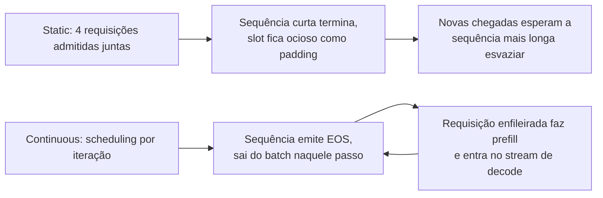

**Follow-ups:** Que novos problemas de scheduling o continuous batching cria? Como o engine decide quando fazer preempt de uma sequência em execução, e o que acontece com o KV cache dela?

</details>

### 9. O que é prompt (prefix) caching, e por que é uma das maiores alavancas de custo disponíveis?

<details><summary><b>Resposta</b></summary>

O trabalho de prefill depende apenas dos tokens processados até o momento, então se duas requisições compartilham um prefixo de tokens idêntico, o KV cache computado para esse prefixo é reutilizável. O prompt caching o armazena e pula a recomputação. Os ganhos canônicos: um system prompt longo + tool definitions compartilhados por toda requisição; conversas multi-turno (cada turno reenvia o histórico inteiro - os turnos anteriores são um prefixo compartilhado); muitas perguntas sobre o mesmo documento longo; agent loops reenviando contextos grandes a cada passo.

Self-hosted: o vLLM faz automatic prefix caching baseado em hash sobre blocos de KV; o RadixAttention do SGLang mantém uma radix tree de prefixos em cache e seu scheduler roteia requisições correspondentes para eles. Cache hits cortam o TTFT dramaticamente (o prefill colapsa para o sufixo sem cache) e liberam compute.

As APIs de provedores monetizam o mesmo mecanismo: **tokens de input em cache são cobrados com um desconto acentuado**. O da Anthropic é explícito (breakpoints `cache_control`): escritas de cache custam ~1,25× o input base, leituras de cache ~0,1× - 90% de desconto - com um TTL de ~5 minutos renovável (TTL mais longo disponível). O da OpenAI é automático para prompts acima de um tamanho mínimo (~1024 tokens), com o desconto de input em cache variando por geração de modelo, de ~50% em modelos mais antigos a ~90% em mais novos. O Gemini oferece caching implícito (automático) em modelos recentes e context caching explícito com preço baseado em armazenamento. Multiplicadores e TTLs exatos mudam, então leia a página de preços atual em vez de decorá-los. Para um agent reenviando um contexto de 20K tokens 30 vezes por sessão, o caching é a diferença entre pagar por ~600K tokens de input e ~600K majoritariamente com desconto - frequentemente a maior economia individual disponível, com zero impacto na qualidade.

A disciplina de engenharia que isso impõe: **prefixo estável primeiro, conteúdo variável por último**. Qualquer byte alterado invalida tudo que vem depois - então nada de timestamps/request IDs no início do system prompt, ordenação determinística das tool definitions e estrutura de conversa append-only. A cache hit rate pertence ao seu dashboard de custos.

**Vale desenhar.** Desenhar o caminho do hit torna a disciplina do prefixo autoevidente: qualquer coisa volátil no início move toda requisição para o ramo do miss.


**Follow-ups:** Por que inserir a data atual no topo de um system prompt destrói o caching? Como o prefix caching interage com personalização por usuário? Qual é a diferença entre isso e semantic caching?

</details>

### 10. Seu app está recebendo 429s do provedor de LLM nos picos de tráfego. Como você lida com rate limits adequadamente?

<details><summary><b>Resposta</b></summary>

Resposta em camadas - tratamento imediato, depois prevenção, depois arquitetura:

**Tratamento imediato**: retry com **exponential backoff + full jitter** (`sleep = random(0, min(cap, base × 2^attempt))`). Jitter não é negociável: sem ele, todos os clients throttled fazem retry em ondas sincronizadas e voltam a gerar pico no provedor (thundering herd). Respeite o header `Retry-After` quando presente. Limite as tentativas (2-3) e imponha um **retry budget** - se mais do que alguns por cento do tráfego estiver em retry, pare de fazer retry e descarte (shed) a carga, ou você amplifica a sobrecarga. Distinga as classes de erro: 429 e 5xx são retryable; 400/422 (bad request, contexto longo demais) nunca vão ter sucesso - falhe rápido.

**Prevenção**: rate limits costumam ser RPM + TPM (tokens/min) + concorrência. Acompanhe seu próprio consumo no client e faça gating com um token-bucket/semáforo *antes* de chamar a API, para enfileirar internamente em vez de queimar requisições em 429s. Priorize classes de tráfego: requisições interativas de usuários recebem capacidade primeiro; jobs em background (evals, enrichment) cedem, ou migram inteiramente para a batch API - essa costuma ser a correção real, já que o trabalho offline é o que comumente consome a cota.

**Arquitetura**: solicite limites maiores ou throughput provisionado/comprometido para a linha de base; distribua entre regiões/contas onde os termos do provedor permitirem; adicione uma **fallback chain** (o mesmo modelo em outro provedor/cloud, ou um modelo menor) atrás de um circuit breaker para throttling sustentado; suavize rajadas com uma fila e UX honesta para features não interativas.

Instrumente também: taxa de 429, taxa de retry, profundidade da fila e time-to-success devem estar em um dashboard - 429s crônicos são um sinal de capacity planning, não um problema de tratamento de erro.

**Follow-ups:** Por que full jitter é melhor que exponential backoff simples? Seus retries estão tendo sucesso mas o P99 de latência triplicou - o que está acontecendo e o que você muda?

</details>

### 11. Setamos temperature em 0, então as saídas deveriam ser determinísticas. Por que os usuários ainda recebem respostas diferentes para o mesmo prompt?

<details><summary><b>Resposta</b></summary>

Temperature 0 torna o passo de *sampling* determinístico (pegar o argmax), mas não torna os *logits* bit a bit idênticos entre execuções. Quando dois tokens candidatos estão próximos em probabilidade, uma diferença no último bit inverte o argmax, e a continuação diverge a partir daí.

De onde vem o não-determinismo:

- **Kernels não são batch-invariant.** A adição de ponto flutuante não é associativa, então a ordem das reduções muda o resultado nos últimos bits. Kernels de matmul e attention escolhem estratégias de split e ordens de redução com base no formato do batch. Sob continuous batching, sua requisição é agrupada com vizinhos diferentes a cada vez, e a composição do batch depende do tráfego de outros usuários. Essa é a causa dominante.
- **O roteamento de MoE** pode depender da composição do batch quando as implementações usam limites de capacidade por expert.
- **Heterogeneidade da frota**: diferentes gerações de GPU, versões de kernel ou driver, grau de tensor-parallel ou quantization alteram a numérica. Provedores também trocam snapshots do modelo por baixo dos panos.

O que ajuda: um parâmetro `seed` remove apenas a aleatoriedade do sampling, então é necessário mas não suficiente. Provedores expõem um backend fingerprint justamente porque não conseguem prometer mais do que best effort. Reprodutibilidade bitwise de verdade exige kernels batch-invariant (fixar a ordem de redução independentemente do formato do batch) mais uma versão de modelo, tipo de hardware e configuração de paralelismo fixados, e você paga throughput por isso.

A postura prática: não construa sistemas que dependam de igualdade exata de tokens. Teste semântica (validade de schema, evals com tolerância, property checks), não comparação de strings. Faça log das saídas, porque você não consegue regenerá-las de forma confiável.

O equívoco a matar: "greedy significa determinístico." Greedy é determinístico dados logits idênticos. Os logits são o problema.

**Follow-ups:** Por que um servidor mais ocupado torna a divergência mais provável? Como você escreveria um teste de regressão para uma feature de LLM que não pode depender de correspondência exata de saída?

</details>

### 12. O que o FlashAttention realmente faz, e como ele é diferente do PagedAttention?

<details><summary><b>Resposta</b></summary>

Eles resolvem problemas diferentes em camadas diferentes, e você os usa juntos em vez de escolher entre eles.

**FlashAttention é um kernel.** É uma implementação exata e IO-aware de attention. Em vez de materializar a matriz de scores n x n completa na HBM, ele divide Q, K e V em tiles na SRAM on-chip e calcula o softmax em uma passada de streaming, mantendo um máximo corrente e uma soma corrente. A memória extra cai de O(n^2) para O(n), e as leituras e escritas na HBM caem por um grande fator constante porque a matriz de scores nunca sai da SRAM (os FLOPs continuam quadráticos), o que torna os contextos longos tratáveis. É exato, não uma aproximação: as saídas coincidem com a attention ingênua até o ponto flutuante. Ganha mais no prefill e em contexto longo, onde a matriz de scores é grande. O decode tem query length 1, então há quase nenhum paralelismo ao longo do eixo da query, e é por isso que variantes voltadas ao decode dividem ao longo do comprimento do KV e combinam os softmaxes parciais depois.

**PagedAttention é gerenciamento de memória.** Armazene o KV cache em blocos de tamanho fixo (16 tokens é o padrão comum) indexados por uma block table por sequência, de modo que o KV de uma sequência não precise ser contíguo. Isso elimina a fragmentação da pré-alocação de buffers de comprimento máximo, então a mesma HBM suporta um batch muito maior, e o prefix sharing vira um ponteiro na block table em vez de uma cópia. O kernel de attention então precisa fazer gather do KV através da block table.

Então: o FlashAttention torna a computação de attention barata em *tráfego* de memória; o PagedAttention torna o KV cache barato em *capacidade* de memória. Um servidor moderno roda kernels estilo FlashAttention sobre um layout de KV paginado, e escolher um "attention backend" é escolher qual kernel desse tipo você recebe.

Formulação de red flag: "usamos PagedAttention em vez de FlashAttention." Também vale dizer: nenhum dos dois muda a qualidade da saída.

**Vale desenhar.** Duas caixas empilhadas como camadas matam o equívoco do "um no lugar do outro" de uma só vez.

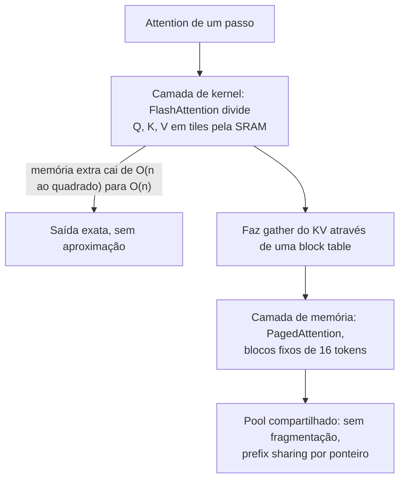

**Follow-ups:** Por que o decode precisa de um kernel com formato diferente do prefill? O que trocar o attention backend realmente muda para você operacionalmente?

</details>

### 13. Um usuário fecha a aba no meio de uma resposta em streaming. O que acontece no servidor, e o que deveria acontecer?

<details><summary><b>Resposta</b></summary>

Por padrão, mais do que você gostaria: a menos que o cancelamento seja propagado por todo o caminho, da conexão HTTP até o scheduler do engine, o modelo continua gerando tokens que ninguém jamais vai ler, mantendo um slot de KV e queimando tempo de GPU durante todo o `max_tokens`. Em um servidor self-hosted isso é capacidade desperdiçada e pior P99 para todos os demais. Contra uma API de provedor, você normalmente ainda é cobrado pelos tokens gerados antes de o abort realmente chegar, então uma desconexão não detectada é uma linha de custo silenciosa.

Mecanicamente: uma desconexão do client em um stream SSE aparece como uma falha de escrita ou um evento de disconnect na conexão. O web framework precisa notá-la, fechar o generator, e o engine precisa abortar a requisição. Duas coisas comumente quebram essa cadeia. Primeiro, proxies: nginx, load balancers e CDNs fazem buffering das respostas, então o servidor pode não ver a desconexão prontamente, ou nunca, até tentar fazer flush. Desabilite o proxy buffering nas rotas de streaming e envie heartbeats periódicos para que o socket seja exercitado. Segundo, os SDKs de client: você precisa realmente cancelar a requisição ou o context, não apenas parar de ler.

Há também um ângulo de corretude. Se a geração tem efeitos colaterais (tool calls, escritas), ser morta no meio deixa estado parcial, então os passos precisam ser idempotentes e ter checkpoints.

O design melhor para qualquer coisa de longa duração: não amarre o tempo de vida da geração à conexão do browser. Gere no servidor para um stream durável no qual o client se inscreve e pode retomar após uma reconexão (um stream com resume token). Assim um refresh não perde a resposta, e o cancelamento acontece porque o usuário apertou stop, não porque um socket caiu.

O que medir: taxa de requisições abortadas e tokens gerados após a desconexão do client.

**Vale desenhar.** O valor está em mostrar a cadeia inteira, porque cada hop é um lugar onde o cancelamento pode silenciosamente não chegar.

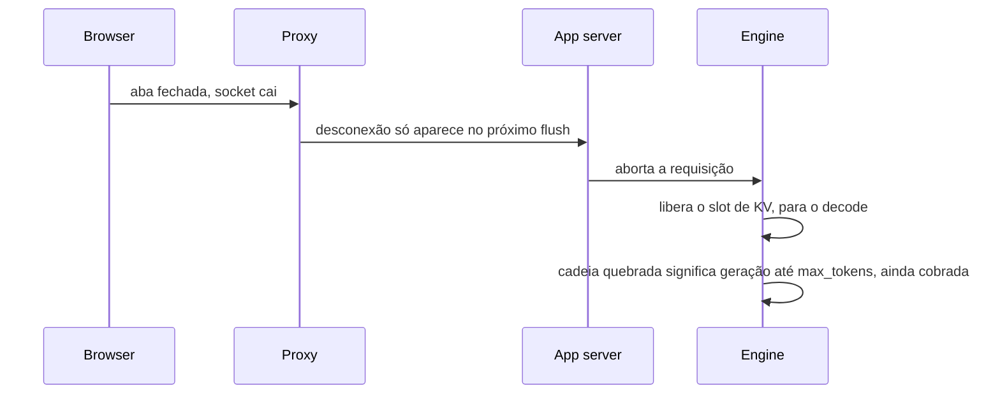

**Follow-ups:** Como você implementaria um stream retomável? Qual é a assinatura de custo, nas suas métricas, de desconexões que nunca são detectadas?

</details>

### 14. Seu código de produção lê o texto da resposta mas nunca checa `finish_reason` (ou `stop_reason`). Por que isso é um bug, e o que você deve fazer com cada stop reason?

<details><summary><b>Resposta</b></summary>

Porque uma resposta pode terminar por outros motivos além de "o modelo terminou", e o texto sozinho não vai te dizer. Toda API importante informa por que a geração parou: `finish_reason` no Chat Completions da OpenAI, um `status` mais detalhes de incompletude na Responses API, `stop_reason` na Anthropic, `finishReason` no Gemini. Ignorá-lo significa entregar saída truncada ou filtrada como se estivesse completa.

Cada valor mapeia para uma ação distinta:

- **Parada natural** (`stop`, `end_turn`): o modelo terminou. Valide e use.
- **Length** (`length`, `max_tokens`): truncado no limite. A prosa termina no meio da frase. JSON ou uma tool call fica impossível de parsear, e o constrained decoding não te salva, porque a gramática não consegue fechar o objeto quando o orçamento acabou. Aumente o limite para aquela feature, peça um formato mais curto ou continue a geração, mas nunca faça parsing como se estivesse completo. Em reasoning models, os thinking tokens normalmente contam contra o mesmo orçamento, então uma requisição pode atingir o limite antes de escrever qualquer resposta visível.
- **Stop sequence** (`stop_sequence`): uma das suas strings de parada disparou. Esperado se você projetou assim, um bug se aquela string pode aparecer legitimamente no conteúdo.
- **Tool use** (`tool_calls`, `tool_use`): o modelo quer que uma tool seja executada. Agent loops devem ramificar neste campo, não em se o texto parece vazio.
- **Safety ou refusal** (`content_filter`, `refusal`): o provedor bloqueou a saída ou o modelo recusou. Mostre uma UX deliberada, não faça retry cego do mesmo input e registre para revisão.

Hábitos de produção que acompanham:

- Faça log do stop reason em toda chamada e gere gráfico da taxa de paradas por length por feature. Um salto após uma mudança de prompt ou modelo é um sinal precoce de verbosity creep, e aparece antes de os usuários reclamarem de respostas cortadas.
- Faça alerta para taxa crescente de refusal por feature, já que muitas vezes significa que uma mudança de prompt cruzou um limite de política.
- Em streams, o motivo chega no evento final, então código que aborta cedo ou descarta o último evento perde isso silenciosamente.
- Trate um valor desconhecido como erro. Provedores adicionam novos, e um branch default que assume sucesso é como um novo stop reason entrega dados truncados.

**Follow-ups:** Como você continuaria com segurança uma geração que foi truncada no meio de um objeto JSON? Sua taxa de paradas por length dobrou após um upgrade de modelo sem mudança de prompt: o que aconteceu e o que você muda?

</details>

## Intermediário

### 15. Por que somos obcecados por latência P99 em vez da média, e o que causa tail latency especificamente em serving de LLM?

<details><summary><b>Resposta</b></summary>

Porque os usuários experimentam a cauda, não a média. Um usuário que faz 100 requisições ao longo de uma semana atinge o P99 cerca de uma vez - e para features com múltiplas chamadas é bem pior: um agent encadeando 10 chamadas sequenciais de LLM tem ~10% de chance por execução de que *alguma* chamada atinja o P99, então a cauda do workflow é dominada pela composição das caudas por chamada. Médias também escondem bimodalidade: P50 estável + P99 explodindo é a assinatura clássica de sobrecarga, invisível na média.

Fontes de cauda específicas de LLM:

- **Picos de queueing**: chegadas em rajadas contra uma capacidade próxima da saturação - o atraso de fila é hipersensível perto do joelho do throughput.
- **Variância do tamanho do prompt**: um prefill de 100K tokens leva ordens de grandeza a mais que um de 500 tokens; sem chunked prefill ele também trava o decode de *outras* requisições (head-of-line blocking), espalhando sua latência para o ITL de espectadores inocentes.
- **Variância do tamanho da saída**: a latência total escala com os tokens gerados; `max_tokens` ilimitado significa latência ilimitada.
- **Preemption**: quando a memória de KV acaba, os engines expulsam sequências e as recomputam/restauram depois - um precipício de latência oculto que só aparece sob pressão de memória.
- **Qualquer coisa fria**: prefix cache frio, réplica recém-escalada esquentando, primeira requisição compilando kernels/CUDA graphs.
- **Variância do lado do provedor** ao usar APIs - você herda a cauda multi-tenant de outra pessoa.

As mitigações mapeiam um a um: admission control e folga para queueing; chunked prefill e pools separados de contexto longo para variância de prompt; limites de `max_tokens`; monitorar contagens de preemption e utilização de KV; warm-up no deploy; hedged requests para caudas de API (enviar um duplicado após ~P95, pegar a primeira resposta - gasta dinheiro para comprar tail latency, então orce).

Meça percentis por faixa de tamanho de prompt e por feature; um P99 global mistura autocomplete com deep research e não diz nada.

**Follow-ups:** Por que a cauda end-to-end de um workflow de agent degrada mais rápido que a de qualquer chamada isolada? Quais são os riscos de hedged requests para operações não idempotentes?

</details>

### 16. Explique arithmetic intensity e o roofline model aplicados a inference de LLM. Por que o batching melhora tão dramaticamente o throughput de decode?

<details><summary><b>Resposta</b></summary>

**Arithmetic intensity** = FLOPs executados por byte movido da memória. O **roofline model** diz que a performance alcançável = `min(peak_FLOPs, intensity × memory_bandwidth)`: abaixo de um ridge point você é memory-bound (a performance cresce linearmente com a intensity), acima dele, compute-bound. O ridge de uma H100 em BF16 é aproximadamente `~989 TFLOPs ÷ ~3,35 TB/s ≈ ~300 FLOPs/byte`; para uma A100 é ~150.

Agora posicione as duas fases da inference nesse roofline. **Decode com batch 1**: para cada elemento de peso (2 bytes em FP16) você faz um multiply-add (2 FLOPs) - intensity ≈ 1 FLOP/byte. Isso está duas ordens de grandeza abaixo do ridge: a GPU transmite 140 GB de pesos para emitir um token enquanto seus tensor cores ficam ~99% ociosos. **Prefill**: um prompt de 4K tokens reutiliza cada peso carregado 4096 vezes - intensity na casa dos milhares, firmemente compute-bound.

Fazer batching do decode eleva a intensity quase de graça: com batch size B, cada byte de peso carregado executa B multiply-adds - intensity ≈ B FLOPs/byte. O throughput, portanto, escala ~linearmente com B até B se aproximar do ridge (~algumas centenas de sequências), onde o decode finalmente se torna compute-bound. Como o custo da leitura de pesos era pago de qualquer forma, os tokens 2..B são quase de graça - este é *o* fato econômico do serving de LLM, e por isso todo scheduler luta para manter os batches cheios.

Limites em B: memória de KV cache (o cache de cada sequência precisa estar residente - geralmente o limite real), crescimento da latência por token conforme a fatia de compute sobe, e o componente de leitura de KV da attention, que, ao contrário dos pesos, é por sequência e não se amortiza - em contextos longos, as leituras de KV, não as de pesos, dominam a conta de largura de banda.

Essa lente também explica a assimetria da quantization (weight-only quant eleva o regime memory-bound; W8A8/FP8 eleva o compute-bound) e por que o speculative decoding funciona (troca compute ocioso por menos varreduras sequenciais de memória).

**Vale desenhar.** Posicionar os três regimes em relação ao ridge point é o que transforma "batching ajuda" em um número que você consegue defender.

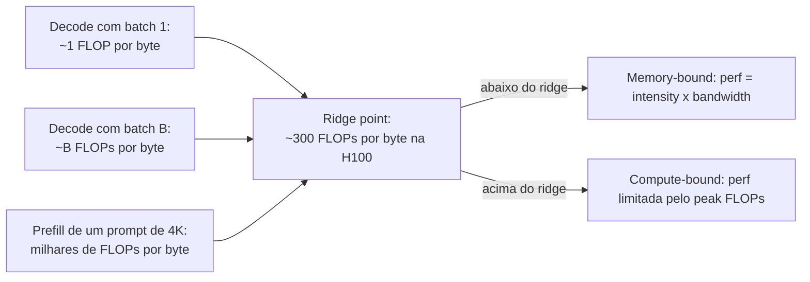

**Follow-ups:** Por que a leitura do KV cache não se amortiza pelo batch como os pesos? Onde o MoE se posiciona no roofline comparado a um modelo dense com a mesma contagem de parâmetros ativos?

</details>

### 17. Que problema o PagedAttention resolve, e como ele funciona?

<details><summary><b>Resposta</b></summary>

Ele resolve a **fragmentação de memória do KV cache**. Sistemas pré-vLLM alocavam o KV cache de cada sequência como um buffer contíguo dimensionado para o comprimento *máximo possível* (já que o tamanho da saída é desconhecido de antemão). Isso desperdiça memória de três formas: fragmentação interna (uma sequência que para em 300 tokens reservou 2048), desperdício de reserva (memória retida para tokens ainda não gerados) e fragmentação externa (chunks contíguos de tamanho variável deixam lacunas inutilizáveis). O paper do vLLM mediu que nos sistemas anteriores apenas ~20-40% da memória de KV continha estado real de tokens. Como a memória de KV limita o batch size e o batch size é o throughput, esse desperdício estava estrangulando diretamente o serving.

O **PagedAttention** aplica o playbook de memória virtual dos sistemas operacionais: fatia o KV cache em **blocos** de tamanho fixo (p. ex., 16 tokens cada), aloca-os sob demanda de um pool compartilhado e dá a cada sequência uma **block table** mapeando posições lógicas → blocos físicos. O kernel de attention percorre a block table, então os blocos não precisam ser contíguos. Consequências:

- O desperdício colapsa para no máximo um bloco parcialmente preenchido por sequência - utilização próxima de 100%, então o batch size efetivo (e o throughput) dá um salto; o paper relatou ~2-4× de throughput sobre o estado da arte anterior.
- **O compartilhamento fica trivial**: várias sequências podem mapear os mesmos blocos físicos. Parallel sampling (n candidatos a partir de um prompt) e prefixos de system prompt compartilhados são tratados com block sharing + copy-on-write quando um bloco compartilhado seria escrito.
- **A preemption é limpa**: sob pressão de memória, o scheduler expulsa os blocos de uma sequência (recompute ou swap para a CPU) e os restaura depois.

O modelo mental a dizer em voz alta: *memória virtual e paginação para o KV cache* - block table = page table, bloco = página, fragmentação resolvida do mesmo jeito que os SOs a resolveram nos anos 1960. Trabalhos posteriores (prefix caching do vLLM, RadixAttention do SGLang) constroem o reuso entre requisições sobre essa abstração de blocos.

**Vale desenhar.** Desenhe duas block tables apontando para um bloco compartilhado e a história do compartilhamento se conta sozinha, sem precisar do paper para a analogia.

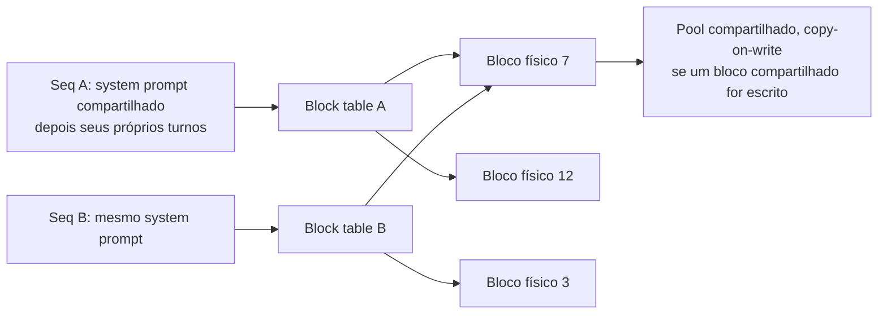

**Follow-ups:** Qual é o custo da paginação - por que não fazer blocos de 1 token cada? Como o copy-on-write funciona para beam search ou n-best sampling?

</details>

### 18. O que é chunked prefill e qual problema de scheduling ele resolve?

<details><summary><b>Resposta</b></summary>

O problema: em um engine com continuous batching, prefills e decodes compartilham a GPU. Uma requisição recém-admitida com um prompt longo roda um prefill grande que satura o compute - e enquanto ele roda, todo decode em andamento trava. Os usuários veem seus streams de tokens congelarem; o ITL salta de dezenas de milissegundos para segundos. Schedulers que priorizam o prefill otimizam o TTFT ao custo do ITL; schedulers que seguram os prefills protegem o ITL mas destroem o TTFT e o throughput. Com prompts de 50K - 100K tokens isso não é um edge case - uma requisição pesada em documentos degrada todo mundo.

O **Chunked prefill** (popularizado por Sarathi/Sarathi-Serve, hoje padrão no vLLM e em outros) divide o prompt em chunks - p. ex., 512-2048 tokens - e processa um chunk por iteração, *agrupado com os passos de decode em andamento*. O prefill longo vira um processo em background que avança incrementalmente, em vez de um bulldozer que monopoliza a GPU.

Dois benefícios:

- **Decodes sem stalls**: o ITL permanece estável independentemente de quais prompts chegam. A cauda da inter-token latency - o que os usuários de chat realmente sentem - é protegida.
- **Melhor eficiência da GPU**: batches só de decode são memory-bound (compute ocioso); chunks de prefill são pesados em compute (largura de banda sobrando). Misturá-los em um batch enche os dois canais - o prefill pega carona nas leituras de pesos que o decode já estava fazendo de qualquer forma.

Custos: o TTFT do próprio prompt em chunks piora um pouco (seu prefill é espalhado por várias iterações, e a attention de cada chunk precisa reler o KV de todos os chunks anteriores, adicionando algum overhead de largura de banda), e há um botão de ajuste - o chunk size - trocando TTFT por proteção de ITL. Os entrevistadores gostam de ouvir o enquadramento: o chunked prefill converte um problema de *interferência* em um tradeoff de *scheduling* explícito e ajustável. Também é um degrau para a correção mais completa: separar prefill e decode em pools distintos (disaggregation).

**Vale desenhar.** Uma iteração desenhada como um batch misto mostra por que isso é um ganho de utilização, não apenas um remendo de fairness.

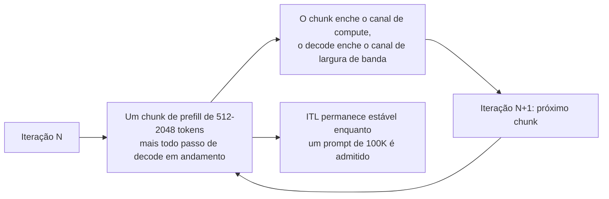

**Follow-ups:** Como você escolheria o chunk size? Por que misturar um chunk de prefill em um batch de decode melhora a utilização do hardware em vez de apenas dividir a dor?

</details>

### 19. Explique speculative decoding. Por que a saída é comprovadamente fiel ao modelo alvo, e quando ele realmente ajuda?

<details><summary><b>Resposta</b></summary>

O decode é memory-bound: cada token custa uma varredura completa de pesos, enquanto o compute fica ocioso. O speculative decoding gasta esse compute ocioso para reduzir o número de varreduras sequenciais. Um **draft model** barato propõe autorregressivamente k tokens (rápido - é pequeno). O **modelo alvo** então pontua todas as k propostas *em um único forward pass paralelo* (barato por token, como o prefill). Os tokens aceitos são emitidos; na primeira rejeição, um token corrigido é amostrado do alvo e o drafting recomeça. No melhor caso você emite k+1 tokens para uma varredura do alvo.

A fidelidade vem da **regra de aceitação** (Leviathan et al. 2022; Chen et al. 2023): aceite o token x do draft com probabilidade `min(1, p_target(x)/p_draft(x))`; na rejeição, reamostre da distribuição residual `normalize(max(0, p_target − p_draft))`. Essa é uma construção de rejection sampling cuja distribuição marginal é *exatamente* `p_target` - demonstrável, não aproximada. Portanto o speculative decoding é puramente uma otimização de latência: mesma distribuição de saída, inclusive com temperature sampling. Qualquer implementação que altere as saídas (além de ruído de ponto flutuante) está com bug ou está deliberadamente fazendo aceitação "relaxada" com perdas.

Quando ajuda: os tokens esperados por passada do alvo sobem com a **taxa de aceitação** α (quão bem o drafter casa com o alvo). Texto previsível - código, saída estruturada, prosa formulaica - faz bom drafting; texto criativo de alta entropia, não. Brilha em batch sizes baixos com folga de compute, tipicamente ~2-3× de melhoria em ITL. Quando prejudica: em batch alto, a GPU já está saturada de compute, então as passadas de verificação roubam throughput; um drafter mal casado ou lento demais pode dar resultado líquido negativo; e o draft model consome memória. Opções de drafter: um modelo pequeno com o mesmo tokenizer, heads de self-drafting (Medusa, EAGLE), ou drafting **n-gram/prompt-lookup** - copiar continuações candidatas do próprio prompt, essencialmente gratuito e muito eficaz para workloads de extração/edição.

**Vale desenhar.** O loop draft-verify-accept com o ramo de rejeição é exatamente o diagrama que prova que você entende por que a saída não muda.

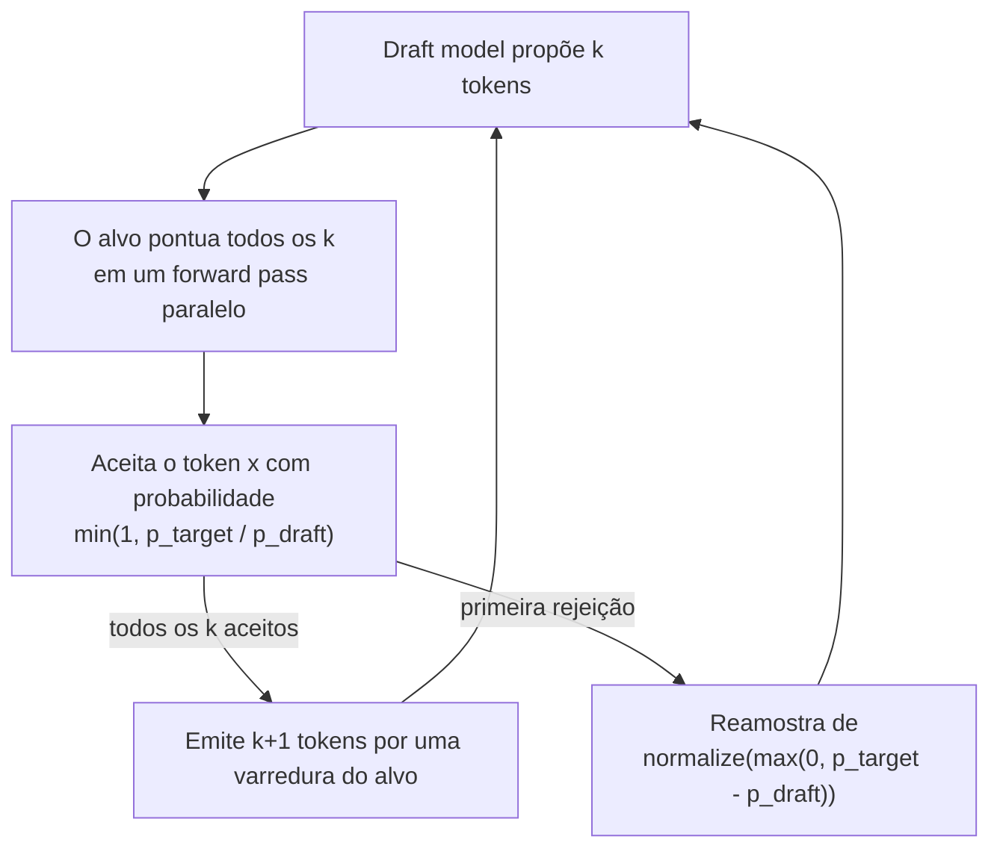

**Follow-ups:** Derive por que a regra de aceitação preserva a distribuição do alvo. Como o batch size muda a economia? Quando o n-gram lookup venceria um draft model treinado?

</details>

### 20. Compare GPTQ, AWQ, GGUF, INT8 e FP8. Como você realmente escolhe uma abordagem de quantization para um deployment?

<details><summary><b>Resposta</b></summary>

Eles não são intercambiáveis - diferem no que é quantizado, como e onde rodam:

- **GPTQ**: post-training, weights-only (geralmente 4 bits). Quantiza layer por layer, usando compensação de erro (de segunda ordem aproximada) contra um calibration set - arredondando pesos posteriores para absorver o erro de arredondamento dos anteriores. Suporte maduro de kernels para GPU.
- **AWQ**: post-training, weights-only de 4 bits. Observação: uma pequena fração dos canais de pesos importa desproporcionalmente, identificada pelas magnitudes das *activations*; o AWQ reescala esses canais salientes antes de quantizar para protegê-los. Sem backprop, calibração leve, tende a ser robusto e rápido com bons kernels (funciona bem para modelos instruction-tuned).
- **GGUF**: não é um algoritmo - é o *formato de arquivo* do llama.cpp, carregando sua família de k-quants/i-quants (Q4_K_M, Q5_K_S, ...) com scales por bloco. A lingua franca da inference em CPU/Metal/edge via llama.cpp e Ollama, com precisão mista por layer.
- **INT8 W8A8**: pesos *e* activations em INT8 (linhagem LLM.int8(), SmoothQuant) - acelera os próprios matmuls. Os activation outliers são a dificuldade.
- **FP8 (E4M3/E5M2)**: W8A8 nativo da Hopper; a estrutura de ponto flutuante lida com outliers de forma mais elegante que o INT8. Quase sem perdas na prática e o padrão para serving de produção de alto throughput; também usado para o KV cache. A família FP4 (NVFP4/MXFP4) é a sucessora nativa da Blackwell, já em uso de produção em frotas Blackwell, mas com um custo de qualidade maior e mais dependente da tarefa que o FP8, então avalie com cuidado.

Escolhendo - faça três perguntas. (1) **Gargalo**: sensível a latência/batch baixo → weights-only de 4 bits (AWQ/GPTQ) ataca o limite de largura de banda; throughput com batch alto → FP8 W8A8 ataca o limite de compute. (2) **Hardware/stack**: classe H100 + vLLM/TensorRT-LLM → FP8; classe Blackwell → FP8, ou NVFP4 onde os evals permitirem; GPU consumer → GPTQ/AWQ; CPU/Apple Silicon/edge → GGUF. (3) **Barra de qualidade**: rode a *sua* suíte de evals no artefato quantizado - deltas de perplexity escondem regressões específicas de tarefa (matemática, código, multilíngue são as vítimas usuais). Muitos times chegam em: FP8 para a frota de serving, INT4 para o tier com restrição de memória, GGUF para local/dev.

**Vale desenhar.** Ramificar pelo gargalo em vez de pelo nome do formato é todo o ponto, e o loop de volta pelos evals é onde a senioridade aparece.


**Follow-ups:** Por que os activation outliers tornam o W8A8 mais difícil que o W4A16? O que faria você rejeitar um modelo de 4 bits que passa nos checks de perplexity?

</details>

### 21. O que é quantização do KV cache, e quando ela é a alavanca certa?

<details><summary><b>Resposta</b></summary>

Armazenar o KV cache em menos bits - FP8 ou INT8 em vez de FP16, com variantes mais agressivas de 4 bits em pesquisa e no llama.cpp. É ortogonal à weight quantization e ataca uma restrição diferente: os pesos são um custo *fixo*, mas o KV cresce com `sequências × tamanho do contexto`, e em um servidor ocupado é o pool de KV, não os pesos, que limita a concorrência.

O retorno é direto: FP8 KV corta os bytes/token pela metade - nosso exemplo de 70B cai de ~320 KB para ~160 KB/token - o que literalmente **dobra** o batch size máximo (throughput) ou o contexto máximo servível na mesma memória. Também reduz o tráfego de memória da attention em contextos longos, onde ler o KV cache (que, ao contrário dos pesos, não se amortiza pelo batch) vira o gargalo de largura de banda - então o decode de contexto longo também fica mais rápido.

Qualidade: KV de 8 bits (especialmente FP8) é geralmente quase sem perdas e amplamente usado em produção; vLLM, TensorRT-LLM e llama.cpp todos o suportam. Abaixo de 8 bits fica delicado - a attention é sensível à precisão das keys (as keys entram nos logits do dot-product; erro ali perturba o softmax sobre *todas* as posições), e a pesquisa consistentemente descobre que **keys precisam de tratamento mais gentil que values**, motivando quantização por canal das keys e esquemas K/V assimétricos. Tarefas longas de múltiplos passos acumulam erro, então avalie em benchmarks de contexto longo e agentic, não em QA curto.

Quando recorrer a ela: (1) deployments limitados por KV - alta concorrência ou contexto longo, em que o dashboard mostra a utilização de KV no teto e as preemptions subindo; (2) encaixar um modelo de contexto longo em hardware fixo; (3) espremer mais batch de uma GPU que já serve pesos de 4 bits. Ressalva: empilhar weight quant agressiva + KV quant agressiva compõe o erro - rode os evals novamente na combinação, não em cada uma isoladamente.

**Follow-ups:** Por que as keys são mais sensíveis à quantization que os values? Sua utilização de KV está em 95% com preemptions subindo - percorra suas opções e seus tradeoffs.

</details>

### 22. Descreva a curva de tradeoff throughput - latency de um servidor de LLM e explique goodput.

<details><summary><b>Resposta</b></summary>

Varie a carga oferecida (ou o batch size máximo) em um deployment fixo e plote os tokens/sec agregados contra a latência por requisição (percentis de TPOT e TTFT). A curva tem três regiões. Em carga baixa, a latência é estável e quase ótima - adicionar tráfego apenas preenche a capacidade ociosa, o throughput sobe ~linearmente (o decode é memory-bound; sequências extras pegam carona nas mesmas leituras de pesos). Ao se aproximar da saturação há um **joelho**: os batches são grandes o bastante para que compute e memória de KV disputem, o TPOT sobe de leve, e o atraso de fila - hipersensível à utilização perto de 1 - começa a explodir o TTFT. Depois do joelho, o throughput estabiliza (roofline do hardware atingido) enquanto a latência cresce sem limite conforme a fila aumenta. Todo deployment de serving está escolhendo um ponto nessa curva: mais batch = mais barato por token, pior experiência por usuário.

**Goodput** (o enquadramento do DistServe) é a correção de uma métrica clássica enganosa: conta apenas o throughput que *atende aos seus SLOs* - p. ex., requisições/sec servidas com P99 TTFT < 1 s e TPOT < 50 ms. Tokens/sec brutos podem ser manipulados rodando fundo na saturação, onde toda requisição viola as metas de latência; o goodput vai a zero ali. É o alvo de otimização certo e a métrica certa para comparar benchmarks - dois engines com o mesmo throughput máximo podem diferir 2× em goodput sob um SLO apertado por causa da qualidade do scheduling (chunked prefill, comportamento de preemption, admission control).

Operacionalmente: faça load test de cada configuração para achar o joelho, depois rode a ~60-70% da capacidade do joelho para ter folga contra rajadas; faça autoscale por indicadores antecedentes (profundidade da fila, utilização de KV) em vez das métricas de latência defasadas; e avalie mudanças de scheduler/engine por goodput-vs-custo, não por pico de tokens/sec. Note também que o próprio SLO define a curva que importa - o SLO apertado de ITL do chat interativo força um ponto de operação diferente (e possivelmente uma divisão de hardware diferente) de um pipeline batch offline no mesmo modelo.

**Follow-ups:** Por que o atraso de fila explode perto da saturação? Seu P99 de TTFT viola o SLO mas a utilização da GPU mostra 60% - o que você investiga?

</details>

### 23. vLLM, SGLang, TensorRT-LLM, TGI, llama.cpp/Ollama - como você escolhe um serving stack?

<details><summary><b>Resposta</b></summary>

Decida com base no formato do workload, no hardware e em quanta engenharia você vai investir - não em estrelas do GitHub:

- **vLLM**: a escolha open-source padrão. PagedAttention, continuous batching, chunked prefill, prefix caching, speculative decoding, suporte a quantization, tensor/pipeline parallelism, servidor compatível com OpenAI, ampla cobertura de modelos (incluindo suporte no dia zero para a maioria dos lançamentos abertos) e backends para múltiplos hardwares. Escolha-o a menos que tenha um motivo específico para não fazê-lo.
- **SGLang**: mais forte quando as requisições compartilham muitos prefixos - workloads agentic, chat multi-turno, baterias de few-shot - graças ao RadixAttention (reuso automático de prefix cache em estrutura de árvore) e a um scheduler que o explora; também conhecido por geração constrained/estruturada muito rápida. Frequentemente competitivo ou à frente do vLLM em benchmarks nesses padrões.
- **TensorRT-LLM**: o caminho de performance máxima da NVIDIA - kernels muito ajustados, fusão agressiva, FP8/FP4 de primeira classe. Desde o lançamento da 1.0, o runtime baseado em PyTorch é o padrão, com o workflow mais antigo de engines compilados ainda disponível. Melhores números brutos em hardware NVIDIA, mas você paga em complexidade de tuning, onboarding de modelos às vezes mais lento e lock-in com a NVIDIA. Escolha quando o custo de serving em escala justificar engenheiros dedicados de inference (muitas vezes atrás do Triton ou da orquestração Dynamo da NVIDIA).
- **TGI (Text Generation Inference)**: o antigo servidor de produção da Hugging Face. A Hugging Face o colocou em modo de manutenção no fim de 2025 e agora aponta os usuários para vLLM e SGLang, então novas arquiteturas de modelos não chegarão lá. Trate-o como um item de migração, não como uma escolha para um novo deployment.
- **llama.cpp / Ollama / MLX**: o tier edge/local. CPU, Apple Silicon (Metal / MLX), GPUs consumer; modelos quantizados em GGUF; trivialmente fácil de rodar. Certo para produtos on-device, inference local com restrição de privacidade e laptops de dev - não para serving de datacenter com alto QPS.

Fatores de decisão a citar: hardware (NVIDIA de datacenter vs AMD/TPU vs laptop), workload (agentic com muito prefixo → SGLang; geral → vLLM; obcecado por custo em escala → TensorRT-LLM), features necessárias (structured output, multi-LoRA serving, spec decoding), maturidade operacional do time e velocidade da comunidade para suportar novos modelos. Mencione também a opção "comprar": endpoints gerenciados (Bedrock, Vertex, Fireworks, Together etc.) quando você não quer rodar o stack de forma alguma.

**Follow-ups:** Seu workload é 90% tráfego de agent com system prompt compartilhado - qual stack e por quê? O que um stack ajustado por vendor como o TensorRT-LLM compra sobre um engine portável, e quanto custa quando você quer adicionar capacidade AMD?

</details>

### 24. Explique tensor parallelism vs pipeline parallelism para inference. Quando você precisa de cada um?

<details><summary><b>Resposta</b></summary>

Ambos dividem um modelo grande demais entre GPUs; cortam ao longo de eixos diferentes, com perfis diferentes de comunicação e latência.

**Tensor parallelism (TP)** divide *dentro* de cada layer: attention heads e matrizes de MLP são divididas entre N GPUs, cada uma computa sua fatia de cada layer, e os resultados são combinados com all-reduces (tipicamente dois por transformer block - após a projeção de saída da attention e após o MLP). Toda GPU participa de todo token, então o TP genuinamente **reduz a latência por token** (cada GPU faz ~1/N dos FLOPs e transmite ~1/N dos bytes de pesos) - mas é falante: um all-reduce por layer, dezenas de vezes por token, exige largura de banda classe NVLink. Regra prática: TP dentro de um node (2/4/8 GPUs), nunca por interconexões lentas. TP=8 sobre NVLink é a forma padrão de servir um modelo 70B+ em FP16.

**Pipeline parallelism (PP)** divide *entre* layers: a GPU 0 guarda as layers 1-20, a GPU 1 as 21-40, etc.; as activations fluem de estágio em estágio. A comunicação é minúscula (um tensor de hidden states por fronteira de estágio), então o PP tolera Ethernet/IB entre nodes. Mas ele **não** reduz a latência por token - cada token ainda atravessa todas as layers em série, mais o overhead dos hops - e os estágios ficam ociosos ("bubbles") a menos que haja trabalho concorrente suficiente para manter todos os estágios ocupados. Os entrevistadores gostam desse contraste dito de forma direta: TP é uma ferramenta de latência *e* capacidade; PP é uma ferramenta de capacidade cujo throughput depende de manter o pipeline cheio (o que o continuous batching fornece de bom grado).

Playbook prático de serving: caiba em uma GPU se a quantization permitir (sem paralelismo é o mais simples); TP dentro de um node para modelos maiores; adicione PP somente quando um modelo exceder um único node (p. ex., escala de fronteira ou monstros de contexto longo) - TP intra-node × PP inter-node. Extensões em uma linha que vale nomear: **expert parallelism** para MoE (experts divididos entre GPUs, roteamento all-to-all) e **data parallelism** (réplicas independentes atrás de um load balancer) como o mecanismo de escala depois que o formato de uma réplica é escolhido.

**Vale desenhar.** Desenhar o eixo de corte ao lado do seu custo de comunicação é o que justifica "TP dentro de um node, PP entre nodes" sem hand-waving.

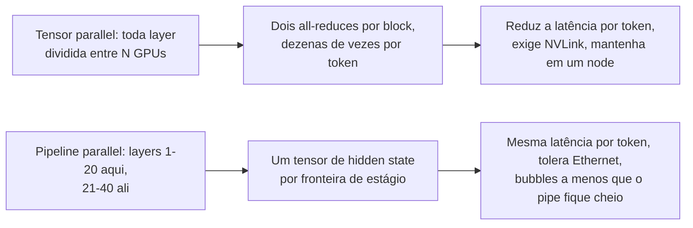

**Follow-ups:** Por que TP=8 entre dois nodes de 4 GPUs sobre Ethernet tem performance terrível? Como o MoE muda o quadro do paralelismo?

</details>

### 25. Self-host de um modelo open-weights ou chamar uma API de provedor - me conduza pela decisão.

<details><summary><b>Resposta</b></summary>

Framework com seis eixos, depois a conta:

1. **Requisitos de qualidade**: se a tarefa exige o melhor da capacidade de fronteira, APIs costumam ser a única opção - os modelos open-weight mais fortes ficam atrás da fronteira fechada, e os que chegam mais perto são MoEs muito grandes e caros de fazer self-host bem. Se um modelo aberto (possivelmente fine-tuned) passa na sua barra de evals, o self-hosting está na mesa. Evals decidem isso, não impressões.
2. **Economia de utilização**: GPUs cobram por hora esteja ocupada ou ociosa; APIs cobram por token. O self-hosting só vence com **utilização alta e estável**. Esboce a conta: uma H100 a ~US$2-4/hora servindo um modelo classe 70B bem batchado consegue produzir da ordem de alguns milhares de tokens de saída/sec agregados - chame de ~US$0,10-0,50 por milhão de tokens com boa utilização, versus preços de API frequentemente 5-20× isso. Mas com 10% de utilização seu custo efetivo se multiplica por 10, e tráfego diurno em picos torna a utilização sustentada genuinamente difícil. Inclua os itens ocultos: engenheiros de plantão, folga de capacidade, evals/upgrades.
3. **Privacidade/compliance/residência**: requisitos rígidos (dados regulados, air-gapped, residência de dados) podem forçar o self-hosting - ou pelo menos ofertas de provedores implantadas em VPC (Bedrock, Vertex, Azure) como caminho intermediário.
4. **Controle de latency**: o self-hosting compra colocation com seus serviços, sem rate limits, controle sobre toda a cauda. APIs te dão o P99 multi-tenant de outra pessoa.
5. **Customização**: fine-tuning pesado, decoding customizado (gramáticas, truques de spec decoding), serving de LoRA por tenant - muito mais fácil no seu próprio stack.
6. **Time**: rodar infra de inference é um compromisso operacional real (aquisição de GPUs, problemas de driver/kernel, upgrades de engine, resposta a incidentes). Um time de duas pessoas entregando produto deveria quase sempre começar em APIs.

A resposta madura geralmente é **híbrida**: API de fronteira para os caminhos de reasoning difíceis e de baixo volume; modelos pequenos self-hosted para tarefas estreitas de alto volume (classificação, extração, embeddings); revisitar trimestralmente conforme modelos e preços se movem. Comece com APIs para encontrar product-market fit, depois traga para dentro os workloads cujas contas de tokens excedem o custo totalmente carregado de servi-los.

**Follow-ups:** Que volume mensal de tokens faria você reavaliar? Como as ofertas de provisioned-throughput mudam esse cálculo?

</details>

### 26. Quando você usaria uma batch API, e como projeta um pipeline em torno de uma?

<details><summary><b>Resposta</b></summary>

Batch APIs (OpenAI Batch, Anthropic Message Batches) aceitam um arquivo/lista de requisições, processam-nas de forma assíncrona com uma janela de conclusão de até ~24 h (frequentemente muito mais rápido na prática) e cobram **~50% do preço interativo**. O provedor está vendendo sua capacidade off-peak/ociosa; você está vendendo flexibilidade de scheduling. Jobs em batch também costumam usar uma cota separada e muito maior que seus rate limits interativos - assim impedem que o trabalho em background canibalize seu TPM de produção.

Use para qualquer coisa sem usuário esperando: suítes de eval, backfills de embeddings/classificação, pipelines de sumarização de documentos, enrichment e labelling de dados, geração de dados sintéticos, varreduras de moderação de conteúdo, geração de relatórios noturnos, reprocessamento após uma mudança de prompt. Uma fração chocante do gasto com tokens de muitos times tem esse formato e silenciosamente paga preços interativos. Nunca use para caminhos voltados ao usuário e limitados por latência - e para o meio-termo ("resultados em minutos"), você ainda precisa da API interativa.

Pontos de design do pipeline:

- **Identidade idempotente da requisição**: anexe seu próprio `custom_id` por requisição; os resultados retornam indexados por ele, sem ordem. Torne o reenvio seguro (dedupe por custom_id) porque você *vai* reenviar.
- **Divida os jobs em chunks** de batches limitados (ambos os provedores limitam requisições/bytes por batch) e acompanhe o estado do job em um store durável: submitted → in_progress → completed/expired/failed.
- **Trate resultados parciais**: requisições individuais dentro de um batch podem falhar ou a janela pode expirar com um subconjunto concluído - reconcilie por requisição, reenvie apenas as faltantes/falhas, com um limite de retries.
- **Poll ou webhook** para conclusão; ao concluir, baixe os resultados, valide (faça schema-check das saídas), depois faça commit downstream.
- **Combine com as outras alavancas de custo**: o prompt caching também se aplica ao tráfego de batch em alguns provedores; faça dedupe de requisições idênticas antes do envio.
- **Backpressure**: um pipeline de batch que se espalha a partir de ações de usuários precisa de uma fila com controle de taxa para que um pico não crie uma tempestade de batches de um milhão de requisições.

**Follow-ups:** Como você lida com um batch que volta com 2% de falhas? Seu batch noturno agora precisa de frescor de 4 horas - o que muda?

</details>

### 27. O que é semantic caching, como ele é diferente de prompt/prefix caching, e quais são seus failure modes?

<details><summary><b>Resposta</b></summary>

O semantic caching armazena pares requisição→resposta anteriores e serve a **resposta** em cache quando uma nova requisição é *semanticamente similar*: faz embedding da query recebida, nearest-neighbour search sobre os embeddings das queries em cache, e se a similaridade passa de um limiar (p. ex., cosine ~0,95), retorna a resposta armazenada sem chamar o modelo de forma alguma.

O contraste com prompt/prefix caching é o ponto-chave que os entrevistadores querem: o prefix caching reutiliza **computação** (o KV cache de um prefixo *exato, idêntico em tokens*) - o modelo ainda roda e gera uma saída nova; é lossless. O semantic caching reutiliza a **resposta** em uma correspondência *fuzzy* e pula a inference inteiramente; são ~100% de economia em um hit, mas com perdas - você está afirmando que duas strings diferentes merecem a mesma resposta.

Failure modes, aproximadamente em ordem de dor:

- **Falsos hits**: embeddings borram exatamente o que importa - negação ("refund policy" vs "no-refund policy"), números, trocas de entidades ("reset password for account A vs B") e datas ficam todos próximos no embedding. Uma resposta errada em cache servida com confiança é pior que uma lenta.
- **Vazamento de contexto**: fazer cache entre usuários pode vazar conteúdo personalizado ou com permissões. As chaves de cache precisam ter escopo - por tenant no mínimo, e o estado que afeta personalização precisa estar na chave.
- **Staleness/invalidação**: a resposta em cache embute um momento no tempo - versão do modelo, versão do system prompt, snapshot do corpus de RAG. Qualquer um desses mudando precisa fazer flush ou particionar o cache por versão; times esquecem constantemente a dimensão da versão do prompt.
- **Ajuste do limiar**: apertado demais = sem hits; frouxo demais = respostas erradas. Meça a **hit precision** (os hits estão realmente corretos?) com revisão amostrada humana/LLM-judge, não apenas a hit rate.

Onde brilha: tráfego de alta repetição e baixa personalização - suporte estilo FAQ, queries públicas tipo busca - em que 20-40%+ do tráfego são quase-duplicatas. Onde evitar: respostas personalizadas, multi-turno ou de alto risco. Um caminho intermediário razoável: usar um hit semântico como *candidato* que um pequeno modelo verificador confirma antes de servir.

**Vale desenhar.** O limiar e o verificador são os dois lugares onde esse design dá errado, então coloque-os na página onde possam ser discutidos.

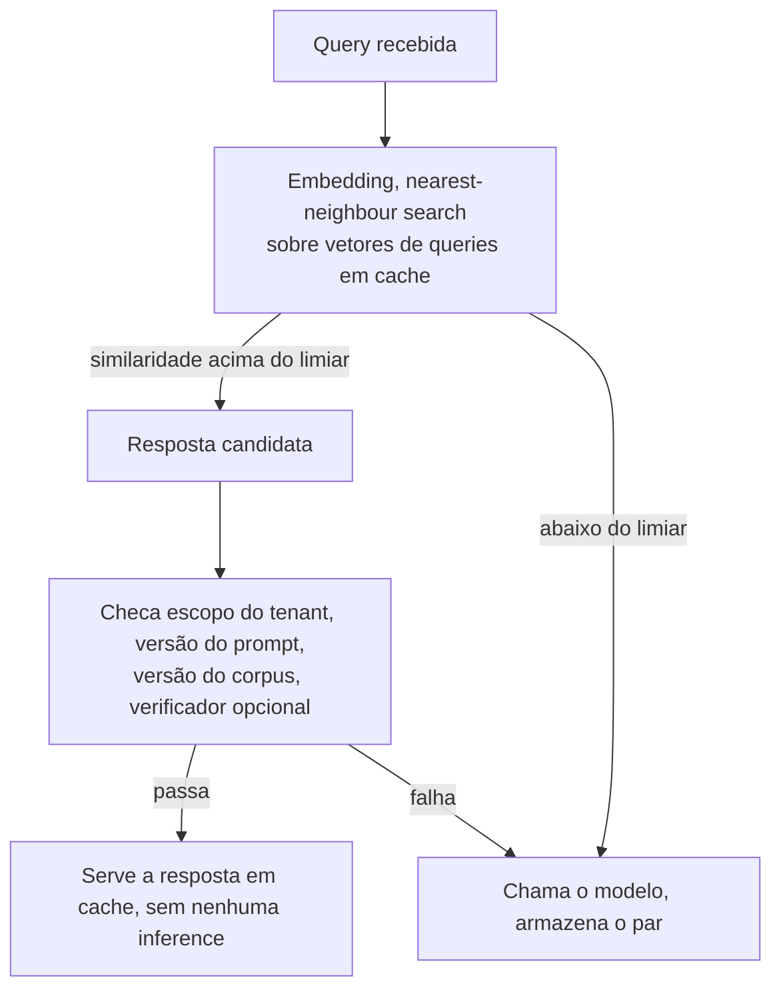

**Follow-ups:** Projete a chave de cache para um produto de RAG multi-tenant. Como você detectaria que seu limiar está causando falsos hits em produção?

</details>

### 28. Como você lida com streaming quando o modelo está emitindo tool calls ou JSON estruturado?

<details><summary><b>Resposta</b></summary>

A tensão: o streaming existe para mostrar progresso incremental, mas tool calls e JSON só são acionáveis quando sintaticamente completos. O stream entrega fragmentos - `{"loc` ... `ation": "par` - e um `json.loads` ingênuo em dados parciais lança exceção.

Primeiro a mecânica: os provedores fazem streaming de conteúdo estruturado como deltas tipados. O Chat Completions da OpenAI envia deltas de `tool_calls` carregando um índice, o nome da função (cedo) e fragmentos incrementais da string de `arguments`, e sua Responses API emite eventos tipados `response.function_call_arguments.delta`; a Anthropic envia eventos `content_block_start` / `input_json_delta` por bloco, com blocos possivelmente intercalando texto e tool use. O trabalho do client é um **acumulador**: roteie cada delta para seu bloco/tool-call pelo índice, concatene os fragmentos de argumentos e marque a conclusão no evento de block-stop/finish. Só então faça parse, valide contra o schema da tool e despache.

Padrões por cima disso:

- **Buffer-then-act** para execução: nunca execute uma tool com argumentos parciais. O sinal de bloco completo é seu ponto de commit; a validação de schema é sua rede de segurança (modelos ocasionalmente emitem JSON malformado - tenha um caminho de repair-or-retry).
- **Partial-JSON parsing** para exibição: parsers best-effort que fecham colchetes/strings abertos permitem renderizar UI progressiva a partir de JSON incompleto (streaming de uma tabela linha por linha, mostrando qual tool está sendo chamada e seus argumentos conforme se formam). Vários SDKs agora expõem helpers de partial-parse exatamente para isso.
- **Interleaving**: modelos modernos misturam prosa e tool calls em uma resposta; mantenha máquinas de estado por bloco em vez de assumir um tipo de conteúdo por mensagem.
- **Streaming pela sua própria API**: se seu backend faz proxy para clients, reemita eventos limpos e versionados (text delta / tool started / tool result / done) em vez de vazar formatos do provedor - é aqui que a normalização multi-provedor se paga.
- **Tratamento de falhas**: um stream morrendo no meio do JSON significa um fragmento inutilizável - trate como uma geração falha, faça retry de forma idempotente e torne impossível a execução dupla de tools (idempotency keys nos efeitos colaterais da tool).

**Vale desenhar.** Separa o caminho de exibição do caminho de execução, que é a distinção que impede uma tool call pela metade de disparar.

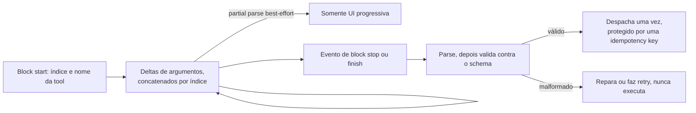

**Follow-ups:** Onde você coloca a validação de schema quando o modelo faz streaming de um array JSON de 10 itens que você quer renderizar progressivamente? Como você evita que uma tool execute duas vezes quando um retry do stream reproduz a tool call?

</details>

### 29. Você precisa servir 200 fine-tunes específicos de clientes do mesmo modelo base de 8B. Como faz isso em um punhado de GPUs, e o que quebra primeiro?

<details><summary><b>Resposta</b></summary>

Multi-LoRA serving. Carregue os pesos base uma vez e trate cada tenant como um adapter de rank r: para cada projeção alvo, y = Wx + scale * (B A x). O caro matmul base é compartilhado por todo o batch, e apenas os pequenos termos low-rank são por adapter, então um batch pode misturar adapters e você mantém o continuous batching. A alternativa, 200 réplicas completas do modelo, é absurda: 200 x ~16 GB versus 1 x 16 GB mais 200 x dezenas de MB.

O kernel é o que faz funcionar. Um loop ingênuo sobre adapters serializa o batch. Sistemas de produção ordenam os tokens por adapter em segmentos contíguos e fazem um único GEMM agrupado (a abordagem SGMV do Punica, usada por LoRAX, vLLM e SGLang). O vLLM expõe isso como `--enable-lora` com `--max-loras` (adapters distintos permitidos em um batch), `--max-lora-rank` e `--max-cpu-loras` (pool no lado do host); a requisição nomeia o adapter que deseja.

O que quebra:

- **Heterogeneidade de rank.** Kernels agrupados fazem padding até o rank máximo, então um adapter de rank 64 taxa todo tenant de rank 8 que compartilha o batch. Padronize os ranks entre tenants.
- **O limite `max_loras`.** Se mais adapters distintos estão ativos concorrentemente do que o limite permite, o scheduler serializa entre grupos de adapters e as caudas de TTFT explodem. Corrija com roteamento: dê a cada réplica um subconjunto de adapters (adapter affinity) para que a concorrência por réplica fique abaixo do limite.
- **Fetch de adapter frio.** Adapters são pequenos, então a paginação para a RAM do host é rápida, mas buscar do object storage na primeira requisição é um pico visível. Faça prefetch no início da sessão.
- **O prefix cache não cruza adapters.** O KV é específico do adapter, então um system prompt compartilhado é cacheado separadamente por adapter. Isso surpreende as pessoas.
- **Avaliação.** Agora você é dono de 200 superfícies de qualidade, não de uma.

Espere um custo real de throughput versus um servidor só com o base, crescendo com os adapters distintos por batch. Meça no seu tráfego em vez de confiar em um número de manchete.

**Vale desenhar.** Mostrar o matmul base compartilhado ao lado do termo por adapter explica num relance por que 200 tenants cabem onde 200 réplicas nunca caberiam.

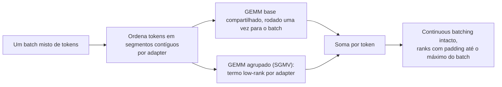

**Follow-ups:** Por que o KV de um system prompt compartilhado não pode ser reutilizado entre dois adapters diferentes? Quando você faria merge de um adapter nos pesos base e o serviria como seu próprio modelo?

</details>

### 30. Como você faz load test de um serviço de LLM para que os números realmente signifiquem algo?

<details><summary><b>Resposta</b></summary>

A maioria dos load tests de LLM está errada das mesmas três formas: carga closed-loop, prompts irrealistas e reportar médias.

**Open loop, não closed loop.** Um teste closed-loop (N workers, cada um envia uma requisição e espera) se auto-throttla quando o servidor desacelera, então você nunca observa a fila se formando. Isso é coordinated omission, e esconde exatamente a falha que você está testando. Gere chegadas a partir de um processo de Poisson a uma taxa alvo, independente das respostas:

```python
import asyncio, random

async def open_loop(rate, duration, send, next_prompt):
    loop = asyncio.get_event_loop()
    end, tasks = loop.time() + duration, []
    while loop.time() < end:
        await asyncio.sleep(random.expovariate(rate))  # não espera pelas respostas
        tasks.append(asyncio.create_task(send(next_prompt())))
    return await asyncio.gather(*tasks)
```

**Distribuições realistas de tokens.** Amostre os tamanhos de input e output dos logs de produção, incluindo a cauda; um workload sintético fixo de 512-in/128-out não diz nada sobre um serviço que ocasionalmente vê prompts de 100K tokens. Criticamente, acerte o realismo do prefix cache: reproduzir um prompt idêntico dá uma cache hit rate de ~100% e um TTFT de fantasia. Espelhe sua razão real de prefixos compartilhados para únicos.

**Faça sweep, não spot-check.** Aumente a taxa de ocioso até a saturação e plote os percentis de TTFT e ITL contra o throughput. O que você quer é o joelho, e a taxa máxima na qual você ainda atende ao SLO. Reporte o **goodput** no SLO, mais P50/P95/P99, nunca a média. Ferramentas como o serve benchmark do vLLM e o GuideLLM fazem o sweep e as chegadas Poisson por você.

**Aqueça e mantenha.** Carga de pesos, captura de CUDA graph e compilação tornam as primeiras requisições não representativas. Descarte a janela de warm-up e meça em steady state por uma duração fixa.

Depois teste as partes feias: comportamento além da saturação (ele enfileira, descarta ou cai?), taxa de preemption, um workload multi-tenant misto e um soak longo para vazamentos e fragmentação. Contra uma API de provedor, você está testando principalmente seus próprios rate limits e a variância deles por horário do dia, então não ajuste com base em uma única execução.

**Follow-ups:** Por que um teste closed-loop com 100 workers subestima a latência P99? Como você projetaria o corpus de prompts para um benchmark de um workload agentic?

</details>

### 31. Seu produto está migrando de um modelo de chat padrão para um reasoning model com extended thinking. O que muda para capacity, SLOs e design?

<details><summary><b>Resposta</b></summary>

Quase tudo a jusante de "tokens por requisição", porque esse número salta aproximadamente uma ordem de grandeza e ganha uma cauda bem mais gorda.

**Capacity.** Thinking tokens são tokens gerados: são cobrados como saída, ocupam KV e consomem passos de decode. Uma requisição que antes emitia ~300 tokens pode emitir vários milhares. Como o dimensionamento da frota é guiado pelo total de tokens de decode, não por requisições, planeje em tokens. A parte reconfortante é que o tráfego de reasoning é pesado em decode e faz batching bem, então o throughput por GPU se sustenta; o problema é a latência por requisição e a ocupação de KV.

**A cauda é o inimigo.** O tamanho da saída se torna heavy-tailed e imprevisível por requisição. Você não consegue dimensionar pela média, e um punhado de requisições pode segurar slots de KV por minutos, causando head-of-line blocking e cascatas de preemption que prejudicam todo mundo. Limite: `max_tokens` rígido e use o thinking budget ou o controle de reasoning-effort do provedor em vez de torcer. Observe a taxa de preemption como uma métrica de primeira classe.

**Os SLOs precisam mudar.** O TTFT é quase sem sentido quando o primeiro token pode ser um thinking token que o usuário talvez nunca veja. Acompanhe o tempo até o primeiro token de *resposta* e o tempo total até a resposta. Os orçamentos interativos passam de centenas de milissegundos para segundos ou dezenas de segundos, e a UX precisa sustentar isso: faça streaming de uma superfície de progresso ou status, ou mova o trabalho para um job em background com notificação.

**Scheduling.** Não misture gerações longas de reasoning e chat rápido em uma só fila; as longas vão destruir o P99 do chat. Pools separados ou classes de prioridade, roteados por effort.

**Alavancas de design.** Roteie por dificuldade: modelo barato sem reasoning primeiro, escale com base em sinais de dificuldade. O prompt caching não ajuda com thinking tokens, já que são gerados do zero toda vez. Se o reasoning anterior é carregado adiante difere por provedor: alguns descartam o thinking de turnos anteriores do contexto, outros esperam que você repasse reasoning items ou thinking blocks dentro de um tool-use loop, o que mantém tanto a continuidade quanto os cache hits. Leia as regras do seu provedor, porque errar isso custa silenciosamente qualidade ou cache hits. O speculative decoding frequentemente se sai bem aqui porque traces longos contêm estrutura previsível. E para qualquer coisa não interativa, um caminho via batch API é a resposta certa.

**Follow-ups:** Como você escolheria o thinking budget por requisição em vez de definir um valor global? O que é pior para sua frota: uma requisição de reasoning de 30K tokens ou trinta requisições de chat de 1K tokens, e por quê?

</details>

### 32. Explique KV cache offloading e o reuso entre requisições além da memória de uma única GPU. Quando carregar um prefixo em cache vence simplesmente recomputar o prefill?

<details><summary><b>Resposta</b></summary>

A HBM da GPU guarda apenas um pequeno working set de KV, então os blocos são expulsos e a próxima requisição refaz o prefill do mesmo prefixo do zero. O offloading adiciona tiers abaixo da HBM: primeiro a RAM do host, depois NVMe, depois um tier de rede compartilhado para que qualquer réplica possa puxar um prefixo que outra réplica computou uma hora atrás. LMCache e a interface de KV connector do vLLM são as implementações comuns, e o mesmo mecanismo move KV de nodes de prefill para nodes de decode sob PD disaggregation.

A decisão é uma comparação de largura de banda: recomputar um prefixo custa FLOPs de prefill, carregá-lo custa bytes por um link. Faça a conta por modelo.

```python
kv_bytes_per_token = 320_000        # ~320 KB, modelo no formato 70B, KV em FP16
link_bw = 50e9                      # ~50 GB/s alcançáveis sobre PCIe Gen5 x16
load_tokens_per_s = link_bw / kv_bytes_per_token   # ~156K tokens/s
# o prefill de um modelo 70B é da ordem de alguns milhares de tokens/s por GPU
```

A RAM do host vence por larga margem, então fazer offload para a memória da CPU quase sempre bate o recompute *quando o hit é real*. NVMe a um dígito de GB/s é uma decisão mais apertada, e um tier de rede mais ainda. A arquitetura do modelo inverte a resposta: attention estilo MLA com KV minúsculo por token torna o carregamento trivialmente barato, enquanto um modelo com KV gordo te empurra de volta para o recompute.

Failure modes que vale nomear:

- **A hit rate é tudo.** Uma hit rate de 20% significa que você paga principalmente overhead de transferência por nada.
- **Interferência.** Fetch e descompressão disputam largura de banda PCIe e SMs com a inference, então uma implementação ingênua desacelera as requisições que está tentando ajudar.
- **Corretude.** A chave de cache precisa incluir versão do modelo, quantization, adapter, layout de TP e tratamento posicional. Servir KV computado sob uma configuração diferente é um bug silencioso de qualidade, e é um outage clássico.

Onde compensa: chat multi-turno e agents com prefixos longos e estáveis, RAG sobre um corpus repetido e Q&A de documentos em que um documento longo é consultado muitas vezes.

**Follow-ups:** O que exatamente deve entrar na chave de cache? Em que hit rate um tier NVMe deixa de se pagar?

</details>

### 33. Como você escolhe hardware de inference: GPUs NVIDIA, AMD, TPUs ou silício de cloud como Inferentia e Trainium?

<details><summary><b>Resposta</b></summary>

Comece pela restrição limitante do workload e pelo software que você teria que manter, não pela ficha técnica, e resolva com um benchmark denominado em dólares por milhão de tokens no seu SLO.

**Case a restrição.** O decode é limitado por largura de banda e capacidade de memória, então a capacidade de HBM e os TB/s importam mais que o pico de FLOPS. A capacidade tem um efeito de segunda ordem que as pessoas perdem: uma MI300X de 192 GB pode guardar um modelo que precisaria de duas placas de 80 GB, o que remove all-reduces de tensor-parallel de cada layer e pode vencer a opção "mais rápida". Uma H200 com 141 GB conta uma história parecida. Prefill e serving com batch grande são compute-bound, então ali o throughput dos tensor cores e o suporte a baixa precisão (FP8, e FP4 em peças classe Blackwell) é o que você está comprando.

**O software geralmente dá o voto decisivo.** A NVIDIA tem suporte no dia zero em vLLM, SGLang e TensorRT-LLM, mais a cobertura de kernels mais ampla para speculative decoding, LoRA e structured output. O ROCm recuperou muito terreno e a MI300X é suportada nos principais stacks abertos. TPUs são fortes para serving em larga escala com batch estável via JAX e XLA e podem ser excelentes em preço-performance, mas o ecossistema é mais estreito. Inferentia e Trainium exigem compilação Neuron, então cobertura de modelos e features é o risco que você está subscrevendo; o retorno é o custo unitário se o seu modelo for suportado.

**A métrica que importa** é dólares por milhão de tokens no seu SLO, no seu modelo, com o formato do seu tráfego. O preço de tabela por GPU-hora não significa nada. Um chip mais barato que corta pela metade o batch size alcançável é mais caro, e um chip que não atinge sua meta de latência em nenhum batch size é infinitamente caro.

**Depois, a realidade.** Disponibilidade e termos de compromisso frequentemente dominam a comparação técnica: o melhor chip que você não consegue por seis meses perde para o adequado que você pode reservar hoje. Cargas de pesos de vários minutos tornam a capacidade spot um mau encaixe para serving interativo. Faça hedge da portabilidade mantendo uma interface de serving compatível com OpenAI e evitando kernels escritos à mão, para que trocar seja uma mudança de config e uma requalificação, não uma reescrita.

**Follow-ups:** Por que uma GPU com mais HBM poderia vencer duas GPUs menores com a mesma memória total? O que faria você rejeitar um chip que vence em dólares por token?

</details>

### 34. Quando a inference on-device ou edge faz sentido, e o que realmente a restringe?

<details><summary><b>Resposta</b></summary>

Faz sentido quando privacidade ou residência de dados, operação offline, custo por requisição em volume muito alto ou latência de rede quase zero importam mais que a qualidade máxima do modelo. Deployments reais típicos: predição de texto, sumarização e transcrição on-device, classificação ou redaction antes de qualquer coisa ir para a cloud e agents locais em laptops.

As restrições, na ordem em que mordem:

- **Memória.** Um celular realisticamente dá a um app alguns GB. Isso coloca você em torno de 1B a 4B params em 4 bits (aproximadamente 0,5 a 2,5 GB), com ~8B em 4 bits (~4,5 GB) apenas em dispositivos com muita memória. O KV cache compete pelo mesmo orçamento, então o contexto utilizável é curto. Laptops são muito mais generosos, e é por isso que a história do agent local é primeiro uma história de laptop.
- **Largura de banda.** Você está em batch 1 para sempre, então o decode é puramente memory-bandwidth bound. A LPDDR5X de celulares fica na casa de dezenas de GB/s versus os TB/s de uma GPU de datacenter, então espere uma ordem de grandeza a menos de tokens/s. O truque do batching que te salva na cloud não existe aqui.
- **Térmica e bateria.** Geração sustentada sofre throttling. Os primeiros 30 segundos de um benchmark são uma mentira; meça uma execução longa e meça a potência.
- **Distribuição.** Downloads de modelos de vários GB prejudicam taxas de instalação e atualizações. Modelos on-device fornecidos pelo SO contornam isso, ao preço de menos controle.
- **Toolchain.** llama.cpp/GGUF, MLX em Apple silicon, ONNX Runtime, Core ML e NPUs de fornecedores. O suporte a NPU é irregular, e a cobertura de operadores mais os formatos de quantization suportados decidem a viabilidade com mais frequência que os TOPS brutos.

O design que geralmente vence é híbrido: um modelo local pequeno cuida de classificação, roteamento, redaction e drafting, e queries difíceis escalam para a cloud; offline degrada para somente-local. Avalie o modelo pequeno na sua tarefa, não em leaderboards gerais. O precipício de qualidade de um modelo de fronteira para um de 3B depende da tarefa: frequentemente aceitável para extração e classificação, ruim para reasoning aberto.

**Follow-ups:** Como você decide onde fica a fronteira de roteamento local/cloud? O que quebra na sua história de avaliação e observability quando a inference roda no dispositivo do usuário?

</details>

### 35. Em batch sizes baixos seu decode é mais lento do que a conta de largura de banda prevê, e a timeline da GPU mostra lacunas entre kernels. O que é CPU overhead em serving de LLM, e como CUDA graphs e overlapped scheduling o corrigem?

<details><summary><b>Resposta</b></summary>

Em batch sizes pequenos um passo de decode é tão curto que o lado do host, não a GPU, vira o gargalo. Um passo são centenas de kernels pequenos (vários por layer ao longo de dezenas de layers), e cada launch custa microssegundos de tempo de CPU em Python, no dispatcher do framework e no driver. Some o trabalho por passo do scheduler (escolher o batch, atualizar block tables, sampling, detokenizar, streaming) e a GPU fica ociosa entre os passos. Um profile mostra lacunas na timeline da GPU e um core de CPU no teto. Em um modelo pequeno, em que a leitura de pesos de um passo leva bem menos de um milissegundo, o overhead pode ser uma grande parcela do passo.

As correções, aproximadamente na ordem em que os engines as adotaram:

- **CUDA graphs.** Capture o passo de decode inteiro uma vez e reproduza-o com um único launch, de modo que o overhead de launch colapsa. O porém é que graphs são estáticos em formato: os engines capturam um conjunto de buckets de batch size na inicialização e fazem padding de cada passo até o bucket mais próximo, o que custa memória e tempo de startup. Peças dinâmicas, como alguns attention backends, roteamento de MoE ou custom ops, podem quebrar a captura e forçar o modo eager.
- **Compilação e fusão.** `torch.compile` e kernels fundidos à mão juntam trabalho elementwise (norms, activations, rotary embeddings) em menos kernels, maiores, o que significa menos launches e menos idas e voltas à HBM.
- **Overlapped scheduling.** Prepare o passo N+1 na CPU enquanto a GPU roda o passo N, de modo que o scheduler saia do caminho crítico. O overlap scheduler do SGLang e o async scheduling do vLLM fazem isso. A sutileza é que o passo N+1 precisa do token amostrado no passo N, então todo o resto é preparado antecipadamente e o token é preenchido por último.
- **Tire trabalho do hot loop.** Rode tokenização, detokenização, streaming e tratamento de HTTP em processos separados do núcleo do engine.

O ponto de entrevista: é por isso que os tokens por segundo medidos em batch 1 em um modelo pequeno podem ficar bem abaixo do teto de largura de banda, e por que um upgrade de engine às vezes compra mais latência do que uma GPU mais rápida. Importa mais para modelos pequenos, batch baixo, speculative decoding (muitos passos de verificação minúsculos) e arquiteturas com cobertura de graph mais fraca.

**Vale desenhar.** Mostra de onde vem o tempo ocioso e qual correção remove cada fatia dele.

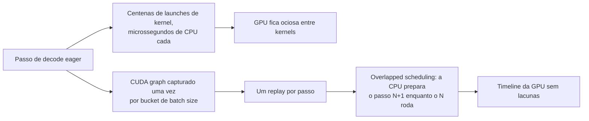

**Follow-ups:** Por que CUDA graphs precisam de buckets de batch size, e quanto custa o padding até um bucket? Como você confirmaria, a partir de um profile, que um problema de latência é host overhead e não largura de banda de memória?

</details>

### 36. Provedores agora vendem o mesmo modelo em vários service tiers: standard, priority, flex ou batch, e provisioned throughput. Como você decide qual tráfego vai para onde?

<details><summary><b>Resposta</b></summary>

Trate os tiers como pontos diferentes de uma curva de preço, latência e garantia de capacidade, e envie cada workload ao tier mais barato que ainda atende ao seu SLO. O modelo é o mesmo em todos os tiers. O que você está comprando é prioridade de scheduling e quão firmemente o provedor garante a capacidade.

- **Standard on-demand.** Preço por token, capacidade compartilhada, latência best-effort, rate limits por organização. O padrão para features interativas em volume moderado.
- **Priority.** O `service_tier` priority da OpenAI, o Priority Tier da Anthropic e ofertas similares cobram um prêmio ou exigem um compromisso em troca de serem escalonados primeiro quando o provedor está ocupado, de modo que a tail latency e a disponibilidade no pico melhoram. Vale para a fatia crítica em latência onde um P99 perdido custa receita, não para todo o tráfego.
- **Flex e batch.** Com desconto, frequentemente em torno da metade do preço, em troca de conclusão mais lenta ou assíncrona e da chance de ser despriorizado ou recusado em horários ocupados. O Flex mantém o formato síncrono da API com timeouts maiores. O Batch recebe um arquivo de requisições e uma janela de conclusão. Ambos servem para evals, backfills, enrichment e qualquer coisa que uma pessoa não esteja esperando.
- **Provisioned throughput.** Bedrock, Vertex AI, Azure e compromissos diretos reservam capacidade em model units ou tokens por minuto, cobrados usando você ou não. Compra latência previsível e nenhum 429 até a sua reserva, e sua economia é a economia do self-hosting: só compensa com utilização alta e estável.

Como decidir: classifique o tráfego por tolerância a latência e valor de negócio. Preencha a capacidade provisionada até sua linha de base sustentada, faça burst no standard, roteie a fatia crítica para priority e empurre tudo que for adiável para flex ou batch. Revise a utilização da capacidade reservada semanalmente, porque um compromisso não utilizado é puro desperdício.

Armadilhas:

- Tiers podem diferir em rate limits e suporte a features, então teste prompt caching, tool use e structured output em cada tier para o qual você roteia.
- O tráfego flex precisa de timeouts maiores e de um comportamento definido quando a capacidade é recusada: tentar de novo depois, fazer fallback para standard ou enfileirar.
- Preços, descontos e termos mudam com frequência. Mantenha a tabela de roteamento de tiers em configuração, marque cada requisição com o tier que a serviu e atribua custo por tier para que a próxima renegociação use dados reais.

**Follow-ups:** Sua capacidade provisionada roda a 40% de utilização durante a noite: o que você roteia para ela? Como você decide se o P99 de uma feature vale pagar preços do tier priority?

</details>

## Avançado

### 37. Construa o orçamento completo de memória da GPU para um deployment de serving e mostre como ele determina o batch size máximo e a concorrência.

<details><summary><b>Resposta</b></summary>

Orçamento para uma H100 de 80 GB servindo um modelo classe 70B (80 layers, 8 KV heads, head_dim 128) quantizado em 4 bits:

```
Pesos:      70e9 params × ~0,56 B/param (4 bits + scales)  ≈ 39 GB
Runtime:    CUDA context + buffers do engine                ≈ 2 GB
Activations/workspace (dependem de batch e chunk size)      ≈ 4 GB
------------------------------------------------------------------
Disponível para KV cache (a ~0,9 de utilização de memória)  ≈ 27 GB
```

O KV cache em FP16 é ~320 KB/token (2 × 80 × 8 × 128 × 2 B), então o pool comporta:

```
27 GB ÷ 320 KB ≈ ~84K tokens de contexto residente no total
```

Esse único número *é* seu orçamento de concorrência: ~21 sequências concorrentes com 4K de contexto, ~10 com 8K, e uma única requisição de 84K de contexto consome o pool inteiro. Como o throughput de decode escala com o batch size, é por isso que **a memória de KV - não o compute - limita o throughput** na maioria dos deployments, e por que uma feature de contexto longo silenciosamente destrói a economia de um pool compartilhado.

Alavancas, com seu efeito na mesma aritmética: KV cache em FP8 → 160 KB/token → ~168K tokens residentes (2× de concorrência); o GQA já está neste modelo (com MHA completa seria 8× pior); uma segunda GPU com TP=2 aproximadamente dobra o pool de KV *e* divide pela metade os bytes de pesos por GPU; modelo menor ou limite de contexto mais curto obviamente ajudam. O PagedAttention importa aqui como habilitador: torna ~todos esses 27 GB *utilizáveis* (a alocação contígua anterior desperdiçava a maior parte), e o prefix caching significa que system prompts compartilhados não são contados múltiplas vezes contra o pool.

Feche o loop com o comportamento no limite: quando a admissão excederia o pool, o scheduler enfileira (o TTFT cresce) ou faz preempt de sequências em execução (evict-and-recompute - o ITL tem picos). Então "utilização de KV" e "taxa de preemption" são os dashboards que dizem que esse orçamento está esgotado antes dos usuários.

**Vale desenhar.** Desenhar o orçamento como um único fluxo da capacidade da placa até as sequências concorrentes torna o pool de KV visivelmente a coisa que limita o throughput.

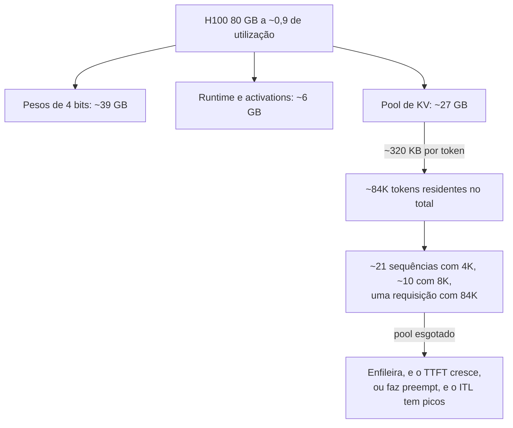

**Follow-ups:** Refaça a conta com pesos FP8 em 2 GPUs. Seu produto quer elevar o limite de contexto de 8K para 128K - o que isso faz com o custo por requisição?

</details>

### 38. Projete os SLOs de uma nova feature com LLM. O que você promete, e como mede?

<details><summary><b>Resposta</b></summary>

Comece pelo que o usuário percebe, por padrão de interação - um "SLO de latência" global é um erro de categoria:

- **Chat interativo (streamed)**: P99 de TTFT (digamos, < 1,5 s; P50 de algumas centenas de ms) + P99 de inter-token latency ou um piso de taxa de stream (tokens/s confortavelmente acima da velocidade de leitura). A duração total importa menos porque o streaming a esconde.
- **Autocomplete/sugestões inline**: latência total de conclusão (P95 < ~300-500 ms) - o TTFT sozinho não significa nada porque a saída é curta e inutilizável até estar inteira.
- **Tarefas agentic/multi-etapa (passos sem streaming)**: orçamento de tempo de conclusão end-to-end da tarefa, decomposto em orçamentos por passo - lembrando que as caudas se compõem em chamadas sequenciais.
- **Batch/background**: SLO de frescor (resultados em N horas) + taxa de conclusão, não latência.

Além da latência: **disponibilidade** (taxa de respostas bem-sucedidas, com respostas em modo degradado contadas separadamente), **guardrails de qualidade** onde mensuráveis (taxa de saída com schema válido, taxa de validade de tool calls, taxa de refusal/erro) - uma resposta rápida e errada não atende ao objetivo - e frequentemente um **SLI de custo** interno (distribuição de custo por requisição) mesmo que não seja uma promessa.

Disciplina de medição: meça na borda do client ou no gateway, não apenas no servidor (os usuários experimentam a rede e seu middleware); percentis por feature por faixa de tamanho de prompt; defina os eventos com precisão (TTFT = requisição enviada → primeiro token de *conteúdo*, excluindo o handshake do provedor?); inclua timeouts e erros na distribuição de latência em vez de descartá-los (manipulação clássica). Defina metas a partir de dados - rode a feature, olhe a curva alcançável, escolha metas que você atende ~99%+ do tempo com folga - depois anexe um **error budget** e combine o que acontece quando ele queima: congelar mudanças arriscadas, descartar carga, escalar.

Por fim, ligue os SLOs à ação: alertas na burn rate do budget (não em blips pontuais), dashboards que decompõem as violações (queueing vs prefill vs provedor vs rede) e prioridades de load-shedding que explicitamente protegem o tier interativo com SLO sacrificando o tráfego de background primeiro.

**Follow-ups:** O P99 do seu provedor é pior que o SLO que você quer oferecer - quais são suas opções? Por que medir requisições terminadas por timeout dentro da distribuição de latência?

</details>

### 39. Capacity planning: dizem para você esperar 100 requisições/sec no pico com ~2K tokens de input e ~300 de output por requisição. Me conduza pela estimativa da frota de GPUs.

<details><summary><b>Resposta</b></summary>

Método primeiro, números depois - os entrevistadores estão avaliando o processo.

**1. Caracterize a demanda.** Pico de 100 req/s × 2K in / 300 out ⇒ ~200K tok/s de input de prefill e ~30K tok/s de output de decode, sustentados. Verifique também a distribuição: médias escondem os uploads de documentos de 32K tokens que dominam o comportamento da cauda. Aplique a cache hit rate esperada do prompt (um system prompt compartilhado entre requisições pode cortar o prefill efetivo dramaticamente).

**2. Meça o goodput por réplica - não confie em datasheets.** Pegue a configuração alvo de modelo/engine/GPU (digamos, 70B FP8, TP=2 em H100s), faça load test com tráfego no formato de produção (mesmos tamanhos de in/out, rajadas de chegada), varie a concorrência e encontre o throughput máximo *sob o seu SLO* (goodput) - p. ex., você pode medir uma réplica sustentando ~X mil tok/s de saída com P99 de TTFT dentro do orçamento. Faça um sanity check de X por primeiros princípios: o decode é bandwidth-bound, então bytes-por-token × tokens/s precisa caber na largura de banda agregada da HBM; se sua medição está muito longe da estimativa do roofline, algo está mal configurado.

**3. Divida com folga.** `réplicas = demanda_de_pico / goodput_por_réplica × folga` - folga ~1,4-1,7× porque a latência de queueing explode perto da saturação (mire em ~60-70% de utilização no pico), mais N+1 para falhas/deploys, mais multi-zona se exigido. O formato diurno decide quanto é capacidade reservada/comprometida versus autoscaled.

**4. Não esqueça as partes que não são GPU**: gateway, tokenização, transferência de KV se disaggregated - e que as demandas de prefill e decode podem justificar formatos de pool *diferentes*.

**5. Valide e itere**: shadow traffic ou rollout gradual, observe goodput/profundidade da fila/utilização de KV, replaneje mensalmente - o drift do mix de tráfego (contextos mais longos, agentic loops) invalida planos mais rápido que o crescimento.

A armadilha a evitar: citar um número de tokens/s de um benchmark de blog rodado com prompts de 128 tokens e chamar isso de plano. Declare também a alternativa: nessa escala, compare com o preço de provisioned-throughput de APIs - a frota que você acabou de dimensionar tem um custo totalmente carregado que pode ou não vencê-lo.

**Follow-ups:** Como uma cache hit rate de prompt de 30% muda a resposta? O pico é 3× a média diária - como você divide capacidade reservada vs autoscaled?

</details>

### 40. Cold starts de GPU levam minutos. Como você faz autoscale de uma frota de inference mesmo assim?

<details><summary><b>Resposta</b></summary>

Primeiro decomponha o cold start: (1) obter um node de GPU - minutos se há capacidade, ilimitado se não há (a escassez de GPU é real); (2) puxar uma imagem de container de vários GB; (3) carregar os pesos - 140 GB do object storage a 1-5 GB/s são minutos por si só; (4) warmup - init do engine, captura de CUDA graphs, compilação, priming do prefix cache. Ingenuamente são 5-15 minutos da decisão de escalar até servir - sem esperança contra um pico de tráfego que se forma em 30 segundos.

Então a estratégia é: **escalar por indicadores antecedentes, encurtar o caminho frio e manter buffers aquecidos.**

- **Sinais certos**: profundidade da fila/tempo de espera, concorrência em andamento, utilização do KV cache, tokens/s vs goodput por réplica conhecido. Não a utilização de GPU (um decode memory-bound lê ~100% significando pouco) e não CPU. Limiares de scale-up agressivos, scale-down lento e com histerese (drene streams com elegância - sequências em andamento devem completar ou migrar).
- **Encurte o caminho frio**: AMIs/imagens pré-assadas (sem pull), pesos em NVMe local ou page cache aquecido, loaders rápidos (safetensors mmap, loaders de streaming como tensorizer), técnicas de snapshot/restore onde disponíveis. Levar o tempo de carga de 10 min para <1 min muda o que o autoscaling pode fazer.
- **Warm pools**: nodes com imagem+pesos residentes, GPU anexada, processo pausado ou servindo em baixa prioridade - standby caro, mas a única resposta verdadeira para picos abruptos. Dimensione o buffer aquecido pela magnitude histórica dos picos.
- **Scaling preditivo/agendado** cuida do grosso diurno: escale antes da rampa das 9h por agenda ou previsão, mantendo o scaling reativo apenas para os resíduos.
- **Absorva o que você não consegue escalar**: admission control com enfileiramento priorizado (o tráfego de background cede primeiro), modos degradados (modelo de fallback menor já aquecido) e burst-overflow para um provedor de API como alívio de pressão - frequentemente o "warm pool" mais barato de todos.

Mencione o enquadramento econômico explicitamente: fazer autoscale de GPUs é trocar custo de standby por risco de SLO; a resposta certa difere para um produto de chat (buffers aquecidos obrigatórios) versus um pipeline batch (enfileire, escale preguiçosamente).

**Vale desenhar.** Dispor o caminho frio estágio por estágio é como você justifica um warm pool para alguém que acha que autoscaling é um valor de config.

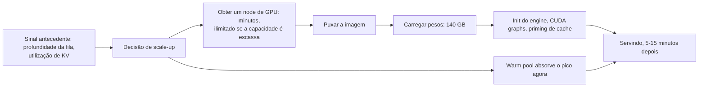

**Follow-ups:** Por que a utilização de GPU é um mau sinal de scaling para workloads pesados em decode? Projete o caminho de scale-down para que streams de longa duração não sejam mortos.

</details>

### 41. O que você monitora em serving de LLM em produção, e o que acorda alguém às 3 da manhã?

<details><summary><b>Resposta</b></summary>

Quatro camadas, cada uma com sinais distintos:

**Camada de experiência do usuário (SLO)**: percentis de TTFT e ITL por feature e faixa de tamanho de prompt, taxa de sucesso de requisições, taxa de timeout, taxa de stream-abort, taxa de saída com schema válido para endpoints estruturados. Medidos no gateway/borda, não apenas no engine.

**Camada de engine** (vLLM e cia. exportam isso via Prometheus): profundidade da fila e tempo de espera, contagens de sequências running/waiting, batch size, **utilização do KV cache**, **contagens de preemption/eviction**, prefix-cache hit rate, tokens in/out por segundo. São os indicadores antecedentes - utilização de KV no teto mais preemptions subindo prevê precipícios de latência antes de os usuários sentirem.

**Camada de hardware**: uso de HBM, largura de banda de memória vs utilização de SM (uma frota de decode memory-bound mostrando "100% de GPU util" é normal; a pergunta interessante é em qual teto você está batendo), throttling de temperatura/potência, erros de ECC, erros de NVLink/interconexão para grupos de TP, saúde dos nodes.

**Camada de custo e provedor**: tokens e US$ por requisição/feature/tenant, cache hit rates (prompt + semantic), taxas de 429/5xx por provedor, drift de latência do provedor, anomalias de burn do orçamento.

**Acordar às 3 da manhã** (impacta usuários, precisa de um humano agora): alertas de burn-rate do SLO de disponibilidade/taxa de erro; violação sustentada de P99 de TTFT/ITL; profundidade da fila crescendo sem limite (saturação/incidente); crash-loop de réplica ou tempestade de OOM; provedor totalmente fora do ar com o fallback também falhando; anomalias de segurança. **Ticket para a manhã**: anomalias de custo, regressões de cache hit rate, degradação de uma única réplica com folga, drift gradual de sinais de qualidade. A barra das 3 da manhã é "a experiência do usuário ou os dados estão em risco *e* um humano pode agir sobre isso" - acordar alguém por custo ou por GPU util bruta é como times esgotam o on-call.

Duas práticas que vale nomear: alerta por burn-rate (alertar pela velocidade de consumo do error budget, não por blips instantâneos) e dashboards de decomposição - quando o TTFT viola, você quer uma tela separando espera na fila vs tempo de prefill vs tempo do provedor vs rede, porque a remediação de cada um é completamente diferente.

**Follow-ups:** A utilização de KV está em 95%, as preemptions estão subindo, mas a "utilização" de GPU parece boa - o que está acontecendo e o que você faz? O que você adicionaria para uma plataforma multi-tenant?

</details>

### 42. Projete a camada de reliability para chamadas a um provedor de LLM: timeouts, retries, circuit breakers, idempotency.

<details><summary><b>Resposta</b></summary>

**Timeouts - em camadas, nunca um número só.** Um único timeout de 120 s está errado para uma chamada com streaming: não distingue "lento mas progredindo" de "travado". Use: connect timeout (segundos); **TTFT timeout** (sem primeiro token em ~10-20 s → requisição morta); **timeout de inatividade entre chunks** (stream silencioso por ~30 s → travado; cuidado com pausas legítimas durante tool use do lado do provedor - heartbeats ajudam); limite de wall-clock total por feature. Ajuste por classe de modelo - reasoning models legitimamente pensam por muito tempo antes do primeiro token visível.

**Retries - limitados e honestos.** Faça retry de 429/5xx/falhas de rede com exponential backoff + full jitter, honrando `Retry-After`; nunca faça retry de erros de validação 4xx. Limite a 2-3 tentativas com um orçamento de latência geral e um retry budget global (se >~10% do tráfego está em retry, você está amplificando um outage - descarte carga em vez disso). Falha no meio do stream é o caso desagradável: um retry regenera do zero, possivelmente produzindo texto *diferente* - a UI deve substituir, não anexar, e tudo que já tenha sido acionado downstream precisa ser tratado (veja idempotency). Hedged requests (disparar uma segunda chamada em ~P95, pegar a vencedora) compram tail latency com dinheiro - use somente em caminhos idempotentes e de alto valor.

**Circuit breakers - por provedor × modelo.** Acompanhe a taxa de falha em uma janela deslizante; abra o breaker em falha sustentada (falhe rápido, pare de alimentar uma dependência moribunda), deixe passar sondas limitadas em half-open, feche na recuperação. Ao abrir: roteie para a fallback chain - modelo menor da mesma família, ou outro provedor - *pré-validada com evals*, porque prompts não transferem 1:1 e um colapso silencioso de qualidade é pior que uma página de erro. Faça bulkhead das classes de tráfego para que jobs de background não esgotem conexões/cota necessárias ao tráfego interativo.

**Idempotency.** A chamada de LLM em si é stateless - segura para retry, no pior caso você paga duas vezes. O perigo são os **efeitos colaterais ao redor dela**: um passo de agent com retry reexecutando uma tool (e-mail duplicado, escrita duplicada). Atribua idempotency keys a operações com efeitos colaterais, faça dedupe na camada de tool e torne os passos do pipeline seguros para replay (um item de batch com retry sobrescreve por `custom_id`, não anexa). Máquinas de estado, não impressões: cada requisição tem um ID e um status durável.

**Vale desenhar.** Os três estados do breaker mais a sonda half-open são a parte que as pessoas descrevem vagamente, e o esboço força as transições a serem exatas.

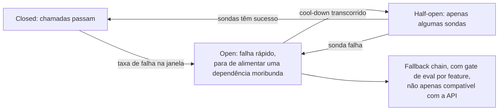

**Follow-ups:** Um stream morre no token 400 de uma resposta de 600 tokens que o usuário está lendo - percorra exatamente o que acontece. Por que os modelos de fallback precisam de gate de eval em vez de serem apenas compatíveis com a API?

</details>

### 43. O tráfego dobra da noite para o dia e você não consegue mais capacidade de GPU por uma semana. Quais são suas opções de graceful degradation?

<details><summary><b>Resposta</b></summary>

O princípio: **degrade qualidade e features antes da disponibilidade, e degrade primeiro o tráfego menos valioso.** Tenha a escada projetada, com flags e testada sob carga *antes* do incidente.

Aproximadamente em ordem de dor para o usuário:

1. **Desloque trabalho para off-peak/offline**: qualquer coisa não interativa (enrichment, evals, digests) → batch API ou pausada. Frequentemente recupera 20-40% da capacidade instantaneamente porque cargas de background se escondem dentro do tráfego de "produção".
2. **Maximize a agressividade do cache**: aumente os TTLs do prompt-cache, pré-compute respostas populares, afrouxe com cautela os limiares do semantic-cache para tráfego tipo FAQ (observando a hit precision).
3. **Reduza tokens por requisição**: limite `max_tokens` com mais rigor, corte janelas de histórico e contagens de chunks de RAG, reduza as configurações de reasoning-effort, desabilite modos verbosos. Corta compute e footprint de KV - lembre que cada token residente é memória de KV, então o trimming de contexto eleva diretamente a concorrência.
4. **Downshift de modelo**: roteie o tráfego de dificuldade média para um modelo menor/mais barato (já aquecido, já avaliado com evals - é por isso que cascades devem existir antes de você precisar). Os usuários recebem respostas um pouco piores; ainda recebem respostas.
5. **Feature shedding**: desligue nice-to-haves movidos a LLM (sugestões, auto-summaries, prefetch especulativo) via kill switches.
6. **Admission control priorizado**: interativo > background; tiers pagantes > gratuitos; dentro do tier, enfileire com UX honesta (posição/ETA) em vez de timeouts. Load shedding explícito das requisições de menor prioridade com um erro claro vence todo mundo dando timeout.
7. **Burst overflow para um provedor de API** (se a política permitir): o warm pool alugado. Custa dinheiro, salva o SLO.
8. **Último recurso**: waitlist/respostas estáticas para o tier mais baixo - um "estamos na capacidade máxima" honesto preserva a confiança melhor que um spinner travado.

Duas notas operacionais que distinguem respostas sênior: todo degrau precisa de uma **feature flag e um rollback**, exercitados em game days, porque inventar degradação durante um incidente falha; e instrumente os modos degradados separadamente - você precisa saber quanta capacidade cada degrau realmente recuperou, e o produto precisa consentir na escada de qualidade com antecedência, não às 3 da manhã.

**Follow-ups:** Quais destes mudam a pressão de memória de KV vs a pressão de compute? Como você decide a ordem de prioridade entre chat do tier gratuito e jobs de background do tier pago?

</details>

### 44. Como o structured output é realmente imposto na camada de serving, e quanto custa?

<details><summary><b>Resposta</b></summary>

O mecanismo é o **constrained (guided) decoding**: compile o formato alvo - JSON Schema, regex ou uma gramática livre de contexto - em um autômato (FSM para regex/JSON, pushdown para CFGs), e a cada passo de decode **mascare os logits** de todos os tokens que violariam o formato antes do sampling. O modelo só pode emitir continuações válidas, então a saída é sintaticamente válida *por construção* - sem loops de parse-and-retry. É isso que Outlines e XGrammar implementam, o que vLLM/SGLang expõem como guided/structured output, o que as gramáticas GBNF do llama.cpp fazem e o que as APIs hospedadas rodam no servidor: o modo JSON-schema `strict` da OpenAI, os structured outputs e o strict tool use da Anthropic e os response schemas do Gemini. Cada um suporta um subconjunto diferente de JSON Schema, então conheça as garantias exatas do seu provedor.

Sutilezas que mostram profundidade: o mascaramento opera em **tokens, não caracteres** - uma string JSON pode cruzar fronteiras de tokens arbitrariamente, então o autômato precisa ser compilado contra o vocabulário do tokenizer (a precomputação cara que Outlines/XGrammar otimizam); nem todas as features de schema mapeiam limpamente para gramáticas (recursão ilimitada, algumas features de regex, tratamento de `additionalProperties`), então confira o subconjunto suportado.

Custos, em três baldes:

- **Tempo de compilação**: a compilação schema→autômato pode levar um tempo perceptível para schemas complexos - faça cache das gramáticas compiladas indexadas por hash do schema (picos de latência na primeira requisição são o sinal revelador de um cache ausente).
- **Overhead por passo**: calcular a máscara de tokens válidos a cada passo; implementações modernas chegam a um custo quase desprezível, mas as ingênuas fazem gargalo no loop de decode.
- **Imposto de qualidade - o sutil**: forçar o formato pode forçar *comprometimento prematuro*. Se o schema exige `{"answer": ...}` primeiro, o modelo precisa responder antes de raciocinar. Mitigações: coloque um campo de texto livre `reasoning` antes dos campos de resposta constrained, ou rode duas fases (thinking sem restrição → extração constrained). Além disso, enums/patterns apertados demais podem encurralar o modelo em valores confiantemente errados - deixe uma válvula de escape (`"other"`, campos nullable).

Escopo da garantia: o constrained decoding garante **sintaxe, não semântica** - o JSON vai fazer parse; os *valores* ainda podem estar errados. Mantenha a validação em nível de aplicação.

**Vale desenhar.** O loop de mascarar-e-avançar por passo é o mecanismo; desenhá-lo separa "válido por construção" de "tentamos de novo até fazer parse".

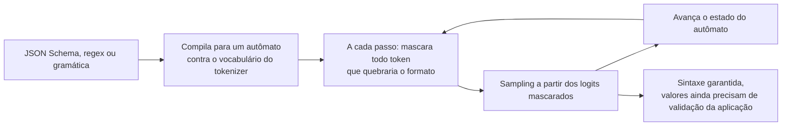

**Follow-ups:** Por que a gramática precisa ser compilada contra o vocabulário do tokenizer? Quando você preferiria parse-and-retry ao constrained decoding?

</details>

### 45. Sua conta de LLM triplicou neste trimestre. Projete um programa de cost engineering - atribuição, cascades, gerenciamento de contexto.

<details><summary><b>Resposta</b></summary>

**Passo 1: atribuição antes da otimização.** Você não conserta o que não vê. Instrumente toda chamada com contagens de tokens de input/output/cached/reasoning × preços atuais, marcadas por feature, tenant, modelo e versão do prompt; faça dashboard de custo por requisição / por feature / por usuário ativo, além de alertas de anomalia na burn rate. Nove em dez vezes a triplicação tem uma causa específica: um agent loop reenviando contextos de 20K tokens sem cache a cada passo, um caminho de retry fora de controle, reasoning-token creep após um upgrade de modelo, ou um tenant B2B entusiasmado. Encontre-a antes de redesenhar qualquer coisa.

**Passo 2: as alavancas mecânicas, em ordem típica de ROI.**

- **Prompt caching**: reestruture os prompts para prefixo-estável-primeiro; no preço estilo Anthropic, leituras em cache custam ~10% do preço de input. Para tráfego de agent/chat, só isso frequentemente corta o gasto de input em 50%+.
- **Batch API** para tudo que é offline: ~50% de desconto com janela de 24 h.
- **Disciplina de saída**: limites de `max_tokens`, formatos concisos, sem repetir o input, reasoning effort ajustado. A saída costuma custar ~4-8× o input, então tokens de saída são onde cortar mais compensa.
- **Gerenciamento de contexto**: sliding-window + sumarização para o histórico, menos/melhores chunks de RAG (precisão de retrieval é uma feature de custo), poda de resultados verbosos de tools em agent loops. Cuidado com o padrão quase quadrático: contexto que cresce a cada turno enquanto é recobrado a cada turno.

**Passo 3: model tiering/cascades.** Roteie por dificuldade prevista: um router barato (heurísticas, classificador pequeno ou confiança baseada em logprob) envia o tráfego fácil a um modelo pequeno e escala os casos difíceis - cascade estilo FrugalGPT: tente o barato, verifique (validadores, self-consistency, judge), escale na falha. Dimensione por feature via evals; muitas features rodam bem em modelos 10-30× mais baratos que a escolha default-para-fronteira. Guard rails: coloque gate de eval em toda mudança de roteamento, monitore a taxa de escalonamento (um cascade que escala 60% do tráfego custa *mais* que ir direto ao grande).

**Passo 4: faça a correção durar.** Custo por feature na revisão semanal, alertas de orçamento por tenant, testes de regressão em contagens de tokens no CI (uma edição de prompt que dobra os tokens deve falhar em uma checagem) e reprecifique trimestralmente conforme modelos/preços mudam.

**Follow-ups:** Como você constrói um difficulty router sem dados rotulados? Um upgrade de modelo melhorou a qualidade mas dobrou os reasoning tokens - como você decide?

</details>

### 46. Aprofunde em speculative decoding: matemática da taxa de aceitação, drafters modernos como Medusa/EAGLE e quando ele sai pela culatra.

<details><summary><b>Resposta</b></summary>

**A matemática.** Seja α a taxa de aceitação por token (token do draft aceito pela checagem de rejection-sampling do alvo). Fazendo draft de k tokens por ciclo, os tokens esperados emitidos por forward pass do alvo são `(1 − α^(k+1)) / (1 − α)` (Leviathan et al.). Com α = 0,8, k = 4: ~3,4 tokens por passada do alvo. O speedup de wall-clock ≈ isso, dividido pelo custo do ciclo `1 + k·c`, onde c é o custo por token do drafter relativo ao alvo - então um drafter precisa ser *tanto* bem alinhado (α alto) *quanto* barato (c baixo). α é empírico e dependente de domínio: alto em código, boilerplate, extração; mais baixo em texto criativo aberto. k maior tem retornos decrescentes (o decaimento α^k desperdiça trabalho de draft após a primeira rejeição), então k é ajustado por workload (~4-8 é típico).

**Drafters modernos.** Modelos pequenos separados precisam de um tokenizer compatível e ainda queimam tempo sequencial fazendo drafting. O self-drafting remove isso: o **Medusa** acopla heads de decoding extras ao alvo para prever vários tokens futuros em uma passada; o **EAGLE** faz autoregressão no *espaço de features* do alvo (reutilizando suas representações da layer de topo), o que obtém aceitação substancialmente melhor que heads em nível de token, verificada sobre uma **árvore** de continuações candidatas em vez de uma única cadeia (tree attention verifica múltiplos ramos em uma passada - elevando o comprimento aceito esperado). O drafting **prompt-lookup/n-gram** recupera spans candidatos do contexto existente - custo zero de modelo, eficácia brutal em tarefas cujas saídas copiam entradas (edição, extração, citações de RAG). Modelos treinados com módulos de **multi-token prediction (MTP)**, sendo o DeepSeek-V3 o exemplo conhecido, trazem seu próprio drafter, que os engines podem usar diretamente sem treinamento separado. Engines como vLLM/SGLang/TensorRT-LLM trazem vários desses.

**Quando sai pela culatra**: (1) serving com batch alto - a verificação consome compute que o decoding regular de outras sequências teria usado; quando a frota é compute-bound, o spec decoding *reduz* o throughput agregado, então é principalmente uma ferramenta de batch baixo/tier de latência; (2) α baixo - overhead de drafting sem nada aceito (domínios descasados, configurações de temperature alta prejudicam); (3) memória - um draft model ou heads extras comem orçamento de KV/pesos que poderia ter sido batch size; (4) complexidade de engenharia - KV caches de dois modelos, corretude da tree verification, interação com o scheduler. Sempre faça A/B em tráfego no formato de produção: meça o ITL *e* o goodput agregado *e* o custo, por domínio.

**Follow-ups:** Por que a temperature afeta as taxas de aceitação? Esboce como a tree verification amortiza uma passada do alvo entre ramos candidatos.

</details>

### 47. O que é prefill/decode disaggregation, e por que deployments em larga escala separam os dois?

<details><summary><b>Resposta</b></summary>

Rodar ambas as fases nas mesmas GPUs cria **interferência**: rajadas de prefill são famintas por compute e travam os decodes co-residentes (picos de ITL); o decode em regime estável é bandwidth-bound e deixa ocioso o compute que os prefills enfileirados querem. O chunked prefill suaviza isso, mas só troca ao longo da mesma curva - um pool precisa satisfazer dois SLOs (TTFT e TPOT) com perfis de recursos anticorrelacionados. A **disaggregation** (DistServe, Mooncake, arquiteturas estilo NVIDIA Dynamo; suportada no vLLM) divide a frota: um **prefill pool** processa prompts e produz KV caches; um **decode pool** recebe o KV e faz streaming dos tokens. O handoff transfere o KV cache da sequência por NVLink/RDMA/IB.

Por que vence em escala:

- **Ajuste independente de SLO**: nodes de prefill otimizam TTFT (rodam saturados de compute, chunks grandes, ninguém para perturbar); nodes de decode otimizam ITL e densidade de batch (estáveis, otimizados para memória). O DistServe mostrou grandes ganhos de goodput sob SLOs duplos apertados versus serving colocated.
- **Escala e hardware independentes**: tráfego pesado em prompts escala o prefill pool; tráfego conversacional de geração longa escala o decode. Os pools podem até usar estratégias de paralelismo ou SKUs de GPU diferentes (otimizado para compute vs otimizado para largura de banda/capacidade de memória) - e a capacidade de prefill pode acumular funções com um store global de prefix-cache (o design KV-centric do Mooncake).
- **Isolamento**: o upload de um documento de 100K tokens não consegue congelar todos os streams da máquina.

Custos e problemas em aberto: a **transferência de KV** é o imposto - centenas de MB a GBs por sequência longa, exigindo interconexão rápida e engenharia de overlap com compute; **complexidade de orquestração** (scheduling em dois estágios, tratamento de falhas no meio do handoff, posicionamento/afinidade de cache para que o reuso de prefixo ainda funcione); piso de latência adicionado pelo hop; e só compensa acima de uma escala em que os tamanhos dos pools possam ser balanceados - um deployment de 4 GPUs deve usar chunked prefill e seguir em frente. Enquadramento de entrevista: chunked prefill = multiplexação no tempo de um pool; disaggregation = particionamento no espaço em dois tiers especializados. Mesma tensão, remédio mais forte, mais partes móveis.

**Vale desenhar.** Dois pools com o handoff de KV desenhado como a aresta torna o imposto explícito em vez de deixá-lo se esconder dentro da arquitetura.

```mermaid
flowchart LR
    R["Requisição"] --> PP["Prefill pool: otimizado para compute,<br/>ajustado para TTFT"]
    PP -->|"KV cache por NVLink, RDMA ou IB"| DP["Decode pool: otimizado para largura de banda,<br/>ajustado para ITL"]
    DP --> S["Tokens em streaming"]
    PP --> SC["Escala com o volume de prompts"]
    DP --> SD["Escala com o volume de geração"]
```

**Follow-ups:** Estime os bytes de KV transferidos para um prompt de 8K tokens em um modelo 70B GQA - essa transferência é um problema em NVLink vs Ethernet? Como a disaggregation interage com o prefix caching?

</details>

### 48. Projete um LLM gateway multi-provedor: roteamento, fallbacks e as armadilhas em que os times caem.

<details><summary><b>Resposta</b></summary>

**Núcleo**: uma API interna (na prática, geralmente compatível com OpenAI mais extensões) com adapters por provedor normalizando formatos de requisição/resposta, formatos de eventos de streaming, convenções de tool calls e taxonomias de erro (o 429 de quem significa o quê). Centralize credenciais, cotas por tenant, logging/medição de custo e redaction de PII no gateway - é o único ponto de estrangulamento onde a governança é aplicável. Build-vs-buy: gateways estilo LiteLLM/OpenRouter ou cloud-native (Bedrock/Vertex fronteando múltiplas famílias de modelos) cobrem o encanamento; você ainda é dono da política de roteamento e dos evals.

Camadas de **roteamento**, de estático a dinâmico: (1) *roteamento por política* - cada feature fixada a um tier de modelo via config, alterável sem deploys; (2) *roteamento por dificuldade* - um classificador/heurística barato envia o tráfego fácil a modelos pequenos, escalando os casos difíceis (cascade com verificação); (3) *roteamento operacional* - seleção ciente de custo/latência/saúde entre backends equivalentes, honrando restrições de residência e tratamento de dados por tenant.

**Fallbacks**: circuit breakers por provedor×modelo; ao abrir, percorra uma fallback chain. A regra não óbvia: **um fallback precisa de gate de eval, não apenas ser compatível com a API**. Prompts não transferem 1:1 entre famílias de modelos - trocar silenciosamente pode colapsar a qualidade enquanto os dashboards ficam verdes. Mantenha scores de eval por backend por feature, e marque as respostas com qual modelo de fato as serviu.

**Armadilhas que realmente mordem**:

- **Divergência de tokenizer**: contagens de tokens (limites, lógica de truncamento, estimativas de custo) diferem por provedor - nunca reutilize as contagens de um tokenizer para o orçamento de outro.
- **Disparidade de features**: garantias de structured output, semântica de tool calls, mecânica de prompt caching, tipos de eventos de streaming, tudo difere; sua abstração deve expor capacidades honestamente em vez de fingir um falso denominador comum.
- **Atualizações silenciosas de modelo**: fixe versões de modelo; trate upgrades do provedor como deploys com execuções de eval.
- **Normalização de streaming**: reemita eventos internos limpos; não vaze formatos do provedor para os clients.
- **Fragmentação de cache**: prompt caches não transferem entre provedores - o failover abre mão dos descontos de cache e dos ganhos de TTFT; leve isso em conta no custo do failover.
- **A armadilha do menor denominador comum**: abstrair demais abre mão das melhores features de cada provedor - o gateway deve rotear e governar, não achatar.

**Vale desenhar.** O caminho da requisição desenhado de ponta a ponta mostra onde a governança é aplicada e onde a decisão de fallback realmente fica.

```mermaid
flowchart LR
    A["Requisição do app"] --> GW["Gateway: auth, cota,<br/>redaction, medição de custo"]
    GW --> RT["Router: política, dificuldade,<br/>saúde e custo"]
    RT --> P1["Modelo primário"]
    P1 -->|"breaker aberto"| P2["Modelo de fallback,<br/>com gate de eval por feature"]
    P1 --> N["Normaliza eventos de stream e erros"]
    P2 --> N
    N --> A
```

**Follow-ups:** Como você roda evals continuamente entre backends sem explodir o custo? Onde o gateway aplica controles de prompt-injection e de data-egress?

</details>

### 49. Você roda 40 réplicas do mesmo modelo atrás de um load balancer, e o round-robin dá uma prefix cache hit rate terrível. Projete a camada de roteamento.

<details><summary><b>Resposta</b></summary>

O KV cache é estado por réplica, então um load balancer stateless joga fora a maior alavanca de custo que você tem. O objetivo é localidade de cache sem destruir o balanceamento de carga, e a tensão entre os dois é o design inteiro.

**Faça a chave da requisição.** Faça hash do prefixo *estável* mais longo, alinhado a blocos do tamanho de bloco do engine, tipicamente o system prompt mais tool definitions mais o histórico da conversa até o último turno. A chave deve incluir versão do modelo, quantization e adapter LoRA, já que o KV não é portável entre eles.

**Roteie por longest prefix match.** Mantenha uma aproximação do lado do router do que cada réplica tem em cache, seja uma radix tree sobre prefixos (a abordagem do router do SGLang) ou consistent hashing sobre os primeiros N blocos, e envie a requisição à réplica com a maior correspondência.

**Nunca roteie só pelo cache.** Pontue os candidatos com algo como `w1 * match_length - w2 * (queue_depth + running)`, ou pegue os poucos melhores candidatos de cache e aplique power-of-two-choices na carga entre eles. Faça overflow para a próxima melhor réplica quando a melhor estiver saturada. Isso é o que transforma um tenant quente de um hotspot em meramente um ponto morno.

**Session affinity é o barato 80%.** Roteamento sticky por id de conversa obtém a maior parte do benefício para chat e agents com uma fração da maquinaria. Seus custos: você precisa de um fallback gracioso quando uma réplica drena ou morre, e ele correlaciona falhas com sessões.

**O estado final escalável** é um tier de KV compartilhado de onde qualquer réplica pode buscar, o que transforma o trabalho do router de "estar certo" em "estar aproximadamente certo", e compõe com a prefill/decode disaggregation, onde o roteamento ciente de prefixo se aplica ao prefill pool.

Armadilhas para levantar sem ser perguntado: a visão do router fica obsoleta quando o engine expulsa blocos, então meça a hit rate *real* reportada pelo engine, não a crença do router. Todo rolling deploy e scale-up reseta caches, então escalone-os e espere um pico de TTFT e custo a cada vez. E meça a hit rate em **tokens**, não em requisições, já que é isso que você paga.

**Vale desenhar.** Colocar o score na página torna concreta a tensão cache-versus-carga, que é o que a pergunta realmente testa.

```mermaid
flowchart TD
    R["Requisição"] --> K["Chave: prefixo estável alinhado a blocos<br/>mais modelo, quant, adapter"]
    K --> M["Radix tree: maior correspondência por réplica"]
    M --> S["Score = w1 x tamanho da correspondência<br/>menos w2 x carga"]
    S -->|"melhor correspondência saturada"| N["Overflow para a próxima melhor"]
    S --> REP["Réplica escolhida"]
    N --> REP
    REP --> V["Confie na hit rate reportada pelo engine<br/>em tokens, não na crença do router"]
```

**Follow-ups:** Como o roteamento ciente de prefixo interage com o autoscaling, e o que isso faz com sua política de scale-up? Que hit rate justificaria um tier de KV compartilhado em vez de sticky sessions simples?

</details>

### 50. Como servir um grande modelo mixture-of-experts esparso difere de servir um modelo dense, e o que o expert parallelism muda?

<details><summary><b>Resposta</b></summary>

O MoE desacopla memória de FLOPs: os parâmetros totais são enormes, mas apenas uma pequena fração é ativada por token. Então o compute por token é barato e a qualidade é alta, mas você precisa guardar todo expert em algum lugar, e o roteamento depende dos dados. Essa combinação reescreve o playbook de serving.

**Escolha de paralelismo.** Os pesos não cabem em uma GPU. Você pode fazer tensor-parallel dos experts (toda GPU guarda uma fatia de cada expert), ou usar **expert parallelism**: cada GPU guarda experts inteiros, e os tokens são enviados à GPU certa com dispatch e combine all-to-all (é isso que kernels estilo DeepEP otimizam). O EP mantém o GEMM de cada expert inteiro e grande, o que é eficiente, e reduz a memória de pesos por GPU, mas coloca dois all-to-alls por layer MoE no caminho crítico de cada token.

**O batch size deixa de ser opcional.** O custo do all-to-all se amortiza sobre os tokens, e cada expert precisa de tokens suficientes para que seu GEMM valha a pena. Em QPS baixo você paga por toda essa memória e interconexão e obtém latência de dense sem nada do throughput. Um MoE esparso com tráfego baixo é um mau negócio, e esse é o ponto que a maioria dos candidatos perde.

**O desbalanceamento de carga é o problema definidor.** O roteamento depende dos dados, então alguns experts ficam quentes. A GPU mais lenta define o tempo do passo e todos esperam na barreira do all-to-all, então o desbalanceamento aparece como latência, não como uma lentidão parcial. Mitigações: replicar experts quentes, rebalancear periodicamente o posicionamento dos experts a partir de estatísticas de roteamento observadas (o EPLB do DeepSeek é o exemplo público) e rodar batches maiores para que o roteamento se equalize na média.

**Prefill e decode querem paralelismo diferente.** O prefill é compute-bound e naturalmente batchy; o decode é limitado pela latência do all-to-all. Querer graus de EP diferentes de cada lado é um dos argumentos mais fortes para a prefill/decode disaggregation, que é exatamente o formato dos deployments MoE de larga escala publicados.

**Re-derive seu modelo de memória.** A attention estilo MLA torna o KV por token pequeno, então o KV deixa de ser o que limita o batch size e os pesos dos experts mais a comunicação passam a ser a restrição. Não carregue as intuições do modelo dense.

**Vale desenhar.** Dois all-to-alls no caminho crítico e um expert quente na barreira explicam o piso de latência e o problema de desbalanceamento de uma só vez.

```mermaid
flowchart LR
    T["Batch de tokens"] --> G["Router escolhe os top-k experts por token"]
    G -->|"dispatch all-to-all"| E1["GPU 1: experts 0-15"]
    G -->|"dispatch all-to-all"| E2["GPU 2: experts 16-31"]
    E1 -->|"combine all-to-all"| C["Combine, depois próxima layer"]
    E2 -->|"combine all-to-all"| C
    E1 --> HOT["Um expert quente define o tempo do passo<br/>para todos na barreira"]
```

**Follow-ups:** Por que tráfego baixo prejudica mais um deployment MoE do que um dense de qualidade similar? Como você detectaria e quantificaria o desbalanceamento de experts em produção?

</details>

### 51. Você roda uma plataforma de LLM compartilhada para 30 times internos em uma só frota de GPUs. Projete o modelo de tenancy: fairness, isolamento e atribuição de custo.

<details><summary><b>Resposta</b></summary>

**Fairness primeiro, e na unidade certa.** O continuous batching é efetivamente first-come-first-served sobre tokens, então um tenant que dispara 10K requisições deixa todos os outros famintos sem erro e sem sinal. Você precisa de admission control no gateway mais fair scheduling no engine. A unidade deve ser *trabalho*, não requisições: token buckets por tenant em tokens por segundo, com tokens de saída ponderados mais alto que os de input. Cotas de requisições por segundo são o erro clássico, porque um prompt de 200K tokens vale milhares de turnos de chat. No scheduler, prefira o tenant que consumiu menos serviço recentemente (uma fair queue estilo virtual-token-counter) em vez da pura ordem de chegada.

**Isolamento é uma escada, escolha um degrau por tenant.** Engine compartilhado é o mais barato e o mais fraco. Pools separados por classe de tráfego é o sweet spot: quase toda organização precisa exatamente de dois, interativo (SLO de latência, folga, prioridade) e background/batch (preemptível, sem SLO, preenche o vale). Essa divisão também é o truque de capacidade mais barato disponível. Frotas dedicadas apenas para os tenants com requisitos genuínos de compliance.

**Atribuição.** Registre por requisição: tenant, modelo, contagens de tokens de input/output/reasoning/cached e GPU-segundos medidos. Cobre em tokens por legibilidade, mas reconcilie com GPU-segundos, porque divergem muito. Um tenant com 90% de prefix cache hits é quase de graça; um tenant com prompts únicos de 50K tokens paga prefill de verdade. Depois decida explicitamente o que acontece com o custo não atribuível (folga ociosa, warm pools, requisições falhas), porque senão seu chargeback nunca soma com a fatura. Cobre como uma taxa de overhead ou absorva centralmente, mas decida.

**Guardrails**: limites de contexto e max_tokens por tenant, circuit breakers por tenant e alertas de gasto na burn rate em vez de totais de fim de mês.

**Os failure modes sutis**: vizinhos barulhentos agem pelo KV, não só pelo compute, então um tenant de contexto longo expulsa os blocos de todos e dispara cascatas de preemption. Acompanhe a taxa de preemption por tenant. E um prefix cache compartilhado é um canal de timing entre tenants: um TTFT rápido revela que alguém enviou recentemente aquele prefixo. Se os tenants são mutuamente não confiáveis, coloque as chaves de cache em namespaces por tenant e aceite a perda de hit rate.

**Follow-ups:** Por que cotas de requisições por segundo são a unidade errada, e o que você usaria no lugar? Como você precifica o chargeback interno quando 60% dos tokens de input de um tenant são cache hits?

</details>

### 52. Seu tráfego está migrando de chat single-turn para agents: 20 a 50 chamadas de modelo por tarefa, tool calls no meio, sessões durando dezenas de minutos. O que isso faz com seu design de serving?

<details><summary><b>Resposta</b></summary>

Muda aquilo que você está otimizando, de latência por token para tempo de conclusão da tarefa e custo por tarefa.

**O reuso de prefixo deixa de ser uma otimização e vira a economia.** Cada passo reenvia a trajetória inteira, então os tokens de input cumulativos crescem aproximadamente de forma quadrática com o número de passos. Sem prefix caching você refaz o prefill do histórico inteiro a cada passo; com ele você faz prefill apenas do delta. Isso torna a disciplina de contexto uma preocupação de serving: histórico append-only, nunca reordenar ou editar turnos anteriores, tool definitions estáveis e nada volátil perto do início do prompt. Combine com cache-aware routing ou session affinity, senão o cache existe mas ninguém o acerta.

**Lacunas ociosas.** Tool calls levam de ~100 ms a segundos, durante os quais o KV da sessão fica lá sem render nada. Retê-lo (pressão de memória, menos sessões concorrentes) ou descartá-lo (re-prefill na volta)? Este é o lar natural de um tier de KV offload: expulse para a memória do host em uma fronteira de tool call, recarregue na volta, o que é barato porque a largura de banda do host excede enormemente o throughput de prefill.

**Queueing mais em rajadas.** Sub-agents se espalham em paralelo e depois ficam quietos, então as chegadas são correlacionadas em vez de Poisson. Seu P99 será pior do que a aritmética de taxa média prevê, e uma capacidade dimensionada em QPS médio vai falhar.

**Orçamento de latência por passo.** Trinta passos de dois segundos são um minuto. Isso é aceitável se você faz streaming do progresso, mas o SLO que você defende é o tempo de conclusão da tarefa, e a divisão de métricas de que você precisa é latência do modelo versus latência das tools, porque frequentemente são as tools.

**Ciclo de vida.** Um usuário cancelando uma tarefa deve matar gerações em andamento e tool calls pendentes; tarefas longas precisam de execução durável no servidor em vez de viver em uma conexão HTTP. Agents em background devem ser preemptíveis e preencher o vale do pool interativo, em uma classe de prioridade separada, ou um job em batch vai destruir o P99 do chat.

**Guardrails.** Limite passos e total de tokens por tarefa. Um agent loop sem orçamento é um incidente de custo ilimitado esperando uma terça-feira ruim.

Métricas: tokens por tarefa, cache hit rate por passo, divisão de latência modelo vs tool, passos até a conclusão, taxa de sucesso das tarefas.

**Follow-ups:** Por que o crescimento de tokens de input em um agent loop é aproximadamente quadrático em passos, e o que você mudaria para achatá-lo? Faça o argumento a favor e contra manter o KV da sessão residente durante uma tool call de 5 segundos.

</details>

### 53. Após um deploy de rotina, o P99 de TTFT foi de ~600 ms para ~4 s. Throughput, taxa de erro, utilização de GPU e a versão do modelo estão todos inalterados. Faça o debug.

<details><summary><b>Resposta</b></summary>

Rollback primeiro, debug depois: um P99 de TTFT de 4 s é um incidente visível ao usuário, e o deploy é o suspeito óbvio.

Depois a decomposição. TTFT = espera na fila + prefill. Throughput inalterado com TTFT pior significa que não estamos simplesmente sobrecarregados: ou cada requisição está fazendo prefill de mais tokens, ou o scheduler as está admitindo mais tarde. Então a primeira coisa que quero é esses dois componentes instrumentados separadamente, porque esse número isolado divide ao meio todo o espaço de busca.

**Se o tempo de fila cresceu**, é scheduling e admissão. Candidatos: `max_num_seqs` ou o orçamento de tokens do batch mudou; o chunked prefill foi desabilitado ou seu limiar se moveu, então um prefill longo agora trava a fila; a taxa de preemption subiu por pressão de KV, então as requisições são expulsas e reenfileiradas; a contagem de réplicas caiu por uma mudança de config do autoscaler ou um rollout ainda drenando; uma nova regra de prioridade ou roteamento.

**Se o tempo de prefill cresceu**, estamos fazendo prefill de mais tokens, e o principal suspeito é o colapso da prefix cache hit rate. Verifique a hit rate medida em tokens. Se foi de ~80% para perto de zero, alguém colocou algo volátil no início do prompt: um timestamp, um request id, um nome de usuário, uma lista de tools embaralhada, um bloco de RAG reordenado. Tudo depois do ponto de mudança é um miss. O mesmo sintoma vem de uma mudança de roteamento que perdeu a cache affinity, de um bump de adapter ou quantization (as chaves de cache os incluem), ou simplesmente de um rolling restart que resetou todos os caches, e esse se recupera, então verifique se o gráfico está plano ou voltando a subir.

Outros fatores de crescimento do prefill: um template de prompt mais longo, RAG retornando mais chunks, uma mudança de chat-template ou tokenizer, ou um novo tenant enviando prompts de 100K tokens para a fila compartilhada.

**Por que "utilização de GPU inalterada" não prova nada:** a utilização conta SMs ocupados, e tanto um decode faminto de largura de banda quanto um prefill compute-bound aparecem como ocupados.

**Método:** faça o diff do deploy incluindo config e templates de prompt, não só o código do modelo; quebre o P99 por tenant, rota e faixa de tamanho de prompt, já que uma regressão agregada geralmente é um segmento; reproduza o tráfego de ontem contra ambas as configurações.

O movimento errado e tentador é adicionar réplicas. Isso esconde uma regressão de cache a várias vezes o custo.

**Vale desenhar.** Desenhar o bisect primeiro mostra que você faz debug dividindo a métrica, não adivinhando causas em uma lista.

```mermaid
flowchart TD
    T["P99 TTFT: 600 ms para 4 s"] --> RB["Rollback, depois debug"]
    RB --> S["Divide o TTFT em espera na fila<br/>versus tempo de prefill"]
    S -->|"fila cresceu"| Q["Scheduling: orçamento de tokens, chunked prefill desligado,<br/>preemptions, contagem de réplicas, regra de roteamento"]
    S -->|"prefill cresceu"| P["Checar prefix cache hit rate, medida em tokens"]
    P -->|"colapsou"| V["Bytes voláteis no início, cache affinity perdida,<br/>bump de adapter ou quantization"]
    P -->|"estável"| L["Mais tokens: mudança de template, mais chunks de RAG,<br/>um novo tenant de prompts longos"]
```

**Follow-ups:** Como você alertaria sobre a prefix cache hit rate sem acordar alguém a cada deploy? Que checagem em tempo de deploy pegaria uma mudança no prefixo do prompt antes de ir para produção?

</details>

### 54. Você está migrando de um transformer dense para um híbrido Mamba-attention. O que muda no seu serving stack?

<details><summary><b>Resposta</b></summary>

Versão curta: o modelo fica muito mais barato em contexto longo, e seu gerenciador de cache fica muito mais difícil. A memória deixa de crescer com o contexto, e o prefix caching deixa de ser de graça.

**As layers não compartilham mais um formato de cache.** Em um transformer dense toda layer armazena o mesmo KV por token, então um pool uniforme de blocos funciona. Um híbrido mistura layers de full-attention, que anexam KV por token, com layers Mamba ou linear-attention, que guardam um estado recorrente de tamanho fixo atualizado in place. Os engines lidam com isso com um alocador unificado sobre estado heterogêneo por layer: o vLLM agrupa layers por tipo e força um page size único entre os grupos, o que na prática significa aumentar o block size da attention até que uma página de attention seja pelo menos tão grande quanto uma página Mamba. Isso produz block sizes de attention na casa das centenas de tokens em vez de 16.

**O prefix caching é onde dói.** Um bloco de KV é endereçável por token, então você pode fazer match, compartilhar e fazer rollback em granularidade de token. Um estado recorrente é um vetor que resume tudo visto até então: você não consegue fatiá-lo nem aparar os últimos 30 tokens, apenas fazer snapshot em fronteiras escolhidas e reproduzir adiante. Então o reuso vira checkpointing explícito de estado, com uma escolha de modo trocando memória do pool por hit rate, e o suporte dos engines a isso ainda está amadurecendo.

A armadilha decorre do block size. O matching é em granularidade de bloco, então um prompt menor que um bloco tem zero blocos completos e obtém aproximadamente 0% de hit rate, enquanto um prompt logo além da fronteira do bloco pode ter hit quase total. O tráfego de chat com prompts curtos despenca sem causa óbvia.

**A memória inverte.** O KV deixa de crescer linearmente com o contexto na maioria das layers, então seu teto não é mais KV-por-token vezes contexto vezes batch. A concorrência é limitada por um estado por sequência quase plano, da ordem de megabytes em híbridos de tamanho médio. Refaça o orçamento de memória e a aritmética de dimensionamento da frota das perguntas de capacity em vez de carregar a fórmula antiga.

**Tudo que move cache precisa mover estado.** A prefill/decode disaggregation e o KV offload agora transferem estado recorrente além de blocos. Observe também a latência com baixa concorrência: os kernels Mamba tipicamente são em Triton, então a cobertura de CUDA graphs importa mais do que em um modelo dense.

**Vale desenhar.** Mostra como uma restrição do alocador vira um precipício de cache para prompts curtos.

```mermaid
flowchart TD
    M["Modelo híbrido: algumas layers de attention,<br/>maioria Mamba ou lineares"] --> A["Layer de attention: blocos de KV,<br/>endereçáveis por token, fatiáveis"]
    M --> S["Layer Mamba: estado de tamanho fixo,<br/>atualizado in place, não fatiável"]
    A --> U["Alocador unificado, um page size<br/>para todos os grupos de layers"]
    S --> U
    U --> B["Block size da attention elevado para casar<br/>com a página Mamba, centenas de tokens"]
    B --> H["Prompt menor que um bloco:<br/>nenhum bloco completo, 0% de cache hit"]
    S --> C["Reuso exige checkpoints explícitos de estado<br/>mais replay adiante"]
```

**Follow-ups:** Por que você não consegue fazer rollback de um estado Mamba em 30 tokens como consegue descartar blocos de KV, e o que isso custa a um agent que edita seu próprio histórico? Seu deployment híbrido reporta 0% de prefix cache hit rate em tráfego de chat mas 90% em tráfego de RAG. O que você checa primeiro?

</details>

### 55. O produto quer oferecer uma context window de 1M tokens em um modelo que você faz self-host. O que quebra no serving, e como você faz funcionar?

<details><summary><b>Resposta</b></summary>

Três coisas quebram de uma vez: o KV cache de uma requisição excede uma GPU, o prefill leva tempo suficiente para ser um problema de produto por si só, e uma única requisição assim pode deixar todos os outros da máquina famintos. Dimensione antes de concordar.

**Memória.** Com o formato 70B GQA usado antes (~320 KB por token em FP16), 1M tokens são ~330 GB de KV para uma sequência, a HBM de várias GPUs. FP8 KV corta isso pela metade. Arquiteturas com MLA, layers sliding-window ou layers híbridas de linear-attention cortam muito mais, e é por isso que modelos de contexto longo são construídos assim. De qualquer forma, uma requisição de 1M precisa de sua própria classe de capacidade.

**Prefill.** Os FLOPs de attention crescem quadraticamente, então com 1M tokens a attention domina o trabalho das layers lineares, e em uma GPU o prefill levaria dezenas de minutos mesmo que a memória permitisse. A correção é **context parallelism**: dividir a sequência entre GPUs, cada uma guardando uma fatia de Q, K e V, e passar blocos de KV em anel (ring attention) ou fazer gather deles, sobrepondo comunicação com compute. O tempo de prefill cai aproximadamente com a contagem de GPUs, e o KV cache acaba dividido entre dispositivos.

**Decode.** Cada passo lê o KV cache inteiro, e essa leitura não se amortiza pelo batch como os pesos, então a latência por token sobe com o contexto. Mantenha o KV dividido: cada GPU computa attention parcial sobre sua fatia, e um pequeno combine mescla os softmaxes parciais.

**Scheduling.** Roteie requisições longas para um pool dedicado para que um prefill de vários minutos nunca compartilhe fila com chat. O admission control deve reservar o KV da requisição inteira de antemão, senão ela sofre preempt no meio e é recomputada, a preemption mais cara que existe.

**Economia e qualidade.** O prefix caching é o que a torna acessível: os usuários fazem muitas perguntas sobre o mesmo corpus, então o prefill de 1M é pago uma vez e reutilizado, idealmente a partir de um tier de offload. Precifique contexto longo separadamente, como alguns provedores fazem acima de um limiar. E rode evals de contexto longo primeiro, porque muitos modelos degradam bem antes do limite anunciado.

**Vale desenhar.** Mostra a requisição longa seguindo seu próprio caminho da admissão ao reuso, que é o núcleo do design.

```mermaid
flowchart TD
    R["Requisição de 1M tokens"] --> A["Admissão: reserva todo o KV<br/>antes de aceitar"]
    A --> L["Pool dedicado de contexto longo"]
    L --> CP["Prefill com context-parallel,<br/>sequência dividida entre GPUs"]
    CP -->|"blocos de KV passados em anel"| KV["KV cache dividido,<br/>FP8 para cortar pela metade"]
    KV --> D["Decode: attention parcial por GPU,<br/>depois um combine"]
    KV --> PC["Prefix cache ou tier de offload<br/>para a próxima pergunta"]
```

**Follow-ups:** Por que o context parallelism ajuda o prefill muito mais do que ajuda o decode? Um cliente envia um documento diferente de 900K tokens a cada requisição: como isso muda sua precificação e seu plano de capacidade?

</details>

### 56. O que muda no seu design de serving quando o domínio NVLink cresce de 8 GPUs em um servidor para 72 GPUs em um rack, como em sistemas classe GB200 NVL72?

<details><summary><b>Resposta</b></summary>

A fronteira entre "interconexão rápida" e "rede lenta" se move do servidor para o rack, e isso muda quais planos de paralelismo são viáveis. Em um servidor de 8 GPUs a regra era tensor parallelism dentro da caixa e tudo que cruzasse caixas por InfiniBand ou Ethernet, aproximadamente uma ordem de grandeza mais lento. Em um domínio NVLink de 72 GPUs como o GB200 NVL72, toda GPU alcança todas as outras por switches NVLink a ~1,8 TB/s por GPU.

O que isso destrava:

- **Expert parallelism amplo.** O dispatch e combine all-to-all que dominam o decode de MoE grande eram dolorosos entre nodes. Dentro de um domínio NVLink você pode espalhar experts por dezenas de GPUs, de modo que cada GPU guarda poucos experts, a maior parte da sua HBM vai para o KV cache e o batch por GPU cresce. Os deployments MoE grandes publicados nesses racks se apoiam exatamente nisso.
- **Instâncias maiores sem pipeline parallelism.** Um modelo grande demais para 8 GPUs não precisa mais de estágios de pipeline por um link lento, então você evita bubbles e a latência de hop entre estágios.
- **Movimentação barata de KV.** O handoff de prefill/decode e tiers de KV compartilhados dentro do rack movem bytes à velocidade do NVLink, o que reduz o imposto da disaggregation.

O que isso custa:

- **Blast radius.** Uma instância de serving pode abranger a maior parte de um rack, então uma única falha de GPU ou de link pode derrubar uma réplica grande. Health checking, failover e planejamento de capacidade de reserva passam do pensamento por GPU para o pensamento por rack.
- **Granularidade grossa.** Menos réplicas, maiores, significam autoscaling mais irregular e um negócio pior com tráfego baixo, a mesma armadilha de QPS baixo do MoE em geral.
- **O software precisa conhecer a topologia.** Você precisa de kernels all-to-all construídos para o domínio, posicionamento de experts ciente da topologia e orquestração ciente do rack, como NVIDIA Dynamo ou llm-d. Um stack ajustado para nodes de 8 GPUs deixa a maior parte do benefício sem uso.
- **Instalações.** Refrigeração líquida e densidade de potência do rack decidem onde você realmente consegue essa capacidade.

O ponto de entrevista: a topologia decide o plano de paralelismo. Re-derive TP, EP e as divisões prefill/decode a partir do novo tamanho de domínio em vez de portar o plano de 8 GPUs.

**Vale desenhar.** Contrasta onde fica o link lento em cada topologia, o que orienta cada escolha subsequente.

```mermaid
flowchart LR
    S["Servidor de 8 GPUs"] -->|"NVLink dentro da caixa"| TP["Tensor parallel dentro de 8"]
    S -->|"InfiniBand ou Ethernet entre caixas"| PP["Estágios de pipeline ou EP estreito,<br/>all-to-all lento"]
    R["Rack NVLink de 72 GPUs"] -->|"NVLink por todo o rack"| WEP["Expert parallelism amplo,<br/>all-to-all rápido"]
    WEP --> KV["Maior parte da HBM liberada para KV cache"]
    R --> BR["Blast radius maior,<br/>unidades de scaling mais grossas"]
```

**Follow-ups:** Por que o expert parallelism amplo libera HBM para o KV cache, e como isso muda o batch size alcançável? Uma única bandeja de switch NVLink falha no rack: o que acontece com sua instância de serving, e como você projeta para isso?

</details>
