# Inference, Serving & Production LLM Systems - Perguntas de Entrevista

> 🇧🇷 Tradução em português do Brasil. Versão original em inglês: [questions.md](questions.md).

56 perguntas: 14 básicas, 22 intermediárias, 20 avançadas.

> **Sobre os diagramas: desenhar é opcional.** Algumas respostas trazem um pequeno esboço que você
> poderia reproduzir num quadro branco ou num documento compartilhado. Você nunca precisa desenhar nada para ir bem,
> e uma resposta falada com clareza se sustenta sozinha. Mas, em perguntas de arquitetura, pipeline e system design,
> esboçar enquanto fala mantém o entrevistador acompanhando você e mostra que você sabe estruturar
> um problema. Veja os diagramas como um bônus, não como lição de casa.

## Básico

### 1. Me explique o que acontece dentro do servidor quando um LLM processa uma requisição. Por que prefill e decode têm gargalos diferentes?

<details><summary><b>Resposta</b></summary>

São duas fases. No **prefill**, o prompt inteiro passa pelo modelo num único forward pass: todos os tokens do prompt são processados em paralelo, então o trabalho se resume a grandes multiplicações matriz-matriz. Isso dá uma arithmetic intensity alta, e a GPU fica **compute-bound**. O prefill produz o primeiro token de saída e popula o KV cache, e é a sua duração que domina o time-to-first-token. No **decode**, os tokens de saída são gerados um de cada vez. A cada passo, o modelo faz um forward pass para um *único* token (multiplicações matriz-vetor), mas ainda precisa ler **todos os pesos do modelo (mais o KV cache) da HBM** para produzir esse token. São pouquíssimos FLOPs por byte movido, então o decode é **memory-bandwidth-bound**: a GPU gasta o tempo lendo pesos, não calculando.

Uma consequência concreta: um modelo de 70B em FP16 tem ~140 GB de pesos. Numa GPU com ~3,35 TB/s de largura de banda de HBM, o decode com batch 1 não passa de aproximadamente 3350/140 ≈ ~24 tokens/s, não importa o compute. O limite vem das leituras de memória.

Essa assimetria orienta praticamente todo o design de serving:

- **Batching** ajuda enormemente o decode (uma leitura de pesos atende o batch inteiro), mas quase não ajuda o prefill (que já satura o compute).
- **Weight quantization** acelera mais o decode (menos bytes para ler) do que o prefill.
- **TTFT e TPOT são SLOs diferentes**, com alavancas diferentes: o TTFT depende de queueing + tamanho do prompt; o TPOT depende de largura de banda e contenção no batch.
- Misturar as duas fases nas mesmas GPUs gera interferência (prefills longos travam o decode de todo mundo). É por isso que existem o chunked prefill e a prefill/decode disaggregation.

**Vale desenhar.** O desenho põe os dois gargalos numa só figura e mostra ao entrevistador que você sabe qual fase passa fome de compute e qual passa fome de largura de banda.

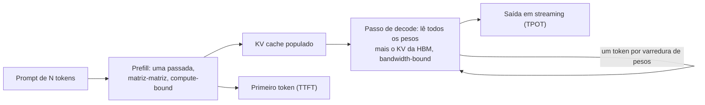

**Follow-ups:** Por que adicionar mais compute (uma GPU mais rápida, com a mesma largura de banda) não acelera o decode com batch 1? Em que batch size, aproximadamente, o decode passa a ser compute-bound? Como você aceleraria especificamente o TTFT?

</details>

### 2. O que é o KV cache, por que ele é necessário e quão grande ele fica? Faça uma estimativa para um modelo classe 70B com 128K de contexto.

<details><summary><b>Resposta</b></summary>

A cada passo de decode, a query do novo token faz attention sobre as keys e values de *todos* os tokens anteriores. Sem cache, você recalcularia as projeções K/V de cada token passado a cada passo, o que é trabalho redundante O(n²) por sequência gerada. O KV cache guarda os vetores K e V de cada layer para cada token processado, e assim cada passo de decode fica incremental. É isso que torna a geração autoregressiva viável em termos de compute. O preço é a memória.

Fórmula do tamanho:

```
KV bytes/token = 2 (K e V) × n_layers × n_kv_heads × head_dim × bytes_per_elem
```

Exemplo resolvido, no formato do Llama-3-70B: 80 layers, 8 KV heads (GQA), head_dim 128, FP16:

```
2 × 80 × 8 × 128 × 2  ≈ 320 KB por token
contexto de 8K   → ~2,6 GB por sequência
contexto de 128K → ~41 GB por sequência
```

Repare que isso já é *com* GQA. Com multi-head attention completa (64 KV heads), seria 8× maior, e é exatamente por isso que GQA/MQA/MLA existem.

Por que isso importa na operação: numa GPU de 80 GB, depois de ~40 GB de pesos de 4 bits, o KV cache é o orçamento que determina **quantas sequências você consegue atender ao mesmo tempo**, ou seja, o seu batch size e, portanto, o seu throughput. Uma única requisição de 128K de contexto pode tomar o espaço de cache de dezenas de usuários de contexto curto. Mitigações: menos KV heads (arquitetura), quantização do KV cache (FP8 corta pela metade), alocação paginada (PagedAttention, para acabar com o desperdício por fragmentação), prefix sharing e sliding-window attention em algumas layers.

**Follow-ups:** Por que o GQA reduz o KV cache, mas não reduz de forma significativa a contagem de pesos? O que acontece no vLLM quando o KV cache enche no meio de uma geração? Como a conta mudaria para um modelo mixture-of-experts?

</details>

### 3. Defina TTFT, TPOT e tokens/sec. O que determina cada um e quais são metas razoáveis para um produto de chat?

<details><summary><b>Resposta</b></summary>

- **TTFT (time to first token)**: da chegada da requisição até o primeiro token gerado. Depende da espera na fila + o tempo de prefill, então cresce com o tamanho do prompt e com a carga do sistema. É a métrica do "está respondendo rápido?".
- **TPOT (time per output token)**, também chamado de inter-token latency (ITL): o intervalo médio entre os tokens seguintes durante o decode. Depende de largura de banda de memória, tamanho do modelo, contenção no batch e interferência dos prefills de outras requisições. É a métrica do "o stream parece fluido?".
- **Tokens/sec** tem dois sentidos que as pessoas misturam: a *velocidade de decode por requisição* (≈ 1/TPOT) e o *throughput agregado do sistema* (todos os tokens de todas as requisições, que é o número de capacidade e de custo). Um sistema pode ter ótimo throughput agregado e péssima velocidade por requisição ao mesmo tempo.

Latência total da requisição ≈ `TTFT + TPOT × output_tokens`. Vale guardar essa fórmula: numa resposta de 500 tokens, reduzir o TPOT de 50 ms para 30 ms economiza 10 s, muito mais do que qualquer otimização de TTFT. Já numa classificação de 20 tokens, o TTFT domina.

Metas razoáveis para chat (ordem de grandeza, variam conforme o produto): P50 de TTFT de algumas centenas de ms, P99 abaixo de ~1-2 s; taxa de streaming bem acima da velocidade de leitura. As pessoas leem a cerca de 5 palavras/s, então ~15-30+ tokens/s por requisição parece fluido, e 50+ parece instantâneo. Features no estilo autocomplete são diferentes: saídas minúsculas e orçamento de latência total de algumas centenas de ms. Workflows agentic longos se importam mais com o tempo de conclusão agregado e com o custo do que com o ITL.

Sempre reporte percentis (P50/P95/P99) por métrica, segmentados por faixa de tamanho de prompt. Médias escondem justamente as falhas que os usuários percebem.

**Vale desenhar.** Uma cascata de latência mostra de qual termo cada métrica é dona e evita que a conversa vire "latency" como um número difuso.

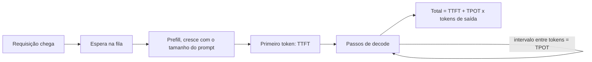

**Follow-ups:** O P99 do seu TTFT dobrou, mas o P50 está estável: quais são as suas principais hipóteses? Qual métrica o speculative decoding melhora, e qual ele pode piorar?

</details>

### 4. Por que produtos com LLM fazem streaming das respostas, e como o streaming funciona de fato sobre HTTP?

<details><summary><b>Resposta</b></summary>

Porque a latência percebida é dominada pelo *tempo até a primeira saída visível*, não pelo tempo total. Uma resposta de 600 tokens a 30 tokens/s leva ~20 s para terminar. Como spinner em branco, isso é inaceitável; como um stream que começa em 400 ms, é perfeitamente tranquilo. O streaming faz a latência percebida pelo usuário passar de `TTFT + TPOT × N` para aproximadamente `TTFT`. Ele também permite cancelamento antecipado (o usuário interrompe uma geração ruim e você para de pagar por tokens de saída) e processamento downstream progressivo.

Como funciona: o transporte padrão é o **Server-Sent Events (SSE)**, uma resposta HTTP comum com `Content-Type: text/event-stream` que o servidor mantém aberta, escrevendo eventos incrementais:

```
data: {"delta": {"text": "The"}}

data: {"delta": {"text": " answer"}}

data: [DONE]
```

Cada evento é uma linha `data:` terminada por uma linha em branco, e os clients fazem o parsing dos eventos conforme eles chegam. O Chat Completions da OpenAI faz streaming de deltas de tokens e termina com um sentinela `[DONE]`. A Messages API da Anthropic e a Responses API, mais nova, da OpenAI fazem streaming de eventos nomeados e tipados (por exemplo `message_start`, `content_block_delta` e `message_stop` na Anthropic; `response.output_text.delta` na OpenAI). WebSockets são uma alternativa quando você precisa de tráfego bidirecional (p. ex., voz), mas o SSE é mais simples e se dá melhor com proxies em streams de tokens de mão única.

Gotchas de produção que valem ser citados: proxies e load balancers intermediários fazendo buffering das respostas (é preciso desabilitar o buffering e ficar de olho nos idle timeouts); tratamento de reconexões (a maioria das APIs de LLM não consegue retomar um stream, e um retry reinicia a geração, então o client precisa lidar com a substituição); heartbeats/keep-alives durante pausas longas de tool-use; e o fato de que a contabilidade de uso/custo normalmente chega no evento final, então o código de billing não pode presumir que ela existe se o stream for abortado. Tool calls e JSON chegam em fragmentos parciais e precisam ser acumulados antes de poderem ser parseados.

**Follow-ups:** Como você projetaria o comportamento de retry para um stream que morre no token 400 de 600? O que quebra quando você coloca uma CDN ou um proxy ingênuo na frente de SSE?

</details>

### 5. Como você estima se um modelo cabe em uma determinada GPU? Um modelo de 70B cabe numa placa de 80 GB?

<details><summary><b>Resposta</b></summary>

Comece com `pesos = params × bytes/param` e depois some o KV cache e o overhead de runtime:

```
FP32: 4 B/param   FP16/BF16: 2   INT8/FP8: 1   INT4: ~0,5-0,6 (incl. scales)
```

Modelo de 70B: em FP16, são ~140 GB, e ele **não** cabe numa GPU de 80 GB; você precisaria de 2 GPUs com tensor parallelism. Em FP8/INT8, são ~70 GB: tecnicamente cabe, mas sobra quase nada para o KV cache, então na prática não dá para servir numa placa só. Em INT4, são ~35-40 GB, cabe com folga e deixa ~30+ GB para KV cache e buffers. Por isso, "70B numa única GPU de 80 GB" quase sempre significa 4 bits.

O orçamento completo é:

```
total ≈ pesos
      + KV cache (bytes/token × total de tokens em cache em todas as sequências)
      + activations e workspace buffers (dependem de batch e seqlen, ~GBs)
      + CUDA context / overhead do framework (~1-2 GB)
```

Para inference você *não* precisa de optimizer states nem de gradientes. Isso é assunto de training (onde o multiplicador é ~16+ bytes/param no full fine-tuning). Uma pegadinha comum de entrevista é esquecer o KV cache: um modelo que "cabe" com 2 GB de sobra atende um batch size de ~zero. Os frameworks de serving deixam isso explícito: o vLLM pré-aloca uma fração da memória da GPU (`gpu_memory_utilization`, padrão ~0,9) e dedica tudo o que sobra depois dos pesos ao pool paginado de KV.

Vale ter na ponta da língua a intuição para modelos pequenos: 8B em FP16 ≈ 16 GB (cabe numa placa consumer de 24 GB); 8B em INT4 ≈ ~4,5 GB (roda num laptop); 1-3B em INT4 rodam em celulares.

**Follow-ups:** Quanta memória o KV cache acrescenta se você atende 32 sequências concorrentes de 8K de contexto nesse 70B? Por que você ainda poderia escolher 2×GPU FP8 em vez de 1×GPU INT4?

</details>

### 6. Por que tokens de saída custam mais que tokens de input, e como isso deve moldar a forma como você constrói?

<details><summary><b>Resposta</b></summary>

Porque custam mais para o provedor produzir. Os tokens de input são processados em paralelo durante o prefill: uma única passada eficiente em compute, diluída pelo prompt inteiro. Cada token de saída exige o seu próprio forward pass sequencial completo pelo modelo, monopolizando a largura de banda de memória, e gerações longas ocupam memória de KV cache (e um slot de batch) durante todo o tempo que duram. Os provedores precificam de acordo: tokens de saída costumam custar ~4-8× os de input nas listas de preços de OpenAI, Anthropic e Google (confira a lista atual do seu modelo, porque a razão muda entre gerações). E, em reasoning models, os tokens ocultos de chain-of-thought/reasoning **são cobrados como tokens de saída**: uma "resposta de uma frase" pode ter milhares de reasoning tokens cobrados por trás.

Implicações de design:

- **Seja conciso na saída e generoso no input.** Tirar trabalho da geração e levá-lo para o contexto costuma sair mais barato: exemplos few-shot, documentos recuperados e schemas no prompt são cobrados como input (e podem ir para o cache), enquanto prosa verbosa gerada é cobrada como saída.
- **Limite o `max_tokens` por feature** e ajuste os prompts para respostas concisas; corte o boilerplate "vou explicar passo a passo" onde ele não é necessário. Em reasoning models, ajuste o reasoning effort por tarefa.
- **Prefira formatos de saída estruturados e mínimos**: um objeto JSON com campos curtos, não ensaios em markdown. Respostas em enum/ID em vez de conteúdo reescrito.
- **Não faça o modelo repetir o próprio input** (desperdício clássico: "devolva o documento completo com as edições" em vez de devolver um diff ou uma lista de edições).
- Combinada com o prompt caching, que dá um desconto grande no *input em cache*, a economia empurra para arquiteturas com prefixos grandes e estáveis em cache e saídas geradas pequenas.

Um sanity check: a US$3/M de input e US$15/M de saída, uma requisição com 4K de entrada e 1K de saída custa US$0,012 + US$0,015. O 1K de saída custa mais que os 4K de input.

**Follow-ups:** Como os reasoning tokens mudam o seu modelo de custo num agentic loop? Quando vale a pena pagar mais tokens de saída por chain-of-thought?

</details>

### 7. O que é quantization para inference? Explique weights-only vs weights-and-activations e os trade-offs típicos.

<details><summary><b>Resposta</b></summary>

Quantization guarda os números em menos bits (FP16 → INT8/FP8/INT4) para reduzir a memória e, dependendo do esquema, acelerar o compute. Em inference de LLM há duas famílias distintas, e a sacada é saber qual gargalo cada uma ataca:

**Weights-only (p. ex., W4A16)**: os pesos ficam guardados em 4 ou 8 bits, são dequantizados na hora e a conta continua sendo feita em FP16. Como o decode com batch 1 é limitado pela *leitura dos bytes de pesos da HBM*, encolher os pesos 4× eleva diretamente o teto de velocidade do decode em até ~4× e corta a memória em ~4× (liberando espaço para o KV cache). Ajuda pouco no prefill ou no serving com batch grande, que são compute-bound. GPTQ e AWQ são os métodos post-training de 4 bits padrão; os k-quants do GGUF atendem o ecossistema llama.cpp/Ollama.

**Weights + activations (p. ex., W8A8 INT8 ou FP8)**: os dois operandos têm baixa precisão, então os matmuls rodam em tensor cores INT8/FP8, com aproximadamente 2× os FLOPs do FP16. Isso é o que ajuda nos regimes *compute-bound*: prefill e serving de throughput com batch alto. A parte difícil são as activations, que têm canais outliers extremos; técnicas como SmoothQuant transferem essa dificuldade para os pesos. O FP8 (nativo a partir da Hopper) é o carro-chefe da produção mainstream. Os formatos da família FP4 (NVFP4/MXFP4) têm aceleração nativa em GPUs classe Blackwell e já são cada vez mais usados em produção nelas, e alguns modelos open-weight já saem nativamente em MXFP4. O FP4 é mais sensível em qualidade que o FP8, então pede a mesma avaliação em nível de tarefa.

Custo típico de qualidade: 8 bits ≈ desprezível; pesos de 4 bits bem feitos ≈ degradação pequena, mas real (muitas vezes ~1-2% em benchmarks, mas às vezes bem pior em capacidades específicas, como matemática, código e idiomas de poucos recursos). A resposta profissional é: **sempre avalie o modelo quantizado no seu próprio conjunto de tarefas**, e não só em perplexity. A quantização do KV cache é uma alavanca separada e combinável (veja a pergunta dedicada).

**Follow-ups:** Por que o W4A16 ajuda pouco num deployment de serving com batch alto? O que são activation outliers e por que eles dificultam o W8A8?

</details>

### 8. Qual é a diferença entre static e continuous batching, e por que o continuous batching se tornou universal?

<details><summary><b>Resposta</b></summary>

**Static batching**: agrupa N requisições, roda todas juntas pelo modelo e só devolve quando todas terminam. Há dois problemas. O primeiro é o **convoy effect**: as sequências terminam em momentos diferentes (uma pede 10 tokens, outra 800), mas o slot do batch fica preso até a mais longa acabar. As sequências já terminadas desperdiçam compute como padding, e as novas requisições esperam o batch inteiro esvaziar. O segundo é o descompasso de chegada: ou você espera para encher um batch (o que adiciona latency) ou roda batches incompletos (o que desperdiça throughput).

**Continuous (in-flight) batching**, introduzido pelo Orca (OSDI '22) e hoje padrão em vLLM, TGI, TensorRT-LLM e SGLang: o scheduling acontece no nível da *iteração*, não da requisição. A cada passo de decode, o engine monta o batch com as sequências ativas naquele momento. A sequência que emite o token EOS sai do batch *naquele passo*, e uma requisição que estava na fila pode ser admitida de imediato (roda o prefill e depois entra no stream de decode). O batch vira uma população em renovação constante, e não uma turma fixa.

Por que ele vence: o throughput de decode cresce com o batch size quase de graça (uma leitura de pesos atende todo mundo), então manter o batch o mais cheio possível a cada passo se converte direto em throughput. Os ganhos vão de várias vezes até uma ordem de grandeza sobre o static batching ingênuo, e com latency média *melhor*, porque ninguém espera os retardatários. Ele também deixa a latency mais previsível e permite que o scheduler aplique políticas (prioridades, fairness, preemption quando a memória de KV está acabando).

A interação que rende ponto extra: admitir uma nova requisição significa rodar o prefill dela, o que pode travar decodes em andamento e causar picos no ITL de todos. É o problema que o chunked prefill foi criado para resolver.

**Vale desenhar.** Duas linhas do tempo curtas, lado a lado, tornam o convoy effect óbvio sem nenhuma conta.

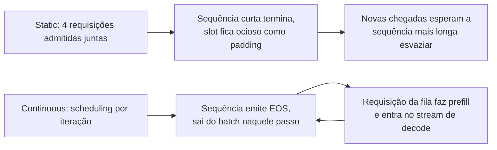

**Follow-ups:** Que novos problemas de scheduling o continuous batching cria? Como o engine decide quando fazer preempt de uma sequência em execução, e o que acontece com o KV cache dela?

</details>

### 9. O que é prompt (prefix) caching, e por que é uma das maiores alavancas de custo disponíveis?

<details><summary><b>Resposta</b></summary>

O trabalho de prefill depende só dos tokens processados até ali. Então, se duas requisições têm um prefixo de tokens idêntico, o KV cache calculado para esse prefixo pode ser reaproveitado. O prompt caching o guarda e pula o recálculo. Os casos canônicos de ganho: um system prompt longo + tool definitions compartilhados por toda requisição; conversas multi-turno (cada turno reenvia o histórico inteiro, e os turnos anteriores são um prefixo compartilhado); muitas perguntas sobre o mesmo documento longo; agent loops que reenviam contextos grandes a cada passo.

Em self-hosting, o vLLM faz automatic prefix caching por hash sobre blocos de KV. O RadixAttention do SGLang mantém uma radix tree de prefixos em cache, e o scheduler dele roteia as requisições compatíveis para eles. Cache hits reduzem o TTFT de forma drástica (o prefill encolhe para o sufixo que não está em cache) e liberam compute.

As APIs dos provedores monetizam o mesmo mecanismo: **tokens de input em cache são cobrados com um desconto grande**. Na Anthropic o cache é explícito (breakpoints `cache_control`): escritas de cache custam ~1,25× o input base e leituras de cache ~0,1×, um desconto de 90%, com um TTL de ~5 minutos que se renova (há TTL mais longo disponível). Na OpenAI ele é automático para prompts acima de um tamanho mínimo (~1024 tokens), e o desconto do input em cache varia conforme a geração do modelo, de ~50% nos mais antigos a ~90% nos mais novos. O Gemini oferece caching implícito (automático) nos modelos recentes e context caching explícito, com preço baseado em armazenamento. Multiplicadores e TTLs exatos mudam, então leia a página de preços atual em vez de decorar. Para um agent que reenvia um contexto de 20K tokens 30 vezes por sessão, o caching é a diferença entre pagar por ~600K tokens de input e pagar por ~600K tokens quase todos com desconto. Costuma ser a maior economia individual disponível, sem nenhum impacto na qualidade.

A disciplina de engenharia que isso exige: **prefixo estável primeiro, conteúdo variável por último**. Qualquer byte alterado invalida tudo o que vem depois. Portanto, nada de timestamps ou request IDs no começo do system prompt, ordenação determinística das tool definitions e estrutura de conversa append-only. A cache hit rate precisa estar no seu dashboard de custos.

**Vale desenhar.** Desenhar o caminho do hit deixa a disciplina do prefixo autoevidente: qualquer coisa volátil no começo joga toda requisição para o ramo do miss.

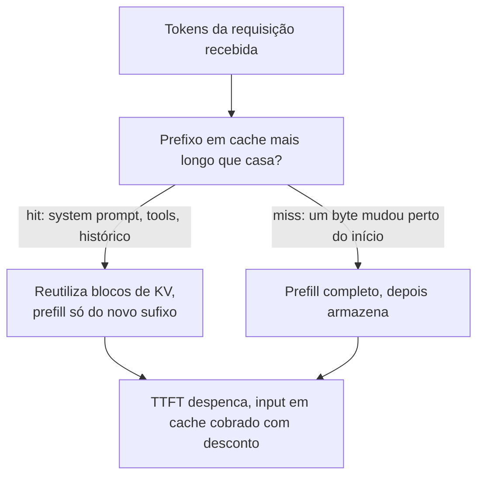

**Follow-ups:** Por que inserir a data atual no topo de um system prompt destrói o caching? Como o prefix caching interage com personalização por usuário? Qual é a diferença entre isso e semantic caching?

</details>

### 10. Seu app está recebendo 429s do provedor de LLM nos picos de tráfego. Como você lida com rate limits do jeito certo?

<details><summary><b>Resposta</b></summary>

Responda em camadas: tratamento imediato, depois prevenção, depois arquitetura.

**Tratamento imediato**: retry com **exponential backoff + full jitter** (`sleep = random(0, min(cap, base × 2^attempt))`). O jitter é inegociável: sem ele, todos os clients throttled fazem retry em ondas sincronizadas e voltam a gerar pico no provedor (thundering herd). Respeite o header `Retry-After` quando ele existir. Limite as tentativas (2-3) e imponha um **retry budget**: se mais do que alguns por cento do tráfego estiver em retry, pare de tentar de novo e descarte carga (shed), senão você amplifica a sobrecarga. Diferencie as classes de erro: 429 e 5xx são retryable; 400/422 (bad request, contexto longo demais) nunca vão funcionar, então falhe rápido.

**Prevenção**: os rate limits costumam ser RPM + TPM (tokens/min) + concorrência. Acompanhe o seu próprio consumo no client e faça gating com um token-bucket/semáforo *antes* de chamar a API, para enfileirar internamente em vez de queimar requisições em 429s. Priorize as classes de tráfego: requisições interativas de usuários recebem capacidade primeiro; jobs em background (evals, enrichment) cedem a vez ou migram de vez para a batch API. Essa costuma ser a correção real, já que o trabalho offline é o que normalmente consome a cota.

**Arquitetura**: peça limites maiores ou throughput provisionado/comprometido para a linha de base; distribua entre regiões/contas quando os termos do provedor permitirem; adicione uma **fallback chain** (o mesmo modelo em outro provedor/cloud, ou um modelo menor) atrás de um circuit breaker para throttling prolongado; suavize rajadas com uma fila e uma UX honesta nas features não interativas.

Instrumente também: taxa de 429, taxa de retry, profundidade da fila e time-to-success devem estar num dashboard. 429s crônicos são sinal de capacity planning, não um problema de tratamento de erro.

**Follow-ups:** Por que full jitter é melhor que exponential backoff simples? Seus retries estão dando certo, mas o P99 de latency triplicou: o que está acontecendo e o que você muda?

</details>

### 11. Colocamos a temperature em 0, então as saídas deveriam ser determinísticas. Por que os usuários ainda recebem respostas diferentes para o mesmo prompt?

<details><summary><b>Resposta</b></summary>

Temperature 0 torna determinístico o passo de *sampling* (pegar o argmax), mas não deixa os *logits* idênticos bit a bit entre execuções. Quando dois tokens candidatos têm probabilidades próximas, uma diferença no último bit inverte o argmax, e a continuação diverge a partir dali.

De onde vem o não-determinismo:

- **Os kernels não são batch-invariant.** A soma em ponto flutuante não é associativa, então a ordem das reduções muda o resultado nos últimos bits. Os kernels de matmul e de attention escolhem estratégias de split e ordens de redução com base no formato do batch. Com continuous batching, a sua requisição é agrupada com vizinhos diferentes a cada vez, e a composição do batch depende do tráfego de outros usuários. Essa é a causa dominante.
- **O roteamento de MoE** pode depender da composição do batch quando a implementação usa limites de capacidade por expert.
- **Heterogeneidade da frota**: gerações diferentes de GPU, versões de kernel ou de driver, grau de tensor parallelism ou quantization alteram a numérica. Os provedores também trocam snapshots do modelo por baixo dos panos.

O que ajuda: um parâmetro `seed` remove só a aleatoriedade do sampling, então é necessário, mas não suficiente. Os provedores expõem um backend fingerprint justamente porque não conseguem prometer mais do que best effort. Reprodutibilidade bitwise de verdade exige kernels batch-invariant (que fixam a ordem de redução independentemente do formato do batch), mais versão do modelo, tipo de hardware e configuração de paralelismo fixados, e você paga isso em throughput.

A postura prática: não construa sistemas que dependam de igualdade exata de tokens. Teste a semântica (validade de schema, evals com tolerância, property checks) e não a comparação de strings. Registre as saídas em log, porque você não consegue regenerá-las de forma confiável.

O equívoco a desfazer: "greedy significa determinístico". Greedy é determinístico dados logits idênticos. O problema são os logits.

**Follow-ups:** Por que um servidor mais ocupado torna a divergência mais provável? Como você escreveria um teste de regressão para uma feature de LLM que não pode depender de correspondência exata da saída?

</details>

### 12. O que o FlashAttention realmente faz, e em que ele difere do PagedAttention?

<details><summary><b>Resposta</b></summary>

Eles resolvem problemas diferentes, em camadas diferentes, e você usa os dois juntos em vez de escolher um.

**O FlashAttention é um kernel.** É uma implementação exata e IO-aware de attention. Em vez de materializar na HBM a matriz de scores n x n inteira, ele divide Q, K e V em tiles na SRAM on-chip e calcula o softmax numa passada de streaming, mantendo um máximo corrente e uma soma corrente. A memória extra cai de O(n^2) para O(n), e as leituras e escritas na HBM diminuem por um fator constante grande, porque a matriz de scores nunca sai da SRAM (os FLOPs continuam quadráticos). É isso que torna os contextos longos tratáveis. Ele é exato, não uma aproximação: as saídas coincidem com as da attention ingênua, a menos do ponto flutuante. Ganha mais no prefill e em contexto longo, onde a matriz de scores é grande. O decode tem query length 1, então quase não há paralelismo ao longo do eixo da query, e por isso as variantes voltadas ao decode dividem o trabalho ao longo do comprimento do KV e combinam os softmaxes parciais depois.

**O PagedAttention é gerenciamento de memória.** Ele guarda o KV cache em blocos de tamanho fixo (16 tokens é o padrão comum), indexados por uma block table por sequência, de modo que o KV de uma sequência não precisa ser contíguo. Isso elimina a fragmentação causada pela pré-alocação de buffers de comprimento máximo, então a mesma HBM comporta um batch muito maior, e o prefix sharing vira um ponteiro na block table em vez de uma cópia. O kernel de attention, por sua vez, precisa fazer o gather do KV através da block table.

Resumindo: o FlashAttention deixa a computação de attention barata em *tráfego* de memória; o PagedAttention deixa o KV cache barato em *capacidade* de memória. Um servidor moderno roda kernels no estilo FlashAttention sobre um layout de KV paginado, e escolher um "attention backend" é escolher qual kernel desse tipo você vai usar.

Formulação de red flag: "usamos PagedAttention em vez de FlashAttention". Vale dizer também que nenhum dos dois muda a qualidade da saída.

**Vale desenhar.** Duas caixas empilhadas, como camadas, desfazem de uma vez o equívoco do "um no lugar do outro".

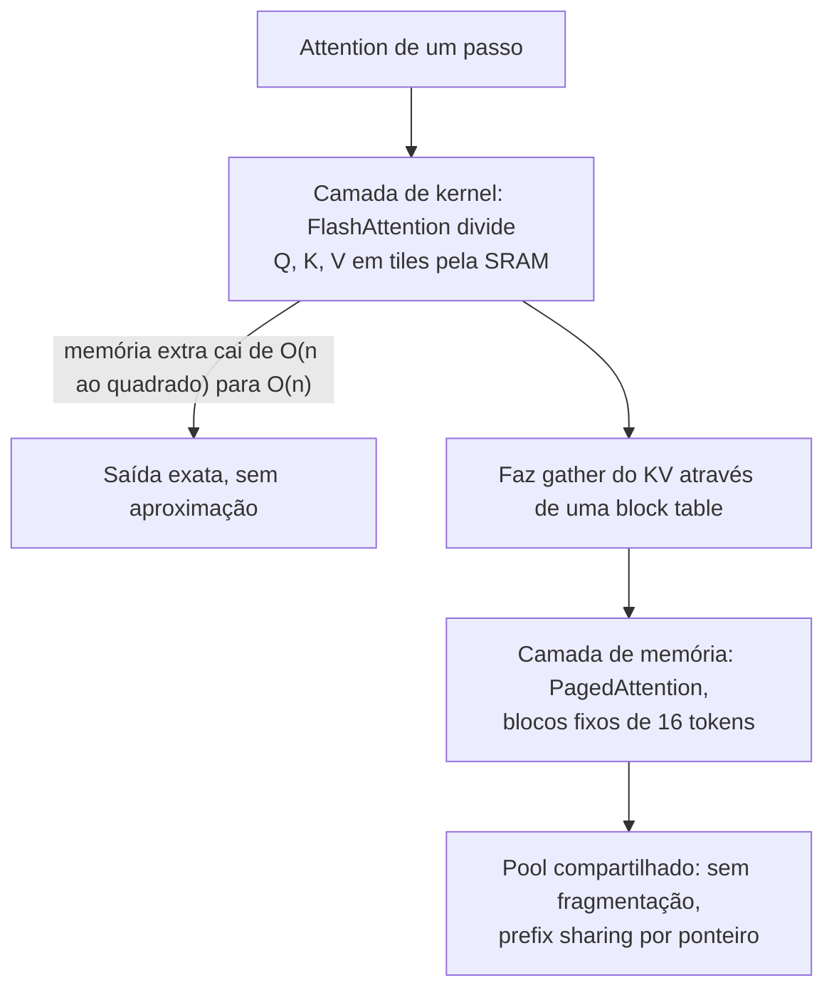

**Follow-ups:** Por que o decode precisa de um kernel com formato diferente do prefill? O que trocar o attention backend muda, de fato, na operação?

</details>

### 13. Um usuário fecha a aba no meio de uma resposta em streaming. O que acontece no servidor, e o que deveria acontecer?

<details><summary><b>Resposta</b></summary>

Por padrão, mais do que você gostaria. A menos que o cancelamento seja propagado por todo o caminho, da conexão HTTP até o scheduler do engine, o modelo continua gerando tokens que ninguém vai ler, ocupando um slot de KV e queimando tempo de GPU até o `max_tokens`. Num servidor self-hosted, isso é capacidade desperdiçada e P99 pior para todos os outros. Com uma API de provedor, você normalmente ainda paga pelos tokens gerados até o abort realmente chegar, então uma desconexão não detectada vira uma linha de custo silenciosa.

Na mecânica: a desconexão do client num stream SSE aparece como uma falha de escrita ou como um evento de disconnect na conexão. O web framework precisa perceber isso e fechar o generator, e o engine precisa abortar a requisição. Duas coisas costumam quebrar essa cadeia. A primeira são os proxies: nginx, load balancers e CDNs fazem buffering das respostas, então o servidor pode não ver a desconexão logo, ou nunca, até tentar fazer flush. Desabilite o proxy buffering nas rotas de streaming e envie heartbeats periódicos para que o socket seja exercitado. A segunda são os SDKs de client: você precisa cancelar de fato a requisição ou o context, e não apenas parar de ler.

Há também um ângulo de corretude. Se a geração tem efeitos colaterais (tool calls, escritas), ser interrompida no meio deixa estado parcial, então os passos precisam ser idempotentes e ter checkpoints.

O design melhor para qualquer coisa de longa duração: não amarre o tempo de vida da geração à conexão do browser. Gere no servidor para um stream durável, no qual o client se inscreve e que ele pode retomar depois de uma reconexão (um stream com resume token). Assim, um refresh não perde a resposta, e o cancelamento acontece porque o usuário apertou stop, não porque um socket caiu.

O que medir: taxa de requisições abortadas e tokens gerados depois da desconexão do client.

**Vale desenhar.** O valor está em mostrar a cadeia inteira, porque cada hop é um ponto onde o cancelamento pode não chegar sem ninguém perceber.

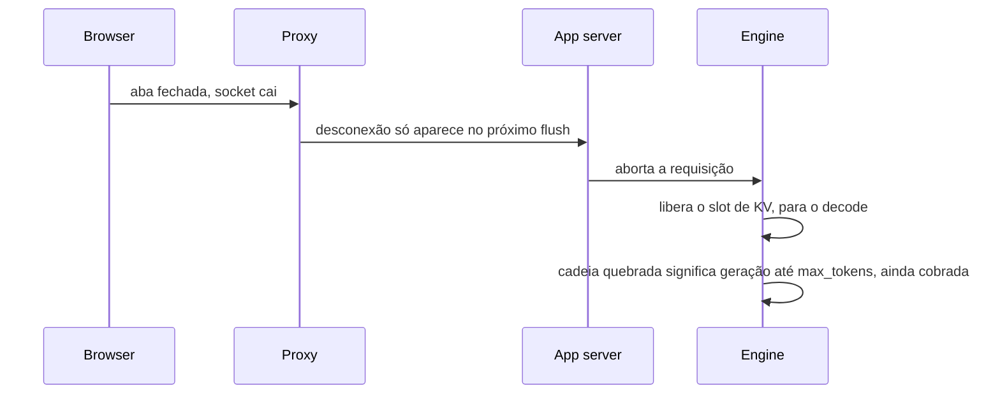

**Follow-ups:** Como você implementaria um stream retomável? Qual é a assinatura de custo, nas suas métricas, de desconexões que nunca são detectadas?

</details>

### 14. Seu código de produção lê o texto da resposta, mas nunca checa `finish_reason` (ou `stop_reason`). Por que isso é um bug, e o que fazer com cada stop reason?

<details><summary><b>Resposta</b></summary>

Porque uma resposta pode terminar por outros motivos além de "o modelo acabou", e o texto sozinho não conta isso. Toda API relevante informa por que a geração parou: `finish_reason` no Chat Completions da OpenAI, um `status` com detalhes de incompletude na Responses API, `stop_reason` na Anthropic, `finishReason` no Gemini. Ignorar esse campo significa entregar saída truncada ou filtrada como se estivesse completa.

Cada valor leva a uma ação diferente:

- **Parada natural** (`stop`, `end_turn`): o modelo terminou. Valide e use.
- **Length** (`length`, `max_tokens`): truncado no limite. A prosa termina no meio da frase. JSON ou uma tool call fica impossível de parsear, e o constrained decoding não te salva, porque a gramática não consegue fechar o objeto quando o orçamento acaba. Aumente o limite para aquela feature, peça um formato mais curto ou continue a geração, mas nunca faça o parsing como se estivesse completo. Em reasoning models, os thinking tokens normalmente contam contra o mesmo orçamento, então uma requisição pode bater no limite antes de escrever qualquer resposta visível.
- **Stop sequence** (`stop_sequence`): uma das suas strings de parada disparou. É o esperado se você projetou assim, e é um bug se essa string pode aparecer legitimamente no conteúdo.
- **Tool use** (`tool_calls`, `tool_use`): o modelo quer que uma tool seja executada. Agent loops devem ramificar neste campo, e não conforme o texto parecer vazio ou não.
- **Safety ou refusal** (`content_filter`, `refusal`): o provedor bloqueou a saída ou o modelo recusou. Mostre uma UX pensada para o caso, não faça retry cego do mesmo input e registre em log para revisão.

Hábitos de produção que acompanham isso:

- Registre o stop reason em toda chamada e plote a taxa de paradas por length por feature. Um salto depois de uma mudança de prompt ou de modelo é um sinal precoce de verbosity creep, e aparece antes de os usuários reclamarem de respostas cortadas.
- Crie um alerta para a taxa crescente de refusal por feature, já que muitas vezes isso significa que uma mudança de prompt cruzou um limite de política.
- Em streams, o motivo chega no evento final, então um código que aborta cedo ou descarta o último evento perde essa informação sem avisar.
- Trate um valor desconhecido como erro. Os provedores adicionam valores novos, e um branch default que presume sucesso é como um novo stop reason acaba entregando dados truncados.

**Follow-ups:** Como você continuaria com segurança uma geração que foi truncada no meio de um objeto JSON? A taxa de paradas por length dobrou depois de um upgrade de modelo, sem mudança de prompt: o que aconteceu e o que você muda?

</details>

## Intermediário

### 15. Por que somos obcecados por latência P99 em vez da média, e o que causa tail latency especificamente em serving de LLM?

<details><summary><b>Resposta</b></summary>

Porque os usuários sentem a cauda, não a média. Um usuário que faz 100 requisições ao longo de uma semana cai no P99 mais ou menos uma vez. Em features com várias chamadas, o efeito é bem pior: um agent que encadeia 10 chamadas sequenciais de LLM tem ~10% de chance, por execução, de que *alguma* chamada caia no P99, então a cauda do workflow é dominada pela soma das caudas de cada chamada. As médias também escondem bimodalidade: P50 estável com P99 explodindo é a assinatura clássica de sobrecarga, e a média não mostra isso.

Fontes de cauda específicas de LLM:

- **Picos de queueing**: chegadas em rajadas contra uma capacidade perto da saturação. O atraso de fila é hipersensível perto do joelho do throughput.
- **Variância do tamanho do prompt**: um prefill de 100K tokens leva ordens de grandeza a mais que um de 500 tokens. Sem chunked prefill, ele também trava o decode de *outras* requisições (head-of-line blocking), passando a sua latency adiante para o ITL de quem não tem nada a ver com isso.
- **Variância do tamanho da saída**: a latency total cresce com os tokens gerados, e `max_tokens` ilimitado significa latency ilimitada.
- **Preemption**: quando a memória de KV acaba, os engines expulsam sequências e as recalculam ou restauram depois. É um precipício de latency escondido, que só aparece sob pressão de memória.
- **Qualquer coisa fria**: prefix cache frio, réplica recém-escalada ainda esquentando, primeira requisição compilando kernels/CUDA graphs.
- **Variância do lado do provedor**, ao usar APIs: você herda a cauda multi-tenant de outra pessoa.

As mitigações correspondem uma a uma: admission control e folga para o queueing; chunked prefill e pools separados de contexto longo para a variância de prompt; limites de `max_tokens`; monitorar a contagem de preemptions e a utilização de KV; warm-up no deploy; e hedged requests para as caudas de API (envie uma duplicata depois de ~P95 e fique com a primeira resposta; isso gasta dinheiro para comprar tail latency, então coloque no orçamento).

Meça percentis por faixa de tamanho de prompt e por feature. Um P99 global mistura autocomplete com deep research e não diz nada.

**Follow-ups:** Por que a cauda end-to-end de um workflow de agent degrada mais rápido que a de qualquer chamada isolada? Quais são os riscos de hedged requests em operações não idempotentes?

</details>

### 16. Explique arithmetic intensity e o roofline model aplicados a inference de LLM. Por que o batching melhora tanto o throughput de decode?

<details><summary><b>Resposta</b></summary>

**Arithmetic intensity** = FLOPs executados por byte movido da memória. O **roofline model** diz que a performance alcançável é `min(peak_FLOPs, intensity × memory_bandwidth)`: abaixo de um ridge point você é memory-bound (a performance cresce linearmente com a intensity), e acima dele, compute-bound. O ridge de uma H100 em BF16 é aproximadamente `~989 TFLOPs ÷ ~3,35 TB/s ≈ ~300 FLOPs/byte`; numa A100 é ~150.

Agora coloque as duas fases da inference nesse roofline. No **decode com batch 1**, para cada elemento de peso (2 bytes em FP16) você faz um multiply-add (2 FLOPs), então a intensity é ≈ 1 FLOP/byte. Isso está duas ordens de grandeza abaixo do ridge: a GPU lê 140 GB de pesos para emitir um token, enquanto os tensor cores ficam ~99% ociosos. No **prefill**, um prompt de 4K tokens reutiliza cada peso carregado 4096 vezes, com intensity na casa dos milhares, firmemente compute-bound.

Fazer batching do decode eleva a intensity quase de graça: com batch size B, cada byte de peso carregado executa B multiply-adds, e a intensity vai a ≈ B FLOPs/byte. O throughput, portanto, cresce ~linearmente com B até B chegar perto do ridge (~algumas centenas de sequências), quando o decode finalmente vira compute-bound. Como o custo da leitura dos pesos já estava sendo pago de qualquer jeito, os tokens 2..B saem quase de graça. Esse é *o* fato econômico do serving de LLM, e por isso todo scheduler luta para manter os batches cheios.

Limites para B: a memória de KV cache (o cache de cada sequência precisa estar residente, e esse costuma ser o limite real), o aumento da latency por token à medida que a fatia de compute cresce, e o componente de leitura de KV da attention, que, ao contrário dos pesos, é por sequência e não se dilui. Em contextos longos, são as leituras de KV, e não as de pesos, que dominam a conta de largura de banda.

Essa lente também explica a assimetria da quantization (weight-only quant melhora o regime memory-bound; W8A8/FP8 melhora o compute-bound) e por que o speculative decoding funciona (troca compute ocioso por menos varreduras sequenciais de memória).

**Vale desenhar.** Posicionar os três regimes em relação ao ridge point é o que transforma "batching ajuda" num número que você consegue defender.

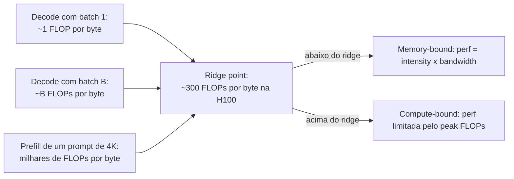

**Follow-ups:** Por que a leitura do KV cache não se dilui pelo batch como a dos pesos? Onde o MoE se posiciona no roofline, comparado a um modelo dense com a mesma contagem de parâmetros ativos?

</details>

### 17. Que problema o PagedAttention resolve, e como ele funciona?

<details><summary><b>Resposta</b></summary>

Ele resolve a **fragmentação de memória do KV cache**. Os sistemas anteriores ao vLLM alocavam o KV cache de cada sequência como um buffer contíguo, dimensionado para o comprimento *máximo possível* (já que o tamanho da saída não é conhecido de antemão). Isso desperdiça memória de três formas: fragmentação interna (uma sequência que para em 300 tokens reservou 2048), desperdício de reserva (memória retida para tokens que ainda nem foram gerados) e fragmentação externa (pedaços contíguos de tamanhos variados deixam lacunas inutilizáveis). O paper do vLLM mediu que, nos sistemas anteriores, só ~20-40% da memória de KV guardava estado real de tokens. Como a memória de KV limita o batch size, e o batch size é o throughput, esse desperdício estrangulava o serving diretamente.

O **PagedAttention** aplica a receita de memória virtual dos sistemas operacionais: corta o KV cache em **blocos** de tamanho fixo (p. ex., 16 tokens cada), aloca os blocos sob demanda a partir de um pool compartilhado e dá a cada sequência uma **block table**, que mapeia posições lógicas → blocos físicos. O kernel de attention percorre a block table, então os blocos não precisam ser contíguos. Consequências:

- O desperdício cai para, no máximo, um bloco parcialmente preenchido por sequência. A utilização fica perto de 100%, então o batch size efetivo (e o throughput) dá um salto; o paper relatou ~2-4× de throughput sobre o estado da arte anterior.
- **Compartilhar fica trivial**: várias sequências podem mapear os mesmos blocos físicos. Parallel sampling (n candidatos a partir de um prompt) e prefixos de system prompt compartilhados são resolvidos com block sharing + copy-on-write, para o caso de um bloco compartilhado precisar ser escrito.
- **A preemption fica limpa**: sob pressão de memória, o scheduler expulsa os blocos de uma sequência (recompute ou swap para a CPU) e os restaura depois.

O modelo mental para dizer em voz alta: *memória virtual e paginação para o KV cache*. Block table = page table, bloco = página, e a fragmentação é resolvida do mesmo jeito que os sistemas operacionais a resolveram nos anos 1960. Trabalhos posteriores (o prefix caching do vLLM, o RadixAttention do SGLang) constroem o reuso entre requisições em cima dessa abstração de blocos.

**Vale desenhar.** Desenhe duas block tables apontando para um bloco compartilhado e a história do compartilhamento se explica sozinha, sem precisar do paper para a analogia.

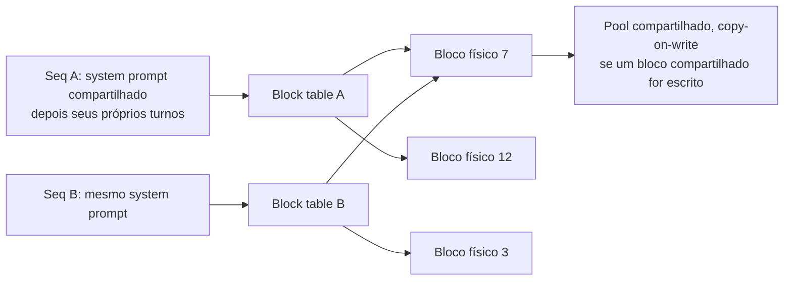

**Follow-ups:** Qual é o custo da paginação? Por que não usar blocos de 1 token? Como o copy-on-write funciona em beam search ou n-best sampling?

</details>

### 18. O que é chunked prefill e que problema de scheduling ele resolve?

<details><summary><b>Resposta</b></summary>

O problema: num engine com continuous batching, prefills e decodes dividem a GPU. Uma requisição recém-admitida, com um prompt longo, roda um prefill grande que satura o compute, e enquanto ele roda, todo decode em andamento trava. Os usuários veem o stream de tokens congelar, e o ITL salta de dezenas de milissegundos para segundos. Os schedulers que priorizam o prefill otimizam o TTFT à custa do ITL; os que seguram os prefills protegem o ITL, mas arruínam o TTFT e o throughput. Com prompts de 50K a 100K tokens, isso não é um edge case: uma única requisição pesada em documentos degrada todo mundo.

O **chunked prefill** (popularizado pelo Sarathi/Sarathi-Serve, hoje padrão no vLLM e em outros engines) divide o prompt em chunks, p. ex. de 512 a 2048 tokens, e processa um chunk por iteração, *junto com os passos de decode em andamento*. O prefill longo vira um processo em background que avança aos poucos, em vez de um bulldozer que monopoliza a GPU.

Dois benefícios:

- **Decodes sem stalls**: o ITL fica estável, não importa quais prompts cheguem. A cauda da inter-token latency, que é o que os usuários de chat realmente sentem, fica protegida.
- **Melhor eficiência da GPU**: batches só de decode são memory-bound (compute ocioso), e chunks de prefill são pesados em compute (largura de banda sobrando). Misturar os dois num batch enche os dois canais, e o prefill pega carona nas leituras de pesos que o decode já estava fazendo de qualquer jeito.

Custos: o TTFT do próprio prompt picado piora um pouco (o prefill dele se espalha por várias iterações, e a attention de cada chunk precisa reler o KV de todos os chunks anteriores, o que acrescenta algum overhead de largura de banda). Além disso, passa a existir um botão de ajuste, o chunk size, que troca TTFT por proteção de ITL. Os entrevistadores gostam de ouvir este enquadramento: o chunked prefill transforma um problema de *interferência* num trade-off de *scheduling* explícito e ajustável. Também é um degrau para a correção mais completa, que é separar prefill e decode em pools distintos (disaggregation).

**Vale desenhar.** Uma iteração desenhada como um batch misto mostra por que isso é um ganho de utilização, e não só um remendo de fairness.

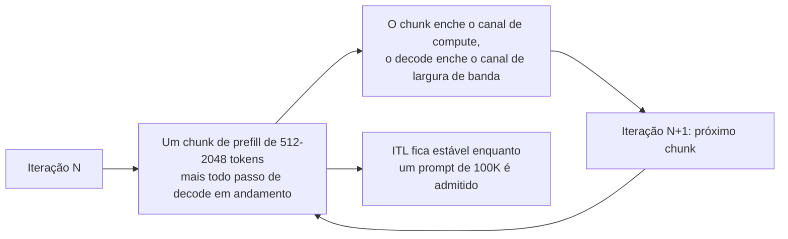

**Follow-ups:** Como você escolheria o chunk size? Por que misturar um chunk de prefill num batch de decode melhora a utilização do hardware, em vez de só dividir o prejuízo?

</details>

### 19. Explique speculative decoding. Por que a saída é comprovadamente fiel ao modelo alvo, e quando ele realmente ajuda?

<details><summary><b>Resposta</b></summary>

O decode é memory-bound: cada token custa uma varredura completa dos pesos, enquanto o compute fica ocioso. O speculative decoding gasta esse compute ocioso para reduzir o número de varreduras sequenciais. Um **draft model** barato propõe k tokens de forma autoregressiva (rápido, porque é pequeno). Em seguida, o **modelo alvo** pontua as k propostas *num único forward pass paralelo* (barato por token, como o prefill). Os tokens aceitos são emitidos; na primeira rejeição, um token corrigido é amostrado do alvo e o drafting recomeça. No melhor caso, você emite k+1 tokens por uma varredura do alvo.

A fidelidade vem da **regra de aceitação** (Leviathan et al. 2022; Chen et al. 2023): aceite o token x do draft com probabilidade `min(1, p_target(x)/p_draft(x))`; na rejeição, reamostre da distribuição residual `normalize(max(0, p_target − p_draft))`. É uma construção de rejection sampling cuja distribuição marginal é *exatamente* `p_target`, demonstrável e não aproximada. Por isso o speculative decoding é puramente uma otimização de latency: mesma distribuição de saída, inclusive com temperature sampling. Qualquer implementação que altere as saídas (além de ruído de ponto flutuante) está com bug ou faz, de propósito, uma aceitação "relaxada", com perdas.

Quando ajuda: os tokens esperados por passada do alvo sobem com a **taxa de aceitação** α (o quanto o drafter acompanha o alvo). Texto previsível, como código, saída estruturada e prosa formulaica, rende bom drafting; texto criativo de alta entropia, não. Ele brilha em batch sizes baixos, com folga de compute, e costuma dar ~2-3× de melhoria em ITL. Quando atrapalha: com batch alto, a GPU já está saturada de compute, então as passadas de verificação roubam throughput; um drafter mal ajustado ao alvo ou lento demais pode dar resultado líquido negativo; e o draft model consome memória. Opções de drafter: um modelo pequeno com o mesmo tokenizer, heads de self-drafting (Medusa, EAGLE) ou drafting **n-gram/prompt-lookup**, que copia continuações candidatas do próprio prompt, sai praticamente de graça e funciona muito bem em workloads de extração e edição.

**Vale desenhar.** O loop draft-verify-accept, com o ramo de rejeição, é exatamente o diagrama que prova que você entende por que a saída não muda.

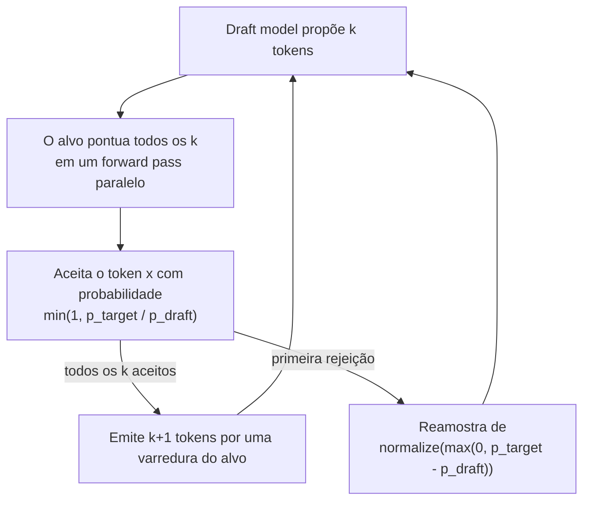

**Follow-ups:** Derive por que a regra de aceitação preserva a distribuição do alvo. Como o batch size muda a economia? Quando o n-gram lookup venceria um draft model treinado?

</details>

### 20. Compare GPTQ, AWQ, GGUF, INT8 e FP8. Como você escolhe, na prática, uma abordagem de quantization para um deployment?

<details><summary><b>Resposta</b></summary>

Eles não são intercambiáveis: diferem no que é quantizado, em como isso é feito e em onde rodam.

- **GPTQ**: post-training, weights-only (geralmente 4 bits). Quantiza layer por layer, usando compensação de erro (de segunda ordem, aproximada) contra um calibration set: arredonda os pesos seguintes de modo a absorver o erro de arredondamento dos anteriores. Tem suporte maduro de kernels para GPU.
- **AWQ**: post-training, weights-only de 4 bits. A observação por trás: uma pequena fração dos canais de pesos importa desproporcionalmente, e eles são identificados pelas magnitudes das *activations*. O AWQ reescala esses canais salientes antes de quantizar, para protegê-los. Não usa backprop, a calibração é leve, e tende a ser robusto e rápido com bons kernels (funciona bem em modelos instruction-tuned).
- **GGUF**: não é um algoritmo, e sim o *formato de arquivo* do llama.cpp, que carrega a família de k-quants/i-quants (Q4_K_M, Q5_K_S, ...) com scales por bloco. É a lingua franca da inference em CPU/Metal/edge via llama.cpp e Ollama, com precisão mista por layer.
- **INT8 W8A8**: pesos *e* activations em INT8 (linhagem LLM.int8(), SmoothQuant), o que acelera os próprios matmuls. A dificuldade são os activation outliers.
- **FP8 (E4M3/E5M2)**: W8A8 nativo da Hopper; a estrutura de ponto flutuante lida melhor com outliers que o INT8. Na prática é quase sem perdas e é o padrão para serving de produção de alto throughput; também é usado no KV cache. A família FP4 (NVFP4/MXFP4) é a sucessora nativa da Blackwell e já roda em produção em frotas Blackwell, mas tem um custo de qualidade maior e mais dependente da tarefa que o FP8, então avalie com cuidado.

Para escolher, faça três perguntas. (1) **Gargalo**: se o caso é sensível a latency, com batch baixo, o weights-only de 4 bits (AWQ/GPTQ) ataca o limite de largura de banda; se é throughput com batch alto, o FP8 W8A8 ataca o limite de compute. (2) **Hardware/stack**: classe H100 + vLLM/TensorRT-LLM → FP8; classe Blackwell → FP8, ou NVFP4 onde os evals permitirem; GPU consumer → GPTQ/AWQ; CPU/Apple Silicon/edge → GGUF. (3) **Barra de qualidade**: rode a *sua* suíte de evals no artefato quantizado, porque deltas de perplexity escondem regressões específicas de tarefa (matemática, código e multilíngue são as vítimas de sempre). Muitos times acabam em: FP8 para a frota de serving, INT4 para o tier com restrição de memória e GGUF para local/dev.

**Vale desenhar.** O ponto é ramificar pelo gargalo, e não pelo nome do formato, e o loop de volta pelos evals é onde a senioridade aparece.

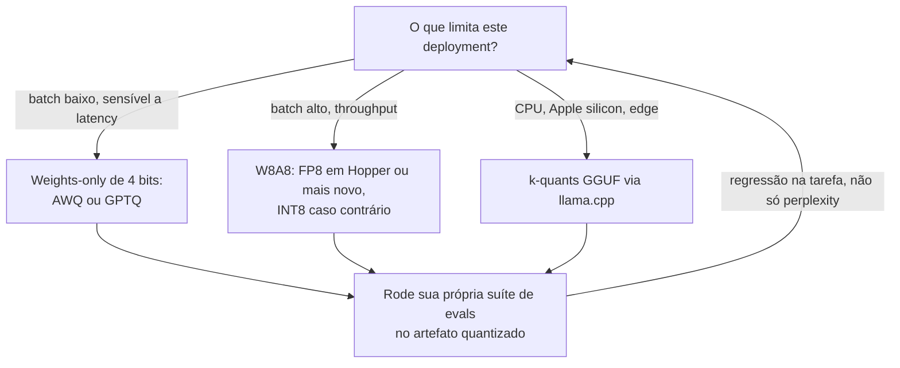

**Follow-ups:** Por que os activation outliers deixam o W8A8 mais difícil que o W4A16? O que faria você rejeitar um modelo de 4 bits que passa nos checks de perplexity?

</details>

### 21. O que é quantização do KV cache, e quando ela é a alavanca certa?

<details><summary><b>Resposta</b></summary>

É guardar o KV cache em menos bits: FP8 ou INT8 no lugar de FP16, com variantes mais agressivas, de 4 bits, em pesquisa e no llama.cpp. Ela é ortogonal à weight quantization e ataca uma restrição diferente. Os pesos são um custo *fixo*, mas o KV cresce com `sequências × tamanho do contexto`, e num servidor ocupado é o pool de KV, e não os pesos, que limita a concorrência.

O retorno é direto: o FP8 KV corta os bytes/token pela metade (o nosso exemplo de 70B cai de ~320 KB para ~160 KB/token), o que literalmente **dobra** o batch size máximo (throughput) ou o contexto máximo atendível com a mesma memória. Ele também reduz o tráfego de memória da attention em contextos longos, onde ler o KV cache (que, ao contrário dos pesos, não se dilui pelo batch) vira o gargalo de largura de banda. Assim, o decode de contexto longo também fica mais rápido.

Qualidade: o KV de 8 bits (principalmente FP8) costuma ser quase sem perdas e é muito usado em produção; vLLM, TensorRT-LLM e llama.cpp têm suporte. Abaixo de 8 bits a coisa fica delicada. A attention é sensível à precisão das keys (elas entram nos logits do dot-product, e o erro ali perturba o softmax sobre *todas* as posições), e a pesquisa conclui de forma consistente que **as keys precisam de um tratamento mais cuidadoso que os values**, o que motiva a quantização por canal das keys e esquemas K/V assimétricos. Tarefas longas, de vários passos, acumulam erro, então avalie em benchmarks de contexto longo e agentic, não em QA curto.

Quando recorrer a ela: (1) deployments limitados por KV, com alta concorrência ou contexto longo, em que o dashboard mostra a utilização de KV no teto e as preemptions subindo; (2) para encaixar um modelo de contexto longo em hardware fixo; (3) para espremer mais batch de uma GPU que já serve pesos de 4 bits. Ressalva: empilhar weight quant agressiva com KV quant agressiva soma os erros, então rode os evals de novo na combinação, e não em cada uma isoladamente.

**Follow-ups:** Por que as keys são mais sensíveis à quantization que os values? A utilização de KV está em 95% e as preemptions estão subindo: percorra as suas opções e os trade-offs de cada uma.

</details>

### 22. Descreva a curva de trade-off throughput × latency de um servidor de LLM e explique goodput.

<details><summary><b>Resposta</b></summary>

Varie a carga oferecida (ou o batch size máximo) num deployment fixo e plote os tokens/sec agregados contra a latency por requisição (percentis de TPOT e TTFT). A curva tem três regiões. Com carga baixa, a latency é estável e quase ótima: adicionar tráfego só preenche a capacidade ociosa, e o throughput sobe ~linearmente (o decode é memory-bound, e as sequências extras pegam carona nas mesmas leituras de pesos). Ao se aproximar da saturação, aparece um **joelho**: os batches ficam grandes o bastante para que compute e memória de KV passem a disputar, o TPOT sobe um pouco, e o atraso de fila, que é hipersensível à utilização perto de 1, começa a explodir o TTFT. Depois do joelho, o throughput se estabiliza (o roofline do hardware foi atingido) enquanto a latency cresce sem limite, conforme a fila aumenta. Todo deployment de serving está escolhendo um ponto nessa curva: mais batch = mais barato por token, mas pior experiência para cada usuário.

O **goodput** (o enquadramento do DistServe) corrige uma métrica clássica que engana: ele conta só o throughput que *cumpre os seus SLOs*, p. ex. requisições/sec atendidas com P99 TTFT < 1 s e TPOT < 50 ms. Os tokens/sec brutos podem ser manipulados rodando fundo na saturação, onde toda requisição viola as metas de latency; ali, o goodput vai a zero. Ele é o alvo de otimização certo e a métrica certa para comparar benchmarks: dois engines com o mesmo throughput máximo podem ter goodput 2× diferente sob um SLO apertado, por causa da qualidade do scheduling (chunked prefill, comportamento de preemption, admission control).

Na operação: faça load test de cada configuração para achar o joelho e depois rode a ~60-70% da capacidade do joelho, para ter folga contra rajadas; faça autoscale por indicadores antecedentes (profundidade da fila, utilização de KV), e não pelas métricas de latency, que chegam atrasadas; e avalie mudanças de scheduler/engine por goodput versus custo, não por pico de tokens/sec. Note também que o próprio SLO define a curva que importa: o SLO apertado de ITL de um chat interativo força um ponto de operação diferente (e talvez uma divisão de hardware diferente) do de um pipeline batch offline rodando o mesmo modelo.

**Follow-ups:** Por que o atraso de fila explode perto da saturação? O P99 de TTFT viola o SLO, mas a utilização da GPU mostra 60%: o que você investiga?

</details>

### 23. vLLM, SGLang, TensorRT-LLM, TGI, llama.cpp/Ollama: como você escolhe um serving stack?

<details><summary><b>Resposta</b></summary>

Decida pelo formato do workload, pelo hardware e por quanta engenharia você vai investir, e não pelas estrelas no GitHub:

- **vLLM**: a escolha open-source padrão. PagedAttention, continuous batching, chunked prefill, prefix caching, speculative decoding, suporte a quantization, tensor/pipeline parallelism, servidor compatível com a API da OpenAI, ampla cobertura de modelos (inclusive suporte no dia zero para a maioria dos lançamentos abertos) e backends para vários tipos de hardware. Escolha-o, a menos que você tenha um motivo específico para não fazer isso.
- **SGLang**: o mais forte quando as requisições compartilham muitos prefixos (workloads agentic, chat multi-turno, baterias de few-shot), graças ao RadixAttention (reuso automático de prefix cache em estrutura de árvore) e a um scheduler que tira proveito dele. Também é conhecido por uma geração constrained/estruturada muito rápida. Nesses padrões, costuma empatar com o vLLM ou ficar à frente nos benchmarks.
- **TensorRT-LLM**: o caminho de performance máxima da NVIDIA, com kernels muito ajustados, fusão agressiva e FP8/FP4 de primeira classe. Desde o lançamento da 1.0, o runtime baseado em PyTorch é o padrão, e o workflow antigo, de engines compiladas, continua disponível. Entrega os melhores números brutos em hardware NVIDIA, mas você paga em complexidade de tuning, em onboarding de modelos às vezes mais lento e em lock-in com a NVIDIA. Escolha quando o custo de serving em escala justificar engenheiros dedicados a inference (muitas vezes atrás do Triton ou da orquestração Dynamo da NVIDIA).
- **TGI (Text Generation Inference)**: o antigo servidor de produção da Hugging Face. A Hugging Face o colocou em modo de manutenção no fim de 2025 e agora aponta os usuários para vLLM e SGLang, então novas arquiteturas de modelos não vão chegar lá. Trate-o como item de migração, não como escolha para um novo deployment.
- **llama.cpp / Ollama / MLX**: o tier edge/local. CPU, Apple Silicon (Metal / MLX), GPUs consumer; modelos quantizados em GGUF; fácil de rodar. Serve para produtos on-device, inference local com restrição de privacidade e laptops de desenvolvimento, e não para serving de datacenter com QPS alto.

Fatores de decisão para citar: hardware (NVIDIA de datacenter vs AMD/TPU vs laptop), workload (agentic com muito prefixo → SGLang; uso geral → vLLM; obcecado por custo em escala → TensorRT-LLM), features necessárias (structured output, multi-LoRA serving, spec decoding), maturidade operacional do time e velocidade da comunidade em suportar novos modelos. Mencione também a opção "comprar": endpoints gerenciados (Bedrock, Vertex, Fireworks, Together etc.), para quem não quer operar o stack.

**Follow-ups:** Seu workload é 90% tráfego de agent com system prompt compartilhado: qual stack e por quê? O que um stack ajustado por um vendor, como o TensorRT-LLM, compra em relação a um engine portável, e quanto isso custa quando você quer adicionar capacidade AMD?

</details>

### 24. Explique tensor parallelism vs pipeline parallelism para inference. Quando você precisa de cada um?

<details><summary><b>Resposta</b></summary>

Os dois dividem um modelo grande demais entre GPUs. Eles cortam em eixos diferentes, com perfis diferentes de comunicação e latency.

O **tensor parallelism (TP)** divide *dentro* de cada layer: attention heads e matrizes de MLP são repartidas entre N GPUs, cada uma calcula a sua fatia de cada layer, e os resultados são combinados com all-reduces (tipicamente dois por transformer block: depois da projeção de saída da attention e depois do MLP). Toda GPU participa de todo token, então o TP realmente **reduz a latency por token** (cada GPU faz ~1/N dos FLOPs e lê ~1/N dos bytes de pesos). Em compensação, ele é "falante": um all-reduce por layer, dezenas de vezes por token, exige largura de banda classe NVLink. Regra prática: TP dentro de um node (2/4/8 GPUs), nunca sobre interconexões lentas. TP=8 sobre NVLink é o jeito padrão de servir um modelo 70B+ em FP16.

O **pipeline parallelism (PP)** divide *entre* layers: a GPU 0 guarda as layers 1-20, a GPU 1 as 21-40, e assim por diante, com as activations passando de estágio em estágio. A comunicação é mínima (um tensor de hidden states por fronteira de estágio), então o PP tolera Ethernet/IB entre nodes. Só que ele **não** reduz a latency por token: cada token ainda atravessa todas as layers em série, mais o overhead dos hops, e os estágios ficam ociosos ("bubbles") a menos que haja trabalho concorrente suficiente para manter todos ocupados. Os entrevistadores gostam desse contraste dito sem rodeio: o TP é uma ferramenta de latency *e* de capacidade; o PP é uma ferramenta de capacidade, cujo throughput depende de manter o pipeline cheio (o que o continuous batching entrega de bom grado).

Playbook prático de serving: se a quantization permitir, caiba numa GPU só (sem paralelismo é o mais simples); use TP dentro de um node para modelos maiores; só adicione PP quando o modelo passar de um único node (p. ex., escala de fronteira ou monstros de contexto longo), combinando TP intra-node × PP inter-node. Duas extensões que valem um comentário rápido: o **expert parallelism** para MoE (experts divididos entre GPUs, com roteamento all-to-all) e o **data parallelism** (réplicas independentes atrás de um load balancer), que é o mecanismo de escala depois que o formato de uma réplica foi escolhido.

**Vale desenhar.** Desenhar o eixo de corte ao lado do custo de comunicação é o que justifica "TP dentro de um node, PP entre nodes" sem hand-waving.


**Follow-ups:** Por que TP=8 entre dois nodes de 4 GPUs sobre Ethernet tem uma performance péssima? Como o MoE muda o quadro do paralelismo?

</details>

### 25. Self-host de um modelo open-weights ou chamar uma API de provedor: me conduza pela decisão.

<details><summary><b>Resposta</b></summary>

Um framework de seis eixos e, depois, a conta:

1. **Requisitos de qualidade**: se a tarefa exige o melhor da capacidade de fronteira, as APIs costumam ser a única opção. Os modelos open-weight mais fortes ficam atrás da fronteira fechada, e os que chegam mais perto são MoEs enormes, caros de hospedar bem por conta própria. Se um modelo aberto (possivelmente fine-tuned) passa na sua barra de evals, o self-hosting entra na mesa. Quem decide isso são os evals, não a impressão.
2. **Economia de utilização**: GPU cobra por hora, esteja ocupada ou ociosa; API cobra por token. O self-hosting só vence com **utilização alta e estável**. Esboce a conta: uma H100 a ~US$2-4/hora servindo um modelo classe 70B bem batchado consegue produzir da ordem de alguns milhares de tokens de saída/sec agregados, algo como ~US$0,10-0,50 por milhão de tokens com boa utilização, contra preços de API que muitas vezes são 5-20× isso. Mas, com 10% de utilização, o seu custo efetivo se multiplica por 10, e um tráfego diurno cheio de picos torna a utilização sustentada realmente difícil. Inclua os itens escondidos: engenheiros de plantão, folga de capacidade, evals e upgrades.
3. **Privacidade/compliance/residência**: requisitos rígidos (dados regulados, ambiente air-gapped, residência de dados) podem forçar o self-hosting, ou pelo menos ofertas de provedores implantadas em VPC (Bedrock, Vertex, Azure) como caminho intermediário.
4. **Controle de latency**: o self-hosting dá colocation com os seus serviços, ausência de rate limits e controle sobre a cauda inteira. Com API, você fica com o P99 multi-tenant de outra pessoa.
5. **Customização**: fine-tuning pesado, decoding customizado (gramáticas, truques de spec decoding), serving de LoRA por tenant: tudo isso é bem mais fácil no seu próprio stack.
6. **Time**: operar infra de inference é um compromisso operacional de verdade (compra de GPUs, problemas de driver/kernel, upgrades de engine, resposta a incidentes). Um time de duas pessoas entregando produto deveria quase sempre começar por APIs.

A resposta madura costuma ser **híbrida**: API de fronteira para os caminhos de reasoning difíceis e de baixo volume; modelos pequenos self-hosted para tarefas estreitas de alto volume (classificação, extração, embeddings); e revisão trimestral, conforme modelos e preços mudam. Comece com APIs para encontrar o product-market fit e, depois, traga para dentro de casa os workloads cuja conta de tokens passa do custo total de servi-los.

**Follow-ups:** Que volume mensal de tokens faria você reavaliar a decisão? Como as ofertas de provisioned throughput mudam essa conta?

</details>

### 26. Quando você usaria uma batch API, e como projeta um pipeline em torno dela?

<details><summary><b>Resposta</b></summary>

As batch APIs (OpenAI Batch, Anthropic Message Batches) aceitam um arquivo ou lista de requisições, processam tudo de forma assíncrona numa janela de conclusão de até ~24 h (na prática, muitas vezes bem mais rápido) e cobram **~50% do preço interativo**. O provedor está vendendo a capacidade ociosa/off-peak dele, e você está vendendo flexibilidade de scheduling. Os jobs em batch também costumam usar uma cota separada e bem maior que a dos seus rate limits interativos, o que impede que o trabalho em background canibalize o TPM de produção.

Use para qualquer coisa sem usuário esperando: suítes de eval, backfills de embeddings/classificação, pipelines de sumarização de documentos, enrichment e labelling de dados, geração de dados sintéticos, varreduras de moderação de conteúdo, relatórios noturnos, reprocessamento depois de uma mudança de prompt. Uma fração surpreendente do gasto com tokens de muitos times tem esse formato e está pagando preço interativo sem ninguém notar. Nunca use para caminhos voltados ao usuário e limitados por latency. E, para o meio-termo ("resultados em minutos"), você ainda precisa da API interativa.

Pontos de design do pipeline:

- **Identidade idempotente da requisição**: anexe um `custom_id` seu a cada requisição; os resultados voltam indexados por ele, fora de ordem. Deixe o reenvio seguro (dedupe por custom_id), porque você *vai* reenviar.
- **Divida os jobs em chunks**, em batches limitados (os dois provedores limitam requisições/bytes por batch), e acompanhe o estado do job num store durável: submitted → in_progress → completed/expired/failed.
- **Trate resultados parciais**: requisições individuais dentro de um batch podem falhar, ou a janela pode expirar com só um subconjunto concluído. Reconcilie por requisição e reenvie somente as que faltam ou falharam, com um limite de retries.
- **Poll ou webhook** para saber da conclusão; ao concluir, baixe os resultados, valide (faça schema-check das saídas) e só então faça o commit downstream.
- **Combine com as outras alavancas de custo**: o prompt caching também vale para o tráfego de batch em alguns provedores; faça dedupe de requisições idênticas antes do envio.
- **Backpressure**: um pipeline de batch que se ramifica a partir de ações de usuários precisa de uma fila com controle de taxa, para que um pico não crie uma tempestade de batches de um milhão de requisições.

**Follow-ups:** Como você lida com um batch que volta com 2% de falhas? O seu batch noturno agora precisa de frescor de 4 horas: o que muda?

</details>

### 27. O que é semantic caching, em que ele difere de prompt/prefix caching, e quais são os failure modes dele?

<details><summary><b>Resposta</b></summary>

O semantic caching guarda pares requisição→resposta anteriores e devolve a **resposta** em cache quando uma nova requisição é *semanticamente parecida*: ele gera o embedding da query recebida, faz uma busca por vizinhos mais próximos nos embeddings das queries em cache e, se a similaridade passa de um limiar (p. ex., cosine ~0,95), devolve a resposta guardada sem chamar o modelo.

O contraste com o prompt/prefix caching é o ponto que os entrevistadores querem ouvir. O prefix caching reaproveita **computação** (o KV cache de um prefixo *exato, idêntico token a token*): o modelo ainda roda e gera uma saída nova, e o processo não tem perda. O semantic caching reaproveita a **resposta** a partir de uma correspondência *aproximada* e pula a inference por completo. Num hit, a economia é de ~100%, mas com perda de fidelidade, porque você está afirmando que duas strings diferentes merecem a mesma resposta.

Failure modes, mais ou menos em ordem de dor:

- **Falsos hits**: os embeddings borram justamente o que importa. Negação ("política de reembolso" vs "política sem reembolso"), números, troca de entidades ("redefinir a senha da conta A vs B") e datas ficam todos próximos no espaço de embeddings. Uma resposta errada servida com confiança é pior que uma resposta lenta.
- **Vazamento de contexto**: fazer cache entre usuários pode vazar conteúdo personalizado ou com permissão restrita. As chaves de cache precisam ter escopo: por tenant, no mínimo, e qualquer estado que afete a personalização precisa fazer parte da chave.
- **Obsolescência/invalidação**: a resposta em cache carrega um momento no tempo: versão do modelo, versão do system prompt, snapshot do corpus de RAG. Qualquer um desses que mude exige limpar ou particionar o cache por versão, e os times esquecem a dimensão da versão do prompt o tempo todo.
- **Ajuste do limiar**: apertado demais, não há hits; frouxo demais, saem respostas erradas. Meça a **hit precision** (os hits estão realmente corretos?) com revisão amostral humana ou por LLM-judge, e não só a hit rate.

Onde brilha: tráfego muito repetitivo e pouco personalizado, como suporte no estilo FAQ e consultas públicas parecidas com busca, em que 20-40%+ do tráfego é de quase-duplicatas. Onde evitar: respostas personalizadas, multi-turno ou de alto risco. Um meio-termo razoável é usar o hit semântico como *candidato*, que um pequeno modelo verificador confirma antes de servir.

**Vale desenhar.** O limiar e o verificador são os dois pontos onde esse design costuma dar errado, então coloque os dois na página, onde dá para discuti-los.

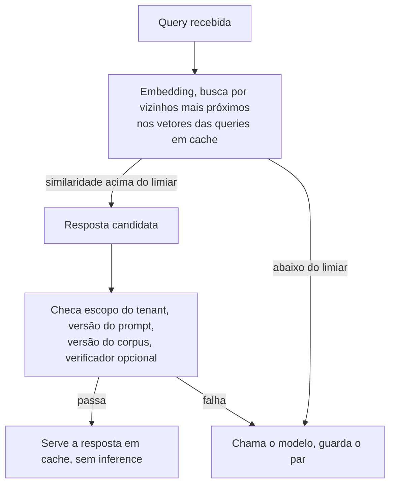

**Follow-ups:** Projete a chave de cache de um produto de RAG multi-tenant. Como você detectaria, em produção, que o seu limiar está causando falsos hits?

</details>

### 28. Como lidar com streaming quando o modelo emite tool calls ou JSON estruturado?

<details><summary><b>Resposta</b></summary>

A tensão: o streaming existe para mostrar progresso incremental, mas tool calls e JSON só são acionáveis quando estão sintaticamente completos. O stream entrega fragmentos (`{"loc` ... `ation": "par`), e um `json.loads` ingênuo sobre dados parciais lança exceção.

Primeiro, a mecânica: os provedores fazem streaming de conteúdo estruturado como deltas tipados. O Chat Completions da OpenAI envia deltas de `tool_calls` com um índice, o nome da função (logo no início) e fragmentos incrementais da string de `arguments`, e a Responses API emite eventos tipados `response.function_call_arguments.delta`. A Anthropic envia eventos `content_block_start` / `input_json_delta` por bloco, e os blocos podem intercalar texto e tool use. O trabalho do client é um **acumulador**: direcionar cada delta ao seu bloco/tool call pelo índice, concatenar os fragmentos de argumentos e marcar a conclusão no evento de fim de bloco/finish. Só então fazer o parsing, validar contra o schema da tool e despachar.

Padrões em cima disso:

- **Buffer-then-act** para execução: nunca execute uma tool com argumentos parciais. O sinal de bloco completo é o seu ponto de commit, e a validação de schema é a sua rede de segurança (o modelo ocasionalmente emite JSON malformado, então tenha um caminho de reparo ou retry).
- **Parsing de JSON parcial** para exibição: parsers best-effort, que fecham colchetes e strings abertos, permitem renderizar uma UI progressiva a partir de JSON incompleto (uma tabela linha a linha, mostrando qual tool está sendo chamada e seus argumentos conforme eles se formam). Vários SDKs já expõem helpers de partial-parse para isso.
- **Intercalação**: os modelos modernos misturam prosa e tool calls numa mesma resposta, então mantenha uma máquina de estados por bloco em vez de presumir um tipo de conteúdo por mensagem.
- **Streaming pela sua própria API**: se o seu backend faz proxy para os clients, reemita eventos limpos e versionados (text delta / tool started / tool result / done), em vez de vazar os formatos do provedor. É aqui que a normalização multi-provider se paga.
- **Tratamento de falhas**: um stream que morre no meio do JSON deixa um fragmento inutilizável. Trate como geração falha, faça retry de forma idempotente e torne impossível a execução dupla de tools (idempotency keys nos efeitos colaterais das tools).

**Vale desenhar.** O desenho separa o caminho de exibição do caminho de execução, que é a distinção que impede uma tool call pela metade de disparar.

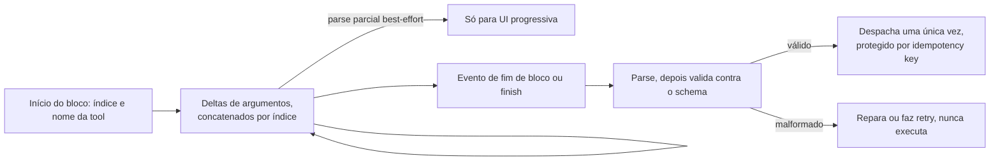

**Follow-ups:** Onde você coloca a validação de schema quando o modelo faz streaming de um array JSON de 10 itens que você quer renderizar progressivamente? Como evitar que uma tool seja executada duas vezes quando o retry de um stream repete a tool call?

</details>

### 29. Você precisa servir 200 fine-tunes específicos de clientes sobre o mesmo modelo base de 8B. Como fazer isso com um punhado de GPUs, e o que quebra primeiro?

<details><summary><b>Resposta</b></summary>

Multi-LoRA serving. Carregue os pesos base uma única vez e trate cada tenant como um adapter de rank r: para cada projeção alvo, y = Wx + scale * (B A x). O matmul caro da base é compartilhado por todo o batch, e só os pequenos termos low-rank são por adapter, então um mesmo batch pode misturar adapters e o continuous batching continua funcionando. A alternativa, 200 réplicas completas do modelo, é absurda: 200 x ~16 GB, contra 1 x 16 GB mais 200 x dezenas de MB.

O que faz isso funcionar é o kernel. Um loop ingênuo sobre os adapters serializa o batch. Os sistemas de produção ordenam os tokens por adapter em segmentos contíguos e fazem um único GEMM agrupado (a abordagem SGMV do Punica, usada por LoRAX, vLLM e SGLang). O vLLM expõe isso como `--enable-lora`, com `--max-loras` (adapters distintos permitidos num mesmo batch), `--max-lora-rank` e `--max-cpu-loras` (pool no lado do host); a requisição informa qual adapter quer.

O que quebra:

- **Heterogeneidade de rank.** Os kernels agrupados fazem padding até o rank máximo, então um único adapter de rank 64 sobrecarrega todo tenant de rank 8 que divide o batch com ele. Padronize os ranks entre os tenants.
- **O limite de `max_loras`.** Se há mais adapters distintos ativos ao mesmo tempo do que o limite permite, o scheduler serializa entre os grupos de adapters e as caudas de TTFT explodem. A correção está no roteamento: dê a cada réplica um subconjunto dos adapters (adapter affinity), para que a concorrência por réplica fique abaixo do limite.
- **Fetch de adapter frio.** Os adapters são pequenos, então o paging a partir da RAM do host é rápido, mas buscar no object storage na primeira requisição causa um pico visível. Faça prefetch no início da sessão.
- **O prefix cache não atravessa adapters.** O KV é específico de cada adapter, então um system prompt compartilhado é cacheado separadamente por adapter. Isso surpreende muita gente.
- **Avaliação.** Agora você é dono de 200 superfícies de qualidade, e não de uma.

Espere um custo real de throughput em relação a um servidor só com o modelo base, que cresce com o número de adapters distintos por batch. Meça isso no seu tráfego, em vez de confiar num número de manchete.

**Vale desenhar.** Mostrar o matmul compartilhado da base ao lado do termo por adapter explica num relance por que 200 tenants cabem onde 200 réplicas nunca caberiam.

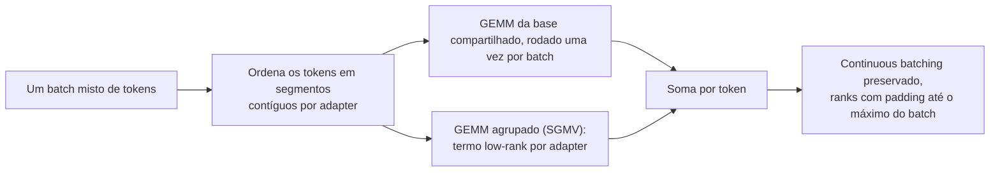

**Follow-ups:** Por que o KV de um system prompt compartilhado não pode ser reaproveitado entre dois adapters diferentes? Quando você faria o merge de um adapter nos pesos base e o serviria como um modelo próprio?

</details>

### 30. Como fazer o load test de um serviço de LLM para que os números signifiquem alguma coisa?

<details><summary><b>Resposta</b></summary>

A maioria dos load tests de LLM erra do mesmo jeito, de três formas: carga em closed loop, prompts irreais e relatório de médias.

**Open loop, não closed loop.** Um teste em closed loop (N workers, cada um envia uma requisição e espera) se auto-limita quando o servidor desacelera, então você nunca vê a fila se formando. Isso é coordinated omission, e esconde exatamente a falha que você quer testar. Gere as chegadas por um processo de Poisson numa taxa-alvo, independentemente das respostas:

```python
import asyncio, random

async def open_loop(rate, duration, send, next_prompt):
    loop = asyncio.get_event_loop()
    end, tasks = loop.time() + duration, []
    while loop.time() < end:
        await asyncio.sleep(random.expovariate(rate))  # não espera as respostas
        tasks.append(asyncio.create_task(send(next_prompt())))
    return await asyncio.gather(*tasks)
```

**Distribuições realistas de tokens.** Amostre os tamanhos de input e de output a partir dos logs de produção, inclusive a cauda; uma carga sintética fixa de 512 tokens de entrada e 128 de saída não diz nada sobre um serviço que de vez em quando recebe prompts de 100K tokens. E, ponto crítico, acerte o realismo do prefix cache: repetir um único prompt idêntico dá ~100% de cache hit rate e um TTFT de fantasia. Reproduza a proporção real entre prefixos compartilhados e únicos.

**Faça um sweep, não um spot-check.** Aumente a taxa aos poucos, do ocioso até a saturação, e plote os percentis de TTFT e ITL contra o throughput. O que você quer é o joelho e a taxa máxima em que o SLO ainda é cumprido. Reporte o **goodput** no SLO, mais P50/P95/P99, nunca a média. Ferramentas como o serve benchmark do vLLM e o GuideLLM fazem o sweep e as chegadas de Poisson para você.

**Aqueça e sustente.** O carregamento de pesos, a captura de CUDA graphs e a compilação deixam as primeiras requisições pouco representativas. Descarte a janela de warm-up e meça em steady state, por uma duração fixa.

Depois, teste as partes feias: o comportamento além da saturação (ele enfileira, descarta ou cai?), a taxa de preemption, uma carga multi-tenant mista e um soak longo para achar leaks e fragmentação. Contra uma API de provedor, você está testando principalmente os seus próprios rate limits e a variação deles ao longo do dia, então não calibre nada com base numa única execução.

**Follow-ups:** Por que um teste em closed loop com 100 workers subestima a latency P99? Como você montaria o corpus de prompts para o benchmark de um workload agentic?

</details>

### 31. Seu produto vai migrar de um modelo de chat padrão para um reasoning model com extended thinking. O que muda em capacidade, SLOs e design?

<details><summary><b>Resposta</b></summary>

Quase tudo que vem depois de "tokens por requisição", porque esse número sobe cerca de uma ordem de grandeza e ganha uma cauda bem mais gorda.

**Capacidade.** Thinking tokens são tokens gerados: são cobrados como saída, ocupam KV e consomem passos de decode. Uma requisição que antes emitia ~300 tokens pode passar a emitir vários milhares. Como o dimensionamento da frota é guiado pelo total de tokens de decode, e não pelo número de requisições, planeje em tokens. A parte tranquilizadora é que o tráfego de reasoning é pesado em decode e forma bons batches, então o throughput por GPU se mantém; o problema está na latency por requisição e na ocupação de KV.

**A cauda é o inimigo.** O tamanho da saída passa a ter cauda pesada e fica imprevisível por requisição. Você não consegue dimensionar pela média, e um punhado de requisições pode segurar slots de KV por minutos, causando head-of-line blocking e cascatas de preemption que prejudicam todo mundo. Coloque um teto: `max_tokens` rígido, e use o thinking budget ou o controle de reasoning effort do provedor, em vez de torcer para dar certo. Acompanhe a taxa de preemption como uma métrica de primeira classe.

**Os SLOs precisam mudar.** O TTFT quase perde o sentido quando o primeiro token pode ser um thinking token que o usuário talvez nunca veja. Acompanhe o tempo até o primeiro token *da resposta* e o tempo total até a resposta. Os orçamentos interativos passam de centenas de milissegundos para segundos ou dezenas de segundos, e a UX precisa sustentar isso: faça streaming de uma superfície de progresso ou status, ou mova o trabalho para um job em background com notificação.

**Scheduling.** Não misture gerações longas de reasoning e chat rápido na mesma fila, porque as longas vão arruinar o P99 do chat. Use pools separados ou classes de prioridade, roteadas por effort.

**Alavancas de design.** Roteie por dificuldade: um modelo barato, sem reasoning, primeiro, e escale conforme sinais de que a tarefa é difícil. O prompt caching não ajuda com thinking tokens, já que eles são gerados do zero toda vez. Se o reasoning anterior é levado adiante ou não, isso varia por provedor: alguns descartam o thinking dos turnos anteriores do contexto, outros esperam que você devolva reasoning items ou thinking blocks dentro de um loop de tool use, o que preserva a continuidade e os cache hits. Leia as regras do seu provedor, porque errar isso custa, sem aviso, qualidade ou cache hits. O speculative decoding costuma ir bem aqui, porque traces longos têm estrutura previsível. E, para tudo que não for interativo, o caminho da batch API é a resposta certa.

**Follow-ups:** Como você escolheria o thinking budget por requisição, em vez de definir um único valor global? O que é pior para a sua frota: uma requisição de reasoning de 30K tokens ou trinta requisições de chat de 1K tokens, e por quê?

</details>

### 32. Explique o offloading de KV cache e o reuso entre requisições além da memória de uma única GPU. Quando carregar um prefixo em cache vence simplesmente recalcular o prefill?

<details><summary><b>Resposta</b></summary>

A HBM da GPU guarda só um pequeno working set de KV, então os blocos são expulsos e a próxima requisição refaz o prefill do mesmo prefixo do zero. O offloading adiciona tiers abaixo da HBM: primeiro a RAM do host, depois o NVMe e, por fim, um tier de rede compartilhado, para que qualquer réplica possa buscar um prefixo que outra réplica calculou uma hora antes. LMCache e a interface de KV connector do vLLM são as implementações mais comuns, e a mesma infraestrutura move KV dos nodes de prefill para os de decode na PD disaggregation.

A decisão é uma comparação de largura de banda: recalcular um prefixo custa FLOPs de prefill, e carregá-lo custa bytes por um link. Faça a conta para cada modelo.

```python
kv_bytes_per_token = 320_000        # ~320 KB, modelo no formato 70B, KV em FP16
link_bw = 50e9                      # ~50 GB/s alcançáveis em PCIe Gen5 x16
load_tokens_per_s = link_bw / kv_bytes_per_token   # ~156K tokens/s
# o prefill de um modelo 70B fica na ordem de alguns milhares de tokens/s por GPU
```

A RAM do host ganha com folga, então o offloading para a memória da CPU quase sempre vence o recompute *quando o hit é real*. O NVMe, com GB/s de um dígito, é um caso mais apertado, e um tier de rede, mais ainda. A arquitetura do modelo vira o jogo: a attention estilo MLA, com KV minúsculo por token, deixa o carregamento baratíssimo, enquanto um modelo de KV gordo empurra você de volta para o recompute.

Failure modes que valem ser citados:

- **A hit rate é tudo.** Com 20% de hit rate, você paga principalmente overhead de transferência à toa.
- **Interferência.** O fetch e a descompressão disputam largura de banda de PCIe e SMs com a inference, então uma implementação ingênua desacelera as próprias requisições que queria ajudar.
- **Corretude.** A chave de cache precisa incluir a versão do modelo, a quantization, o adapter, o layout de TP e o tratamento posicional. Servir KV calculado sob outra configuração é um bug de qualidade silencioso, e um clássico de outage.

Onde compensa: chat multi-turno e agents com prefixos longos e estáveis, RAG sobre um corpus repetido e Q&A sobre documentos, em que um único documento longo é consultado muitas vezes.

**Follow-ups:** O que exatamente precisa entrar na chave de cache? A partir de que hit rate um tier de NVMe deixa de se pagar?

</details>

### 33. Como escolher hardware de inference: GPUs NVIDIA, AMD, TPUs ou silício de cloud como Inferentia e Trainium?

<details><summary><b>Resposta</b></summary>

Comece pela restrição que limita o workload e pelo software que você teria que manter, e não pela folha de especificações, e feche a decisão com um benchmark em dólares por milhão de tokens no seu SLO.

**Case a restrição.** O decode é limitado por largura de banda e capacidade de memória, então a capacidade de HBM e os TB/s importam mais que o pico de FLOPS. A capacidade tem um efeito de segunda ordem que muita gente deixa passar: uma MI300X de 192 GB comporta um modelo que exigiria duas placas de 80 GB, o que tira os all-reduces de tensor parallelism de toda layer e pode superar a opção "mais rápida". Uma H200, com 141 GB, conta uma história parecida. Já o prefill e o serving com batch grande são compute-bound, e ali o que você está comprando é throughput de tensor core e suporte a baixa precisão (FP8, e FP4 em chips classe Blackwell).

**O software costuma dar o voto de minerva.** A NVIDIA tem suporte no dia zero em vLLM, SGLang e TensorRT-LLM, além da cobertura de kernels mais ampla para speculative decoding, LoRA e structured output. O ROCm fechou boa parte da distância, e a MI300X é suportada nos principais stacks abertos. As TPUs são fortes para serving de grande escala com batch estável, via JAX e XLA, e podem ser excelentes em preço-performance, mas o ecossistema é mais estreito. Inferentia e Trainium exigem compilação via Neuron, então o risco que você assume é a cobertura de modelos e features; o retorno, se o seu modelo for suportado, é o custo unitário.

**A métrica que importa** é dólares por milhão de tokens no seu SLO, com o seu modelo e o formato do seu tráfego. O preço de tabela por GPU-hora não significa nada. Um chip mais barato que corta pela metade o batch size alcançável acaba mais caro, e um chip que não atinge a sua meta de latency em nenhum batch size sai infinitamente caro.

**Depois, a realidade.** Disponibilidade e termos de compromisso muitas vezes pesam mais que a comparação técnica: o melhor chip que você só consegue daqui a seis meses perde para o adequado que você reserva hoje. Cargas de pesos que levam vários minutos fazem a capacidade spot combinar mal com serving interativo. Proteja a portabilidade mantendo uma interface de serving compatível com a da OpenAI e evitando kernels escritos à mão, de modo que trocar de hardware seja uma mudança de configuração e uma requalificação, e não uma reescrita.

**Follow-ups:** Por que uma GPU com mais HBM pode vencer duas GPUs menores com a mesma memória total? O que faria você rejeitar um chip que ganha em dólares por token?

</details>

### 34. Quando faz sentido fazer inference on-device ou no edge, e o que realmente limita isso?

<details><summary><b>Resposta</b></summary>

Faz sentido quando privacidade ou residência de dados, operação offline, custo por requisição em volume muito alto ou latency de rede quase zero pesam mais que a qualidade máxima do modelo. Deployments reais típicos: previsão de texto, sumarização e transcrição on-device, classificação ou redação (redaction) antes de qualquer coisa ir para a cloud e agents locais em laptops.

As restrições, na ordem em que pesam:

- **Memória.** Um celular, na prática, dá a um app uns poucos GB. Isso leva a algo entre 1B e 4B de parâmetros em 4 bits (cerca de 0,5 a 2,5 GB), com ~8B em 4 bits (~4,5 GB) só em dispositivos com muita memória. O KV cache disputa o mesmo orçamento, então o contexto utilizável é curto. Laptops são bem mais generosos, e por isso a história dos agents locais é, antes de tudo, uma história de laptop.
- **Largura de banda.** Você está em batch 1 para sempre, então o decode é puramente limitado por largura de banda de memória. A LPDDR5X de um celular fica na casa das dezenas de GB/s, contra TB/s numa GPU de datacenter, e por isso espere uma ordem de grandeza a menos de tokens/s. O truque do batching, que salva você na cloud, não existe aqui.
- **Térmica e bateria.** A geração sustentada sofre throttling. Os primeiros 30 segundos de um benchmark mentem; meça uma execução longa e meça o consumo de energia.
- **Distribuição.** Downloads de modelos de vários GB prejudicam as taxas de instalação e as atualizações. Modelos on-device fornecidos pelo próprio sistema operacional contornam isso, ao preço de menos controle.
- **Toolchain.** llama.cpp/GGUF, MLX em Apple silicon, ONNX Runtime, Core ML e NPUs de fabricantes. O suporte a NPUs é irregular, e a cobertura de operadores e os formatos de quantization suportados decidem a viabilidade com mais frequência que os TOPS brutos.

O design que costuma vencer é o híbrido: um modelo local pequeno cuida de classificação, roteamento, redaction e rascunhos, e as queries difíceis escalam para a cloud; offline, o sistema degrada para só-local. Avalie o modelo pequeno na sua tarefa, e não em leaderboards gerais. O precipício de qualidade entre um modelo de fronteira e um de 3B depende da tarefa: muitas vezes é aceitável para extração e classificação, e ruim para reasoning aberto.

**Follow-ups:** Como você decide onde fica a fronteira de roteamento local/cloud? O que quebra na sua história de avaliação e observability quando a inference roda no dispositivo do usuário?

</details>

### 35. Com batches pequenos, o seu decode fica mais lento do que a conta de largura de banda prevê, e a timeline da GPU mostra buracos entre os kernels. O que é CPU overhead em serving de LLM, e como CUDA graphs e overlapped scheduling resolvem isso?

<details><summary><b>Resposta</b></summary>

Com batches pequenos, um passo de decode é tão curto que o lado do host, e não a GPU, vira o gargalo. Um passo são centenas de kernels pequenos (vários por layer, em dezenas de layers), e cada launch custa microssegundos de CPU em Python, no dispatcher do framework e no driver. Some a isso o trabalho do scheduler a cada passo (escolher o batch, atualizar as block tables, fazer sampling, detokenizar, fazer streaming) e a GPU fica ociosa entre os passos. O profile mostra buracos na timeline da GPU e um core de CPU no talo. Num modelo pequeno, em que a leitura de pesos de um passo leva bem menos de um milissegundo, o overhead pode ser uma parcela grande do passo.

As correções, mais ou menos na ordem em que os engines as adotaram:

- **CUDA graphs.** Captura o passo de decode inteiro uma vez e o reproduz com um único launch, o que faz o overhead de launch desabar. A pegadinha é que os graphs têm shape estático: os engines capturam um conjunto de buckets de batch size na inicialização e fazem padding de cada passo até o bucket mais próximo, o que custa memória e tempo de startup. Partes dinâmicas, como alguns attention backends, o roteamento de MoE ou custom ops, podem quebrar a captura e forçar o modo eager.
- **Compilação e fusão.** `torch.compile` e kernels fundidos à mão juntam o trabalho elementwise (norms, activations, rotary embeddings) em kernels menos numerosos e maiores, o que significa menos launches e menos idas e vindas à HBM.
- **Overlapped scheduling.** Prepara o passo N+1 na CPU enquanto a GPU roda o passo N, tirando o scheduler do caminho crítico. O overlap scheduler do SGLang e o async scheduling do vLLM fazem isso. A sutileza é que o passo N+1 precisa do token amostrado no passo N, então tudo o mais é preparado com antecedência e o token é preenchido por último.
- **Tire trabalho do hot loop.** Rode tokenização, detokenização, streaming e tratamento de HTTP em processos separados do núcleo do engine.

O ponto de entrevista: é por isso que o tokens por segundo medido com batch 1, num modelo pequeno, pode ficar bem abaixo do teto de largura de banda, e por isso um upgrade de engine às vezes compra mais latency do que uma GPU mais rápida. Isso pesa mais em modelos pequenos, batches baixos, speculative decoding (muitos passos pequenos de verificação) e arquiteturas com cobertura de graph mais fraca.

**Vale desenhar.** O desenho mostra de onde vem o tempo ocioso e qual correção elimina cada fatia dele.

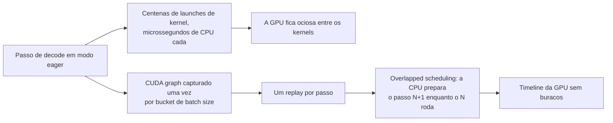

**Follow-ups:** Por que os CUDA graphs precisam de buckets de batch size, e quanto custa o padding até um bucket? Como você confirmaria, por um profile, que um problema de latency vem de overhead do host e não de largura de banda de memória?

</details>

### 36. Os provedores agora vendem o mesmo modelo em vários service tiers: standard, priority, flex ou batch, e provisioned throughput. Como decidir qual tráfego vai para onde?

<details><summary><b>Resposta</b></summary>

Trate os tiers como pontos diferentes de uma curva de preço, latency e garantia de capacidade, e mande cada workload para o tier mais barato que ainda cumpre o seu SLO. O modelo é o mesmo em todos os tiers. O que você compra é prioridade de scheduling e o quanto o provedor garante a capacidade.

- **Standard on-demand.** Preço por token, capacidade compartilhada, latency best-effort, rate limits por organização. É o padrão para features interativas em volume moderado.
- **Priority.** O `service_tier` priority da OpenAI, o Priority Tier da Anthropic e ofertas parecidas cobram um prêmio ou exigem um compromisso em troca de serem escalonados primeiro quando o provedor está ocupado, o que melhora a tail latency e a disponibilidade nos picos. Vale a pena para a fatia crítica de latency, em que um P99 estourado custa receita, e não para todo o tráfego.
- **Flex e batch.** Com desconto, muitas vezes por volta de metade do preço, em troca de conclusão mais lenta ou assíncrona e da chance de ser despriorizado ou recusado em horários de pico. O flex mantém o formato síncrono da API, com timeouts mais longos. O batch recebe um arquivo de requisições e uma janela de conclusão. Os dois servem para evals, backfills, enrichment e tudo que não tenha uma pessoa esperando.
- **Provisioned throughput.** Bedrock, Vertex AI, Azure e compromissos diretos reservam capacidade em model units ou tokens por minuto, cobrados quer você use, quer não. Compra latency previsível e ausência de 429s até o limite da reserva, e a economia dele é a do self-hosting: só compensa com utilização alta e estável.

Como decidir: classifique o tráfego por tolerância a latency e por valor de negócio. Preencha a capacidade provisionada até a sua linha de base sustentada, absorva os picos no standard, mande a fatia crítica para o priority e empurre tudo que pode esperar para flex ou batch. Revise toda semana a utilização da capacidade reservada, porque um compromisso não usado é puro desperdício.

Armadilhas:

- Os tiers podem diferir em rate limits e suporte a features, então teste prompt caching, tool use e structured output em cada tier para o qual você roteia.
- O tráfego flex precisa de timeouts mais longos e de um comportamento definido para quando a capacidade é recusada: tentar de novo mais tarde, cair para o standard ou enfileirar.
- Preços, descontos e termos mudam com frequência. Mantenha a tabela de roteamento de tiers em configuração, marque cada requisição com o tier que a atendeu e atribua custo por tier, para que a próxima renegociação use dados reais.

**Follow-ups:** A sua capacidade provisionada roda a 40% de utilização durante a madrugada: o que você roteia para ela? Como decidir se o P99 de uma feature justifica pagar preço de priority tier?

</details>

## Avançado

### 37. Monte o orçamento completo de memória de GPU de um deployment de serving e mostre como ele determina o batch size máximo e a concorrência.

<details><summary><b>Resposta</b></summary>

Orçamento para uma H100 de 80 GB servindo um modelo classe 70B (80 layers, 8 KV heads, head_dim 128) quantizado em 4 bits:

```
Pesos:     70e9 params × ~0,56 B/param (4 bits + scales)  ≈ 39 GB
Runtime:   CUDA context + buffers do engine               ≈ 2 GB
Activations/workspace (dependem de batch e chunk size)    ≈ 4 GB
------------------------------------------------------------------
Disponível para o KV cache (a ~0,9 de uso de memória)     ≈ 27 GB
```

O KV cache em FP16 é de ~320 KB/token (2 × 80 × 8 × 128 × 2 B), então o pool comporta:

```
27 GB ÷ 320 KB ≈ ~84K tokens de contexto residente no total
```

Esse único número *é* o seu orçamento de concorrência: ~21 sequências simultâneas com 4K de contexto, ~10 com 8K, e uma única requisição com 84K de contexto consome o pool inteiro. Como o throughput de decode cresce com o batch size, é por isso que, na maioria dos deployments, **a memória de KV, e não o compute, limita o throughput**, e por isso uma feature de contexto longo destrói em silêncio a economia de um pool compartilhado.

Alavancas, com o efeito de cada uma na mesma aritmética: KV cache em FP8 → 160 KB/token → ~168K tokens residentes (2× de concorrência); o GQA já está neste modelo (com MHA completa seria 8× pior); uma segunda GPU com TP=2 praticamente dobra o pool de KV *e* reduz à metade os bytes de pesos por GPU; um modelo menor ou um contexto mais curto também ajudam, claro. O PagedAttention importa aqui como habilitador: ele torna ~todos esses 27 GB *utilizáveis* (a alocação contígua anterior desperdiçava a maior parte), e o prefix caching faz com que system prompts compartilhados não sejam contados várias vezes contra o pool.

Feche o raciocínio com o comportamento no limite: quando a admissão estouraria o pool, o scheduler enfileira (o TTFT cresce) ou faz preempt de sequências em execução (evict-and-recompute, com picos de ITL). Por isso "utilização de KV" e "taxa de preemption" são os dashboards que avisam que esse orçamento acabou antes dos usuários.

**Vale desenhar.** Desenhar o orçamento como um fluxo único, da capacidade da placa até as sequências concorrentes, deixa visível que o pool de KV é o que limita o throughput.

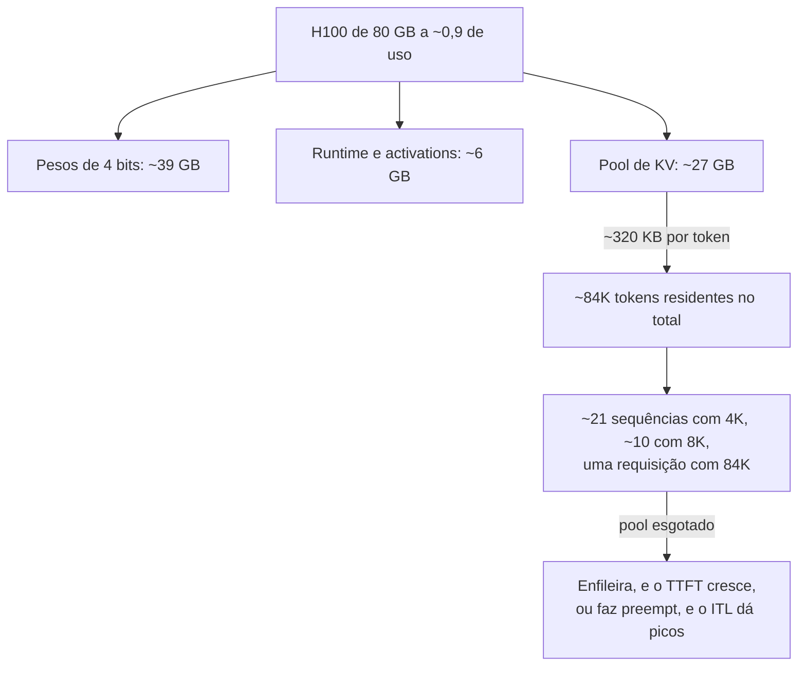

**Follow-ups:** Refaça a conta com pesos em FP8 em 2 GPUs. Seu produto quer subir o limite de contexto de 8K para 128K: o que isso faz com o custo por requisição?

</details>

### 38. Projete os SLOs de uma nova feature baseada em LLM. O que você promete e como mede?

<details><summary><b>Resposta</b></summary>

Parta do que o usuário percebe, para cada padrão de interação. Um único "SLO de latency" global é um erro de categoria:

- **Chat interativo (com streaming)**: P99 de TTFT (digamos, < 1,5 s; P50 de algumas centenas de ms) + P99 de inter-token latency ou um piso de taxa de stream (tokens/s bem acima da velocidade de leitura). A duração total importa menos, porque o streaming a esconde.
- **Autocomplete/sugestões inline**: latency total de conclusão (P95 < ~300-500 ms). O TTFT sozinho não significa nada, já que a saída é curta e só serve inteira.
- **Tarefas agentic/de vários passos (passos sem streaming)**: um orçamento de tempo de conclusão end-to-end da tarefa, decomposto em orçamentos por passo, lembrando que as caudas se acumulam em chamadas sequenciais.
- **Batch/background**: um SLO de frescor (resultados em até N horas) + taxa de conclusão, e não latency.

Além da latency: **disponibilidade** (taxa de respostas bem-sucedidas, com respostas em modo degradado contadas à parte), **guardrails de qualidade** onde forem mensuráveis (taxa de saída válida pelo schema, taxa de validade de tool calls, taxa de refusal/erro), porque uma resposta rápida e errada não cumpre o objetivo, e, muitas vezes, um **SLI de custo** interno (distribuição do custo por requisição), mesmo que não seja uma promessa.

Disciplina de medição: meça na borda do client ou no gateway, e não só no servidor (os usuários vivem a rede e o seu middleware); use percentis por feature e por faixa de tamanho de prompt; defina os eventos com precisão (TTFT = requisição enviada → primeiro token de *conteúdo*, excluindo o handshake com o provedor?); inclua timeouts e erros na distribuição de latency, em vez de descartá-los (a manipulação clássica). Defina as metas a partir de dados: rode a feature, olhe a curva alcançável e escolha metas que você cumpra em ~99%+ do tempo, com folga. Depois, associe um **error budget** e combine o que acontece quando ele queima: congelar mudanças arriscadas, descartar carga, escalar.

Por fim, ligue os SLOs à ação: alertas sobre a burn rate do budget (e não sobre oscilações pontuais), dashboards que decompõem as violações (queueing vs prefill vs provedor vs rede) e prioridades de load shedding que protejam explicitamente o tier interativo com SLO, sacrificando primeiro o tráfego de background.

**Follow-ups:** O P99 do seu provedor é pior que o SLO que você quer oferecer: quais são as suas opções? Por que medir as requisições encerradas por timeout dentro da distribuição de latency?

</details>

### 39. Capacity planning: dizem que você deve esperar 100 requisições/sec no pico, com ~2K tokens de input e ~300 de output por requisição. Me conduza pela estimativa da frota de GPUs.

<details><summary><b>Resposta</b></summary>

Primeiro o método, depois os números: os entrevistadores estão avaliando o processo.

**1. Caracterize a demanda.** Pico de 100 req/s × 2K in / 300 out ⇒ ~200K tok/s de input no prefill e ~30K tok/s de output no decode, de forma sustentada. Olhe também a distribuição: as médias escondem os uploads de documentos de 32K tokens, que dominam o comportamento da cauda. Aplique a cache hit rate esperada do prompt cache (um system prompt compartilhado entre requisições pode reduzir drasticamente o prefill efetivo).

**2. Meça o goodput por réplica; não confie em datasheets.** Pegue a configuração alvo de modelo/engine/GPU (digamos, 70B FP8, TP=2 em H100s), faça load test com tráfego no formato de produção (mesmos tamanhos de entrada/saída, mesmas rajadas de chegada), varie a concorrência e ache o throughput máximo *dentro do seu SLO* (goodput). Por exemplo, você pode medir uma réplica sustentando ~X mil tok/s de saída com o P99 de TTFT dentro do orçamento. Confira o X pelos primeiros princípios: o decode é limitado por largura de banda, então bytes por token × tokens/s precisa caber na largura de banda agregada da HBM; se a sua medição está muito fora da estimativa do roofline, algo está mal configurado.

**3. Divida, com folga.** `réplicas = demanda_de_pico / goodput_por_réplica × folga`. A folga fica em ~1,4-1,7×, porque a latency de queueing explode perto da saturação (mire em ~60-70% de utilização no pico), mais N+1 para falhas e deploys, mais multi-zona, se for exigida. O formato diurno da curva decide quanto fica como capacidade reservada/comprometida e quanto fica em autoscaling.

**4. Não esqueça as partes que não são GPU**: gateway, tokenização, transferência de KV se houver disaggregation. Lembre também que as demandas de prefill e de decode podem justificar pools de *formatos diferentes*.

**5. Valide e itere**: shadow traffic ou rollout gradual, acompanhando goodput, profundidade da fila e utilização de KV, e replaneje todo mês. A deriva do mix de tráfego (contextos mais longos, agentic loops) invalida os planos mais rápido que o crescimento.

A armadilha a evitar: citar um número de tokens/s de um benchmark de blog, rodado com prompts de 128 tokens, e chamar isso de plano. Cite também a alternativa: nessa escala, compare com o preço de provisioned throughput das APIs, porque a frota que você acabou de dimensionar tem um custo total que pode ou não bater essa oferta.

**Follow-ups:** Como uma cache hit rate de 30% no prompt cache muda a resposta? O pico é 3× a média diária: como você divide a capacidade reservada e a de autoscaling?

</details>

### 40. O cold start de uma GPU leva minutos. Como fazer autoscaling de uma frota de inference mesmo assim?

<details><summary><b>Resposta</b></summary>

Primeiro, decomponha o cold start: (1) conseguir um node com GPU, o que leva minutos se há capacidade e é ilimitado se não há (a escassez de GPU é real); (2) baixar uma imagem de container de vários GB; (3) carregar os pesos, e 140 GB do object storage a 1-5 GB/s já são minutos por si só; (4) warmup: init do engine, captura de CUDA graphs, compilação, aquecimento do prefix cache. Ingenuamente, são 5-15 minutos entre a decisão de escalar e o serving, o que não adianta nada contra um pico de tráfego que se forma em 30 segundos.

Então a estratégia é: **escalar por indicadores antecedentes, encurtar o caminho frio e manter buffers aquecidos.**

- **Os sinais certos**: profundidade da fila/tempo de espera, concorrência em andamento, utilização do KV cache, tokens/s contra o goodput por réplica já conhecido. Nada de utilização de GPU (um decode memory-bound mostra ~100% sem que isso signifique muito) e nada de CPU. Limiares de scale-up agressivos, scale-down lento e com histerese (drene os streams com cuidado: as sequências em andamento precisam terminar ou migrar).
- **Encurte o caminho frio**: AMIs/imagens pré-montadas (sem pull), pesos em NVMe local ou no page cache já aquecido, loaders rápidos (safetensors com mmap, loaders de streaming como o tensorizer), técnicas de snapshot/restore quando disponíveis. Passar o tempo de carga de 10 min para menos de 1 min muda o que o autoscaling consegue fazer.
- **Warm pools**: nodes com imagem e pesos já residentes, GPU anexada, processo pausado ou servindo com baixa prioridade. É um standby caro, mas é a única resposta de verdade para picos abruptos. Dimensione o buffer aquecido pela magnitude histórica dos picos.
- **Scaling preditivo/agendado** cuida do grosso do ciclo diurno: escale antes da rampa das 9h, por agenda ou previsão, deixando o scaling reativo só para o que sobrar.
- **Absorva o que você não consegue escalar**: admission control com filas priorizadas (o tráfego de background cede primeiro), modos degradados (um modelo de fallback menor que já esteja aquecido) e overflow de rajadas para uma API de provedor como válvula de alívio, que muitas vezes é o "warm pool" mais barato de todos.

Cite o enquadramento econômico de forma explícita: fazer autoscaling de GPUs é trocar custo de standby por risco de SLO, e a resposta certa muda entre um produto de chat (buffers aquecidos são obrigatórios) e um pipeline em batch (enfileire e escale sem pressa).

**Vale desenhar.** Mostrar o caminho frio etapa por etapa é como você justifica um warm pool para quem acha que autoscaling é só um valor de configuração.

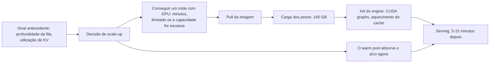

**Follow-ups:** Por que a utilização de GPU é um mau sinal de scaling para workloads dominados por decode? Projete o caminho de scale-down de modo que streams de longa duração não sejam derrubados.

</details>

### 41. O que você monitora em serving de LLM em produção, e o que acorda alguém às 3 da manhã?

<details><summary><b>Resposta</b></summary>

São quatro camadas, cada uma com sinais próprios:

**Camada de experiência do usuário (SLO)**: percentis de TTFT e ITL por feature e por faixa de tamanho de prompt, taxa de sucesso das requisições, taxa de timeout, taxa de abort de streams, taxa de saída válida pelo schema nos endpoints estruturados. Medidos no gateway/na borda, e não só no engine.

**Camada do engine** (vLLM e afins exportam isso via Prometheus): profundidade e tempo de espera da fila, contagens de sequências em execução/aguardando, batch size, **utilização do KV cache**, **contagens de preemption/eviction**, prefix-cache hit rate, tokens de entrada/saída por segundo. Esses são os indicadores antecedentes: KV no teto mais preemptions subindo anunciam precipícios de latency antes que os usuários sintam.

**Camada de hardware**: uso de HBM, largura de banda de memória vs utilização de SM (uma frota de decode memory-bound mostrando "100% de GPU util" é normal; a pergunta interessante é em qual teto você está batendo), throttling por temperatura/potência, erros de ECC, erros de NVLink/interconexão nos grupos de TP, saúde dos nodes.

**Camada de custo e provedor**: tokens e US$ por requisição/feature/tenant, cache hit rates (prompt + semântico), taxas de 429/5xx por provedor, deriva de latency do provedor, anomalias de queima de orçamento.

**O que acorda alguém às 3 da manhã** (afeta o usuário e precisa de um humano agora): alertas de burn rate do SLO de disponibilidade/taxa de erro; violação sustentada do P99 de TTFT/ITL; profundidade da fila crescendo sem limite (saturação/incidente); réplica em crash-loop ou tempestade de OOM; provedor fora do ar e o fallback também falhando; anomalias de segurança. **Ticket para a manhã**: anomalias de custo, regressões de cache hit rate, degradação de uma única réplica com folga, deriva gradual de sinais de qualidade. O critério das 3 da manhã é "a experiência do usuário ou os dados correm risco *e* um humano consegue agir sobre isso". Acionar o plantão por custo ou por utilização bruta de GPU é como os times esgotam quem fica de oncall.

Duas práticas que vale citar: alertas por burn rate (alerte pela velocidade de consumo do error budget, não por oscilações instantâneas) e dashboards de decomposição. Quando o TTFT estoura, você quer uma tela que separe espera na fila vs tempo de prefill vs tempo do provedor vs rede, porque a correção de cada um é completamente diferente.

**Follow-ups:** A utilização de KV está em 95%, as preemptions estão subindo, mas a "utilização" da GPU parece normal: o que está acontecendo e o que você faz? O que você acrescentaria para uma plataforma multi-tenant?

</details>

### 42. Projete a camada de reliability para chamadas a um provedor de LLM: timeouts, retries, circuit breakers, idempotência.

<details><summary><b>Resposta</b></summary>

**Timeouts: em camadas, nunca um número só.** Um único timeout de 120 s está errado para uma chamada com streaming: ele não distingue "lento, mas progredindo" de "travado". Use: timeout de connect (segundos); **timeout de TTFT** (nenhum primeiro token em ~10-20 s → requisição morta); **timeout de inatividade entre chunks** (stream em silêncio por ~30 s → travado; cuidado com pausas legítimas durante tool use do lado do provedor, e heartbeats ajudam); e um teto de tempo total (wall-clock) por feature. Ajuste por classe de modelo: reasoning models pensam por muito tempo, legitimamente, antes do primeiro token visível.

**Retries: limitados e honestos.** Faça retry de 429/5xx/falhas de rede com exponential backoff + full jitter, respeitando o `Retry-After`; nunca faça retry de erros 4xx de validação. Limite a 2-3 tentativas, com um orçamento de latency total, e use um retry budget global (se mais de ~10% do tráfego está em retry, você está amplificando um outage, então descarte carga). A falha no meio do stream é o caso feio: o retry regenera do zero, possivelmente produzindo um texto *diferente*, então a UI precisa substituir, e não acrescentar, e tudo o que já tenha sido acionado downstream precisa ser tratado (veja idempotência). Hedged requests (disparar uma segunda chamada em ~P95 e ficar com a vencedora) compram tail latency com dinheiro, então use apenas em caminhos idempotentes e de alto valor.

**Circuit breakers: por provedor × modelo.** Acompanhe a taxa de falhas numa janela deslizante; abra o breaker diante de falha sustentada (falhe rápido e pare de alimentar uma dependência moribunda), deixe passar sondas limitadas no estado half-open e feche quando houver recuperação. Quando abrir: roteie para a fallback chain, que pode ser um modelo menor da mesma família ou outro provedor, *pré-validada com evals*, porque os prompts não se transferem 1:1 e um colapso silencioso de qualidade é pior que uma página de erro. Faça bulkhead das classes de tráfego, para que jobs em background não esgotem as conexões/cota de que o tráfego interativo precisa.

**Idempotência.** A chamada ao LLM em si é stateless e segura para retry (no pior caso, você paga duas vezes). O perigo são os **efeitos colaterais ao redor dela**: um passo de agent que sofre retry e executa a tool de novo (e-mail duplicado, escrita duplicada). Atribua idempotency keys às operações com efeitos colaterais, faça dedupe na camada de tools e deixe os passos do pipeline seguros para replay (o item de batch reenviado sobrescreve pelo `custom_id`, não acrescenta). Máquinas de estado, não achismo: cada requisição tem um ID e um status durável.

**Vale desenhar.** Os três estados do breaker mais a sonda do half-open são a parte que as pessoas descrevem de forma vaga, e o desenho obriga a ter as transições exatas.

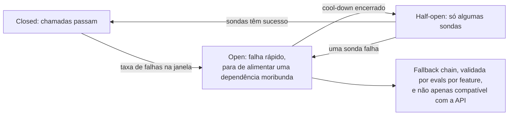

**Follow-ups:** Um stream morre no token 400 de uma resposta de 600 tokens que o usuário está lendo: explique exatamente o que acontece. Por que os modelos de fallback precisam ser validados por evals, e não apenas compatíveis com a API?

</details>

### 43. O tráfego dobra da noite para o dia e você não consegue mais capacidade de GPU por uma semana. Quais são as suas opções de graceful degradation?

<details><summary><b>Resposta</b></summary>

O princípio: **degrade qualidade e features antes da disponibilidade, e degrade primeiro o tráfego de menor valor.** A escada precisa estar desenhada, sob feature flag e testada sob carga *antes* do incidente.

Aproximadamente em ordem de dor para o usuário:

1. **Mova trabalho para fora do pico/offline**: tudo que não é interativo (enrichment, evals, digests) → batch API ou pausado. Isso costuma recuperar 20-40% da capacidade na hora, porque cargas de background se escondem dentro do tráfego "de produção".
2. **Seja agressivo no cache**: aumente os TTLs do prompt cache, pré-calcule respostas populares e afrouxe com cautela os limiares do semantic cache em tráfego tipo FAQ (de olho na hit precision).
3. **Encolha os tokens por requisição**: aperte o `max_tokens`, reduza as janelas de histórico e o número de chunks de RAG, baixe o reasoning effort, desligue modos verbosos. Isso corta compute e a pegada de KV; lembre que cada token residente é memória de KV, então aparar contexto aumenta a concorrência diretamente.
4. **Rebaixe o modelo**: roteie o tráfego de dificuldade média para um modelo menor e mais barato (já aquecido, já avaliado; é por isso que as cascades devem existir antes de você precisar delas). Os usuários recebem respostas um pouco piores, mas ainda recebem respostas.
5. **Corte features**: desligue por kill switches os extras movidos a LLM (sugestões, resumos automáticos, prefetch especulativo).
6. **Admission control priorizado**: interativo > background; tiers pagos > gratuito; dentro de cada tier, enfileire com uma UX honesta (posição/ETA) em vez de dar timeout. Descartar explicitamente as requisições de menor prioridade, com um erro claro, é melhor do que todo mundo tomar timeout.
7. **Overflow de rajadas para uma API de provedor** (se a política permitir): o warm pool alugado. Custa dinheiro, salva o SLO.
8. **Último recurso**: lista de espera/respostas estáticas para o tier mais baixo. Um "estamos no limite de capacidade" honesto preserva mais a confiança que um spinner travado.

Duas notas operacionais que distinguem as respostas seniores: cada degrau precisa de uma **feature flag e de um rollback**, exercitados em game days, porque inventar degradação durante um incidente não dá certo; e instrumente os modos degradados separadamente, porque você precisa saber quanta capacidade cada degrau realmente recuperou, e o produto precisa concordar com a escada de qualidade com antecedência, e não às 3 da manhã.

**Follow-ups:** Quais dessas medidas mudam a pressão sobre a memória de KV e quais mudam a pressão sobre o compute? Como você decide a ordem de prioridade entre chat do tier gratuito e jobs de background do tier pago?

</details>

### 44. Como o structured output é realmente imposto na camada de serving, e quanto isso custa?

<details><summary><b>Resposta</b></summary>

O mecanismo é o **constrained (guided) decoding**: compile o formato alvo (JSON Schema, regex ou uma gramática livre de contexto) em um autômato (FSM para regex/JSON, pushdown para CFGs) e, a cada passo de decode, **aplique uma máscara nos logits** de todos os tokens que violariam o formato, antes do sampling. O modelo só consegue emitir continuações válidas, então a saída é sintaticamente válida *por construção*, sem loops de parse-and-retry. É isso que Outlines e XGrammar implementam, o que vLLM/SGLang expõem como guided/structured output, o que as gramáticas GBNF do llama.cpp fazem e o que as APIs hospedadas rodam no servidor: o modo JSON-schema `strict` da OpenAI, os structured outputs e o strict tool use da Anthropic e os response schemas do Gemini. Cada um suporta um subconjunto diferente de JSON Schema, então conheça as garantias exatas do seu provedor.

Sutilezas que mostram profundidade: a máscara opera sobre **tokens, e não caracteres**. Uma string JSON pode atravessar fronteiras de tokens de modo arbitrário, então o autômato precisa ser compilado contra o vocabulário do tokenizer (a pré-computação cara que Outlines e XGrammar otimizam). Nem todas as features de schema mapeiam bem para gramáticas (recursão ilimitada, algumas features de regex, o tratamento de `additionalProperties`), então confira o subconjunto suportado.

Custos, em três grupos:

- **Tempo de compilação**: a compilação schema→autômato pode levar um tempo perceptível em schemas complexos. Faça cache das gramáticas compiladas, com chave pelo hash do schema (picos de latency na primeira requisição são o sinal de que falta esse cache).
- **Overhead por passo**: calcular a máscara de tokens válidos a cada passo. As implementações modernas deixam isso quase desprezível, mas as ingênuas viram gargalo do loop de decode.
- **Taxa de qualidade (a sutil)**: forçar o formato pode forçar um *comprometimento prematuro*. Se o schema exige `{"answer": ...}` primeiro, o modelo precisa responder antes de raciocinar. Mitigações: coloque um campo de texto livre `reasoning` antes dos campos de resposta restritos, ou rode duas fases (thinking sem restrição → extração restrita). Além disso, enums/patterns apertados demais podem encurralar o modelo em valores errados com confiança, então deixe uma válvula de escape (`"other"`, campos nullable).

Escopo da garantia: o constrained decoding garante **sintaxe, não semântica**. O JSON vai ser parseável, mas os *valores* ainda podem estar errados. Mantenha a validação no nível da aplicação.

**Vale desenhar.** O loop de máscara e avanço a cada passo é o mecanismo, e desenhá-lo separa "válido por construção" de "tentamos de novo até parsear".


**Follow-ups:** Por que a gramática precisa ser compilada contra o vocabulário do tokenizer? Quando você preferiria parse-and-retry ao constrained decoding?

</details>

### 45. A sua conta de LLM triplicou neste trimestre. Projete um programa de cost engineering: atribuição, cascades, gestão de contexto.

<details><summary><b>Resposta</b></summary>

**Passo 1: atribuição antes de otimização.** Você não conserta o que não enxerga. Instrumente toda chamada com as contagens de tokens de input/output/cached/reasoning × preços atuais, marcadas por feature, tenant, modelo e versão do prompt; monte dashboards de custo por requisição / por feature / por usuário ativo, além de alertas de anomalia na burn rate. Em nove de dez casos, a triplicação tem uma causa específica: um agent loop reenviando a cada passo contextos de 20K tokens sem cache, um caminho de retry descontrolado, o aumento de reasoning tokens depois de um upgrade de modelo, ou um tenant B2B muito entusiasmado. Ache isso antes de redesenhar qualquer coisa.

**Passo 2: as alavancas mecânicas, em ordem típica de ROI.**

- **Prompt caching**: reestruture os prompts com o prefixo estável primeiro; no preço no estilo Anthropic, leituras de cache custam ~10% do preço de input. Para tráfego de agent/chat, só isso muitas vezes corta 50%+ do gasto com input.
- **Batch API** para tudo que é offline: ~50% de desconto com janela de 24 h.
- **Disciplina de saída**: limites de `max_tokens`, formatos concisos, nada de repetir o input, reasoning effort ajustado. A saída costuma custar ~4-8× o preço do input, então é nos tokens de saída que o corte rende mais.
- **Gestão de contexto**: sliding window + sumarização para o histórico, menos chunks de RAG e de melhor qualidade (precisão de retrieval é uma feature de custo), poda de resultados verbosos de tools nos agent loops. Fique de olho no padrão quase quadrático: um contexto que cresce a cada turno e é recobrado a cada turno.

**Passo 3: model tiering/cascades.** Roteie pela dificuldade prevista: um router barato (heurísticas, um classificador pequeno ou confiança baseada em logprobs) manda o tráfego fácil para um modelo pequeno e escala os casos difíceis, numa cascade no estilo FrugalGPT: tenta o barato, verifica (validadores, self-consistency, judge) e escala em caso de falha. Dimensione cada feature por evals; muitas features rodam bem em modelos 10-30× mais baratos que a escolha padrão de ir direto para o frontier. Guardrails: valide por evals toda mudança de roteamento e monitore a taxa de escalonamento (uma cascade que escala 60% do tráfego custa *mais* que ir direto ao modelo grande).

**Passo 4: fazer o ganho durar.** Custo por feature na revisão semanal, alertas de orçamento por tenant, testes de regressão de contagem de tokens no CI (uma edição de prompt que dobra os tokens deveria quebrar uma verificação) e reprecificação trimestral, conforme modelos e preços mudam.

**Follow-ups:** Como construir um router de dificuldade sem dados rotulados? Um upgrade de modelo melhorou a qualidade, mas dobrou os reasoning tokens: como você decide?

</details>

### 46. Aprofunde o speculative decoding: a matemática da taxa de aceitação, drafters modernos como Medusa/EAGLE e quando ele sai pela culatra.

<details><summary><b>Resposta</b></summary>

**A matemática.** Seja α a taxa de aceitação por token (o token do draft aceito pela checagem de rejection sampling do alvo). Fazendo o draft de k tokens por ciclo, o número esperado de tokens emitidos por forward pass do alvo é `(1 − α^(k+1)) / (1 − α)` (Leviathan et al.). Com α = 0,8 e k = 4: ~3,4 tokens por passada do alvo. O speedup em tempo real ≈ esse valor dividido pelo custo do ciclo `1 + k·c`, em que c é o custo por token do drafter relativo ao alvo. Portanto, um drafter precisa ser *ao mesmo tempo* bem alinhado (α alto) e barato (c baixo). O α é empírico e depende do domínio: alto em código, boilerplate e extração; mais baixo em texto criativo aberto. Um k maior tem retornos decrescentes (o decaimento α^k desperdiça trabalho de draft depois da primeira rejeição), então o k é ajustado por workload (~4-8 é típico).

**Drafters modernos.** Modelos pequenos separados exigem um tokenizer compatível e ainda gastam tempo sequencial fazendo o draft. O self-drafting elimina isso: o **Medusa** acopla ao alvo heads de decoding extras, que preveem vários tokens futuros numa só passada; o **EAGLE** faz autoregressão no *espaço de features* do alvo (reaproveitando as representações da camada de topo), o que dá uma aceitação bem melhor que heads no nível de token, e verifica sobre uma **árvore** de continuações candidatas, e não sobre uma única cadeia (a tree attention verifica vários ramos numa passada, elevando o comprimento aceito esperado). O drafting por **prompt-lookup/n-gram** recupera spans candidatos do próprio contexto: custo zero de modelo e eficácia brutal em tarefas cujas saídas copiam entradas (edição, extração, citações de RAG). Modelos treinados com módulos de **multi-token prediction (MTP)**, sendo o DeepSeek-V3 o exemplo mais conhecido, já vêm com o próprio drafter, que os engines podem usar direto, sem treino separado. Engines como vLLM, SGLang e TensorRT-LLM incluem várias dessas opções.

**Quando sai pela culatra**: (1) serving com batch alto: a verificação consome compute que o decoding normal de outras sequências teria usado; quando a frota é compute-bound, o spec decoding *reduz* o throughput agregado, então ele é principalmente uma ferramenta de tier de baixo batch/latency; (2) α baixo: overhead de drafting sem nada aceito (domínios descasados e temperaturas altas pioram); (3) memória: um draft model ou heads extras ocupam orçamento de KV/pesos que poderia ter virado batch size; (4) complexidade de engenharia: dois KV caches de modelos, corretude da tree verification, interação com o scheduler. Sempre faça A/B com tráfego no formato de produção: meça o ITL *e* o goodput agregado *e* o custo, por domínio.

**Follow-ups:** Por que a temperature afeta as taxas de aceitação? Esboce como a tree verification dilui uma única passada do alvo entre os ramos candidatos.

</details>

### 47. O que é prefill/decode disaggregation, e por que deployments de grande escala separam as duas fases?

<details><summary><b>Resposta</b></summary>

Rodar as duas fases nas mesmas GPUs causa **interferência**: rajadas de prefill consomem muito compute e travam os decodes que estão ali ao lado (picos de ITL); o decode em regime estável é limitado por largura de banda e deixa ocioso o compute que os prefills na fila querem. O chunked prefill suaviza isso, mas só troca ao longo da mesma curva: um pool único precisa cumprir dois SLOs (TTFT e TPOT) com perfis de recursos anticorrelacionados. A **disaggregation** (DistServe, Mooncake, arquiteturas no estilo NVIDIA Dynamo; suportada no vLLM) divide a frota: um **pool de prefill** processa os prompts e produz os KV caches; um **pool de decode** recebe o KV e faz o streaming dos tokens. A passagem de bastão transfere o KV cache da sequência por NVLink/RDMA/IB.

Por que vence em escala:

- **Ajuste independente dos SLOs**: os nodes de prefill otimizam o TTFT (rodam saturados de compute, com chunks grandes e sem ninguém para atrapalhar); os nodes de decode otimizam o ITL e a densidade de batch (estáveis, otimizados para memória). O DistServe mostrou grandes ganhos de goodput sob SLOs duplos apertados, em comparação com o serving colocalizado.
- **Escala e hardware independentes**: o tráfego pesado em prompts escala o pool de prefill; o tráfego conversacional de gerações longas escala o de decode. Os pools podem até usar estratégias de paralelismo ou SKUs de GPU diferentes (otimizadas para compute vs para largura de banda/capacidade de memória), e a capacidade de prefill pode acumular a função de um store global de prefix cache (o design KV-cêntrico do Mooncake).
- **Isolamento**: o upload de um documento de 100K tokens não congela todos os streams da máquina.

Custos e problemas em aberto: a **transferência de KV** é o imposto, com centenas de MB a GBs por sequência longa, exigindo interconexão rápida e engenharia de sobreposição com o compute; a **complexidade de orquestração** (scheduling em dois estágios, tratamento de falhas no meio da passagem, posicionamento/afinidade de cache para que o reuso de prefixo continue funcionando); o piso de latency que o hop acrescenta; e só compensa a partir de uma escala em que os pools possam ser balanceados. Um deployment de 4 GPUs deve usar chunked prefill e seguir em frente. Enquadramento para a entrevista: chunked prefill = multiplexação no tempo de um único pool; disaggregation = partição no espaço em dois tiers especializados. Mesma tensão, remédio mais forte, mais partes móveis.

**Vale desenhar.** Dois pools, com a passagem de KV desenhada como a aresta, tornam o imposto explícito, em vez de deixá-lo escondido dentro da arquitetura.

```mermaid
flowchart LR
    R["Requisição"] --> PP["Pool de prefill: otimizado para compute,<br/>ajustado para TTFT"]
    PP -->|"KV cache por NVLink, RDMA ou IB"| DP["Pool de decode: otimizado para largura de banda,<br/>ajustado para ITL"]
    DP --> S["Tokens em streaming"]
    PP --> SC["Escala com o volume de prompts"]
    DP --> SD["Escala com o volume de geração"]
```

**Follow-ups:** Estime os bytes de KV transferidos para um prompt de 8K tokens num modelo 70B com GQA: essa transferência é um problema em NVLink vs Ethernet? Como a disaggregation interage com o prefix caching?

</details>

### 48. Projete um gateway de LLM multi-provider: roteamento, fallbacks e as armadilhas em que os times caem.

<details><summary><b>Resposta</b></summary>

**Núcleo**: uma API interna única (na prática, em geral compatível com a da OpenAI, mais extensões), com adapters por provedor que normalizam os formatos de request/response, os formatos dos eventos de streaming, as convenções de tool call e as taxonomias de erro (o 429 de quem significa o quê). Centralize no gateway as credenciais, as cotas por tenant, o logging/medição de custo e a redação de PII: é o único ponto de estrangulamento onde a governança pode ser imposta. Construir ou comprar: gateways no estilo LiteLLM/OpenRouter ou soluções cloud-native (Bedrock/Vertex à frente de várias famílias de modelos) resolvem o encanamento; a política de roteamento e os evals continuam sendo seus.

As camadas de **roteamento**, do estático ao dinâmico: (1) *policy routing*: cada feature fixada num tier de modelo por configuração, alterável sem deploy; (2) *difficulty routing*: um classificador/heurística barato manda o tráfego fácil para modelos pequenos e escala os casos difíceis (cascade com verificação); (3) *operational routing*: seleção ciente de custo, latency e saúde entre backends equivalentes, respeitando as restrições de residência e de tratamento de dados de cada tenant.

**Fallbacks**: circuit breakers por provedor×modelo; quando o breaker abre, percorra uma fallback chain. A regra nada óbvia: **um fallback precisa ser validado por evals, e não apenas compatível com a API**. Os prompts não se transferem 1:1 entre famílias de modelos, e uma troca silenciosa pode derrubar a qualidade enquanto os dashboards seguem verdes. Mantenha scores de eval por backend e por feature, e marque nas respostas qual modelo realmente as serviu.

**Armadilhas que realmente machucam**:

- **Divergência de tokenizer**: as contagens de tokens (limites, lógica de truncamento, estimativas de custo) diferem por provedor. Nunca reutilize as contagens de um tokenizer no orçamento de outro.
- **Disparidade de features**: garantias de structured output, semântica de tool calls, mecânica de prompt caching e tipos de eventos de streaming são todos diferentes. A sua abstração precisa expor as capacidades com honestidade, em vez de fingir um falso denominador comum.
- **Atualizações silenciosas de modelo**: fixe as versões dos modelos e trate os upgrades do provedor como deploys, com execução de evals.
- **Normalização de streaming**: reemita eventos internos limpos e não vaze os formatos do provedor para os clients.
- **Fragmentação de cache**: os prompt caches não se transferem entre provedores, então o failover perde os descontos de cache e os ganhos de TTFT; some isso ao custo do failover.
- **A armadilha do mínimo denominador comum**: abstrair demais joga fora as melhores features de cada provedor. O gateway deve rotear e governar, não achatar.

**Vale desenhar.** O caminho da requisição desenhado de ponta a ponta mostra onde a governança é imposta e onde fica, de fato, a decisão de fallback.

```mermaid
flowchart LR
    A["Requisição do app"] --> GW["Gateway: auth, cota,<br/>redação, medição de custo"]
    GW --> RT["Router: política, dificuldade,<br/>saúde e custo"]
    RT --> P1["Modelo primário"]
    P1 -->|"breaker aberto"| P2["Modelo de fallback,<br/>validado por evals por feature"]
    P1 --> N["Normaliza eventos de stream e erros"]
    P2 --> N
    N --> A
```

**Follow-ups:** Como rodar evals continuamente em vários backends sem explodir o custo? Onde o gateway aplica os controles de prompt injection e de data egress?

</details>

### 49. Você roda 40 réplicas do mesmo modelo atrás de um load balancer, e o round-robin dá uma prefix cache hit rate péssima. Projete a camada de roteamento.

<details><summary><b>Resposta</b></summary>

O KV cache é estado por réplica, então um load balancer stateless joga fora a maior alavanca de custo que você tem. O objetivo é localidade de cache sem destruir o balanceamento de carga, e a tensão entre as duas coisas é o design inteiro.

**Gere a chave da requisição.** Faça o hash do prefixo *estável* mais longo, alinhado em blocos ao tamanho de bloco do engine, tipicamente o system prompt mais as tool definitions mais o histórico da conversa até o último turno. A chave precisa incluir a versão do modelo, a quantization e o adapter LoRA, porque o KV não é portável entre eles.

**Roteie pelo maior prefix match.** Mantenha no router uma aproximação do que cada réplica tem em cache, seja uma radix tree sobre os prefixos (a abordagem do router do SGLang), seja consistent hashing sobre os primeiros N blocos, e mande a requisição para a réplica com o match mais longo.

**Nunca roteie só pelo cache.** Pontue os candidatos com algo como `w1 * match_length - w2 * (queue_depth + running)`, ou pegue os poucos melhores candidatos de cache e aplique power-of-two-choices sobre a carga entre eles. Faça overflow para a próxima melhor réplica quando a melhor estiver saturada. É isso que transforma um tenant "quente" de hotspot em, no máximo, um ponto morno.

**Session affinity é o 80% barato.** O roteamento sticky por id de conversa captura a maior parte do benefício em chat e agents com uma fração da maquinaria. Os custos: você precisa de um fallback gracioso quando uma réplica é drenada ou cai, e ele correlaciona falhas com sessões.

**O estado final escalável** é um tier de KV compartilhado de onde qualquer réplica pode buscar, o que muda o trabalho do router de "acertar" para "acertar mais ou menos", e se combina com a prefill/decode disaggregation, em que o roteamento ciente de prefixo se aplica ao pool de prefill.

Armadilhas para levantar sem ninguém pedir: a visão do router fica desatualizada quando o engine expulsa blocos, então meça a hit rate *real* reportada pelo engine, e não a crença do router. Todo rolling deploy e todo scale-up zera caches, então escalone-os e espere um pico de TTFT e de custo a cada vez. E meça a hit rate em **tokens**, não em requisições, porque é isso que você paga.

**Vale desenhar.** Colocar o score na página deixa concreta a tensão entre cache e carga, que é o que a pergunta realmente testa.

```mermaid
flowchart TD
    R["Requisição"] --> K["Chave: prefixo estável alinhado a blocos<br/>mais modelo, quant, adapter"]
    K --> M["Radix tree: match mais longo por réplica"]
    M --> S["Score = w1 x tamanho do match<br/>menos w2 x carga"]
    S -->|"melhor match saturado"| N["Overflow para a próxima melhor"]
    S --> REP["Réplica escolhida"]
    N --> REP
    REP --> V["Confie na hit rate reportada pelo engine,<br/>em tokens, e não na crença do router"]
```

**Follow-ups:** Como o roteamento ciente de prefixo interage com o autoscaling, e o que isso faz com a sua política de scale-up? Que hit rate justificaria um tier de KV compartilhado em vez de sticky sessions simples?

</details>

### 50. Como servir um grande modelo mixture-of-experts esparso difere de servir um modelo dense, e o que o expert parallelism muda?

<details><summary><b>Resposta</b></summary>

O MoE desacopla memória de FLOPs: os parâmetros totais são enormes, mas só uma pequena fração é ativada por token. Assim, o compute por token é barato e a qualidade é alta, mas você precisa manter todos os experts em algum lugar, e o roteamento depende dos dados. Essa combinação reescreve o playbook de serving.

**Escolha de paralelismo.** Os pesos não cabem numa GPU. Você pode aplicar tensor parallelism aos experts (cada GPU guarda uma fatia de cada expert) ou usar **expert parallelism**: cada GPU guarda experts inteiros, e os tokens são enviados à GPU certa por dispatch e combine em all-to-all (é isso que kernels no estilo DeepEP otimizam). O EP mantém o GEMM de cada expert inteiro e grande, o que é eficiente, e reduz a memória de pesos por GPU, mas coloca dois all-to-alls por layer MoE no caminho crítico de cada token.

**O batch size deixa de ser opcional.** O custo do all-to-all se dilui pelos tokens, e cada expert precisa de tokens suficientes para o GEMM valer a pena. Com QPS baixo, você paga por toda aquela memória e interconexão e recebe uma latency parecida com a de um modelo dense, sem nada do throughput. Um MoE esparso com pouco tráfego é um mau negócio, e esse é o ponto que a maioria dos candidatos perde.

**O desbalanceamento de carga é o problema que define tudo.** O roteamento depende dos dados, então alguns experts ficam quentes. A GPU mais lenta define o tempo do passo e todo mundo espera na barreira do all-to-all, de modo que o desbalanceamento aparece como latency, e não como uma lentidão parcial. Mitigações: replicar os experts quentes, rebalancear periodicamente o posicionamento dos experts a partir das estatísticas de roteamento observadas (o EPLB da DeepSeek é o exemplo público) e rodar batches maiores para que o roteamento se equilibre na média.

**Prefill e decode querem paralelismos diferentes.** O prefill é compute-bound e naturalmente batchy; o decode é limitado pela latency do all-to-all. Querer graus de EP diferentes em cada lado é um dos argumentos mais fortes a favor da prefill/decode disaggregation, que é exatamente o formato dos deployments de MoE em larga escala publicados.

**Refaça o seu modelo de memória.** A attention estilo MLA deixa o KV por token pequeno, então o KV deixa de ser o que limita o batch size, e passam a ser a restrição os pesos dos experts mais a comunicação. Não leve as intuições do modelo dense para cá.

**Vale desenhar.** Dois all-to-alls no caminho crítico e um expert quente na barreira explicam, ao mesmo tempo, o piso de latency e o problema de desbalanceamento.

```mermaid
flowchart LR
    T["Batch de tokens"] --> G["O router escolhe os top-k experts por token"]
    G -->|"dispatch all-to-all"| E1["GPU 1: experts 0-15"]
    G -->|"dispatch all-to-all"| E2["GPU 2: experts 16-31"]
    E1 -->|"combine all-to-all"| C["Combina, depois a próxima layer"]
    E2 -->|"combine all-to-all"| C
    E1 --> HOT["Um expert quente define o tempo do passo<br/>para todos na barreira"]
```

**Follow-ups:** Por que pouco tráfego prejudica mais um deployment MoE do que um dense de qualidade parecida? Como você detectaria e quantificaria o desbalanceamento de experts em produção?

</details>

### 51. Você opera uma plataforma de LLM compartilhada por 30 times internos numa única frota de GPUs. Projete o modelo de tenancy: fairness, isolamento e atribuição de custo.

<details><summary><b>Resposta</b></summary>

**Fairness primeiro, e na unidade certa.** O continuous batching é, na prática, first-come-first-served sobre tokens, então um tenant que dispara 10K requisições deixa todo mundo sem recursos, sem erro e sem nenhum sinal. Você precisa de admission control no gateway e de fair scheduling no engine. A unidade tem de ser *trabalho*, e não requisições: token buckets por tenant em tokens por segundo, com os tokens de saída pesando mais que os de input. Cotas de requisições por segundo são o erro clássico, porque um prompt de 200K tokens vale milhares de turnos de chat. No scheduler, prefira o tenant que consumiu menos serviço recentemente (uma fila justa no estilo virtual-token-counter), em vez da ordem pura de chegada.

**Isolamento é uma escada, escolha um degrau por tenant.** Engine compartilhado é o mais barato e o mais fraco. Pools separados por classe de tráfego são o ponto ideal: quase toda organização precisa de exatamente dois, o interativo (SLO de latency, folga, prioridade) e o de background/batch (preemptível, sem SLO, que preenche o vale). Essa divisão também é o truque de capacidade mais barato que existe. Frotas dedicadas só para os tenants com requisitos reais de compliance.

**Atribuição.** Registre por requisição: tenant, modelo, contagens de tokens de input/output/reasoning/cached e GPU-seconds medidos. Cobre em tokens, pela legibilidade, mas reconcilie com os GPU-seconds, porque os dois divergem muito. Um tenant com 90% de prefix cache hits sai quase de graça; um tenant com prompts únicos de 50K tokens paga prefill de verdade. Depois, decida explicitamente o que acontece com o custo não atribuível (folga ociosa, warm pools, requisições que falharam), porque senão o seu chargeback nunca fecha com a fatura. Cobre isso como uma taxa de overhead ou absorva centralmente, mas decida.

**Guardrails**: limites de contexto e de max_tokens por tenant, circuit breakers por tenant e alertas de gasto pela burn rate, e não pelo total do fim do mês.

**Os failure modes sutis**: vizinhos barulhentos agem pelo KV, e não só pelo compute, então um tenant de contexto longo expulsa os blocos de todo mundo e dispara cascatas de preemption. Acompanhe a taxa de preemption por tenant. E um prefix cache compartilhado é um canal de timing entre tenants: um TTFT rápido revela que outra pessoa enviou aquele prefixo recentemente. Se os tenants não confiam uns nos outros, use um namespace por tenant nas chaves de cache e aceite a perda de hit rate.

**Follow-ups:** Por que cotas de requisições por segundo são a unidade errada, e o que você usaria no lugar? Como você precifica o chargeback interno quando 60% dos tokens de input de um tenant são cache hits?

</details>

### 52. Seu tráfego está migrando de chat de turno único para agents: de 20 a 50 chamadas ao modelo por tarefa, com tool calls entre elas e sessões de dezenas de minutos. O que isso faz com o seu design de serving?

<details><summary><b>Resposta</b></summary>

Muda aquilo que você está otimizando, da latency por token para o tempo de conclusão da tarefa e o custo por tarefa.

**O reuso de prefixo deixa de ser uma otimização e passa a ser a economia.** Cada passo reenvia a trajetória inteira, então os tokens de input acumulados crescem de forma aproximadamente quadrática com o número de passos. Sem prefix caching, você refaz o prefill do histórico inteiro a cada passo; com ele, só do delta. Isso transforma a disciplina de contexto numa questão de serving: histórico append-only, nunca reordenar nem editar turnos anteriores, tool definitions estáveis e nada volátil no começo do prompt. Combine com roteamento ciente de cache ou session affinity, senão o cache existe, mas ninguém acerta nele.

**Intervalos ociosos.** As tool calls levam de ~100 ms a vários segundos, e nesse tempo o KV da sessão fica parado, sem render nada. Manter (pressão de memória, menos sessões concorrentes) ou descartar (refazer o prefill na volta)? Este é o lar natural de um tier de KV offload: expulse para a memória do host na fronteira da tool call e recarregue na volta, o que sai barato porque a largura de banda do host é muito maior que o throughput de prefill.

**Queueing mais em rajadas.** Sub-agents se abrem em paralelo e depois ficam quietos, então as chegadas são correlacionadas, e não Poisson. O seu P99 vai ser pior do que a aritmética da taxa média prevê, e uma capacidade dimensionada pelo QPS médio vai errar.

**Orçamento de latency por passo.** Trinta passos de dois segundos dão um minuto. Isso é aceitável se você fizer streaming do progresso, mas o SLO que você defende é o tempo de conclusão da tarefa, e a separação de métricas de que você precisa é latency do modelo versus latency das tools, porque muitas vezes o culpado são as tools.

**Ciclo de vida.** Quando o usuário cancela uma tarefa, isso precisa matar as gerações em andamento e as tool calls pendentes; tarefas longas precisam de execução durável no servidor, em vez de viver numa única conexão HTTP. Agents em background devem ser preemptíveis e preencher o vale do pool interativo, numa classe de prioridade separada, senão um job em batch arruína o P99 do chat.

**Guardrails.** Limite os passos e o total de tokens por tarefa. Um agent loop sem orçamento é um incidente de custo ilimitado esperando por uma terça-feira ruim.

Métricas: tokens por tarefa, cache hit rate por passo, divisão de latency entre modelo e tools, passos até a conclusão, taxa de sucesso das tarefas.

**Follow-ups:** Por que o crescimento dos tokens de input num agent loop é aproximadamente quadrático no número de passos, e o que você mudaria para achatá-lo? Defenda os dois lados: manter o KV da sessão residente durante uma tool call de 5 segundos ou não.

</details>

### 53. Depois de um deploy de rotina, o P99 de TTFT foi de ~600 ms para ~4 s. Throughput, taxa de erro, utilização de GPU e versão do modelo estão todos iguais. Faça o debug.

<details><summary><b>Resposta</b></summary>

Primeiro rollback, depois debug: um P99 de TTFT de 4 s é um incidente visível para o usuário, e o deploy é o suspeito óbvio.

Depois, a decomposição. TTFT = espera na fila + prefill. Throughput inalterado com TTFT pior significa que não estamos simplesmente sobrecarregados: ou cada requisição está fazendo prefill de mais tokens, ou o scheduler as está admitindo mais tarde. Então a primeira coisa que quero é ter esses dois componentes instrumentados separadamente, porque esse único número divide ao meio todo o espaço de busca.

**Se o tempo de fila cresceu**, o problema é de scheduling e admissão. Candidatos: `max_num_seqs` ou o orçamento de tokens por batch mudou; o chunked prefill foi desabilitado ou teve o limiar alterado, e agora um único prefill longo trava a fila; a taxa de preemption subiu por pressão de KV, então as requisições são expulsas e reenfileiradas; a contagem de réplicas caiu por uma mudança de configuração do autoscaler ou por um rollout ainda drenando; uma nova regra de prioridade ou de roteamento.

**Se o tempo de prefill cresceu**, estamos fazendo prefill de mais tokens, e o principal suspeito é o colapso da prefix cache hit rate. Verifique a hit rate medida em tokens. Se ela passou de ~80% para quase zero, alguém colocou algo volátil no começo do prompt: um timestamp, um request id, o nome do usuário, uma lista de tools reembaralhada, um bloco de RAG reordenado. Tudo o que vem depois do ponto de mudança é miss. O mesmo sintoma pode vir de uma mudança de roteamento que perdeu a afinidade de cache, de uma troca de adapter ou de quantization (as chaves de cache incluem os dois) ou, simplesmente, de um rolling restart que zerou todos os caches, e esse se recupera sozinho, então veja se o gráfico está plano ou voltando a subir.

Outras coisas que fazem o prefill crescer: um template de prompt mais longo, o RAG retornando mais chunks, uma mudança de chat template ou de tokenizer, ou um novo tenant mandando prompts de 100K tokens para a fila compartilhada.

**Por que "utilização de GPU inalterada" não prova nada:** a utilização conta SMs ocupados, e tanto um decode faminto de largura de banda quanto um prefill compute-bound aparecem como ocupados.

**Método:** faça o diff do deploy incluindo configuração e templates de prompt, e não só o código do modelo; quebre o P99 por tenant, rota e faixa de tamanho de prompt, já que uma regressão agregada costuma ser um único segmento; reproduza o tráfego de ontem contra as duas configurações.

O movimento tentador e errado é adicionar réplicas. Isso esconde uma regressão de cache a um custo várias vezes maior.

**Vale desenhar.** Desenhar primeiro o bisect mostra que você faz o debug dividindo a métrica, e não chutando causas de uma lista.

```mermaid
flowchart TD
    T["P99 de TTFT: 600 ms para 4 s"] --> RB["Rollback, depois debug"]
    RB --> S["Separar o TTFT em espera na fila<br/>versus tempo de prefill"]
    S -->|"a fila cresceu"| Q["Scheduling: orçamento de tokens, chunked prefill desligado,<br/>preemptions, contagem de réplicas, regra de roteamento"]
    S -->|"o prefill cresceu"| P["Checar a prefix cache hit rate, medida em tokens"]
    P -->|"colapsou"| V["Bytes voláteis no início, afinidade de cache perdida,<br/>troca de adapter ou quantization"]
    P -->|"estável"| L["Mais tokens: mudança de template, mais chunks de RAG,<br/>um novo tenant de prompts longos"]
```

**Follow-ups:** Como alertar sobre a prefix cache hit rate sem acordar o plantão a cada deploy? Que verificação em tempo de deploy pegaria uma mudança no prefixo do prompt antes de ela ir ao ar?

</details>

### 54. Você está migrando de um transformer dense para um híbrido Mamba-attention. O que muda no seu serving stack?

<details><summary><b>Resposta</b></summary>

Resumindo: o modelo fica muito mais barato em contexto longo, e o seu gerenciador de cache fica muito mais difícil. A memória deixa de crescer com o contexto, e o prefix caching deixa de ser de graça.

**As layers não compartilham mais o mesmo formato de cache.** Num transformer dense, toda layer guarda o mesmo KV por token, então um único pool de blocos uniforme funciona. Um híbrido mistura layers de full attention, que acrescentam KV por token, com layers Mamba ou linear-attention, que guardam um estado recorrente de tamanho fixo, atualizado no lugar. Os engines lidam com isso com um alocador unificado sobre estado heterogêneo por layer: o vLLM agrupa as layers por tipo e força um único tamanho de página entre os grupos, o que na prática significa aumentar o tamanho de bloco da attention até que uma página de attention seja pelo menos tão grande quanto uma página Mamba. O resultado são tamanhos de bloco de attention na casa das centenas de tokens, em vez de 16.

**É no prefix caching que isso pega.** Um bloco de KV é endereçável por token, então dá para fazer match, compartilhar e fazer rollback com granularidade de token. Um estado recorrente é um vetor único que resume tudo o que foi visto até ali: você não consegue fatiá-lo nem cortar os últimos 30 tokens, só tirar um snapshot em fronteiras escolhidas e refazer a partir dali. Assim, o reuso vira checkpointing explícito de estado, com uma escolha de modo que troca memória do pool por hit rate, e o suporte dos engines a isso ainda está amadurecendo.

A armadilha decorre do tamanho de bloco. O match é por bloco, então um prompt menor que um bloco não tem nenhum bloco completo e fica com hit rate de cerca de 0%, enquanto um prompt um pouco acima da fronteira do bloco pode acertar quase tudo. O tráfego de chat com prompts curtos despenca num precipício, sem causa óbvia.

**A memória se inverte.** O KV deixa de crescer linearmente com o contexto na maioria das layers, então o seu teto já não é KV-por-token vezes contexto vezes batch. A concorrência é limitada por um estado por sequência quase constante, na ordem de megabytes em híbridos de porte médio. Refaça o orçamento de memória e a aritmética de dimensionamento de frota das perguntas de capacidade, em vez de levar a fórmula antiga.

**Tudo que move cache precisa mover estado.** A prefill/decode disaggregation e o KV offload agora transferem também o estado recorrente, além dos blocos. Fique de olho também na latency com baixa concorrência: os kernels Mamba costumam ser em Triton, então a cobertura de CUDA graphs pesa mais que num modelo dense.

**Vale desenhar.** O desenho mostra como uma restrição do alocador vira um precipício de cache para prompts curtos.

```mermaid
flowchart TD
    M["Modelo híbrido: poucas layers de attention,<br/>maioria de layers Mamba ou lineares"] --> A["Layer de attention: blocos de KV,<br/>endereçáveis por token, fatiáveis"]
    M --> S["Layer Mamba: estado de tamanho fixo,<br/>atualizado no lugar, não fatiável"]
    A --> U["Alocador unificado, um só tamanho de página<br/>para todos os grupos de layers"]
    S --> U
    U --> B["Bloco de attention aumentado para casar<br/>com a página Mamba, centenas de tokens"]
    B --> H["Prompt menor que um bloco:<br/>nenhum bloco completo, 0% de cache hit"]
    S --> C["O reuso exige checkpoints explícitos de estado<br/>mais replay a partir deles"]
```

**Follow-ups:** Por que não dá para fazer rollback de um estado Mamba em 30 tokens como se faz com blocos de KV, e quanto isso custa a um agent que edita o próprio histórico? Seu deployment híbrido reporta 0% de prefix cache hit rate em tráfego de chat, mas 90% em tráfego de RAG. O que você checa primeiro?

</details>

### 55. O produto quer oferecer uma janela de contexto de 1M tokens num modelo que você hospeda. O que quebra no serving, e como fazer funcionar?

<details><summary><b>Resposta</b></summary>

Três coisas quebram ao mesmo tempo: o KV cache de uma única requisição passa do tamanho de uma GPU, o prefill demora tanto que vira um problema de produto por si só, e uma única requisição assim pode deixar todo o resto da máquina sem recursos. Dimensione antes de concordar.

**Memória.** Com o formato 70B GQA usado antes (~320 KB por token em FP16), 1M de tokens dá ~330 GB de KV para uma só sequência, a HBM de várias GPUs. O KV em FP8 corta isso pela metade. Arquiteturas com MLA, layers de sliding window ou layers híbridas de linear attention cortam muito mais, e é por isso que os modelos de contexto longo são construídos assim. De qualquer forma, uma requisição de 1M precisa da sua própria classe de capacidade.

**Prefill.** Os FLOPs da attention crescem de forma quadrática, então com 1M de tokens a attention domina o trabalho das layers lineares, e numa GPU só o prefill levaria dezenas de minutos, mesmo que a memória permitisse. A solução é o **context parallelism**: dividir a sequência entre as GPUs, cada uma com uma fatia de Q, K e V, passando blocos de KV em anel (ring attention) ou fazendo gather, sobrepondo comunicação e compute. O tempo de prefill cai aproximadamente com o número de GPUs, e o KV cache acaba distribuído entre os dispositivos.

**Decode.** Cada passo lê o KV cache inteiro, e essa leitura não se dilui pelo batch como a dos pesos, então a latency por token sobe com o contexto. Mantenha o KV distribuído: cada GPU calcula a attention parcial sobre a sua fatia, e um pequeno combine junta os softmaxes parciais.

**Scheduling.** Roteie as requisições longas para um pool dedicado, para que um prefill de vários minutos nunca divida fila com o chat. O admission control precisa reservar KV para a requisição inteira de antemão; caso contrário, ela sofre preemption no meio e é recalculada, a preemption mais cara que existe.

**Economia e qualidade.** O prefix caching é o que torna isso acessível: os usuários fazem muitas perguntas sobre o mesmo corpus, então o prefill de 1M é pago uma vez e reaproveitado, idealmente a partir de um tier de offload. Precifique o contexto longo à parte, como alguns provedores fazem acima de um limiar. E rode os evals de contexto longo primeiro, porque muitos modelos degradam bem antes do limite anunciado.

**Vale desenhar.** O desenho mostra a requisição longa seguindo um caminho próprio, da admissão ao reuso, que é o núcleo do design.

```mermaid
flowchart TD
    R["Requisição de 1M tokens"] --> A["Admissão: reservar todo o KV<br/>antes de aceitar"]
    A --> L["Pool dedicado de contexto longo"]
    L --> CP["Prefill com context parallelism,<br/>sequência dividida entre as GPUs"]
    CP -->|"blocos de KV passados em anel"| KV["KV cache distribuído,<br/>FP8 para cortar pela metade"]
    KV --> D["Decode: attention parcial por GPU,<br/>depois um combine"]
    KV --> PC["Prefix cache ou tier de offload<br/>para a próxima pergunta"]
```

**Follow-ups:** Por que o context parallelism ajuda muito mais o prefill do que o decode? Um cliente envia um documento diferente de 900K tokens a cada requisição: como isso muda o seu preço e o seu plano de capacidade?

</details>

### 56. O que muda no seu design de serving quando o domínio NVLink cresce de 8 GPUs num servidor para 72 GPUs num rack, como nos sistemas classe GB200 NVL72?

<details><summary><b>Resposta</b></summary>

A fronteira entre "interconexão rápida" e "rede lenta" sai do servidor e vai para o rack, e isso muda quais planos de paralelismo valem a pena. Num servidor de 8 GPUs, a regra era tensor parallelism dentro da máquina e qualquer coisa que cruzasse máquinas passando por InfiniBand ou Ethernet, algo como uma ordem de grandeza mais lento. Num domínio NVLink de 72 GPUs, como o GB200 NVL72, toda GPU alcança todas as outras por switches NVLink, a ~1,8 TB/s por GPU.

O que isso destrava:

- **Expert parallelism amplo.** O dispatch e o combine em all-to-all, que dominam o decode de MoEs grandes, eram dolorosos entre nodes. Dentro de um único domínio NVLink, você pode espalhar os experts por dezenas de GPUs, de modo que cada GPU guarda poucos experts, a maior parte da HBM vai para o KV cache e o batch por GPU cresce. Os deployments de MoE em larga escala publicados nesses racks se apoiam exatamente nisso.
- **Instâncias maiores sem pipeline parallelism.** Um modelo grande demais para 8 GPUs não precisa mais de estágios de pipeline sobre um link lento, então você evita bubbles e a latency dos hops entre estágios.
- **Movimentação barata de KV.** A passagem de prefill/decode e os tiers de KV compartilhados dentro do rack movem bytes na velocidade do NVLink, o que reduz o imposto da disaggregation.

O que isso custa:

- **Raio de impacto.** Uma única instância de serving pode ocupar a maior parte de um rack, então a falha de uma GPU ou de um link pode derrubar uma réplica grande. Health checking, failover e planejamento de capacidade de reserva passam de um raciocínio por GPU para um raciocínio por rack.
- **Granularidade grossa.** Réplicas menos numerosas e maiores significam autoscaling mais "em degraus" e um negócio pior com pouco tráfego, a mesma armadilha de baixo QPS do MoE em geral.
- **O software precisa conhecer a topologia.** Você precisa de kernels de all-to-all feitos para o domínio, posicionamento de experts ciente da topologia e orquestração ciente do rack, como NVIDIA Dynamo ou llm-d. Um stack ajustado para nodes de 8 GPUs deixa a maior parte do benefício sem uso.
- **Infraestrutura física.** Refrigeração líquida e densidade de potência por rack decidem onde você consegue, de fato, essa capacidade.

O ponto de entrevista: a topologia decide o plano de paralelismo. Refaça TP, EP e as divisões de prefill/decode a partir do novo tamanho de domínio, em vez de portar o plano de 8 GPUs.

**Vale desenhar.** O desenho contrasta onde fica o link lento em cada topologia, que é o que guia todas as escolhas seguintes.

```mermaid
flowchart LR
    S["Servidor de 8 GPUs"] -->|"NVLink dentro da máquina"| TP["Tensor parallel dentro das 8"]
    S -->|"InfiniBand ou Ethernet entre máquinas"| PP["Estágios de pipeline ou EP estreito,<br/>all-to-all lento"]
    R["Rack NVLink de 72 GPUs"] -->|"NVLink por todo o rack"| WEP["Expert parallelism amplo,<br/>all-to-all rápido"]
    WEP --> KV["A maior parte da HBM liberada para KV cache"]
    R --> BR["Raio de impacto maior,<br/>unidades de scaling mais grossas"]
```

**Follow-ups:** Por que o expert parallelism amplo libera HBM para o KV cache, e como isso muda o batch size alcançável? Uma bandeja de switch NVLink falha no rack: o que acontece com a sua instância de serving e como você projeta para isso?

</details>
