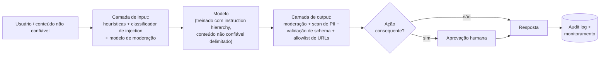

# 🛡️ Safety, Security & Responsible AI

> 🇧🇷 Tradução em português do Brasil. Versão original em inglês: [README.md](README.md).

Toda empresa que entrega features com LLM agora faz uma revisão de segurança, e "como você impediria prompt injection?" virou o equivalente em AI engineering de "como você preveniria SQL injection?" - exceto que a resposta honesta é mais difícil. Este tópico aparece em rodadas de system design para vagas de AI/GenAI engineer, em loops dedicados de segurança em laboratórios de fronteira e, cada vez mais, como pergunta-filtro em qualquer lugar onde agents tocam dados reais de usuários: os entrevistadores querem engenheiros que projetam para a falha, não os que acreditam que um system prompt é uma fronteira de segurança.

## Crash course

### A causa raiz: instruções e dados compartilham um único canal

A context window de um LLM **não tem separação de privilégios**. System prompt, mensagem do usuário, documentos recuperados e resultados de tools são todos apenas tokens; seguir instruções é um *comportamento treinado*, não uma fronteira imposta. Qualquer coisa que o modelo leia pode direcionar o que ele faz. Quase todo problema deste tópico - injection, leakage, sequestro de agents - é consequência deste único fato, e toda defesa é uma tentativa de reinstalar a separação a partir de fora.

### Prompt injection: direta vs indireta

**Injection direta**: o atacante *é* o usuário ("ignore as instruções anteriores e..."). **Injection indireta**: o atacante planta instruções em conteúdo que seu app vai processar em nome de outra pessoa - uma página web, um e-mail, um currículo, um PDF, um convite de calendário, um resultado de tool. A indireta é a perigosa: a vítima nunca vê o ataque, e ele escala (uma página envenenada atinge todo agent que a navega). Simon Willison batizou "prompt injection" em 2022, e Greshake et al. caracterizaram a variante indireta em 2023. A analogia com SQL injection é adequada, exceto que **não existe equivalente a queries parametrizadas**. Mitigações em tempo de treinamento, como a instruction hierarchy da OpenAI (system privilegiado > user > conteúdo de tools), reduzem as taxas de sucesso de ataque, mas são probabilísticas - e em segurança, um filtro de 99% significa apenas que o atacante itera até cair no 1%. **Projete assumindo que a injection tem sucesso.**

### Jailbreaks são um ataque diferente

- **Jailbreak** = atacar o *safety training do modelo* para extrair conteúdo que o provedor proíbe. Atacante e vítima: o usuário e o provedor do modelo.
- **Prompt injection** = atacar a *aplicação* para abusar dos dados e privilégios do usuário. Um terceiro ataca o usuário *através* do seu app.

Famílias de jailbreak, conceitualmente: **roleplay/enquadramento de persona** (invólucro de ficção vs. recusas treinadas), **many-shot** (centenas de turnos de diálogo falsos exploram o in-context learning em janelas longas - Anthropic, 2024), **encoding/ofuscação** (base64, cifras, idiomas de poucos recursos - a capacidade generaliza mais longe do que o safety training), **sufixos otimizados** (strings buscadas por gradiente, GCG, que transferem entre modelos), **escalada multi-turno** e perturbação aleatória **best-of-N**. Fio condutor: o safety training é distribucional; os atacantes saem da distribuição.

### Defense in depth

Nenhuma camada única funciona. Empilhe-as e reduza o blast radius:

Princípios que geram as camadas: **least privilege** (escopos mínimos de tools, defaults somente leitura), **trate todo output do modelo como não confiável** (faça escape, parametrize, isole em sandbox - ele é transitivamente controlado pelo atacante), **restrições estruturais** (um modelo forçado a emitir `{"category": um de 5 enums}` não consegue exfiltrar um segredo, não importa o que seja injetado), **aprovação humana para ações irreversíveis** e **audit logging** para tudo.

### A lethal trifecta

O teste de design de Simon Willison para agents. Um agent que combina **(1) acesso a dados privados**, **(2) exposição a conteúdo não confiável** e **(3) um canal de exfiltração** (enviar e-mail, HTTP fetch, imagens markdown) é explorável - ponto final. A correção é arquitetural: **remova uma das pernas**. Coloque o canal de exfiltração atrás de aprovação, não alimente o agent privilegiado com conteúdo não confiável, ou não dê dados privados a esse agent. O ecossistema mix-and-match de tools do MCP facilita que *usuários* montem a trifecta por acidente.

### Defesas em nível de design

O **padrão dual-LLM** (Willison, 2023): um LLM *privilegiado* planeja e chama tools, mas nunca lê conteúdo não confiável; um LLM *em quarentena* processa o conteúdo não confiável e retorna resultados apenas como variáveis tipadas (`$email_summary`) que o lado privilegiado manipula simbolicamente sem lê-las. O **CaMeL** (Google DeepMind, 2025) endurece isso em plan-then-execute: o planner escreve código apenas a partir da requisição confiável, um interpretador customizado o executa, e políticas de capability rastreiam quais dados podem fluir para quais sinks. Resistência real a prompt injection por construção - ao custo de flexibilidade (o plano não consegue se adaptar ao que os dados dizem) e de esforço de engenharia. Um paper de meados de 2025 (Beurer-Kellner et al.) cataloga seis desses padrões: action-selector, plan-then-execute, LLM map-reduce, dual LLM, code-then-execute e context-minimisation. Todos eles trocam capacidade por uma garantia: texto não confiável nunca escolhe a próxima ação do agent.

### OWASP Top 10 for LLM Applications (2025)

O vocabulário compartilhado das revisões de segurança de IA: **LLM01 Prompt Injection**, **LLM02 Sensitive Information Disclosure**, **LLM03 Supply Chain**, **LLM04 Data & Model Poisoning**, **LLM05 Improper Output Handling**, **LLM06 Excessive Agency**, **LLM07 System Prompt Leakage**, **LLM08 Vector & Embedding Weaknesses**, **LLM09 Misinformation**, **LLM10 Unbounded Consumption**. Para produtos com agents, 01 + 05 + 06 formam a cadeia crítica: instruções injetadas → output não sanitizado → tools com privilégios excessivos. Em dezembro de 2025, o OWASP GenAI Security Project adicionou um **Top 10 for Agentic Applications** separado (de ASI01 Agent Goal Hijack a ASI10 Rogue Agents), cobrindo uso indevido de tools, abuso de identidade e privilégio, memory poisoning e comunicação entre agents. Em uma revisão de agent, use as duas listas.

### Engenharia de guardrails

- **Lado do input:** heurísticas baratas (denylists de regex, limites de tamanho) → pequenos classificadores de injection/jailbreak (estilo Prompt Guard, dezenas de ms) → moderação (o endpoint gratuito de moderação da OpenAI; LLMs de safeguard estilo **Llama Guard** classificando contra uma taxonomia de hazards).
- **Lado do output:** moderação, detecção de PII (p. ex., Presidio), checagens de groundedness, **validação de schema** - o guardrail de maior alavancagem porque é determinístico.
- **Conta de latency:** checagens em série se somam. Rode classificadores de input *em paralelo* com a geração principal e cancele ao detectar algo; para checagens de output, streaming é o inimigo - faça buffer e cheque frase a frase, ou faça stream livre para chat mas barre rigidamente tudo que dispara uma ação. Divida em tiers por risco: checagens baratas em todo lugar, checagens caras nos gatilhos.
- Lembre que os modelos de guardrail também são atacáveis, e todo classificador tem um orçamento de falsos positivos que você paga em qualidade de produto.

### Data leakage & privacidade

Dados sensíveis vazam por mais caminhos do que o modelo: **prompts enviados a vendors, traces de observabilidade (eles armazenam prompts completos!), logs, eval sets, dados de fine-tuning, caches, embeddings**. Controles: tiers de API/enterprise não treinam com seus dados por padrão; acordos de **zero-data-retention (ZDR)** removem até a janela de ~30 dias de monitoramento de abuso; DPAs/BAAs para dados regulados. **Assuma que o system prompt vaza** - a extração é trivial, então nenhum segredo em prompts, jamais; mantenha a autorização no lado do servidor. Os modelos também **memorizam** dados de treinamento - ataques de extração já recuperaram PII literal de modelos em produção - então faça dedup e scrub antes de qualquer treinamento/fine-tuning. Pilha de técnicas: **redação de PII pré-LLM** (NER → placeholders `[PERSON_1]` com um mapa reversível para re-hidratação), pseudonimização, **deployment VPC/privado** (Bedrock, Azure OpenAI, Vertex) ou open weights on-prem para soberania, e **isolamento por tenant** - namespaces separados de vector index, filtros de ACL em tempo de query, nunca um cache compartilhado entre tenants.

### Segurança de agents & supply chain

- **Tools:** escopos de least privilege por tarefa (default somente leitura, credenciais de curta duração), argumentos validados (raízes de path, allowlists de URL, usuários de DB somente leitura), gates de aprovação para ações irreversíveis.
- **Execução de código:** sandbox (container/gVisor/Firecracker/WASM), **sem network egress por padrão**, limites de recursos, filesystems descartáveis.
- **MCP/tools de terceiros:** as *descrições* das tools entram no seu contexto - são um vetor de injection (**tool poisoning**); servidores podem mudar descrições depois que você as aprovou (**rug pull**) ou instruir o modelo a usar *outras* tools de forma indevida (**shadowing**); um servidor stdio é código arbitrário na sua máquina. Fixe versões, revise descrições, faça diff em mudanças, use allowlist de registries.
- **Identidade e memória:** um agent que detém credenciais amplas enquanto age em nome de um usuário menos privilegiado é um **confused deputy** - prefira tokens delegados e com escopo do usuário a uma service account compartilhada. Memória persistente transforma uma injection pontual em uma durável (**memory poisoning**), então trate escritas na memória como input não confiável, com proveniência, revisão e expiração.
- **Artefatos de modelo:** checkpoints baseados em pickle executam código arbitrário ao carregar - use **safetensors** (formato somente de dados); PyTorch 2.6 e posteriores usam por padrão `torch.load(weights_only=True)`. Fixe revisões e verifique hashes.

### Alinhamento, para engenheiros

O pré-treinamento cria capacidades, inclusive as danosas. **RLHF** (e os sucessores DPO/RLAIF) molda a distribuição de comportamento - utilidade *e* recusas vivem nos pesos. **Constitutional AI / RLAIF** em uma linha: o modelo critica e revisa seus próprios outputs contra princípios escritos, e então rótulos de preferência de IA substituem os humanos para harmlessness durante o RL. Um system prompt apenas *condiciona* essa policy treinada; ele não consegue remover uma capacidade e pode ser sobrescrito - e por isso "alinhamento via system prompt" é uma frase de red flag. O outro lado é o **over-refusal**: um modelo que recusa pedidos benignos é trivialmente "seguro" e inútil, então evals de segurança devem sempre parear taxas de compliance com pedidos danosos com taxas de recusa benigna.

### Hallucination é um problema de segurança

Fabricação confiante queima usuários (advogados já foram sancionados por protocolar citações fabricadas). Mitigações: **grounding** (RAG com instruções para responder apenas a partir do contexto), **citações** cuja existência nas fontes você realmente verifica, **abstenção** - fluxos de produto e prompts que tornam "não sei" uma resposta de primeira classe - e checagens de groundedness post-hoc. Os modelos alucinam em parte porque o treinamento e os benchmarks recompensam o chute confiante em vez da incerteza calibrada; o design de produto precisa empurrar na direção oposta.

### Red-teaming e safety evals

**Pré-lançamento:** red-teaming manual por especialistas (segurança + domínio) mais scanners automatizados (garak, PyRIT) e loops de LLM atacante, cobrindo categorias OWASP e os piores danos específicos do seu app. **Contínuo:** re-execute a cada troca de modelo, mudança de prompt e nova tool - o comportamento não é estável entre versões. Converta cada achado em um regression eval; acompanhe a taxa de sucesso de ataque ao longo do tempo. Conheça os nomes dos benchmarks (HarmBench, StrongREJECT, AgentHarm para tarefas danosas de agents, AgentDojo para prompt injection contra agents que usam tools, XSTest para over-refusal) e seus limites: benchmarks estáticos ficam obsoletos contra atacantes adaptativos e nunca cobrem o seu domínio.

### Processo de Responsible AI

**Model cards / system cards** documentam uso pretendido, evals e limitações (model card = o modelo; system card = o seu sistema em produção). **EU AI Act**: tiers de risco - práticas proibidas, alto risco (contratação, crédito, médico - avaliações de conformidade, logging, supervisão humana), tier de transparência (chatbots devem se declarar IA), mínimo - mais obrigações separadas para modelos de propósito geral. As proibições valem desde fevereiro de 2025 e as obrigações de GPAI desde agosto de 2025; o acordo Digital Omnibus fechado em maio de 2026 moveu as obrigações de alto risco independentes (Anexo III) para dezembro de 2027 e as embutidas em produtos (Anexo I) para agosto de 2028, então confirme o texto adotado antes de citar datas. **NIST AI RMF** em uma linha: um framework voluntário organizado em Govern / Map / Measure / Manage, com um Generative AI Profile (NIST AI 600-1) mapeando-o para riscos de LLM. **ISO/IEC 42001** é o padrão certificável de sistema de gestão de IA que compradores enterprise pedem cada vez mais. **Audit logging**: registros imutáveis de prompts, outputs, tool calls e aprovações - com a tensão de privacidade (logar tudo vs. reter nada) resolvida via logs redigidos mais acesso restrito ao bruto.

## Perguntas de entrevista

Veja [questions.pt-BR.md](questions.pt-BR.md) - **52 perguntas** com respostas, de noções básicas de injection ao design completo de um agent seguro.

## Red flags que os entrevistadores observam

- Afirmar que prompt injection é resolvida por uma instrução no system prompt, um esquema de delimitadores ou "um prompt melhor" - ou não saber a diferença entre prompt injection e jailbreaking.
- Propor colocar API keys, credenciais ou lógica de negócio secreta no system prompt; tratar o sigilo do prompt como um controle de segurança.
- Projetar um agent com a lethal trifecta completa e sem gates de aprovação - ou nunca ter ouvido o termo e não ter nenhum modelo mental equivalente.
- Confiar no output do modelo: renderizá-lo como HTML, executar SQL/código gerado sem sandbox, ou encaminhá-lo a tools privilegiadas sem validação.
- Nenhuma resposta para latency de guardrails e falsos positivos - propor cinco chamadas seriais a classificadores em toda requisição sem discutir custo, streaming ou orçamento de FP.
- Achar que "não treinamos com seus dados" é toda a história de privacidade - ignorando logs, traces, janelas de retenção, embeddings e isolamento por tenant.
- Red teaming único pré-lançamento, sem regression evals, sem monitoramento e sem plano para re-testar após mudanças de modelo ou prompt.
- Respostas tudo-segurança-nada-produto: incapaz de discutir over-refusal, custo de UX dos guardrails ou onde o risco residual é conscientemente aceito.

## Leituras complementares

- [The lethal trifecta for AI agents - Simon Willison](https://simonwillison.net/2025/Jun/16/the-lethal-trifecta/) - o modelo mental essencial de segurança de agents.
- [Prompt injection series - Simon Willison](https://simonwillison.net/series/prompt-injection/) - da criação do termo em 2022 até dual-LLM e CaMeL.
- [Not what you've signed up for: Compromising Real-World LLM-Integrated Applications with Indirect Prompt Injection - Greshake et al.](https://arxiv.org/abs/2302.12173) - o paper que definiu a injection indireta.
- [Defeating Prompt Injections by Design (CaMeL) - Debenedetti et al.](https://arxiv.org/abs/2503.18813) - plan-then-execute com rastreamento de capabilities.
- [Design Patterns for Securing LLM Agents against Prompt Injections - Beurer-Kellner et al.](https://arxiv.org/abs/2506.08837) - seis padrões arquiteturais e seus tradeoffs.
- [OWASP Top 10 for Large Language Model Applications](https://owasp.org/www-project-top-10-for-large-language-model-applications/) - o vocabulário compartilhado para revisões de segurança de LLM.
- [OWASP Top 10 for Agentic Applications](https://genai.owasp.org/resource/owasp-top-10-for-agentic-applications-for-2026/) - a lista companheira específica para agents (ASI01-ASI10).
- [Universal and Transferable Adversarial Attacks on Aligned Language Models - Zou et al.](https://arxiv.org/abs/2307.15043) - GCG; por que a segurança em nível de prompt é frágil.
- [Many-shot jailbreaking - Anthropic](https://www.anthropic.com/research/many-shot-jailbreaking) - long context como superfície de ataque.
- [Constitutional AI: Harmlessness from AI Feedback - Bai et al.](https://arxiv.org/abs/2212.08073) - o paper de RLAIF por trás de "o alinhamento vive nos pesos."
- [Scalable Extraction of Training Data from (Production) Language Models - Nasr et al.](https://arxiv.org/abs/2311.17035) - memorização e extração contra modelos de chat em produção.
- [NIST AI Risk Management Framework](https://www.nist.gov/itl/ai-risk-management-framework) - Govern / Map / Measure / Manage.
