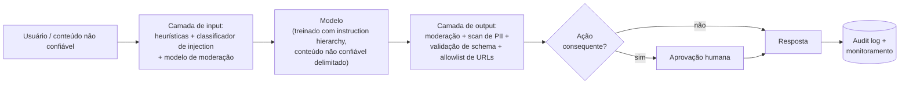

# 🛡️ Safety, Security & Responsible AI

> 🇧🇷 Tradução em português do Brasil. Versão original em inglês: [README.md](README.md).

Toda empresa que lança features com LLM hoje passa por uma revisão de segurança, e "como você impediria prompt injection?" virou, em AI engineering, o equivalente a "como você preveniria SQL injection?". A diferença é que aqui a resposta honesta é mais difícil. O tema aparece em rodadas de system design para vagas de AI/GenAI engineer, em loops dedicados de segurança nos frontier labs e, cada vez mais, como pergunta-filtro em qualquer lugar onde agents tocam dados reais de usuários. Os entrevistadores querem engenheiros que projetam já pensando na falha, não quem acredita que um system prompt é uma fronteira de segurança.

## Crash course

### A causa raiz: instruções e dados compartilham um único canal

A context window de um LLM **não tem separação de privilégios**. System prompt, mensagem do usuário, documentos recuperados e resultados de tools são todos apenas tokens. Seguir instruções é um *comportamento treinado*, não uma fronteira imposta, e qualquer coisa que o modelo leia pode direcionar o que ele faz. Quase todos os problemas deste tópico (injection, leakage, sequestro de agents) são consequência desse único fato, e toda defesa é uma tentativa de recolocar a separação por fora.

### Prompt injection: direta vs indireta

**Injection direta**: o atacante *é* o usuário ("ignore as instruções anteriores e..."). **Injection indireta**: o atacante planta instruções em um conteúdo que seu app vai processar em nome de outra pessoa, como uma página web, um e-mail, um currículo, um PDF, um convite de calendário ou um resultado de tool. A indireta é a perigosa: a vítima nunca vê o ataque, e ele escala (uma página envenenada atinge todo agent que a navega). Simon Willison cunhou o termo "prompt injection" em 2022, e Greshake et al. caracterizaram a variante indireta em 2023. A analogia com SQL injection é boa, só que **não existe equivalente às queries parametrizadas**. Mitigações aplicadas no treinamento, como a instruction hierarchy da OpenAI (system, que é privilegiado, > user > conteúdo de tools), reduzem a taxa de sucesso dos ataques, mas são probabilísticas. Em segurança, um filtro de 99% só significa que o atacante vai tentando até cair no 1%. **Projete assumindo que a injection vai funcionar.**

### Jailbreaks são um ataque diferente

- **Jailbreak**: ataca o *safety training do modelo* para extrair conteúdo que o provedor proíbe. Atacante e vítima são o usuário e o provedor do modelo.
- **Prompt injection**: ataca a *aplicação* para abusar dos dados e privilégios do usuário. Um terceiro ataca o usuário *através* do seu app.

Famílias de jailbreak, em termos conceituais: **roleplay/enquadramento de persona** (um invólucro de ficção contra as recusas treinadas), **many-shot** (centenas de turnos de diálogo falsos exploram o in-context learning em janelas longas, Anthropic, 2024), **encoding/ofuscação** (base64, cifras, idiomas com poucos recursos: a capacidade generaliza mais longe que o safety training), **sufixos otimizados** (strings encontradas por busca com gradiente, as GCG, que transferem entre modelos), **escalada multi-turno** e perturbação aleatória **best-of-N**. O ponto em comum: o safety training é distribucional, e os atacantes saem da distribuição.

### Defense in depth

Nenhuma camada sozinha resolve. Empilhe várias e reduza o blast radius:

Princípios que geram as camadas: **least privilege** (escopos mínimos de tools, defaults somente leitura); **trate todo output do modelo como não confiável** (faça escape, parametrize, rode em sandbox: ele é, por transitividade, controlado pelo atacante); **restrições estruturais** (um modelo obrigado a emitir `{"category": um de 5 enums}` não consegue exfiltrar um segredo, não importa o que seja injetado); **aprovação humana para ações irreversíveis**; e **audit logging** de tudo.

### A lethal trifecta

O teste de design de Simon Willison para agents. Um agent que combina **(1) acesso a dados privados**, **(2) exposição a conteúdo não confiável** e **(3) um canal de exfiltração** (enviar e-mail, HTTP fetch, imagens em markdown) é explorável, ponto final. A correção é arquitetural: **remova uma das pernas**. Coloque o canal de exfiltração atrás de uma aprovação, não passe conteúdo não confiável ao agent privilegiado, ou não dê dados privados a esse agent. O ecossistema de tools do MCP, em que se combina o que quiser, facilita que os próprios *usuários* montem a trifecta sem perceber.

### Defesas em nível de design

O **padrão dual-LLM** (Willison, 2023): um LLM *privilegiado* planeja e chama tools, mas nunca lê conteúdo não confiável. Um LLM *em quarentena* processa esse conteúdo e devolve os resultados apenas como variáveis tipadas (`$email_summary`), que o lado privilegiado manipula de forma simbólica, sem lê-las. O **CaMeL** (Google DeepMind, 2025) reforça a ideia com plan-then-execute: o planner escreve código só a partir da requisição confiável, um interpretador customizado o executa, e políticas de capability rastreiam quais dados podem fluir para quais sinks. É resistência real a prompt injection já na construção, ao custo de flexibilidade (o plano não consegue se adaptar ao que os dados dizem) e de esforço de engenharia. Um paper de meados de 2025 (Beurer-Kellner et al.) cataloga seis padrões desse tipo: action-selector, plan-then-execute, LLM map-reduce, dual LLM, code-then-execute e context-minimisation. Todos trocam capacidade por uma garantia: texto não confiável nunca escolhe a próxima ação do agent.

### OWASP Top 10 for LLM Applications (2025)

O vocabulário comum das revisões de segurança de IA: **LLM01 Prompt Injection**, **LLM02 Sensitive Information Disclosure**, **LLM03 Supply Chain**, **LLM04 Data & Model Poisoning**, **LLM05 Improper Output Handling**, **LLM06 Excessive Agency**, **LLM07 System Prompt Leakage**, **LLM08 Vector & Embedding Weaknesses**, **LLM09 Misinformation**, **LLM10 Unbounded Consumption**. Em produtos com agents, 01 + 05 + 06 formam a cadeia crítica: instruções injetadas → output não sanitizado → tools com privilégios excessivos. Em dezembro de 2025, o OWASP GenAI Security Project acrescentou um **Top 10 for Agentic Applications** separado (de ASI01 Agent Goal Hijack até ASI10 Rogue Agents), que cobre uso indevido de tools, abuso de identidade e privilégio, memory poisoning e comunicação entre agents. Na revisão de um agent, use as duas listas.

### Engenharia de guardrails

- **Lado do input:** heurísticas baratas (denylists de regex, limites de tamanho) → pequenos classificadores de injection/jailbreak (estilo Prompt Guard, dezenas de ms) → moderação (o endpoint gratuito de moderação da OpenAI; LLMs de safeguard, estilo **Llama Guard**, que classificam segundo uma taxonomia de hazards).
- **Lado do output:** moderação, detecção de PII (p. ex., Presidio), checagens de groundedness e **validação de schema**, o guardrail com maior retorno por ser determinístico.
- **Conta da latency:** checagens em série se somam. Rode os classificadores de input *em paralelo* com a geração principal e cancele se algum disparar. Nos checks de output, o streaming atrapalha: faça buffer e confira frase a frase, ou faça stream livre em chats, mas bloqueie de forma rígida tudo que dispara uma ação. Divida em tiers por risco: checagens baratas em todo lugar, caras só nos gatilhos.
- Lembre que os modelos de guardrail também podem ser atacados, e todo classificador tem um orçamento de falsos positivos que você paga em qualidade do produto.

### Data leakage & privacidade

Dados sensíveis vazam por mais caminhos do que só o modelo: **prompts enviados a vendors, traces de observabilidade (eles guardam os prompts completos!), logs, eval sets, dados de fine-tuning, caches, embeddings**. Controles: tiers de API/enterprise não treinam com seus dados por padrão; acordos de **zero-data-retention (ZDR)** eliminam até a janela de ~30 dias de monitoramento de abuso; DPAs/BAAs para dados regulados. **Assuma que o system prompt vaza**: a extração é trivial, então nunca coloque segredos em prompts e mantenha a autorização no servidor. Os modelos também **memorizam** dados de treinamento (ataques de extração já recuperaram PII literal de modelos em produção), então faça dedup e scrub antes de qualquer treinamento/fine-tuning. O conjunto de técnicas: **redação de PII antes do LLM** (NER → placeholders como `[PERSON_1]`, com um mapa reversível para re-hidratação), pseudonimização, **deployment em VPC/privado** (Bedrock, Azure OpenAI, Vertex) ou open weights on-prem quando a soberania importa, e **isolamento por tenant**: namespaces separados de vector index, filtros de ACL em tempo de query e nunca um cache compartilhado entre tenants.

### Segurança de agents & supply chain

- **Tools:** escopos de least privilege por tarefa (default somente leitura, credenciais de curta duração), argumentos validados (raízes de path, allowlists de URL, usuários de DB somente leitura) e gates de aprovação para ações irreversíveis.
- **Execução de código:** sandbox (container/gVisor/Firecracker/WASM), **sem network egress por padrão**, limites de recursos e filesystems descartáveis.
- **MCP/tools de terceiros:** as *descrições* das tools entram no seu contexto, então são um vetor de injection (**tool poisoning**). Os servidores podem mudar as descrições depois que você as aprovou (**rug pull**) ou instruir o modelo a usar *outras* tools de forma indevida (**shadowing**), e um servidor stdio é código arbitrário rodando na sua máquina. Fixe versões, revise as descrições, faça diff a cada mudança e use allowlist de registries.
- **Identidade e memória:** um agent com credenciais amplas que age em nome de um usuário menos privilegiado é um **confused deputy**. Prefira tokens delegados, com escopo do usuário, a uma service account compartilhada. A memória persistente transforma uma injection pontual em uma duradoura (**memory poisoning**), então trate as escritas na memória como input não confiável, com proveniência, revisão e expiração.
- **Artefatos de modelo:** checkpoints baseados em pickle executam código arbitrário ao serem carregados. Use **safetensors** (formato só de dados); do PyTorch 2.6 em diante, o padrão é `torch.load(weights_only=True)`. Fixe revisões e verifique hashes.

### Alinhamento, para engenheiros

O pré-treinamento cria capacidades, inclusive as danosas. O **RLHF** (e seus sucessores DPO/RLAIF) molda a distribuição de comportamento: tanto a utilidade quanto as recusas vivem nos pesos. **Constitutional AI / RLAIF** em uma linha: o modelo critica e revisa os próprios outputs com base em princípios escritos, e depois rótulos de preferência gerados por IA substituem os humanos, para harmlessness, durante o RL. Um system prompt apenas *condiciona* essa policy treinada: ele não remove uma capacidade e pode ser sobrescrito. Por isso "alinhamento via system prompt" é uma frase que acende red flag. O outro lado da moeda é o **over-refusal**: um modelo que recusa pedidos benignos é "seguro" de forma trivial e inútil, então os evals de segurança devem sempre parear as taxas de compliance com pedidos danosos com as taxas de recusa de pedidos benignos.

### Hallucination é um problema de segurança

Fabricação feita com confiança prejudica os usuários (advogados já foram sancionados por protocolar citações inventadas). Mitigações: **grounding** (RAG com instruções para responder apenas a partir do contexto), **citações** cuja existência nas fontes você realmente verifica, **abstenção** (fluxos de produto e prompts que fazem do "não sei" uma resposta de primeira classe) e checagens de groundedness post-hoc. Os modelos alucinam em parte porque o treinamento e os benchmarks premiam o chute confiante, e não a incerteza calibrada; o design do produto precisa puxar na direção oposta.

### Red-teaming e safety evals

**Pré-lançamento:** red-teaming manual feito por especialistas (segurança + domínio), mais scanners automatizados (garak, PyRIT) e loops com um LLM atacante, cobrindo as categorias da OWASP e os piores danos específicos do seu app. **Contínuo:** repita a cada troca de modelo, mudança de prompt e nova tool, porque o comportamento não se mantém estável entre versões. Transforme cada achado em um regression eval e acompanhe a taxa de sucesso dos ataques ao longo do tempo. Saiba os nomes dos benchmarks (HarmBench, StrongREJECT, AgentHarm para tarefas danosas de agents, AgentDojo para prompt injection contra agents que usam tools, XSTest para over-refusal) e os limites deles: benchmarks estáticos ficam obsoletos diante de atacantes adaptativos e nunca cobrem o seu domínio.

### Processo de Responsible AI

**Model cards / system cards** documentam o uso pretendido, os evals e as limitações (model card = o modelo; system card = o seu sistema em produção). **EU AI Act**: tiers de risco, que são práticas proibidas, alto risco (contratação, crédito, saúde: avaliações de conformidade, logging, supervisão humana), tier de transparência (chatbots precisam informar que são IA) e risco mínimo, além de obrigações separadas para modelos de propósito geral. As proibições valem desde fevereiro de 2025 e as obrigações de GPAI desde agosto de 2025. O acordo Digital Omnibus, fechado em maio de 2026, empurrou as obrigações de alto risco independentes (Anexo III) para dezembro de 2027 e as de produtos com IA embutida (Anexo I) para agosto de 2028; por isso, confirme o texto adotado antes de citar datas. **NIST AI RMF** em uma linha: um framework voluntário organizado em Govern / Map / Measure / Manage, com um Generative AI Profile (NIST AI 600-1) que o mapeia para os riscos de LLMs. **ISO/IEC 42001** é o padrão certificável de sistema de gestão de IA que os compradores enterprise pedem cada vez mais. **Audit logging**: registros imutáveis de prompts, outputs, tool calls e aprovações. A tensão com a privacidade (logar tudo vs. não reter nada) se resolve com logs redigidos e acesso restrito aos dados brutos.

## Perguntas de entrevista

Veja [questions.pt-BR.md](questions.pt-BR.md): **52 perguntas** com respostas, das noções básicas de injection ao design completo de um agent seguro.

## Red flags que os entrevistadores observam

- Afirmar que prompt injection se resolve com uma instrução no system prompt, um esquema de delimitadores ou "um prompt melhor", ou não saber a diferença entre prompt injection e jailbreak.
- Propor colocar API keys, credenciais ou lógica de negócio secreta no system prompt, ou tratar o sigilo do prompt como controle de segurança.
- Projetar um agent com a lethal trifecta completa e sem gates de aprovação, ou nunca ter ouvido o termo e não ter nenhum modelo mental equivalente.
- Confiar no output do modelo: renderizá-lo como HTML, executar SQL/código gerado sem sandbox ou encaminhá-lo a tools privilegiadas sem validação.
- Não ter resposta para a latency dos guardrails e para os falsos positivos: propor cinco chamadas seriais a classificadores em toda requisição, sem discutir custo, streaming ou orçamento de FP.
- Achar que "não treinamos com seus dados" é a história toda da privacidade, ignorando logs, traces, janelas de retenção, embeddings e isolamento por tenant.
- Red teaming feito uma única vez antes do lançamento, sem regression evals, sem monitoramento e sem plano de re-testar após mudanças de modelo ou de prompt.
- Respostas que só falam de segurança e ignoram o produto: não saber discutir over-refusal, o custo de UX dos guardrails ou onde o risco residual é aceito conscientemente.

## Leituras complementares

- [The lethal trifecta for AI agents - Simon Willison](https://simonwillison.net/2025/Jun/16/the-lethal-trifecta/) - o modelo mental essencial de segurança de agents.
- [Prompt injection series - Simon Willison](https://simonwillison.net/series/prompt-injection/) - do surgimento do termo em 2022 até dual-LLM e CaMeL.
- [Not what you've signed up for: Compromising Real-World LLM-Integrated Applications with Indirect Prompt Injection - Greshake et al.](https://arxiv.org/abs/2302.12173) - o paper que definiu a injection indireta.
- [Defeating Prompt Injections by Design (CaMeL) - Debenedetti et al.](https://arxiv.org/abs/2503.18813) - plan-then-execute com rastreamento de capabilities.
- [Design Patterns for Securing LLM Agents against Prompt Injections - Beurer-Kellner et al.](https://arxiv.org/abs/2506.08837) - seis padrões arquiteturais e seus tradeoffs.
- [OWASP Top 10 for Large Language Model Applications](https://owasp.org/www-project-top-10-for-large-language-model-applications/) - o vocabulário comum das revisões de segurança de LLMs.
- [OWASP Top 10 for Agentic Applications](https://genai.owasp.org/resource/owasp-top-10-for-agentic-applications-for-2026/) - a lista complementar, específica para agents (ASI01-ASI10).
- [Universal and Transferable Adversarial Attacks on Aligned Language Models - Zou et al.](https://arxiv.org/abs/2307.15043) - GCG; por que a segurança em nível de prompt é frágil.
- [Many-shot jailbreaking - Anthropic](https://www.anthropic.com/research/many-shot-jailbreaking) - long context como superfície de ataque.
- [Constitutional AI: Harmlessness from AI Feedback - Bai et al.](https://arxiv.org/abs/2212.08073) - o paper de RLAIF por trás de "o alinhamento vive nos pesos."
- [Scalable Extraction of Training Data from (Production) Language Models - Nasr et al.](https://arxiv.org/abs/2311.17035) - memorização e extração contra modelos de chat em produção.
- [NIST AI Risk Management Framework](https://www.nist.gov/itl/ai-risk-management-framework) - Govern / Map / Measure / Manage.
