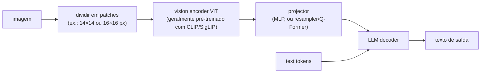

# 🖼️ Multimodal Models

> 🇧🇷 Tradução em português do Brasil. Versão original em inglês: [README.md](README.md).

Perguntas sobre multimodal aparecem em dois sabores: conceitual ("como uma imagem entra em um LLM?", "explique diffusion") em screenings e rodadas de conhecimento de modelos, e aplicado ("projete um pipeline de extração de documentos", "construa um voice agent dentro de um orçamento de latency") em rodadas de system design. Quem faz entrevista para uma vaga de produto GenAI recebe o sabor aplicado - document AI, multimodal RAG e voice agents são três das cargas de trabalho reais mais comuns em 2026 - e as entrevistas em frontier labs acrescentam profundidade em arquitetura e geração.

## Crash course

### O padrão VLM: vision encoder → projector → LLM

Quase todo vision-language model que você vai usar (família LLaVA, Qwen-VL, InternVL e, em primeira aproximação, os modelos frontier fechados) segue um mesmo padrão: um **vision encoder** transforma a imagem em uma sequência de embeddings, um pequeno **projector/adapter** mapeia esses embeddings para o espaço de embeddings do LLM, e o **LLM** os consome como se fossem token embeddings - a attention não se importa que alguns "tokens" tenham vindo de pixels.



- O **vision encoder** é um **ViT** (Vision Transformer): a imagem é cortada em patches de tamanho fixo, cada patch recebe um embedding linear, e um transformer padrão roda sobre a sequência de patches. Uma imagem 224×224 com patches 16×16 → 196 patch tokens. O encoder quase sempre é pré-treinado com aprendizado contrastivo imagem-texto (CLIP/SigLIP), o que torna suas features "alinhadas à linguagem" e baratas de enxertar em um LLM.
- O espaço de design do **projector**: um **MLP** simples (LLaVA) mantém todos os patch tokens - simples, sem perdas, mas consome contexto; um **resampler / Q-Former** (Perceiver Resampler do Flamingo, BLIP-2) faz cross-attention de um número fixo de queries aprendidas sobre as patch features - comprime centenas de patches para, por exemplo, 64 tokens, com alguma perda de informação. O padrão moderno é MLP + tiling + pooling leve de tokens.
- **Receita de treinamento** (estilo LLaVA): o estágio 1 treina apenas o projector em pares imagem-legenda (ambas as torres congeladas) para alinhar os espaços; o estágio 2 descongela o LLM (às vezes o encoder também) para visual instruction tuning; estágios posteriores adicionam dados de alta resolução e preference tuning.

A alternativa é a **multimodalidade nativa / early-fusion**: um único transformer treinado do zero em modalidades intercaladas (o Chameleon da Meta, que tokeniza imagens em códigos discretos; Gemini e GPT-4o, que seus fabricantes descrevem como nativamente multimodais sem publicar a arquitetura; o Fuyu chega a descartar o vision encoder e alimenta o decoder diretamente com patches projetados linearmente). Integração mais profunda e geração+compreensão unificadas, a um custo de treinamento muito maior.

### CLIP: por que um único modelo destravou tudo isso

**CLIP** (OpenAI, 2021) treina conjuntamente um image encoder e um text encoder em ~400M de pares imagem-texto da web com uma **contrastive loss**: em um batch de N pares, maximiza a similaridade dos N embeddings (imagem, legenda) correspondentes e minimiza a dos N² - N não correspondentes. Ambas as modalidades caem em um único espaço de embedding compartilhado.

```python
# classificação zero-shot com CLIP - sem treinar nas classes-alvo
text_embs = encode_text([f"a photo of a {c}" for c in classes])  # (C, d)
img_emb   = encode_image(img)                                    # (d,)
pred = classes[(img_emb @ text_embs.T).argmax()]                 # a legenda mais próxima vence
```

Por que transfere bem: a supervisão é **linguagem natural de vocabulário aberto**, não uma head fixa de 1000 classes, então o encoder aprende features organizadas em torno de qualquer coisa que as pessoas escrevam sobre imagens. Isso dá (a) **classificação zero-shot** (~76% de top-1 no ImageNet sem ver um único rótulo do ImageNet, para o maior CLIP), (b) **text-to-image retrieval** de graça e (c) o **vision backbone** padrão para VLMs. O SigLIP (loss sigmoide par a par em vez do softmax contrastivo sobre o batch inteiro) é o substituto moderno comum, e o SigLIP 2 (2025) adicionou objetivos de localização e dense-feature, além de uma variante com aspect ratio nativo, tornando-se um encoder padrão para VLMs open mais novos. Conheça as ressalvas: o CLIP se comporta de forma meio bag-of-words (fraco em ordem de palavras, relações, contagem), e os embeddings de imagem e de texto ocupam cones separados no espaço compartilhado (o "modality gap").

### Imagens são tokens, e resolução é dinheiro

Todo provider converte imagens em tokens; o orçamento escala com a resolução. Os esquemas exatos mudam a cada geração de modelo, então confira a documentação atual antes de citar um valor de fatura:

- **OpenAI** (classe GPT-4o, high detail): a imagem é redimensionada e cortada em **tiles de 512×512**, ~170 tokens por tile + 85 tokens base; modelos mais novos contam patches pequenos em vez disso, mas o princípio - tokens escalam com a área - é o mesmo.
- **Anthropic**: ~`(width × height) / 750` tokens, com imagens reduzidas até um teto por modelo (~1568 px no lado maior, cerca de 1,6k tokens, para a maioria dos modelos; modelos flagship mais novos aceitam resolução maior).
- **Google Gemini**: o Gemini 2.x cobrava ~258 tokens por imagem pequena ou por tile de 768×768. O Gemini 3 substituiu o tiling por uma configuração `media_resolution` que fixa o orçamento por imagem: 280, 560, 1120 ou 2240 tokens, de baixa a ultra-alta, sendo 1120 o padrão.

Assim, uma página inteira legível de um documento custa da ordem de **1-2k tokens**; um PDF de 100 páginas enviado como imagens dá ~150k tokens *por requisição*. É por isso que existem **tiling / dynamic resolution** (AnyRes do LLaVA-NeXT, dynamic resolution do Qwen-VL): o modelo vê uma visão global em baixa resolução mais crops em alta resolução, gastando tokens só onde é preciso. O tradeoff de engenharia é sempre o mesmo - mais pixels significam melhor OCR e mais detalhe fino, mas custo e latency linearmente maiores, e além da resolução de treinamento do modelo pixels extras não compram nada.

### O que modelos de visão erram

Modos de falha previsíveis, que vale recitar em qualquer resposta de design:

- **Contagem** (mais de ~4-5 objetos) e **relações espaciais precisas** (esquerda/direita, acima/abaixo, tamanhos relativos) - patch features e attention com pooling se parecem mais com um "bag of features" do que com um scene graph.
- **Texto pequeno / OCR denso** - a qualidade desaba abaixo de um limiar de legibilidade que depende do orçamento de image tokens; dígitos são o caso mais assustador porque o modelo substitui por números *plausíveis* (alucinação numérica silenciosa).
- **Gráficos** - ler valores nos eixos, especialmente pontos sem rótulo, é estimativa, não extração.
- **Object hallucination** - nomear coisas que não estão lá, especialmente objetos que co-ocorrem com o tipo de cena nos dados de treinamento.

Mitigações: aumentar resolução/tiling, recortar e perguntar de novo sobre regiões de interesse, rotear páginas densas em texto por OCR e dar ao modelo tanto a imagem quanto o texto do OCR, usar self-consistency para números críticos e validar as extrações contra schemas/checksums.

### Document AI: pipeline de OCR vs OCR-free

Dois caminhos para obter dados estruturados de documentos:

1. **Pipeline de OCR**: detecção de layout + reconhecimento de texto (Tesseract/PaddleOCR, ou gerenciados: AWS Textract, Google Document AI, Azure Document Intelligence) → texto com coordenadas → LLM para extração. Barato em escala (~frações de centavo por página), fornece bounding boxes em nível de caractere (auditabilidade, redlining), quase determinístico. Quebra em: layouts complexos, ordem de leitura entre colunas, manuscrito, tabelas que atravessam páginas - e os erros se acumulam no estágio do LLM.
2. **VLM OCR-free**: enviar a imagem da página direto a um VLM com um prompt de extração. Lida com layout, manuscrito, checkboxes, carimbos e contexto em conjunto; um único estágio para manter. Custa 10-100× mais por página com modelos frontier (VLMs pequenos reduzem bastante essa diferença), alucina valores plausíveis, e a maioria dos modelos não fornece coordenadas exatas.

Uma camada intermediária surgiu desde 2025: **VLMs pequenos especializados em documentos** (modelos open como olmOCR, PaddleOCR-VL e DeepSeek-OCR, serviços gerenciados como o Mistral OCR) que transformam imagens de página em Markdown com ordem de leitura e tabelas a um custo muito mais próximo do OCR do que de um VLM frontier. Eles resolvem a maior parte dos problemas de ordem de leitura e de tabelas do OCR clássico, mas ainda alucinam em regiões ilegíveis, então a validação continua necessária.

Sistemas em produção usam cada vez mais uma **cascade**: classificar as páginas, rodar OCR barato em tudo, escalar para um VLM apenas as páginas difíceis/de alto valor, e sempre alimentar o VLM com *ambos*, a imagem e o texto do OCR. Para tabelas, valide estruturalmente (somas de linhas/colunas, tipos do schema); para gráficos, trate as leituras do VLM como estimativas, a menos que os valores estejam impressos.

### Geração de imagens: diffusion em uma tela

A intuição de **diffusion**: defina um processo *forward* que adiciona gradualmente ruído gaussiano a uma imagem ao longo de T passos (conforme um **noise schedule**) até virar ruído puro; treine uma rede para *reverter* um passo - dada uma imagem ruidosa e o timestep, prever o ruído que foi adicionado. Geração = partir de ruído puro e fazer denoising iterativamente. Cada passo é uma correção pequena e aprendível, e é por isso que o treinamento é estável: é apenas regressão sobre ruído (DDPM, 2020).

- **Latent diffusion** (Stable Diffusion, 2022): rodar diffusion em pixels 512×512×3 é desperdício, então primeiro um **VAE** comprime a imagem 8× por lado em um latent 64×64×4 (~48× menos valores), a diffusion acontece no espaço latente, e o decoder do VAE mapeia o latent final de volta para pixels. Componentes: VAE, U-Net de denoising (hoje geralmente um **DiT** - diffusion transformer - como no SD3/Flux), text encoder (CLIP e/ou T5), sampler.
- **Conditioning + classifier-free guidance (CFG)**: o condicionamento por texto entra via cross-attention. Durante o treinamento a condição é descartada em ~10-20% das vezes, para que uma única rede aprenda tanto o denoising condicional quanto o incondicional; na amostragem você extrapola: `pred = uncond + s * (cond - uncond)`. A escala `s` (tipicamente ~5-9 para modelos clássicos de latent diffusion, menor para muitos modelos mais novos de flow matching) troca diversidade por aderência ao prompt; alta demais → saída supersaturada e propensa a artefatos. A CFG dobra o compute por passo. "Negative prompts" são apenas trocar o ramo incondicional por coisas das quais você quer se afastar.
- **Flow matching / rectified flow** (SD3, Flux): em vez da predição de ruído do DDPM, defina um caminho reto entre dados e ruído, `x_t = (1 - t) * x_0 + t * noise`, e treine a rede para prever a velocidade `noise - x_0`. Trajetórias mais retas precisam de menos passos de amostragem; latents, o DiT, o text conditioning e a CFG permanecem iguais.
- **Contagem de passos**: ~1000 passos de treinamento para modelos estilo DDPM, 20-50 passos de amostragem com samplers modernos, 1-4 com modelos destilados.

A **alternativa autoregressive**: tokenizar a imagem em códigos discretos (VQ-VAE/VQGAN) e fazer um transformer prevê-los como texto (DALL·E 1, Parti), ou gerar nativamente dentro de um omni-model (geração de imagem estilo GPT-4o). A geração AR se integra ao LLM - melhor instruction following, renderização de texto e edição conversacional - ao custo de decodificação sequencial; a diffusion refina o canvas inteiro em paralelo. A geração de imagens frontier em 2026 usa os dois campos.

### Áudio: ASR, TTS, voice agents

- **ASR - o design do Whisper**: um transformer encoder-decoder. Áudio → espectrograma log-Mel (janelas de 30 segundos) → encoder; o decoder é um modelo de texto autoregressive cujos special tokens selecionam a tarefa (idioma, transcrever vs traduzir, timestamps). O release original foi treinado em ~680k horas de áudio da web com supervisão fraca (o large-v3 acrescentou vários milhões a mais, boa parte com pseudo-rótulos), de onde vem a robustez a sotaques e ruído. Falha conhecida: alucinar texto em silêncio ou música. Ele trabalha em janelas fixas de 30 segundos, portanto não é nativamente streaming: produtos de voz em tempo real usam modelos de ASR streaming ou gambiarras com chunks. Métrica: **WER** (word error rate).
- **TTS**: classicamente um modelo acústico (texto → mel spectrogram) + vocoder neural (mel → waveform, ex.: HiFi-GAN). A abordagem moderna são os **neural codec language models**: comprimir o áudio em codec tokens discretos (EnCodec/SoundStream), e então um transformer AR gera codec tokens condicionados ao texto e a alguns segundos de voz de referência (estilo VALL-E) - o que também torna fácil o voice cloning zero-shot, para o bem e para o mal.
- **Voice agents** - a pergunta de design que surge o tempo todo. Duas arquiteturas:

| | Pipeline: STT → LLM → TTS | Speech-to-speech nativo |
|---|---|---|
| Latency | cada estágio se soma; exige streaming agressivo | voice-to-voice na casa de ~300ms é possível (OpenAI Realtime API, Gemini Live API) |
| Controle | texto completo no meio: guardrails, tools e logging são fáceis | mais difícil de inspecionar/aplicar guardrails; uso de tools via eventos da API |
| Qualidade da voz | prosódia/emoção se perdem na fronteira do STT | ouve o tom, pode rir/sussurrar, preserva paralinguística |
| Maturidade | testado em batalha, mistura de vendors | menos opções, eval mais difícil |

Orçamento de latency para uma conversa natural: humanos deixam ~200ms de intervalo entre turnos; **voice-to-voice abaixo de um segundo é o patamar**, ~500-800ms soa bom. Um pipeline gasta isso aproximadamente assim: VAD/endpointing 100-300ms + finalização do streaming ASR ~100-200ms + LLM time-to-first-token 200-500ms + TTS time-to-first-audio 100-300ms + rede. Portanto tudo precisa ser streaming, e você inicia o TTS na primeira frase, não na resposta completa. Timeouts fixos de silêncio ou cortam o usuário ou deixam silêncio morto, então stacks modernas adicionam um modelo de **semantic turn-detection** sobre a transcrição em streaming (o turn detector do LiveKit, o Smart Turn do Pipecat) que encurta a espera quando o enunciado parece completo e a estende no meio de uma frase. **Interrupções (barge-in)**: rode o VAD continuamente durante a reprodução (com echo cancellation para o agent não ouvir a si mesmo), pare o TTS imediatamente, cancele a geração e trunque o estado da conversa para o que o usuário realmente ouviu.

### Vídeo: frames são caros

A compreensão de vídeo é principalmente *amostragem de frames + compreensão de imagem + a faixa de áudio*. Típico: amostragem uniforme em torno de ~1 fps (padrão do Gemini; ~258 tokens por frame no Gemini 2.x, 70 na resolução de vídeo padrão do Gemini 3), de modo que uma hora de vídeo incluindo a faixa de áudio vai de **algumas centenas de milhares a ~1M de tokens** - custo e contexto são as restrições que limitam. Amostragem mais inteligente: detecção de mudança de cena/keyframes, amostragem densa apenas em torno de momentos de interesse, transcrever o áudio e alinhar. Fraquezas persistentes: movimento fino entre frames amostrados, contagem de eventos, ordenação temporal precisa e causalidade em horizontes longos. Padrão de mitigação padrão: hierárquico - uma passada barata para resumir/segmentar, depois reconsultar janelas específicas com fps maior.

### Cross-modal retrieval e multimodal RAG

**Text-to-image search**: dual encoders estilo CLIP dão isso quase de graça - gere os embeddings das imagens offline em um índice ANN (HNSW/IVF), gere o embedding da query de texto em runtime, vizinhos mais próximos. Pegadinhas práticas: o limite de 77 tokens de texto do CLIP e o viés para estilo de legenda, o modality gap, e domain shift (faça fine-tuning com hard negatives para, por exemplo, busca de produtos); faça rerank dos top candidates com um VLM quando a precisão importar.

**Multimodal RAG** sobre documentos visualmente ricos, em três níveis:
1. Fazer parse para texto e RAG normal - perde figuras/gráficos por completo.
2. **Caption/summarise** de toda imagem, tabela e gráfico com um VLM na ingestão; gerar embeddings das descrições em texto; recuperar as descrições e então entregar a imagem original ao VLM na hora da resposta. O padrão pragmático.
3. **Screenshot-based retrieval (estilo ColPali)**: pular o parsing - um VLM gera embeddings de cada *imagem de página* em muitos vetores no nível de patch, e da query em vetores por token, e o scoring é late interaction estilo ColBERT (soma das similaridades máximas por token da query). A qualidade de retrieval em documentos visualmente ricos é excelente porque nada se perde no parsing; os custos são armazenamento multi-vector e a necessidade de um VLM para ler as páginas recuperadas.

### Avaliando sistemas multimodais

- **Compreensão**: benchmarks estilo VQA - VQAv2, DocVQA (métrica ANLS), ChartQA, TextVQA, OCRBench, MMMU para raciocínio em nível de especialista. Trate números públicos com ceticismo quanto a contaminação; para produtos, construa um eval rotulado a partir do seu próprio tráfego (acurácia de extração por campo em doc AI vence qualquer benchmark público).
- **Geração**: FID (realismo em nível de distribuição - inútil para julgar uma imagem individual), CLIPScore (alinhamento prompt-imagem), checagens composicionais (estilo GenEval: contagens de objetos, cores e posições corretas) e, por fim, a **preferência humana** - arenas lado a lado continuam sendo o padrão-ouro.
- **Judges**: LLM-as-judge funciona, mas o judge precisa realmente ver a imagem (use um VLM judge forte), e ele herda os pontos cegos dos VLMs - não julgue contagem com um modelo que não sabe contar.

### Segurança: proveniência, deepfakes, filtragem

A segurança do lado da geração é em camadas: classificadores de prompt e filtros de política na entrada (incluindo imagens de referência enviadas - semelhança com pessoas reais, menores), classificadores de saída (NSFW; hash-matching contra CSAM conhecido) e comportamento de recusa ajustado no modelo. **Proveniência**: o C2PA "Content Credentials" anexa um manifesto assinado criptograficamente dizendo quem/o que criou a imagem - mas são metadados e se perdem em re-encode/screenshot; a **marca d'água invisível** (ex.: SynthID do Google) embute um sinal nos pixels que sobrevive a transformações comuns. Conheça os limites honestos: proveniência prova a *presença* de uma alegação, a ausência não prova nada; classificadores de *detecção* de deepfake a posteriori são uma corrida armamentista e não confiáveis como única evidência. O voice cloning adiciona requisitos de verificação de consentimento, e a regulamentação agora exige rotulagem: as obrigações de transparência do Artigo 50 do EU AI Act, aplicáveis a partir de agosto de 2026 (com um curto período de carência para sistemas já no mercado), exigem marcação legível por máquina de conteúdo gerado por IA e divulgação de deepfakes.

## Perguntas de entrevista

Veja [questions.pt-BR.md](questions.pt-BR.md) - 40 perguntas com respostas detalhadas, do básico ao avançado.

## Red flags que os entrevistadores observam

- Não saber que imagens são cobradas como tokens e que a resolução determina o custo - propor "enviar todas as 500 páginas como imagens" sem conta de orçamento.
- Não conseguir explicar o objetivo contrastivo do CLIP ou por que a classificação zero-shot funciona - é o "explique attention" das rodadas de multimodal.
- Confiar cegamente no OCR de VLM: sem plano para alucinação numérica, sem validação de schema, sem híbrido OCR+VLM para campos críticos.
- Explicar diffusion apenas como "ela faz denoising" sem saber o que a rede é treinada para prever, o que é o noise schedule ou o que a escala da CFG faz.
- Projetar um voice agent sem números de latency, sem streaming em todos os estágios e sem uma história para barge-in/interrupção.
- Ignorar a faixa de áudio e a estratégia de amostragem em vídeo - tratar vídeo como "um monte de imagens" sem estimativa de custo.
- Afirmar que marca d'água ou C2PA "resolvem" deepfakes, ou, ao contrário, descartar a proveniência por completo - ambos sinalizam um raciocínio superficial sobre segurança.
- Conhecer apenas o stack de um vendor; não conseguir comparar VLMs open baseados em adapter com modelos frontier nativamente multimodais.

## Leituras complementares

- [CLIP: Learning Transferable Visual Models From Natural Language Supervision](https://arxiv.org/abs/2103.00020) - o paper por trás de todo vision encoder moderno.
- [An Image is Worth 16x16 Words (ViT)](https://arxiv.org/abs/2010.11929) - patches como tokens.
- [Visual Instruction Tuning (LLaVA)](https://arxiv.org/abs/2304.08485) - a receita canônica encoder+projector+LLM.
- [High-Resolution Image Synthesis with Latent Diffusion Models](https://arxiv.org/abs/2112.10752) - o paper do Stable Diffusion.
- [Scaling Rectified Flow Transformers for High-Resolution Image Synthesis (SD3)](https://arxiv.org/abs/2403.03206) - rectified flow mais a arquitetura MMDiT.
- [SigLIP 2: Multilingual Vision-Language Encoders](https://arxiv.org/abs/2502.14786) - o encoder por trás de muitos VLMs open atuais.
- [What are Diffusion Models? - Lilian Weng](https://lilianweng.github.io/posts/2021-07-11-diffusion-models/) - o melhor texto único de derivação com intuição.
- [Robust Speech Recognition via Large-Scale Weak Supervision (Whisper)](https://arxiv.org/abs/2212.04356) - ASR encoder-decoder e por que a weak supervision escala.
- [ColPali: Efficient Document Retrieval with Vision Language Models](https://arxiv.org/abs/2407.01449) - retrieval baseado em screenshot e o benchmark ViDoRe.
- [C2PA specifications](https://c2pa.org/) - proveniência de conteúdo e Content Credentials.
