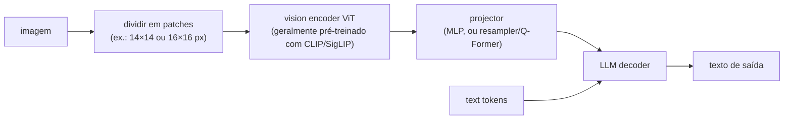

# 🖼️ Multimodal Models

> 🇧🇷 Tradução em português do Brasil. Versão original em inglês: [README.md](README.md).

As perguntas sobre multimodal aparecem em dois formatos. O conceitual ("como uma imagem entra em um LLM?", "explique diffusion") é comum em screenings e em rodadas de conhecimento de modelos. O aplicado ("projete um pipeline de extração de documentos", "construa um voice agent dentro de um orçamento de latency") aparece em rodadas de system design. Quem entrevista para uma vaga de produto GenAI enfrenta o formato aplicado: document AI, multimodal RAG e voice agents estão entre as três cargas de trabalho reais mais comuns em 2026. Já as entrevistas em frontier labs acrescentam profundidade em arquitetura e em geração.

## Crash course

### O padrão VLM: vision encoder → projector → LLM

Quase todo vision-language model que você vai usar (família LLaVA, Qwen-VL, InternVL e, em primeira aproximação, os modelos frontier fechados) segue o mesmo padrão. Um **vision encoder** transforma a imagem em uma sequência de embeddings. Um pequeno **projector/adapter** mapeia esses embeddings para o espaço de embeddings do LLM. O **LLM** então os consome como se fossem token embeddings, porque a attention não se importa que alguns "tokens" tenham vindo de pixels.



- O **vision encoder** é um **ViT** (Vision Transformer): a imagem é cortada em patches de tamanho fixo, cada patch recebe um embedding linear e um transformer padrão roda sobre a sequência de patches. Uma imagem 224×224 com patches 16×16 gera 196 patch tokens. O encoder quase sempre é pré-treinado com aprendizado contrastivo imagem-texto (CLIP/SigLIP). Por isso suas features já são "alinhadas à linguagem" e é barato acoplá-las a um LLM.
- As opções de design do **projector**: um **MLP** simples (LLaVA) mantém todos os patch tokens. É simples e sem perdas, mas consome contexto. Um **resampler / Q-Former** (Perceiver Resampler do Flamingo, BLIP-2) faz cross-attention de um número fixo de queries aprendidas sobre as patch features. Isso comprime centenas de patches em, por exemplo, 64 tokens, com alguma perda de informação. O padrão atual é MLP + tiling + pooling leve de tokens.
- **Receita de treinamento** (estilo LLaVA): no estágio 1, só o projector é treinado em pares imagem-legenda, com as duas torres congeladas, para alinhar os espaços. No estágio 2, o LLM é descongelado (às vezes o encoder também) para o visual instruction tuning. Os estágios seguintes acrescentam dados de alta resolução e preference tuning.

A alternativa é a **multimodalidade nativa / early-fusion**: um único transformer treinado do zero com modalidades intercaladas. Exemplos: o Chameleon da Meta, que tokeniza imagens em códigos discretos; Gemini e GPT-4o, que seus fabricantes descrevem como nativamente multimodais, mas sem publicar a arquitetura; e o Fuyu, que chega a dispensar o vision encoder e alimenta o decoder direto com patches projetados linearmente. A integração é mais profunda e a geração e a compreensão ficam unificadas, mas o custo de treinamento é muito maior.

### CLIP: por que um único modelo destravou tudo isso

O **CLIP** (OpenAI, 2021) treina em conjunto um image encoder e um text encoder, usando ~400M de pares imagem-texto da web e uma **contrastive loss**. Em um batch de N pares, a loss maximiza a similaridade dos N embeddings (imagem, legenda) que se correspondem e minimiza a dos N² − N que não se correspondem. As duas modalidades caem em um único espaço de embedding compartilhado.

```python
# classificação zero-shot com CLIP: sem treinar nas classes-alvo
text_embs = encode_text([f"a photo of a {c}" for c in classes])  # (C, d)
img_emb   = encode_image(img)                                    # (d,)
pred = classes[(img_emb @ text_embs.T).argmax()]                 # a legenda mais próxima vence
```

Por que ele transfere tão bem: a supervisão é **linguagem natural de vocabulário aberto**, e não uma head fixa de 1000 classes. Assim, o encoder aprende features organizadas em torno de qualquer coisa que as pessoas escrevam sobre imagens. Isso rende (a) **classificação zero-shot** (~76% de top-1 no ImageNet, sem ver um único rótulo do ImageNet, no maior CLIP), (b) **text-to-image retrieval** de brinde e (c) o **vision backbone** padrão dos VLMs. O SigLIP (loss sigmoide par a par, no lugar do softmax contrastivo sobre o batch inteiro) é o substituto moderno mais comum. O SigLIP 2 (2025) acrescentou objetivos de localização e de dense features, além de uma variante com aspect ratio nativo, e virou o encoder padrão dos VLMs open mais novos. Conheça as ressalvas: o CLIP se comporta de forma meio bag-of-words (é fraco em ordem das palavras, relações e contagem), e os embeddings de imagem e de texto ocupam cones separados no espaço compartilhado (o "modality gap").

### Imagens são tokens, e resolução é dinheiro

Todo provider converte imagens em tokens, e o orçamento cresce com a resolução. Os esquemas exatos mudam a cada geração de modelos, então confira a documentação atual antes de citar um valor de fatura:

- **OpenAI** (classe GPT-4o, high detail): a imagem é redimensionada e cortada em **tiles de 512×512**, com ~170 tokens por tile + 85 tokens base. Os modelos mais novos contam patches pequenos, mas o princípio é o mesmo: os tokens crescem com a área.
- **Anthropic**: ~`(width × height) / 750` tokens, com a imagem reduzida até um teto que varia por modelo (~1568 px no lado maior, cerca de 1,6k tokens, na maioria dos modelos; os flagships mais novos aceitam resolução maior).
- **Google Gemini**: o Gemini 2.x cobrava ~258 tokens por imagem pequena ou por tile de 768×768. O Gemini 3 trocou o tiling por uma configuração `media_resolution`, que fixa o orçamento por imagem: 280, 560, 1120 ou 2240 tokens, de baixa a ultra-alta, sendo 1120 o padrão.

Ou seja, uma página inteira e legível de um documento custa da ordem de **1-2k tokens**, e um PDF de 100 páginas enviado como imagens dá ~150k tokens *por requisição*. É por isso que existem **tiling / dynamic resolution** (AnyRes do LLaVA-NeXT, dynamic resolution do Qwen-VL): o modelo vê uma visão global em baixa resolução mais crops em alta resolução, e gasta tokens só onde precisa. O tradeoff de engenharia é sempre o mesmo. Mais pixels significam OCR melhor e mais detalhe fino, mas custo e latency crescem de forma linear, e acima da resolução de treinamento do modelo os pixels extras não compram nada.

### Onde os modelos de visão erram

Os modos de falha são previsíveis, e vale citá-los em qualquer resposta de design:

- **Contagem** (mais de ~4-5 objetos) e **relações espaciais precisas** (esquerda/direita, acima/abaixo, tamanhos relativos). Patch features e attention com pooling lembram mais um "bag of features" do que um scene graph.
- **Texto pequeno / OCR denso**: a qualidade desaba abaixo de um limiar de legibilidade, que depende do orçamento de image tokens. Os dígitos são o caso mais perigoso, porque o modelo troca o valor por números *plausíveis* (alucinação numérica silenciosa).
- **Gráficos**: ler valores nos eixos, principalmente de pontos sem rótulo, é estimativa, não extração.
- **Object hallucination**: o modelo cita coisas que não estão na imagem, em especial objetos que costumam aparecer junto desse tipo de cena nos dados de treinamento.

Mitigações: aumentar a resolução/tiling; recortar e perguntar de novo sobre as regiões de interesse; encaminhar as páginas densas em texto pelo OCR e dar ao modelo a imagem e o texto do OCR; usar self-consistency nos números críticos; e validar as extrações contra schemas e checksums.

### Document AI: pipeline de OCR vs OCR-free

Existem dois caminhos para extrair dados estruturados de documentos:

1. **Pipeline de OCR**: detecção de layout + reconhecimento de texto (Tesseract/PaddleOCR, ou serviços gerenciados: AWS Textract, Google Document AI, Azure Document Intelligence) → texto com coordenadas → LLM para a extração. É barato em escala (frações de centavo por página), fornece bounding boxes em nível de caractere (auditabilidade, redlining) e é quase determinístico. Quebra em layouts complexos, na ordem de leitura entre colunas, em manuscritos e em tabelas que atravessam páginas, e os erros se acumulam na etapa do LLM.
2. **VLM OCR-free**: a imagem da página vai direto para um VLM, com um prompt de extração. Ele lida com layout, manuscrito, checkboxes, carimbos e contexto de uma vez, e há um único estágio para manter. Em contrapartida, custa 10-100× mais por página com modelos frontier (VLMs pequenos reduzem bastante essa diferença), alucina valores plausíveis, e a maioria dos modelos não devolve coordenadas exatas.

Desde 2025 surgiu uma camada intermediária: os **VLMs pequenos especializados em documentos** (modelos open como olmOCR, PaddleOCR-VL e DeepSeek-OCR; serviços gerenciados como o Mistral OCR). Eles transformam imagens de página em Markdown, com ordem de leitura e tabelas, a um custo bem mais próximo do OCR do que de um VLM frontier. Resolvem a maior parte dos problemas de ordem de leitura e de tabelas do OCR clássico, mas ainda alucinam em regiões ilegíveis, então a validação continua necessária.

Os sistemas em produção usam cada vez mais uma **cascade**: classificar as páginas, rodar um OCR barato em tudo, escalar para um VLM só as páginas difíceis ou de alto valor e sempre dar ao VLM *os dois*, a imagem e o texto do OCR. Nas tabelas, valide a estrutura (somas de linhas e colunas, tipos do schema). Nos gráficos, trate as leituras do VLM como estimativas, a menos que os valores estejam impressos.

### Geração de imagens: diffusion em uma tela

A intuição de **diffusion**: defina um processo *forward* que adiciona ruído gaussiano à imagem aos poucos, ao longo de T passos (seguindo um **noise schedule**), até ela virar ruído puro. Depois, treine uma rede para *reverter* um passo: dada uma imagem ruidosa e o timestep, ela prevê o ruído que foi adicionado. Gerar é partir de ruído puro e fazer denoising de forma iterativa. Cada passo é uma correção pequena e aprendível, e é por isso que o treinamento é estável: ele é só uma regressão sobre ruído (DDPM, 2020).

- **Latent diffusion** (Stable Diffusion, 2022): rodar diffusion em pixels 512×512×3 é desperdício. Então, primeiro, um **VAE** comprime a imagem 8× por lado em um latent 64×64×4 (~48× menos valores). A diffusion acontece no espaço latente, e o decoder do VAE leva o latent final de volta para pixels. Componentes: VAE, U-Net de denoising (hoje geralmente um **DiT**, diffusion transformer, como no SD3/Flux), text encoder (CLIP e/ou T5) e sampler.
- **Conditioning + classifier-free guidance (CFG)**: o condicionamento por texto entra via cross-attention. Durante o treinamento, a condição é descartada em ~10-20% das vezes, para que uma única rede aprenda o denoising condicional e o incondicional. Na amostragem, você extrapola: `pred = uncond + s * (cond - uncond)`. A escala `s` (tipicamente ~5-9 nos modelos clássicos de latent diffusion, e menor em muitos modelos mais novos de flow matching) troca diversidade por aderência ao prompt. Se for alta demais, a saída fica supersaturada e propensa a artefatos. A CFG dobra o compute por passo. Os "negative prompts" nada mais são do que trocar o ramo incondicional por aquilo de que você quer se afastar.
- **Flow matching / rectified flow** (SD3, Flux): em vez da predição de ruído do DDPM, define-se um caminho reto entre os dados e o ruído, `x_t = (1 - t) * x_0 + t * noise`, e a rede é treinada para prever a velocidade `noise - x_0`. Trajetórias mais retas precisam de menos passos de amostragem. Latents, DiT, text conditioning e CFG continuam iguais.
- **Número de passos**: ~1000 passos de treinamento nos modelos estilo DDPM, 20-50 passos de amostragem com samplers modernos e 1-4 com modelos destilados.

A **alternativa autoregressive**: tokenizar a imagem em códigos discretos (VQ-VAE/VQGAN) e fazer um transformer prevê-los como se fossem texto (DALL·E 1, Parti), ou gerar de forma nativa dentro de um omni-model (geração de imagem estilo GPT-4o). A geração AR se integra ao LLM, o que traz melhor instruction following, melhor renderização de texto e edição conversacional, ao custo de uma decodificação sequencial. A diffusion, por sua vez, refina o canvas inteiro em paralelo. A geração de imagens frontier em 2026 usa as duas abordagens.

### Áudio: ASR, TTS, voice agents

- **ASR, o design do Whisper**: um transformer encoder-decoder. O áudio vira um espectrograma log-Mel (janelas de 30 segundos) e entra no encoder. O decoder é um modelo de texto autoregressive, e seus special tokens definem a tarefa (idioma, transcrever vs traduzir, timestamps). O release original foi treinado com ~680k horas de áudio da web com supervisão fraca (o large-v3 acrescentou vários milhões de horas, boa parte com pseudo-rótulos), e daí vem a robustez a sotaques e ruído. Falha conhecida: alucinar texto em trechos de silêncio ou música. Como trabalha em janelas fixas de 30 segundos, ele não é nativamente streaming: produtos de voz em tempo real usam modelos de ASR streaming ou gambiarras com chunks. Métrica: **WER** (word error rate).
- **TTS**: o modelo clássico combina um modelo acústico (texto → mel spectrogram) com um vocoder neural (mel → waveform, ex.: HiFi-GAN). A abordagem moderna são os **neural codec language models**: o áudio é comprimido em codec tokens discretos (EnCodec/SoundStream), e um transformer AR gera esses tokens condicionado ao texto e a alguns segundos de voz de referência (estilo VALL-E). É isso também que torna fácil o voice cloning zero-shot, para o bem e para o mal.
- **Voice agents**: a pergunta de design que aparece o tempo todo. Há duas arquiteturas:

| | Pipeline: STT → LLM → TTS | Speech-to-speech nativo |
|---|---|---|
| Latency | os estágios se somam; exige streaming agressivo | voice-to-voice na casa de ~300ms é possível (OpenAI Realtime API, Gemini Live API) |
| Controle | texto completo no meio: guardrails, tools e logging são fáceis | mais difícil de inspecionar e de aplicar guardrails; uso de tools via eventos da API |
| Qualidade da voz | prosódia e emoção se perdem na fronteira do STT | ouve o tom, pode rir ou sussurrar, preserva a paralinguística |
| Maturidade | testado em batalha, dá para combinar vendors | menos opções, eval mais difícil |

O orçamento de latency para uma conversa natural: as pessoas deixam ~200ms de intervalo entre os turnos, então o **patamar é voice-to-voice abaixo de um segundo**, e ~500-800ms já soa bem. Um pipeline gasta esse orçamento mais ou menos assim: VAD/endpointing 100-300ms + finalização do streaming ASR ~100-200ms + LLM time-to-first-token 200-500ms + TTS time-to-first-audio 100-300ms + rede. Por isso tudo precisa ser streaming, e o TTS deve começar na primeira frase, não na resposta completa. Timeouts fixos de silêncio ou cortam o usuário ou deixam um silêncio morto. As stacks modernas, então, adicionam um modelo de **semantic turn-detection** sobre a transcrição em streaming (o turn detector do LiveKit, o Smart Turn do Pipecat), que encurta a espera quando a fala parece completa e a alonga no meio de uma frase. **Interrupções (barge-in)**: rode o VAD continuamente durante a reprodução (com echo cancellation, para o agent não ouvir a si mesmo), pare o TTS na hora, cancele a geração e trunque o estado da conversa até o ponto que o usuário de fato ouviu.

### Vídeo: frames são caros

Entender vídeo é, na maior parte, *amostrar frames + entender imagens + usar a faixa de áudio*. O típico é a amostragem uniforme em torno de ~1 fps (padrão do Gemini; ~258 tokens por frame no Gemini 2.x e 70 na resolução de vídeo padrão do Gemini 3). Assim, uma hora de vídeo, contando a faixa de áudio, vai de **algumas centenas de milhares a ~1M de tokens**, e custo e contexto viram as restrições decisivas. Para amostrar de forma mais inteligente: detecte mudanças de cena/keyframes, amostre de forma densa só em torno dos momentos de interesse e transcreva o áudio, alinhando-o aos frames. Fraquezas persistentes: movimento fino entre os frames amostrados, contagem de eventos, ordenação temporal precisa e causalidade em horizontes longos. O padrão usual de mitigação é hierárquico: uma passada barata para resumir e segmentar, seguida de novas consultas em janelas específicas, com fps maior.

### Cross-modal retrieval e multimodal RAG

**Text-to-image search**: os dual encoders estilo CLIP entregam isso quase de graça. Gere os embeddings das imagens offline em um índice ANN (HNSW/IVF), gere o embedding da query de texto em runtime e busque os vizinhos mais próximos. Pegadinhas práticas: o limite de 77 tokens de texto do CLIP e o viés para o estilo de legenda, o modality gap e o domain shift (faça fine-tuning com hard negatives em casos como busca de produtos). Quando a precision importar, faça rerank dos top candidates com um VLM.

**Multimodal RAG** sobre documentos visualmente ricos, em três níveis:
1. Fazer parse para texto e usar RAG normal: perde figuras e gráficos por completo.
2. **Caption/summarise** de toda imagem, tabela e gráfico com um VLM na ingestão; gerar embeddings das descrições em texto; recuperar as descrições e, na hora da resposta, entregar a imagem original ao VLM. É o padrão pragmático.
3. **Screenshot-based retrieval (estilo ColPali)**: pula o parsing. Um VLM gera embeddings de cada *imagem de página* em muitos vetores no nível de patch, e da query em vetores por token. O scoring é late interaction estilo ColBERT (soma das similaridades máximas por token da query). A qualidade do retrieval em documentos visualmente ricos é excelente, porque nada se perde no parsing. Em troca, há o custo de armazenar multi-vector e a necessidade de um VLM para ler as páginas recuperadas.

### Avaliando sistemas multimodais

- **Compreensão**: benchmarks estilo VQA: VQAv2, DocVQA (métrica ANLS), ChartQA, TextVQA, OCRBench e MMMU, para raciocínio em nível de especialista. Encare os números públicos com ceticismo quanto à contaminação. Em produtos, monte um eval rotulado a partir do seu próprio tráfego: a accuracy de extração por campo em doc AI vale mais do que qualquer benchmark público.
- **Geração**: FID (realismo em nível de distribuição, inútil para julgar uma imagem isolada), CLIPScore (alinhamento prompt-imagem), checagens composicionais (estilo GenEval: contagem de objetos, cores e posições corretas) e, no fim, a **preferência humana**: arenas lado a lado continuam sendo o padrão-ouro.
- **Judges**: LLM-as-judge funciona, mas o judge precisa mesmo ver a imagem (use um VLM judge forte) e herda os pontos cegos dos VLMs. Não avalie contagem com um modelo que não sabe contar.

### Segurança: proveniência, deepfakes, filtragem

A segurança do lado da geração é feita em camadas: classificadores de prompt e filtros de política na entrada (inclusive para imagens de referência enviadas, por causa de semelhança com pessoas reais e de menores), classificadores de saída (NSFW; hash-matching contra CSAM conhecido) e comportamento de recusa ajustado no próprio modelo. **Proveniência**: o C2PA "Content Credentials" anexa um manifesto assinado criptograficamente, dizendo quem ou o que criou a imagem. Mas são metadados e se perdem em re-encode ou screenshot. Já a **marca d'água invisível** (ex.: SynthID, do Google) embute um sinal nos pixels que sobrevive a transformações comuns. Conheça os limites, com honestidade: a proveniência prova a *presença* de uma alegação, e a ausência dela não prova nada. Os classificadores de *detecção* de deepfake a posteriori são uma corrida armamentista e não servem como única evidência. O voice cloning traz requisitos de verificação de consentimento, e a regulamentação agora exige rotulagem: as obrigações de transparência do Artigo 50 do EU AI Act, aplicáveis a partir de agosto de 2026 (com um curto período de carência para sistemas que já estão no mercado), exigem marcação legível por máquina do conteúdo gerado por IA e a divulgação de deepfakes.

## Perguntas de entrevista

Veja [questions.pt-BR.md](questions.pt-BR.md): 40 perguntas com respostas detalhadas, do básico ao avançado.

## Red flags que os entrevistadores observam

- Não saber que imagens são cobradas como tokens e que a resolução determina o custo, propondo "enviar todas as 500 páginas como imagens" sem fazer a conta do orçamento.
- Não conseguir explicar o objetivo contrastivo do CLIP nem por que a classificação zero-shot funciona. Nas rodadas de multimodal, essa é a pergunta "explique attention".
- Confiar cegamente no OCR de VLM: sem plano para alucinação numérica, sem validação de schema, sem híbrido OCR+VLM para campos críticos.
- Explicar diffusion apenas como "ela faz denoising", sem saber o que a rede é treinada para prever, o que é o noise schedule ou o que a escala da CFG faz.
- Projetar um voice agent sem números de latency, sem streaming em todos os estágios e sem uma estratégia para barge-in/interrupção.
- Ignorar a faixa de áudio e a estratégia de amostragem em vídeo, tratando vídeo como "um monte de imagens", sem estimativa de custo.
- Afirmar que marca d'água ou C2PA "resolvem" deepfakes ou, ao contrário, descartar a proveniência por completo. As duas posturas revelam um raciocínio superficial sobre segurança.
- Conhecer só a stack de um vendor e não conseguir comparar VLMs open baseados em adapter com modelos frontier nativamente multimodais.

## Leituras complementares

- [CLIP: Learning Transferable Visual Models From Natural Language Supervision](https://arxiv.org/abs/2103.00020) - o paper por trás de todo vision encoder moderno.
- [An Image is Worth 16x16 Words (ViT)](https://arxiv.org/abs/2010.11929) - patches como tokens.
- [Visual Instruction Tuning (LLaVA)](https://arxiv.org/abs/2304.08485) - a receita canônica encoder+projector+LLM.
- [High-Resolution Image Synthesis with Latent Diffusion Models](https://arxiv.org/abs/2112.10752) - o paper do Stable Diffusion.
- [Scaling Rectified Flow Transformers for High-Resolution Image Synthesis (SD3)](https://arxiv.org/abs/2403.03206) - rectified flow mais a arquitetura MMDiT.
- [SigLIP 2: Multilingual Vision-Language Encoders](https://arxiv.org/abs/2502.14786) - o encoder por trás de muitos VLMs open atuais.
- [What are Diffusion Models? - Lilian Weng](https://lilianweng.github.io/posts/2021-07-11-diffusion-models/) - o melhor texto único de derivação com intuição.
- [Robust Speech Recognition via Large-Scale Weak Supervision (Whisper)](https://arxiv.org/abs/2212.04356) - ASR encoder-decoder e por que a weak supervision escala.
- [ColPali: Efficient Document Retrieval with Vision Language Models](https://arxiv.org/abs/2407.01449) - retrieval baseado em screenshot e o benchmark ViDoRe.
- [C2PA specifications](https://c2pa.org/) - proveniência de conteúdo e Content Credentials.
